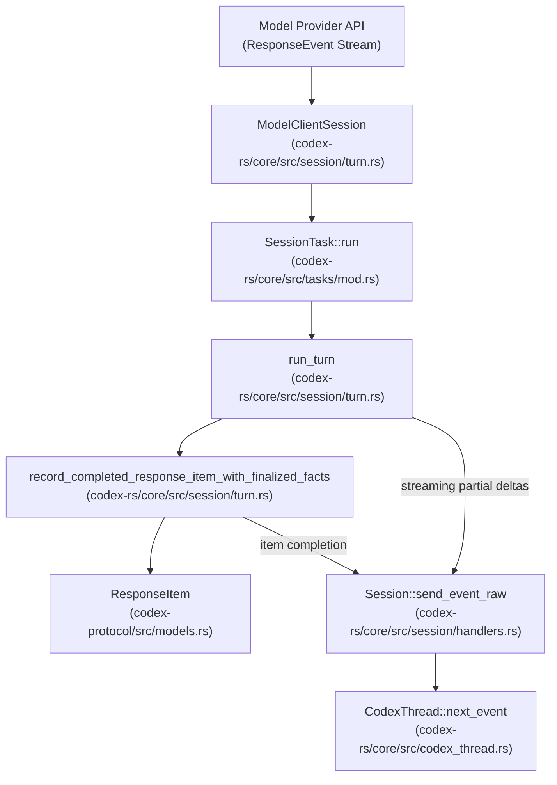
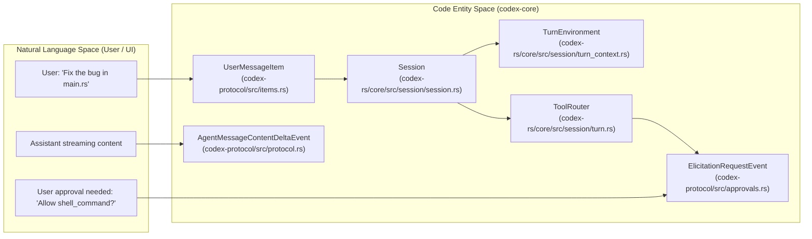
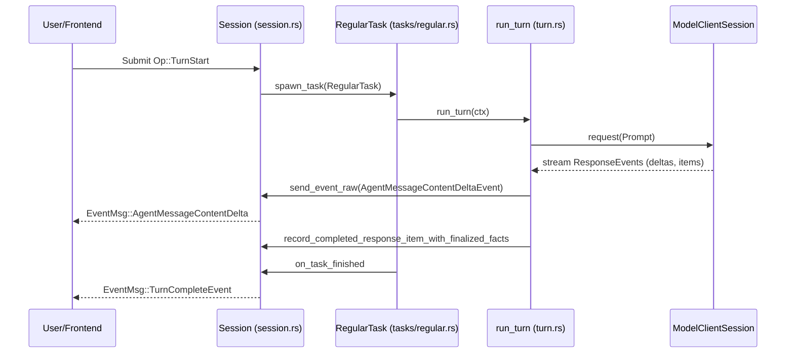

<!-- source: DeepWiki mcp.deepwiki.com · repo openai/codex · page 3.4 Event Processing and State Management · fetched 2026-10-26 -->

# Event Processing and State Management

<details>
<summary>Relevant source files</summary>

The following files were used as context for generating this wiki page:

- [codex-rs/app-server-protocol/src/protocol/thread_history.rs](codex-rs/app-server-protocol/src/protocol/thread_history.rs)
- [codex-rs/app-server-protocol/src/protocol/v2/item.rs](codex-rs/app-server-protocol/src/protocol/v2/item.rs)
- [codex-rs/app-server/tests/suite/v2/imagegen_extension.rs](codex-rs/app-server/tests/suite/v2/imagegen_extension.rs)
- [codex-rs/core/src/context/token_budget_context.rs](codex-rs/core/src/context/token_budget_context.rs)
- [codex-rs/core/src/event_mapping.rs](codex-rs/core/src/event_mapping.rs)
- [codex-rs/core/src/event_mapping_tests.rs](codex-rs/core/src/event_mapping_tests.rs)
- [codex-rs/core/src/session/token_budget.rs](codex-rs/core/src/session/token_budget.rs)
- [codex-rs/core/src/session/turn_tests.rs](codex-rs/core/src/session/turn_tests.rs)
- [codex-rs/core/src/state/auto_compact_window.rs](codex-rs/core/src/state/auto_compact_window.rs)
- [codex-rs/core/src/stream_events_utils.rs](codex-rs/core/src/stream_events_utils.rs)
- [codex-rs/core/src/stream_events_utils_tests.rs](codex-rs/core/src/stream_events_utils_tests.rs)
- [codex-rs/core/src/tools/handlers/extension_tools.rs](codex-rs/core/src/tools/handlers/extension_tools.rs)
- [codex-rs/core/tests/suite/extension_sandbox.rs](codex-rs/core/tests/suite/extension_sandbox.rs)
- [codex-rs/core/tests/suite/snapshots/all__suite__token_budget__token_budget_new_context_window_tool_full_context.snap](codex-rs/core/tests/suite/snapshots/all__suite__token_budget__token_budget_new_context_window_tool_full_context.snap)
- [codex-rs/core/tests/suite/token_budget.rs](codex-rs/core/tests/suite/token_budget.rs)
- [codex-rs/ext/image-generation/Cargo.toml](codex-rs/ext/image-generation/Cargo.toml)
- [codex-rs/ext/image-generation/imagegen_description.md](codex-rs/ext/image-generation/imagegen_description.md)
- [codex-rs/ext/image-generation/src/backend.rs](codex-rs/ext/image-generation/src/backend.rs)
- [codex-rs/ext/image-generation/src/extension.rs](codex-rs/ext/image-generation/src/extension.rs)
- [codex-rs/ext/image-generation/src/tests.rs](codex-rs/ext/image-generation/src/tests.rs)
- [codex-rs/ext/image-generation/src/tool.rs](codex-rs/ext/image-generation/src/tool.rs)
- [codex-rs/ext/memories/src/extension.rs](codex-rs/ext/memories/src/extension.rs)
- [codex-rs/ext/memories/src/tests.rs](codex-rs/ext/memories/src/tests.rs)
- [codex-rs/protocol/src/items.rs](codex-rs/protocol/src/items.rs)
- [codex-rs/protocol/src/legacy_events.rs](codex-rs/protocol/src/legacy_events.rs)
- [codex-rs/tools/src/tool_call.rs](codex-rs/tools/src/tool_call.rs)

</details>


This page documents how the core agent system translates raw model provider response events (`ResponseEvent`) into protocol-level `EventMsg` variants, manages event emission, and synchronizes session state across turns. The focus is on the technical implementation of event translation, event emission pipeline, and session-wide state updates supporting conversation continuity, tooling approvals, and token budgeting.

For the submission side of the asynchronous protocol, see **2.1 Protocol Layer (Submission/Event System)**. For detailed conversation history mechanics, see **3.5 Conversation History Management**.

---

## Event Processing Pipeline

The raw event stream emitted by model clients (such as streaming completion fragments) is ingested by the turn executor to produce structured protocol messages that are dispatched to frontends and persisted in session state.

### Overview of ResponseEvent → EventMsg Flow

- The **Model Provider API** streams raw `ResponseEvent`s, which encapsulate incremental text deltas, turn item lifecycle signals, and intermediate statuses.
- The **ModelClientSession** within `codex-rs/core/src/session/turn.rs` consumes these raw events and interprets them into domain-specific `TurnItem`s (such as user messages, agent messages, and tool calls).
- The **SessionTask::run** method orchestrates the lifecycle of a turn, producing event streams including both partial content deltas and finalized turn items.
- When a turn item is completed, the system emits an `ItemCompletedEvent` which wraps the fully constructed `TurnItem`.
- All events are sent through the session's internal event sender channel as `EventMsg` variants, which are consumed by frontends or other system components.
- The `CodexThread` abstraction is the interface for consuming these events, providing asynchronous access for UI or other consumers.



**Key points:**

- Streaming partial content, such as `AgentMessageContentDeltaEvent`s representing incremental assistant content, are emitted in real time.
- Completed turn items cause emission of `ItemCompletedEvent`s with their fully materialized `TurnItem` data.
- External context citations (e.g., memory references) are recognized during item finalization to update memory usage state.
- Tool calls—including those from Model Context Protocol (MCP) servers—generate corresponding events (e.g., tool call begin/end, approval requests).

Sources:  
[codex-rs/core/src/session/turn.rs:42-126](),  
[codex-rs/core/src/session/handlers.rs:67-77](),  
[codex-rs/core/src/tasks/mod.rs:179-196]()  

---

## EventMsg and TurnItem Translation

The system bridges model raw responses (`ResponseItem` types) and the protocol-level events (`EventMsg`) by transforming and filtering message content into structured `TurnItem`s, which are building blocks of conversation turns.

### Parsing and Filtering Contextual Content

- The system distinguishes **contextual fragments**—system-injected developer or tooling messages such as token budget annotations, environment instructions, or skill instructions—from user-authored messages.
- Contextual fragments are detected using prefix strings or XML-like tag markers such as `<tools>`, `<environment_context>`, `<skills_instructions>`.
- The `is_contextual_dev_message_content` function (in `core/src/event_mapping.rs`) identifies such fragments to filter them out of pure user input.
- To extract user messages cleanly, the system skips over image/audio label fragments and only includes recognized user text or media.

### Parsing User Messages

The `parse_user_message` function ingests a slice of `ContentItem`s from a `ResponseItem::Message` and returns a sanitized `UserMessageItem`:

- Filters out contextual fragments and their markers.
- Excludes media wrapper labels, preserving inline images and audio content where appropriate.
- Constructs a vector of `UserInput` representing textual and media input segments.

This produces a clean user input model that becomes a `TurnItem::UserMessage`.

### Mapping of Important Event Variants

| Protocol Event Variant           | Description                                          | Code Reference                                         |
| ------------------------------- | -------------------------------------------------- | ----------------------------------------------------- |
| `ItemStartedEvent`               | Signals the start of a `TurnItem` lifecycle         | [codex-rs/core/src/session/mod.rs:129-130]()          |
| `ItemCompletedEvent`             | Signals completion of a `TurnItem`                  | [codex-rs/core/src/session/mod.rs:129-130]()          |
| `AgentMessageContentDeltaEvent` | Streaming assistant content delta                    | [codex-rs/core/src/session/turn.rs:96-108]()          |
| `TurnCompleteEvent`              | Signals turn closure and triggers state updates     | [codex-rs/core/src/tasks/mod.rs:56-66]()              |
| `ElicitationRequestEvent`        | Requests user approval or input                      | [codex-rs/core/src/session/mod.rs:96-110]()           |

Sources:  
[codex-rs/core/src/event_mapping.rs:90-147](),  
[codex-rs/codex-protocol/src/protocol.rs:117-149](),  
[codex-rs/core/src/session/mod.rs:129-130](),  
[codex-rs/core/src/session/turn.rs:96-108]()  

---

## Session State and Synchronization

The `Session` struct manages global session state that persists across turns. This ensures the conversation context, token usage, permission profiles, and tooling state remain synchronized and consistent.

### SessionState Structure and Key Fields

The core mutable session state is encapsulated in the `SessionState` struct defined in `codex-rs/core/src/state/session.rs`. This struct manages:

- **Session Configuration:** Runtime settings, feature flags, and policy profiles.
- **Conversation History:** Managed by `ContextManager`, including turns and message items.
- **Token Usage and Rate Limits:** Used for telemetry and abiding by provider limits.
- **Auto-compaction:** Tracks rolling token windows and context trimming logic via `AutoCompactWindow`.
- **Permission Profiles:** Tracks granted permissions for sandbox environments and tools.
- **Turn Metadata and Latest Session Information:** Including last started turn, startup handles, shell state snapshots, and shutdown flags.
- **Additional Context:** Supplemental context fragments injected into turns, e.g., those from memory or environment systems.

Example snippet of `SessionState` fields:

```rust
pub(crate) struct SessionState {
    pub(crate) session_configuration: SessionConfiguration,
    pub(crate) active_disabled_plugin_ids: Vec<String>,
    pub(crate) base_instructions_provenance: Option<BaseInstructionsProvenance>,
    pub(crate) history: ContextManager,
    pub(crate) history_reset: CancellationToken,
    pub(crate) latest_rate_limits: Option<RateLimitSnapshot>,
    pub(crate) latest_token_usage_record: Option<TokenUsageRecord>,
    pub(crate) server_reasoning_included: bool,
    pub(crate) mcp_dependency_prompted: HashSet<String>,
    pub(crate) additional_context: AdditionalContextStore,
    previous_turn_settings: Option<PreviousTurnSettings>,
    pub(crate) last_started_turn_id: Option<String>,
    auto_compact_window: AutoCompactWindow,
    pub(crate) reasoning_effort_pin: ReasoningEffortPin,
    pub(crate) shutting_down: bool,
    pub(crate) startup_prewarm: Option<SessionStartupPrewarmHandle>,
    pub(crate) shell_snapshot_prewarm: Option<AbortOnDropHandle<()>>,
    pub(crate) current_time_reminder: CurrentTimeReminderState,
    pub(crate) active_connector_selection: HashSet<String>,
    pub(crate) pending_session_start_sources: VecDeque<codex_hooks::SessionStartSource>,
    granted_permissions_by_environment_id: HashMap<String, AdditionalPermissionProfile>,
    next_turn_is_first: bool,
}
```

### Turn Environment and Sandbox Context

The `TurnEnvironment` struct reflects the per-turn execution context (in `core/src/session/turn_context.rs`), including:

- **Sandbox Environment:** Composed of sandbox policies, permission profiles, and optional base policy snapshot used to merge additional permissions dynamically.
- **Shell Snapshots:** Supporting sandbox shell state reuse across turns.
- **Environment Metadata:** IDs and labels describing the runtime environment and permission sets.

This design allows ephemeral elevation of permissions or policy changes at a turn granularity without global side effects.

### Metadata Tracking with TurnMetadataState and Usage Information

- `TurnMetadataState` manages mutable turn-related metadata such as working directory, repo root, sandbox mode, environment IDs, and reasoner path.
- `ResponseUsageMetadata` records token counts and reasoner effort used by a turn.
- These metadata structs are used downstream for telemetry, state synchronization, and contextual tracking after a turn completes.

Sources:  
[codex-rs/core/src/state/session.rs:1-159](),  
[codex-rs/core/src/session/turn_context.rs:40-110](),  
[codex-rs/core/src/session/mod.rs:45-90]()  

---

## Token Budget and Context Window Management

Token budget management ensures conversation prompts respect model context window limits, maintain coherence, and optimize token usage by triggering context compaction when appropriate.

- The `AutoCompactWindow` (in `core/src/state/auto_compact_window.rs`) manages sequential context window IDs tied to token counts, enabling triggering of compaction when the token budget is exceeded.
- `TokenBudgetContext` (in `core/src/context/token_budget_context.rs`) represents context window information injected as contextual user fragments in developer messages that the model sees.
- The system injects reminders and fallback prompts based on threshold conditions, avoiding repeated alerts per session.
- Session flags track whether reminders or fallback compaction prompts have been sent for the current session.

Example `TokenBudgetContext` implementation excerpt:

```rust
pub(crate) struct TokenBudgetContext {
    agent_path: AgentPath,
    first_window_id: Uuid,
    previous_window_id: Option<Uuid>,
    window_id: Uuid,
}

impl ContextualUserFragment for TokenBudgetContext {
    fn content_kind(&self) -> ContentItemKind {
        ContentItemKind("token_budget.context_window".to_string())
    }
    fn role(&self) -> &'static str {
        "developer"
    }
    fn markers(&self) -> (&'static str, &'static str) {
        Self::type_markers()
    }
    fn type_markers() -> (&'static str, &'static str) {
        (CONTEXT_WINDOW_OPEN_TAG, CONTEXT_WINDOW_CLOSE_TAG)
    }
    fn body(&self) -> ContentItem {
        let first_window_id = self.first_window_id;
        let window_id = self.window_id;
        let mut lines = vec![
            format!("Agent name: {}", self.agent_path),
            format!("First context window id: {first_window_id}"),
            format!("Current context window id: {window_id}"),
        ];
        if let Some(previous_window_id) = self.previous_window_id {
            lines.push(format!("Previous context window id: {previous_window_id}"));
        }
        input_text(format!("\n{}\n", lines.join("\n")))
    }
}
```

Sources:  
[codex-rs/core/src/state/auto_compact_window.rs:1-192](),  
[codex-rs/core/src/context/token_budget_context.rs:1-242](),  
[codex-rs/core/src/session/token_budget.rs:21-193]()  

---

## Data Flow Diagrams: Bridging Natural Language to Code Entities

### 1) User Input and Event Flow to Session and Turn Context



This diagram maps user-visible inputs and system events to their internal Rust struct counterparts and processing components in the core.

Sources:  
[codex-rs/core/src/session/session.rs:50-110](),  
[codex-rs/codex-protocol/src/items.rs:180-210](),  
[codex-rs/codex-protocol/src/protocol.rs:25-65]()  

---

### 2) Turn Execution and Event Emission Sequence



This sequence illustrates how a turn is initiated by the user, streamed partial content is emitted, finished turn items are recorded, and turn completion events propagate for client consumption.

Sources:  
[codex-rs/core/src/session/session.rs:125-130](),  
[codex-rs/core/src/session/turn.rs:148-154](),  
[codex-rs/core/src/session/handlers.rs:125-130](),  
[codex-rs/core/src/tasks/mod.rs:188-196]()  

---

## Summary

- The event processing pipeline translates raw model responses (`ResponseEvent`) into structured protocol-level events (`EventMsg`) for history persistence and frontend rendering.
- Session state (`SessionState`) maintains comprehensive, consistent state including conversation history, token budgets, permission profiles, and tooling metadata.
- The per-turn environment encapsulates sandbox state and metadata to control runtime contexts for tools and executions.
- Token budgeting and context window tracking via `AutoCompactWindow` and contextual user fragments guide model interactions within token limits.
- The event lifecycle supports partial streaming, item lifecycle events, and user approval flows.
- The diagrams bridge natural language view (user inputs and frontend events) with the underlying Rust code entities managing event processing and session synchronization.

---

Sources:  
- [codex-rs/core/src/session/turn.rs:42-154]()  
- [codex-rs/core/src/session/handlers.rs:67-77]()  
- [codex-rs/core/src/tasks/mod.rs:179-196]()  
- [codex-rs/core/src/event_mapping.rs:30-147]()  
- [codex-rs/core/src/state/session.rs:1-159]()  
- [codex-rs/core/src/session/turn_context.rs:40-110]()  
- [codex-rs/core/src/state/auto_compact_window.rs:1-192]()  
- [codex-rs/core/src/context/token_budget_context.rs:1-242]()  
- [codex-rs/core/src/session/token_budget.rs:21-193]()  
- [codex-rs/core/src/session/session.rs:100-130]()

---

