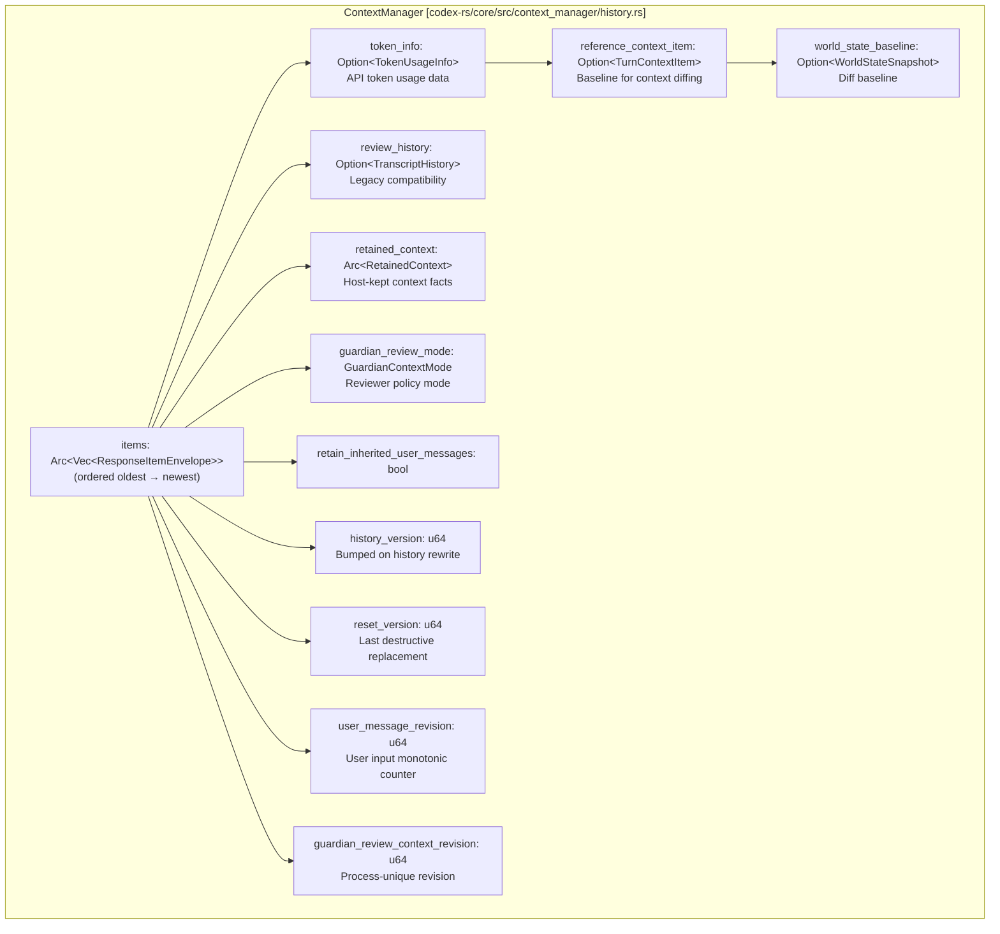
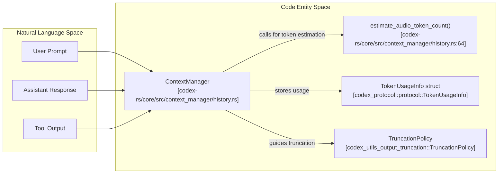
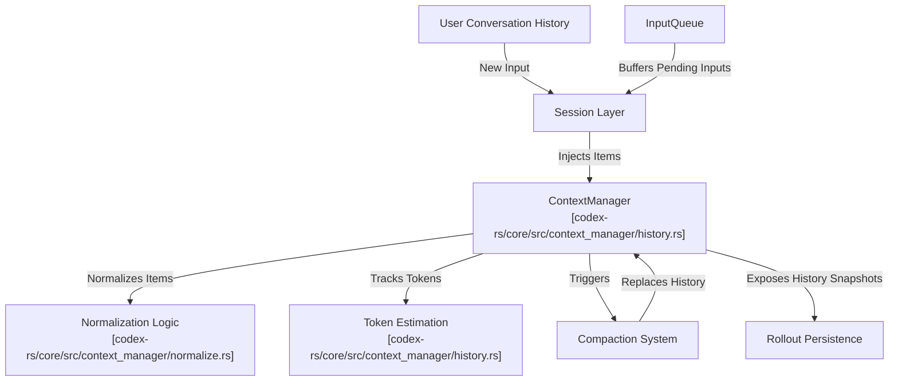

<!-- source: DeepWiki mcp.deepwiki.com · repo openai/codex · page 3.5 Conversation History Management · fetched 2026-10-26 -->

# Conversation History Management

Relevant source files

The following files were used as context for generating this wiki page:

- [codex-rs/core/src/context_manager/history.rs](codex-rs/core/src/context_manager/history.rs)
- [codex-rs/core/src/context_manager/history_tests.rs](codex-rs/core/src/context_manager/history_tests.rs)
- [codex-rs/core/src/context_manager/normalize.rs](codex-rs/core/src/context_manager/normalize.rs)

This document explains how Codex maintains and manipulates the conversation history that forms the model's context window. It covers the `ContextManager` data structure, item recording and normalization, token estimation, and history lifecycle management.

For details on **summarizing and compacting** conversation history when context limits are approached, see [History Compaction System](#3.5.1). For information on **persisting history to disk** and replaying it during session resumption, see [Rollout Persistence and Replay](#3.5.2).

---

## Overview

The conversation history manager is responsible for:

- Storing `ResponseItem` entries (user messages, assistant messages, tool calls, tool outputs, reasoning items, and compaction summaries) wrapped in `ResponseItemEnvelope` to preserve metadata [codex-rs/core/src/context_manager/history.rs:91-125]().
- Normalizing history to maintain invariants, such as ensuring every tool call has a corresponding output, and automatically inserting missing outputs where needed [codex-rs/core/src/context_manager/normalize.rs:20-138]().
- Tracking token usage reported from API responses and estimating tokens for locally-added items to maintain budget awareness [codex-rs/core/src/context_manager/history.rs:110-111]().
- Managing the **World State** baseline snapshot to emit minimal diffs of environment and agent settings into the history [codex-rs/core/src/context_manager/history.rs:121-124]().
- Preparing history for prompt construction by filtering, transforming, and truncating items according to configured policies.

The primary entry point is the `ContextManager` struct, used by the `Session` to manage the transcript of a conversation thread [codex-rs/core/src/context_manager/history.rs:91-125]().

---

## ContextManager Structure

The `ContextManager` serves as the core data structure bridging the session state and the low-level `ResponseItem` storage used for API communication and history persistence. It stores conversation items ordered from oldest to newest inside an immutable reference-counted vector to enable efficient snapshotting.

### Key Fields

| Field                       | Type                                     | Purpose                                                                                         |
|-----------------------------|------------------------------------------|-------------------------------------------------------------------------------------------------|
| `items`                     | `Arc<Vec<ResponseItemEnvelope>>`         | Immutable, reference-counted vector of conversation history entries [codex-rs/core/src/context_manager/history.rs:94]() |
| `review_history`            | `Option<TranscriptHistory>`               | Compatibility history for legacy reviewer contexts [codex-rs/core/src/context_manager/history.rs:96]()             |
| `retained_context`          | `Arc<RetainedContext>`                     | Non-model-visible host facts shared immutably across snapshots [codex-rs/core/src/context_manager/history.rs:98]()   |
| `guardian_review_mode`      | `GuardianContextMode`                      | Reviewer policy mode associated with snapshot [codex-rs/core/src/context_manager/history.rs:100]()               |
| `retain_inherited_user_messages` | `bool`                                | Flag to retain inherited user messages [codex-rs/core/src/context_manager/history.rs:102]() |
| `history_version`           | `u64`                                     | Monotonically incremented on destructive history rewrites like compaction or rollback [codex-rs/core/src/context_manager/history.rs:103]() |
| `reset_version`             | `u64`                                     | Marks last destructive history replacement [codex-rs/core/src/context_manager/history.rs:105]()                  |
| `user_message_revision`     | `u64`                                     | Monotonic revision counting user inputs or resets [codex-rs/core/src/context_manager/history.rs:107]()          |
| `guardian_review_context_revision` | `u64`                               | Process-unique revision tracking context changes for reviewer state [codex-rs/core/src/context_manager/history.rs:109]() |
| `token_info`                | `Option<TokenUsageInfo>`                  | Last known model API token usage statistics [codex-rs/core/src/context_manager/history.rs:110]()                |
| `reference_context_item`    | `Option<TurnContextItem>`                  | Snapshot baseline for diffing and producing model-visible settings updates [codex-rs/core/src/context_manager/history.rs:121]() |
| `world_state_baseline`      | `Option<WorldStateSnapshot>`               | Snapshot of environment and model-visible world state to optimize diff emission [codex-rs/core/src/context_manager/history.rs:123]() |

**Sources:** [codex-rs/core/src/context_manager/history.rs:91-125]()

---

## World State and Contextual Fragments

Codex integrates environment and agent runtime state with conversation history using *World State* snapshots:

- These snapshots capture facts such as environment variables, active tools, shell status, and other runtime metadata to provide up-to-date model-visible context [codex-rs/core/src/context_manager/history.rs:121-124]().
- The `ContextManager` maintains a `world_state_baseline` member representing the last known world state snapshot appended to history.
- When world state changes, diffs (`WorldStateItem`s) are recorded in the conversation history to capture only incremental updates.
- This design efficiently conveys environment changes to the model per turn, minimizing redundant context injection and token usage.

**Sources:** [codex-rs/core/src/context_manager/history.rs:121-124]()

---

## Recording and Normalization

### Recording Items

History entries enter the conversation via the `ContextManager`'s `record_items` method:

- It accepts any iterator of `ResponseItemEnvelope`s which wrap `ResponseItem`s with associated metadata.
- Items are recorded with adherence to a truncation or token budget policy, ensuring the conversation history doesn't exceed model token limits.
- The truncation policy can be token-based, byte-based, or custom [codex-rs/core/src/context_manager/history_tests.rs:138-140]().

### Normalization

Before history snapshots are exposed for prompt construction or saved to disk, Codex enforces several *normalization* invariants:

- All function and tool calls must have matching output items; missing outputs are synthesized and inserted immediately after their calls [codex-rs/core/src/context_manager/normalize.rs:20-138]().
- Orphaned outputs without a call are removed to avoid inconsistency.
- Contextual filtering identifies developer or internal messages separate from model-visible user messages to respect privacy and focus.
- Normalization stabilizes prompt cache IDs and improves robustness to history changes.

This processing ensures the conversation items represent a well-formed, consistent conversation transcript that can be safely used by the model and clients.

**Sources:**  
- [codex-rs/core/src/context_manager/normalize.rs:20-138]()  
- [codex-rs/core/src/context_manager/history_tests.rs:138-140]()

---

## Token Estimation and Budgets

Token budget management is critical due to model context window limits:

- API responses supply token usage information (`TokenUsageInfo`) recorded in `ContextManager.token_info` to track actual usage [codex-rs/core/src/context_manager/history.rs:110]().
- For local inputs and items yet to be sent to the model, estimated token counts are computed heuristically using an internal function (`estimate_item_token_count`), leveraging rough token counting utilities [codex-rs/core/src/context_manager/history.rs:64-70]().
- These token counts enable truncation policies to limit conversation size and prioritize newer or more relevant messages.
- Proactive monitoring of token usage triggers history compaction or rollback before hitting constraints, preserving system responsiveness.

**Sources:** [codex-rs/core/src/context_manager/history.rs:64-70](), [codex-rs/core/src/context_manager/history.rs:110-111]()

---

## History Lifecycle and Compaction

Conversation history is continually evolving and may be rewritten to remain efficient and relevant:

- **Local (Inline) Compaction** is triggered during runtime by token budget exhaustion. It summarizes conversation history into a condensed representation using summarization prompts, preserving critical context like recent user messages and environment state.
- **Remote Compaction (V2)** performs server-side legacy or large history compaction with extended token budgets, supporting richer reinjection of initial context and detailed retention policies.
- Compaction replaces the existing items vector atomically and updates the `history_version`, enabling consistent rollback and replay semantics [codex-rs/core/src/context_manager/history.rs:103]().
- Injecting initial context fragments (like user instructions, world state, or guardian policy) during compaction ensures the model retains continuity without sending full history each turn.

For complete implementation and workflows, see [History Compaction System](#3.5.1).

**Sources:**  
- [codex-rs/core/src/context_manager/history.rs:103]()  

---

## Integration with Session and Persistence

`ContextManager` is closely integrated with broader session and persistence layers:

- The `Session` layer injects new conversation items into the history and manages trusted metadata and approvals.
- The input queue buffers pending user inputs and system messages before they are added to history and model prompts.
- Rollout persistence modules serialize history snapshots and replay events to durable storage for crash recovery and session resumption.

This collaboration enables Codex to maintain consistent and recoverable conversation state, synchronized across multi-agent scenarios and client interfaces.

---

## Related Topics

- **[History Compaction System](#3.5.1)** — Detailed documentation of local and remote compaction workflows, summarization prompts, and initial context reinjection strategies.
- **[Rollout Persistence and Replay](#3.5.2)** — Covers rollout file format, filtering persistent events, session resumption mechanics, and thread-store history materialization via rollout crates.

---

# Summary Diagram: From User Conversation to Core Code Entities

---

This overview describes how Codex manages conversation history, balancing efficient storage, token budgeting, normalization, and integration with session and persistence layers. For detailed implementation and workflows, consult the referenced child pages and source files.

**Sources:**

- [codex-rs/core/src/context_manager/history.rs:91-125]()
- [codex-rs/core/src/context_manager/normalize.rs:20-138]()

---

