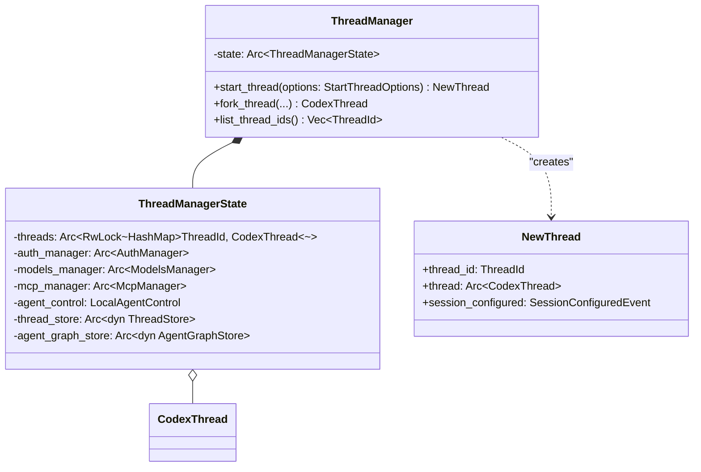
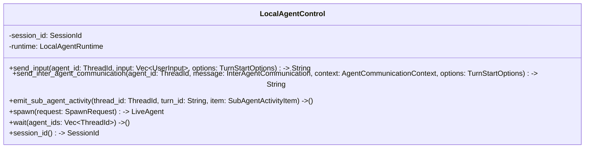
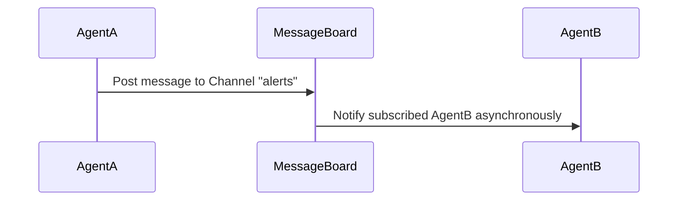
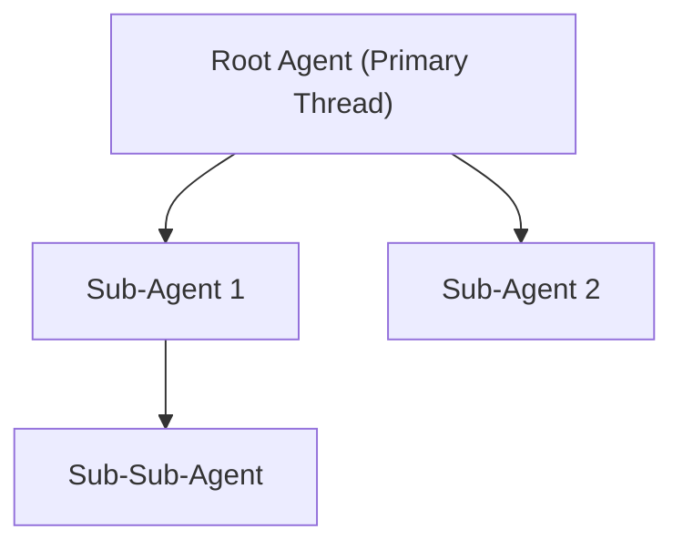
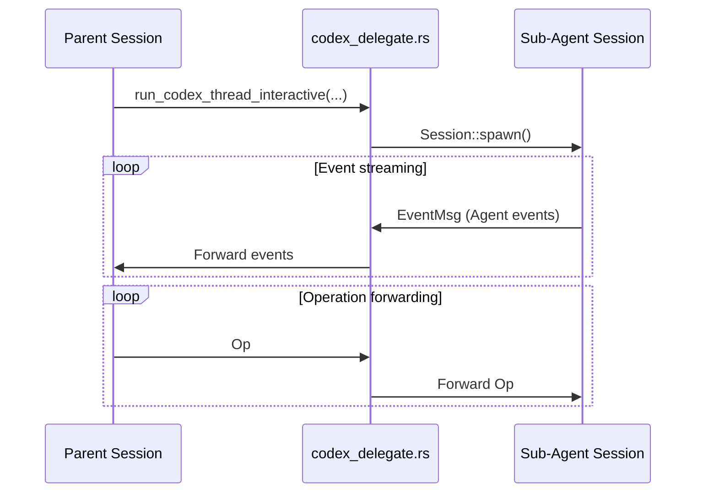
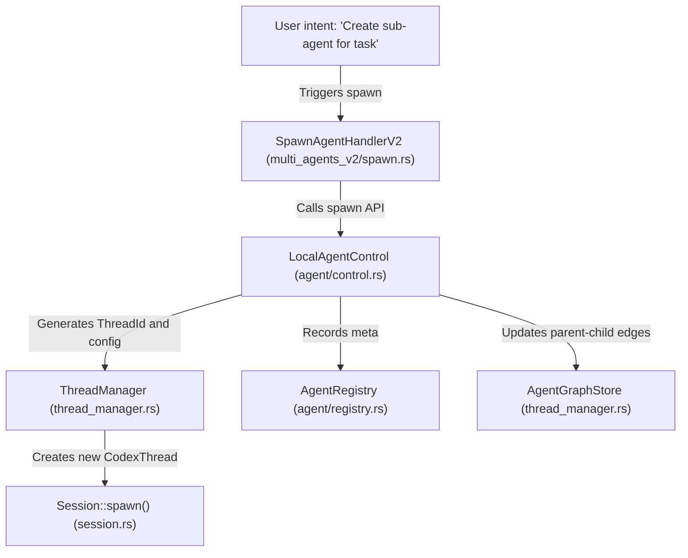
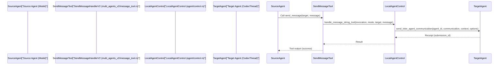

<!-- source: DeepWiki mcp.deepwiki.com · repo openai/codex · page 3.6 Thread Management and Multi-Agent · fetched 2026-10-26 -->

# Thread Management and Multi-Agent

<details>
<summary>Relevant source files</summary>

The following files were used as context for generating this wiki page:

- [codex-rs/app-server/tests/suite/v2/agent_message_board.rs](codex-rs/app-server/tests/suite/v2/agent_message_board.rs)
- [codex-rs/core/src/agent/api.rs](codex-rs/core/src/agent/api.rs)
- [codex-rs/core/src/agent/control.rs](codex-rs/core/src/agent/control.rs)
- [codex-rs/core/src/agent/control/api.rs](codex-rs/core/src/agent/control/api.rs)
- [codex-rs/core/src/agent/control/completion.rs](codex-rs/core/src/agent/control/completion.rs)
- [codex-rs/core/src/agent/control/delivery.rs](codex-rs/core/src/agent/control/delivery.rs)
- [codex-rs/core/src/agent/control/inspection.rs](codex-rs/core/src/agent/control/inspection.rs)
- [codex-rs/core/src/agent/control/interrupt.rs](codex-rs/core/src/agent/control/interrupt.rs)
- [codex-rs/core/src/agent/control/spawn.rs](codex-rs/core/src/agent/control/spawn.rs)
- [codex-rs/core/src/agent/control/spawn_guard.rs](codex-rs/core/src/agent/control/spawn_guard.rs)
- [codex-rs/core/src/agent/control_tests.rs](codex-rs/core/src/agent/control_tests.rs)
- [codex-rs/core/src/agent/registry.rs](codex-rs/core/src/agent/registry.rs)
- [codex-rs/core/src/agent/registry_tests.rs](codex-rs/core/src/agent/registry_tests.rs)
- [codex-rs/core/src/agent/role.rs](codex-rs/core/src/agent/role.rs)
- [codex-rs/core/src/agent/role_tests.rs](codex-rs/core/src/agent/role_tests.rs)
- [codex-rs/core/src/agent_message_board.rs](codex-rs/core/src/agent_message_board.rs)
- [codex-rs/core/src/context/agent_message_board_notification.rs](codex-rs/core/src/context/agent_message_board_notification.rs)
- [codex-rs/core/src/session/thread_settings.rs](codex-rs/core/src/session/thread_settings.rs)
- [codex-rs/core/src/session/turn_input.rs](codex-rs/core/src/session/turn_input.rs)
- [codex-rs/core/src/session/turn_input_tests.rs](codex-rs/core/src/session/turn_input_tests.rs)
- [codex-rs/core/src/session/turn_suspension.rs](codex-rs/core/src/session/turn_suspension.rs)
- [codex-rs/core/src/session_prefix.rs](codex-rs/core/src/session_prefix.rs)
- [codex-rs/core/src/session_prefix_tests.rs](codex-rs/core/src/session_prefix_tests.rs)
- [codex-rs/core/src/tools/handlers/multi_agents.rs](codex-rs/core/src/tools/handlers/multi_agents.rs)
- [codex-rs/core/src/tools/handlers/multi_agents/close_agent.rs](codex-rs/core/src/tools/handlers/multi_agents/close_agent.rs)
- [codex-rs/core/src/tools/handlers/multi_agents/resume_agent.rs](codex-rs/core/src/tools/handlers/multi_agents/resume_agent.rs)
- [codex-rs/core/src/tools/handlers/multi_agents/send_input.rs](codex-rs/core/src/tools/handlers/multi_agents/send_input.rs)
- [codex-rs/core/src/tools/handlers/multi_agents/spawn.rs](codex-rs/core/src/tools/handlers/multi_agents/spawn.rs)
- [codex-rs/core/src/tools/handlers/multi_agents/wait.rs](codex-rs/core/src/tools/handlers/multi_agents/wait.rs)
- [codex-rs/core/src/tools/handlers/multi_agents_common.rs](codex-rs/core/src/tools/handlers/multi_agents_common.rs)
- [codex-rs/core/src/tools/handlers/multi_agents_tests.rs](codex-rs/core/src/tools/handlers/multi_agents_tests.rs)
- [codex-rs/core/src/tools/handlers/multi_agents_v2.rs](codex-rs/core/src/tools/handlers/multi_agents_v2.rs)
- [codex-rs/core/src/tools/handlers/multi_agents_v2/followup_task.rs](codex-rs/core/src/tools/handlers/multi_agents_v2/followup_task.rs)
- [codex-rs/core/src/tools/handlers/multi_agents_v2/interrupt_agent.rs](codex-rs/core/src/tools/handlers/multi_agents_v2/interrupt_agent.rs)
- [codex-rs/core/src/tools/handlers/multi_agents_v2/message_tool.rs](codex-rs/core/src/tools/handlers/multi_agents_v2/message_tool.rs)
- [codex-rs/core/src/tools/handlers/multi_agents_v2/send_message.rs](codex-rs/core/src/tools/handlers/multi_agents_v2/send_message.rs)
- [codex-rs/core/src/tools/handlers/multi_agents_v2/spawn.rs](codex-rs/core/src/tools/handlers/multi_agents_v2/spawn.rs)
- [codex-rs/core/tests/suite/abort_tasks.rs](codex-rs/core/tests/suite/abort_tasks.rs)
- [codex-rs/core/tests/suite/agent_control_tests.rs](codex-rs/core/tests/suite/agent_control_tests.rs)
- [codex-rs/core/tests/suite/guardian_subagent_notification_tests.rs](codex-rs/core/tests/suite/guardian_subagent_notification_tests.rs)
- [codex-rs/core/tests/suite/multi_agent_restore_tests.rs](codex-rs/core/tests/suite/multi_agent_restore_tests.rs)
- [codex-rs/core/tests/suite/multi_agent_resume.rs](codex-rs/core/tests/suite/multi_agent_resume.rs)
- [codex-rs/core/tests/suite/pending_input_persistence.rs](codex-rs/core/tests/suite/pending_input_persistence.rs)
- [codex-rs/core/tests/suite/scenarios_agent_message_board.rs](codex-rs/core/tests/suite/scenarios_agent_message_board.rs)
- [codex-rs/core/tests/suite/snapshots/all__suite__scenarios__agent_message_board__agent_message_board_context.snap](codex-rs/core/tests/suite/snapshots/all__suite__scenarios__agent_message_board__agent_message_board_context.snap)
- [codex-rs/core/tests/suite/snapshots/all__suite__scenarios__agent_message_board__board_connections.snap](codex-rs/core/tests/suite/snapshots/all__suite__scenarios__agent_message_board__board_connections.snap)
- [codex-rs/core/tests/suite/snapshots/all__suite__scenarios__child_completion_wakes_parent_after_final_answer.snap](codex-rs/core/tests/suite/snapshots/all__suite__scenarios__child_completion_wakes_parent_after_final_answer.snap)
- [codex-rs/core/tests/suite/subagent_notifications.rs](codex-rs/core/tests/suite/subagent_notifications.rs)
- [codex-rs/core/tests/suite/turn_input_submission.rs](codex-rs/core/tests/suite/turn_input_submission.rs)
- [codex-rs/ext/agent-message-board/Cargo.toml](codex-rs/ext/agent-message-board/Cargo.toml)
- [codex-rs/ext/agent-message-board/README.md](codex-rs/ext/agent-message-board/README.md)
- [codex-rs/ext/agent-message-board/examples/configure_board.rs](codex-rs/ext/agent-message-board/examples/configure_board.rs)
- [codex-rs/ext/agent-message-board/src/api.rs](codex-rs/ext/agent-message-board/src/api.rs)
- [codex-rs/ext/agent-message-board/src/extension.rs](codex-rs/ext/agent-message-board/src/extension.rs)
- [codex-rs/ext/agent-message-board/src/host.rs](codex-rs/ext/agent-message-board/src/host.rs)
- [codex-rs/ext/agent-message-board/src/in_memory.rs](codex-rs/ext/agent-message-board/src/in_memory.rs)
- [codex-rs/ext/agent-message-board/src/in_memory_tests.rs](codex-rs/ext/agent-message-board/src/in_memory_tests.rs)
- [codex-rs/ext/agent-message-board/src/lib.rs](codex-rs/ext/agent-message-board/src/lib.rs)
- [codex-rs/ext/agent-message-board/src/local.rs](codex-rs/ext/agent-message-board/src/local.rs)
- [codex-rs/ext/agent-message-board/src/local/connection.rs](codex-rs/ext/agent-message-board/src/local/connection.rs)
- [codex-rs/ext/agent-message-board/src/local/lifecycle.rs](codex-rs/ext/agent-message-board/src/local/lifecycle.rs)
- [codex-rs/ext/agent-message-board/src/local/pool.rs](codex-rs/ext/agent-message-board/src/local/pool.rs)
- [codex-rs/ext/agent-message-board/src/local/pools_tests.rs](codex-rs/ext/agent-message-board/src/local/pools_tests.rs)
- [codex-rs/ext/agent-message-board/src/local/queries.rs](codex-rs/ext/agent-message-board/src/local/queries.rs)
- [codex-rs/ext/agent-message-board/src/local/setup.rs](codex-rs/ext/agent-message-board/src/local/setup.rs)
- [codex-rs/ext/agent-message-board/src/permissions.rs](codex-rs/ext/agent-message-board/src/permissions.rs)
- [codex-rs/ext/agent-message-board/src/tools.rs](codex-rs/ext/agent-message-board/src/tools.rs)
- [codex-rs/ext/agent-message-board/src/tools/arguments.rs](codex-rs/ext/agent-message-board/src/tools/arguments.rs)
- [codex-rs/ext/agent-message-board/src/tools/spec.rs](codex-rs/ext/agent-message-board/src/tools/spec.rs)
- [codex-rs/ext/agent-message-board/src/types.rs](codex-rs/ext/agent-message-board/src/types.rs)
- [codex-rs/ext/agent-message-board/tests/local_board.rs](codex-rs/ext/agent-message-board/tests/local_board.rs)
- [codex-rs/protocol/src/turn_input.rs](codex-rs/protocol/src/turn_input.rs)

</details>


## Purpose and Scope

This page provides an in-depth technical overview of Codex's thread management system and multi-agent infrastructure. We cover the implementation of `ThreadManager` as the central controller of conversation threads, distinction between primary threads and sub-agents, the role-based agent configuration, multi-agent spawning and messaging tools, the `AgentMessageBoard` communication system, and the `AgentGraphStore` for tracking agent relationships. This document is aimed at developers contributing to or extending multi-agent capabilities within Codex.

---

## ThreadManager and Thread Lifecycle

At the core of Codex's thread management is the `ThreadManager` struct, responsible for managing the lifecycle of all conversation threads (`CodexThread` instances). This includes starting new threads, resuming existing ones, and forking from other threads. `ThreadManager` provides a concurrency-safe interface over an internal `ThreadManagerState` wrapped in an `Arc`, which stores all live threads.



`ThreadManager` orchestrates thread startup by invoking `Session::spawn` underneath, passing relevant startup arguments such as configuration, authentication providers, and model managers. It handles loading initial histories (new, resumed, or forked) from persistent storage and manages data persistence via `ThreadStore`. Shared services like `AuthManager` and `McpManager` provide capabilities needed by agent sessions and are integrated at the manager level.

This architecture ensures safe and controlled creation, resumption, and management of the entire set of active threads in Codex.

Sources: [codex-rs/core/src/thread_manager.rs:21-22](), [codex-rs/core/src/thread_manager.rs:181-182](), [codex-rs/core/src/thread_manager.rs:223-228]()

---

## Primary Threads vs Sub-Agents

- **Primary Threads (Sessions):** User-facing conversation threads with full capabilities, owning session lifecycle, event history, and user interaction.
- **Sub-Agents:** Child threads spawned from primary threads or other agents to perform delegated or specialized tasks. They operate within the root session's context but with potentially modified roles and reduced capabilities.

Sub-agents operate in an isolated but linked environment, preserving scoped thread state and hierarchical relationships through the agent graph.

---

## LocalAgentControl: Multi-Agent Control Plane

The `LocalAgentControl` struct is the session-scoped controller for managing multi-agent interactions. It owns the `LocalAgentRuntime` that interfaces with the thread manager state for spawning, messaging, waiting, and managing sub-agents.



### Behavior Highlights

- `send_input` asynchronously delivers rich user inputs to a sub-agent's thread and starts or steers its turn. [codex-rs/core/src/agent/control.rs:137-163]()
- `send_inter_agent_communication` sends inter-agent messages with optional turn triggering. [codex-rs/core/src/agent/control.rs:165-188]()
- `spawn` launches a new sub-agent thread with specific configurations, spawn options, and input type. [codex-rs/core/src/agent/control_tests.rs:135-147]()
- `wait` allows awaiting one or more agent completions.
- Controls execution capacity and rollout budgets to enforce resource limits.
- Generates unique thread IDs scoped to the session.

Internally, `LocalAgentControl` upgrades a weak reference of the shared `ThreadManagerState`, ensuring the control remains valid only within the root session's lifetime. [codex-rs/core/src/agent/control.rs:115-123]()

Sources: [codex-rs/core/src/agent/control.rs:90-189]()

---

## Agent Roles and Configuration Overrides

Agent roles customize sub-agent behavior by layering bounded config overrides on top of the parent's configuration. This system restricts or specializes child agents without increasing privilege.

### Role Resolution and Application Flow

```mermaid
flowchart TD
    A[Spawn Request with role_name]
    B[resolve_role_config(config, role_name)]
    C[apply_role_to_config(config, AgentRoleConfig) -> Overridden Config]
    D[Spawn Agent with new Config]
    A --> B --> C --> D
```

- `resolve_role_config` obtains role config from agent_roles or built-in defaults by name. [codex-rs/core/src/agent/role.rs:164-172]()
- `apply_role_to_config` asynchronously merges the role config as an overlay to produce a confined child config. [codex-rs/core/src/agent/role.rs:51-66]()
- Roles adjust developer notes, model info, reasoning parameters, service tiers, feature toggles, and skill enablement. [codex-rs/core/src/agent/role.rs:81-117]()
- The parent session's authority always restricts the sub-agent's scope; roles cannot grant extra privileges.

This layering approach enables spawning agents with specialized capabilities, e.g., isolated reviewers or reduced-permission workers.

Sources: [codex-rs/core/src/agent/role.rs:50-130]()

---

## Multi-Agent Spawn and Control Tools

Codex exposes multi-agent orchestration capabilities through a suite of core tool handlers that mediate between model function calls and internal multi-agent APIs. They allow spawning, messaging, waiting, and querying sub-agents efficiently.

### Major Multi-Agent Tools

| Tool Name           | Handler                    | Description                                        |
|---------------------|----------------------------|--------------------------------------------------|
| `spawn_agent`       | `SpawnAgentHandlerV2`       | Spawn a sub-agent asynchronously with config and input. |
| `send_message`      | `SendMessageHandlerV2`      | Send textual messages asynchronously to agents.  |
| `followup_task`     | `FollowupTaskHandlerV2`     | Like send_message, but triggers immediate turn start. |
| `wait_agent`        | `WaitAgentHandlerV2`        | Wait asynchronously for agents to complete.       |
| `list_agents`       | `ListAgentsHandlerV2`       | Returns active agents within session scope.       |

### Tool Handler Architecture

- Each handler parses incoming tool invocation payloads (usually JSON). [codex-rs/core/src/tools/handlers/multi_agents_v2/spawn.rs:114-115]()
- Calls into `LocalAgentControl` APIs for spawning or messaging. [codex-rs/core/src/tools/handlers/multi_agents_v2/spawn.rs:124-135]()
- Handles errors translating internal errors into user-appropriate responses. [codex-rs/core/src/tools/handlers/multi_agents_v2/spawn.rs:138-152]()
- Reports analytics events for spawn success/failure and tool calls. [codex-rs/core/src/tools/handlers/multi_agents_v2/spawn.rs:49-87]()
- Supports multiple multi-agent protocol versions: V1 (legacy), V2 (preferred, with usage hints and full history). [codex-rs/core/src/tools/handlers/multi_agents_v2/spawn.rs:149]()

Sources: [codex-rs/core/src/tools/handlers/multi_agents_v2/spawn.rs:1-185](), [codex-rs/core/src/tools/handlers/multi_agents.rs:1-99]()

---

## Agent Message Board

The `AgentMessageBoard` abstraction enables asynchronous, decoupled messaging among agents in the same root session.

- Manages message posts, subscriptions, notifications, and channels scoped by session ID. [codex-rs/ext/agent-message-board/src/local.rs:10-12]()
- Core implementation is `LocalAgentMessageBoard` backed by SQLite for persistence and concurrency-safe live handles. [codex-rs/ext/agent-message-board/src/local.rs:15-16]()
- Supports creation of named channels, posting messages, deduplication by request ID, and subscription management. [codex-rs/ext/agent-message-board/src/local.rs:10-12]()
- Sends fan-out notifications to subscribed agents through asynchronous delivery. [codex-rs/ext/agent-message-board/src/local/pool.rs:10-12]()
- Ensures delivery attempts survive caller disconnections, uses immediate transactions to serialize state. [codex-rs/ext/agent-message-board/src/local/lifecycle.rs:10-12]()

### Excerpt from `LocalAgentMessageBoard` functionality

- `open`: Open or reopen a message board by session ID using shared SQLite config. [codex-rs/ext/agent-message-board/src/local.rs:10-12]()
- `create_channel`: Create channels scoped to the board with validation. [codex-rs/ext/agent-message-board/src/local.rs:10-12]()
- `post`: Submit message posts that survive process unloads. [codex-rs/ext/agent-message-board/src/local.rs:10-12]()
- `subscribe`: Manage subscriptions to channels or message sources. [codex-rs/ext/agent-message-board/src/local.rs:10-12]()



Reliable message boards serve as the backbone for agent collaboration and notifications without synchronous dependencies.

Sources: [codex-rs/ext/agent-message-board/src/local.rs](), [codex-rs/ext/agent-message-board/tests/local_board.rs:1-197]()

---

## AgentGraphStore: Tracking Agent Relationships

The `AgentGraphStore` records the parent-child edges among agent threads, forming the multi-agent session graph.

- Keeps track of thread spawn ancestry and relationships. [codex-rs/core/src/thread_manager.rs:26-27]()
- Supports queries for lineage, siblings, descendants, and subgraphs. [codex-rs/core/src/thread_manager.rs:26-27]()
- Persists graph edges to durable storage integrated with `ThreadManager`. [codex-rs/core/src/thread_manager.rs:26-27]()
- Supports functionalities such as listing descendants, authority resolution, and session provenance. [codex-rs/core/src/thread_manager.rs:26-27]()



This data structure underlies session scoping for multi-agent orchestration and delegation.

Sources: [codex-rs/core/src/thread_manager.rs:26-27]()

---

## Sub-Agent Runtime Delegation (`codex_delegate`)

`codex_delegate` enables running sub-agents as fully isolated interactive Codex sessions delegated from a parent session.

- Launches a new sub-agent session by calling `Session::spawn`.
- Receives the event stream from the sub-agent and proxies it back to the parent.
- Implements bidirectional forwarding of operations (Ops) between parent and sub-agent.
- Runs spawned sub-agent sessions with strict approval policy `Never` to avoid approval cycles.
- Inherits or isolates environments and sandbox state as needed.



This delegation mechanism offers seamless integration of fully-featured sub-agents with isolation guarantees.

Sources: [codex-rs/core/src/codex_delegate.rs:44-152]()

---

## Summary Diagram: Bridging Natural Language to Code Entities in Multi-Agent Spawning



This diagram illustrates the end-to-end workflow transforming a natural language tool call into creation and registration of a sub-agent session managed by core thread management and graph persistence.

Sources: [codex-rs/core/src/tools/handlers/multi_agents_v2/spawn.rs:10-60](), [codex-rs/core/src/agent/control.rs:25-65](), [codex-rs/core/src/thread_manager.rs:4-30](), [codex-rs/ext/agent-message-board/src/local.rs]()

---

## Multi-Agent Messaging Flow

The `send_message` and `followup_task` tools facilitate inter-agent communication. Both use a shared message submission path but differ in whether they trigger an immediate turn start in the target agent.



- `SendMessageHandlerV2` and `FollowupTaskHandlerV2` both delegate to `handle_message_string_tool`. [codex-rs/core/src/tools/handlers/multi_agents_v2/message_tool.rs:42-47]()
- `message_content` validates the message to ensure it's not empty. [codex-rs/core/src/tools/handlers/multi_agents_v2/message_tool.rs:32-39]()
- `resolve_agent_target` determines the `ThreadId` of the target agent.
- `build_agent_resume_config` prepares the necessary configuration for resuming the target agent. [codex-rs/core/src/tools/handlers/multi_agents_v2/message_tool.rs:60-61]()
- `LocalAgentControl::send` is invoked to deliver the message, potentially triggering a turn based on `MessageDeliveryMode`. [codex-rs/core/src/tools/handlers/multi_agents_v2/message_tool.rs:62-80]()
- `emit_sub_agent_activity` records the interaction for telemetry. [codex-rs/core/src/tools/handlers/multi_agents_v2/message_tool.rs:81-98]()

Sources: [codex-rs/core/src/tools/handlers/multi_agents_v2/message_tool.rs:1-101](), [codex-rs/core/src/agent/control.rs:165-188]()

---

# References

- `ThreadManager` and thread lifecycle: [codex-rs/core/src/thread_manager.rs:1-173]()
- `LocalAgentControl`: [codex-rs/core/src/agent/control.rs:1-189]()
- Agent role application: [codex-rs/core/src/agent/role.rs:1-184]()
- Multi-agent v2 tool handlers: [codex-rs/core/src/tools/handlers/multi_agents_v2/spawn.rs:1-196](), [codex-rs/core/src/tools/handlers/multi_agents.rs:1-99]()
- `codex_delegate` interactive session spawn and event forwarding: [codex-rs/core/src/codex_delegate.rs:40-152]()
- Agent message board in `agent-message-board` crate: [codex-rs/ext/agent-message-board/src/local.rs]()
- Agent graph store persistence: [codex-rs/core/src/thread_manager.rs:26-27]()
- Multi-agent messaging: [codex-rs/core/src/tools/handlers/multi_agents_v2/message_tool.rs:1-101]()

---

This document is a leaf wiki page capturing the technical details of thread management and multi-agent orchestration in Codex core.

---

