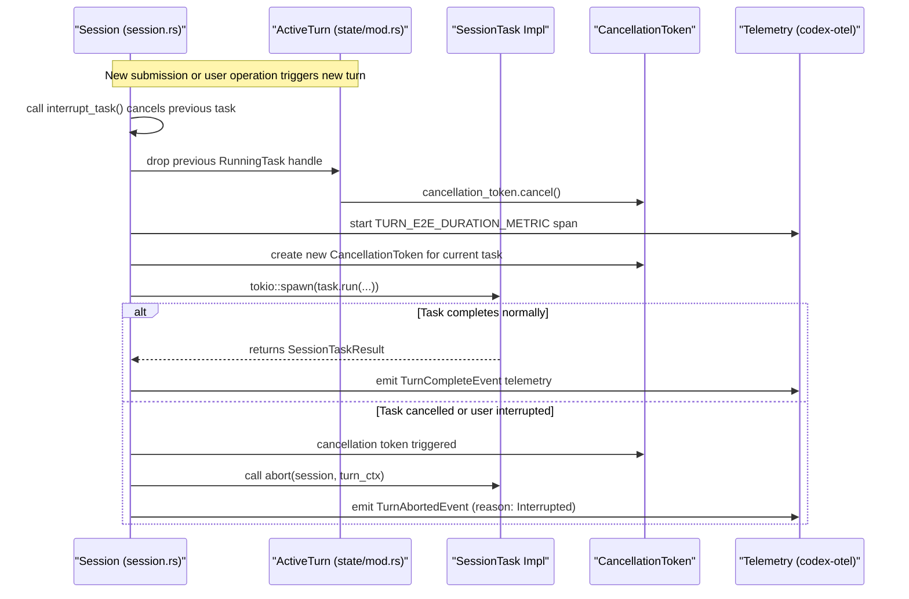
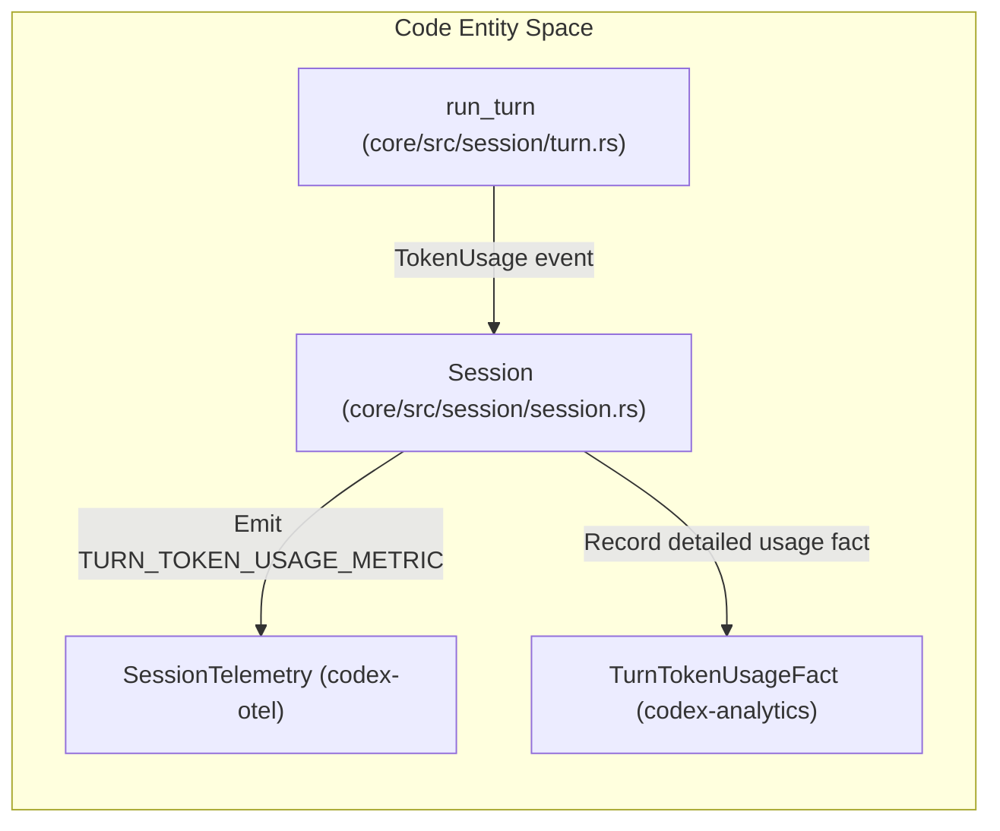
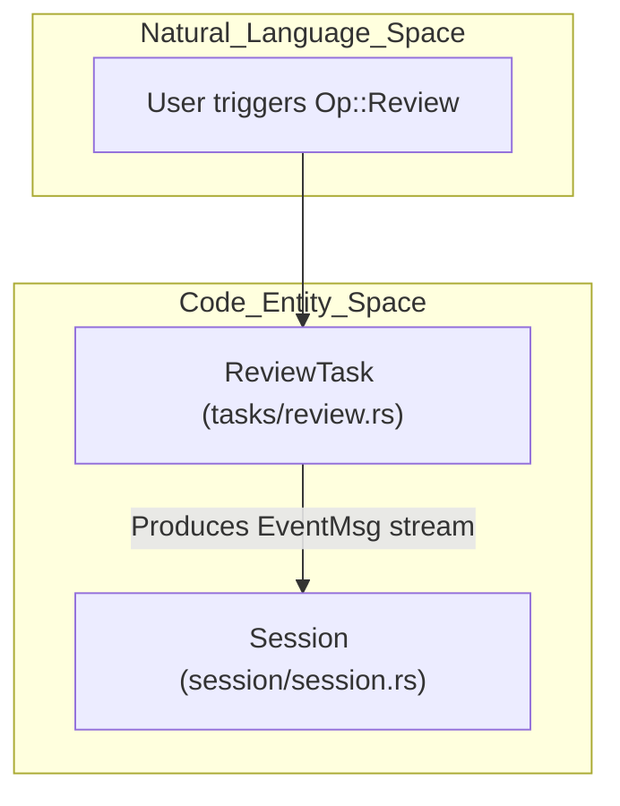

<!-- source: DeepWiki mcp.deepwiki.com · repo openai/codex · page 3.7 Session Tasks and Turn State · fetched 2026-10-26 -->

# Session Tasks and Turn State

<details>
<summary>Relevant source files</summary>

The following files were used as context for generating this wiki page:

- [codex-rs/app-server/tests/suite/v2/client_metadata.rs](codex-rs/app-server/tests/suite/v2/client_metadata.rs)
- [codex-rs/app-server/tests/suite/v2/thread_goal_empty_responses.rs](codex-rs/app-server/tests/suite/v2/thread_goal_empty_responses.rs)
- [codex-rs/app-server/tests/suite/v2/turn_steer.rs](codex-rs/app-server/tests/suite/v2/turn_steer.rs)
- [codex-rs/core/src/responses_metadata.rs](codex-rs/core/src/responses_metadata.rs)
- [codex-rs/core/src/session/inject.rs](codex-rs/core/src/session/inject.rs)
- [codex-rs/core/src/session/input_queue.rs](codex-rs/core/src/session/input_queue.rs)
- [codex-rs/core/src/session/review.rs](codex-rs/core/src/session/review.rs)
- [codex-rs/core/src/tasks/compact.rs](codex-rs/core/src/tasks/compact.rs)
- [codex-rs/core/src/tasks/regular.rs](codex-rs/core/src/tasks/regular.rs)
- [codex-rs/core/src/tasks/review.rs](codex-rs/core/src/tasks/review.rs)
- [codex-rs/core/src/turn_metadata.rs](codex-rs/core/src/turn_metadata.rs)
- [codex-rs/core/src/turn_metadata_tests.rs](codex-rs/core/src/turn_metadata_tests.rs)
- [codex-rs/core/tests/suite/image_rollout.rs](codex-rs/core/tests/suite/image_rollout.rs)
- [codex-rs/core/tests/suite/pending_input.rs](codex-rs/core/tests/suite/pending_input.rs)
- [codex-rs/core/tests/suite/review.rs](codex-rs/core/tests/suite/review.rs)
- [codex-rs/ext/goal/BUILD.bazel](codex-rs/ext/goal/BUILD.bazel)
- [codex-rs/ext/goal/Cargo.toml](codex-rs/ext/goal/Cargo.toml)
- [codex-rs/ext/goal/src/accounting.rs](codex-rs/ext/goal/src/accounting.rs)
- [codex-rs/ext/goal/src/api.rs](codex-rs/ext/goal/src/api.rs)
- [codex-rs/ext/goal/src/extension.rs](codex-rs/ext/goal/src/extension.rs)
- [codex-rs/ext/goal/src/lib.rs](codex-rs/ext/goal/src/lib.rs)
- [codex-rs/ext/goal/src/runtime.rs](codex-rs/ext/goal/src/runtime.rs)
- [codex-rs/ext/goal/src/spec.rs](codex-rs/ext/goal/src/spec.rs)
- [codex-rs/ext/goal/src/steering.rs](codex-rs/ext/goal/src/steering.rs)
- [codex-rs/ext/goal/src/tool.rs](codex-rs/ext/goal/src/tool.rs)
- [codex-rs/ext/goal/templates/goals/budget_limit.md](codex-rs/ext/goal/templates/goals/budget_limit.md)
- [codex-rs/ext/goal/templates/goals/continuation.md](codex-rs/ext/goal/templates/goals/continuation.md)
- [codex-rs/ext/goal/templates/goals/objective_updated.md](codex-rs/ext/goal/templates/goals/objective_updated.md)
- [codex-rs/ext/goal/tests/accounting.rs](codex-rs/ext/goal/tests/accounting.rs)
- [codex-rs/ext/goal/tests/goal_extension_backend.rs](codex-rs/ext/goal/tests/goal_extension_backend.rs)
- [codex-rs/tools/src/tool_config.rs](codex-rs/tools/src/tool_config.rs)
- [codex-rs/tools/src/tool_config_tests.rs](codex-rs/tools/src/tool_config_tests.rs)

</details>


This page explains the `SessionTask` trait for defining asynchronous session tasks, their lifecycle managed within a `Session`, the `TurnState` structure that tracks pending operations during a turn, and the system's approach to token usage tracking for telemetry and UI.

---

## Overview

The Codex core system models every AI interaction or workflow—such as chat turns, reviews, and terminal commands—as a **Session Task**. These tasks run asynchronously on Tokio background tasks owned by the `Session` instance. This architecture enables multitasking, interruptions, long-running operations, and cancellation to be handled gracefully, preserving a responsive user experience and consistent internal state.

This page covers:

- The `SessionTask` trait and its core contract
- The lifecycle steps of task execution, including cancellation and abort handling
- The `TurnState` struct and how it manages asynchronous pending operations during a turn
- How token usage statistics are collected for telemetry and UI presentation

---

## SessionTask Trait and Lifecycle

The `SessionTask` trait defines a unit of asynchronous work executed as part of a `Session` turn [codex-rs/core/src/tasks/mod.rs:172-200](). The trait is intentionally small, focusing on identifying the task kind, running the task asynchronously, and optionally cleaning up on abort [codex-rs/core/src/tasks/mod.rs:176-200]().

### `SessionTask` Trait Definition

```rust
pub(crate) trait SessionTask: Send + Sync + 'static {
    /// Describes the type of work the task performs so the session can
    /// surface it in telemetry and UI.
    fn kind(&self) -> TaskKind;

    /// Returns the tracing span name for the spawned task.
    fn span_name(&self) -> &'static str;

    /// Executes the task until completion or cancellation.
    ///
    /// Implementations typically stream protocol events using `session` and
    /// `ctx`, returning an optional final agent message when finished. The
    /// provided `cancellation_token` is cancelled when the session requests an
    /// abort; implementers should watch for it and terminate quickly once it
    /// fires. Returning [`Some`] yields a final message that
    /// [`Session::on_task_finished`] will emit to the client. Returning
    /// [`CodexErr::TurnAborted`] completes the task through the aborted-turn
    /// lifecycle instead.
    fn run(
        self: Arc<Self>,
        session: Arc<Session>,
        ctx: Arc<TurnContext>,
        input: Vec<TurnInput>,
        cancellation_token: CancellationToken,
    ) -> BoxFuture<'static, SessionTaskResult>;

    /// Optional abort handler called on cancellation to release resources.
    fn abort(
        &self,
        session: Arc<Session>,
        ctx: Arc<TurnContext>,
    ) -> BoxFuture<'static, ()> {
        async move {}.boxed()
    }
}
```

- `kind()` identifies the task's type, for example, `RegularTask`, `ReviewTask`, or `CompactTask` [codex-rs/core/src/tasks/mod.rs:64-66, 183]().
- `span_name()` provides the tracing span name for diagnostics [codex-rs/core/src/tasks/mod.rs:186]().
- `run(...)` takes ownership of the task, the immutable turn context, user inputs, and a cancellation token that signals when to stop early [codex-rs/core/src/tasks/mod.rs:189-196]().
- `abort()` gives an opportunity for clean shutdown in case the task is cancelled [codex-rs/core/src/tasks/mod.rs:198-204]().

This trait supports interruption-aware asynchronous workflows managed by `Session` [codex-rs/core/src/tasks/mod.rs:172-175]().

### Task Lifecycle (Spawning and Cancellation)

The `Session` owns task instances via the `ActiveTurn` and manages the lifecycle including spawning, cancellation, and completion [codex-rs/core/src/session/session.rs:92]().

#### Lifecycle Sequence Diagram

Title: "SessionTask Lifecycle Sequence"



- When a new turn starts (such as on user input), `Session::interrupt_task` cancels any currently running task [codex-rs/core/src/session/session.rs:60-61]().
- The cancellation propagates through `CancellationToken` [codex-rs/core/src/tasks/mod.rs:17-18]().
- The new task is spawned as a Tokio background task [codex-rs/core/src/tasks/mod.rs:172-179]().
- Completion or cancellation triggers telemetry events marking turn outcome [codex-rs/core/src/tasks/mod.rs:43-58]().

This model ensures robust and interruptible session task execution [codex-rs/core/src/tasks/mod.rs:172-179]().

Sources:
- `codex-rs/core/src/tasks/mod.rs:171-204`
- `codex-rs/core/src/session/session.rs:57-95`
- `codex-rs/core/src/state/mod.rs:18-40`

---

## Turn State and Pending Operations

During an active turn, the mutable state is captured by a `TurnMetadataState` struct that tracks pending asynchronous operations and user interactions that must resolve before the turn completes [codex-rs/core/src/turn_metadata.rs:159-176]().

### Key Pending Operations in TurnMetadataState

| Operation                    | Responsible Component              | Description                                                                                      |
|------------------------------|----------------------------------|--------------------------------------------------------------------------------------------------|
| MCP Elicitation Requests     | MCP (`McpRefresh`) handles async calls | Tracks asynchronous function calls to MCP servers with approval or child invocations pending.    |
| User Input and Message Queue | `InputQueue`                     | Queues for incoming user messages and mailbox requests to process asynchronously.                 |
| Async Hook Results           | Async Hook Runtime               | Manages receivers for results of async hooks, e.g., session start hooks or turn stop hooks.      |
| Guardian Review Sessions     | `GuardianReviewSessionManager`  | Handles safety review flows requiring tool approval or policy compliance checks asynchronously.   |

These pending operations represent asynchronous work that can overlap, be awaited, or cancelled during a turn [codex-rs/core/src/turn_metadata.rs:159-176]().

`TurnMetadataState` assists ownership and tracking of these resources for efficient lifecycle management [codex-rs/core/src/turn_metadata.rs:159-176]().

Sources:
- `codex-rs/core/src/turn_metadata.rs:159-176`
- `codex-rs/core/src/session/input_queue.rs:1-20`

---

## TurnContext and Turn Environment

Every turn operates within an immutable `TurnContext` providing configuration, environment snapshot, and state relevant to the turn [codex-rs/core/src/session/turn_context.rs:68-83]().

An embedded `TurnEnvironment` struct encapsulates:

- Selected execution environment snapshot (working directory, sandbox policy, shell configuration) [codex-rs/core/src/session/turn_context.rs:68-83]()
- Metadata about configuration origin [codex-rs/core/src/session/turn_context.rs:70]()
- Details on shell snapshot caches and filesystem sandbox contexts [codex-rs/core/src/session/turn_context.rs:79-82]()

This allows consistent reproduction of environment-dependent behavior during turn execution [codex-rs/core/src/session/turn_context.rs:68-106]().

Sources:
- `codex-rs/core/src/session/turn_context.rs:68-106`

---

## Token Usage Tracking

Token usage during turns is centrally collected and exposed for telemetry, usage planning, and UI feedback [codex-rs/core/src/tasks/mod.rs:41-55]().

### Token Usage Data Flow Diagram

Title: "Token Usage Data Flow"



- The `run_turn` function processes model output and emits `TokenUsage` events capturing input/output token counts [codex-rs/core/src/session/turn.rs:1-155]().
- The `Session` records telemetry counters for token usage [codex-rs/core/src/tasks/mod.rs:41-48]().
- Detailed facts are generated for analytics pipelines enabling usage monitoring and quota enforcement [codex-rs/core/src/tasks/mod.rs:41]().

This comprehensive token tracking supports effective model prompt shaping and billing [codex-rs/core/src/tasks/mod.rs:41-55]().

Sources:
- `codex-rs/core/src/tasks/mod.rs:41-55`
- `codex-rs/core/src/session/turn.rs:1-155`

---

## Specialized Task Implementations

`SessionTask` trait implementations encapsulate different AI interaction scenarios [codex-rs/core/src/tasks/mod.rs:64-68]():

| Task Type            | Location and Description                                      |
|----------------------|---------------------------------------------------------------|
| `RegularTask`        | `tasks/regular.rs` — Main chat loop including tool calls and streaming output. [codex-rs/core/src/tasks/mod.rs:65]() |
| `ReviewTask`         | `tasks/review.rs` — Sub-agent workflow for code review or auditing runs. [codex-rs/core/src/tasks/mod.rs:66]() |
| `CompactTask`        | `tasks/compact.rs` — History summarization and thread compaction tasks. [codex-rs/core/src/tasks/mod.rs:64]() |
| `UserShellCommandTask`| `tasks/user_shell.rs` — Direct terminal user shell command execution tasks. [codex-rs/core/src/tasks/mod.rs:67-68]() |

### Example: ReviewTask Workflow Bridging Natural Language to Code

Title: "ReviewTask Workflow Bridging"



This shows how a user review operation results in spawning the `ReviewTask`, which asynchronously produces events to the owning `Session` [codex-rs/core/src/tasks/review.rs:1-100]().

Sources:
- `codex-rs/core/src/tasks/mod.rs:64-68`
- `codex-rs/core/src/tasks/review.rs:1-100`

---

## Summary

- The `SessionTask` trait abstracts asynchronous session work with interruption support [codex-rs/core/src/tasks/mod.rs:172-180]().
- `Session` manages the lifecycle of tasks, including task spawning, cancellation, and abort workflows [codex-rs/core/src/session/session.rs:57-95]().
- `TurnMetadataState` tracks asynchronous pending operations within each turn [codex-rs/core/src/turn_metadata.rs:159-176]().
- Turn environment and context are captured immutably via `TurnContext` for consistent behavior [codex-rs/core/src/session/turn_context.rs:68-83]().
- Token usage is tracked meticulously for telemetry, usage control, and UI presentation [codex-rs/core/src/tasks/mod.rs:41-55]().
- Multiple task types implement this framework to provide modular and extensible workflows [codex-rs/core/src/tasks/mod.rs:64-68]().

Sources:
- `codex-rs/core/src/tasks/mod.rs:64-68, 172-200`
- `codex-rs/core/src/session/session.rs:57-95`
- `codex-rs/core/src/turn_metadata.rs:159-176`
- `codex-rs/core/src/session/turn_context.rs:68-83`

---

