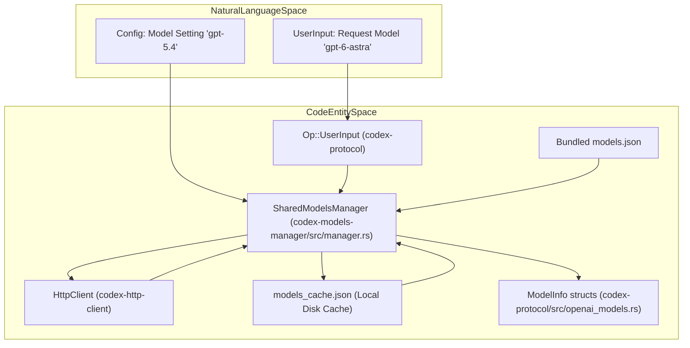
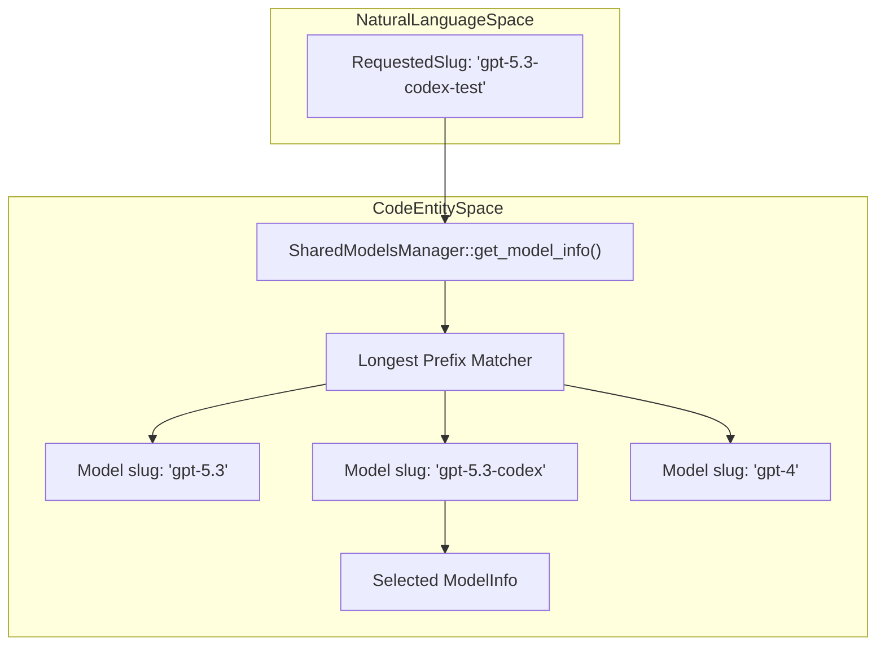

<!-- source: DeepWiki mcp.deepwiki.com · repo openai/codex · page 3.8 Models Manager · fetched 2026-10-26 -->

# Models Manager

Relevant source files

The following files were used as context for generating this wiki page:

- [codex-rs/app-server-protocol/schema/json/v2/ModelListResponse.json](codex-rs/app-server-protocol/schema/json/v2/ModelListResponse.json)
- [codex-rs/app-server-protocol/schema/typescript/v2/Model.ts](codex-rs/app-server-protocol/schema/typescript/v2/Model.ts)
- [codex-rs/app-server/src/models.rs](codex-rs/app-server/src/models.rs)
- [codex-rs/app-server/tests/common/models_cache.rs](codex-rs/app-server/tests/common/models_cache.rs)
- [codex-rs/app-server/tests/suite/v2/model_list.rs](codex-rs/app-server/tests/suite/v2/model_list.rs)
- [codex-rs/codex-api/tests/models_integration.rs](codex-rs/codex-api/tests/models_integration.rs)
- [codex-rs/core/src/tools/handlers/multi_agents_spec.rs](codex-rs/core/src/tools/handlers/multi_agents_spec.rs)
- [codex-rs/core/src/tools/handlers/multi_agents_spec_tests.rs](codex-rs/core/src/tools/handlers/multi_agents_spec_tests.rs)
- [codex-rs/core/tests/suite/catalog_permission_messages.rs](codex-rs/core/tests/suite/catalog_permission_messages.rs)
- [codex-rs/core/tests/suite/gateway_auth.rs](codex-rs/core/tests/suite/gateway_auth.rs)
- [codex-rs/core/tests/suite/injected_models_cache.rs](codex-rs/core/tests/suite/injected_models_cache.rs)
- [codex-rs/core/tests/suite/model_switching.rs](codex-rs/core/tests/suite/model_switching.rs)
- [codex-rs/core/tests/suite/models_cache_auth.rs](codex-rs/core/tests/suite/models_cache_auth.rs)
- [codex-rs/core/tests/suite/models_cache_ttl.rs](codex-rs/core/tests/suite/models_cache_ttl.rs)
- [codex-rs/core/tests/suite/personality.rs](codex-rs/core/tests/suite/personality.rs)
- [codex-rs/core/tests/suite/remote_models.rs](codex-rs/core/tests/suite/remote_models.rs)
- [codex-rs/core/tests/suite/rmcp_client.rs](codex-rs/core/tests/suite/rmcp_client.rs)
- [codex-rs/core/tests/suite/search_tool.rs](codex-rs/core/tests/suite/search_tool.rs)
- [codex-rs/core/tests/suite/spawn_agent_description.rs](codex-rs/core/tests/suite/spawn_agent_description.rs)
- [codex-rs/core/tests/suite/view_image.rs](codex-rs/core/tests/suite/view_image.rs)
- [codex-rs/ext/guardian-v2/src/async_scorer/sampler/connection_pool.rs](codex-rs/ext/guardian-v2/src/async_scorer/sampler/connection_pool.rs)
- [codex-rs/ext/guardian-v2/src/async_scorer/sampler/connection_pool_tests.rs](codex-rs/ext/guardian-v2/src/async_scorer/sampler/connection_pool_tests.rs)
- [codex-rs/model-provider/src/combined_auth.rs](codex-rs/model-provider/src/combined_auth.rs)
- [codex-rs/model-provider/src/models_endpoint.rs](codex-rs/model-provider/src/models_endpoint.rs)
- [codex-rs/model-provider/src/models_endpoint_timeout_tests.rs](codex-rs/model-provider/src/models_endpoint_timeout_tests.rs)
- [codex-rs/model-provider/src/models_identity.rs](codex-rs/model-provider/src/models_identity.rs)
- [codex-rs/model-provider/src/shared_state_tests.rs](codex-rs/model-provider/src/shared_state_tests.rs)
- [codex-rs/models-manager/models.json](codex-rs/models-manager/models.json)
- [codex-rs/models-manager/src/api_key_discovery_tests.rs](codex-rs/models-manager/src/api_key_discovery_tests.rs)
- [codex-rs/models-manager/src/cache.rs](codex-rs/models-manager/src/cache.rs)
- [codex-rs/models-manager/src/manager.rs](codex-rs/models-manager/src/manager.rs)
- [codex-rs/models-manager/src/manager_tests.rs](codex-rs/models-manager/src/manager_tests.rs)
- [codex-rs/models-manager/src/model_info.rs](codex-rs/models-manager/src/model_info.rs)
- [codex-rs/models-manager/src/model_info_tests.rs](codex-rs/models-manager/src/model_info_tests.rs)
- [codex-rs/protocol/src/openai_models.rs](codex-rs/protocol/src/openai_models.rs)
- [codex-rs/tui/src/chatwidget/model_popups.rs](codex-rs/tui/src/chatwidget/model_popups.rs)
- [codex-rs/tui/src/chatwidget/rate_limits.rs](codex-rs/tui/src/chatwidget/rate_limits.rs)
- [codex-rs/tui/src/chatwidget/reasoning_shortcuts.rs](codex-rs/tui/src/chatwidget/reasoning_shortcuts.rs)
- [codex-rs/tui/src/chatwidget/snapshots/codex_tui__chatwidget__tests__model_reasoning_selection_popup.snap](codex-rs/tui/src/chatwidget/snapshots/codex_tui__chatwidget__tests__model_reasoning_selection_popup.snap)
- [codex-rs/tui/src/chatwidget/snapshots/codex_tui__chatwidget__tests__model_selection_popup.snap](codex-rs/tui/src/chatwidget/snapshots/codex_tui__chatwidget__tests__model_selection_popup.snap)
- [codex-rs/tui/src/chatwidget/snapshots/codex_tui__chatwidget__tests__reasoning_shortcut_max_footer.snap](codex-rs/tui/src/chatwidget/snapshots/codex_tui__chatwidget__tests__reasoning_shortcut_max_footer.snap)
- [codex-rs/tui/src/chatwidget/snapshots/codex_tui__chatwidget__tests__reasoning_shortcut_max_plan_footer.snap](codex-rs/tui/src/chatwidget/snapshots/codex_tui__chatwidget__tests__reasoning_shortcut_max_plan_footer.snap)
- [codex-rs/tui/src/chatwidget/snapshots/codex_tui__chatwidget__tests__ultra_reasoning_selection_high_multi_agent_concurrency_warning.snap](codex-rs/tui/src/chatwidget/snapshots/codex_tui__chatwidget__tests__ultra_reasoning_selection_high_multi_agent_concurrency_warning.snap)
- [codex-rs/tui/src/chatwidget/tests/status_command_tests.rs](codex-rs/tui/src/chatwidget/tests/status_command_tests.rs)
- [codex-rs/tui/src/status/card.rs](codex-rs/tui/src/status/card.rs)
- [codex-rs/tui/src/status/snapshots/codex_tui__status__tests__status_snapshot_local_background_server.snap](codex-rs/tui/src/status/snapshots/codex_tui__status__tests__status_snapshot_local_background_server.snap)
- [codex-rs/tui/src/status/snapshots/codex_tui__status__tests__status_snapshot_remote_server.snap](codex-rs/tui/src/status/snapshots/codex_tui__status__tests__status_snapshot_remote_server.snap)
- [codex-rs/tui/src/status/snapshots/codex_tui__status__tests__status_snapshot_uses_default_reasoning_when_config_empty.snap](codex-rs/tui/src/status/snapshots/codex_tui__status__tests__status_snapshot_uses_default_reasoning_when_config_empty.snap)
- [codex-rs/tui/src/status/tests.rs](codex-rs/tui/src/status/tests.rs)

## Purpose and Scope

The Models Manager is the subsystem within `codex-core` and `codex-models-manager` responsible for discovering, remotely fetching, caching with TTL, and resolving model metadata. It acts as a bridge between the remote `/models` endpoint, local cache layers, and the rest of the agent system. The manager makes detailed model capabilities available for prompt construction, tool configuration, and user interface model pickers, while supporting configuration overrides and collaboration mode presets to adapt agent behavior dynamically.

Sources: [codex-rs/models-manager/src/manager.rs:1-100](), [codex-rs/core/tests/suite/remote_models.rs:1-50]()

---

## Core Types

The principal model metadata types are defined in `codex-protocol/src/openai_models.rs` [codex-rs/protocol/src/openai_models.rs:1-217](). These types are serialized across boundaries including core, TUI, app-server, and SDKs, using field defaults to maintain backward compatibility when older payloads lack newer fields.

| Type | Description |
|---|---|
| `ModelInfo` | Represents full model metadata including model slug, display name, description, reasoning levels, shell execution preferences, a truncation policy, instructions templates, and optionally personality templates [codex-rs/protocol/src/openai_models.rs:200-217](). |
| `ModelPreset` | A UI-focused summary derived from `ModelInfo` optimized for model selection in interfaces [codex-rs/core/tests/suite/remote_models.rs:15-20](). |
| `ModelsResponse` | Wraps a vector of `ModelInfo` models returned by a model list remote API [codex-rs/protocol/src/openai_models.rs:22-26](). |
| `ReasoningEffort` | Enum representing distinct reasoning effort levels, such as `None`, `Minimal`, `Low`, `Medium`, `High`, up to `Persistent`, with a custom string variant [codex-rs/protocol/src/openai_models.rs:59-73](). |
| `ReasoningEffortPreset`| Associates a reasoning effort with a user-friendly description for UI display [codex-rs/protocol/src/openai_models.rs:195-203](). |
| `ConfigShellToolType` | Enumerates supported shell execution tool modes like `UnifiedExec` or `ShellCommand` [codex-rs/protocol/src/openai_models.rs:68-69](). |
| `ModelVisibility` | Controls model visibility to users: `List` (visible), `Hide`, and `None` [codex-rs/protocol/src/openai_models.rs:62-63](). |
| `TruncationPolicyConfig`| Details output truncation limits for tokens or bytes ensuring model input size constraints [codex-rs/protocol/src/openai_models.rs:207-217](). |
| `ModelUpgrade` | Metadata describing recommended upgrades or migrations for models, including markdown instructions [codex-rs/protocol/src/openai_models.rs:204-217](). |

Sources: [codex-rs/protocol/src/openai_models.rs:1-217](), [codex-rs/core/tests/suite/model_switching.rs:102-157]()

---

## Key Code Entities and Their Roles

### `SharedModelsManager` (from `codex-models-manager` crate)

- Maintains an authoritative in-memory list of available model metadata [codex-rs/models-manager/src/manager.rs:41-70]().
- Provides asynchronous refresh of models with a configurable `RefreshStrategy`, supporting online fetch, offline-only cache use, or online fetch only when cache is empty [codex-rs/models-manager/src/manager.rs:41-70]().
- Implements model slug resolution using **longest prefix matching** to enable fallback from specific model slugs to more generic or parent model definitions [codex-rs/core/tests/suite/remote_models.rs:130-180]().
- Supports configuration-driven overrides such as instructions templating, visibility, and feature flags dynamically applied to models [codex-rs/core/tests/suite/remote_models.rs:68-100]().
- Provides a fallback bundled catalog parsed from `models.json` shipped with the codebase for offline/baseline usage [codex-rs/models-manager/models.json:1-75]().

### `ModelsCache`

- Persists model metadata and related cache info such as fetch timestamps and client app version in disk file `models_cache.json` inside the `.codex` home directory [codex-rs/core/tests/suite/models_cache_ttl.rs:50-100]().
- Validates cached data freshness by comparing the cache's `fetched_at` time with a configurable TTL duration [codex-rs/core/tests/suite/models_cache_ttl.rs:90-100]().
- Validates cache compatibility by comparing saved cache `client_version` against the running application client version [codex-rs/core/tests/suite/models_cache_ttl.rs:10-20]().
- Discards stale or incompatible cache contents and fetches fresh data remotely [codex-rs/core/tests/suite/models_cache_ttl.rs:158-173]().

Sources: [codex-rs/core/tests/suite/remote_models.rs:130-180](), [codex-rs/core/tests/suite/models_cache_ttl.rs:50-100](), [codex-rs/models-manager/models.json:1-75](), [codex-rs/models-manager/src/manager.rs:35-70]()

---

## ModelsManager Architecture and Data Flow

The following diagram shows the relationships bridging user or configuration model selections ("Natural Language Space") with the underlying model metadata resolution machinery in code ("Code Entity Space").

Sources: [codex-rs/core/tests/suite/remote_models.rs:7-15](), [codex-rs/core/tests/suite/models_cache_ttl.rs:50-100](), [codex-rs/models-manager/models.json:1-75](), [codex-rs/protocol/src/openai_models.rs:200-217]()

---

## Refresh Strategies and Cache TTL

The `SharedModelsManager` refreshes models from remote endpoints or cache using the `RefreshStrategy` enum [codex-rs/models-manager/src/manager.rs:41-43]():

| Variant | Behavior |
|---|---|
| `Online` | Always performs a network fetch of the latest models, ignoring the cache (ensures freshest data) [codex-rs/core/tests/suite/models_cache_ttl.rs:85-90](). |
| `Offline` | Uses only cached data from disk, never hits the network (good for offline mode) [codex-rs/core/tests/suite/models_cache_ttl.rs:85-90](). |
| `OnlineIfUncached` | Uses cached data if available and still fresh; otherwise performs network fetch [codex-rs/core/tests/suite/models_cache_ttl.rs:85-90](). |

### Cache Freshness Validation

- The cache file `models_cache.json` includes a `fetched_at` timestamp [codex-rs/core/tests/suite/models_cache_ttl.rs:90-100]().
- Freshness is evaluated against a TTL threshold to determine if a network fetch is required [codex-rs/core/tests/suite/models_cache_ttl.rs:90-100]().
- The cache's `client_version` metadata is compared to the running app version via `client_version_to_whole()` [codex-rs/core/tests/suite/models_cache_ttl.rs:10-20]().
- If versions mismatch, the cache is considered stale even if TTL is valid, preventing incompatible metadata usage [codex-rs/core/tests/suite/models_cache_ttl.rs:158-173]().

Sources: [codex-rs/core/tests/suite/models_cache_ttl.rs:10-173](), [codex-rs/models-manager/src/manager.rs:41-43]()

---

## Model Slug Resolution (Longest Prefix Matching)

When resolving which model metadata applies to a requested model slug, `SharedModelsManager` uses a **longest prefix matching algorithm** [codex-rs/core/tests/suite/remote_models.rs:138-180]().

### Rationale

- Exact slug matches may not always be present in the active catalog [codex-rs/core/tests/suite/remote_models.rs:138-180]().
- A request for `"gpt-5.3-codex-test"` falls back to `"gpt-5.3-codex"` or `"gpt-5.3"` if an exact match is absent [codex-rs/core/tests/suite/remote_models.rs:138-180]().

### Diagram: Prefix Matching Resolution

Sources: [codex-rs/core/tests/suite/remote_models.rs:137-184]()

---

## ModelInfo Resolution and Overrides

After a model is resolved via slug matching, several layers of logic augment the `ModelInfo` before use:

- **Fallback Instructions**: If no exact or prefix match is found, a baseline `ModelInfo` with default base instructions (`BASE_INSTRUCTIONS`) is returned [codex-rs/core/tests/suite/remote_models.rs:104-135]().
- **Personality Injection**: If personality features are enabled, instruction templates with placeholders (`{{ personality }}`) are replaced by configured personality texts [codex-rs/core/tests/suite/personality.rs:58-100]().
- **Input Modalities Checks**: Handlers like `ViewImageHandler` check `ModelInfo.input_modalities` to verify if the model supports modalities like images before permitting execution [codex-rs/core/tests/suite/view_image.rs:98-108]().
- **Multi-Agent Collaboration**: Models supporting collaboration (marked via `multi_agent_version` set to `V2`) influence spawn agent tooling [codex-rs/core/src/tools/handlers/multi_agents_spec.rs:30-50]().
- **Model Switching**: Mid-session model changes use `ThreadSettingsOverrides` to update the active model, appending developer instructions to steer the newly selected model [codex-rs/core/tests/suite/model_switching.rs:70-104]().

Sources: [codex-rs/core/tests/suite/remote_models.rs:66-184](), [codex-rs/core/tests/suite/personality.rs:20-100](), [codex-rs/core/tests/suite/model_switching.rs:70-104](), [codex-rs/core/tests/suite/view_image.rs:98-108](), [codex-rs/core/src/tools/handlers/multi_agents_spec.rs:30-50]()

---

## Truncation Policies

Codex applies output truncation rules specified per model to manage prompt and tool output sizes via `truncation_policy`:
- **Mode**: `Tokens` or `Bytes` [codex-rs/models-manager/models.json:15-18]().
- **Limit**: The truncation limit value [codex-rs/models-manager/models.json:15-18]().

Sources: [codex-rs/protocol/src/openai_models.rs:205-217](), [codex-rs/models-manager/models.json:15-18]()

---

## Collaboration Mode Presets

Collaboration mode presets encapsulate model and agent concurrency behavior, reasoning level recommendations, and tooling modes:
- Configure reasoning effort levels (`low`, `medium`, `high`, `xhigh`) [codex-rs/models-manager/models.json:42-66]().
- Influence tool usability and environment exposure [codex-rs/core/src/tools/handlers/multi_agents_spec.rs:30-50]().
- Correspond with multi-agent backend versions (`MultiAgentVersion::V2`) [codex-rs/models-manager/models.json:21]().

Sources: [codex-rs/models-manager/models.json:21-66](), [codex-rs/core/src/tools/handlers/multi_agents_spec.rs:30-50]()

---

## Summary

The Models Manager subsystem provides authoritative model metadata management for Codex through:
- Remote fetching and disk caching with TTL and client version validation [codex-rs/core/tests/suite/models_cache_ttl.rs:50-173]().
- Bundled fallback catalogs for offline usage [codex-rs/models-manager/models.json:1-75]().
- Longest prefix matching for flexible model slug resolution [codex-rs/core/tests/suite/remote_models.rs:138-180]().
- Runtime overrides for personality, collaboration presets, and feature flags [codex-rs/core/tests/suite/personality.rs:58-100]().

Sources: [codex-rs/models-manager/src/manager.rs:1-100](), [codex-rs/core/tests/suite/remote_models.rs:138-180]()

---

