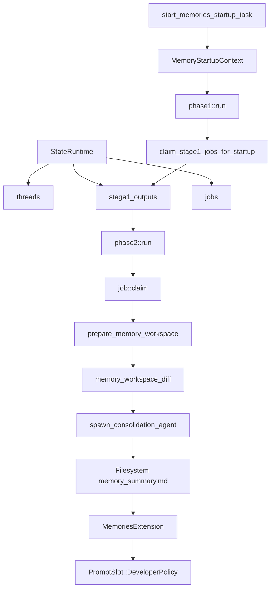
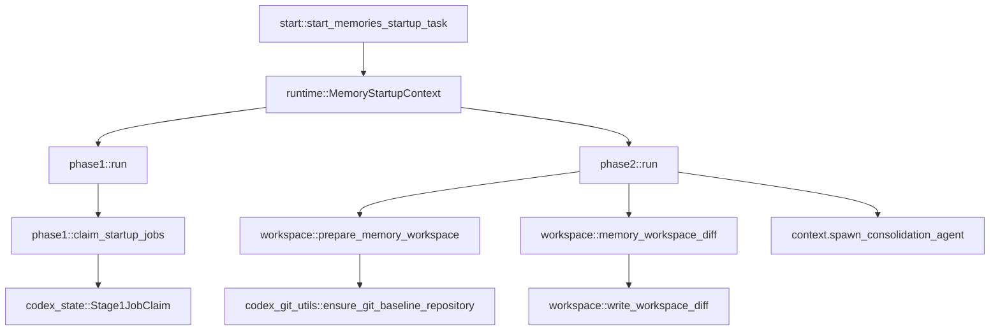
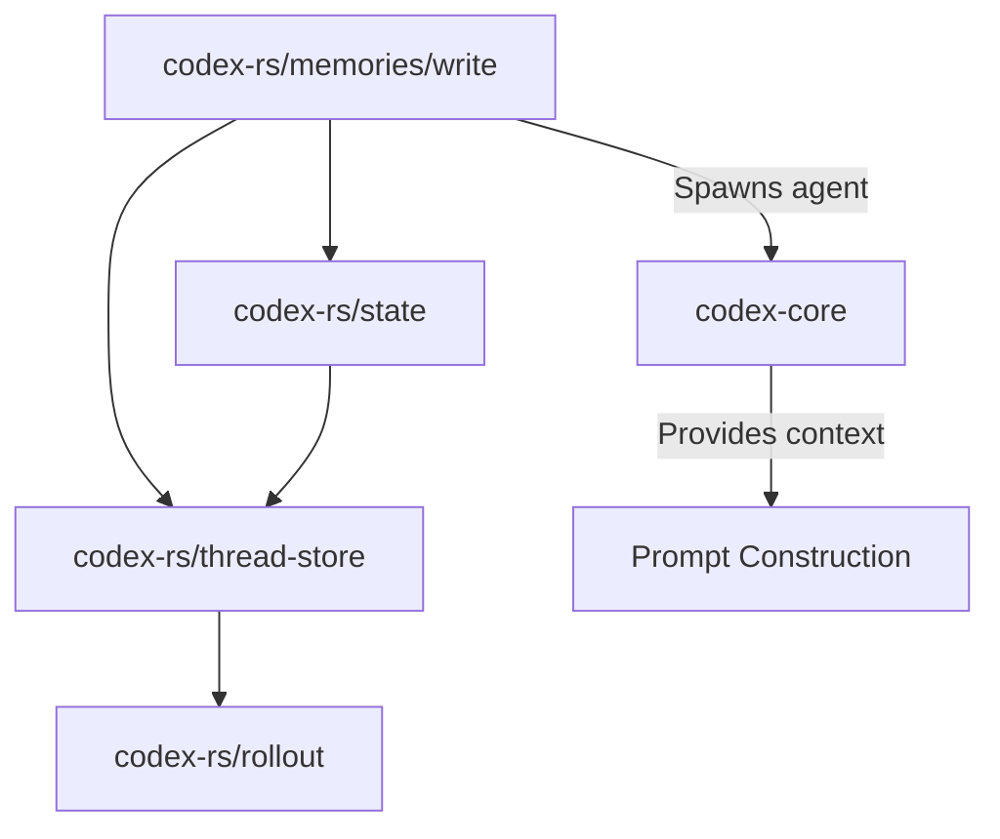

<!-- source: DeepWiki mcp.deepwiki.com · repo openai/codex · page 3.9 Memories System · fetched 2026-10-26 -->

# Memories System

Relevant source files

The following files were used as context for generating this wiki page:

- [codex-rs/app-server/src/request_processors/thread_delete.rs](codex-rs/app-server/src/request_processors/thread_delete.rs)
- [codex-rs/app-server/tests/suite/v2/memory_reset.rs](codex-rs/app-server/tests/suite/v2/memory_reset.rs)
- [codex-rs/app-server/tests/suite/v2/thread_delete.rs](codex-rs/app-server/tests/suite/v2/thread_delete.rs)
- [codex-rs/memories/write/Cargo.toml](codex-rs/memories/write/Cargo.toml)
- [codex-rs/memories/write/src/guard.rs](codex-rs/memories/write/src/guard.rs)
- [codex-rs/memories/write/src/guard_tests.rs](codex-rs/memories/write/src/guard_tests.rs)
- [codex-rs/memories/write/src/lib.rs](codex-rs/memories/write/src/lib.rs)
- [codex-rs/memories/write/src/metrics.rs](codex-rs/memories/write/src/metrics.rs)
- [codex-rs/memories/write/src/phase1.rs](codex-rs/memories/write/src/phase1.rs)
- [codex-rs/memories/write/src/phase2.rs](codex-rs/memories/write/src/phase2.rs)
- [codex-rs/memories/write/src/phase2_sandbox_tests.rs](codex-rs/memories/write/src/phase2_sandbox_tests.rs)
- [codex-rs/memories/write/src/phase2_workspace_roots_tests.rs](codex-rs/memories/write/src/phase2_workspace_roots_tests.rs)
- [codex-rs/memories/write/src/prompts.rs](codex-rs/memories/write/src/prompts.rs)
- [codex-rs/memories/write/src/prompts_tests.rs](codex-rs/memories/write/src/prompts_tests.rs)
- [codex-rs/memories/write/src/rollout_input.rs](codex-rs/memories/write/src/rollout_input.rs)
- [codex-rs/memories/write/src/rollout_input_tests.rs](codex-rs/memories/write/src/rollout_input_tests.rs)
- [codex-rs/memories/write/src/runtime.rs](codex-rs/memories/write/src/runtime.rs)
- [codex-rs/memories/write/src/start.rs](codex-rs/memories/write/src/start.rs)
- [codex-rs/memories/write/src/startup_dual_write_tests.rs](codex-rs/memories/write/src/startup_dual_write_tests.rs)
- [codex-rs/memories/write/src/startup_tests.rs](codex-rs/memories/write/src/startup_tests.rs)
- [codex-rs/memories/write/src/workspace.rs](codex-rs/memories/write/src/workspace.rs)
- [codex-rs/memories/write/src/workspace_tests.rs](codex-rs/memories/write/src/workspace_tests.rs)
- [codex-rs/rollout/src/rollout_reference_index.rs](codex-rs/rollout/src/rollout_reference_index.rs)
- [codex-rs/rollout/src/rollout_reference_index_tests.rs](codex-rs/rollout/src/rollout_reference_index_tests.rs)
- [codex-rs/state/src/model/memories.rs](codex-rs/state/src/model/memories.rs)
- [codex-rs/state/src/model/thread_metadata.rs](codex-rs/state/src/model/thread_metadata.rs)
- [codex-rs/state/src/runtime/memories.rs](codex-rs/state/src/runtime/memories.rs)
- [codex-rs/state/src/runtime/test_support.rs](codex-rs/state/src/runtime/test_support.rs)
- [codex-rs/thread-store/src/local/archive_thread.rs](codex-rs/thread-store/src/local/archive_thread.rs)
- [codex-rs/thread-store/src/local/delete_thread.rs](codex-rs/thread-store/src/local/delete_thread.rs)
- [codex-rs/thread-store/src/local/helpers.rs](codex-rs/thread-store/src/local/helpers.rs)
- [codex-rs/thread-store/src/local/list_threads.rs](codex-rs/thread-store/src/local/list_threads.rs)
- [codex-rs/thread-store/src/local/read_thread.rs](codex-rs/thread-store/src/local/read_thread.rs)
- [codex-rs/thread-store/src/local/unarchive_thread.rs](codex-rs/thread-store/src/local/unarchive_thread.rs)
- [codex-rs/thread-store/src/local/update_thread_metadata.rs](codex-rs/thread-store/src/local/update_thread_metadata.rs)
- [codex-rs/thread-store/src/thread_metadata_sync.rs](codex-rs/thread-store/src/thread_metadata_sync.rs)

## Purpose and Scope

The Memories System is a multi-phase background and startup pipeline designed to extract, consolidate, and inject persistent knowledge derived from conversation rollouts into agent context. It enables Codex to maintain long-term continuity by remembering user preferences, workflow choices, and project insights across sessions. This page documents the multi-phase memory extraction (`codex-rs/memories/write/src/phase1.rs` [codex-rs/memories/write/src/phase1.rs:50-94]()) and global consolidation (`codex-rs/memories/write/src/phase2.rs` [codex-rs/memories/write/src/phase2.rs:49-192]()), workspace state management (`codex-rs/memories/write/src/workspace.rs` [codex-rs/memories/write/src/workspace.rs:16-49]()), startup orchestration (`codex-rs/memories/write/src/start.rs` [codex-rs/memories/write/src/start.rs:24-94]()), and underlying storage persistence.

---

## Architecture Overview

The Memories System operates through two primary asynchronous phases orchestrated at startup:
- **Phase 1 (Startup Extraction):** Claims eligible rollout jobs for non-ephemeral threads, runs lightweight parallel summarization tasks (`phase1::run`), and stores thread-level stage-1 memory outputs in SQLite state tables [codex-rs/memories/write/src/phase1.rs:50-94]().
- **Phase 2 (Global Consolidation):** Claims a global exclusive job lock (`phase2::run`), syncs phase-2 workspace inputs, detects workspace mutations via git baseline diffing (`memory_workspace_diff`), and spawns a constrained consolidation agent to update global markdown summaries (`memory_summary.md`) [codex-rs/memories/write/src/phase2.rs:49-192]().
- **Startup Injection:** Injects consolidated memory summaries into new session context prompt slots [codex-rs/memories/write/src/start.rs:24-94]().

### Memory Pipeline Data Flow

Title: "Memories System Data Flow and Execution Architecture"

Sources: [codex-rs/memories/write/src/start.rs:24-94](), [codex-rs/memories/write/src/phase1.rs:50-94](), [codex-rs/memories/write/src/phase2.rs:49-192](), [codex-rs/memories/write/src/workspace.rs:16-32]()

---

## Phase 1: Startup Extraction

Phase 1 runs as part of the startup task (`start_memories_startup_task`) when the `MemoryTool` feature flag is enabled and the session is not ephemeral or a non-root subagent [codex-rs/memories/write/src/start.rs:33-38]().

### Job Claiming and Eligibility
- The system checks rate limits using `guard::rate_limits_ok` [codex-rs/memories/write/src/start.rs:79-86]().
- `claim_startup_jobs` queries the database via `claim_stage1_jobs_for_startup` to select candidate rollouts matching interactive session sources within configured age and idle duration windows [codex-rs/memories/write/src/phase1.rs:120-157]().
- Stale stage-1 outputs are pruned prior to extraction via `phase1::prune` [codex-rs/memories/write/src/phase1.rs:97-118](), [codex-rs/memories/write/src/start.rs:77]().

### Execution and Parallel Sampling
- `phase1::run` builds request contexts (`StageOneRequestContext`) using configured reasoning efforts (`stage_one::REASONING_EFFORT`) [codex-rs/memories/write/src/phase1.rs:56-94](), [codex-rs/memories/write/src/lib.rs:81-82]().
- Eligible extraction jobs are scheduled concurrently using a bounded buffer (`buffer_unordered` with `CONCURRENCY_LIMIT` set to 8) [codex-rs/memories/write/src/phase1.rs:180-192](), [codex-rs/memories/write/src/lib.rs:83]().

Sources: [codex-rs/memories/write/src/phase1.rs:50-192](), [codex-rs/memories/write/src/start.rs:24-94]().

---

## Phase 2: Global Consolidation

Phase 2 executes immediately after Phase 1 finishes in the startup pipeline worker [codex-rs/memories/write/src/start.rs:89-91]().

### Concurrency and Locking
- `phase2::run` acquires a global exclusive lock using `job::claim` [codex-rs/memories/write/src/phase2.rs:66-73]().
- If the global lock cannot be acquired or workspace setup fails, the job exits or marks failure (`job::failed`) with appropriate telemetry counters [codex-rs/memories/write/src/phase2.rs:75-80]().

### Workspace Management and Git Baseline
- `prepare_memory_workspace` ensures a git repository exists inside the memory root (`codex_home/memories/`) to track incremental updates without retaining prompt artifacts (`phase2_workspace_diff.md`) [codex-rs/memories/write/src/workspace.rs:16-23]().
- `memory_workspace_diff` computes the changes since the latest init [codex-rs/memories/write/src/workspace.rs:29-32](). If no changes are detected and validation (`validate_consolidation_artifacts_for_version`) succeeds, the phase exits early without spending tokens [codex-rs/memories/write/src/phase2.rs:131-152]().
- Validates consolidated files against schema rules (e.g., verifying `memory_summary.md` begins with `"v1"` and contains required sections like `## User Profile` and `## User preferences`) [codex-rs/memories/write/src/workspace.rs:76-129]().

Sources: [codex-rs/memories/write/src/phase2.rs:49-192](), [codex-rs/memories/write/src/workspace.rs:16-162]().

---

## Runtime Context and Storage Infrastructure

The `codex-rs/memories/write` crate relies on runtime and storage helper types to bridge core agent threads, model providers, and persistent states.

### Core Runtime Structs
- `MemoryStartupContext`: Coordinates thread managers, authentication managers, shared model providers (`SharedModelProvider`), and session telemetry across pipeline steps [codex-rs/memories/write/src/runtime.rs:80-88]().
- `StageOneRequestContext`: Wraps model configuration, reasoning effort parameters, and telemetry timers for metric emission [codex-rs/memories/write/src/runtime.rs:52-60]().
- `SpawnedConsolidationAgent`: Manages handles to the running consolidation thread ID and `CodexThread` instance [codex-rs/memories/write/src/runtime.rs:47-50]().

### Storage Utilities
- `memory_storage_bytes`: Sums regular file sizes inside the memory root recursively while excluding `.git/` metadata directories and symbolic links [codex-rs/memories/write/src/workspace.rs:52-68]().
- Dual-write configurations (`config.memories.dual_write`) support parallel maintenance of both `v1` and `v2` memory directory layouts during migration [codex-rs/memories/write/src/start.rs:40-44](), [codex-rs/memories/write/src/startup_tests.rs:81-105]().

Sources: [codex-rs/memories/write/src/runtime.rs:47-210](), [codex-rs/memories/write/src/workspace.rs:52-162](), [codex-rs/memories/write/src/start.rs:40-44]().

---

## Code Entity Architecture

Title: "Memories Write Pipeline Code Entity Map"

Sources: [codex-rs/memories/write/src/start.rs:24-94](), [codex-rs/memories/write/src/phase1.rs:50-94](), [codex-rs/memories/write/src/phase2.rs:49-186](), [codex-rs/memories/write/src/workspace.rs:16-32]()

---

## Memories Read/Write/MCP Crates

The Memories system is composed of several crates that handle different aspects of memory management:

- **`codex-rs/memories/write`**: This crate contains the core logic for the multi-phase memory extraction and consolidation pipeline. It defines the `phase1` and `phase2` modules, the `runtime` context, and `workspace` management for memory artifacts. It interacts with the `codex-state` crate for persistent storage.
    - Key functions: `phase1::run` [codex-rs/memories/write/src/phase1.rs:50-94](), `phase2::run` [codex-rs/memories/write/src/phase2.rs:49-192](), `start_memories_startup_task` [codex-rs/memories/write/src/start.rs:24-94]().
    - Data structures: `MemoryStartupContext` [codex-rs/memories/write/src/runtime.rs:80-88](), `StageOneRequestContext` [codex-rs/memories/write/src/runtime.rs:52-60]().

- **`codex-rs/state`**: This crate provides the SQLite-backed runtime for various agent states, including memories. It defines the `MemoryStore` struct which manages the `stage1_outputs` and `jobs` tables.
    - `MemoryStore`: Handles persistence of stage-1 outputs, job claims, and pruning.
        - `clear_memory_data`: Deletes all persisted memory state [codex-rs/state/src/runtime/memories.rs:52-54]().
        - `record_stage1_output_usage`: Increments usage count and updates `last_usage` for stage-1 outputs [codex-rs/state/src/runtime/memories.rs:60-91]().
        - `stage1_source_needs_update`: Checks if a thread's stage-1 output needs to be updated based on `source_updated_at` and `last_success_watermark` [codex-rs/state/src/runtime/memories.rs:93-136]().
        - `claim_stage1_jobs_for_startup`: Selects and claims stage-1 startup jobs for stale threads, filtering by activity, age, and idle time [codex-rs/state/src/runtime/memories.rs:153-207]().
    - `ThreadMetadata`: Canonical persisted thread metadata, including `memory_mode` [codex-rs/state/src/model/thread_metadata.rs:124-183]().

- **`codex-rs/thread-store`**: This crate manages the storage and retrieval of thread metadata and history. It interacts with the `codex-state` crate to persist thread metadata, including memory-related fields.
    - `ThreadMetadataSync`: Derives metadata updates from appended rollout items, including `memory_mode` [codex-rs/thread-store/src/thread_metadata_sync.rs:39-50]().
    - `update_thread_metadata`: Updates thread metadata in the SQLite store, handling `memory_mode` and `git_info` patches [codex-rs/thread-store/src/local/update_thread_metadata.rs:38-182]().
    - `read_thread`: Reads thread metadata, potentially from SQLite or rollout files, and attaches history [codex-rs/thread-store/src/local/read_thread.rs:31-118]().
    - `RolloutReferenceIndex`: Indexes direct fork references found in local rollout files, used for managing thread relationships and archiving [codex-rs/rollout/src/rollout_reference_index.rs:24-34]().

- **`codex-rs/mcp`**: While not directly part of the memory extraction/consolidation pipeline, the Model Context Protocol (MCP) allows external services to contribute context, which can include memory-like information. The memories system itself can be seen as a specialized form of context injection.

Title: "Memories System Crate Interactions"

Sources: [codex-rs/memories/write/src/lib.rs](), [codex-rs/state/src/runtime/memories.rs](), [codex-rs/state/src/model/thread_metadata.rs](), [codex-rs/thread-store/src/thread_metadata_sync.rs](), [codex-rs/thread-store/src/local/update_thread_metadata.rs](), [codex-rs/thread-store/src/local/read_thread.rs](), [codex-rs/rollout/src/rollout_reference_index.rs]()

---

# Sources

- [codex-rs/memories/write/src/lib.rs:1-149]()
- [codex-rs/memories/write/src/start.rs:20-94]()
- [codex-rs/memories/write/src/phase1.rs:50-192]()
- [codex-rs/memories/write/src/phase2.rs:49-192]()
- [codex-rs/memories/write/src/runtime.rs:47-210]()
- [codex-rs/memories/write/src/workspace.rs:16-162]()
- [codex-rs/memories/write/src/startup_tests.rs:65-105]()
- [codex-rs/state/src/runtime/memories.rs:1-5473]()
- [codex-rs/state/src/model/thread_metadata.rs:1-897]()
- [codex-rs/thread-store/src/thread_metadata_sync.rs:1-940]()
- [codex-rs/thread-store/src/local/update_thread_metadata.rs:1-2458]()
- [codex-rs/thread-store/src/local/read_thread.rs:1-1669]()
- [codex-rs/rollout/src/rollout_reference_index.rs:1-184]()

---

