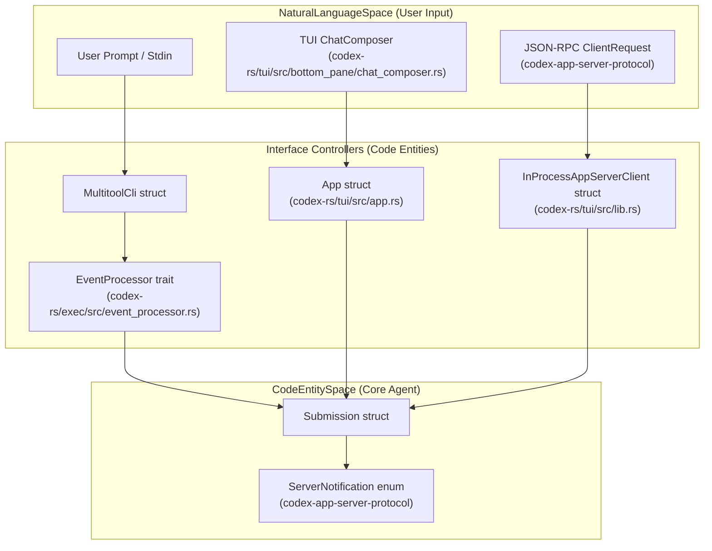
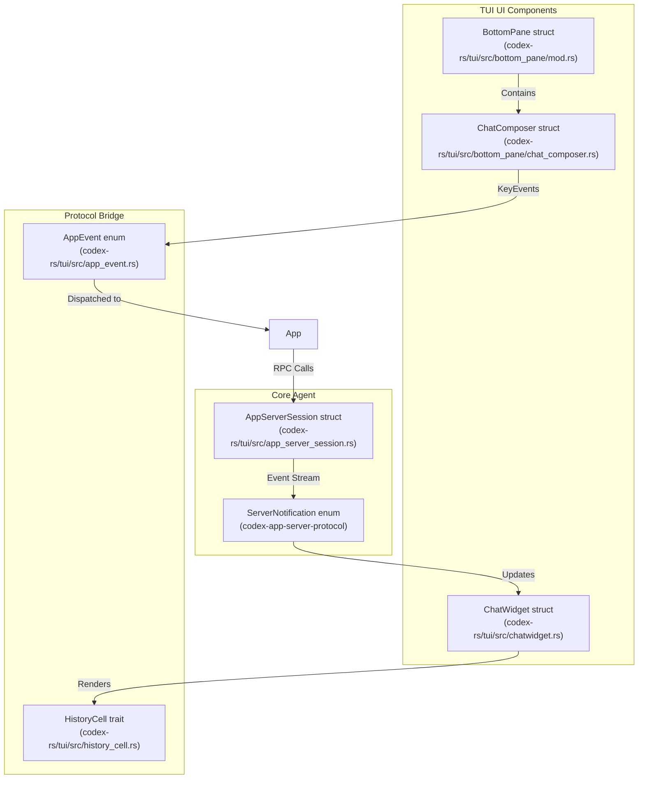

<!-- source: DeepWiki mcp.deepwiki.com · repo openai/codex · page 4 User Interfaces · fetched 2026-10-26 -->

# User Interfaces

Relevant source files

The following files were used as context for generating this wiki page:

- [codex-rs/exec/src/lib.rs](codex-rs/exec/src/lib.rs)
- [codex-rs/exec/src/lib_tests.rs](codex-rs/exec/src/lib_tests.rs)
- [codex-rs/tui/src/app.rs](codex-rs/tui/src/app.rs)
- [codex-rs/tui/src/app/app_server_events.rs](codex-rs/tui/src/app/app_server_events.rs)
- [codex-rs/tui/src/app/event_dispatch.rs](codex-rs/tui/src/app/event_dispatch.rs)
- [codex-rs/tui/src/app/session_lifecycle.rs](codex-rs/tui/src/app/session_lifecycle.rs)
- [codex-rs/tui/src/app/startup.rs](codex-rs/tui/src/app/startup.rs)
- [codex-rs/tui/src/app/test_support.rs](codex-rs/tui/src/app/test_support.rs)
- [codex-rs/tui/src/app/tests.rs](codex-rs/tui/src/app/tests.rs)
- [codex-rs/tui/src/app/tests/session_lifecycle_requests.rs](codex-rs/tui/src/app/tests/session_lifecycle_requests.rs)
- [codex-rs/tui/src/app/tests/startup.rs](codex-rs/tui/src/app/tests/startup.rs)
- [codex-rs/tui/src/app/thread_routing.rs](codex-rs/tui/src/app/thread_routing.rs)
- [codex-rs/tui/src/app_event.rs](codex-rs/tui/src/app_event.rs)
- [codex-rs/tui/src/app_server_session.rs](codex-rs/tui/src/app_server_session.rs)
- [codex-rs/tui/src/bottom_pane/chat_composer.rs](codex-rs/tui/src/bottom_pane/chat_composer.rs)
- [codex-rs/tui/src/bottom_pane/command_popup.rs](codex-rs/tui/src/bottom_pane/command_popup.rs)
- [codex-rs/tui/src/bottom_pane/mod.rs](codex-rs/tui/src/bottom_pane/mod.rs)
- [codex-rs/tui/src/bottom_pane/slash_commands.rs](codex-rs/tui/src/bottom_pane/slash_commands.rs)
- [codex-rs/tui/src/bottom_pane/textarea.rs](codex-rs/tui/src/bottom_pane/textarea.rs)
- [codex-rs/tui/src/bottom_pane/textarea/vim_commands.rs](codex-rs/tui/src/bottom_pane/textarea/vim_commands.rs)
- [codex-rs/tui/src/chatwidget.rs](codex-rs/tui/src/chatwidget.rs)
- [codex-rs/tui/src/chatwidget/interaction.rs](codex-rs/tui/src/chatwidget/interaction.rs)
- [codex-rs/tui/src/chatwidget/slash_dispatch.rs](codex-rs/tui/src/chatwidget/slash_dispatch.rs)
- [codex-rs/tui/src/chatwidget/tests.rs](codex-rs/tui/src/chatwidget/tests.rs)
- [codex-rs/tui/src/chatwidget/tests/slash_commands.rs](codex-rs/tui/src/chatwidget/tests/slash_commands.rs)
- [codex-rs/tui/src/lib.rs](codex-rs/tui/src/lib.rs)
- [codex-rs/tui/src/slash_command.rs](codex-rs/tui/src/slash_command.rs)

## Purpose and Scope

This document describes the user-facing interfaces through which users interact with Codex: the **Terminal User Interface (TUI)** for interactive sessions, **headless execution mode** (`codex exec`) for non-interactive automation, the **CLI entry point** that dispatches to different modes, and the **App Server** for IDE integrations. Each interface provides a different interaction model while sharing the same underlying core agent engine and protocol.

For configuration of these interfaces, see [Configuration System](#2.2). For the protocol layer that coordinates async communication across all interfaces, see [Protocol Layer (Submission/Event System)](#2.1).

---

## Execution Modes Overview

Codex supports several distinct execution modes, each optimized for different use cases. These modes bridge the "Natural Language Space" (user prompts) to the "Code Entity Space" (tool executions and file changes) via the `codex-app-server-protocol`.

### System Interface Mapping

The following diagram maps high-level user interfaces to the internal code entities that handle their execution:

Sources: [codex-rs/tui/src/app.rs:1-4](), [codex-rs/tui/src/lib.rs:29-31](), [codex-rs/tui/src/bottom_pane/chat_composer.rs:1-11](), [codex-rs/exec/src/lib.rs:1-4]()

**Execution Mode Characteristics:**

| Mode         | Interactive | Output Format           | Primary Use Case                   |
|--------------|-------------|------------------------|----------------------------------|
| TUI          | Yes         | Rich terminal UI        | Human-driven development sessions|
| Exec         | No          | Plain text or JSONL     | CI/CD, scripting, automation     |
| Review       | No          | Plain text             | Code review workflows             |
| App Server   | Yes (via IDE) | JSON-RPC              | IDE integrations (VS Code, Cursor)|
| Cloud Tasks  | Yes         | TUI/CLI                | Remote environment execution      |

Sources: [codex-rs/tui/src/app.rs:1-4](), [codex-rs/tui/src/lib.rs:29-31](), [codex-rs/tui/src/bottom_pane/chat_composer.rs:1-11](), [codex-rs/exec/src/lib.rs:1-4]()

---

## Terminal User Interface (TUI)

The TUI is the primary interactive interface for Codex. It is built on `ratatui` and follows an event-driven architecture where the `App` struct orchestrates coordination between UI widgets and agent background threads.

### Component Hierarchy and Data Flow

The TUI maps user interactions to submission requests and renders `ServerNotification` streams into `HistoryCell` units. Below is a structural diagram showing interactions between key components:

Sources: [codex-rs/tui/src/chatwidget.rs:1-30](), [codex-rs/tui/src/bottom_pane/mod.rs:1-20](), [codex-rs/tui/src/bottom_pane/chat_composer.rs:1-100](), [codex-rs/tui/src/app_event.rs:1-10](), [codex-rs/tui/src/app_server_session.rs:1-4]()

### Key TUI Components

| Component      | File                                           | Responsibility                                               |
|----------------|------------------------------------------------|------------------------------------------------------------|
| `App`          | [codex-rs/tui/src/app.rs:1-4]()                 | Central state manager and main event handling run loop.     |
| `ChatWidget`   | [codex-rs/tui/src/chatwidget.rs:1-30]()         | Main chat surface; consumes protocol events and manages message cells. |
| `BottomPane`   | [codex-rs/tui/src/bottom_pane/mod.rs:1-20]()    | Manages the footer area, input routing, popups, and interactions. |
| `ChatComposer` | [codex-rs/tui/src/bottom_pane/chat_composer.rs:1-100]() | Handles user text input, slash command parsing, and editing behaviors. |

The TUI supports rich UI features including streaming output, interactive overlays, slash commands, syntax highlighting, and dynamic status lines.

For full detail, see [Terminal User Interface (TUI)](#4.1).

Sources: [codex-rs/tui/src/app.rs:1-4](), [codex-rs/tui/src/chatwidget.rs:1-30](), [codex-rs/tui/src/bottom_pane/mod.rs:1-20](), [codex-rs/tui/src/bottom_pane/chat_composer.rs:1-100]()

---

## Headless Execution Mode (codex exec)

The headless mode enables running Codex commands non-interactively from the CLI, suited for automation and CI/CD environments.

- This mode primarily processes command-line input or `stdin` requests and emits events as output without a persistent UI.
- The `EventProcessorWithHumanOutput` class handles terminal-friendly text output.
- The alternate `EventProcessorWithJsonOutput` supports machine-readable JSONL output with one event per line.
- The review feature supports sub-agent delegation flows for code review tasks.

These are implemented within the `codex-exec` crate.

Sources: [codex-rs/exec/src/lib.rs:1-10](), [codex-rs/exec/src/lib.rs:114-118](), [codex-rs/exec/src/lib.rs:150-154]()

For full detail, see [Headless Execution Mode (codex exec)](#4.2).

---

## CLI Entry Points and Multitool Dispatch

The `codex` binary entry point manages dispatch to subcommands and modes including TUI and exec.

- The `MultitoolCli` struct parses CLI arguments and routes invocation accordingly.
- Handles loading configuration via layered `ConfigBuilder` and feature flag processing.
- Supports commands like `doctor` for system diagnostic and `arg0` dispatch for symlink-based mode invocation.

This is mainly implemented in the CLI crates and `main.rs`.

Sources: [codex-rs/tui/src/lib.rs:6-11](), [codex-rs/exec/src/lib.rs:50-70]()

For full detail, see [CLI Entry Points and Multitool Dispatch](#4.3).

---

## Session Resumption and Forking

Session management includes capabilities to resume or fork conversation threads:

- **Resuming**: Using `ThreadResumeParams` to restore conversations by thread ID and state.
- **Forking**: Leveraging `ThreadForkParams` to create a new independent conversation branch from an existing thread.
- Persistent session state and histories are managed via `StateDbHandle`.
- Migrates sessions and config from external agents (e.g., Claude, Cursor) using external configuration migration flows.

These features enable long-term goal tracking and multitasking.

Sources: [codex-rs/exec/src/lib.rs:35-50](), [codex-rs/tui/src/lib.rs:60-75]()

For full detail, see [Session Resumption and Forking](#4.4).

---

## App Server and IDE Integration

The App Server exposes Codex’s capabilities via JSON-RPC 2.0, integrating with IDEs such as VS Code and Cursor.

- Supports bidirectional asynchronous requests and notifications.
- Manages session lifecycle, thread and turn endpoints, config APIs, and authentication flows.
- The TUI integrates with this server either as an `InProcessAppServerClient` or via remote transports.
- Protocol versioning and extension mechanisms ensure backwards compatibility.

Sources: [codex-rs/tui/src/lib.rs:28-35](), [codex-rs/tui/src/app_server_session.rs:1-4]()

For full detail, see [App Server and IDE Integration](#4.5).

---

## Cloud Tasks (codex cloud)

The cloud tasks subsystem (`codex-cloud-tasks`) provides TUI and CLI interfaces for submitting long-running or remote execution tasks to Codex Cloud.

- Uses `CloudConfigBundleLoader` for environment and configuration management.
- Tracks task status and allows diff viewing.
- Abstracts remote operation execution, facilitating offloading from local environments.

Sources: [codex-rs/tui/src/lib.rs:45-48](), [codex-rs/exec/src/lib.rs:58-62]()

For full detail, see [Cloud Tasks (codex cloud)](#4.6).

---

## Exec Server

The `codex-exec-server` crate runs a JSON-RPC WebSocket server enabling subprocess spawning and management through `codex-utils-pty`.

- Supports filesystem RPCs and remote control.
- Used by the TUI and other clients for sandboxed execution environment management.
- Includes a client abstraction, `ExecServerClient`, for programmatic interaction.

Sources: [codex-rs/tui/src/lib.rs:50-52](), [codex-rs/tui/src/app.rs:145-146]()

For full detail, see [Exec Server](#4.7).

---

## Sources Summary

- Core TUI orchestration: [codex-rs/tui/src/app.rs:1-4]()
- Chat UI and rendering: [codex-rs/tui/src/chatwidget.rs:1-30]()
- Input and bottom pane: [codex-rs/tui/src/bottom_pane/mod.rs:1-20](), [codex-rs/tui/src/bottom_pane/chat_composer.rs:1-100]()
- Exec mode implementation: [codex-rs/exec/src/lib.rs:1-154]()
- App Server integration: [codex-rs/tui/src/app_server_session.rs:1-4](), [codex-rs/tui/src/lib.rs:28-35]()
- Session management and persistence: [codex-rs/tui/src/lib.rs:60-75]()

---

This page provides a high-level overview of the user interface system and points to dedicated child pages for deeper technical details:

- [Terminal User Interface (TUI)](#4.1)
- [Headless Execution Mode (codex exec)](#4.2)
- [CLI Entry Points and Multitool Dispatch](#4.3)
- [Session Resumption and Forking](#4.4)
- [App Server and IDE Integration](#4.5)
- [Cloud Tasks (codex cloud)](#4.6)
- [Exec Server](#4.7)

---

