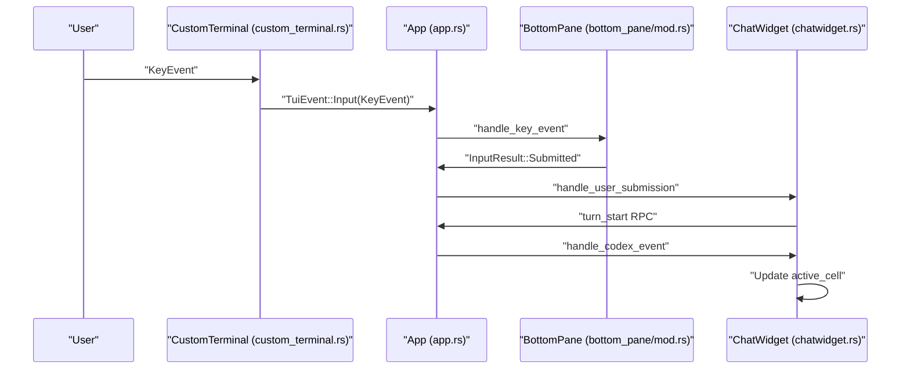
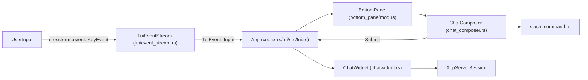
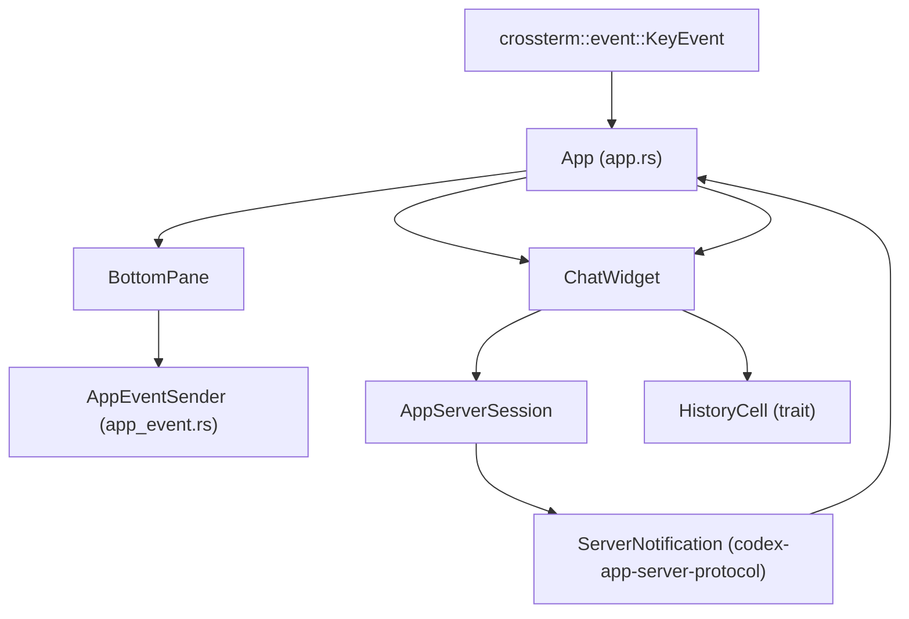

<!-- source: DeepWiki mcp.deepwiki.com · repo openai/codex · page 4.1 Terminal User Interface (TUI) · fetched 2026-10-26 -->

# Terminal User Interface (TUI)

Relevant source files

The following files were used as context for generating this wiki page:

- [codex-rs/config/src/tui_keymap.rs](codex-rs/config/src/tui_keymap.rs)
- [codex-rs/login/src/device_code_auth.rs](codex-rs/login/src/device_code_auth.rs)
- [codex-rs/login/src/device_code_auth_tests.rs](codex-rs/login/src/device_code_auth_tests.rs)
- [codex-rs/tui/src/chatwidget/tests/terminal_program_status.rs](codex-rs/tui/src/chatwidget/tests/terminal_program_status.rs)
- [codex-rs/tui/src/config_update.rs](codex-rs/tui/src/config_update.rs)
- [codex-rs/tui/src/config_update_tests.rs](codex-rs/tui/src/config_update_tests.rs)
- [codex-rs/tui/src/custom_terminal.rs](codex-rs/tui/src/custom_terminal.rs)
- [codex-rs/tui/src/insert_history.rs](codex-rs/tui/src/insert_history.rs)
- [codex-rs/tui/src/iterm_session_status_tests.rs](codex-rs/tui/src/iterm_session_status_tests.rs)
- [codex-rs/tui/src/keymap.rs](codex-rs/tui/src/keymap.rs)
- [codex-rs/tui/src/keymap/bindings.rs](codex-rs/tui/src/keymap/bindings.rs)
- [codex-rs/tui/src/keymap_setup.rs](codex-rs/tui/src/keymap_setup.rs)
- [codex-rs/tui/src/keymap_setup/actions.rs](codex-rs/tui/src/keymap_setup/actions.rs)
- [codex-rs/tui/src/onboarding/auth.rs](codex-rs/tui/src/onboarding/auth.rs)
- [codex-rs/tui/src/onboarding/auth/headless_chatgpt_login.rs](codex-rs/tui/src/onboarding/auth/headless_chatgpt_login.rs)
- [codex-rs/tui/src/onboarding/bedrock.rs](codex-rs/tui/src/onboarding/bedrock.rs)
- [codex-rs/tui/src/onboarding/bedrock_tests.rs](codex-rs/tui/src/onboarding/bedrock_tests.rs)
- [codex-rs/tui/src/onboarding/directory_trust.rs](codex-rs/tui/src/onboarding/directory_trust.rs)
- [codex-rs/tui/src/onboarding/mod.rs](codex-rs/tui/src/onboarding/mod.rs)
- [codex-rs/tui/src/onboarding/onboarding_screen.rs](codex-rs/tui/src/onboarding/onboarding_screen.rs)
- [codex-rs/tui/src/onboarding/snapshots/codex_tui__onboarding__bedrock__tests__gov_cloud_warning.snap](codex-rs/tui/src/onboarding/snapshots/codex_tui__onboarding__bedrock__tests__gov_cloud_warning.snap)
- [codex-rs/tui/src/onboarding/snapshots/codex_tui__onboarding__bedrock__tests__gov_cloud_warning_short.snap](codex-rs/tui/src/onboarding/snapshots/codex_tui__onboarding__bedrock__tests__gov_cloud_warning_short.snap)
- [codex-rs/tui/src/onboarding/snapshots/codex_tui__onboarding__trust_directory__tests__existing_untrusted_task.snap](codex-rs/tui/src/onboarding/snapshots/codex_tui__onboarding__trust_directory__tests__existing_untrusted_task.snap)
- [codex-rs/tui/src/onboarding/snapshots/codex_tui__onboarding__trust_directory__tests__renders_restricted_folder.snap](codex-rs/tui/src/onboarding/snapshots/codex_tui__onboarding__trust_directory__tests__renders_restricted_folder.snap)
- [codex-rs/tui/src/onboarding/snapshots/codex_tui__onboarding__trust_directory__tests__renders_snapshot_for_git_repo.snap](codex-rs/tui/src/onboarding/snapshots/codex_tui__onboarding__trust_directory__tests__renders_snapshot_for_git_repo.snap)
- [codex-rs/tui/src/onboarding/snapshots/codex_tui__onboarding__trust_directory__tests__renders_snapshot_for_remote_git_subdirectory.snap](codex-rs/tui/src/onboarding/snapshots/codex_tui__onboarding__trust_directory__tests__renders_snapshot_for_remote_git_subdirectory.snap)
- [codex-rs/tui/src/onboarding/snapshots/codex_tui__onboarding__trust_directory__tests__renders_snapshot_for_trust_error.snap](codex-rs/tui/src/onboarding/snapshots/codex_tui__onboarding__trust_directory__tests__renders_snapshot_for_trust_error.snap)
- [codex-rs/tui/src/onboarding/trust_directory.rs](codex-rs/tui/src/onboarding/trust_directory.rs)
- [codex-rs/tui/src/onboarding/welcome.rs](codex-rs/tui/src/onboarding/welcome.rs)
- [codex-rs/tui/src/snapshots/codex_tui__keymap_setup__tests__keymap_picker_custom.snap](codex-rs/tui/src/snapshots/codex_tui__keymap_setup__tests__keymap_picker_custom.snap)
- [codex-rs/tui/src/snapshots/codex_tui__keymap_setup__tests__keymap_picker_fast_mode_enabled.snap](codex-rs/tui/src/snapshots/codex_tui__keymap_setup__tests__keymap_picker_fast_mode_enabled.snap)
- [codex-rs/tui/src/snapshots/codex_tui__keymap_setup__tests__keymap_picker_first_actions.snap](codex-rs/tui/src/snapshots/codex_tui__keymap_setup__tests__keymap_picker_first_actions.snap)
- [codex-rs/tui/src/snapshots/codex_tui__keymap_setup__tests__keymap_picker_global_chord.snap](codex-rs/tui/src/snapshots/codex_tui__keymap_setup__tests__keymap_picker_global_chord.snap)
- [codex-rs/tui/src/snapshots/codex_tui__keymap_setup__tests__keymap_picker_narrow.snap](codex-rs/tui/src/snapshots/codex_tui__keymap_setup__tests__keymap_picker_narrow.snap)
- [codex-rs/tui/src/snapshots/codex_tui__keymap_setup__tests__keymap_picker_wide.snap](codex-rs/tui/src/snapshots/codex_tui__keymap_setup__tests__keymap_picker_wide.snap)
- [codex-rs/tui/src/snapshots/codex_tui__terminal_program_status__tests__iterm_session_status_fields.snap](codex-rs/tui/src/snapshots/codex_tui__terminal_program_status__tests__iterm_session_status_fields.snap)
- [codex-rs/tui/src/terminal_palette.rs](codex-rs/tui/src/terminal_palette.rs)
- [codex-rs/tui/src/terminal_probe.rs](codex-rs/tui/src/terminal_probe.rs)
- [codex-rs/tui/src/terminal_program_status.rs](codex-rs/tui/src/terminal_program_status.rs)
- [codex-rs/tui/src/tui.rs](codex-rs/tui/src/tui.rs)
- [codex-rs/tui/src/tui/event_stream.rs](codex-rs/tui/src/tui/event_stream.rs)
- [codex-rs/tui/src/tui/job_control.rs](codex-rs/tui/src/tui/job_control.rs)
- [codex-rs/tui/src/tui/screen_size.rs](codex-rs/tui/src/tui/screen_size.rs)
- [codex-rs/tui/src/tui/size_monitor.rs](codex-rs/tui/src/tui/size_monitor.rs)
- [codex-rs/tui/src/tui/size_monitor_tests.rs](codex-rs/tui/src/tui/size_monitor_tests.rs)
- [codex-rs/tui/src/tui/windows_console.rs](codex-rs/tui/src/tui/windows_console.rs)
- [codex-rs/tui/tests/suite/focus_palette.rs](codex-rs/tui/tests/suite/focus_palette.rs)
- [codex-rs/tui/tests/suite/gov_cloud_guidance_tests.rs](codex-rs/tui/tests/suite/gov_cloud_guidance_tests.rs)
- [codex-rs/tui/tests/suite/mod.rs](codex-rs/tui/tests/suite/mod.rs)

## Purpose and Scope

The Terminal User Interface (TUI) is Codex’s primary interactive frontend, delivering a responsive and feature-rich terminal-based chat experience. It is built on the [`ratatui`](https://github.com/tui-rs/ratatui) ecosystem utilizing a custom terminal abstraction (`CustomTerminal`) over the `crossterm` backend for cross-platform terminal control, enhanced key detection, and input handling [codex-rs/tui/src/tui.rs:1-107](), [codex-rs/tui/src/custom_terminal.rs:1-85]().

This interface manages conversation transcripts rendering, user prompt composition, slash command processing, interactive approval flows, multi-agent thread switching, and a variety of popup overlays such as selection lists, transcripts, and authentication dialogs.

This page provides a high-level overview of the TUI’s design including terminal abstractions, theming, keymaps, onboarding, and the component hierarchy. Detailed implementation specifics are documented in dedicated child pages.

Sources: [codex-rs/tui/src/tui.rs:1-107](), [codex-rs/tui/src/custom_terminal.rs:1-85]()

---

## Component Hierarchy

### Structural Overview

At the core, the `App` struct orchestrates the UI lifecycle, event dispatch, and state management. The main visual structure of the TUI is layered as follows:

- **ChatWidget:** Renders the scrolling chat transcript, including both finalized history cells and a mutable currently active cell to display streaming assistant or tool output.
- **BottomPane:** The footer area containing the `ChatComposer` text editor for input, alongside a stack of modal/popups implemented as `BottomPaneView`s, used for commands, approvals, and settings.
- **Status Indicator:** Embedded in the bottom pane, shows running task status, rate limits, and other ephemeral notifications.
- **HistoryCell:** A trait abstraction representing any unit of chat display content, allowing polymorphic rendering of user input, agent messages, tool output, or notifications.

```mermaid
graph TB
    subgraph "MainEventLoop"
        App["App"] -->|Manages UI and events| TuiFramework["TuiFramework"]
        App -->|Emits/Receives Events| AppEventSender["AppEventSender"]
        AppEventSender -->|Internal Event Bus| AppEventChannel["AppEventChannel"]
    end
    
    subgraph "PrimaryUISurface"
        ChatWidget["ChatWidget"] -->|Displays conversation| TranscriptCells["TranscriptCells"]
        ChatWidget -->|Streaming output| ActiveCell["ActiveCell"]
        TranscriptCells -->|Vec<Arc<dyn HistoryCell>>| HistoryCells["HistoryCells"]
    end
    
    subgraph "BottomPaneStack"
        BottomPane["BottomPane"] -->|Composes input| ChatComposer["ChatComposer"]
        BottomPane -->|Stack of popups/modals| ViewStack["ViewStack"]
        BottomPane -->|Status area| StatusIndicatorWidget["StatusIndicatorWidget"]
        ViewStack -->|VecDeque<BottomPaneView>| Popups["Popups"]
    end
    
    subgraph "HistoryCellImplementations"
        HistoryCell["HistoryCell (trait)"] --> UserHistoryCell["UserHistoryCell"]
        HistoryCell --> AgentMessageCell["AgentMessageCell"]
        HistoryCell --> PlainHistoryCell["PlainHistoryCell"]
    end
```

Sources: [codex-rs/tui/src/tui.rs:1-107](), [codex-rs/tui/src/custom_terminal.rs:1-85]()

---

## Event-Driven Architecture

The TUI combines user input events and backend updates into an event-driven architecture:

- **User Input Events:** Keyboard and mouse inputs are captured via `crossterm`, translated into `TuiEvent`s, and delivered to the main event loop [codex-rs/tui/src/tui/event_stream.rs]() [codex-rs/tui/src/tui.rs:55-56]().
- **Protocol Events:** Asynchronous notifications from the app server provide updates about agent turns, approvals, and external commands via sessions and are dispatched into UI components.

Sources: [codex-rs/tui/src/tui/event_stream.rs](), [codex-rs/tui/src/tui.rs:55-56](), [codex-rs/tui/src/custom_terminal.rs:1-85]()

---

## Main Components and Child Pages

### 4.1.1 App Event Loop and Initialization
Documents the `App` struct, main event loop, startup orchestration, agent overviews, `InProcessAppServerClient`, and daemon startup. For details, see [App Event Loop and Initialization](#4.1.1).

### 4.1.2 ChatWidget and Conversation Display
Explains `ChatWidget` rendering, the `HistoryCell` trait, execution cells, streaming controller, and markdown/diff rendering with syntax highlighting. For details, see [ChatWidget and Conversation Display](#4.1.2).

### 4.1.3 BottomPane and Input System
Documents the `BottomPane` view stack, `ChatComposer`, textarea/vim editing, slash command handling, popups, and footer rendering. For details, see [BottomPane and Input System](#4.1.3).

### 4.1.4 Status Line and Footer Rendering
Explains `StatusIndicatorWidget`, status cards, rate limits display, tooltips, and snapshot tests. For details, see [Status Line and Footer Rendering](#4.1.4).

### 4.1.5 Interactive Overlays and Popups
Documents approval overlays, pager/transcript overlays and backtracking, notices, resume picker, feedback views, settings popups, and realtime voice UI. For details, see [Interactive Overlays and Popups](#4.1.5).

Sources: [codex-rs/tui/src/tui.rs:1-107](), [codex-rs/tui/src/custom_terminal.rs:1-85]()

---

## Terminal Abstraction, Themes, and Keymaps

The TUI builds on `CustomTerminal`—a wrapper over `ratatui`’s `Terminal` backend offering fine-grained control over terminal features [codex-rs/tui/src/custom_terminal.rs:133-160]():
- Manages efficient viewport redraws, cursor visibility and style, ANSI sequences, and hyperlink insertion into scrollback [codex-rs/tui/src/insert_history.rs:55-115]().
- Handles stderr capture and frame rate limiting via `TARGET_FRAME_INTERVAL` [codex-rs/tui/src/tui.rs:99-100]().

Keymaps are fully configurable at runtime via the `keymap` module and resolved through `RuntimeKeymap`, supporting `AppKeymap`, `ChatKeymap`, `ComposerKeymap`, and editor/vim modes [codex-rs/tui/src/keymap.rs:67-94](), [codex-config/src/tui_keymap.rs:35-50](). The `keymap_setup` module provides the interactive UI for remapping keybindings [codex-rs/tui/src/keymap_setup.rs:1-19]().

Sources: [codex-rs/tui/src/tui.rs:99-100](), [codex-rs/tui/src/custom_terminal.rs:133-160](), [codex-rs/tui/src/keymap.rs:67-94](), [codex-rs/config/src/tui_keymap.rs:35-50](), [codex-rs/tui/src/insert_history.rs:55-115](), [codex-rs/tui/src/keymap_setup.rs:1-19]()

---

## Onboarding and Trust Directory

The onboarding subsystem guides new users through initial setup, authentication, and environment trust configuration using `OnboardingScreen` and steps like `WelcomeWidget`, `AuthModeWidget`, and `TrustDirectoryWidget` [codex-rs/tui/src/onboarding/onboarding_screen.rs:70-78](), [codex-rs/tui/src/onboarding/auth.rs:83-94](). The `SignInState` enum manages the authentication flow, including `PickMode`, `ChatGptContinueInBrowser`, `ApiKeyEntry`, and `Bedrock` [codex-rs/tui/src/onboarding/auth.rs:83-94]().

Sources: [codex-rs/tui/src/onboarding/onboarding_screen.rs:70-78](), [codex-rs/tui/src/onboarding/auth.rs:83-94]()

---

## Bridging Natural Language to Code Entity Space

### Diagram: User Interaction to Code Entities

Sources: [codex-rs/tui/src/tui/event_stream.rs](), [codex-rs/tui/src/tui.rs:55-56](), [codex-rs/tui/src/custom_terminal.rs:1-85]()

### Diagram: UI Components and Backend Protocol Integration

Sources: [codex-rs/tui/src/tui/event_stream.rs](), [codex-rs/tui/src/tui.rs:55-56](), [codex-rs/tui/src/custom_terminal.rs:1-85]()

---

## Next Steps and Child Pages

- [App Event Loop and Initialization](#4.1.1)
- [ChatWidget and Conversation Display](#4.1.2)
- [BottomPane and Input System](#4.1.3)
- [Status Line and Footer Rendering](#4.1.4)
- [Interactive Overlays and Popups](#4.1.5)

---

