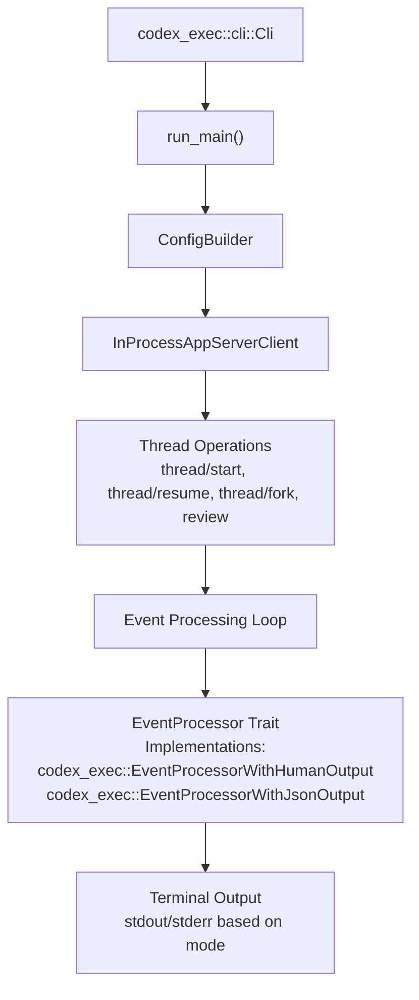
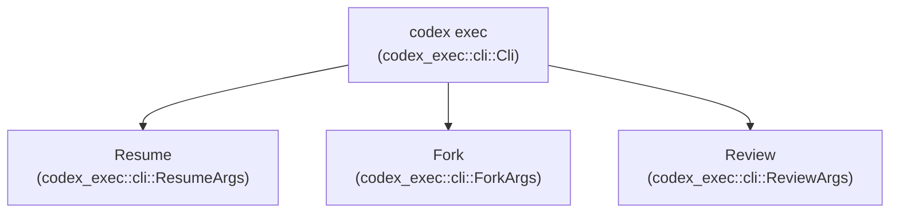
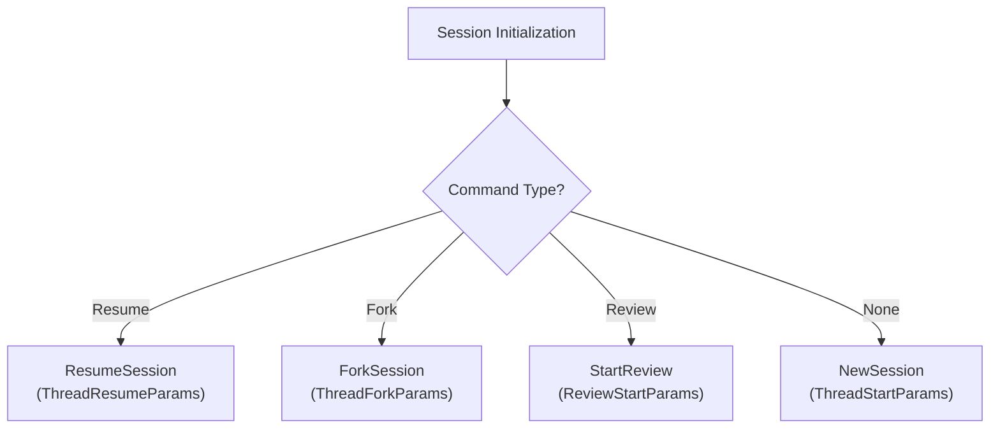
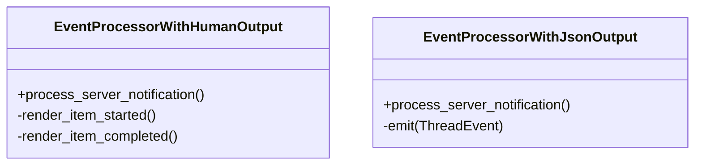

<!-- source: DeepWiki mcp.deepwiki.com · repo openai/codex · page 4.2 Headless Execution Mode (codex exec) · fetched 2026-10-26 -->

# Headless Execution Mode (codex exec)

Relevant source files

The following files were used as context for generating this wiki page:

- [.github/actions/linux-code-sign/action.yml](.github/actions/linux-code-sign/action.yml)
- [.github/actions/windows-code-sign/action.yml](.github/actions/windows-code-sign/action.yml)
- [.github/dotslash-config.json](.github/dotslash-config.json)
- [codex-cli/scripts/README.md](codex-cli/scripts/README.md)
- [codex-cli/scripts/build_npm_package.py](codex-cli/scripts/build_npm_package.py)
- [codex-rs/core/tests/suite/cli_stream.rs](codex-rs/core/tests/suite/cli_stream.rs)
- [codex-rs/exec/src/cli.rs](codex-rs/exec/src/cli.rs)
- [codex-rs/exec/src/cli_tests.rs](codex-rs/exec/src/cli_tests.rs)
- [codex-rs/exec/tests/suite/mod.rs](codex-rs/exec/tests/suite/mod.rs)
- [codex-rs/exec/tests/suite/resume.rs](codex-rs/exec/tests/suite/resume.rs)
- [codex-rs/exec/tests/suite/seatbelt.rs](codex-rs/exec/tests/suite/seatbelt.rs)
- [codex-rs/tui/src/cli.rs](codex-rs/tui/src/cli.rs)
- [codex-rs/utils/cli/src/shared_options.rs](codex-rs/utils/cli/src/shared_options.rs)
- [scripts/stage_npm_packages.py](scripts/stage_npm_packages.py)
- [sdk/typescript/README.md](sdk/typescript/README.md)
- [sdk/typescript/src/codex.ts](sdk/typescript/src/codex.ts)
- [sdk/typescript/src/codexOptions.ts](sdk/typescript/src/codexOptions.ts)
- [sdk/typescript/src/exec.ts](sdk/typescript/src/exec.ts)
- [sdk/typescript/src/index.ts](sdk/typescript/src/index.ts)
- [sdk/typescript/src/thread.ts](sdk/typescript/src/thread.ts)
- [sdk/typescript/src/threadOptions.ts](sdk/typescript/src/threadOptions.ts)
- [sdk/typescript/tests/exec.test.ts](sdk/typescript/tests/exec.test.ts)
- [sdk/typescript/tests/run.test.ts](sdk/typescript/tests/run.test.ts)
- [sdk/typescript/tests/testCodex.ts](sdk/typescript/tests/testCodex.ts)

## Purpose and Scope

The headless execution mode (`codex exec`) provides a non-interactive command-line interface for automating Codex tasks. It is designed for workflows where interaction is not possible or desired, such as CI pipelines, scripts, or programmatic integrations. Exec mode executes a single session to completion without user input, continuously processes internal and server events, and outputs results formatted for machines or human consumption before exiting. It also supports advanced features like resuming prior sessions, forking sessions, and running automated code reviews.

This page serves as a high-level parent overview of the headless execution mode. For detailed implementation mechanics, terminal formatting, approval handling, JSONL serialization, and command workflows, refer to the child pages:
- [Exec Mode Event Processing](#4.2.1)
- [Resume and Review Commands](#4.2.2)

---

## Architecture Overview

Exec mode wraps the Codex core engine with a minimal client and event processing loop, orchestrating the session lifecycle without user interaction. It initializes an in-process app server client (`InProcessAppServerClient`) to manage session threads and processes server notifications and requests in a loop until the session is completed or an error occurs.

The following diagram illustrates the flow from user input through the CLI parser (`codex_exec::cli::Cli`), execution runner, and event processors (`EventProcessorWithHumanOutput` and `EventProcessorWithJsonOutput`):

Sources:  
[codex-rs/exec/src/cli.rs:10-86](),  
[codex-rs/exec/src/lib.rs:19-72]()

---

## Command-Line Interface

### CLI Structure and Options

The `Cli` struct defines exec mode arguments utilizing `clap` for parsing and inherits many shared options from `SharedCliOptions` to harmonize configuration with other interfaces [codex-rs/exec/src/cli.rs:10-86](), [codex-rs/utils/cli/src/shared_options.rs:9-77]().

| Option | Type | Description |
|---|---|---|
| `prompt` | `Option<String>` | Initial instructions for the agent as positional arg or `-` to read stdin [codex-rs/exec/src/cli.rs:81-86]() |
| `--image, -i` | `Vec<PathBuf>` | Images attached to the prompt (supported in resume and fork) [codex-rs/exec/src/cli.rs:190-199]() |
| `--model` | `Option<String>` | Override the AI model selection (global) [codex-rs/exec/src/cli.rs:164]() |
| `--json` | `bool` | Output events as JSON Lines (JSONL) on stdout [codex-rs/exec/src/cli.rs:63-70]() |
| `--output-last-message, -o` | `Option<PathBuf>` | Write last agent message to a file [codex-rs/exec/src/cli.rs:72-79]() |
| `--ephemeral` | `bool` | Run without saving session files to disk [codex-rs/exec/src/cli.rs:40-42]() |
| `--worktree` | `bool` | Use a managed Git worktree for session workspace [codex-rs/exec/src/cli.rs:169]() |
| `--output-schema` | `Option<PathBuf>` | Path to a JSON Schema file describing the model's final response shape [codex-rs/exec/src/cli.rs:53-56]() |
| `--cyber-access-program` | `Option<CyberAccessProgramCliArg>` | Request an experimental Cyber access program for this turn [codex-rs/exec/src/cli.rs:31-34]() |
| `--ignore-user-config` | `bool` | Do not load `$CODEX_HOME/config.toml` [codex-rs/exec/src/cli.rs:44-46]() |
| `--ignore-rules` | `bool` | Do not load user or project execpolicy `.rules` files [codex-rs/exec/src/cli.rs:48-50]() |

Sources:  
[codex-rs/exec/src/cli.rs:10-86](),  
[codex-rs/utils/cli/src/shared_options.rs:9-77]()

### Subcommands

Exec mode supports three main subcommands (`Resume`, `Fork`, and `Review`) implemented as enum variants in `Command` [codex-rs/exec/src/cli.rs:172-182]().

Sources:  
[codex-rs/exec/src/cli.rs:172-182]()

---

## Execution Flow

The session lifecycle is managed by initializing the appropriate thread parameters based on the requested subcommand [codex-rs/exec/src/cli.rs:172-182]().

For details on how resumption state, rollout files, and sub-agent delegation operate during these flows, see [Resume and Review Commands](#4.2.2).

Sources:  
[codex-rs/exec/src/cli.rs:172-182]()

---

## Event Processing

Exec mode handles a continuous stream of server notifications and requests through generalized event processing interfaces.

### EventProcessor Implementations

The event processors handle the incoming event stream and format output for human readability or programmatic consumption [codex-rs/exec/src/lib.rs:115-118]().

For deep technical details regarding `EventProcessorWithHumanOutput`, terminal formatting, approval handling, JSONL output mode, and `exec_events` serialization, see [Exec Mode Event Processing](#4.2.1).

Sources:  
[codex-rs/exec/src/lib.rs:115-118]()

---

## Child Pages

- [Exec Mode Event Processing](#4.2.1) — Document `EventProcessorWithHumanOutput`, terminal formatting, approval handling, JSONL output mode, and `exec_events` serialization.
- [Resume and Review Commands](#4.2.2) — Explain session resumption in exec mode and the review command's sub-agent delegation.

---

