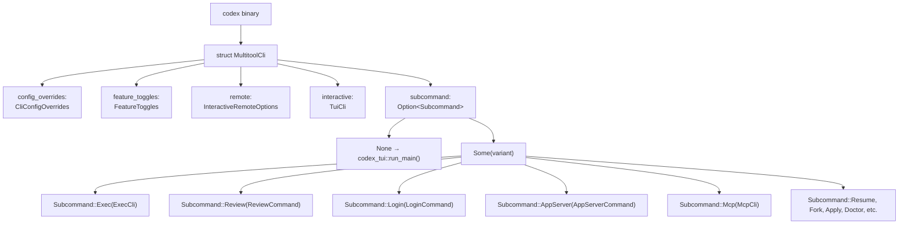
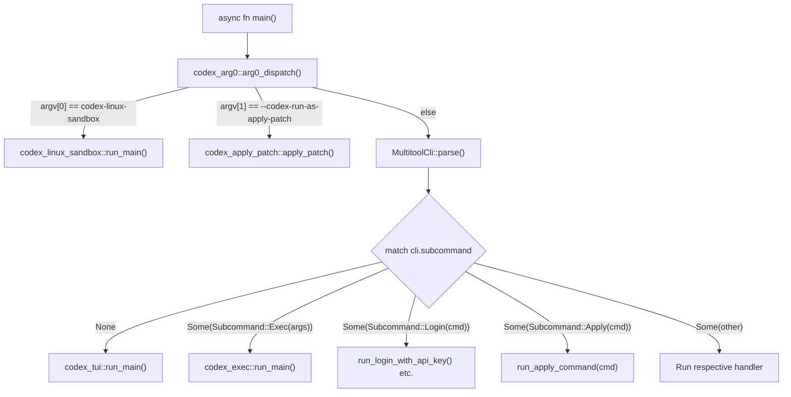
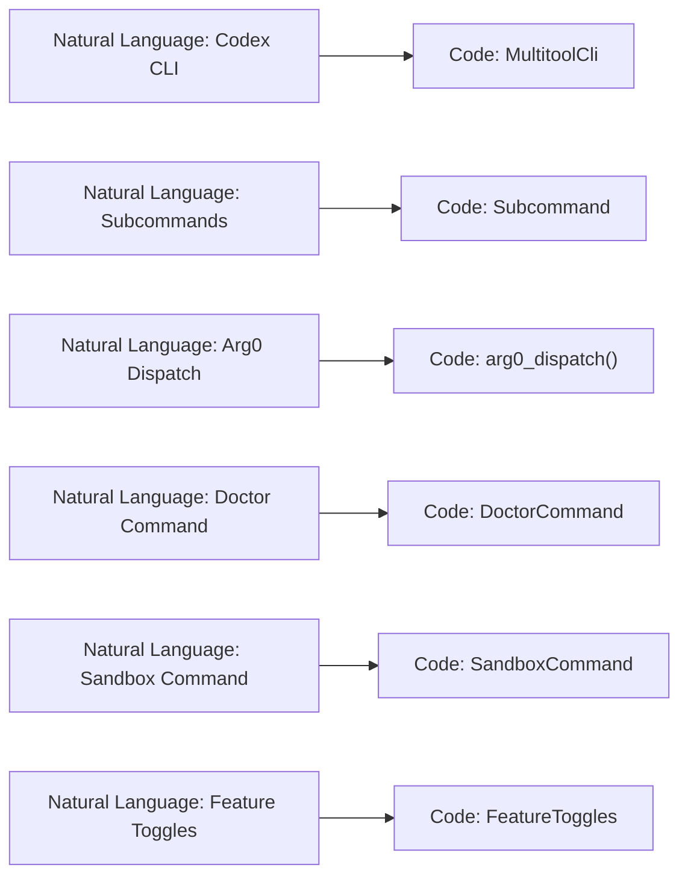

<!-- source: DeepWiki mcp.deepwiki.com · repo openai/codex · page 4.3 CLI Entry Points and Multitool Dispatch · fetched 2026-10-26 -->

# CLI Entry Points and Multitool Dispatch

<details>
<summary>Relevant source files</summary>

The following files were used as context for generating this wiki page:

- [MODULE.bazel](MODULE.bazel)
- [MODULE.bazel.lock](MODULE.bazel.lock)
- [codex-cli/bin/codex.js](codex-cli/bin/codex.js)
- [codex-rs/Cargo.lock](codex-rs/Cargo.lock)
- [codex-rs/Cargo.toml](codex-rs/Cargo.toml)
- [codex-rs/README.md](codex-rs/README.md)
- [codex-rs/app-server/Cargo.toml](codex-rs/app-server/Cargo.toml)
- [codex-rs/app-server/src/extensions.rs](codex-rs/app-server/src/extensions.rs)
- [codex-rs/app-server/src/mcp_refresh.rs](codex-rs/app-server/src/mcp_refresh.rs)
- [codex-rs/apply-patch/src/file_update.rs](codex-rs/apply-patch/src/file_update.rs)
- [codex-rs/apply-patch/src/file_update_tests.rs](codex-rs/apply-patch/src/file_update_tests.rs)
- [codex-rs/apply-patch/src/invocation.rs](codex-rs/apply-patch/src/invocation.rs)
- [codex-rs/apply-patch/src/lib.rs](codex-rs/apply-patch/src/lib.rs)
- [codex-rs/apply-patch/src/parser.rs](codex-rs/apply-patch/src/parser.rs)
- [codex-rs/apply-patch/src/seek_sequence.rs](codex-rs/apply-patch/src/seek_sequence.rs)
- [codex-rs/apply-patch/src/standalone_executable.rs](codex-rs/apply-patch/src/standalone_executable.rs)
- [codex-rs/apply-patch/src/streaming_parser.rs](codex-rs/apply-patch/src/streaming_parser.rs)
- [codex-rs/apply-patch/src/text_file.rs](codex-rs/apply-patch/src/text_file.rs)
- [codex-rs/apply-patch/tests/fixtures/scenarios/.gitattributes](codex-rs/apply-patch/tests/fixtures/scenarios/.gitattributes)
- [codex-rs/apply-patch/tests/fixtures/scenarios/020_whitespace_padded_patch_marker_lines/expected/file.txt](codex-rs/apply-patch/tests/fixtures/scenarios/020_whitespace_padded_patch_marker_lines/expected/file.txt)
- [codex-rs/apply-patch/tests/fixtures/scenarios/020_whitespace_padded_patch_marker_lines/input/file.txt](codex-rs/apply-patch/tests/fixtures/scenarios/020_whitespace_padded_patch_marker_lines/input/file.txt)
- [codex-rs/apply-patch/tests/fixtures/scenarios/020_whitespace_padded_patch_marker_lines/patch.txt](codex-rs/apply-patch/tests/fixtures/scenarios/020_whitespace_padded_patch_marker_lines/patch.txt)
- [codex-rs/apply-patch/tests/fixtures/scenarios/023_preserves_crlf_line_endings/expected/lines.txt](codex-rs/apply-patch/tests/fixtures/scenarios/023_preserves_crlf_line_endings/expected/lines.txt)
- [codex-rs/arg0/Cargo.toml](codex-rs/arg0/Cargo.toml)
- [codex-rs/arg0/src/lib.rs](codex-rs/arg0/src/lib.rs)
- [codex-rs/cli/Cargo.toml](codex-rs/cli/Cargo.toml)
- [codex-rs/cli/src/debug_sandbox.rs](codex-rs/cli/src/debug_sandbox.rs)
- [codex-rs/cli/src/doctor.rs](codex-rs/cli/src/doctor.rs)
- [codex-rs/cli/src/doctor/output.rs](codex-rs/cli/src/doctor/output.rs)
- [codex-rs/cli/src/doctor/output/detail.rs](codex-rs/cli/src/doctor/output/detail.rs)
- [codex-rs/cli/src/doctor/runtime.rs](codex-rs/cli/src/doctor/runtime.rs)
- [codex-rs/cli/src/doctor/snapshots/codex__doctor__output__tests__doctor_human_report_environment_rows.snap](codex-rs/cli/src/doctor/snapshots/codex__doctor__output__tests__doctor_human_report_environment_rows.snap)
- [codex-rs/cli/src/doctor/updates.rs](codex-rs/cli/src/doctor/updates.rs)
- [codex-rs/cli/src/lib.rs](codex-rs/cli/src/lib.rs)
- [codex-rs/cli/src/main.rs](codex-rs/cli/src/main.rs)
- [codex-rs/cli/src/snapshots/codex__doctor__tests__doctor_dumb_non_interactive_human.snap](codex-rs/cli/src/snapshots/codex__doctor__tests__doctor_dumb_non_interactive_human.snap)
- [codex-rs/cli/src/snapshots/codex__doctor__tests__terminal_check_prioritizes_unreadable_terminfo_over_warnings.snap](codex-rs/cli/src/snapshots/codex__doctor__tests__terminal_check_prioritizes_unreadable_terminfo_over_warnings.snap)
- [codex-rs/cli/tests/doctor_path_safety.rs](codex-rs/cli/tests/doctor_path_safety.rs)
- [codex-rs/codex-api/src/api_bridge.rs](codex-rs/codex-api/src/api_bridge.rs)
- [codex-rs/codex-api/src/api_bridge_tests.rs](codex-rs/codex-api/src/api_bridge_tests.rs)
- [codex-rs/codex-api/src/error.rs](codex-rs/codex-api/src/error.rs)
- [codex-rs/codex-mcp/README.md](codex-rs/codex-mcp/README.md)
- [codex-rs/codex-mcp/src/sandbox_metadata.rs](codex-rs/codex-mcp/src/sandbox_metadata.rs)
- [codex-rs/codex-mcp/src/sandbox_metadata_tests.rs](codex-rs/codex-mcp/src/sandbox_metadata_tests.rs)
- [codex-rs/core/Cargo.toml](codex-rs/core/Cargo.toml)
- [codex-rs/core/src/lib.rs](codex-rs/core/src/lib.rs)
- [codex-rs/core/src/tools/events.rs](codex-rs/core/src/tools/events.rs)
- [codex-rs/core/src/turn_diff_tracker.rs](codex-rs/core/src/turn_diff_tracker.rs)
- [codex-rs/core/src/turn_diff_tracker_tests.rs](codex-rs/core/src/turn_diff_tracker_tests.rs)
- [codex-rs/core/tests/suite/mcp_sandbox_tests.rs](codex-rs/core/tests/suite/mcp_sandbox_tests.rs)
- [codex-rs/install-context/Cargo.toml](codex-rs/install-context/Cargo.toml)
- [codex-rs/install-context/src/bundle_tests.rs](codex-rs/install-context/src/bundle_tests.rs)
- [codex-rs/install-context/src/lib.rs](codex-rs/install-context/src/lib.rs)
- [codex-rs/protocol/src/error.rs](codex-rs/protocol/src/error.rs)
- [codex-rs/protocol/src/error_tests.rs](codex-rs/protocol/src/error_tests.rs)
- [codex-rs/response-debug-context/src/lib.rs](codex-rs/response-debug-context/src/lib.rs)
- [codex-rs/tui/Cargo.toml](codex-rs/tui/Cargo.toml)
- [codex-rs/tui/src/update_action.rs](codex-rs/tui/src/update_action.rs)
- [codex-rs/tui/src/updates.rs](codex-rs/tui/src/updates.rs)
- [docs/config.md](docs/config.md)
- [docs/example-config.md](docs/example-config.md)
- [docs/skills.md](docs/skills.md)
- [docs/slash_commands.md](docs/slash_commands.md)
- [patches/BUILD.bazel](patches/BUILD.bazel)
- [patches/mxc-sdk_utf8_resources.patch](patches/mxc-sdk_utf8_resources.patch)
- [patches/rules_rs_windows_msvc_linker.patch](patches/rules_rs_windows_msvc_linker.patch)
- [patches/rules_rust_windows_msvc_direct_link_args.patch](patches/rules_rust_windows_msvc_direct_link_args.patch)

</details>


## Purpose and Scope

This page documents the **CLI entry point architecture** of the main `codex` binary (`codex-rs/cli/src/main.rs`), which serves as a multitool command-line interface orchestrating multiple modes of operation such as:

- Interactive Terminal User Interface (TUI)
- Headless execution (`exec`) mode
- App server-related operations
- Diagnostics and utility commands

It explains the main data structures and control flow for parsing CLI arguments, subcommand routing, integration of the "arg0 dispatch" mechanism (specialized binary behaviors based on the invoked executable name), feature toggles, and the special-purpose `doctor` diagnostics command.

For deep understanding of specific modes, consult the child pages:
- Interactive UI: [4.1 Terminal User Interface (TUI)]()
- Headless exec mode: [4.2 Headless Execution Mode (codex exec)]()
- App server & IDE integration: [4.5 App Server and IDE Integration]()

---

## MultitoolCli Structure and Subcommand Hierarchy

At the core of CLI parsing lies the `MultitoolCli` struct. It uses the `clap` crate for declarative argument parsing and supports rich flattening for shared CLI options. The relevant code is located in `codex-rs/cli/src/main.rs` (lines 113-144).

### `MultitoolCli` Fields

- **`config_overrides: CliConfigOverrides`**  
  Allows runtime overrides of configuration via `-c key=value` flags. This layering lets users modify settings on the command line temporarily without editing config files.  
  _[codex-rs/cli/src/main.rs:130-131]()_

- **`feature_toggles: FeatureToggles`**  
  Encapsulates runtime feature flags, enabling dynamic toggling of experimental or optional capabilities. The feature flag system validates keys at runtime.  
  _[codex-rs/cli/src/main.rs:133-134]()_

- **`remote: InteractiveRemoteOptions`**  
  Remote-specific CLI options related to interactive sessions (used internally in specific modes).  
  _[codex-rs/cli/src/main.rs:136-137]()_

- **`interactive: TuiCli`**  
  All options related to the interactive terminal UI are flattened here, enabling those flags to be present globally on the main CLI without subcommand. Defaults to starting the TUI if no subcommand is provided.  
  _[codex-rs/cli/src/main.rs:139-140]()_

- **`subcommand: Option<Subcommand>`**  
  Optional subcommand enum indicating specific CLI commands. If absent, triggers interactive mode.  
  _[codex-rs/cli/src/main.rs:142-143]()_

### Subcommand Variants

The `Subcommand` enum lists all supported subcommands:

| Variant Name | Description                              | Corresponding Struct              | Crate                   |
|--------------|------------------------------------------|---------------------------------|-------------------------|
| `None`       | Default: run interactive TUI              | Uses flattened `TuiCli`          | `codex-tui`             |
| `Exec`       | Headless non-interactive exec mode         | `ExecCli`                       | `codex-exec`            |
| `Review`     | Code review mode                           | `ReviewCommand`                 | `codex-cli`             |
| `Login`      | Manage login/authentication                | `LoginCommand`                  | `codex-cli`             |
| `Logout`     | Remove stored credentials                   | `LogoutCommand`                 | `codex-cli`             |
| `Mcp`        | Manage MCP servers                          | `McpCli`                       | `codex-cli`             |
| `AppServer`  | Run JSON-RPC app server (experimental)     | `AppServerCommand`              | `codex-cli`             |
| `Doctor`     | Run diagnostic checks on installation      | `DoctorCommand`                 | `codex-cli`             |
| `Apply`      | Apply patches/diffs produced by Codex      | `ApplyCommand`                 | `codex-chatgpt`         |
| `Sandbox`    | Run subcommands inside sandboxed environment| `SandboxCommand`                | `codex-cli`             |
| `Completion` | Generate shell completions                   | `CompletionCommand`             | `codex-cli`             |
| ...          | Other internal and hidden commands          | Various                        | Mostly `codex-cli`       |

_This list is declaratively defined with `clap` structs in `main.rs` between lines 146-205._

### Diagram: MultitoolCli Structure and Field Composition



---

## Subcommand Routing Table

This table summarizes principal subcommands with their enum variants, handling structs, crates, and core purposes:

| Subcommand      | Enum Variant                | Struct                      | Crate             | Purpose                                    |
|-----------------|-----------------------------|-----------------------------|-------------------|--------------------------------------------|
| *(none)*        | N/A                         | `TuiCli`                   | `codex-tui`       | Default interactive terminal UI mode       |
| `exec`          | `Subcommand::Exec`           | `ExecCli`                  | `codex-exec`      | Headless non-interactive exec mode         |
| `review`        | `Subcommand::Review`         | `ReviewCommand`            | `codex-cli`       | Code review mode                           |
| `login`         | `Subcommand::Login`          | `LoginCommand`             | `codex-cli`       | Authentication management                   |
| `logout`        | `Subcommand::Logout`         | `LogoutCommand`            | `codex-cli`       | Remove stored credentials                   |
| `mcp`           | `Subcommand::Mcp`            | `McpCli`                   | `codex-cli`       | Manage external MCP servers                 |
| `app-server`    | `Subcommand::AppServer`      | `AppServerCommand`         | `codex-cli`       | JSON-RPC server for IDE integrations       |
| `doctor`        | `Subcommand::Doctor`         | `DoctorCommand`            | `codex-cli`       | Diagnose local installation & runtime health |
| `sandbox`       | `Subcommand::Sandbox`        | `SandboxCommand`           | `codex-cli`       | Run commands inside a Codex sandbox        |
| `completion`    | `Subcommand::Completion`     | `CompletionCommand`        | `codex-cli`       | Generate shell completion scripts           |
| `apply`         | `Subcommand::Apply`          | `ApplyCommand`             | `codex-chatgpt`   | Apply patches/diffs produced by Codex agents |

---

## Dispatch Flow and Main Function

The `main` function (`codex-rs/cli/src/main.rs`, lines 1-144) implements the overall startup and dispatch logic:

1. **Arg0 Dispatch:** Using `codex_arg0::arg0_dispatch()`, the function first checks the executable name and first argument (`argv[0]` and `argv[1]`) to detect if execution should be rerouted to specialized binaries or modes before the usual CLI parsing occurs. This includes internal aliases like `codex-linux-sandbox` or patch application executables.  
   _[codex-rs/arg0/src/lib.rs:59-147]()_

2. **Environment Preparation:** Loads dotenv files (`.env`) and sets up environment PATH guards to protect internal helper binaries.

3. **CLI Parsing:** Parses the normal CLI options and subcommands into `MultitoolCli` with Clap.

4. **Subcommand Routing:** Matches on the parsed subcommand and dispatches to the appropriate handler. If no subcommand is provided, the interactive terminal UI (`codex_tui::run_main()`) is launched.

5. **Exit Handling:** Gracefully handles errors and result codes, managing terminal modes and update signals.

### Diagram: Main Function Dispatch Flow



---

## Arg0 Dispatch for Specialized Binaries

The `codex-arg0` crate implements a preliminary dispatch based on the executable path or the first argument. This approach allows a single binary to act as multiple specialized tools depending on how it is invoked, known as "arg0 dispatch". This mechanism prevents loading the full CLI parser when running helper subprocesses or internal binaries.

### Supported Dispatch Targets

| Trigger (`argv[0]` or `argv[1]`)                       | Dispatch Target                      | Crate                 |
|-------------------------------------------------------|------------------------------------|-----------------------|
| `argv[0] == "codex-linux-sandbox"`                    | `codex_linux_sandbox::run_main()`  | `codex-linux-sandbox` |
| `argv[0]` == `"apply_patch"` or `"applypatch"`         | `codex_apply_patch::main()`         | `codex-apply-patch`   |
| `argv[1] == "--codex-run-as-apply-patch"`             | `codex_apply_patch::apply_patch()` | `codex-apply-patch`   |
| `argv[1] == "--codex-fs-helper"`                       | `codex_exec_server::run_fs_helper_main()` | `codex-exec-server` |

This mechanism enables highly modular invocation patterns and internal binary aliasing without increasing the set of distinct physical binaries.

---

## Default Mode Selection: Interactive TUI

If the `codex` binary is invoked **without any subcommand**, the CLI will default to launching the interactive Terminal User Interface (TUI). Because all TUI-related flags and options are flattened into the top-level CLI `MultitoolCli` struct, the user can supply those options directly on the command line with no subcommand prefix.

This default behavior is implemented by running the `codex_tui::run_main()` async function if `MultitoolCli.subcommand` is `None`.  

---

## The Doctor Command

The `doctor` command provides diagnostics on the local Codex installation, runtime environment, configuration, authentication status, and filesystem health, without side effects. It is implemented in `codex-rs/cli/src/doctor.rs` and exposes a `DoctorCommand` struct with relevant options.

### `DoctorCommand` Options

- `--json` (bool): Emit a fully redacted, machine-readable diagnostic report in JSON rather than human-readable text.
- `--summary` (bool): Limit output to grouped summaries and counts (compact display).
- `--all` (bool): Expand all lists and details in the human-readable output.
- `--no-color` and `--ascii` (bool): Control ANSI coloring and use ASCII-only decorations.

The doctor command carefully crafts tests that cover installation paths, PATH environment entries, config health, network reachability, terminal capabilities, and state database integrity. It is designed to be *read-only* and safe to run when troubleshooting.

---

## Sandbox and Permission Profile Routing

The `sandbox` subcommand facilitates running commands in various platform-specific sandbox environments with enforced permission profiles:

- **macOS:** Uses the Seatbelt sandbox implementation via `codex-sandboxing::seatbelt` [macOS code in `codex-rs/cli/src/debug_sandbox.rs` and related modules].  
- **Linux:** Uses the Landlock kernel sandbox implementation (seccomp), implemented in `codex-sandboxing::landlock` and hooked via `codex-arg0` for the specialized `codex-linux-sandbox` binary.  
- **Windows:** Uses Windows-specific sandboxing/token confinement technologies via the `codex-windows-sandbox` crate.

At runtime, the sandbox command variants invoke corresponding platform subcommands or executables using prepared permission profiles and environment configurations.

---

## Common CLI Infrastructure Components

### Config Overrides: `CliConfigOverrides`

- Provided by the `codex-utils-cli` crate.
- Allows arbitrary sets of configuration key-value overrides via repeated `-c key=value` arguments.
- These overrides are merged on top of the layered config loading system at runtime.  
- Implemented as a flattened clap argument struct inside `MultitoolCli`.

### Feature Toggles: `FeatureToggles`

- Provided by the `codex-features` crate.
- Supports enabling or disabling runtime features by known feature keys.
- Validates keys as recognized feature flags and their respective lifecycle stages.
- Ensures safe experimentation and gradual rollout of features.

---

## Exit Handling and Post-Run Updates

The interactive TUI and other CLI subcommands return an `AppExitInfo` structure that wraps:

- The `ExitReason`, detailing intentional or error exit causes.
- An `UpdateAction` enum indicating whether post-run update or cleanup actions are triggered.

This mechanism facilitates orchestrating self-updates and internal housekeeping after the primary CLI operation terminates, ensuring consistent terminal reset and resource cleanup.

---

## Appendix: Terminology Mapping Diagram (Natural Language Space to Code Entities)



---

## Appendix: High-Level Dispatch Flow (Natural Language to Code Entities)

```mermaid
flowchart TD
    UserRuns["User executes `codex` binary"] --> Arg0Dispatch["codex_arg0::arg0_dispatch()"]
    Arg0Dispatch -->|Match arg0/arg1 suffix| SpecializedBin["Run specialized handler<br/>(e.g., codex_linux_sandbox::run_main)"]
    Arg0Dispatch -->|No suffix match| ParseCli["MultitoolCli::parse()"]
    ParseCli --> SubcommandMatch{"match MultitoolCli.subcommand"}
    SubcommandMatch -->|None| TuiDefault["codex_tui::run_main()"]
    SubcommandMatch -->|Some(Subcommand::Exec)| ExecMode["codex_exec::run_main()"]
    SubcommandMatch -->|Some(Subcommand::Login)| LoginCmd["run_login_with_api_key()"]
    SubcommandMatch -->|Some(Subcommand::Doctor)| DoctorCmd["run doctor diagnostics"]
    SubcommandMatch -->|Some(Subcommand::Sandbox)| SandboxCmd["dispatch platform sandbox"]
```

---

# Summary

The `codex` CLI binary is a versatile multitool dispatch binary utilizing Clap-based declarative subcommand parsing paired with an arg0 pre-dispatch mechanism to conditionally run specialized binaries and commands. The `MultitoolCli` struct centrally models the CLI arguments, featuring config overrides, feature toggles, remote options, an interactive TUI fallback, and a large, extensible set of subcommands.

Key components include:

- `codex_arg0::arg0_dispatch()` for efficient early dispatch by executable name or argument.
- The richly layered `MultitoolCli` structure for global CLI options + subcommands.
- Subcommands spanning interactive UI, exec automation, authentication, MCP server management, sandboxing, patch application, and diagnostic `doctor`.
- The `doctor` command offering a safe, read-only installation and environment diagnostic report.
- Platform-specific sandbox command delegation integrating macOS Seatbelt, Linux Landlock, and Windows sandbox technologies.
- Runtime feature toggles enabling gradual feature enablement with validation.
- Exit handling yielding structured results for orchestrated cleanup and updates.

This architecture centralizes core CLI entrypoint logic, neatly separating subcommand parsing, dispatch, and execution, ensuring extensibility and maintainability for Codex's diverse command-line interface needs.

---

# Sources

- `codex-rs/cli/src/main.rs:1-144,113-216`  
- `codex-rs/cli/src/doctor.rs:1-188`  
- `codex-rs/arg0/src/lib.rs:59-147`  
- `codex-rs/cli/src/debug_sandbox.rs:1-130`  
- `codex-rs/cli/src/main.rs:130-134,136-140`

---

