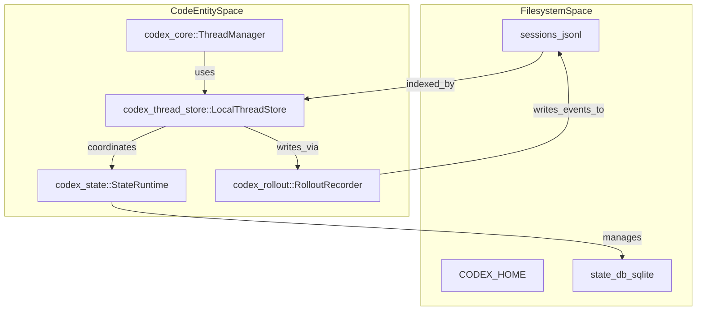
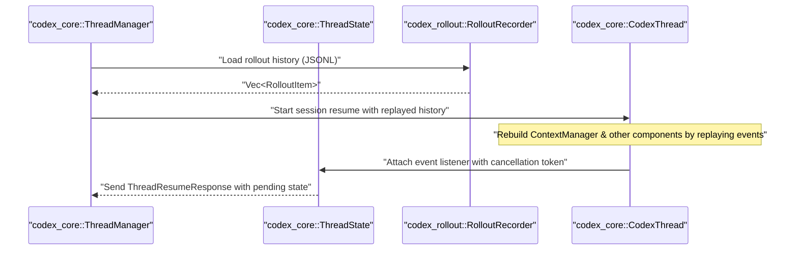
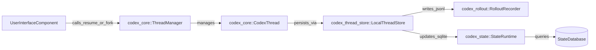
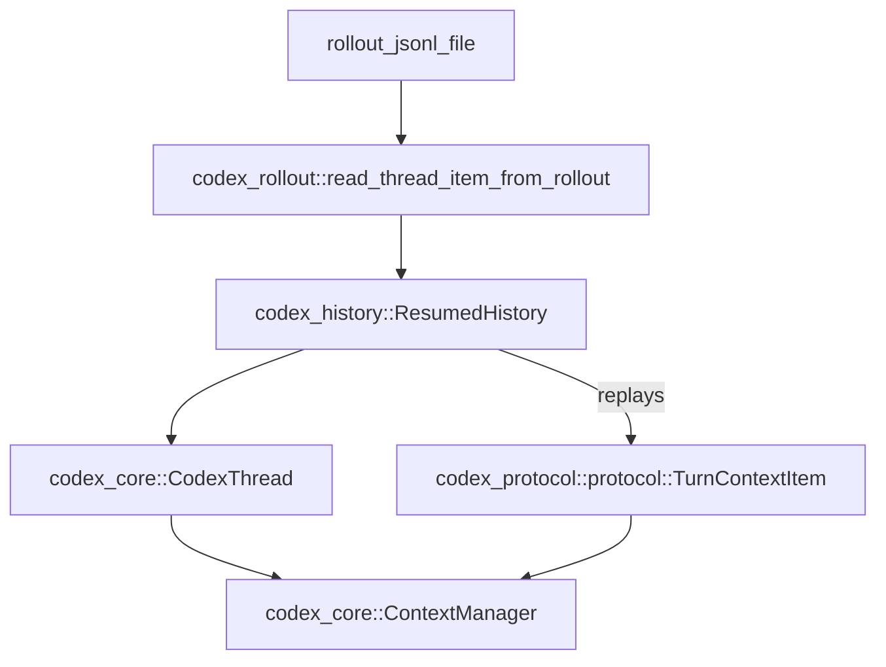

<!-- source: DeepWiki mcp.deepwiki.com · repo openai/codex · page 4.4 Session Resumption and Forking · fetched 2026-10-26 -->

# Session Resumption and Forking

Relevant source files

The following files were used as context for generating this wiki page:

- [codex-rs/app-server-protocol/schema/json/v2/ThreadForkResponse.json](codex-rs/app-server-protocol/schema/json/v2/ThreadForkResponse.json)
- [codex-rs/app-server-protocol/schema/json/v2/ThreadListResponse.json](codex-rs/app-server-protocol/schema/json/v2/ThreadListResponse.json)
- [codex-rs/app-server-protocol/schema/json/v2/ThreadMetadataUpdateResponse.json](codex-rs/app-server-protocol/schema/json/v2/ThreadMetadataUpdateResponse.json)
- [codex-rs/app-server-protocol/schema/json/v2/ThreadReadResponse.json](codex-rs/app-server-protocol/schema/json/v2/ThreadReadResponse.json)
- [codex-rs/app-server-protocol/schema/json/v2/ThreadResumeResponse.json](codex-rs/app-server-protocol/schema/json/v2/ThreadResumeResponse.json)
- [codex-rs/app-server-protocol/schema/json/v2/ThreadStartResponse.json](codex-rs/app-server-protocol/schema/json/v2/ThreadStartResponse.json)
- [codex-rs/app-server-protocol/schema/json/v2/ThreadStartedNotification.json](codex-rs/app-server-protocol/schema/json/v2/ThreadStartedNotification.json)
- [codex-rs/app-server-protocol/schema/json/v2/ThreadUnarchiveResponse.json](codex-rs/app-server-protocol/schema/json/v2/ThreadUnarchiveResponse.json)
- [codex-rs/app-server/tests/suite/conversation_summary.rs](codex-rs/app-server/tests/suite/conversation_summary.rs)
- [codex-rs/app-server/tests/suite/v2/remote_thread_store.rs](codex-rs/app-server/tests/suite/v2/remote_thread_store.rs)
- [codex-rs/app-server/tests/suite/v2/thread_read.rs](codex-rs/app-server/tests/suite/v2/thread_read.rs)
- [codex-rs/app-server/tests/suite/v2/thread_unarchive.rs](codex-rs/app-server/tests/suite/v2/thread_unarchive.rs)
- [codex-rs/thread-store/src/in_memory.rs](codex-rs/thread-store/src/in_memory.rs)
- [codex-rs/thread-store/src/lib.rs](codex-rs/thread-store/src/lib.rs)
- [codex-rs/thread-store/src/live_thread.rs](codex-rs/thread-store/src/live_thread.rs)
- [codex-rs/thread-store/src/local/mod.rs](codex-rs/thread-store/src/local/mod.rs)
- [codex-rs/thread-store/src/store.rs](codex-rs/thread-store/src/store.rs)
- [codex-rs/thread-store/src/types.rs](codex-rs/thread-store/src/types.rs)

## Purpose and Scope

This document describes how Codex manages session continuity through resumption and forking. 

- **Session Resumption** enables users to continue a previous conversation thread by replaying persisted events, restoring the session’s exact state including context, memory, and multi-agent collaborations [codex-rs/thread-store/src/local/live_writer.rs:40-136]().
- **Session Forking** creates a new thread branched off a parent thread’s history, allowing divergent explorations or delegation to sub-agents without mutating the original session [codex-rs/thread-store/src/types.rs:87-90]().

This page explains the different lifecycle operations (`thread/resume` vs. `thread/fork`), the event replay mechanism used during resumption, state restoration details, and external agent session migrations. It also highlights the thread persistence architecture and data flow involving JSONL rollout files, SQLite state, and live writers, grounding these concepts with code-level insights.

Sources: [codex-rs/thread-store/src/types.rs:1-134](), [codex-rs/thread-store/src/local/live_writer.rs:40-136]()

---

## Core Data Structures

The following key data structures coordinate session resumption and forking:

| Concept                         | Code Entity                                          | Description                                                        |
|--------------------------------|-----------------------------------------------------|--------------------------------------------------------------------|
| **Thread identifier**           | `codex_protocol::ThreadId`                           | Uniquely identifies a conversation thread (session) [codex-rs/thread-store/src/types.rs:10]() |
| **Rollout items**               | `codex_rollout::RolloutItem`                         | Discrete persisted events in the thread history [codex-rs/thread-store/src/types.rs:25]() |
| **Thread persistence metadata**| `codex_thread_store::ThreadPersistenceMetadata`     | Metadata including working directory, model provider, memory mode [codex-rs/thread-store/src/types.rs:56-65]() |
| **Create thread params**        | `codex_thread_store::CreateThreadParams`            | Parameters to persist a newly created thread [codex-rs/thread-store/src/types.rs:73-119]()   |
| **Resume thread params**        | `codex_thread_store::ResumeThreadParams`            | Parameters to resume an existing persisted thread [codex-rs/thread-store/src/types.rs:123-134]() |
| **Thread history mode**         | `codex_protocol::protocol::ThreadHistoryMode`       | Legacy vs paginated history persistence modes [codex-rs/thread-store/src/types.rs:21]()     |
| **Live thread recorder**        | `codex_rollout::RolloutRecorder`                     | Writes live rollout of session events to JSONL [codex-rs/thread-store/src/local/live_writer.rs:117-122]() |

Sources: [codex-rs/thread-store/src/types.rs:1-134](), [codex-rs/thread-store/src/local/live_writer.rs:117-122]()

---

## Thread Storage and Persistence Architecture

Codex persists conversations as ordered sequences of `RolloutItem` events in rollout JSONL files and indexes session metadata in a SQLite database. This enables efficient querying and consistency checks.

### Diagram: Thread Persistence Architecture

- The `ThreadManager` orchestrates thread lifecycles and dispatches storage calls to the `ThreadStore`.
- The `LocalThreadStore` implementation manages bidirectional synchronization between the JSONL files and SQLite [codex-rs/thread-store/src/local/mod.rs:143-152]().
- The `RolloutRecorder` streams in-memory events to durable JSONL files per thread [codex-rs/thread-store/src/local/live_writer.rs:117-122]().
- The `StateRuntime` manages the SQLite `state.db` indexing threads and goals [codex-rs/thread-store/src/in_memory.rs:77-81]().

Sources: [codex-rs/thread-store/src/local/mod.rs:143-152](), [codex-rs/thread-store/src/local/live_writer.rs:117-122](), [codex-rs/thread-store/src/in_memory.rs:77-81]()

---

## Session Resumption and Event Replay

Session resumption is initiated via `thread/resume`, where a stored session is restored by replaying persisted rollout events. This reconstruction guarantees consistent session state, conversation memory, and runtime configurations aligned with the original session.

### Resumption Workflow

- The rollout history is read from JSONL and replayed as `RolloutItem`s [codex-rs/thread-store/src/types.rs:130]().
- `CodexThread` rehydrates its internal context by processing each event sequentially, restoring conversation memory, tool state, and multi-agent information.
- `ThreadState` synchronizes event listeners with resume progress via generation tokens to maintain correct notification ordering.

### State Restoration Details

- **History Reconstruction:** Events such as `SessionMeta`, `AgentMessageEvent`, and `ResponseItem` are interpreted to recreate the conversation context snapshot and active turn state [codex-rs/thread-store/src/local/live_writer.rs:75-96]().

- **Resume Settings Validation:** The `resume_thread` method compares stored thread metadata to current runtime configuration, ensuring working directory and model provider parameters are correctly validated [codex-rs/thread-store/src/local/live_writer.rs:98-111]().

Sources: [codex-rs/thread-store/src/types.rs:130](), [codex-rs/thread-store/src/local/live_writer.rs:75-111]()

---

## Forking and Lineage Tracking

Forking enables divergence in conversation threads by creating a new thread originating from a given parent thread's history. Forked threads can explore alternative directions or act as sub-agents with independent lifecycles.

### Forking Implementation

- `ThreadForkParams` specifies the source thread ID and configuration overrides for the fork [codex-rs/app-server/tests/suite/v2/thread_read.rs:23-24]().
- The system copies relevant history and records parent-child relationship edges in the local store state [codex-rs/thread-store/src/types.rs:87-90]().
- Sub-agents track their parent via `parent_thread_id` and use `ThreadSource` to distinguish sub-agents from user-initiated threads [codex-rs/thread-store/src/types.rs:89-94]().

Sources: [codex-rs/app-server/tests/suite/v2/thread_read.rs:23-24](), [codex-rs/thread-store/src/types.rs:87-94]()

---

## External Agent Session Migration

Codex supports migrating sessions from external AI agents through dedicated migration and state extraction pipelines.

### Migration Flow

- External conversation histories and metadata are mapped into `RolloutItem` sequences and indexed via `LocalThreadStore` [codex-rs/thread-store/src/local/mod.rs:133-145]().
- Migrated states integrate into Codex's persistence layers, aligning with legacy and paginated history modes [codex-rs/thread-store/src/types.rs:106-111]().

Sources: [codex-rs/thread-store/src/local/mod.rs:133-145](), [codex-rs/thread-store/src/types.rs:106-111]()

---

## Additional Mermaid Diagrams

### Diagram: Session Lifecycle Management Bridge

Sources: [codex-rs/thread-store/src/local/mod.rs:143-152](), [codex-rs/thread-store/src/local/live_writer.rs:117-122](), [codex-rs/thread-store/src/in_memory.rs:77-81]()

### Diagram: Event Replay Bridge

Sources: [codex-rs/thread-store/src/local/mod.rs:133-145](), [codex-rs/thread-store/src/local/live_writer.rs:40-136]()

---

