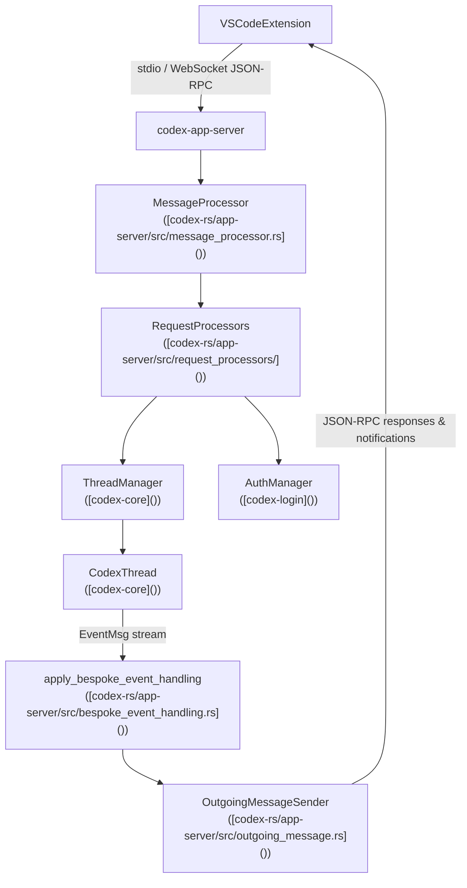
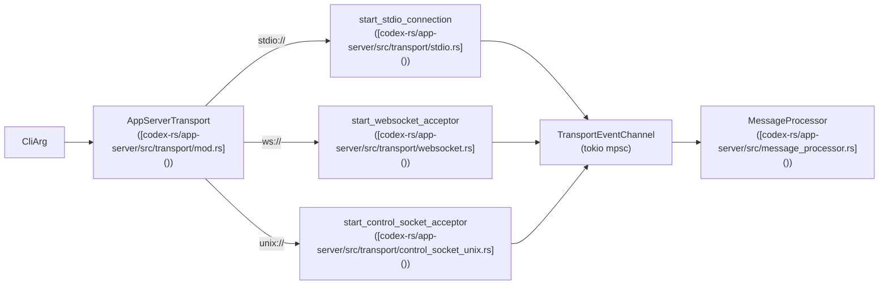
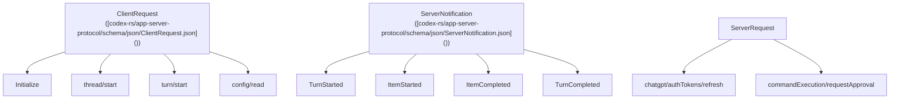
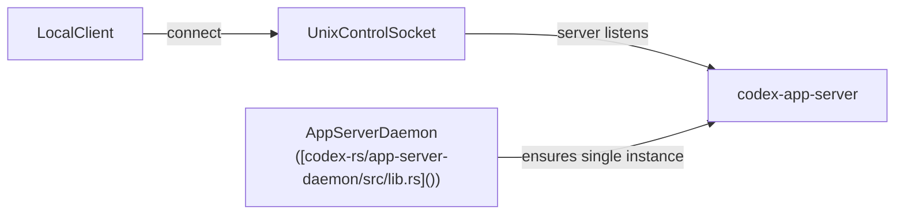

<!-- source: DeepWiki mcp.deepwiki.com · repo openai/codex · page 4.5 App Server and IDE Integration · fetched 2026-10-26 -->

# App Server and IDE Integration

Relevant source files

The following files were used as context for generating this wiki page:

- [codex-rs/.cargo/audit.toml](codex-rs/.cargo/audit.toml)
- [codex-rs/app-server-daemon/Cargo.toml](codex-rs/app-server-daemon/Cargo.toml)
- [codex-rs/app-server-daemon/README.md](codex-rs/app-server-daemon/README.md)
- [codex-rs/app-server-daemon/src/backend/mod.rs](codex-rs/app-server-daemon/src/backend/mod.rs)
- [codex-rs/app-server-daemon/src/backend/pid.rs](codex-rs/app-server-daemon/src/backend/pid.rs)
- [codex-rs/app-server-daemon/src/backend/pid_start.rs](codex-rs/app-server-daemon/src/backend/pid_start.rs)
- [codex-rs/app-server-daemon/src/backend/pid_tests.rs](codex-rs/app-server-daemon/src/backend/pid_tests.rs)
- [codex-rs/app-server-daemon/src/background_command.rs](codex-rs/app-server-daemon/src/background_command.rs)
- [codex-rs/app-server-daemon/src/client.rs](codex-rs/app-server-daemon/src/client.rs)
- [codex-rs/app-server-daemon/src/lib.rs](codex-rs/app-server-daemon/src/lib.rs)
- [codex-rs/app-server-daemon/src/managed_install.rs](codex-rs/app-server-daemon/src/managed_install.rs)
- [codex-rs/app-server-daemon/src/managed_install_path_tests.rs](codex-rs/app-server-daemon/src/managed_install_path_tests.rs)
- [codex-rs/app-server-daemon/src/managed_install_tests.rs](codex-rs/app-server-daemon/src/managed_install_tests.rs)
- [codex-rs/app-server-daemon/src/manual_update.rs](codex-rs/app-server-daemon/src/manual_update.rs)
- [codex-rs/app-server-daemon/src/migration.rs](codex-rs/app-server-daemon/src/migration.rs)
- [codex-rs/app-server-daemon/src/prepare_install.rs](codex-rs/app-server-daemon/src/prepare_install.rs)
- [codex-rs/app-server-daemon/src/prepare_install_tests.rs](codex-rs/app-server-daemon/src/prepare_install_tests.rs)
- [codex-rs/app-server-daemon/src/prepare_install_windows.rs](codex-rs/app-server-daemon/src/prepare_install_windows.rs)
- [codex-rs/app-server-daemon/src/prepare_install_windows_tests.rs](codex-rs/app-server-daemon/src/prepare_install_windows_tests.rs)
- [codex-rs/app-server-daemon/src/release_pruning.rs](codex-rs/app-server-daemon/src/release_pruning.rs)
- [codex-rs/app-server-daemon/src/settings.rs](codex-rs/app-server-daemon/src/settings.rs)
- [codex-rs/app-server-daemon/src/settings_tests.rs](codex-rs/app-server-daemon/src/settings_tests.rs)
- [codex-rs/app-server-daemon/src/update_loop.rs](codex-rs/app-server-daemon/src/update_loop.rs)
- [codex-rs/app-server-daemon/src/update_loop_tests.rs](codex-rs/app-server-daemon/src/update_loop_tests.rs)
- [codex-rs/app-server-protocol/schema/json/ClientRequest.json](codex-rs/app-server-protocol/schema/json/ClientRequest.json)
- [codex-rs/app-server-protocol/schema/json/ServerNotification.json](codex-rs/app-server-protocol/schema/json/ServerNotification.json)
- [codex-rs/app-server-protocol/schema/json/codex_app_server_protocol.schemas.json](codex-rs/app-server-protocol/schema/json/codex_app_server_protocol.schemas.json)
- [codex-rs/app-server-protocol/schema/json/codex_app_server_protocol.v2.schemas.json](codex-rs/app-server-protocol/schema/json/codex_app_server_protocol.v2.schemas.json)
- [codex-rs/app-server-protocol/schema/precomputed/app-server-exports-experimental.json.zst](codex-rs/app-server-protocol/schema/precomputed/app-server-exports-experimental.json.zst)
- [codex-rs/app-server-protocol/schema/precomputed/app-server-exports-stable.json.zst](codex-rs/app-server-protocol/schema/precomputed/app-server-exports-stable.json.zst)
- [codex-rs/app-server-protocol/schema/typescript/ClientRequest.ts](codex-rs/app-server-protocol/schema/typescript/ClientRequest.ts)
- [codex-rs/app-server-protocol/schema/typescript/v2/index.ts](codex-rs/app-server-protocol/schema/typescript/v2/index.ts)
- [codex-rs/app-server-protocol/src/protocol/common.rs](codex-rs/app-server-protocol/src/protocol/common.rs)
- [codex-rs/app-server-protocol/src/protocol/v2/remote_control.rs](codex-rs/app-server-protocol/src/protocol/v2/remote_control.rs)
- [codex-rs/app-server-protocol/src/protocol/v2/tests.rs](codex-rs/app-server-protocol/src/protocol/v2/tests.rs)
- [codex-rs/app-server-protocol/src/protocol/v2/thread.rs](codex-rs/app-server-protocol/src/protocol/v2/thread.rs)
- [codex-rs/app-server-transport/Cargo.toml](codex-rs/app-server-transport/Cargo.toml)
- [codex-rs/app-server-transport/src/daemon_shutdown.rs](codex-rs/app-server-transport/src/daemon_shutdown.rs)
- [codex-rs/app-server-transport/src/lib.rs](codex-rs/app-server-transport/src/lib.rs)
- [codex-rs/app-server-transport/src/transport/mod.rs](codex-rs/app-server-transport/src/transport/mod.rs)
- [codex-rs/app-server-transport/src/transport/remote_control/auth.rs](codex-rs/app-server-transport/src/transport/remote_control/auth.rs)
- [codex-rs/app-server-transport/src/transport/remote_control/clients.rs](codex-rs/app-server-transport/src/transport/remote_control/clients.rs)
- [codex-rs/app-server-transport/src/transport/remote_control/enroll.rs](codex-rs/app-server-transport/src/transport/remote_control/enroll.rs)
- [codex-rs/app-server-transport/src/transport/remote_control/mod.rs](codex-rs/app-server-transport/src/transport/remote_control/mod.rs)
- [codex-rs/app-server-transport/src/transport/remote_control/protocol.rs](codex-rs/app-server-transport/src/transport/remote_control/protocol.rs)
- [codex-rs/app-server-transport/src/transport/remote_control/server_api.rs](codex-rs/app-server-transport/src/transport/remote_control/server_api.rs)
- [codex-rs/app-server-transport/src/transport/remote_control/server_api_tests.rs](codex-rs/app-server-transport/src/transport/remote_control/server_api_tests.rs)
- [codex-rs/app-server-transport/src/transport/remote_control/tests.rs](codex-rs/app-server-transport/src/transport/remote_control/tests.rs)
- [codex-rs/app-server-transport/src/transport/remote_control/tests/clients_tests.rs](codex-rs/app-server-transport/src/transport/remote_control/tests/clients_tests.rs)
- [codex-rs/app-server-transport/src/transport/remote_control/tests/pairing_tests.rs](codex-rs/app-server-transport/src/transport/remote_control/tests/pairing_tests.rs)
- [codex-rs/app-server-transport/src/transport/remote_control/tests/retry_tests.rs](codex-rs/app-server-transport/src/transport/remote_control/tests/retry_tests.rs)
- [codex-rs/app-server-transport/src/transport/remote_control/websocket.rs](codex-rs/app-server-transport/src/transport/remote_control/websocket.rs)
- [codex-rs/app-server-transport/src/transport/remote_control/websocket_refresh_tests.rs](codex-rs/app-server-transport/src/transport/remote_control/websocket_refresh_tests.rs)
- [codex-rs/app-server-transport/src/transport/remote_control/websocket_retry_tests.rs](codex-rs/app-server-transport/src/transport/remote_control/websocket_retry_tests.rs)
- [codex-rs/app-server-transport/src/transport/unix_socket.rs](codex-rs/app-server-transport/src/transport/unix_socket.rs)
- [codex-rs/app-server-transport/src/transport/unix_socket_tests.rs](codex-rs/app-server-transport/src/transport/unix_socket_tests.rs)
- [codex-rs/app-server-transport/src/transport/websocket.rs](codex-rs/app-server-transport/src/transport/websocket.rs)
- [codex-rs/app-server-transport/src/transport/websocket_compression_tests.rs](codex-rs/app-server-transport/src/transport/websocket_compression_tests.rs)
- [codex-rs/app-server-transport/src/websocket_compression.rs](codex-rs/app-server-transport/src/websocket_compression.rs)
- [codex-rs/app-server-transport/src/websocket_compression_tests.rs](codex-rs/app-server-transport/src/websocket_compression_tests.rs)
- [codex-rs/app-server/README.md](codex-rs/app-server/README.md)
- [codex-rs/app-server/src/lib.rs](codex-rs/app-server/src/lib.rs)
- [codex-rs/app-server/src/main.rs](codex-rs/app-server/src/main.rs)
- [codex-rs/app-server/src/message_processor.rs](codex-rs/app-server/src/message_processor.rs)
- [codex-rs/app-server/src/request_processors.rs](codex-rs/app-server/src/request_processors.rs)
- [codex-rs/app-server/src/request_processors/remote_control_processor.rs](codex-rs/app-server/src/request_processors/remote_control_processor.rs)
- [codex-rs/app-server/src/request_processors/remote_control_processor/remote_control_processor_tests.rs](codex-rs/app-server/src/request_processors/remote_control_processor/remote_control_processor_tests.rs)
- [codex-rs/app-server/src/request_processors/thread_lifecycle.rs](codex-rs/app-server/src/request_processors/thread_lifecycle.rs)
- [codex-rs/app-server/src/request_processors/thread_processor.rs](codex-rs/app-server/src/request_processors/thread_processor.rs)
- [codex-rs/app-server/src/thread_state.rs](codex-rs/app-server/src/thread_state.rs)
- [codex-rs/app-server/src/transport.rs](codex-rs/app-server/src/transport.rs)
- [codex-rs/app-server/tests/suite/v2/connection_handling_websocket.rs](codex-rs/app-server/tests/suite/v2/connection_handling_websocket.rs)
- [codex-rs/app-server/tests/suite/v2/connection_handling_websocket_compression_tests.rs](codex-rs/app-server/tests/suite/v2/connection_handling_websocket_compression_tests.rs)
- [codex-rs/app-server/tests/suite/v2/mod.rs](codex-rs/app-server/tests/suite/v2/mod.rs)
- [codex-rs/app-server/tests/suite/v2/otel.rs](codex-rs/app-server/tests/suite/v2/otel.rs)
- [codex-rs/app-server/tests/suite/v2/remote_control.rs](codex-rs/app-server/tests/suite/v2/remote_control.rs)
- [codex-rs/app-server/tests/suite/v2/thread_fork.rs](codex-rs/app-server/tests/suite/v2/thread_fork.rs)
- [codex-rs/app-server/tests/suite/v2/thread_resume.rs](codex-rs/app-server/tests/suite/v2/thread_resume.rs)
- [codex-rs/app-server/tests/suite/v2/thread_start.rs](codex-rs/app-server/tests/suite/v2/thread_start.rs)
- [codex-rs/app-server/tests/suite/v2/thread_unsubscribe.rs](codex-rs/app-server/tests/suite/v2/thread_unsubscribe.rs)
- [codex-rs/app-server/tests/suite/v2/turn_start.rs](codex-rs/app-server/tests/suite/v2/turn_start.rs)
- [codex-rs/cli/tests/app_server_daemon.rs](codex-rs/cli/tests/app_server_daemon.rs)
- [codex-rs/cli/tests/app_server_daemon_windows.rs](codex-rs/cli/tests/app_server_daemon_windows.rs)
- [codex-rs/cli/tests/daemon_startup.rs](codex-rs/cli/tests/daemon_startup.rs)
- [codex-rs/cli/tests/daemon_telemetry.rs](codex-rs/cli/tests/daemon_telemetry.rs)
- [codex-rs/cli/tests/worktree.rs](codex-rs/cli/tests/worktree.rs)
- [codex-rs/deny.toml](codex-rs/deny.toml)
- [codex-rs/tui/src/daemon_startup.rs](codex-rs/tui/src/daemon_startup.rs)
- [codex-rs/tui/src/daemon_startup_tests.rs](codex-rs/tui/src/daemon_startup_tests.rs)
- [codex-rs/tui/src/daemon_telemetry.rs](codex-rs/tui/src/daemon_telemetry.rs)
- [codex-rs/tui/src/startup_orchestration.rs](codex-rs/tui/src/startup_orchestration.rs)
- [scripts/install/install.ps1](scripts/install/install.ps1)
- [scripts/install/install.sh](scripts/install/install.sh)
- [scripts/install/test_install_sh.py](scripts/install/test_install_sh.py)
- [sdk/python/src/openai_codex/generated/v2_all.py](sdk/python/src/openai_codex/generated/v2_all.py)

The `codex-app-server` crate (`[codex-rs/app-server/src/lib.rs]()`) provides a JSON-RPC 2.0 app server that enables rich external clients such as IDE extensions (e.g., VS Code) to communicate with Codex. The app server runs as a separate process, communicating over stdio, WebSocket, or Unix sockets. It translates client JSON-RPC requests into internal `codex-core` operations like thread and turn management, configuration, and authentication, while streaming asynchronous event notifications back to clients in real time.

This page offers a high-level overview of the JSON-RPC app server architecture, transport mechanisms, protocol versioning, remote control capabilities, and the app-server-daemon lifecycle manager. Detailed design and implementation notes are delegated to dedicated child pages for each subsystem.

For foundational systems underlying the app server, see page 2.1 (Protocol Layer) for the core Op/Event model, and page 3.1 (Codex Interface and Session Lifecycle) for thread and turn session management.

---

## Architecture Overview

The app server architecture centers on the `MessageProcessor` struct (`[codex-rs/app-server/src/message_processor.rs]()`) which routes JSON-RPC client requests to specialized request processors managing threads, turns, configs, and authentication. The core agent system (`codex-core`) powers thread state and event emission.

Clients connect over various transports to the app server binary. The server uses an async event loop to deserialize, validate, dispatch, and serialize JSON-RPC messages.

Title: App Server Component Data Flow

Sources: `[codex-rs/app-server/src/lib.rs:28-32]`, `[codex-rs/app-server/src/message_processor.rs:135-158]`, `[codex-rs/app-server/src/bespoke_event_handling.rs:1-120]()`

---

## Transport Layer

The app server supports multiple transport endpoints configured via command line `--listen <url>` (`[codex-rs/app-server/src/lib.rs:40-50]()`). Key transports include:

| Transport   | Listen URL        | Wire Format                | Usage                             |
|-------------|-------------------|----------------------------|----------------------------------|
| stdio       | `stdio://` (default) | Newline-delimited JSON (JSONL) | Default for IDE subprocesses       |
| WebSocket   | `ws://IP:PORT`    | JSON-RPC 2.0 frames         | Experimental remote control clients|
| Unix Socket | `unix://`         | WebSocket over `.sock` file | Local control-plane clients         |

Transport layers deserialize incoming JSON-RPC messages and enqueue them for processing by the server's request pipeline. Outbound responses and notifications are similarly sent over the active connection.

Title: Transport Connection Routing

Sources: `[codex-rs/app-server/src/lib.rs:40-50]`, `[codex-rs/app-server/src/transport/mod.rs:20-75]()`

Backpressure is enforced with bounded queues to avoid resource exhaustion. Excess incoming requests return JSON-RPC error `-32001` with message `"Server overloaded; retry later."` (`[codex-rs/app-server/README.md:24-30]()`).

Sources: `[codex-rs/app-server/src/lib.rs:40-50]`, `[codex-rs/app-server/README.md:24-30]()`

---

## JSON-RPC Protocol and Versioning

The app server implements a JSON-RPC 2.0-based protocol tailored for IDE integration with Codex. The message types include:

| Direction | Message Type           | Description                         |
|-----------|------------------------|-----------------------------------|
| Client→Server | `ClientRequest`      | RPC calls with `id`, `method`, and `params` |
| Client→Server | `ClientNotification` | Notifications without `id` (e.g., `initialized`) |
| Server→Client | `JSONRPCResponse` or `JSONRPCError` | RPC replies with results or errors |
| Server→Client | `ServerNotification` | Asynchronous event pushes (e.g., `item/started`) |
| Server→Client | `ServerRequest`      | Server-originated RPC calls (e.g., `chatgpt/authTokens/refresh`) |

The protocol is versioned, with the current standard defined in `codex_app_server_protocol` crate. Typed schema files describe request and notification payloads (`[codex-rs/app-server-protocol/schema/json/codex_app_server_protocol.schemas.json:202-226]()`).

Title: Protocol Payload Categories

Sources: `[codex-rs/app-server-protocol/schema/json/codex_app_server_protocol.schemas.json:202-226]`, `[codex-rs/app-server/src/message_processor.rs:135-158]()`

---

## Subsystem Details

The app server functionality is organized into specialized child pages:

- [CodexMessageProcessor and Request Handling](#4.5.1) — Document request routing, initialization handshake, and OutgoingMessageSender bidirectional communication. For details, see [CodexMessageProcessor and Request Handling](#4.5.1).
- [Thread and Turn Management API](#4.5.2) — Explain thread/* and turn/* endpoints, thread status tracking, lifecycle/unloading, and subscription management. For details, see [Thread and Turn Management API](#4.5.2).
- [Event Translation and Streaming](#4.5.3) — Document apply_bespoke_event_handling, event-to-notification translation, and server request patterns. For details, see [Event Translation and Streaming](#4.5.3).
- [Config API and Layer System](#4.5.4) — Explain config/read and config/write endpoints, requirements layers, profile scoping, and ConfigEditsBuilder. For details, see [Config API and Layer System](#4.5.4).
- [Authentication Modes and Account Management](#4.5.5) — Document auth modes (API key, ChatGPT, custom), login/logout flows, device code auth, and account/rate-limit retrieval. For details, see [Authentication Modes and Account Management](#4.5.5).

Sources: `[codex-rs/app-server/src/message_processor.rs:106-160]`, `[codex-rs/app-server/src/bespoke_event_handling.rs:1-120]()`

---

## App Server Daemon Lifecycle

The `codex app-server daemon` manages a persistent instance of the app server process on local disk. It ensures there is exactly one active app-server bound to a control socket, simplifying client discovery and multiplexing (`[codex-rs/app-server/README.md:51-53]()`).

Title: Daemon Lifecycle and Client Connection

Sources: `[codex-rs/app-server/README.md:51-54]`, `[codex-rs/app-server/src/lib.rs:170-184]()`

---

