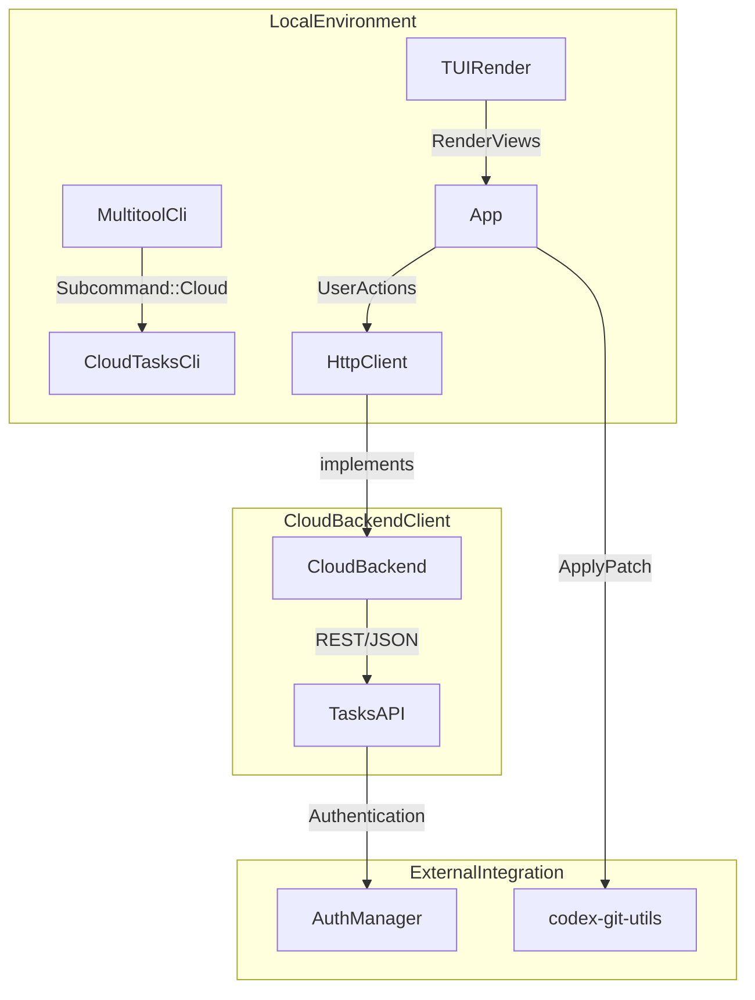
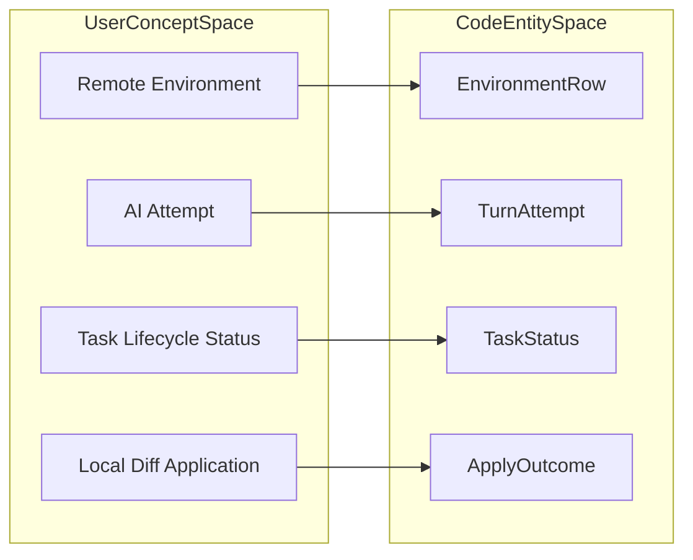
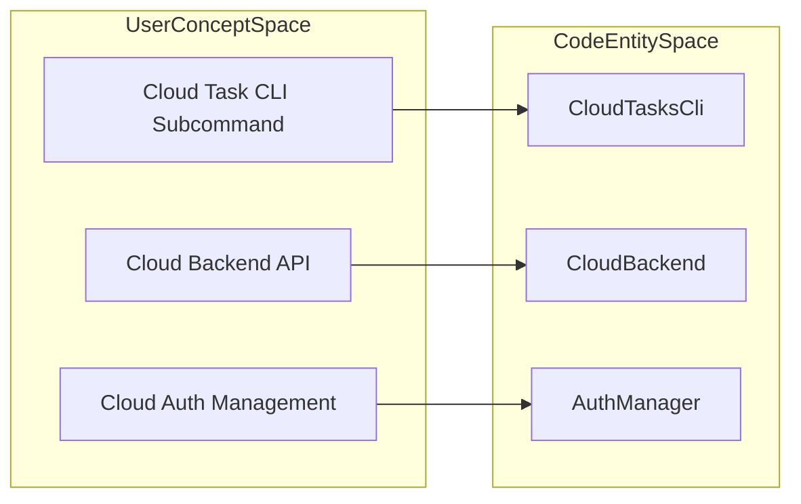

<!-- source: DeepWiki mcp.deepwiki.com · repo openai/codex · page 4.6 Cloud Tasks (codex cloud) · fetched 2026-10-26 -->

# Cloud Tasks (codex cloud)

Relevant source files

The following files were used as context for generating this wiki page:

- [codex-rs/app-server-protocol/schema/json/v2/AppsReadResponse.json](codex-rs/app-server-protocol/schema/json/v2/AppsReadResponse.json)
- [codex-rs/app-server-protocol/schema/typescript/v2/AppToolSummary.ts](codex-rs/app-server-protocol/schema/typescript/v2/AppToolSummary.ts)
- [codex-rs/app-server-protocol/src/protocol/v2/apps.rs](codex-rs/app-server-protocol/src/protocol/v2/apps.rs)
- [codex-rs/app-server/src/app_info.rs](codex-rs/app-server/src/app_info.rs)
- [codex-rs/app-server/src/request_processors/apps_processor.rs](codex-rs/app-server/src/request_processors/apps_processor.rs)
- [codex-rs/app-server/src/request_processors/apps_processor/read.rs](codex-rs/app-server/src/request_processors/apps_processor/read.rs)
- [codex-rs/app-server/tests/suite/v2/app_list.rs](codex-rs/app-server/tests/suite/v2/app_list.rs)
- [codex-rs/app-server/tests/suite/v2/app_read.rs](codex-rs/app-server/tests/suite/v2/app_read.rs)
- [codex-rs/app-server/tests/suite/v2/experimental_feature_list.rs](codex-rs/app-server/tests/suite/v2/experimental_feature_list.rs)
- [codex-rs/chatgpt/src/connectors.rs](codex-rs/chatgpt/src/connectors.rs)
- [codex-rs/connectors/src/metadata_store.rs](codex-rs/connectors/src/metadata_store.rs)
- [codex-rs/connectors/src/metadata_store_tests.rs](codex-rs/connectors/src/metadata_store_tests.rs)

The `codex-cloud-tasks` crate implements the `codex cloud` (also aliased as `cloud-tasks`) subcommand, providing a terminal user interface (TUI) and command line interface (CLI) for submitting, monitoring, browsing, and applying tasks executed on Codex Cloud [codex-rs/cli/src/main.rs:21-21](), [codex-rs/cli/Cargo.toml:41-41](). This page details the design, components, data flow, key abstractions, CLI commands, and user interface for interacting with Codex Cloud tasks.

It enables users to:
- Submit new tasks (prompts with context) to remote Codex Cloud environments [codex-rs/cli/src/main.rs:21-21]()
- Query task status and list previous tasks [codex-rs/cli/src/main.rs:21-21]()
- Fetch and render diffs produced by the cloud tasks [codex-rs/cli/src/main.rs:21-21]()
- Apply cloud-generated diffs to the local workspace [codex-rs/cli/src/main.rs:21-21]()

Sources:
- `codex-rs/cli/src/main.rs:21-21` [codex-rs/cli/src/main.rs:21-21]()
- `codex-rs/cli/Cargo.toml:41-41` [codex-rs/cli/Cargo.toml:41-41]()

---

## Architecture and Data Flow

The system is architected around a `CloudBackend` trait that abstracts remote task operations enabling pluggable client implementations: a live HTTP client for real cloud communication and a mock client for tests and development [codex-rs/cli/src/main.rs:21-21]().

Title: Cloud Tasks Interaction Diagram

Sources:
- `codex-rs/cli/src/main.rs:21-21` [codex-rs/cli/src/main.rs:21-21]()
- `codex-rs/cli/Cargo.toml:41-41` [codex-rs/cli/Cargo.toml:41-41]()

---

## Mapping Natural Language Concepts to Code Entities

Title: Natural Language to Code Entity Mapping for Cloud Tasks

Sources:
- `codex-rs/cli/src/main.rs:21-21` [codex-rs/cli/src/main.rs:21-21]()
- `codex-rs/cli/Cargo.toml:41-41` [codex-rs/cli/Cargo.toml:41-41]()

---

Title: Natural Language to Code Entity Mapping for Cloud Submissions

Sources:
- `codex-rs/cli/src/main.rs:21-21` [codex-rs/cli/src/main.rs:21-21]()
- `codex-rs/cli/Cargo.toml:41-41` [codex-rs/cli/Cargo.toml:41-41]()

---

## Backend Abstraction: `CloudBackend` Trait

The `CloudBackend` trait provides the interface to perform operations on cloud tasks [codex-rs/cli/src/main.rs:21-21]():
- Listing environments [codex-rs/cli/src/main.rs:21-21]()
- Creating new tasks [codex-rs/cli/src/main.rs:21-21]()
- Retrieving status and diffs for tasks [codex-rs/cli/src/main.rs:21-21]()
- Applying diffs locally [codex-rs/cli/src/main.rs:21-21]()

### `HttpClient` Implementation
- The main live backend implementation is `HttpClient` [codex-rs/cli/src/main.rs:21-21]().
- Supports authentication modes via `AuthManager`: API keys, ChatGPT tokens, and Workload Identity [codex-rs/cli/src/main.rs:21-21]().
- Uses RESTful JSON APIs to communicate with the Codex Cloud service [codex-rs/cli/src/main.rs:21-21]().

### `MockClient` Implementation
- A mock client is provided in `cloud-tasks-mock-client` crate for testing and development purposes [codex-rs/cli/src/main.rs:21-21]().
- Simulates cloud task lifecycle and environments without requiring actual network calls [codex-rs/cli/src/main.rs:21-21]().

Sources:
- `codex-rs/cli/src/main.rs:21-21` [codex-rs/cli/src/main.rs:21-21]()
- `codex-rs/cli/Cargo.toml:41-41` [codex-rs/cli/Cargo.toml:41-41]()

---

## CLI Commands (`CloudTasksCli`)

The `codex cloud` command implements subcommands for task management [codex-rs/cli/src/main.rs:21-21]():

| Subcommand | Description |
|------------|--------------|
| `exec`     | Submit a new cloud task, returns a task URL [codex-rs/cli/src/main.rs:21-21](). |
| `list`     | List existing cloud tasks, supports environment filtering and pagination [codex-rs/cli/src/main.rs:21-21](). |
| `status`   | Check the execution status of a cloud task [codex-rs/cli/src/main.rs:21-21](). |
| `diff`     | Display the unified diff generated by a cloud task [codex-rs/cli/src/main.rs:21-21](). |
| `apply`    | Fetch and apply the diff from a cloud task locally [codex-rs/cli/src/main.rs:21-21](). |

Sources:
- `codex-rs/cli/src/main.rs:21-21` [codex-rs/cli/src/main.rs:21-21]()
- `codex-rs/cli/Cargo.toml:41-41` [codex-rs/cli/Cargo.toml:41-41]()

---

## Terminal User Interface (TUI)

The TUI enables fully interactive management of cloud tasks [codex-rs/cli/src/main.rs:21-21]():
- **Task List View**: Displays summaries and statuses of cloud-submitted tasks [codex-rs/cli/src/main.rs:21-21]().
- **New Task Page**: Interface for composing and submitting prompts for remote execution [codex-rs/cli/src/main.rs:21-21]().
- **Diff Overlay**: Full-screen modal to inspect generated diffs with syntax highlighting (leveraging `diffy`) [codex-rs/cli/src/main.rs:21-21]().
- **Environment Selection Modals**: Interactive picker to select remote execution environment [codex-rs/cli/src/main.rs:21-21]().
- **Attempt Navigation**: Cycle through multiple "best-of-n" assistant attempts for a given task to select the best candidate for application [codex-rs/cli/src/main.rs:21-21]().

Sources:
- `codex-rs/cli/src/main.rs:21-21` [codex-rs/cli/src/main.rs:21-21]()
- `codex-rs/cli/Cargo.toml:41-41` [codex-rs/cli/Cargo.toml:41-41]()

---

## Local Patch Application

Applying diffs fetched from cloud tasks involves [codex-rs/cli/src/main.rs:21-21]():
1. **Preflight Conflict Detection**: Optional check for local working tree conflicts prior to applying patches [codex-rs/cli/src/main.rs:21-21]().
2. **Patch Fetching**: Retrieval of the generated diff from the cloud backend [codex-rs/cli/src/main.rs:21-21]().
3. **Patch Application**: Use of `codex-apply-patch` or `codex-git-utils` crates to apply changes to the filesystem [codex-rs/cli/src/main.rs:21-21]().
4. **Result Reporting**: Returns an `ApplyOutcome` struct detailing success/failure and the list of affected paths [codex-rs/cli/src/main.rs:21-21]().

Sources:
- `codex-rs/cli/src/main.rs:21-21` [codex-rs/cli/src/main.rs:21-21]()
- `codex-rs/cli/Cargo.toml:41-41` [codex-rs/cli/Cargo.toml:41-41]()

---

## Summary

`codex-cloud-tasks` provides a cohesive TUI/CLI client for working with Codex Cloud, abstracted by the `CloudBackend` trait to support multiple client implementations [codex-rs/cli/src/main.rs:21-21](), [codex-rs/cli/Cargo.toml:41-41](). Its components enable users to create, monitor, inspect, and apply remote AI-powered code tasks smoothly, with strong integration into authentication, config management, and patch application tooling [codex-rs/cli/src/main.rs:21-21]().

Sources:
- `codex-rs/cli/src/main.rs:21-21` [codex-rs/cli/src/main.rs:21-21]()
- `codex-rs/cli/Cargo.toml:41-41` [codex-rs/cli/Cargo.toml:41-41]()

---

