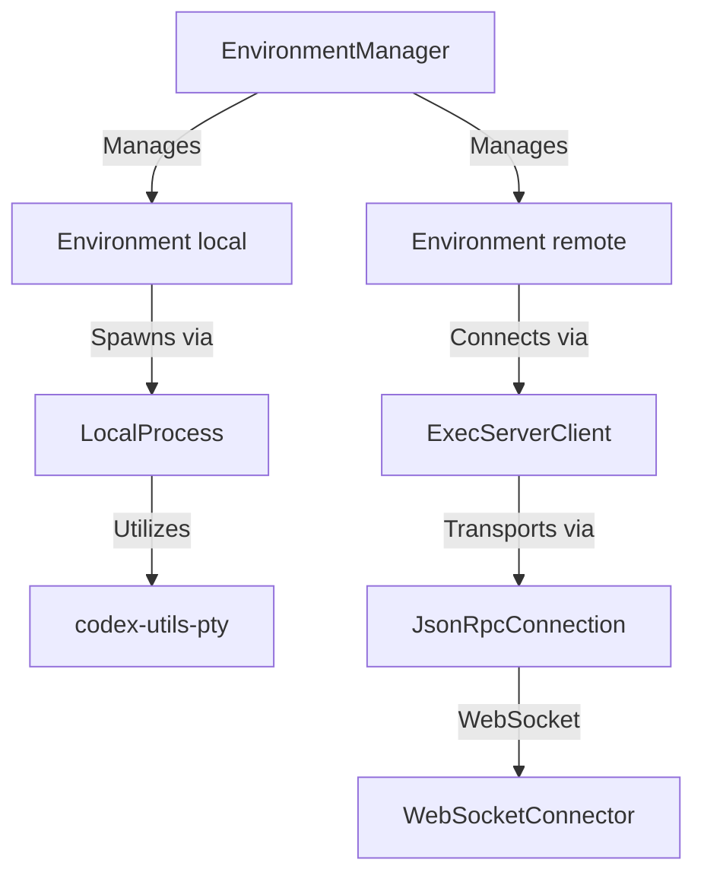
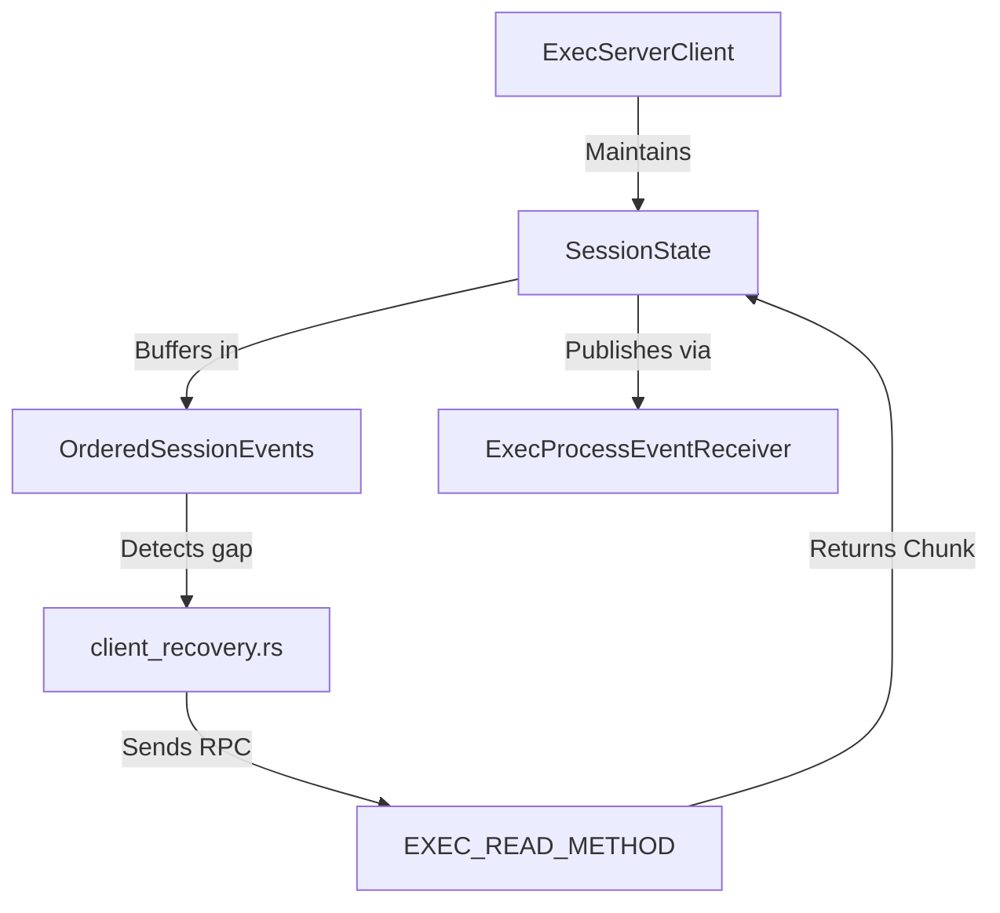

<!-- source: DeepWiki mcp.deepwiki.com · repo openai/codex · page 4.7 Exec Server · fetched 2026-10-26 -->

# Exec Server

Relevant source files

The following files were used as context for generating this wiki page:

- [codex-rs/exec-server/Cargo.toml](codex-rs/exec-server/Cargo.toml)
- [codex-rs/exec-server/README.md](codex-rs/exec-server/README.md)
- [codex-rs/exec-server/src/capability_discovery.rs](codex-rs/exec-server/src/capability_discovery.rs)
- [codex-rs/exec-server/src/client.rs](codex-rs/exec-server/src/client.rs)
- [codex-rs/exec-server/src/client/accepted.rs](codex-rs/exec-server/src/client/accepted.rs)
- [codex-rs/exec-server/src/client/accepted_tests.rs](codex-rs/exec-server/src/client/accepted_tests.rs)
- [codex-rs/exec-server/src/client_api.rs](codex-rs/exec-server/src/client_api.rs)
- [codex-rs/exec-server/src/client_recovery.rs](codex-rs/exec-server/src/client_recovery.rs)
- [codex-rs/exec-server/src/client_recovery_tests.rs](codex-rs/exec-server/src/client_recovery_tests.rs)
- [codex-rs/exec-server/src/client_refresh.rs](codex-rs/exec-server/src/client_refresh.rs)
- [codex-rs/exec-server/src/client_refresh_tests.rs](codex-rs/exec-server/src/client_refresh_tests.rs)
- [codex-rs/exec-server/src/client_transport.rs](codex-rs/exec-server/src/client_transport.rs)
- [codex-rs/exec-server/src/client_transport_tests.rs](codex-rs/exec-server/src/client_transport_tests.rs)
- [codex-rs/exec-server/src/environment.rs](codex-rs/exec-server/src/environment.rs)
- [codex-rs/exec-server/src/environment/accepted.rs](codex-rs/exec-server/src/environment/accepted.rs)
- [codex-rs/exec-server/src/environment_provider.rs](codex-rs/exec-server/src/environment_provider.rs)
- [codex-rs/exec-server/src/environment_toml.rs](codex-rs/exec-server/src/environment_toml.rs)
- [codex-rs/exec-server/src/fs_helper.rs](codex-rs/exec-server/src/fs_helper.rs)
- [codex-rs/exec-server/src/fs_helper_main.rs](codex-rs/exec-server/src/fs_helper_main.rs)
- [codex-rs/exec-server/src/fs_sandbox_windows_tests.rs](codex-rs/exec-server/src/fs_sandbox_windows_tests.rs)
- [codex-rs/exec-server/src/lib.rs](codex-rs/exec-server/src/lib.rs)
- [codex-rs/exec-server/src/local_file_system.rs](codex-rs/exec-server/src/local_file_system.rs)
- [codex-rs/exec-server/src/local_file_system_read.rs](codex-rs/exec-server/src/local_file_system_read.rs)
- [codex-rs/exec-server/src/regular_file.rs](codex-rs/exec-server/src/regular_file.rs)
- [codex-rs/exec-server/src/regular_file_tests.rs](codex-rs/exec-server/src/regular_file_tests.rs)
- [codex-rs/exec-server/src/remote.rs](codex-rs/exec-server/src/remote.rs)
- [codex-rs/exec-server/src/remote_file_system.rs](codex-rs/exec-server/src/remote_file_system.rs)
- [codex-rs/exec-server/src/remote_file_system_path_uri_tests.rs](codex-rs/exec-server/src/remote_file_system_path_uri_tests.rs)
- [codex-rs/exec-server/src/rpc.rs](codex-rs/exec-server/src/rpc.rs)
- [codex-rs/exec-server/src/sandboxed_file_open.rs](codex-rs/exec-server/src/sandboxed_file_open.rs)
- [codex-rs/exec-server/src/sandboxed_file_system.rs](codex-rs/exec-server/src/sandboxed_file_system.rs)
- [codex-rs/exec-server/src/server.rs](codex-rs/exec-server/src/server.rs)
- [codex-rs/exec-server/src/server/file_system_handler.rs](codex-rs/exec-server/src/server/file_system_handler.rs)
- [codex-rs/exec-server/src/server/handler.rs](codex-rs/exec-server/src/server/handler.rs)
- [codex-rs/exec-server/src/server/processor.rs](codex-rs/exec-server/src/server/processor.rs)
- [codex-rs/exec-server/src/server/registry.rs](codex-rs/exec-server/src/server/registry.rs)
- [codex-rs/exec-server/tests/capability_discovery.rs](codex-rs/exec-server/tests/capability_discovery.rs)
- [codex-rs/exec-server/tests/common/exec_server.rs](codex-rs/exec-server/tests/common/exec_server.rs)
- [codex-rs/exec-server/tests/deferred_environment.rs](codex-rs/exec-server/tests/deferred_environment.rs)
- [codex-rs/exec-server/tests/file_stream.rs](codex-rs/exec-server/tests/file_stream.rs)
- [codex-rs/exec-server/tests/file_system/shared.rs](codex-rs/exec-server/tests/file_system/shared.rs)
- [codex-rs/exec-server/tests/file_system/support.rs](codex-rs/exec-server/tests/file_system/support.rs)
- [codex-rs/exec-server/tests/file_system_unix.rs](codex-rs/exec-server/tests/file_system_unix.rs)
- [codex-rs/exec-server/tests/file_system_windows.rs](codex-rs/exec-server/tests/file_system_windows.rs)
- [codex-rs/exec-server/tests/initialize.rs](codex-rs/exec-server/tests/initialize.rs)
- [codex-rs/exec-server/tests/relay.rs](codex-rs/exec-server/tests/relay.rs)
- [codex-rs/file-system/src/environment_accessor.rs](codex-rs/file-system/src/environment_accessor.rs)
- [codex-rs/file-system/src/lib.rs](codex-rs/file-system/src/lib.rs)

The `codex-exec-server` crate provides a standalone JSON-RPC WebSocket server for spawning and managing subprocesses through `codex-utils-pty`, exposing filesystem operations, and supporting both local and remote execution environments [codex-rs/exec-server/README.md:1-16](), [codex-rs/exec-server/src/lib.rs:69-70](). This page documents its core architecture, wire protocol, filesystem RPCs, remote relay mechanisms, and the client-side `ExecServerClient` implementation.

Sources: [codex-rs/exec-server/README.md:1-16](), [codex-rs/exec-server/src/lib.rs:69-70]()

---

## Overview and Architecture

The Exec Server isolates process execution and filesystem access from the main Codex application logic. It communicates via JSON-RPC 2.0 over WebSockets or stdio [codex-rs/exec-server/README.md:3-13](). 

The `EnvironmentManager` struct (`[codex-rs/exec-server/src/environment.rs:101-108]`) owns the execution and filesystem environments available to the runtime, tracking connection states (`EnvironmentConnectionState`, `[codex-rs/exec-server/src/environment.rs:69-76]`) such as `Connected` or `Disconnected`. Process execution backends (`ExecBackend`, `[codex-rs/exec-server/src/lib.rs:145-151]`) are implemented by `LocalProcess` (`[codex-rs/exec-server/src/environment.rs:45-45]`) and `RemoteProcess` (`[codex-rs/exec-server/src/environment.rs:50-50]`).

Diagram: Environment and Execution Architecture (Code Entity Space)

Sources: [codex-rs/exec-server/src/environment.rs:101-108](), [codex-rs/exec-server/src/environment.rs:45-50](), [codex-rs/exec-server/src/client.rs:43-45](), [codex-rs/exec-server/src/remote.rs:48-50]()

---

## Wire Protocol and Handshake

Communication follows JSON-RPC 2.0 semantics defined in `codex-exec-server-protocol` (`[codex-rs/exec-server/src/lib.rs:63-64]`).

### Initialization and Session Handshake
1. The client invokes `initialize` carrying `InitializeParams` containing `client_name` and optional `resume_session_id` [codex-rs/exec-server/src/client.rs:117-120]().
2. The server responds with `InitializeResponse` providing the `session_id` and `environment_info` [codex-rs/exec-server/src/client.rs:117-120]().
3. The client finishes the handshake by sending an `initialized` notification [codex-rs/exec-server/src/client.rs:118-118]().

### Process Control RPC Methods
Process management methods are structured around explicit RPC endpoints:
- `process/start`: Spawns a process via `EXEC_METHOD` (`[codex-rs/exec-server/src/client.rs:61-61]`).
- `process/read`: Reads buffered output chunks using `EXEC_READ_METHOD` (`[codex-rs/exec-server/src/client.rs:63-63]`).
- `process/write`: Writes bytes to standard input via `EXEC_WRITE_METHOD` (`[codex-rs/exec-server/src/client.rs:66-66]`).
- `process/signal`: Sends process signals using `EXEC_SIGNAL_METHOD` (`[codex-rs/exec-server/src/client.rs:64-64]`).
- `process/terminate`: Terminates processes using `EXEC_TERMINATE_METHOD` (`[codex-rs/exec-server/src/client.rs:65-65]`).

### Server Notifications
- `process/output`: Streamed incremental output delta notifications (`EXEC_OUTPUT_DELTA_METHOD`, `[codex-rs/exec-server/src/client.rs:62-62]`).
- `process/exited`: Process exit code notification (`EXEC_EXITED_METHOD`, `[codex-rs/exec-server/src/client.rs:60-60]`).
- `process/closed`: Stream closure notification (`EXEC_CLOSED_METHOD`, `[codex-rs/exec-server/src/client.rs:59-59]`).

Sources: [codex-rs/exec-server/src/lib.rs:63-64](), [codex-rs/exec-server/src/client.rs:57-66]()

---

## Filesystem RPCs

Filesystem operations are handled by `FileSystemHandler` (`[codex-rs/exec-server/src/server/file_system_handler.rs:58-61]`) wrapping `LocalFileSystem` (`[codex-rs/exec-server/src/server/file_system_handler.rs:59-59]`) and `FileHandleManager` (`[codex-rs/exec-server/src/server/file_system_handler.rs:60-60]`). These implement the `ExecutorFileSystem` trait (`[codex-rs/exec-server/src/lib.rs:91-94]`).

| JSON-RPC Method | Request Parameters | Description |
|---|---|---|
| `fs/readFile` | `FsReadFileParams` (`[codex-rs/exec-server/src/client.rs:106-106]`) | Reads file contents into base64 data. |
| `fs/writeFile` | `FsWriteFileParams` (`[codex-rs/exec-server/src/client.rs:114-114]`) | Writes block data to a target path. |
| `fs/createDirectory` | `FsCreateDirectoryParams` (`[codex-rs/exec-server/src/client.rs:95-95]`) | Creates a new directory recursively. |
| `fs/getMetadata` | `FsGetMetadataParams` (`[codex-rs/exec-server/src/client.rs:97-97]`) | Retrieves `FileMetadata` (`[codex-rs/exec-server/src/lib.rs:97-97]`). |
| `fs/readDirectory` | `FsReadDirectoryParams` (`[codex-rs/exec-server/src/client.rs:104-104]`) | Lists directory contents. |
| `fs/remove` | `FsRemoveParams` (`[codex-rs/exec-server/src/client.rs:108-108]`) | Deletes files or directories. |
| `fs/walk` | `FsWalkParams` (`[codex-rs/exec-server/src/client.rs:110-110]`) | Performs a bounded recursive directory walk (`WalkOutcome`, `[codex-rs/exec-server/src/lib.rs:110-110]`). |
| `fs/canonicalize` | `FsCanonicalizeParams` (`[codex-rs/exec-server/src/client.rs:89-89]`) | Resolves a path into absolute form. |

Sources: [codex-rs/exec-server/src/lib.rs:91-110](), [codex-rs/exec-server/src/client.rs:89-114](), [codex-rs/exec-server/src/server/file_system_handler.rs:58-61]()

---

## Remote Relay and Noise Protocols

Remote execution configurations register with an environment registry service via `EnvironmentRegistryClient` (`[codex-rs/exec-server/src/remote.rs:83-91]`) using the `register_environment` method (`[codex-rs/exec-server/src/remote.rs:149-163]`). 

The connection then establishes a secure WebSocket tunnel using either:
- **Noise Protocol (`RemoteEnvironmentTransport::Noise`)**: Relays multiplexed binary protobuf frames (`RelayMessageFrame`) across a rendezvous connection (`[codex-rs/exec-server/src/remote.rs:68-74]`, `[codex-rs/exec-server/README.md:127-132]()`).
- **Direct Transport (`RemoteEnvironmentTransport::Direct`)**: Connects directly via authenticated WebSockets when configured with `--aws-sigv4` or direct endpoints (`[codex-rs/exec-server/src/remote.rs:68-74]`, `[codex-rs/exec-server/README.md:95-101]()`).

Sources: [codex-rs/exec-server/src/remote.rs:68-163](), [codex-rs/exec-server/README.md:95-132]()

---

## ExecServerClient and Session Recovery

`ExecServerClient` (`[codex-rs/exec-server/src/lib.rs:76-76]`) manages connection lifecycles, retries, and failure recovery. When underlying WebSocket connections drop, session data is recovered using `SessionState` and `OrderedSessionEvents` (`[codex-rs/exec-server/src/client_recovery.rs:28-35]`).

Diagram: Client Session Recovery and Event Sequencing (Code Entity Space)

Sources: [codex-rs/exec-server/src/lib.rs:76-76](), [codex-rs/exec-server/src/client_recovery.rs:28-35](), [codex-rs/exec-server/src/client.rs:63-63]()

---

