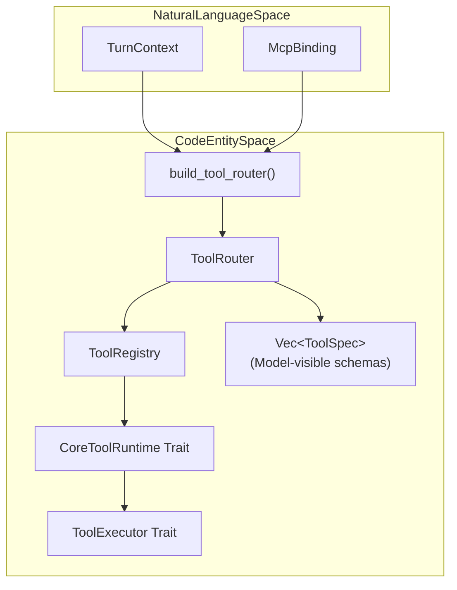
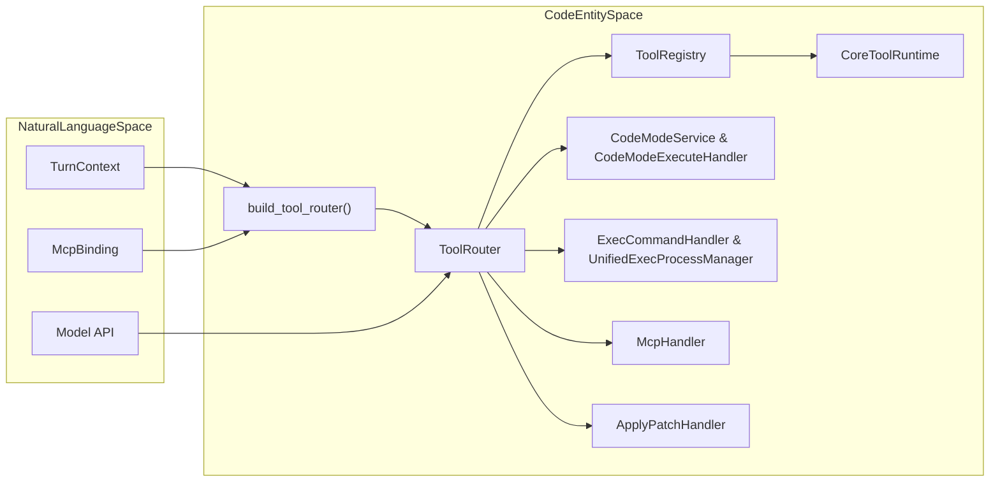

<!-- source: DeepWiki mcp.deepwiki.com · repo openai/codex · page 5 Tool System · fetched 2026-10-26 -->

# Tool System

Relevant source files

The following files were used as context for generating this wiki page:

- [codex-rs/core/src/tools/code_mode/delegate.rs](codex-rs/core/src/tools/code_mode/delegate.rs)
- [codex-rs/core/src/tools/code_mode/delegate_tests.rs](codex-rs/core/src/tools/code_mode/delegate_tests.rs)
- [codex-rs/core/src/tools/code_mode/execute_handler.rs](codex-rs/core/src/tools/code_mode/execute_handler.rs)
- [codex-rs/core/src/tools/code_mode/mod.rs](codex-rs/core/src/tools/code_mode/mod.rs)
- [codex-rs/core/src/tools/code_mode/wait_handler.rs](codex-rs/core/src/tools/code_mode/wait_handler.rs)
- [codex-rs/core/src/tools/context.rs](codex-rs/core/src/tools/context.rs)
- [codex-rs/core/src/tools/context_tests.rs](codex-rs/core/src/tools/context_tests.rs)
- [codex-rs/core/src/tools/handlers/dynamic.rs](codex-rs/core/src/tools/handlers/dynamic.rs)
- [codex-rs/core/src/tools/handlers/mcp.rs](codex-rs/core/src/tools/handlers/mcp.rs)
- [codex-rs/core/src/tools/handlers/mcp_search_tests.rs](codex-rs/core/src/tools/handlers/mcp_search_tests.rs)
- [codex-rs/core/src/tools/parallel.rs](codex-rs/core/src/tools/parallel.rs)
- [codex-rs/core/src/tools/registry.rs](codex-rs/core/src/tools/registry.rs)
- [codex-rs/core/src/tools/registry_tests.rs](codex-rs/core/src/tools/registry_tests.rs)
- [codex-rs/core/src/tools/router.rs](codex-rs/core/src/tools/router.rs)
- [codex-rs/core/src/tools/router_tests.rs](codex-rs/core/src/tools/router_tests.rs)
- [codex-rs/core/src/tools/spec_plan.rs](codex-rs/core/src/tools/spec_plan.rs)
- [codex-rs/core/src/tools/spec_plan_tests.rs](codex-rs/core/src/tools/spec_plan_tests.rs)
- [codex-rs/core/src/tools/tool_dispatch_trace_tests.rs](codex-rs/core/src/tools/tool_dispatch_trace_tests.rs)

## Purpose and Scope

The Tool System is an extensible framework within Codex that enables model-driven usage of external functionality through registered tools. Its responsibilities include:

- **Tool registration and specification:** Defining and managing tool schemas and their runtime endpoints via `ToolRegistry` and `ToolSpec` [codex-rs/core/src/tools/registry.rs:55-172](), [codex-rs/core/src/tools/router.rs:74-81]().
- **Tool routing and discovery:** Dynamically building the tool plan per turn based on session context, capabilities, and permissions using `build_tool_router` [codex-rs/core/src/tools/spec_plan.rs:122-145]().
- **Tool invocation orchestration:** Handling execution lifecycle, parallelism via `ToolCallRuntime`, cancellation, and inter-tool dependencies [codex-rs/core/src/tools/parallel.rs:41-61]().
- **Tool execution:** Running tools locally or via remote MCP servers (`McpHandler`), shell backends, or sandboxed environments [codex-rs/core/src/tools/handlers/mcp.rs:51-173]().
- **Integration with external subsystems:** Multi-agent orchestration, apply-patch systems, plugins, permissions, and code-mode execution [codex-rs/core/src/tools/code_mode/mod.rs:69-95]().
- **Instrumentation and hooks:** Allowing observation and modification of tool input and output through lifecycle hooks and event emissions [codex-rs/core/src/tools/registry.rs:55-172]().

This page serves as a high-level overview of the tool subsystem architecture and components. Each detailed aspect is covered in its own child page.

---

## Tool Registry and Configuration

At the center of tool management is the `ToolRouter` [codex-rs/core/src/tools/router.rs:74-81](), constructed by `build_tool_router` [codex-rs/core/src/tools/spec_plan.rs:122-145]() based on session state, model capabilities, MCP bindings, and dynamic tools.

Tools are registered in a `ToolRegistry` mapping tool names to executors implementing the `CoreToolRuntime` trait [codex-rs/core/src/tools/registry.rs:55-172](). This registry supports flexible inclusion/exclusion, namespace management, visibility controls, and parallel execution flags.

### Diagram: Tool Configuration and Dispatch Flow

Sources: [codex-rs/core/src/tools/router.rs:74-81](), [codex-rs/core/src/tools/spec_plan.rs:122-145](), [codex-rs/core/src/tools/registry.rs:55-172]()

For details, see [Tool Registry and Configuration](#5.1).

---

## Shell Execution Tools and Unified Exec Process Management

Shell-based tools (such as `shell_command`, `exec_command`, and `write_stdin`) provide interactive or batch command execution capabilities. These are backed by the Unified Exec process management system:

- `ExecCommandHandler` and `WriteStdinHandler` handle tool invocation dispatching [codex-rs/core/src/tools/spec_plan.rs:14-33]().
- `UnifiedExecProcessManager` tracks running processes, handles events, and enforces resource constraints.
- Managed process handles are stored in an LRU-capped `ProcessStore` to prevent resource exhaustion.

For details, see [Shell Execution Tools](#5.2) and [Unified Exec Process Management](#5.3).

---

## Apply Patch System

The `apply_patch` tool enables precise, incremental file modifications driven by the model.

- Patches are parsed and verified through `ApplyPatchHandler` [codex-rs/core/src/tools/spec_plan.rs:9-10]().
- Runtime application workflow validates changes against turn-specific environment snapshots and handles approval gating.

For details, see [Apply Patch System](#5.4).

---

## Tool Orchestration and Approval

Tool execution involves calculating approval requirements, executing policy checks, checking network permissions, and optionally routing requests through the Guardian sub-agent scoring framework. The `ToolOrchestrator` coordinates these checks prior to releasing execution gates.

For details, see [Tool Orchestration and Approval](#5.5).

---

## Sandboxing Implementation

Tool execution occurs under platform-specific sandboxing layers (Landlock/bwrap on Linux, Seatbelt on macOS, Windows Token restrictions). The system detects sandbox denials and handles automatic retry and escalation logic.

For details, see [Sandboxing Implementation](#5.6).

---

## Tool Event Emission and Output

The framework features a `ToolEmitter` factory pattern that manages the tool event lifecycle, stream event utilities, and background `async_watcher` tasks to relay output back to consumers and frontends.

For details, see [Tool Event Emission and Output](#5.7).

---

## Code Mode and JavaScript REPL

Code Mode provides a stateful JavaScript execution environment where the model can invoke nested tools programmatically:

- `CodeModeExecuteHandler` initiates cell execution and sets up dispatch brokers [codex-rs/core/src/tools/code_mode/execute_handler.rs:26-37]().
- `CodeModeService` manages the underlying `CodeModeSession` instance, coordinating yields, interruption, and cleanup [codex-rs/core/src/tools/code_mode/mod.rs:76-104]().

For details, see [Code Mode and JavaScript REPL](#5.8).

---

## Skills System

The skills system discovers reusable instructions and context from `.codex/skills`, utilizing a `SkillsManager` host service to inject relevant domain knowledge into execution turns.

For details, see [Skills System](#5.9).

---

## Permission Request System

The `request_permissions` tool enables runtime privilege escalation, supporting turn-scoped or session-scoped grants with sticky persistence across interactions.

For details, see [Permission Request System](#5.10).

---

## Plugins System

The plugins marketplace and `PluginsManager` handle installation, remote synchronization, and the injection of plugin-defined tools into the active registry.

For details, see [Plugins System](#5.11).

---

## Extension Tools (Image Generation, Web Search)

Specialized capabilities like image generation (`imagegen`) and web search (`WebSearch`) are implemented via the `codex-extension-api` framework, registering tools and contributing context dynamically [codex-rs/core/src/tools/spec_plan.rs:34-55]().

For details, see [Extension Tools (Image Generation, Web Search)](#5.12).

---

## Summary Diagram: System Integration from Natural Language Space to Code Entities

Sources: [codex-rs/core/src/tools/spec_plan.rs:122-145](), [codex-rs/core/src/tools/router.rs:74-81](), [codex-rs/core/src/tools/registry.rs:55-172](), [codex-rs/core/src/tools/code_mode/mod.rs:76-104]()

---

For exhaustive details on each component, visit the respective child pages:

- [Tool Registry and Configuration](#5.1)
- [Shell Execution Tools](#5.2)
- [Unified Exec Process Management](#5.3)
- [Apply Patch System](#5.4)
- [Tool Orchestration and Approval](#5.5)
- [Sandboxing Implementation](#5.6)
- [Tool Event Emission and Output](#5.7)
- [Code Mode and JavaScript REPL](#5.8)
- [Skills System](#5.9)
- [Permission Request System](#5.10)
- [Plugins System](#5.11)
- [Extension Tools (Image Generation, Web Search)](#5.12)

---

