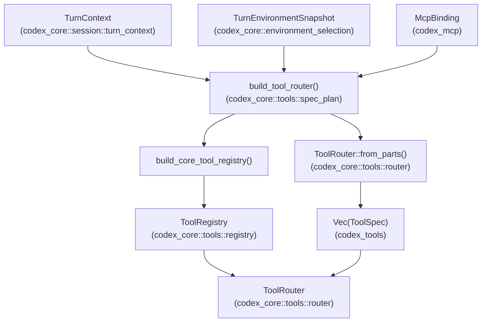
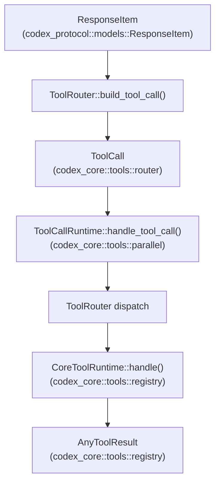
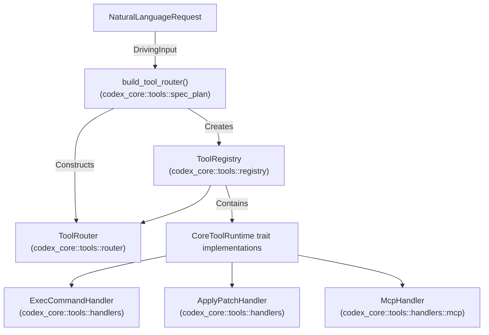
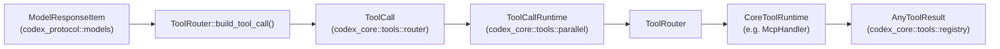

<!-- source: DeepWiki mcp.deepwiki.com · repo openai/codex · page 5.1 Tool Registry and Configuration · fetched 2026-10-26 -->

# Tool Registry and Configuration

<details>
<summary>Relevant source files</summary>

The following files were used as context for generating this wiki page:

- [codex-rs/app-server/tests/suite/v2/recommended_plugins.rs](codex-rs/app-server/tests/suite/v2/recommended_plugins.rs)
- [codex-rs/core/src/context/recommended_plugins_instructions.rs](codex-rs/core/src/context/recommended_plugins_instructions.rs)
- [codex-rs/core/src/tools/code_mode/delegate.rs](codex-rs/core/src/tools/code_mode/delegate.rs)
- [codex-rs/core/src/tools/code_mode/delegate_tests.rs](codex-rs/core/src/tools/code_mode/delegate_tests.rs)
- [codex-rs/core/src/tools/code_mode/execute_handler.rs](codex-rs/core/src/tools/code_mode/execute_handler.rs)
- [codex-rs/core/src/tools/code_mode/mod.rs](codex-rs/core/src/tools/code_mode/mod.rs)
- [codex-rs/core/src/tools/code_mode/wait_handler.rs](codex-rs/core/src/tools/code_mode/wait_handler.rs)
- [codex-rs/core/src/tools/context.rs](codex-rs/core/src/tools/context.rs)
- [codex-rs/core/src/tools/context_tests.rs](codex-rs/core/src/tools/context_tests.rs)
- [codex-rs/core/src/tools/handlers/dynamic.rs](codex-rs/core/src/tools/handlers/dynamic.rs)
- [codex-rs/core/src/tools/handlers/mcp.rs](codex-rs/core/src/tools/handlers/mcp.rs)
- [codex-rs/core/src/tools/handlers/mcp_search_tests.rs](codex-rs/core/src/tools/handlers/mcp_search_tests.rs)
- [codex-rs/core/src/tools/handlers/request_plugin_install.rs](codex-rs/core/src/tools/handlers/request_plugin_install.rs)
- [codex-rs/core/src/tools/handlers/request_plugin_install_spec.rs](codex-rs/core/src/tools/handlers/request_plugin_install_spec.rs)
- [codex-rs/core/src/tools/handlers/request_plugin_install_tests.rs](codex-rs/core/src/tools/handlers/request_plugin_install_tests.rs)
- [codex-rs/core/src/tools/parallel.rs](codex-rs/core/src/tools/parallel.rs)
- [codex-rs/core/src/tools/registry.rs](codex-rs/core/src/tools/registry.rs)
- [codex-rs/core/src/tools/registry_tests.rs](codex-rs/core/src/tools/registry_tests.rs)
- [codex-rs/core/src/tools/router.rs](codex-rs/core/src/tools/router.rs)
- [codex-rs/core/src/tools/router_tests.rs](codex-rs/core/src/tools/router_tests.rs)
- [codex-rs/core/src/tools/spec_plan.rs](codex-rs/core/src/tools/spec_plan.rs)
- [codex-rs/core/src/tools/spec_plan_tests.rs](codex-rs/core/src/tools/spec_plan_tests.rs)
- [codex-rs/core/src/tools/tool_dispatch_trace_tests.rs](codex-rs/core/src/tools/tool_dispatch_trace_tests.rs)
- [codex-rs/core/tests/suite/request_plugin_install.rs](codex-rs/core/tests/suite/request_plugin_install.rs)
- [codex-rs/core/tests/suite/snapshots/all__suite__request_plugin_install__startup_recommendations_developer_context.snap](codex-rs/core/tests/suite/snapshots/all__suite__request_plugin_install__startup_recommendations_developer_context.snap)
- [codex-rs/tools/Cargo.toml](codex-rs/tools/Cargo.toml)
- [codex-rs/tools/README.md](codex-rs/tools/README.md)
- [codex-rs/tools/src/lib.rs](codex-rs/tools/src/lib.rs)
- [codex-rs/tools/src/request_plugin_install.rs](codex-rs/tools/src/request_plugin_install.rs)
- [codex-rs/tools/src/request_plugin_install_tests.rs](codex-rs/tools/src/request_plugin_install_tests.rs)
- [codex-rs/tools/src/tool_discovery.rs](codex-rs/tools/src/tool_discovery.rs)
- [codex-rs/tools/src/tool_discovery_tests.rs](codex-rs/tools/src/tool_discovery_tests.rs)

</details>


This page documents how Codex decides which tools are made available to the model in a given session. It covers `ToolSpec` definitions, `ToolRegistryBuilder`, `ToolRouter`, tool discovery/search, and the `ToolsConfig`.

For how the tools themselves *execute* (e.g., shell, apply_patch, unified exec) see pages **5.2**–**5.8**. For MCP-specific tool configuration and delegation, see **6.1** and **6.2**. For the overall sandbox and approval system, see **2.4** and **5.5**.

---

## Overview

Every agent session computes a set of tools before the first API request. Tool planning is driven primarily by the `TurnContext` [codex-rs/core/src/tools/spec_plan.rs:109-109]() and `TurnEnvironmentSnapshot` [codex-rs/core/src/tools/spec_plan.rs:111-111](), incorporating model capabilities, enabled feature flags, session source, and environment state.

These inputs are combined during tool planning to build a:

- **`ToolRegistry`**: Holds concrete runtime tool handlers implementing the `CoreToolRuntime` trait, which extends `ToolExecutor` and manages dispatch of tool calls; see [codex-rs/core/src/tools/registry.rs:57-176]().
- **`ToolRouter`**: A session-scoped interface composed of the registry plus a filtered, model-visible set of `ToolSpec`s representing the advertised tool schema sent to the LLM; see [codex-rs/core/src/tools/router.rs:85-92]().

The key data flow steps from policy, environment snapshots, and turn context through tool planning and routing are illustrated below.

### Natural Language Space to Code Entity Space: Tool Planning Data Flow



### Explanation

- `build_tool_router()` is the main function [codex-rs/core/src/tools/spec_plan.rs:121-130]() to build the tool plan, driven by turn state, environment snapshot, and MCP bindings.
- `build_core_tool_registry()` assembles the runtime tool handler implementations (`CoreToolRuntime`) into `ToolRegistry`.
- The `ToolRouter` is created combining the `ToolRegistry` with the filtered and sorted set of model-visible tool specs [codex-rs/core/src/tools/router.rs:125-132]().
- The `ToolSpec` data structure encapsulates metadata and input/output schemas consumed by the model [codex-rs/tools/src/lib.rs:109-109]().

Sources: [codex-rs/core/src/tools/spec_plan.rs:121-130](), [codex-rs/core/src/tools/router.rs:85-146](), [codex-rs/core/src/tools/registry.rs:57-176]()

---

## Tool Specifications (`ToolSpec`)

### Purpose

A `ToolSpec` is a strongly-typed representation encoding the model-visible description, argument schema, and metadata for a tool. It is used for:

- Informing the LLM of tool existence and schemas.
- Enabling model-driven tool invocation.
- Generating JSON schemas representing the tool arguments.

### Sources of `ToolSpec`

The system aggregates tool specs from multiple sources integrated in `build_tool_router()` [codex-rs/core/src/tools/spec_plan.rs:121-130]():

1. **Core Built-in Tools**

   Rust implementations of core tools such as:

   - `ApplyPatchHandler` handles file patching [codex-rs/core/src/tools/spec_plan.rs:9-9]().
   - `ExecCommandHandler` manages shell process execution [codex-rs/core/src/tools/spec_plan.rs:14-14]().
   - `RequestPermissionsHandler` facilitates requesting sandbox permissions [codex-rs/core/src/tools/spec_plan.rs:23-23]().

2. **MCP Tools**

   External tools served by Model Context Protocol (MCP) servers injected dynamically during runtime, wrapped by `McpHandler` which converts tool info to `ToolSpec` [codex-rs/core/src/tools/handlers/mcp.rs:51-99]().

3. **Dynamic Tools**

   Runtime-constructed tools injected using `DynamicToolHandler` [codex-rs/core/src/tools/spec_plan.rs:13-13]().

4. **Multi-Agent Collaboration Tools**

   Versioned multi-agent tooling support with handlers like `SpawnAgentHandler` and `SendMessageHandler` [codex-rs/core/src/tools/spec_plan.rs:38-51]().

### Tool Exposure Levels

- Model-visible tools are included in the `model_visible_specs` vector and advertised for model consumption via `ToolRouter::model_visible_specs()` [codex-rs/core/src/tools/router.rs:148-150]().
- Hidden or dispatch-only tools are registered with the `ToolRegistry` for internal use (e.g., invoked by the code mode system) but not exposed to the LLM.
- Deferred tools are discovered at runtime, e.g., via tool search [codex-rs/tools/src/lib.rs:94-94]().

Sources: [codex-rs/core/src/tools/spec_plan.rs:1-1680](), [codex-rs/core/src/tools/handlers/mcp.rs:51-99](), [codex-rs/core/src/tools/router.rs:148-150]()

---

## Tool Registry Builder

### Tool Registry Architecture

Concrete tool runtimes implement the `CoreToolRuntime` trait [codex-rs/core/src/tools/registry.rs:57-176](), which extends `ToolExecutor<ToolInvocation>`.

Key methods on `CoreToolRuntime`:

```rust
pub(crate) trait CoreToolRuntime: ToolExecutor<ToolInvocation> {
    fn is_builtin_control_tool(&self) -> bool { false }
    fn immutable_spec(&self) -> Option<&Arc<ToolSpec>> { None }
    fn cached_code_mode_definitions(&self, max_bytes: Option<usize>) -> Option<&[codex_code_mode::ToolDefinition]> { None }
    fn wait_until_ready<'a>(&'a self, session: &'a Arc<Session>) -> Option<BoxFuture<'a, ()>> { None }
    fn mcp_server_name(&self) -> Option<&str> { None }
    fn matches_kind(&self, payload: &ToolPayload) -> bool { ... }
}
```

The assembled `ToolRegistry` supports:
- Tool execution dispatch.
- Tool exposure queries and telemetry tagging [codex-rs/core/src/tools/registry.rs:109-111]().
- Readiness orchestration via `wait_until_ready` [codex-rs/core/src/tools/registry.rs:86-89]().

Sources: [codex-rs/core/src/tools/registry.rs:57-176]()

---

## Tool Router

The `ToolRouter` struct combines the `ToolRegistry` with a curated list of model-visible tool specs for runtime dispatch and query [codex-rs/core/src/tools/router.rs:85-92]().

### Key Responsibilities

- Exposes which tools are available and visible to the model (`model_visible_specs`) [codex-rs/core/src/tools/router.rs:148-150]().
- Provides tool mode state (`ToolMode`, e.g., `Direct`, `CodeMode`) [codex-rs/core/src/tools/router.rs:152-154]().
- Maintains mappings for Code Mode dispatch (`code_mode_tool_names`) [codex-rs/core/src/tools/router.rs:162-164]().
- Reports on capabilities like terminal control exposure (`has_terminal_controls`) [codex-rs/core/src/tools/router.rs:173-176]() and child management (`can_manage_children`) [codex-rs/core/src/tools/router.rs:180-182]().

### `ToolCall` Struct

Encapsulates individual tool invocation with [codex-rs/core/src/tools/router.rs:47-53]():
- `tool_name`: a `ToolName` (namespaced identifier).
- `call_id`: unique string to track lifecycle.
- `payload`: `ToolPayload` containing function arguments or dynamic payloads.
- `encrypted_function_args`: optional encrypted arguments for secure multi-agent delegation.

### Dispatch Flow and Parallel Execution

`ToolRouter` dispatches calls using the `ToolRegistry`. Calls are managed concurrently through `ToolCallRuntime` [codex-rs/core/src/tools/parallel.rs:45-52]().



### Parallel Execution and Locking

- Some tools support parallel invocation based on `supports_parallel_tool_calls`.
- `ToolCallRuntime` utilizes a shared read/write lock (`parallel_execution: Arc<RwLock<()>>`) [codex-rs/core/src/tools/parallel.rs:51-51]() to govern concurrent tool execution safely.

Sources: [codex-rs/core/src/tools/router.rs:47-92](), [codex-rs/core/src/tools/parallel.rs:45-52](), [codex-rs/core/src/tools/registry.rs:57-176]()

---

## Tool Discovery and Search

The system includes tools specifically for listing and searching available tools:
- `ToolSearchHandlerCache` caches searched tool results [codex-rs/core/src/tools/spec_plan.rs:30-30]().
- Constants like `TOOL_SEARCH_TOOL_NAME` provide search interfaces [codex-rs/tools/src/lib.rs:94-94]().
- `ToolSearchInfo` encapsulates search metadata and source attribution [codex-rs/tools/src/lib.rs:106-106]().

Sources: [codex-rs/core/src/tools/spec_plan.rs:30-30](), [codex-rs/tools/src/lib.rs:94-94](), [codex-rs/tools/src/lib.rs:106-106]()

---

## Tools Configuration (`ToolsConfig`)

Tool configuration is driven by:
- Layered configuration specs (`Config` and `TurnContext`).
- Feature flag gates (e.g., `Feature::CodeMode`, `Feature::CodeModeOnly`).
- MCP server tool listings with filtering options defined in config files.

Sources: [codex-rs/core/src/tools/spec_plan.rs:1-1680]()

---

## Summary of Key Classes and Traits

| Type | Description | Defined In |
| :--- | :--- | :--- |
| `ToolSpec` | Specification of a tool's schema and metadata, visible to the model. | [codex-rs/tools/src/lib.rs:109-109]() |
| `CoreToolRuntime` | Trait defining the runtime execution contract and metadata for core tools. | [codex-rs/core/src/tools/registry.rs:57-176]() |
| `ToolRegistry` | Registry of active tools holding `CoreToolRuntime` implementations. | [codex-rs/core/src/tools/registry.rs:86-92]() |
| `ToolRouter` | High-level interface combining `ToolRegistry` and model-visible tool specs. | [codex-rs/core/src/tools/router.rs:85-92]() |
| `ToolCall` | Represents an invocation request for a tool with identification and payload. | [codex-rs/core/src/tools/router.rs:47-53]() |
| `ToolCallRuntime` | Handles execution concurrency and lifecycle of tool calls during a turn. | [codex-rs/core/src/tools/parallel.rs:45-52]() |

Sources: [codex-rs/tools/src/lib.rs:109-109](), [codex-rs/core/src/tools/registry.rs:57-176](), [codex-rs/core/src/tools/router.rs:47-92](), [codex-rs/core/src/tools/parallel.rs:45-52]()

---

# Diagrams Connecting Natural Language System Names to Code Entities

## 1. Tool Planning Data to Runtime Components



Sources: [codex-rs/core/src/tools/spec_plan.rs:121-130](), [codex-rs/core/src/tools/registry.rs:57-176](), [codex-rs/core/src/tools/handlers/mcp.rs:51-99]()

## 2. Tool Invocation and Execution Flow



Sources: [codex-rs/core/src/tools/router.rs:47-53](), [codex-rs/core/src/tools/parallel.rs:45-52](), [codex-rs/core/src/tools/handlers/mcp.rs:133-184]()

---

