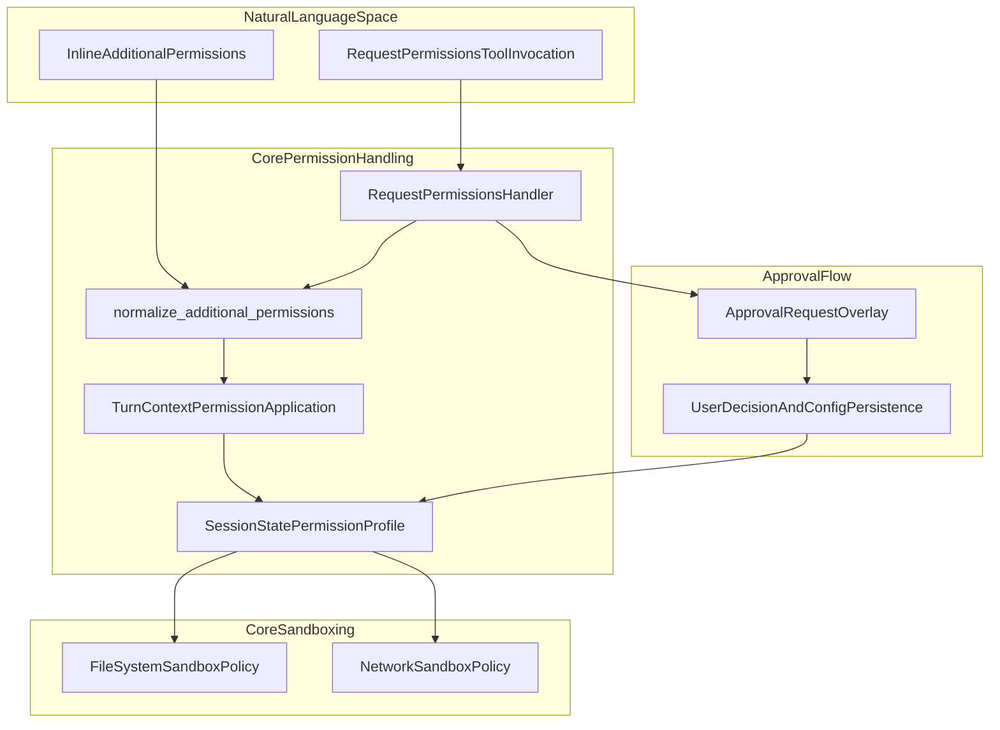
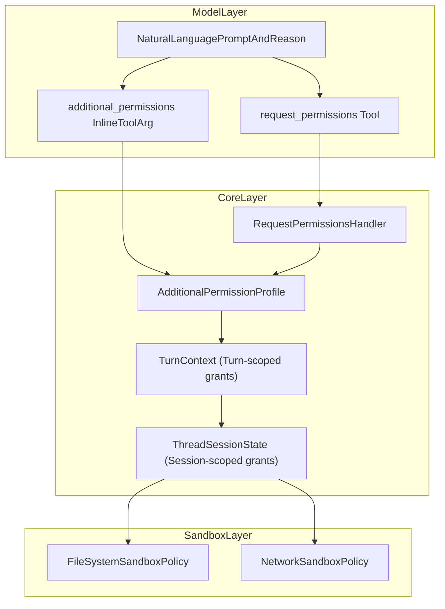

<!-- source: DeepWiki mcp.deepwiki.com · repo openai/codex · page 5.10 Permission Request System · fetched 2026-10-26 -->

# Permission Request System

<details>
<summary>Relevant source files</summary>

The following files were used as context for generating this wiki page:

- [codex-rs/app-server-protocol/src/protocol/v2/permissions.rs](codex-rs/app-server-protocol/src/protocol/v2/permissions.rs)
- [codex-rs/config/src/permissions_toml.rs](codex-rs/config/src/permissions_toml.rs)
- [codex-rs/core/src/apply_patch.rs](codex-rs/core/src/apply_patch.rs)
- [codex-rs/core/src/apply_patch_tests.rs](codex-rs/core/src/apply_patch_tests.rs)
- [codex-rs/core/src/config/permissions.rs](codex-rs/core/src/config/permissions.rs)
- [codex-rs/core/src/config/permissions_tests.rs](codex-rs/core/src/config/permissions_tests.rs)
- [codex-rs/core/src/context/environment_context.rs](codex-rs/core/src/context/environment_context.rs)
- [codex-rs/core/src/safety.rs](codex-rs/core/src/safety.rs)
- [codex-rs/core/src/safety_tests.rs](codex-rs/core/src/safety_tests.rs)
- [codex-rs/core/src/tools/handlers/apply_patch.rs](codex-rs/core/src/tools/handlers/apply_patch.rs)
- [codex-rs/core/src/tools/handlers/apply_patch_tests.rs](codex-rs/core/src/tools/handlers/apply_patch_tests.rs)
- [codex-rs/core/src/tools/handlers/mod.rs](codex-rs/core/src/tools/handlers/mod.rs)
- [codex-rs/core/src/tools/handlers/request_permissions.rs](codex-rs/core/src/tools/handlers/request_permissions.rs)
- [codex-rs/core/src/tools/handlers/shell_spec.rs](codex-rs/core/src/tools/handlers/shell_spec.rs)
- [codex-rs/core/src/tools/handlers/shell_spec_tests.rs](codex-rs/core/src/tools/handlers/shell_spec_tests.rs)
- [codex-rs/core/src/tools/handlers/unified_exec/exec_command.rs](codex-rs/core/src/tools/handlers/unified_exec/exec_command.rs)
- [codex-rs/core/src/tools/handlers/unified_exec/write_stdin.rs](codex-rs/core/src/tools/handlers/unified_exec/write_stdin.rs)
- [codex-rs/core/src/tools/handlers/view_image.rs](codex-rs/core/src/tools/handlers/view_image.rs)
- [codex-rs/core/tests/suite/request_permissions.rs](codex-rs/core/tests/suite/request_permissions.rs)
- [codex-rs/core/tests/suite/request_permissions_tool.rs](codex-rs/core/tests/suite/request_permissions_tool.rs)
- [codex-rs/protocol/src/permissions.rs](codex-rs/protocol/src/permissions.rs)
- [codex-rs/sandboxing/src/policy_transforms.rs](codex-rs/sandboxing/src/policy_transforms.rs)
- [codex-rs/sandboxing/src/policy_transforms_tests.rs](codex-rs/sandboxing/src/policy_transforms_tests.rs)

</details>


The Permission Request System empowers the Codex AI agent to dynamically request elevated sandbox permissions such as filesystem access and network capabilities during turn execution. This capability allows the agent to request explicit user approval for permissions beyond its base sandbox constraints, with the possibility for these permissions to be granted temporarily for a single turn or persistently for the entire session.

This page documents the core components, data flow, and grant persistence mechanisms related to the `request_permissions` tool, the distinction between turn-scoped and session-scoped grants, and the sticky permissions feature that streamlines repeated permission requests.

For foundational details on sandbox policies and approval workflows, refer to [Sandbox and Approval Policies (2.4)]() and [Tool Orchestration and Approval (5.5)]().

---

## Overview

The permission request system functions primarily via two integrated mechanisms:

1. **Standalone `request_permissions` Tool:**  
   An explicit tool invocation by the model to request permissions with a textual reason, triggering an approval workflow. The handler is `RequestPermissionsHandler` located in [codex-rs/core/src/tools/handlers/mod.rs]().  

2. **Inline `additional_permissions` Field in Tool Calls:**  
   Some tools (e.g., `exec_command`, `apply_patch`) support requesting additional permissions inline with the tool usage, which are pre-validated and escalate permissions within the turn as needed. This mechanism is handled in tool-specific handlers, e.g., `ApplyPatchHandler` in [codex-rs/core/src/tools/handlers/apply_patch.rs]() and `ExecCommandHandler` in [codex-rs/core/src/tools/handlers/unified_exec/exec_command.rs]().

Both entry points culminate in normalized `AdditionalPermissionProfile` objects which represent requested filesystem and network permission escalations. These are then integrated into the turn and session state, optionally "sticky" to persist and automatically apply to future turns, reducing repetitive user approval prompts.

Sources: [codex-rs/core/src/tools/handlers/mod.rs](), [codex-rs/core/src/tools/handlers/apply_patch.rs](), [codex-rs/core/src/tools/handlers/unified_exec/exec_command.rs](), [codex-rs/sandboxing/src/policy_transforms.rs:19-145]()

---

## System Architecture

### Permission Request and Validation Flow

This diagram maps the natural language constructs used by the model to request permissions to the core code entities that implement permission normalization, validation, event emission, and user approval.



- The **`request_permissions` tool** is an explicit user-invoked request handled by `RequestPermissionsHandler` located in [codex-rs/core/src/tools/handlers/mod.rs]().  
- Inline `additional_permissions` augment existing tool invocations and are normalized by `normalize_additional_permissions` [codex-rs/sandboxing/src/policy_transforms.rs:19-53]().  
- The normalized permissions form a concrete `AdditionalPermissionProfile` applied to the current turn and potentially persisted to the session.  
- The sandbox enforcement, via `FileSystemSandboxPolicy` and `NetworkSandboxPolicy`, leverages these permissions to govern code execution capability [codex-rs/protocol/src/permissions.rs]().  
- User approval UI overlays mediate granting permissions, with user decisions persisted through configuration updates and session synchronization.

Sources: [codex-rs/core/src/tools/handlers/mod.rs](), [codex-rs/sandboxing/src/policy_transforms.rs:19-53](), [codex-rs/protocol/src/permissions.rs]()

---

## Implementation Details

### Permission Request Handling

The `RequestPermissionsHandler` processes the explicit `request_permissions` tool call. It receives arguments comprising a textual reason and a requested permission profile which is deserialized into a `RequestPermissionProfile` object (a specialized subtype of `AdditionalPermissionProfile`).  

The handler validates the permission profile using normalization functions that check:
- The filesystem paths are well-formed and respect the current execution context via `normalize_additional_permissions_with_context` [codex-rs/sandboxing/src/policy_transforms.rs:55-77]().
- The network access requested respects feature flags and security policies.

If validation succeeds, the permission request event is emitted to the frontend/UI for potential user approval.

Sources: [codex-rs/sandboxing/src/policy_transforms.rs:55-77](), [codex-rs/core/tests/suite/request_permissions.rs]()

### Turn vs Session Scoped Grants

Requested permissions can be granted either:

- **Turn-Scoped Grants:** Valid only for the current execution turn. After completion, these escalations expire.

- **Session-Scoped Grants:** Persist for the entire session, becoming "sticky" such that future turns inherit the user-approved permissions automatically, avoiding redundant permission prompts.

The granularity of grant scopes is governed by the `PermissionGrantScope` enum [codex-rs/protocol/src/request_permissions.rs]().

Sources: [codex-rs/protocol/src/request_permissions.rs]()

### Sticky Permissions Pattern

Sticky permissions are a user-experience enhancement:

- Once a user approves expanded permissions (e.g., write access to workspace roots), the system applies the approved profile automatically to subsequent turns until explicitly changed.

- The permissions menu UI component and permission discovery features empower users to select predefined permission profiles such as `:workspace`, `:read-only`, or elevated `:danger-full-access` [codex-rs/core/src/config/permissions.rs:46-121]().

- User selections modify active configuration and synchronize to thread-level session state.

Sources: [codex-rs/core/src/config/permissions.rs:46-121]()

---

## Permission Data Structures and Policy Models

### Filesystem Permissions

Filesystem permissions are expressed as collections of `FileSystemSandboxEntry` instances. Each entry pairs a path specifier with an access mode:

| Symbol | Description |
|---|---|
| `FileSystemSandboxEntry` | Entry with a `FileSystemPath` and `FileSystemAccessMode` [codex-rs/protocol/src/permissions.rs:181-186]() |
| `FileSystemPath` | Paths can be concrete OS paths, globs, or special identifiers (`Root`, `ProjectRoots`) [codex-rs/protocol/src/permissions.rs:141-166]() |
| `FileSystemAccessMode` | Enum: `Read`, `Write`, `Deny` (deny > write > read precedence) [codex-rs/protocol/src/permissions.rs:120-126]() |

Special paths include workspace roots or temporary directories, enabling declarative sandbox rules.

Protected metadata directories `.git`, `.agents`, `.codex`, `.aws` receive special protection via `forbidden_agent_metadata_write()` which blocks agent writes to these before execution [codex-rs/protocol/src/permissions.rs:40-79]().

Normalization resolves relative and glob paths against the current execution context using `materialize_additional_permissions_with_context()` which ensures paths are consistent and safe [codex-rs/sandboxing/src/policy_transforms.rs:82-91]().

Sources: [codex-rs/protocol/src/permissions.rs:40-186](), [codex-rs/sandboxing/src/policy_transforms.rs:82-91]()

### Network Permissions

Network sandboxing is governed by the `NetworkSandboxPolicy` enum with two states:

- `Restricted`: Default network access policy, limited or disabled [codex-rs/protocol/src/permissions.rs:86-90]().
- `Enabled`: Allows network access [codex-rs/protocol/src/permissions.rs:89]().

Profiles can specify proxy URLs or domain allow/deny lists, which are translated into `NetworkProxyConfig` but do not themselves trigger proxies - these configurations are applied by feature gates and network policy enforcement [codex-rs/core/src/config/permissions.rs:144-156]().

Merging multiple permission profiles results in a combined policy that preserves enabled network access if any source profile enables it via `merge_permission_profiles` [codex-rs/sandboxing/src/policy_transforms.rs:93-145]().

Sources: [codex-rs/protocol/src/permissions.rs:86-90](), [codex-rs/core/src/config/permissions.rs:144-156](), [codex-rs/sandboxing/src/policy_transforms.rs:93-145]()

---

## Event Flow for Request Permissions

The permission request system communicates with the model and frontend through structured events. For example, the standalone `request_permissions` tool generates function call events using the signature:

```json
{
  "tool": "request_permissions",
  "arguments": {
    "reason": "<human-readable justification>",
    "permissions": { ... }
  }
}
```

Upon receiving user approval, the granted permission profile is applied to the turn and optionally persisted.

Sources: [codex-rs/core/tests/suite/request_permissions.rs:111-122]()

---

## Summary and Key Components

| Component | Role | File and Location |
|---|---|---|
| `RequestPermissionsHandler` | Handles explicit `request_permissions` tool calls and triggers permission requests | `codex-rs/core/src/tools/handlers/` |
| `AdditionalPermissionProfile` | Core data structure representing filesystem and network permission requests | `codex-rs/sandboxing/src/policy_transforms.rs:19-53` |
| `FileSystemSandboxEntry` | Represents an individual path access rule | `codex-rs/protocol/src/permissions.rs:181-186` |
| `NetworkSandboxPolicy` | Enum for network access state (`Restricted`, `Enabled`) | `codex-rs/protocol/src/permissions.rs:86-90` |
| `materialize_additional_permissions_with_context` | Resolves relative paths in permission profiles to absolute context | `codex-rs/sandboxing/src/policy_transforms.rs:82-91` |
| `merge_permission_profiles` | Combines multiple permission profiles into unified grants | `codex-rs/sandboxing/src/policy_transforms.rs:93-145` |

Sources: [codex-rs/core/src/tools/handlers/mod.rs](), [codex-rs/sandboxing/src/policy_transforms.rs:19-145](), [codex-rs/protocol/src/permissions.rs:86-186]()

---

## Permission Request System Context and Code Architecture

The following diagram connects natural language constructs and system components within the broader Codex architecture, illustrating permission request scope and state application.



- The **model layer** issues permission requests either explicitly or inline [codex-rs/core/tests/suite/request_permissions.rs:111-122]().  
- The **core layer** validates, normalizes, and applies permission profiles to both the turn (transient) and session (persistent) via `RequestPermissionsHandler` and `AdditionalPermissionProfile` [codex-rs/sandboxing/src/policy_transforms.rs:19-53]().  
- The **sandbox layer** enforces permissions at runtime based on session-scoped policies via `FileSystemSandboxPolicy` and `NetworkSandboxPolicy` [codex-rs/protocol/src/permissions.rs]()

Sources: [codex-rs/core/tests/suite/request_permissions.rs:111-122](), [codex-rs/sandboxing/src/policy_transforms.rs:19-53](), [codex-rs/protocol/src/permissions.rs]()

---

## References

- `request_permissions` tool and handler: [codex-rs/core/src/tools/handlers/mod.rs]()
- Additional permissions normalization and merging: [codex-rs/sandboxing/src/policy_transforms.rs:19-145]()
- Filesystem permission entry and path handling: [codex-rs/protocol/src/permissions.rs]()
- Permission request test cases: [codex-rs/core/tests/suite/request_permissions.rs]()

---

