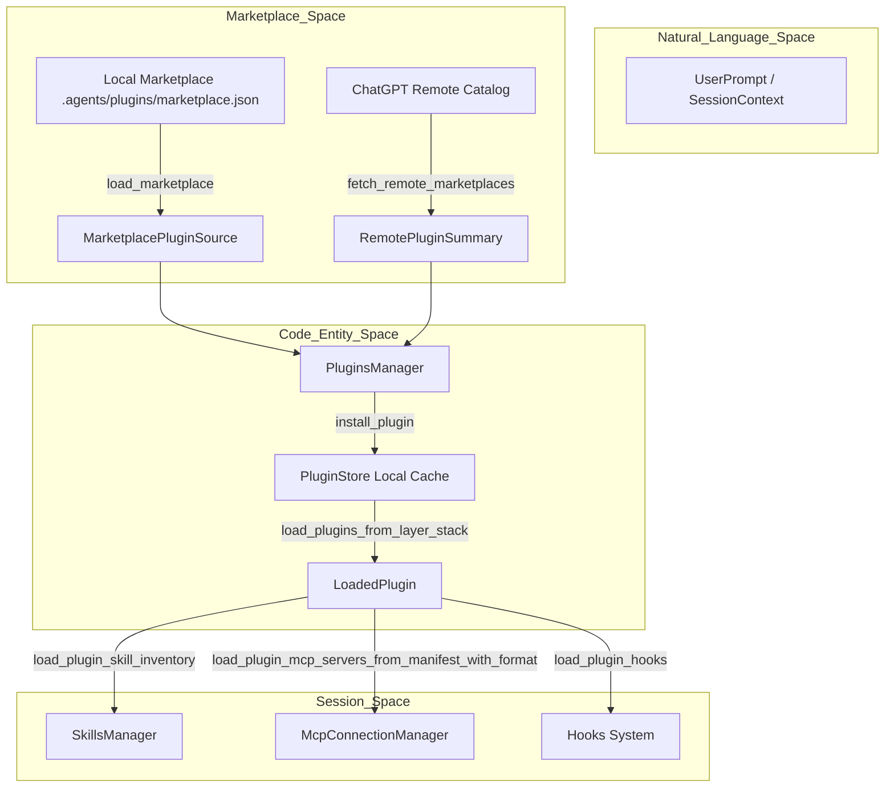
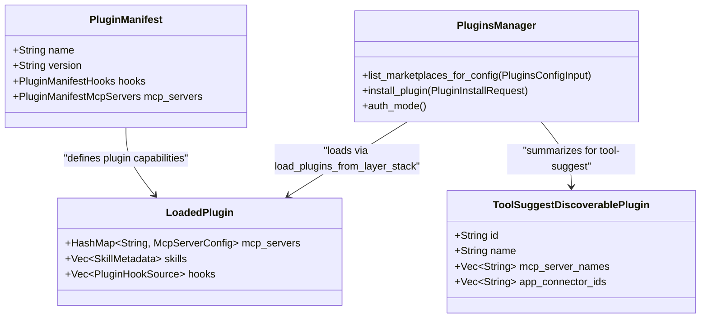

<!-- source: DeepWiki mcp.deepwiki.com · repo openai/codex · page 5.11 Plugins System · fetched 2026-10-26 -->

# Plugins System

Relevant source files

The following files were used as context for generating this wiki page:

- [codex-rs/app-server-protocol/schema/json/v2/PluginListResponse.json](codex-rs/app-server-protocol/schema/json/v2/PluginListResponse.json)
- [codex-rs/app-server-protocol/schema/json/v2/PluginReadResponse.json](codex-rs/app-server-protocol/schema/json/v2/PluginReadResponse.json)
- [codex-rs/app-server-protocol/schema/json/v2/PluginShareListResponse.json](codex-rs/app-server-protocol/schema/json/v2/PluginShareListResponse.json)
- [codex-rs/app-server-protocol/schema/typescript/v2/PluginSummary.ts](codex-rs/app-server-protocol/schema/typescript/v2/PluginSummary.ts)
- [codex-rs/app-server-protocol/src/protocol/v2/plugin.rs](codex-rs/app-server-protocol/src/protocol/v2/plugin.rs)
- [codex-rs/app-server/src/request_processors/plugins.rs](codex-rs/app-server/src/request_processors/plugins.rs)
- [codex-rs/app-server/tests/suite/v2/plugin_install.rs](codex-rs/app-server/tests/suite/v2/plugin_install.rs)
- [codex-rs/app-server/tests/suite/v2/plugin_list.rs](codex-rs/app-server/tests/suite/v2/plugin_list.rs)
- [codex-rs/app-server/tests/suite/v2/plugin_read.rs](codex-rs/app-server/tests/suite/v2/plugin_read.rs)
- [codex-rs/app-server/tests/suite/v2/plugin_share.rs](codex-rs/app-server/tests/suite/v2/plugin_share.rs)
- [codex-rs/app-server/tests/suite/v2/plugin_uninstall.rs](codex-rs/app-server/tests/suite/v2/plugin_uninstall.rs)
- [codex-rs/cli/src/doctor/git.rs](codex-rs/cli/src/doctor/git.rs)
- [codex-rs/cli/src/doctor/snapshots/codex__doctor__git__tests__reports_git_candidates_and_repo_metadata.snap](codex-rs/cli/src/doctor/snapshots/codex__doctor__git__tests__reports_git_candidates_and_repo_metadata.snap)
- [codex-rs/cli/src/marketplace_cmd.rs](codex-rs/cli/src/marketplace_cmd.rs)
- [codex-rs/cli/src/plugin_cmd.rs](codex-rs/cli/src/plugin_cmd.rs)
- [codex-rs/cli/src/plugin_cmd_tests.rs](codex-rs/cli/src/plugin_cmd_tests.rs)
- [codex-rs/cli/tests/plugin_cli.rs](codex-rs/cli/tests/plugin_cli.rs)
- [codex-rs/core-plugins/Cargo.toml](codex-rs/core-plugins/Cargo.toml)
- [codex-rs/core-plugins/src/discoverable.rs](codex-rs/core-plugins/src/discoverable.rs)
- [codex-rs/core-plugins/src/discoverable_tests.rs](codex-rs/core-plugins/src/discoverable_tests.rs)
- [codex-rs/core-plugins/src/lib.rs](codex-rs/core-plugins/src/lib.rs)
- [codex-rs/core-plugins/src/loader.rs](codex-rs/core-plugins/src/loader.rs)
- [codex-rs/core-plugins/src/loader_tests.rs](codex-rs/core-plugins/src/loader_tests.rs)
- [codex-rs/core-plugins/src/manager.rs](codex-rs/core-plugins/src/manager.rs)
- [codex-rs/core-plugins/src/manager_tests.rs](codex-rs/core-plugins/src/manager_tests.rs)
- [codex-rs/core-plugins/src/manifest.rs](codex-rs/core-plugins/src/manifest.rs)
- [codex-rs/core-plugins/src/marketplace.rs](codex-rs/core-plugins/src/marketplace.rs)
- [codex-rs/core-plugins/src/marketplace_tests.rs](codex-rs/core-plugins/src/marketplace_tests.rs)
- [codex-rs/core-plugins/src/remote.rs](codex-rs/core-plugins/src/remote.rs)
- [codex-rs/core-plugins/src/remote/remote_installed_plugin_sync.rs](codex-rs/core-plugins/src/remote/remote_installed_plugin_sync.rs)
- [codex-rs/core-plugins/src/remote/share/tests.rs](codex-rs/core-plugins/src/remote/share/tests.rs)
- [codex-rs/core-plugins/src/remote_bundle.rs](codex-rs/core-plugins/src/remote_bundle.rs)
- [codex-rs/core-plugins/src/startup_sync.rs](codex-rs/core-plugins/src/startup_sync.rs)
- [codex-rs/core-plugins/src/startup_sync_tests.rs](codex-rs/core-plugins/src/startup_sync_tests.rs)
- [codex-rs/core-plugins/src/store.rs](codex-rs/core-plugins/src/store.rs)
- [codex-rs/core-plugins/src/store_tests.rs](codex-rs/core-plugins/src/store_tests.rs)
- [codex-rs/core-plugins/src/test_support.rs](codex-rs/core-plugins/src/test_support.rs)
- [codex-rs/core/tests/suite/plugins.rs](codex-rs/core/tests/suite/plugins.rs)
- [codex-rs/plugin/Cargo.toml](codex-rs/plugin/Cargo.toml)
- [codex-rs/plugin/src/lib.rs](codex-rs/plugin/src/lib.rs)
- [codex-rs/plugin/src/load_outcome.rs](codex-rs/plugin/src/load_outcome.rs)
- [codex-rs/plugin/src/manifest.rs](codex-rs/plugin/src/manifest.rs)
- [codex-rs/plugin/src/provider.rs](codex-rs/plugin/src/provider.rs)
- [codex-rs/plugin/src/provider_tests.rs](codex-rs/plugin/src/provider_tests.rs)
- [codex-rs/utils/plugins/src/lib.rs](codex-rs/utils/plugins/src/lib.rs)
- [codex-rs/utils/plugins/src/plugin_namespace.rs](codex-rs/utils/plugins/src/plugin_namespace.rs)

The Plugins System provides an extensibility framework for Codex, allowing the discovery, installation, and execution of third-party capabilities. Plugins bundle multiple entities including **Skills** (natural language instructions), **MCP Servers** (external tool providers), **App Connectors** (integrations with web services), and **Hooks** (automated session events) [codex-rs/core-plugins/src/loader.rs:8-9](), [codex-rs/core-plugins/src/loader.rs:79-83](), [codex-rs/core-plugins/src/manifest.rs:8-10]().

## Overview and Marketplace

Plugins are distributed via **Marketplaces**, defined by `marketplace.json` manifest files. Marketplaces can be local (typically within a repository’s `.agents/plugins/` or `.codex-plugin/` directory) or remote (managed via the ChatGPT backend) [codex-rs/app-server/tests/suite/v2/plugin_list.rs:116-118](), [codex-rs/core-plugins/src/marketplace.rs:1-20](), [codex-rs/core-plugins/src/remote.rs:93-100]().

### Plugin Discovery and Activation

The system discovers plugins by resolving their metadata in configured marketplaces and checking installation state (local cache or remote sync). The following diagram illustrates the interaction from natural language prompts through marketplaces to plugin entities and session injections:

Title: "Plugin Discovery and Session Injection"

- **UserPrompt / SessionContext** triggers tool or skill invocation from loaded plugins.
- **MarketplacePluginSource** are local manifest sources resolving plugins defined in a marketplace [codex-rs/core-plugins/src/marketplace.rs:49-50]().
- **RemotePluginSummary** represents fetched plugin summaries from remote marketplaces [codex-rs/cli/src/plugin_cmd.rs:31-31]().
- **PluginsManager** manages the discovery, installation, and activation of plugins [codex-rs/core-plugins/src/manager.rs:96-99]().
- **PluginStore** manages local plugin storage, caching plugin bundle files [codex-rs/core-plugins/src/store.rs:85-86]().
- **LoadedPlugin** is the in-memory representation of an installed plugin including its capabilities [codex-rs/core-plugins/src/lib.rs:56-57]().
- Plugins inject their skills, MCP servers, and hooks into the various subsystem managers during agent session initialization [codex-rs/core-plugins/src/loader.rs:138-166]().

Sources: [codex-rs/core-plugins/src/manager.rs:26-31](), [codex-rs/core-plugins/src/loader.rs:26-29](), [codex-rs/core-plugins/src/loader.rs:138-166](), [codex-rs/core-plugins/src/remote.rs:63-72](), [codex-rs/core-plugins/src/store.rs:85-86]()

## PluginsManager and App Server Integration

The `PluginsManager` is the central orchestrator for all plugin operations. It tracks the current authentication mode, manages plugin installation/uninstallation, and refreshes plugin states based on configuration and remote syncing [codex-rs/core-plugins/src/manager.rs:135-160](), [codex-rs/core-plugins/src/manager_tests.rs:130-160]().

Within the JSON-RPC based app-server, `PluginRequestProcessor` acts as an API handler exposing management endpoints such as:

- `plugin/list` — list known plugins from configured marketplaces [codex-rs/app-server/tests/suite/v2/plugin_list.rs:130-136]().
- `plugin/install` — initiate plugin installation request [codex-rs/app-server/tests/suite/v2/plugin_install.rs:126-132]().
- `plugin/uninstall` — remove a plugin [codex-rs/app-server/tests/suite/v2/plugin_uninstall.rs:100-106]().
- `plugin/share/save` — share plugins with other users in a remote catalog context [codex-rs/app-server/tests/suite/v2/plugin_share.rs:100-106]().

### Key Data Structures and Their Roles

| Struct | Description |
|---|---|
| `LoadedPlugin` | Represents a fully loaded and validated plugin including its MCP Servers, Skills, and Hooks [codex-rs/core-plugins/src/lib.rs:56-57](), [codex-rs/core-plugins/src/loader.rs:39-40](). |
| `PluginsManager` | Primary manager coordinating plugin lifecycle, discovery, and remote sync operations [codex-rs/core-plugins/src/lib.rs:96-99](). |
| `PluginStore` | Local storage manager responsible for plugin bundle directory structure and plugin version management [codex-rs/core-plugins/src/loader.rs:22-22](), [codex-rs/core-plugins/src/store.rs:85-86](). |
| `RemoteInstalledPlugin` | Metadata and bundle info for plugins installed via remote ChatGPT plugin sync [codex-rs/core-plugins/src/remote.rs:65-65](). |
| `PluginSummary` | Protocol-level summary of the plugin used by frontends for display in marketplace listings [codex-rs/app-server-protocol/schema/typescript/v2/PluginSummary.ts]() |

Sources: [codex-rs/core-plugins/src/lib.rs:56-57](), [codex-rs/core-plugins/src/lib.rs:80-102](), [codex-rs/core-plugins/src/remote.rs:65-85](), [codex-rs/app-server/src/request_processors/plugins.rs:71-120]()

## Plugin Installation and Storage

Plugins are versioned and cached locally to guarantee stable execution environments and offline availability.

### Local Cache Directory Hierarchy

The `PluginStore` enforces a consistent folder hierarchy rooted under the plugins cache directory inside the Codex home directory [codex-rs/core-plugins/src/store.rs:85-86]().

- Cache Root: `plugins/cache/`
- Directory Layout:  
  `plugins/cache/{marketplace}/{plugin_name}/{version}/`  
This directory contains each plugin's immutable bundle (scripts, manifests, skills, hooks, MCP servers) [codex-rs/core-plugins/src/store.rs:85-86](), [codex-rs/core-plugins/src/remote.rs:9-10]().

- Every plugin bundle contains a `plugin.json` manifest for metadata, capability declaration, and extension points. Manifests are discovered via `find_plugin_manifest_path` utility [codex-rs/core-plugins/src/loader.rs:56-56](), [codex-rs/core-plugins/src/manifest.rs:1-20]().

### Installation Workflow Steps

1.  **Request Invocation:**  
    Installation is triggered via app-server JSON-RPC `plugin/install`, specifying either a `marketplacePath` or `remoteMarketplaceName` along with plugin name [codex-rs/app-server/tests/suite/v2/plugin_install.rs:126-132]().

2.  **Validation:**  
    Ensures exactly one source is specified and verifies the plugin exists and is eligible in the targeted marketplace [codex-rs/app-server/tests/suite/v2/plugin_install.rs:150-180](), [codex-rs/core-plugins/src/marketplace.rs:51-51]().

3.  **Materialization:**  
    If remote plugin, a bundle is downloaded via ChatGPT API synchronization, verified for integrity and security, and unpacked into the cache directory [codex-rs/core-plugins/src/remote.rs:68-68]().

4.  **Registration:**  
    Once installed, the plugin is enabled in the user's `config.toml` under `[plugins]` configuration, which persists the install for future sessions [codex-rs/core/tests/suite/plugins.rs:131-136](), [codex-rs/app-server/tests/suite/v2/plugin_list.rs:66-73]().

Sources: [codex-rs/app-server/tests/suite/v2/plugin_install.rs:88-197](), [codex-rs/core-plugins/src/remote.rs:68-71](), [codex-rs/core-plugins/src/manager.rs:98-99]()

## Remote Plugins and Sharing

Codex supports remote plugin synchronization via ChatGPT marketplaces, allowing users to keep their plugin sets consistent and share plugins with others [codex-rs/core-plugins/src/remote.rs:55-91]().

### Remote Marketplace Synchronization

-   **Marketplace Types:**  
    Remote marketplaces include specially scoped names such as:  
    -   `openai-curated-remote` (global curated plugin catalog) [codex-rs/core-plugins/src/remote.rs:93-93]()  
    -   `created-by-me-remote` (user-owned plugins) [codex-rs/core-plugins/src/remote.rs:94-94]()  
    -   `workspace-directory`, `workspace-shared-with-me`, various shared visibility scopes [codex-rs/core-plugins/src/remote.rs:95-100]().

-   **Sync Logic:**  
    The function `sync_remote_installed_plugin_bundles_once` ensures the local cache contains all remote-installed plugins marked as installed, downloading as needed [codex-rs/core-plugins/src/remote.rs:71-71]().

-   **Concurrency Handling:**  
    `RemotePluginCacheMutationGuard` is used to prevent concurrent cache mutations or state races during sync operations [codex-rs/core-plugins/src/remote.rs:66-66]().

### Plugin Sharing Features

-   **Discoverability Tiers:**  
    Plugins can be shared with specified discoverability levels such as `Public`, `Unlisted`, or scoped sharing [codex-rs/core-plugins/src/remote.rs:77-77](), [codex-rs/app-server/tests/suite/v2/plugin_share.rs:100-106]().

-   **Sharing Principals:**  
    Can specify sharing targets with roles `Reader` or `Editor` for users or groups, enabling collaborative plugin development or usage [codex-rs/core-plugins/src/remote.rs:78-80](), [codex-rs/app-server-protocol/src/protocol/v2/plugin.rs:9-9]().

-   **Persistence:**  
    Sharing changes invoke `save_remote_plugin_share`, which manages bundle uploads and remote registry updates [codex-rs/core-plugins/src/remote.rs:90-90]().

Sources: [codex-rs/core-plugins/src/remote.rs:55-145](), [codex-rs/app-server/src/request_processors/plugins.rs:166-172]()

## Session Injection and Entity Mapping

During each conversation session, the `PluginsManager` injects active plugins' capabilities into the Codex runtime. These capabilities include Skill definitions, MCP servers for tool invocation, hooks for event interception, and tool suggestion metadata.

### Plugin Entity Mapping Diagram

Title: "Plugin Entity Mapping and Code Structure"

-   `PluginManifest` provides the static data describing plugin versions and capabilities [codex-rs/core-plugins/src/manifest.rs:1-30]().
-   `LoadedPlugin` is instantiated post-loading and combines manifest with runtime loaded skills, MCP servers, and hooks [codex-rs/core-plugins/src/lib.rs:56-57](), [codex-rs/core-plugins/src/loader.rs:39-40]().
-   `PluginsManager` provides APIs to list marketplaces, install plugins, and query auth modes [codex-rs/core-plugins/src/lib.rs:80-102]().
-   `ToolSuggestDiscoverablePlugin` represents lightweight summaries of plugins eligible for suggestion as new tools [codex-rs/core-plugins/src/lib.rs:74-75]().

Sources: [codex-rs/core-plugins/src/manager.rs:80-110](), [codex-rs/core-plugins/src/loader.rs:138-166](), [codex-rs/core-plugins/src/lib.rs:56-57]()

### Types of Injection

-   **Tool Suggestions:**  
    `ToolSuggestDiscoverablePlugin` entries identify uninstalled plugins, filtered by allowlists (e.g., `github@openai-curated`), to offer plugin installation suggestions based on user context [codex-rs/core-plugins/src/lib.rs:74-75](), [codex-rs/core-plugins/src/manager.rs:89-89]().

-   **Skill Injection:**  
    Natural language skills stored under the plugin’s `skills/` directory are loaded through `load_plugin_skill_inventory` and made available for prompt-driven actions [codex-rs/core-plugins/src/loader.rs:30-30](), [codex-rs/core-plugins/src/manager_tests.rs:9-9]().

-   **Hook Dispatch:**  
    Plugins define event hooks (e.g. on `PreToolUse`) via manifest JSON, parsed by `load_plugin_hooks` and dispatched during session event processing [codex-rs/core-plugins/src/loader.rs:27-28](), [codex-rs/core-plugins/src/loader.rs:22-23]().

-   **MCP Servers:**  
    Plugin declared MCP servers are loaded and managed for external tool execution, integrated with `McpConnectionManager` to route calls at runtime [codex-rs/core-plugins/src/loader.rs:29-30](), [codex-rs/app-server/tests/suite/v2/plugin_read.rs:200-220]().

Sources: [codex-rs/core-plugins/src/loader.rs:1-178](), [codex-rs/core-plugins/src/manager.rs:1-153](), [codex-rs/core-plugins/src/manager_tests.rs:1-177]()

---

