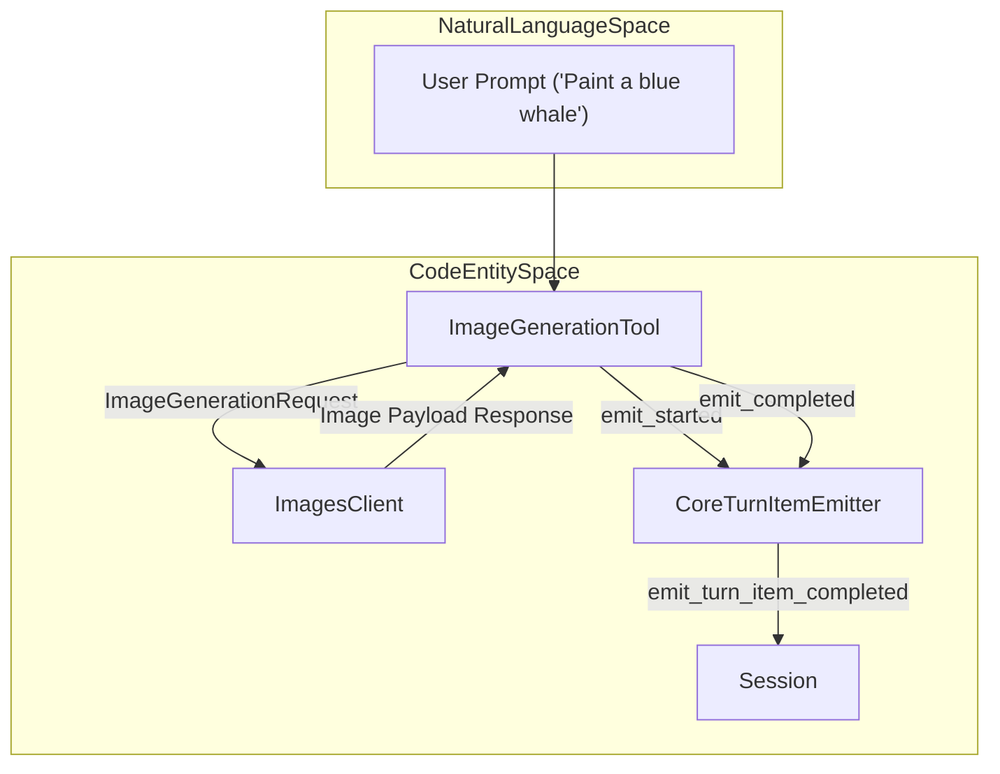
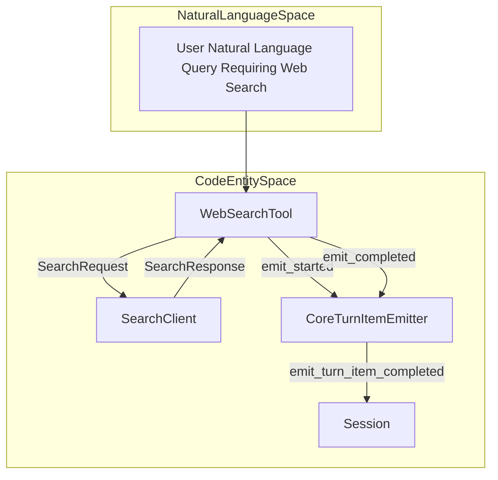

<!-- source: DeepWiki mcp.deepwiki.com · repo openai/codex · page 5.12 Extension Tools (Image Generation, Web Search) · fetched 2026-10-26 -->

# Extension Tools (Image Generation, Web Search)

<details>
<summary>Relevant source files</summary>

The following files were used as context for generating this wiki page:

- [codex-rs/app-server/tests/suite/v2/web_search.rs](codex-rs/app-server/tests/suite/v2/web_search.rs)
- [codex-rs/codex-api/src/endpoint/images.rs](codex-rs/codex-api/src/endpoint/images.rs)
- [codex-rs/codex-api/src/endpoint/mod.rs](codex-rs/codex-api/src/endpoint/mod.rs)
- [codex-rs/codex-api/src/endpoint/search.rs](codex-rs/codex-api/src/endpoint/search.rs)
- [codex-rs/codex-api/src/images.rs](codex-rs/codex-api/src/images.rs)
- [codex-rs/codex-api/src/lib.rs](codex-rs/codex-api/src/lib.rs)
- [codex-rs/codex-api/src/search.rs](codex-rs/codex-api/src/search.rs)
- [codex-rs/core/src/tools/lifecycle.rs](codex-rs/core/src/tools/lifecycle.rs)
- [codex-rs/core/tests/suite/tool_lifecycle.rs](codex-rs/core/tests/suite/tool_lifecycle.rs)
- [codex-rs/core/tests/suite/web_search_system_proxy_tests.rs](codex-rs/core/tests/suite/web_search_system_proxy_tests.rs)
- [codex-rs/ext/extension-api/src/capabilities/events.rs](codex-rs/ext/extension-api/src/capabilities/events.rs)
- [codex-rs/ext/extension-api/src/capabilities/mod.rs](codex-rs/ext/extension-api/src/capabilities/mod.rs)
- [codex-rs/ext/extension-api/src/contributors.rs](codex-rs/ext/extension-api/src/contributors.rs)
- [codex-rs/ext/extension-api/src/contributors/approval_review.rs](codex-rs/ext/extension-api/src/contributors/approval_review.rs)
- [codex-rs/ext/extension-api/src/contributors/tool_lifecycle.rs](codex-rs/ext/extension-api/src/contributors/tool_lifecycle.rs)
- [codex-rs/ext/extension-api/src/lib.rs](codex-rs/ext/extension-api/src/lib.rs)
- [codex-rs/ext/extension-api/src/registry.rs](codex-rs/ext/extension-api/src/registry.rs)
- [codex-rs/ext/extension-api/tests/capabilities.rs](codex-rs/ext/extension-api/tests/capabilities.rs)
- [codex-rs/ext/extension-api/tests/registry.rs](codex-rs/ext/extension-api/tests/registry.rs)
- [codex-rs/ext/web-search/Cargo.toml](codex-rs/ext/web-search/Cargo.toml)
- [codex-rs/ext/web-search/src/extension.rs](codex-rs/ext/web-search/src/extension.rs)
- [codex-rs/ext/web-search/src/output.rs](codex-rs/ext/web-search/src/output.rs)
- [codex-rs/ext/web-search/src/tool.rs](codex-rs/ext/web-search/src/tool.rs)
- [codex-rs/tools/src/tool_output.rs](codex-rs/tools/src/tool_output.rs)

</details>


The extension tools system in Codex provides a modular framework to integrate advanced AI capabilities such as image generation and web search. These extensions harness the `codex-extension-api` framework to register tools and contribute context during the session lifecycle, enabling complex UI-bound items like generated images or search results to be managed elegantly.

Sources: `[codex-rs/ext/extension-api/src/lib.rs:1-126]()`, `[codex-rs/ext/web-search/src/tool.rs:1-94]()`

---

## Extension API Framework

The `codex-extension-api` crate defines core interfaces and infrastructure for extensions to register contributors that participate in various phases of Codex agent execution. These contributors influence prompt construction, tool execution, lifecycle events, configuration, and approval workflows.

### Extension Registry and Contributor Types

Extensions are registered via an `ExtensionRegistryBuilder`, which collects typed contributors before producing an immutable `ExtensionRegistry` used at runtime.

| Contributor Type              | Role                                                                    | Interface Location                                   |
|------------------------------|-------------------------------------------------------------------------|-----------------------------------------------------|
| **ToolContributor**           | Registers native tools (e.g., `image_gen.imagegen`, `web.run`).          | `[codex-rs/ext/extension-api/src/registry.rs:133-135]()` |
| **ContextContributor**        | Adds prompt and world state fragments for context injection.             | `[codex-rs/ext/extension-api/src/contributors.rs:117-153]()`|
| **TurnItemContributor**       | Post-processes turn items before emission to the frontend UI.            | `[codex-rs/ext/extension-api/src/registry.rs:142-144]()`        |
| **ThreadLifecycleContributor**| Manages thread state during start, resume, idle, and stop phases.        | `[codex-rs/ext/extension-api/src/contributors.rs:160-171]()`|
| **TurnLifecycleContributor** | Manages turn start, stop, abort events for state handling.                | `[codex-rs/ext/extension-api/src/contributors.rs:60-64]()`|
| **ConfigContributor**         | Reacts to session configuration changes dynamically.                     | `[codex-rs/ext/extension-api/src/registry.rs:93-95]()`                  |
| **McpServerContributor**      | Resolves runtime MCP servers based on host config.                       | `[codex-rs/ext/extension-api/src/contributors.rs:84-110]()`     |
| **TokenUsageContributor**     | Tracks token usage for extensions.                                       | `[codex-rs/ext/extension-api/src/registry.rs:98-100]()`              |
| **ApprovalReviewContributor** | Contributes to tool approval decisions (automated/human-in-the-loop).    | `[codex-rs/ext/extension-api/src/registry.rs:73-75]()`          |

Each contributor type implements asynchronous methods invoked by the host at defined points, passing runtime state and context.

Sources: `[codex-rs/ext/extension-api/src/registry.rs:21-170]`, `[codex-rs/ext/extension-api/src/contributors.rs:84-171]()`

### Data Flow: Tool Execution and UI Item Emission

Title: "Extension Tool Execution and Event Flow"
```mermaid
graph TD
    subgraph "NaturalLanguageSpace"
        NLQuery["User Natural Language Request"]
    end

    subgraph "CodeEntitySpace"
        TR["ToolRouter"]
        ET["ExtensionToolAdapter"]
        IGT["ImageGenerationTool"]
        Emitter["CoreTurnItemEmitter"]
        SES["Session"]
    end

    NLQuery --> TR
    TR -->|handle| ET
    ET -->|handle| IGT
    IGT -->|emit_started| Emitter
    Note over IGT: "Invoke remote image/search backend API"
    IGT -->|emit_completed| Emitter
    Emitter -->|emit_turn_item_completed| SES
```

Sources: `[codex-rs/ext/extension-api/src/lib.rs:30-46]`, `[codex-rs/core/src/tools/lifecycle.rs:21-60]()`

---

## Image Generation Extension (`ext/image-generation`)

The image generation extension provides AI-driven image creation and editing capabilities integrated as a native tool under the namespace `image_gen` and tool name `imagegen`.

### Key Implementation Details

- **Artifact Storage**: Generated images are saved under a host-provided root directory (`save_root`). The path is computed via helper utilities, and a prompt hint is emitted.
- **Backend Abstraction**: Wraps backend services to interact with image generation endpoints using `ImageGenerationRequest` and `ImageEditRequest` (`[codex-rs/codex-api/src/images.rs]()`).
- **Handle Call Flow**: Asynchronously dispatches calls, managing started and completed item emissions through `TurnItemEmitter`.

Title: "Image Generation Tool Data Flow"


Sources: `[codex-rs/codex-api/src/endpoint/images.rs:1-12]`, `[codex-rs/codex-api/src/images.rs:1-68]()`

---

## Web Search Extension (`ext/web-search`)

The web search extension integrates live external search capabilities, exposing a tool under the namespace `web` with the function `run` (`[codex-rs/ext/web-search/src/tool.rs:41-43]()`).

### Tool and API Client

- Implements `WebSearchTool` utilizing `SearchClient` from `codex-api` to execute search queries (`[codex-rs/ext/web-search/src/tool.rs:46-94]()`).
- Parses input schemas, propagates trace headers (originator, turn metadata), and emits search lifecycle events as `ExtensionTurnItem` structures (`[codex-rs/ext/web-search/src/tool.rs:120-150]()`).

Title: "Web Search Invocation and Execution Flow"


Sources: `[codex-rs/ext/web-search/src/tool.rs:46-175]`, `[codex-rs/codex-api/src/endpoint/search.rs:1-35]()`

---

## Integration with `codex-core`

Extension tools integrate into the Codex core via extension adapters, bridging runtime invocations with execution state.

### Persistent Storage of Extension Items

- Extension items are stored in conversation history using the core protocol's `TurnItem::Extension` variant.
- `ExtensionData` provides in-memory key-value state scoped per session, thread, or turn (`[codex-rs/ext/extension-api/src/state.rs]()`).

| Extension Entity               | Core Protocol Representation         | Persistence / Location                                  |
|-------------------------------|------------------------------------|-------------------------------------------------------|
| `ExtensionItem::ImageGeneration` | `TurnItem::Extension`               | Filesystem artifacts at `save_root`; rollout history   |
| `ExtensionItem::WebSearch`        | `TurnItem::Extension`               | Embedded in conversation history; pollution-aware      |
| `ExtensionData`                  | In-memory per-lifecycle store        | Scoped to Session, Thread, or Turn                      |

Sources: `[codex-rs/ext/extension-api/src/lib.rs:105-108]`, `[codex-rs/core/src/tools/lifecycle.rs:21-60]()`

---

