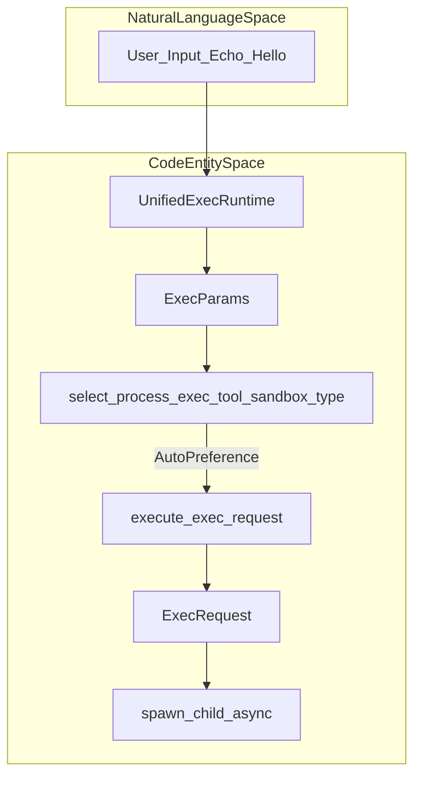
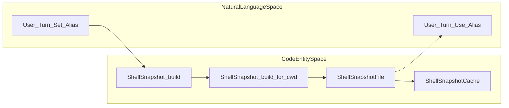
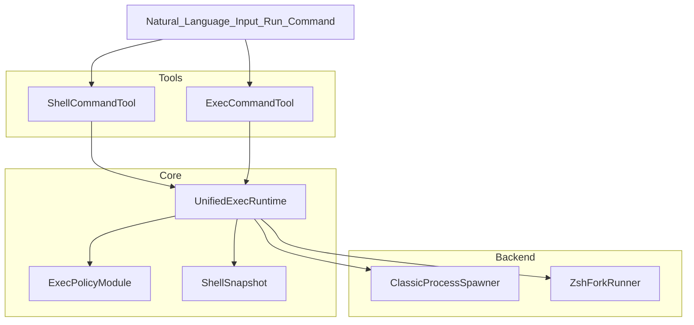

<!-- source: DeepWiki mcp.deepwiki.com · repo openai/codex · page 5.2 Shell Execution Tools · fetched 2026-10-26 -->

# Shell Execution Tools

Relevant source files

The following files were used as context for generating this wiki page:

- [codex-rs/core/src/exec.rs](codex-rs/core/src/exec.rs)
- [codex-rs/core/src/exec_tests.rs](codex-rs/core/src/exec_tests.rs)
- [codex-rs/core/src/sandboxing/mod.rs](codex-rs/core/src/sandboxing/mod.rs)
- [codex-rs/core/src/shell.rs](codex-rs/core/src/shell.rs)
- [codex-rs/core/src/shell_snapshot.rs](codex-rs/core/src/shell_snapshot.rs)
- [codex-rs/core/src/shell_snapshot_tests.rs](codex-rs/core/src/shell_snapshot_tests.rs)
- [codex-rs/core/src/shell_tests.rs](codex-rs/core/src/shell_tests.rs)
- [codex-rs/core/src/tasks/user_shell.rs](codex-rs/core/src/tasks/user_shell.rs)
- [codex-rs/core/src/tools/runtimes/mod.rs](codex-rs/core/src/tools/runtimes/mod.rs)
- [codex-rs/core/src/tools/runtimes/mod_tests.rs](codex-rs/core/src/tools/runtimes/mod_tests.rs)
- [codex-rs/core/tests/suite/models_etag_responses.rs](codex-rs/core/tests/suite/models_etag_responses.rs)
- [codex-rs/core/tests/suite/shell_snapshot.rs](codex-rs/core/tests/suite/shell_snapshot.rs)
- [codex-rs/core/tests/suite/tool_harness.rs](codex-rs/core/tests/suite/tool_harness.rs)
- [codex-rs/exec-server-protocol/src/protocol.rs](codex-rs/exec-server-protocol/src/protocol.rs)
- [codex-rs/exec-server/src/fs_sandbox.rs](codex-rs/exec-server/src/fs_sandbox.rs)
- [codex-rs/exec-server/src/local_process.rs](codex-rs/exec-server/src/local_process.rs)
- [codex-rs/exec-server/src/process_sandbox.rs](codex-rs/exec-server/src/process_sandbox.rs)
- [codex-rs/exec-server/src/process_sandbox_tests.rs](codex-rs/exec-server/src/process_sandbox_tests.rs)
- [codex-rs/exec-server/src/server/handler/tests.rs](codex-rs/exec-server/src/server/handler/tests.rs)
- [codex-rs/exec-server/src/server/request_dispatcher.rs](codex-rs/exec-server/src/server/request_dispatcher.rs)
- [codex-rs/exec-server/src/server/request_dispatcher_tests.rs](codex-rs/exec-server/src/server/request_dispatcher_tests.rs)
- [codex-rs/exec-server/src/shell_snapshot.rs](codex-rs/exec-server/src/shell_snapshot.rs)
- [codex-rs/exec-server/src/shell_snapshot_tests.rs](codex-rs/exec-server/src/shell_snapshot_tests.rs)
- [codex-rs/exec-server/src/telemetry.rs](codex-rs/exec-server/src/telemetry.rs)
- [codex-rs/exec-server/tests/exec_process.rs](codex-rs/exec-server/tests/exec_process.rs)
- [codex-rs/exec-server/tests/exec_process/shell_snapshot.rs](codex-rs/exec-server/tests/exec_process/shell_snapshot.rs)
- [codex-rs/sandboxing/Cargo.toml](codex-rs/sandboxing/Cargo.toml)
- [codex-rs/sandboxing/src/lib.rs](codex-rs/sandboxing/src/lib.rs)
- [codex-rs/sandboxing/src/manager.rs](codex-rs/sandboxing/src/manager.rs)
- [codex-rs/sandboxing/src/manager_tests.rs](codex-rs/sandboxing/src/manager_tests.rs)
- [codex-rs/shell-command/src/shell_detect.rs](codex-rs/shell-command/src/shell_detect.rs)
- [codex-rs/shell-command/src/shell_snapshot.rs](codex-rs/shell-command/src/shell_snapshot.rs)
- [codex-rs/shell-command/src/shell_snapshot_capture.rs](codex-rs/shell-command/src/shell_snapshot_capture.rs)
- [codex-rs/shell-command/src/shell_snapshot_credentials.rs](codex-rs/shell-command/src/shell_snapshot_credentials.rs)
- [codex-rs/shell-command/src/shell_snapshot_render.rs](codex-rs/shell-command/src/shell_snapshot_render.rs)
- [codex-rs/shell-command/src/shell_snapshot_tests.rs](codex-rs/shell-command/src/shell_snapshot_tests.rs)

This page documents the shell execution tools within Codex that enable running shell commands on the user’s machine in both interactive and non-interactive modes. It covers core abstractions such as the `shell_command` tool, the `shell` backend selection logic with its multiple implementations (classic process spawner and specialized zsh fork), mechanisms for capturing shell snapshots, and the escalation protocol for permissions and approval.

## Overview

Codex provides a comprehensive system for executing shell commands safely and efficiently. It implements:

- **`shell_command`**: Executes script-style or one-off shell commands.
- **Shell tool (`UnifiedExecRuntime`)**: Supports interactive process execution with PTYs, managing command lifecycle including approval requests and sandboxing.
- **Shell Backend Selection**: Dynamically chooses an execution backend (native process spawner or zsh fork) based on configuration, platform, and sandbox policy.
- **Shell Snapshots**: Mechanism to persist shell state including environment variables, aliases, and functions between commands to improve context preservation.
- **Shell Escalation (Unix, via Zsh Fork)**: Special protocol to enable fine-grained, just-in-time approval and escalation of commands intercepted during execution.

| Tool / Component        | Purpose                                    | Key Runtime / Struct                   | Notes                                           |
|------------------------|--------------------------------------------|--------------------------------------|-------------------------------------------------|
| `shell_command`         | Run shell commands non-interactively       | `ShellRuntime` (tools/runtimes)      | Supports classic, zsh-fork backends              |
| `exec_command`          | Manage interactive command execution       | `UnifiedExecRuntime` (tools/runtimes)| Supports direct or zsh-fork backends             |
| `Shell`                 | Represents shell binary and arguments      | `Shell` struct                       | Detects shell type and formats execution args    |
| Shell Backend Selector  | Chooses execution backend at runtime       | `select_process_exec_tool_sandbox_type` | Config-driven selection of classic or zsh-fork |
| Shell Snapshots          | Capture/persist shell environment state   | `ShellSnapshot`                      | Supports aliases, exports, with snapshot files  |
| Shell Escalation        | Unix execve interception protocol          | zsh fork and `codex-execve-wrapper`  | For JIT approvals and sandbox bypassing          |

Sources: `[codex-rs/core/src/exec.rs:97-138]`, `[codex-rs/core/src/shell_snapshot.rs:50-130]()`

---

## Shell Command and Shell Tool

### `shell_command` Tool

The `shell_command` tool provides the capability to execute shell commands in a non-interactive manner within Codex. It runs commands with explicit argument lists, environment variable handling, working directory setup, and applies sandbox policies and exec policy checks to ensure security.

- The runtime for this tool is implemented as part of the tool orchestration framework.
- It supports selection among multiple execution backends, primarily:
  - The classic process-spawning backend (`[codex-rs/core/src/exec.rs:1-177]()`).
  - The patched zsh fork backend enabling interception and escalation.
- It integrates with Codex's approval and sandboxing systems to gate execution of potentially dangerous commands.

### `shell` Struct Representation

The `Shell` struct represents the selected shell binary, tracking its `shell_type` (e.g., Bash, Zsh, Sh, PowerShell, Cmd) and absolute path (`PathBuf`). It provides derivation helpers like `derive_exec_args` to produce execution arguments matching platform norms (e.g., `-lc` for Unix shells vs. `-NoProfile -Command` for PowerShell).

Sources: `[codex-rs/core/src/exec.rs:97-138]()`

---

## Shell Backend Selection and Execution Flow

Codex supports multiple backends for shell command execution, with dynamic selection logic based on the platform, configuration, and sandboxing needs. `select_process_exec_tool_sandbox_type` (`[codex-rs/core/src/exec.rs:127-138]()`) evaluates permission profiles and sandbox preferences to select the appropriate `SandboxType`.

### Data Flow Diagram: Natural Language Command to Execution Backends

**Execution Flow Explanation:**

1. User inputs a command through a front-facing tool (`shell_command` or `exec_command`) interfacing with `UnifiedExecRuntime`.
2. The runtime constructs an `ExecParams` object (`[codex-rs/core/src/exec.rs:97-111]()`) carrying command vectors, working directories, and sandbox permissions.
3. The backend selector `select_process_exec_tool_sandbox_type` (`[codex-rs/core/src/exec.rs:127-138]()`) resolves the sandbox strategy.
4. The chosen backend prepares an `ExecRequest` (`[codex-rs/sandboxing/mod.rs:50-73]()`) and spawns the child process asynchronously (`[codex-rs/core/src/exec.rs:25-25]()`).
5. Child process management includes sandboxing, telemetry, sandbox permission checks, and approval gating.

Sources: `[codex-rs/core/src/exec.rs:97-138]`, `[codex-rs/sandboxing/mod.rs:50-73]()`

---

## Shell Snapshots

Shell snapshots allow persisting the state of a shell environment between command executions including exports, aliases, and functions, improving the continuity of interactive sessions.

### Core Components

- The `ShellSnapshot` struct encapsulates snapshot configuration and credential state (`[codex-rs/core/src/shell_snapshot.rs:50-63]()`).
- Snapshots are stored as executable shell scripts (`.sh` or `.ps1`) under a dedicated `shell_snapshots` directory in the Codex home directory.
- Snapshots capture environment variables, aliases, and functions to recreate user shell context.
- Credential broker integration allows snapshots to integrate secure credential management and network proxy contexts.
- Snapshots expire and get cleaned up after a retention period (`[codex-rs/core/src/shell_snapshot.rs:106-107]()`).

### Snapshot Lifecycle and Capture Flow

**Explanation of Flow:**

- On a user turn requiring shell state preservation, `ShellSnapshot::build` (`[codex-rs/core/src/shell_snapshot.rs:152-160]()`) is invoked asynchronously.
- The snapshot script is generated via snapshot capture scripts (`[codex-rs/core/src/shell_snapshot.rs:34-34]()`).
- The snapshot is saved as a `ShellSnapshotFile` (`[codex-rs/core/src/shell_snapshot.rs:73-77]()`).
- `ShellSnapshotCache` holds prepared snapshots for fast replay when executing commands in the same shell context.
- On subsequent turns, the snapshot file and cache data are utilized to replay the shell environment, improving interactive continuity.

Sources: `[codex-rs/core/src/shell_snapshot.rs:50-180]()`

---

## Shell Escalation (Unix, Zsh Fork)

For Unix systems, Codex supports a specialized escalation mechanism that allows interception of shell commands for just-in-time approval and permission elevation:

- Uses a patched Zsh fork which intercepts `execve` system calls via environment variables such as `EXEC_WRAPPER`.
- The helper checks whether credential snapshots apply (`[codex-rs/exec-server/src/process_sandbox.rs:98-108]()`).
- The execve wrapper intercepts command execution, triggering approval workflows before allowing commands to run.
- This flow enables commands flagged by exec policy or sandbox rules to request approvals interactively, with the option to escalate permissions or bypass sandbox restrictions.

Sources: `[codex-rs/exec-server/src/process_sandbox.rs:98-108]()`

---

## User Shell Command Handling

Users can run arbitrary shell commands interactively via the `/shell` command in the Codex UI or CLI using `UserShellCommandTask` (`[codex-rs/core/src/tasks/user_shell.rs:60-72]()`):

- `execute_user_shell_command` (`[codex-rs/core/src/tasks/user_shell.rs:103-110]()`) coordinates task metrics, session telemetry, and turn lifecycles.
- Resolves local turn environments and optional shell configurations (`[codex-rs/core/src/tasks/user_shell.rs:129-141]()`).
- Derives execution arguments via `environment_shell.derive_exec_args(&command, use_login_shell)` (`[codex-rs/core/src/tasks/user_shell.rs:147-147]()`).
- Prepares environment maps via `create_env` and `inject_session_env` (`[codex-rs/core/src/tasks/user_shell.rs:170-171]()`), stripping managed proxies if required (`[codex-rs/core/src/tasks/user_shell.rs:173-175]()`).

Sources: `[codex-rs/core/src/tasks/user_shell.rs:60-182]()`

---

## Summary Diagram: Natural Language Command to Shell Execution Entities

This diagram bridges the natural language user command input to the core entities responsible for shell execution in Codex:

- The shell-related tools encapsulate user requests.
- `UnifiedExecRuntime` manages execution lifecycle and environmental context.
- The `exec_policy` module enforces command safety.
- `ShellSnapshot` manages environment state persistence.
- Backends include the classic process spawner and the patched zsh fork with escalation capabilities.

Sources: `[codex-rs/core/src/exec.rs:97-138]`, `[codex-rs/core/src/shell_snapshot.rs:50-130]()`

---

## References and Source Files

- Core exec parameters and types: `codex-rs/core/src/exec.rs`
- User shell task and execution routines: `codex-rs/core/src/tasks/user_shell.rs`
- Shell snapshot logic and lifecycle: `codex-rs/core/src/shell_snapshot.rs`
- Sandboxing and request wrappers: `codex-rs/core/src/sandboxing/mod.rs`
- Process sandbox preparation and checks: `codex-rs/exec-server/src/process_sandbox.rs`

---

