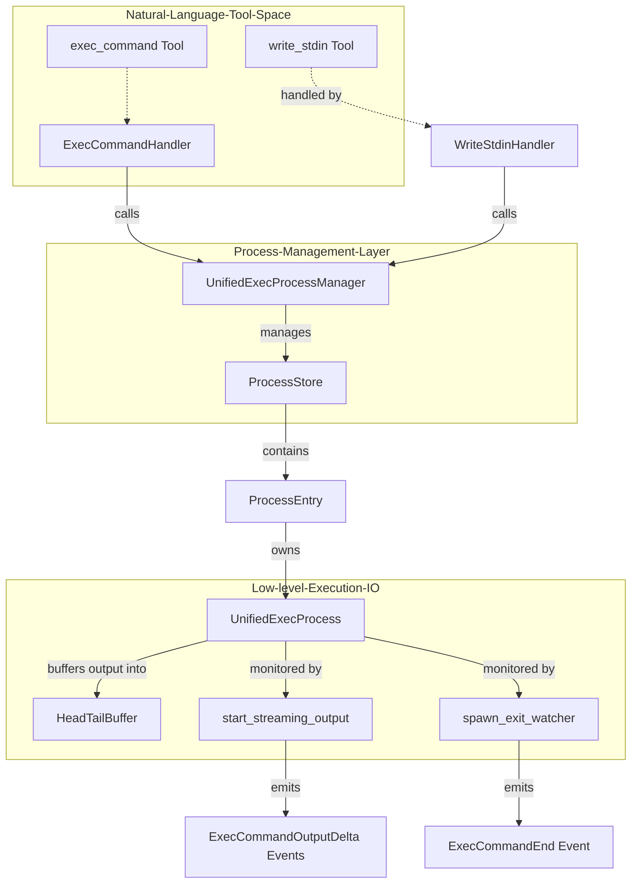
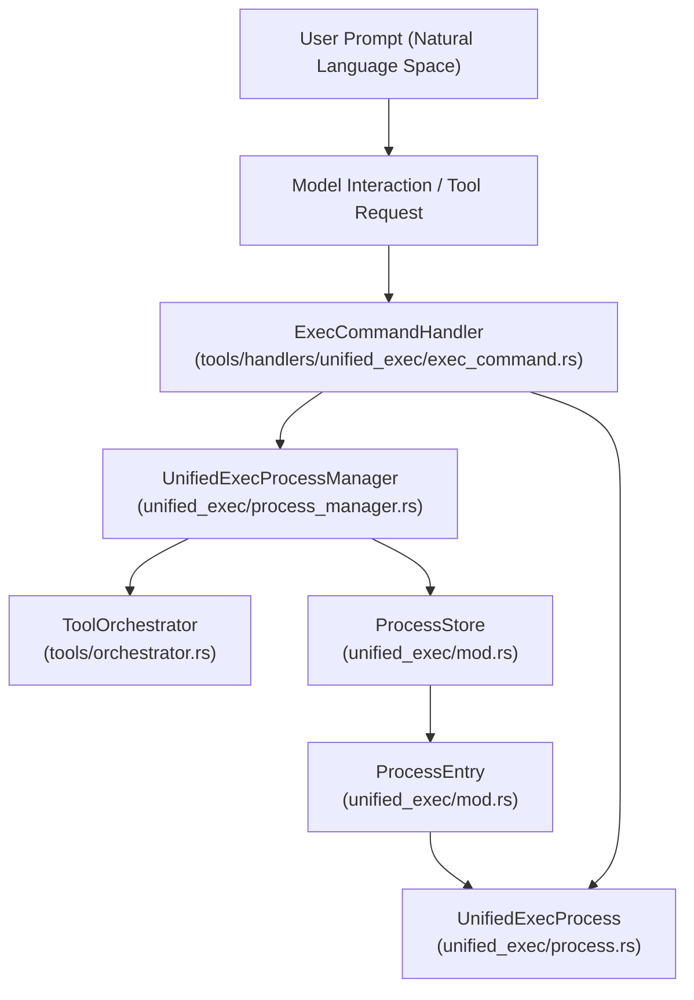

<!-- source: DeepWiki mcp.deepwiki.com · repo openai/codex · page 5.3 Unified Exec Process Management · fetched 2026-10-26 -->

# Unified Exec Process Management

<details>
<summary>Relevant source files</summary>

The following files were used as context for generating this wiki page:

- [codex-rs/core/src/tools/handlers/unified_exec.rs](codex-rs/core/src/tools/handlers/unified_exec.rs)
- [codex-rs/core/src/tools/handlers/unified_exec_tests.rs](codex-rs/core/src/tools/handlers/unified_exec_tests.rs)
- [codex-rs/core/src/unified_exec/async_watcher.rs](codex-rs/core/src/unified_exec/async_watcher.rs)
- [codex-rs/core/src/unified_exec/async_watcher_tests.rs](codex-rs/core/src/unified_exec/async_watcher_tests.rs)
- [codex-rs/core/src/unified_exec/errors.rs](codex-rs/core/src/unified_exec/errors.rs)
- [codex-rs/core/src/unified_exec/head_tail_buffer.rs](codex-rs/core/src/unified_exec/head_tail_buffer.rs)
- [codex-rs/core/src/unified_exec/head_tail_buffer_tests.rs](codex-rs/core/src/unified_exec/head_tail_buffer_tests.rs)
- [codex-rs/core/src/unified_exec/mod.rs](codex-rs/core/src/unified_exec/mod.rs)
- [codex-rs/core/src/unified_exec/mod_tests.rs](codex-rs/core/src/unified_exec/mod_tests.rs)
- [codex-rs/core/src/unified_exec/oneshot.rs](codex-rs/core/src/unified_exec/oneshot.rs)
- [codex-rs/core/src/unified_exec/process.rs](codex-rs/core/src/unified_exec/process.rs)
- [codex-rs/core/src/unified_exec/process_manager.rs](codex-rs/core/src/unified_exec/process_manager.rs)
- [codex-rs/core/src/unified_exec/process_manager_tests.rs](codex-rs/core/src/unified_exec/process_manager_tests.rs)
- [codex-rs/core/src/unified_exec/process_tests.rs](codex-rs/core/src/unified_exec/process_tests.rs)
- [codex-rs/core/tests/suite/apply_patch_cli.rs](codex-rs/core/tests/suite/apply_patch_cli.rs)
- [codex-rs/core/tests/suite/guardian_sandbox_retry.rs](codex-rs/core/tests/suite/guardian_sandbox_retry.rs)
- [codex-rs/core/tests/suite/skills.rs](codex-rs/core/tests/suite/skills.rs)
- [codex-rs/core/tests/suite/unified_exec.rs](codex-rs/core/tests/suite/unified_exec.rs)
- [codex-rs/core/tests/suite/unified_exec_process_events.rs](codex-rs/core/tests/suite/unified_exec_process_events.rs)
- [codex-rs/exec-server/src/process.rs](codex-rs/exec-server/src/process.rs)
- [codex-rs/exec-server/src/remote_process.rs](codex-rs/exec-server/src/remote_process.rs)
- [codex-rs/exec-server/src/server/process_handler.rs](codex-rs/exec-server/src/server/process_handler.rs)
- [codex-rs/exec-server/src/server/session_registry.rs](codex-rs/exec-server/src/server/session_registry.rs)

</details>


## Purpose and Scope

The Unified Exec system provides **interactive PTY-based process execution** orchestrated with approvals and sandboxing, enabling persistent shell sessions that can maintain state across multiple tool calls. It manages PTY-backed subprocesses, their lifecycle, output buffering with caps, and enforces centralized approval and sandboxing policies using a shared orchestrator.

This page details the implementation of the Unified Exec process management layer, core tools `exec_command` and `write_stdin`, the `ProcessStore` for tracking active processes, and the LRU pruning mechanism for resource control.

Sources: [codex-rs/core/src/unified_exec/mod.rs:1-25]()

---

## Architecture Overview

The Unified Exec architecture connects high-level tool invocation with underlying PTY process management and asynchronous event streaming.

### Architecture Data Flow



Sources: [codex-rs/core/src/unified_exec/mod.rs:70-197](), [codex-rs/core/src/unified_exec/process_manager.rs:1-174](), [codex-rs/core/src/unified_exec/process.rs:90-144](), [codex-rs/core/src/unified_exec/async_watcher.rs:57-160]()

---

## UnifiedExecProcessManager and ProcessStore

### UnifiedExecProcessManager

The `UnifiedExecProcessManager` struct provides high-level orchestration of subprocess lifecycles. It manages PTY-backed processes called `UnifiedExecProcess` wrapped in `ProcessEntry` structs within a thread-safe `ProcessStore`.

```rust
pub(crate) struct UnifiedExecProcessManager {
    process_store: Mutex<ProcessStore>,
    max_write_stdin_yield_time_ms: u64,
}
```

- **Process lifecycle management:** Creates and tracks processes, allows writing stdin, and removes processes [codex-rs/core/src/unified_exec/mod.rs:170-182]().
- **Yield time control:** Caps the maximum wait time for output after stdin writes (minimum 250 ms, clamped in construction) [codex-rs/core/src/unified_exec/mod.rs:176-181]().
- **LRU pruning:** Enforces a maximum number of active processes (`MAX_UNIFIED_EXEC_PROCESSES` = 64) [codex-rs/core/src/unified_exec/mod.rs:77-77](). On reaching capacity, it prunes the least recently used process by `last_used` timestamp.
- **Deterministic process IDs:** Provides a test-only mode for deterministic process ID allocation, otherwise uses random ranges for IDs [codex-rs/core/src/unified_exec/process_manager.rs:111-127]().
- **Environment control:** Injects a fixed set of environment variables overriding common keys for consistency (e.g., `NO_COLOR=1`, `TERM=dumb`), by merging a predefined map on top of user environments [codex-rs/core/src/unified_exec/process_manager.rs:93-134]().

Sources: [codex-rs/core/src/unified_exec/mod.rs:170-189](), [codex-rs/core/src/unified_exec/process_manager.rs:93-134](), [codex-rs/core/src/unified_exec/process_manager_tests.rs:10-48]()

### ProcessStore

`ProcessStore` keeps active process entries by their integer IDs and tracks reserved IDs to avoid collisions [codex-rs/core/src/unified_exec/mod.rs:150-162]().

- `remove(process_id)` safely removes a process entry and frees the reserved ID (unless in deterministic test mode) [codex-rs/core/src/unified_exec/mod.rs:156-161]().
- The store facilitates process LRU pruning by sorting entries by their `last_used` time.

Sources: [codex-rs/core/src/unified_exec/mod.rs:150-162]()

### ProcessEntry

Each active process is wrapped in a `ProcessEntry` storing execution metadata, weak session references, timestamps, and sandboxing policies [codex-rs/core/src/unified_exec/mod.rs:185-194]().

Sources: [codex-rs/core/src/unified_exec/mod.rs:185-194]()

---

## Tools: exec_command and write_stdin

### exec_command Tool

This tool starts a PTY process or reuses an existing one for shell command execution:
- Implemented via `ExecCommandHandler` [codex-rs/core/src/tools/handlers/unified_exec/exec_command.rs:74-92]().
- Parses and resolves command line options, shell types (`shell_type`), login requirements, and tty flags [codex-rs/core/src/tools/handlers/unified_exec.rs:25-50]().
- Coordinates with `ToolOrchestrator` for policy checks, approvals, and sandbox selection.
- Spawns background asynchronous watchers (`start_streaming_output` and `spawn_exit_watcher`) [codex-rs/core/src/unified_exec/async_watcher.rs:57-160]().

Sources: [codex-rs/core/src/tools/handlers/unified_exec.rs:25-50](), [codex-rs/core/src/tools/handlers/unified_exec/exec_command.rs:74-92](), [codex-rs/core/src/unified_exec/async_watcher.rs:57-160]()

### write_stdin Tool

Designed to send input to an existing PTY process:
- Managed by `WriteStdinHandler` [codex-rs/core/src/tools/handlers/unified_exec.rs:23-23]().
- Accepts `process_id` and `input` text, writing bytes to the target subprocess `UnifiedExecProcess` [codex-rs/core/src/unified_exec/mod.rs:128-137]().
- Yields control for output collection within clamped timeout bounds [codex-rs/core/src/unified_exec/mod.rs:68-72]().

Sources: [codex-rs/core/src/tools/handlers/unified_exec.rs:23-23](), [codex-rs/core/src/unified_exec/mod.rs:68-72](), [codex-rs/core/src/unified_exec/mod.rs:128-137]()

---

## Output Buffering and Streaming

### HeadTailBuffer

- `HeadTailBuffer` retains a symmetric prefix ("head") and suffix ("tail") of output bytes up to `UNIFIED_EXEC_OUTPUT_MAX_BYTES` (1 MiB), discarding middle content when exceeded [codex-rs/core/src/unified_exec/head_tail_buffer.rs:1-15]().
- Provides utility functions to format omission markers and concatenate buffers.

Sources: [codex-rs/core/src/unified_exec/head_tail_buffer.rs:1-165]()

### Async Output Streaming

- `start_streaming_output` reads chunks from process broadcast receivers and emits `ExecCommandOutputDelta` events [codex-rs/core/src/unified_exec/async_watcher.rs:57-153]().
- `spawn_exit_watcher` monitors process termination and emits a final `ExecCommandEnd` event with the full transcript [codex-rs/core/src/unified_exec/async_watcher.rs:155-181]().

Sources: [codex-rs/core/src/unified_exec/async_watcher.rs:57-181]()

---

## Process ID and Yield Time Controls

### Process ID Generation

- Process IDs are allocated securely or deterministically in tests via `set_deterministic_process_ids_for_tests` [codex-rs/core/src/unified_exec/process_manager.rs:118-120]().

Sources: [codex-rs/core/src/unified_exec/process_manager.rs:118-120]()

### Yield Time Clamping

Yield times are bounded by constants:
- `MIN_YIELD_TIME_MS` (250 ms) [codex-rs/core/src/unified_exec/mod.rs:68-68]()
- `MIN_EMPTY_YIELD_TIME_MS` (5,000 ms) [codex-rs/core/src/unified_exec/mod.rs:71-71]()
- `MAX_YIELD_TIME_MS` (30,000 ms) [codex-rs/core/src/unified_exec/mod.rs:72-72]()

Sources: [codex-rs/core/src/unified_exec/mod.rs:68-72]()

---

## LRU Pruning and Resource Limits

- Enforces `MAX_UNIFIED_EXEC_PROCESSES` = 64 [codex-rs/core/src/unified_exec/mod.rs:77-77]().
- Prunes the least recently used process based on `last_used` when capacity is reached [codex-rs/core/src/unified_exec/process_manager.rs:47-64]().

Sources: [codex-rs/core/src/unified_exec/mod.rs:77-77](), [codex-rs/core/src/unified_exec/process_manager.rs:47-64]()

---

## Summary Table: Responsibilities of Core Entities

| Component/Entity              | Responsibility / Role                                          | File and Location                           |
|------------------------------|---------------------------------------------------------------|---------------------------------------------|
| `UnifiedExecProcessManager`  | Guard process lifecycle: spawn, reuse, prune; manage IDs      | [codex-rs/core/src/unified_exec/mod.rs:164-177]() |
| `ProcessStore`               | Storage and bookkeeping of active processes                    | [codex-rs/core/src/unified_exec/mod.rs:150-162]() |
| `ProcessEntry`               | Metadata per active process: call_id, timestamps, session refs| [codex-rs/core/src/unified_exec/mod.rs:185-194]() |
| `UnifiedExecProcess`          | Low-level PTY and OS process handle                            | [codex-rs/core/src/unified_exec/process.rs:94-107]() |
| `ExecCommandHandler`          | Tool handler entrypoint for `exec_command`                     | [codex-rs/core/src/tools/handlers/unified_exec/exec_command.rs:74-77]() |
| `WriteStdinHandler`           | Tool handler entrypoint for `write_stdin`                      | [codex-rs/core/src/tools/handlers/unified_exec.rs:23-23]() |

Sources: [codex-rs/core/src/unified_exec/mod.rs:150-194](), [codex-rs/core/src/unified_exec/process.rs:94-107](), [codex-rs/core/src/tools/handlers/unified_exec.rs:23-23]()

---

## Diagrams Bridging Natural Language to Code Entities

### Diagram 1: From User Prompt through Exec Command Tool to Managed Process Lifecycle



Sources: [codex-rs/core/src/unified_exec/mod.rs:1-243](), [codex-rs/core/src/unified_exec/process_manager.rs:1-174](), [codex-rs/core/src/tools/handlers/unified_exec.rs:1-124](), [codex-rs/core/src/unified_exec/process.rs:1-177]()

### Diagram 2: Writing to Process Stdin and Output Streaming Chain

```mermaid
graph LR
    WriteStdinHandler["WriteStdinHandler<br/>(tools/handlers/unified_exec.rs)"]
    UnifiedExecProcessManager["UnifiedExecProcessManager<br/>(unified_exec/process_manager.rs)"]
    ProcessStore["ProcessStore<br/>(unified_exec/mod.rs)"]
    ProcessEntry["ProcessEntry<br/>(unified_exec/mod.rs)"]
    UnifiedExecProcess["UnifiedExecProcess<br/>(unified_exec/process.rs)"]
    AsyncOutputStreamer["start_streaming_output<br/>(unified_exec/async_watcher.rs)"]
    EventStream["Codex Event Stream<br/>(ExecCommandOutputDelta)"]

    WriteStdinHandler --> UnifiedExecProcessManager
    UnifiedExecProcessManager --> ProcessStore
    ProcessStore --> ProcessEntry
    ProcessEntry --> UnifiedExecProcess
    UnifiedExecProcess --> AsyncOutputStreamer
    AsyncOutputStreamer --> EventStream
```



Sources: [codex-rs/core/src/unified_exec/mod.rs:1-243](), [codex-rs/core/src/unified_exec/process_manager.rs:1-174](), [codex-rs/core/src/unified_exec/async_watcher.rs:57-153]()

---

