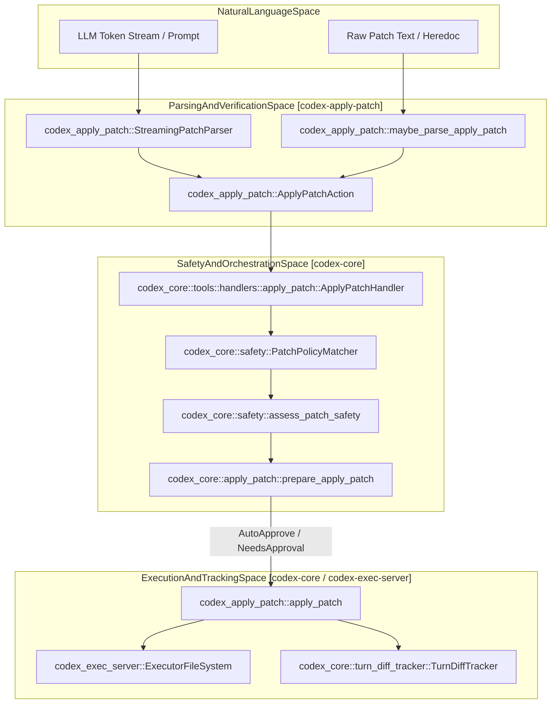
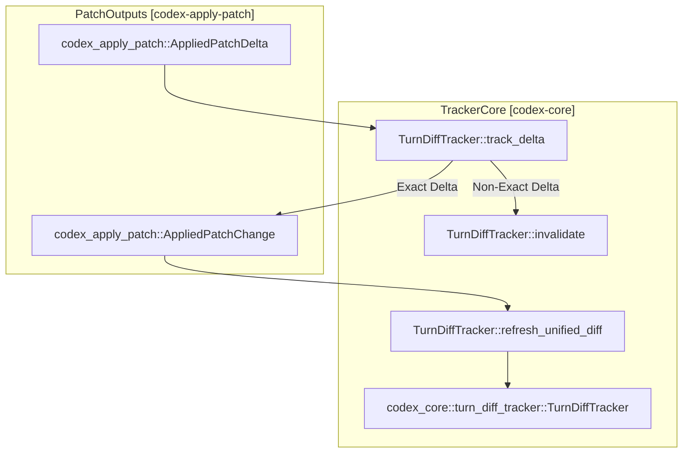

<!-- source: DeepWiki mcp.deepwiki.com · repo openai/codex · page 5.4 Apply Patch System · fetched 2026-10-26 -->

# Apply Patch System

Relevant source files

The following files were used as context for generating this wiki page:

- [codex-rs/apply-patch/src/file_update.rs](codex-rs/apply-patch/src/file_update.rs)
- [codex-rs/apply-patch/src/file_update_tests.rs](codex-rs/apply-patch/src/file_update_tests.rs)
- [codex-rs/apply-patch/src/invocation.rs](codex-rs/apply-patch/src/invocation.rs)
- [codex-rs/apply-patch/src/lib.rs](codex-rs/apply-patch/src/lib.rs)
- [codex-rs/apply-patch/src/parser.rs](codex-rs/apply-patch/src/parser.rs)
- [codex-rs/apply-patch/src/seek_sequence.rs](codex-rs/apply-patch/src/seek_sequence.rs)
- [codex-rs/apply-patch/src/standalone_executable.rs](codex-rs/apply-patch/src/standalone_executable.rs)
- [codex-rs/apply-patch/src/streaming_parser.rs](codex-rs/apply-patch/src/streaming_parser.rs)
- [codex-rs/apply-patch/src/text_file.rs](codex-rs/apply-patch/src/text_file.rs)
- [codex-rs/apply-patch/tests/fixtures/scenarios/.gitattributes](codex-rs/apply-patch/tests/fixtures/scenarios/.gitattributes)
- [codex-rs/apply-patch/tests/fixtures/scenarios/020_whitespace_padded_patch_marker_lines/expected/file.txt](codex-rs/apply-patch/tests/fixtures/scenarios/020_whitespace_padded_patch_marker_lines/expected/file.txt)
- [codex-rs/apply-patch/tests/fixtures/scenarios/020_whitespace_padded_patch_marker_lines/input/file.txt](codex-rs/apply-patch/tests/fixtures/scenarios/020_whitespace_padded_patch_marker_lines/input/file.txt)
- [codex-rs/apply-patch/tests/fixtures/scenarios/020_whitespace_padded_patch_marker_lines/patch.txt](codex-rs/apply-patch/tests/fixtures/scenarios/020_whitespace_padded_patch_marker_lines/patch.txt)
- [codex-rs/apply-patch/tests/fixtures/scenarios/023_preserves_crlf_line_endings/expected/lines.txt](codex-rs/apply-patch/tests/fixtures/scenarios/023_preserves_crlf_line_endings/expected/lines.txt)
- [codex-rs/arg0/Cargo.toml](codex-rs/arg0/Cargo.toml)
- [codex-rs/arg0/src/lib.rs](codex-rs/arg0/src/lib.rs)
- [codex-rs/core/src/apply_patch.rs](codex-rs/core/src/apply_patch.rs)
- [codex-rs/core/src/apply_patch_tests.rs](codex-rs/core/src/apply_patch_tests.rs)
- [codex-rs/core/src/safety.rs](codex-rs/core/src/safety.rs)
- [codex-rs/core/src/safety_tests.rs](codex-rs/core/src/safety_tests.rs)
- [codex-rs/core/src/tools/events.rs](codex-rs/core/src/tools/events.rs)
- [codex-rs/core/src/tools/handlers/apply_patch.rs](codex-rs/core/src/tools/handlers/apply_patch.rs)
- [codex-rs/core/src/tools/handlers/apply_patch_tests.rs](codex-rs/core/src/tools/handlers/apply_patch_tests.rs)
- [codex-rs/core/src/tools/handlers/mod.rs](codex-rs/core/src/tools/handlers/mod.rs)
- [codex-rs/core/src/tools/handlers/request_permissions.rs](codex-rs/core/src/tools/handlers/request_permissions.rs)
- [codex-rs/core/src/tools/handlers/shell_spec.rs](codex-rs/core/src/tools/handlers/shell_spec.rs)
- [codex-rs/core/src/tools/handlers/shell_spec_tests.rs](codex-rs/core/src/tools/handlers/shell_spec_tests.rs)
- [codex-rs/core/src/tools/handlers/unified_exec/exec_command.rs](codex-rs/core/src/tools/handlers/unified_exec/exec_command.rs)
- [codex-rs/core/src/tools/handlers/unified_exec/write_stdin.rs](codex-rs/core/src/tools/handlers/unified_exec/write_stdin.rs)
- [codex-rs/core/src/tools/handlers/view_image.rs](codex-rs/core/src/tools/handlers/view_image.rs)
- [codex-rs/core/src/turn_diff_tracker.rs](codex-rs/core/src/turn_diff_tracker.rs)
- [codex-rs/core/src/turn_diff_tracker_tests.rs](codex-rs/core/src/turn_diff_tracker_tests.rs)

## Purpose and Scope

The `apply_patch` system enables Codex agents to safely and precisely modify workspace files using a custom, human- and LLM-friendly patch format. It supports multiple invocation styles—such as standalone execution via CLI arg0 dispatch [codex-rs/arg0/src/lib.rs:73-75](), embedded execution server requests, and tool calls—while providing robust parsing, verification, safety checks, approval handling, and turn diff tracking.

Implementation spans several key crates:
- **`codex-apply-patch`**: Provides core patch parsing (`parse_patch`), streaming incremental parsing (`StreamingPatchParser`), file updates, and verification logic [codex-rs/apply-patch/src/lib.rs:24-39](), [codex-rs/apply-patch/src/invocation.rs:141-146]().
- **`codex-core` (`ApplyPatchHandler` & `safety`)**: Manages tool invocation execution, safety assessment (`assess_patch_safety`), policy matching (`PatchPolicyMatcher`), and streaming argument consumption (`ApplyPatchArgumentDiffConsumer`) [codex-rs/core/src/tools/handlers/apply_patch.rs:65-106](), [codex-rs/core/src/safety.rs:32-72]().
- **`codex-arg0`**: Manages process dispatch when invoking internal apply_patch helpers (`CODEX_CORE_APPLY_PATCH_ARG1`) or standalone `apply_patch` executables [codex-rs/arg0/src/lib.rs:73-75](), [codex-rs/arg0/src/lib.rs:92-96]().

Sources: [codex-rs/apply-patch/src/lib.rs:24-39](), [codex-rs/apply-patch/src/invocation.rs:141-146](), [codex-rs/core/src/tools/handlers/apply_patch.rs:65-106](), [codex-rs/core/src/safety.rs:32-72](), [codex-rs/arg0/src/lib.rs:73-75](), [codex-rs/arg0/src/lib.rs:92-96]()

---

## Patch Format, Parsing, and Streaming Workflow

The patch format relies on explicit text markers indicating file additions, deletions, and updates.

### Patch Grammar and Structure

The grammar defined in `codex-rs/apply-patch/src/parser.rs` expects:
- A beginning marker: `*** Begin Patch` [codex-rs/apply-patch/src/parser.rs:37-37]()
- An optional environment ID marker: `*** Environment ID: <id>` [codex-rs/apply-patch/src/streaming_parser.rs:19-19]()
- One or more hunks (`AddFile`, `DeleteFile`, `UpdateFile`) [codex-rs/apply-patch/src/parser.rs:11-14]()
- An ending marker: `*** End Patch` [codex-rs/apply-patch/src/parser.rs:38-38]()

### Streaming Patch Parser and Argument Diff Consumer

`StreamingPatchParser` allows incremental parsing of patch text chunks via `StreamingPatchParser::push_delta` and finalization via `StreamingPatchParser::finish` [codex-rs/apply-patch/src/streaming_parser.rs:139-154](). In `codex-core`, `ApplyPatchArgumentDiffConsumer` implements `ToolArgumentDiffConsumer` to consume patch text deltas during tool streaming, buffering updates using `APPLY_PATCH_ARGUMENT_DIFF_BUFFER_INTERVAL` (500ms) and emitting `PatchApplyUpdated` events when `Feature::ApplyPatchStreamingEvents` is enabled [codex-rs/core/src/tools/handlers/apply_patch.rs:76-106]().

Sources: [codex-rs/apply-patch/src/parser.rs:11-38](), [codex-rs/apply-patch/src/streaming_parser.rs:139-154](), [codex-rs/core/src/tools/handlers/apply_patch.rs:76-106]()

---

## Safety Assessment, Policy Matching, and Approval Requests

Before applying patches, `codex-core` evaluates patch safety to determine whether changes can be automatically approved, require user confirmation, or must be rejected [codex-rs/core/src/apply_patch.rs:22-62](), [codex-rs/core/src/safety.rs:67-72]().

### Safety Assessment Workflow

1. **Policy Matching (`PatchPolicyMatcher`)**: Prepares policy matching against the configured `FileSystemSandboxPolicy` and sandbox route (`PatchSandboxRoute::ExecutorManaged` or `PatchSandboxRoute::Platform`) [codex-rs/core/src/safety.rs:32-56]().
2. **Safety Check Evaluation (`assess_patch_safety`)**: Evaluates the `ApplyPatchAction` against the user's approval settings (`AskForApproval`), permission profile (`PermissionProfile`), and writable path constraints [codex-rs/core/src/safety.rs:67-125]().
   - **`SafetyCheck::AutoApprove`**: Returned if the patch is constrained to writable paths and a suitable sandbox is active or permissions are disabled [codex-rs/core/src/safety.rs:106-112]().
   - **`SafetyCheck::AskUser`**: Triggers a user approval request (`ExecApprovalRequirement::NeedsApproval`) if sandbox approval is enabled and the patch falls outside strict auto-approval bounds [codex-rs/core/src/safety.rs:52-56](), [codex-rs/core/src/safety.rs:113-124]().
   - **`SafetyCheck::Reject`**: Rejects the patch with a specific reason (e.g., writing outside project roots or blocked by read-only sandbox) [codex-rs/core/src/safety.rs:58-60](), [codex-rs/core/src/safety.rs:127-144]().

Sources: [codex-rs/core/src/apply_patch.rs:22-62](), [codex-rs/core/src/safety.rs:32-144]()

---

## Architecture and Data Flow

### Conceptual Overview

Natural language inputs or LLM stream tokens are processed by `StreamingPatchParser` or `maybe_parse_apply_patch` [codex-rs/apply-patch/src/invocation.rs:112-137](), verified via `prepare_apply_patch` and `assess_patch_safety` [codex-rs/core/src/apply_patch.rs:22-36](), and applied via `apply_patch` onto the `ExecutorFileSystem` [codex-rs/apply-patch/src/lib.rs:70-77]().

### Component Interaction Diagram Bridging Natural Language Space to Code Entity Space

Sources: [codex-rs/apply-patch/src/invocation.rs:112-146](), [codex-rs/core/src/apply_patch.rs:22-62](), [codex-rs/core/src/safety.rs:32-125](), [codex-rs/core/src/turn_diff_tracker.rs:92-106]()

---

## Turn Diff Tracking

`TurnDiffTracker` accumulates net text changes within a turn from committed `apply_patch` mutations without rereading the workspace disk [codex-rs/core/src/turn_diff_tracker.rs:47-49]().

### Key Methods and Data Structures

- `TurnDiffTracker::track_delta`: Ingests an `AppliedPatchDelta` for a given `environment_id`, verifying exactness before recording updates [codex-rs/core/src/turn_diff_tracker.rs:92-100]().
- `TurnDiffTracker::invalidate`: Marks the tracker invalid (e.g., when a non-exact or external file modification occurs), clearing cached diffs [codex-rs/core/src/turn_diff_tracker.rs:108-112]().
- `TurnDiffTracker::get_unified_diff`: Returns the aggregated unified diff string for the turn [codex-rs/core/src/turn_diff_tracker.rs:114-116]().

### Turn Diff Tracking Architecture Diagram

Sources: [codex-rs/core/src/turn_diff_tracker.rs:47-116]()

---

## Standalone Execution and Arg0 Dispatch

The `apply_patch` utility can be executed as a standalone binary or via process self-invocation [codex-rs/apply-patch/src/standalone_executable.rs:4-7](), [codex-rs/arg0/src/lib.rs:92-128]().

### Arg0 Dispatch Routing

- When invoked with `argv[0]` matching `apply_patch` or `applypatch`, `codex_apply_patch::main()` is executed [codex-rs/arg0/src/lib.rs:73-75]().
- When invoked with `argv[1]` equal to `CODEX_CORE_APPLY_PATCH_ARG1` (`--codex-run-as-apply-patch`), `codex_arg0` spawns a single-threaded Tokio runtime to execute `codex_apply_patch::apply_patch` against the local filesystem [codex-rs/arg0/src/lib.rs:92-121]().

Sources: [codex-rs/arg0/src/lib.rs:73-128](), [codex-rs/apply-patch/src/standalone_executable.rs:4-7]()

---

## Summary of Key Classes and Functions

| Component | Purpose | Location |
| --- | --- | --- |
| `ApplyPatchHandler` | Handles freeform `apply_patch` tool execution requests | [codex-rs/core/src/tools/handlers/apply_patch.rs:65-68]() |
| `StreamingPatchParser` | Incremental stateful patch parsing from text streams | [codex-rs/apply-patch/src/streaming_parser.rs:22-26]() |
| `ApplyPatchAction` | Structured representation of parsed patch changes and working directory | [codex-rs/apply-patch/src/lib.rs:169-179]() |
| `PatchPolicyMatcher` | Prepares policy matching against configured file system sandbox policies | [codex-rs/core/src/safety.rs:32-37]() |
| `assess_patch_safety` | Evaluates patch safety to determine auto-approval, prompt, or rejection | [codex-rs/core/src/safety.rs:67-72]() |
| `TurnDiffTracker` | Accumulates net text diffs for the current turn from applied patch deltas | [codex-rs/core/src/turn_diff_tracker.rs:49-60]() |
| `apply_patch` | Core function executing file updates on an `ExecutorFileSystem` | [codex-rs/apply-patch/src/lib.rs:70-77]() |

Sources: [codex-rs/core/src/tools/handlers/apply_patch.rs:65-68](), [codex-rs/apply-patch/src/streaming_parser.rs:22-26](), [codex-rs/apply-patch/src/lib.rs:77-179](), [codex-rs/core/src/safety.rs:32-72](), [codex-rs/core/src/turn_diff_tracker.rs:49-60]()

---

