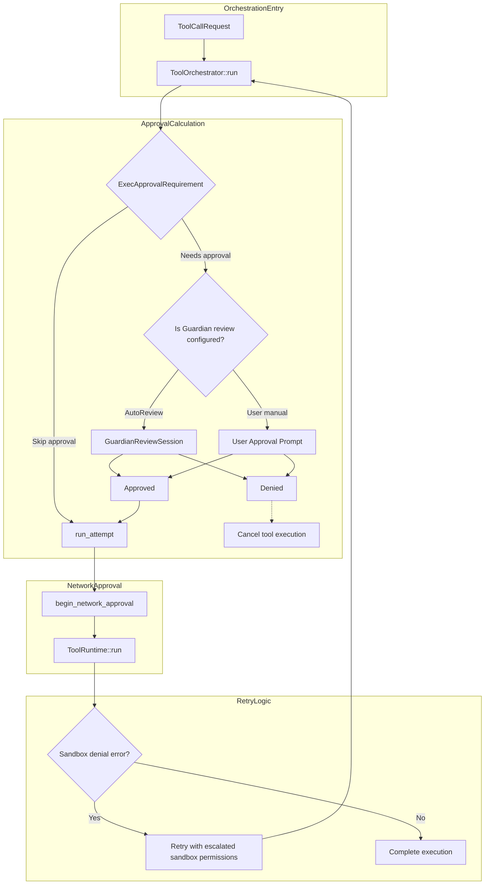
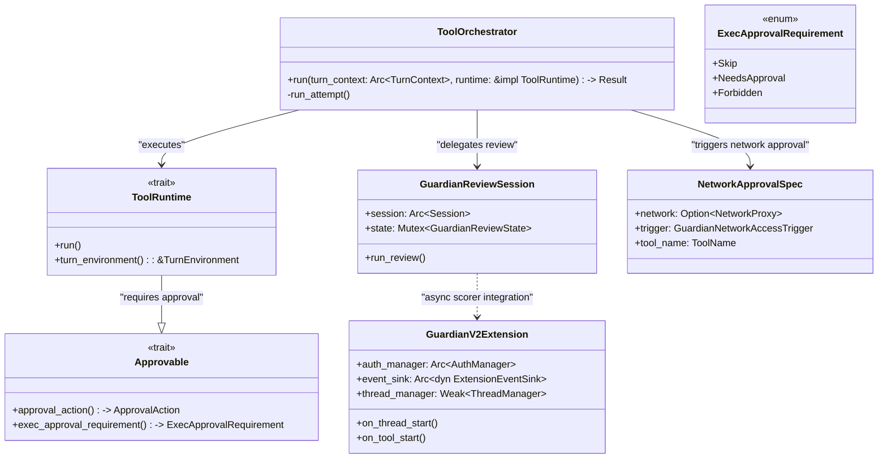
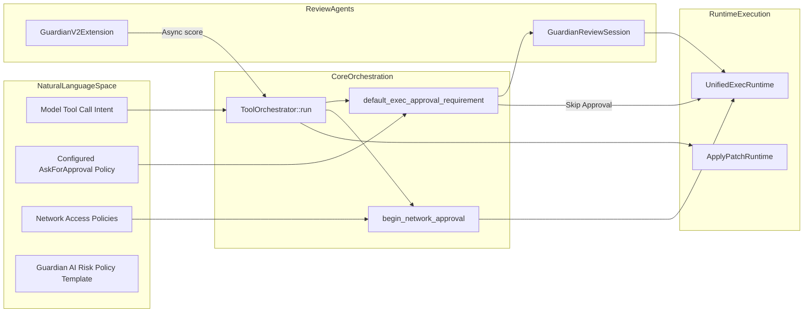

<!-- source: DeepWiki mcp.deepwiki.com · repo openai/codex · page 5.5 Tool Orchestration and Approval · fetched 2026-10-26 -->

# Tool Orchestration and Approval

Relevant source files

The following files were used as context for generating this wiki page:

- [codex-rs/app-server/tests/suite/v2/guardian_v2.rs](codex-rs/app-server/tests/suite/v2/guardian_v2.rs)
- [codex-rs/app-server/tests/suite/v2/mcp_tool.rs](codex-rs/app-server/tests/suite/v2/mcp_tool.rs)
- [codex-rs/core/src/agent/control/user_authorization.rs](codex-rs/core/src/agent/control/user_authorization.rs)
- [codex-rs/core/src/context/guardian_review_evidence.rs](codex-rs/core/src/context/guardian_review_evidence.rs)
- [codex-rs/core/src/context_manager/history_user_authorization.rs](codex-rs/core/src/context_manager/history_user_authorization.rs)
- [codex-rs/core/src/guardian/decision.rs](codex-rs/core/src/guardian/decision.rs)
- [codex-rs/core/src/guardian/mod.rs](codex-rs/core/src/guardian/mod.rs)
- [codex-rs/core/src/guardian/prompt.rs](codex-rs/core/src/guardian/prompt.rs)
- [codex-rs/core/src/guardian/review.rs](codex-rs/core/src/guardian/review.rs)
- [codex-rs/core/src/guardian/review_request.rs](codex-rs/core/src/guardian/review_request.rs)
- [codex-rs/core/src/guardian/review_session.rs](codex-rs/core/src/guardian/review_session.rs)
- [codex-rs/core/src/guardian/review_session_setup.rs](codex-rs/core/src/guardian/review_session_setup.rs)
- [codex-rs/core/src/guardian/review_session_tests.rs](codex-rs/core/src/guardian/review_session_tests.rs)
- [codex-rs/core/src/guardian/reviewer_config.rs](codex-rs/core/src/guardian/reviewer_config.rs)
- [codex-rs/core/src/guardian/runtime.rs](codex-rs/core/src/guardian/runtime.rs)
- [codex-rs/core/src/guardian/test_host.rs](codex-rs/core/src/guardian/test_host.rs)
- [codex-rs/core/src/guardian/tests.rs](codex-rs/core/src/guardian/tests.rs)
- [codex-rs/core/src/tools/approvals.rs](codex-rs/core/src/tools/approvals.rs)
- [codex-rs/core/src/tools/approvals_tests.rs](codex-rs/core/src/tools/approvals_tests.rs)
- [codex-rs/core/src/tools/mod.rs](codex-rs/core/src/tools/mod.rs)
- [codex-rs/core/src/tools/network_approval.rs](codex-rs/core/src/tools/network_approval.rs)
- [codex-rs/core/src/tools/network_approval_tests.rs](codex-rs/core/src/tools/network_approval_tests.rs)
- [codex-rs/core/src/tools/orchestrator.rs](codex-rs/core/src/tools/orchestrator.rs)
- [codex-rs/core/src/tools/runtimes/apply_patch.rs](codex-rs/core/src/tools/runtimes/apply_patch.rs)
- [codex-rs/core/src/tools/runtimes/apply_patch_tests.rs](codex-rs/core/src/tools/runtimes/apply_patch_tests.rs)
- [codex-rs/core/src/tools/runtimes/unified_exec.rs](codex-rs/core/src/tools/runtimes/unified_exec.rs)
- [codex-rs/core/src/tools/sandboxing.rs](codex-rs/core/src/tools/sandboxing.rs)
- [codex-rs/core/src/tools/sandboxing_tests.rs](codex-rs/core/src/tools/sandboxing_tests.rs)
- [codex-rs/core/src/tools/user_messaging.rs](codex-rs/core/src/tools/user_messaging.rs)
- [codex-rs/core/src/tools/user_messaging_tests.rs](codex-rs/core/src/tools/user_messaging_tests.rs)
- [codex-rs/core/tests/suite/guardian_connector_trust.rs](codex-rs/core/tests/suite/guardian_connector_trust.rs)
- [codex-rs/core/tests/suite/guardian_retained_context.rs](codex-rs/core/tests/suite/guardian_retained_context.rs)
- [codex-rs/core/tests/suite/guardian_review.rs](codex-rs/core/tests/suite/guardian_review.rs)
- [codex-rs/core/tests/suite/guardian_subagent_authorization.rs](codex-rs/core/tests/suite/guardian_subagent_authorization.rs)
- [codex-rs/core/tests/suite/managed_threads_tests.rs](codex-rs/core/tests/suite/managed_threads_tests.rs)
- [codex-rs/core/tests/suite/network_approval.rs](codex-rs/core/tests/suite/network_approval.rs)
- [codex-rs/core/tests/suite/scenarios_guardian_orchestrator_connector.rs](codex-rs/core/tests/suite/scenarios_guardian_orchestrator_connector.rs)
- [codex-rs/core/tests/suite/snapshots/all__suite__scenarios__guardian_orchestrator_connector__host_owned_orchestrator_connector_request_history.snap](codex-rs/core/tests/suite/snapshots/all__suite__scenarios__guardian_orchestrator_connector__host_owned_orchestrator_connector_request_history.snap)
- [codex-rs/ext/guardian-reviewer/Cargo.toml](codex-rs/ext/guardian-reviewer/Cargo.toml)
- [codex-rs/ext/guardian-reviewer/src/assessment.rs](codex-rs/ext/guardian-reviewer/src/assessment.rs)
- [codex-rs/ext/guardian-reviewer/src/assessment_tests.rs](codex-rs/ext/guardian-reviewer/src/assessment_tests.rs)
- [codex-rs/ext/guardian-reviewer/src/circuit_breaker.rs](codex-rs/ext/guardian-reviewer/src/circuit_breaker.rs)
- [codex-rs/ext/guardian-reviewer/src/completion.rs](codex-rs/ext/guardian-reviewer/src/completion.rs)
- [codex-rs/ext/guardian-reviewer/src/feedback.rs](codex-rs/ext/guardian-reviewer/src/feedback.rs)
- [codex-rs/ext/guardian-reviewer/src/feedback_tests.rs](codex-rs/ext/guardian-reviewer/src/feedback_tests.rs)
- [codex-rs/ext/guardian-reviewer/src/lib.rs](codex-rs/ext/guardian-reviewer/src/lib.rs)
- [codex-rs/ext/guardian-reviewer/src/metrics.rs](codex-rs/ext/guardian-reviewer/src/metrics.rs)
- [codex-rs/ext/guardian-reviewer/src/outcome.rs](codex-rs/ext/guardian-reviewer/src/outcome.rs)
- [codex-rs/ext/guardian-reviewer/src/pool.rs](codex-rs/ext/guardian-reviewer/src/pool.rs)
- [codex-rs/ext/guardian-reviewer/src/pool_tests.rs](codex-rs/ext/guardian-reviewer/src/pool_tests.rs)
- [codex-rs/ext/guardian-reviewer/src/retry.rs](codex-rs/ext/guardian-reviewer/src/retry.rs)
- [codex-rs/ext/guardian-reviewer/src/retry_tests.rs](codex-rs/ext/guardian-reviewer/src/retry_tests.rs)
- [codex-rs/ext/guardian-reviewer/src/review.rs](codex-rs/ext/guardian-reviewer/src/review.rs)
- [codex-rs/ext/guardian-reviewer/src/review_tests.rs](codex-rs/ext/guardian-reviewer/src/review_tests.rs)
- [codex-rs/ext/guardian-reviewer/src/routing.rs](codex-rs/ext/guardian-reviewer/src/routing.rs)
- [codex-rs/ext/guardian-reviewer/src/settings.rs](codex-rs/ext/guardian-reviewer/src/settings.rs)
- [codex-rs/ext/guardian-v2/BUILD.bazel](codex-rs/ext/guardian-v2/BUILD.bazel)
- [codex-rs/ext/guardian-v2/Cargo.toml](codex-rs/ext/guardian-v2/Cargo.toml)
- [codex-rs/ext/guardian-v2/src/async_scorer/approval.rs](codex-rs/ext/guardian-v2/src/async_scorer/approval.rs)
- [codex-rs/ext/guardian-v2/src/async_scorer/classification.rs](codex-rs/ext/guardian-v2/src/async_scorer/classification.rs)
- [codex-rs/ext/guardian-v2/src/async_scorer/config.rs](codex-rs/ext/guardian-v2/src/async_scorer/config.rs)
- [codex-rs/ext/guardian-v2/src/async_scorer/config_tests.rs](codex-rs/ext/guardian-v2/src/async_scorer/config_tests.rs)
- [codex-rs/ext/guardian-v2/src/async_scorer/conversation.rs](codex-rs/ext/guardian-v2/src/async_scorer/conversation.rs)
- [codex-rs/ext/guardian-v2/src/async_scorer/conversation_tests.rs](codex-rs/ext/guardian-v2/src/async_scorer/conversation_tests.rs)
- [codex-rs/ext/guardian-v2/src/async_scorer/decisions.rs](codex-rs/ext/guardian-v2/src/async_scorer/decisions.rs)
- [codex-rs/ext/guardian-v2/src/async_scorer/decisions_lifecycle_tests.rs](codex-rs/ext/guardian-v2/src/async_scorer/decisions_lifecycle_tests.rs)
- [codex-rs/ext/guardian-v2/src/async_scorer/decisions_tests.rs](codex-rs/ext/guardian-v2/src/async_scorer/decisions_tests.rs)
- [codex-rs/ext/guardian-v2/src/async_scorer/extension.rs](codex-rs/ext/guardian-v2/src/async_scorer/extension.rs)
- [codex-rs/ext/guardian-v2/src/async_scorer/extension_tests.rs](codex-rs/ext/guardian-v2/src/async_scorer/extension_tests.rs)
- [codex-rs/ext/guardian-v2/src/async_scorer/metrics.rs](codex-rs/ext/guardian-v2/src/async_scorer/metrics.rs)
- [codex-rs/ext/guardian-v2/src/async_scorer/mod.rs](codex-rs/ext/guardian-v2/src/async_scorer/mod.rs)
- [codex-rs/ext/guardian-v2/src/async_scorer/observation.rs](codex-rs/ext/guardian-v2/src/async_scorer/observation.rs)
- [codex-rs/ext/guardian-v2/src/async_scorer/pending_score_tests.rs](codex-rs/ext/guardian-v2/src/async_scorer/pending_score_tests.rs)
- [codex-rs/ext/guardian-v2/src/async_scorer/retained_sampling_tests.rs](codex-rs/ext/guardian-v2/src/async_scorer/retained_sampling_tests.rs)
- [codex-rs/ext/guardian-v2/src/async_scorer/sampler.rs](codex-rs/ext/guardian-v2/src/async_scorer/sampler.rs)
- [codex-rs/ext/guardian-v2/src/async_scorer/sampler/connection_pool_cancellation_tests.rs](codex-rs/ext/guardian-v2/src/async_scorer/sampler/connection_pool_cancellation_tests.rs)
- [codex-rs/ext/guardian-v2/src/async_scorer/sampler/execution.rs](codex-rs/ext/guardian-v2/src/async_scorer/sampler/execution.rs)
- [codex-rs/ext/guardian-v2/src/async_scorer/sampler/telemetry.rs](codex-rs/ext/guardian-v2/src/async_scorer/sampler/telemetry.rs)
- [codex-rs/ext/guardian-v2/src/async_scorer/sampler_tests.rs](codex-rs/ext/guardian-v2/src/async_scorer/sampler_tests.rs)
- [codex-rs/ext/guardian-v2/src/async_scorer/score.rs](codex-rs/ext/guardian-v2/src/async_scorer/score.rs)
- [codex-rs/ext/guardian-v2/src/async_scorer/startup.rs](codex-rs/ext/guardian-v2/src/async_scorer/startup.rs)
- [codex-rs/ext/guardian-v2/src/async_scorer/transcript.rs](codex-rs/ext/guardian-v2/src/async_scorer/transcript.rs)
- [codex-rs/ext/guardian-v2/src/async_scorer/transcript_tests.rs](codex-rs/ext/guardian-v2/src/async_scorer/transcript_tests.rs)
- [codex-rs/ext/guardian-v2/src/async_scorer/trusted_tools.rs](codex-rs/ext/guardian-v2/src/async_scorer/trusted_tools.rs)
- [codex-rs/ext/guardian-v2/src/async_scorer/trusted_tools_tests.rs](codex-rs/ext/guardian-v2/src/async_scorer/trusted_tools_tests.rs)
- [codex-rs/ext/guardian-v2/src/async_scorer/wrapper_lag.rs](codex-rs/ext/guardian-v2/src/async_scorer/wrapper_lag.rs)
- [codex-rs/ext/guardian-v2/src/sync_reviewer/mod.rs](codex-rs/ext/guardian-v2/src/sync_reviewer/mod.rs)
- [codex-rs/ext/guardian-v2/src/sync_reviewer/reviewer_config.rs](codex-rs/ext/guardian-v2/src/sync_reviewer/reviewer_config.rs)
- [codex-rs/guardian-context/src/composition.rs](codex-rs/guardian-context/src/composition.rs)
- [codex-rs/guardian-context/src/lib.rs](codex-rs/guardian-context/src/lib.rs)
- [codex-rs/guardian-context/src/registry_tests.rs](codex-rs/guardian-context/src/registry_tests.rs)
- [codex-rs/guardian-context/src/retained_instructions.rs](codex-rs/guardian-context/src/retained_instructions.rs)
- [codex-rs/guardian-context/src/retained_instructions_tests.rs](codex-rs/guardian-context/src/retained_instructions_tests.rs)
- [codex-rs/guardian-context/src/section.rs](codex-rs/guardian-context/src/section.rs)
- [codex-rs/guardian-context/src/transcript_tests.rs](codex-rs/guardian-context/src/transcript_tests.rs)
- [codex-rs/guardian-context/src/trusted_skills.rs](codex-rs/guardian-context/src/trusted_skills.rs)
- [codex-rs/guardian-context/src/trusted_skills_tests.rs](codex-rs/guardian-context/src/trusted_skills_tests.rs)
- [codex-rs/guardian-context/src/trusted_tool.rs](codex-rs/guardian-context/src/trusted_tool.rs)
- [codex-rs/guardian-context/src/trusted_tool_tests.rs](codex-rs/guardian-context/src/trusted_tool_tests.rs)
- [codex-rs/guardian-context/tests/cache_prefix.rs](codex-rs/guardian-context/tests/cache_prefix.rs)
- [codex-rs/history/src/lib.rs](codex-rs/history/src/lib.rs)
- [codex-rs/history/src/reconciled_retained_context.rs](codex-rs/history/src/reconciled_retained_context.rs)
- [codex-rs/history/src/reconciled_retained_context_tests.rs](codex-rs/history/src/reconciled_retained_context_tests.rs)
- [codex-rs/history/src/retained_context.rs](codex-rs/history/src/retained_context.rs)
- [codex-rs/history/src/retained_context_tests.rs](codex-rs/history/src/retained_context_tests.rs)
- [codex-rs/history/src/tests.rs](codex-rs/history/src/tests.rs)
- [codex-rs/protocol/src/approvals.rs](codex-rs/protocol/src/approvals.rs)
- [codex-rs/protocol/src/mcp_approval_meta.rs](codex-rs/protocol/src/mcp_approval_meta.rs)
- [codex-rs/protocol/src/openai_models/guardian_v2.rs](codex-rs/protocol/src/openai_models/guardian_v2.rs)
- [codex-rs/thread-store/src/local/rollout_migration/rollback_plan.rs](codex-rs/thread-store/src/local/rollout_migration/rollback_plan.rs)
- [codex-rs/tui/src/bottom_pane/mcp_server_elicitation.rs](codex-rs/tui/src/bottom_pane/mcp_server_elicitation.rs)

## Purpose and Scope

This page documents the `ToolOrchestrator` [codex-rs/core/src/tools/orchestrator.rs:42-42]() and related infrastructure that centralizes **tool execution orchestration**, **approval requirements calculation**, **network approval triggering**, **sandbox policy enforcement**, and the use of the synchronous Guardian sub-agent and its asynchronous Guardian V2 scorer. It explains how the system decides when to require approval or review, delegates to Guardian sub-agent sessions, manages retries on denial, and enforces sandboxing constraints consistently across all tool runtimes.

The focus is on approval flows, sandbox escalation policies, network approval interaction, synchronous versus asynchronous Guardian review models, and the integration of key runtimes such as `UnifiedExecRuntime` [codex-rs/core/src/tools/runtimes/unified_exec.rs:109-111]().

Sources:  
[codex-rs/core/src/tools/orchestrator.rs:42-156](), [codex-rs/core/src/tools/sandboxing.rs:120-171](), [codex-rs/core/src/guardian/mod.rs:84-142](), [codex-rs/core/src/guardian/review_session.rs:127-133](), [codex-rs/core/src/guardian/review.rs:114-160](), [codex-rs/ext/guardian-v2/src/async_scorer/extension.rs:37-42](), [codex-rs/core/src/tools/network_approval.rs:40-73]().

---

## Architecture Overview

The tool orchestration and approval system coordinates the lifecycle of tool execution within an approval and sandboxing framework.

### High-Level Flow

### Description

- `ToolOrchestrator` [codex-rs/core/src/tools/orchestrator.rs:42-42]() is the central entry point coordinating tool calls, approval checking, sandbox preference selection, and execution retry on denials.
- The approval requirement is computed based on configured policies and the tool runtime's specifics.
- If set to auto-review, the system uses the Guardian synchronous sub-agent (`GuardianReviewSession`) [codex-rs/core/src/guardian/review_session.rs:127-133]() to programmatically approve or deny calls before executing.
- Network access approval requests are integrated before runtime execution via `begin_network_approval` [codex-rs/core/src/tools/network_approval.rs:40-73]().
- If sandbox denial occurs, the orchestrator may retry with elevated permissions according to configured sandbox escalation logic.

Sources:  
[codex-rs/core/src/tools/orchestrator.rs:42-156](), [codex-rs/core/src/tools/sandboxing.rs:140-172](), [codex-rs/core/src/tools/network_approval.rs:40-73](), [codex-rs/core/src/guardian/review_session.rs:127-133]().

---

## Key Types and Code Entities Bridging Model Intents to Code Execution

This diagram maps system architecture concepts to their concrete code entities.

| Type                       | File Path                                 | Role                                                        |
|----------------------------|-------------------------------------------|-------------------------------------------------------------|
| `ToolOrchestrator`          | [codex-rs/core/src/tools/orchestrator.rs]() | Orchestrates approval, sandbox, and execution orchestration |
| `ToolRuntime`               | [codex-rs/core/src/tools/sandboxing.rs]()    | Trait defining how tools run and specify approval needs     |
| `Approvable`                | [codex-rs/core/src/tools/sandboxing.rs]()    | Trait for approval capability (approval action, permission) |
| `ExecApprovalRequirement`   | [codex-rs/core/src/tools/sandboxing.rs]()    | Enum indicating if approval is required                      |
| `GuardianReviewSession`     | [codex-rs/core/src/guardian/review_session.rs]() | Handles synchronous AI-powered approval sub-agent          |
| `NetworkApprovalSpec`       | [codex-rs/core/src/tools/network_approval.rs]() | Describes network permission requirements                   |
| `GuardianV2Extension`       | [codex-rs/ext/guardian-v2/src/async_scorer/extension.rs]() | Async, low-latency AI scoring extension                      |

Sources:  
[codex-rs/core/src/tools/orchestrator.rs:42-156](), [codex-rs/core/src/tools/sandboxing.rs:120-171](), [codex-rs/core/src/guardian/review_session.rs:127-133](), [codex-rs/core/src/tools/network_approval.rs:40-73](), [codex-rs/ext/guardian-v2/src/async_scorer/extension.rs:37-42]().

---

## Approval Requirement Calculation

The approval requirement for any tool execution is determined by the tool's `exec_approval_requirement` method combined with the system-wide `AskForApproval` policy.

### `default_exec_approval_requirement` Logic

The function computes approval needs as follows:
- For policies `OnRequest` or `Granular`:
  - Approval is **needed** if the sandbox kind is `Unrestricted`, or if the tool requests additional permissions outside the sandbox policy.
- For policy `UnlessTrusted`:
  - Approval is always **needed**.
- The returned `ExecApprovalRequirement` variant is one of `Skip`, `NeedsApproval`, or `Forbidden`.

Sources:  
[codex-rs/core/src/tools/sandboxing.rs:190-210]().

---

## Network Approval

Network-sensitive tool calls are intercepted to check network approval requirements before execution.

- `NetworkApprovalSpec` [codex-rs/core/src/tools/network_approval.rs:40-73]() encapsulates whether the tool requires managed network proxy access.
- `begin_network_approval` [codex-rs/core/src/tools/network_approval.rs:40-73]() examines the environment and tool context to request or verify network proxy approval.
- Outbound external requests may trigger user or operator acknowledgements.
- If denied, the tool call is aborted.

Sources:  
[codex-rs/core/src/tools/network_approval.rs:40-73]().

---

## Guardian Approval Sub-Agent (Synchronous)

The Guardian agent is a synchronous sub-agent specialized for automated risk review of tool calls requiring approval.

### Core Concepts

- `GuardianReviewSession` [codex-rs/core/src/guardian/review_session.rs:127-133]() manages isolated AI-driven review subprocesses tied to the main session via shared context.
- The session operates with snapshots of conversation state, approval reasons, and model configuration.
- Reviews produce `GuardianAssessment` results with statuses such as approved or denied.

### Review Configuration

`guardian_review_session_config` [codex-rs/core/src/guardian/review.rs:114-160]() constructs the review session configuration by resolving reviewer models and policy context from current session and thread data.

Sources:  
[codex-rs/core/src/guardian/review_session.rs:127-133](), [codex-rs/core/src/guardian/review.rs:114-160](), [codex-rs/core/src/guardian/mod.rs:84-142]().

---

## Guardian V2 Async Scorer Extension

The `GuardianV2Extension` [codex-rs/ext/guardian-v2/src/async_scorer/extension.rs:37-42]() provides an asynchronous, low-latency scoring mechanism that runs alongside the main thread lifecycle via extension hooks.

- Registers as a `ThreadLifecycleContributor`, `SkillInvocationContributor`, and `ToolLifecycleContributor` [codex-rs/ext/guardian-v2/src/async_scorer/extension.rs:44-162]().
- Initializes model-based scoring policies and a sampler (`LunaSampler`) on thread start [codex-rs/ext/guardian-v2/src/async_scorer/extension.rs:56-100]().
- Prewarms connections to external services [codex-rs/ext/guardian-v2/src/async_scorer/extension.rs:134-148]().
- Records evidence of trusted skill invocations [codex-rs/ext/guardian-v2/src/async_scorer/extension.rs:158-173]().

Sources:  
[codex-rs/ext/guardian-v2/src/async_scorer/extension.rs:37-173]().

---

## Tool Runtimes and Sandbox Integration

Concrete tool runtimes implement the `ToolRuntime` trait and participate in the orchestrator's approval flow.

### Unified Exec Runtime

- `UnifiedExecRuntime` [codex-rs/core/src/tools/runtimes/unified_exec.rs:109-111]() encapsulates execution of shell commands in PTYs with sandbox and approval coordination.
- Builds a `UnifiedExecRequest` [codex-rs/core/src/tools/runtimes/unified_exec.rs:73-92]() containing command, environment, sandbox permissions, and network proxy references.
- Delegates process management to `UnifiedExecProcessManager` [codex-rs/core/src/tools/runtimes/unified_exec.rs:40-41]().

Sources:  
[codex-rs/core/src/tools/runtimes/unified_exec.rs:40-111](), [codex-rs/core/src/tools/sandboxing.rs:120-171]().

---

## Summary Diagram: Natural Language to Code Entity Flow

Sources:  
[codex-rs/core/src/tools/orchestrator.rs:42-156](), [codex-rs/core/src/tools/sandboxing.rs:120-171](), [codex-rs/core/src/tools/network_approval.rs:40-73](), [codex-rs/core/src/guardian/review_session.rs:127-133](), [codex-rs/ext/guardian-v2/src/async_scorer/extension.rs:37-42]()

---

## Sources

- [codex-rs/core/src/tools/orchestrator.rs:42-156]()
- [codex-rs/core/src/tools/sandboxing.rs:120-210]()
- [codex-rs/core/src/tools/network_approval.rs:40-73]()
- [codex-rs/core/src/guardian/mod.rs:84-142]()
- [codex-rs/core/src/guardian/review_session.rs:127-133]()
- [codex-rs/core/src/guardian/review.rs:114-160]()
- [codex-rs/ext/guardian-v2/src/async_scorer/extension.rs:37-173]()
- [codex-rs/core/src/tools/runtimes/unified_exec.rs:40-111]()

---

