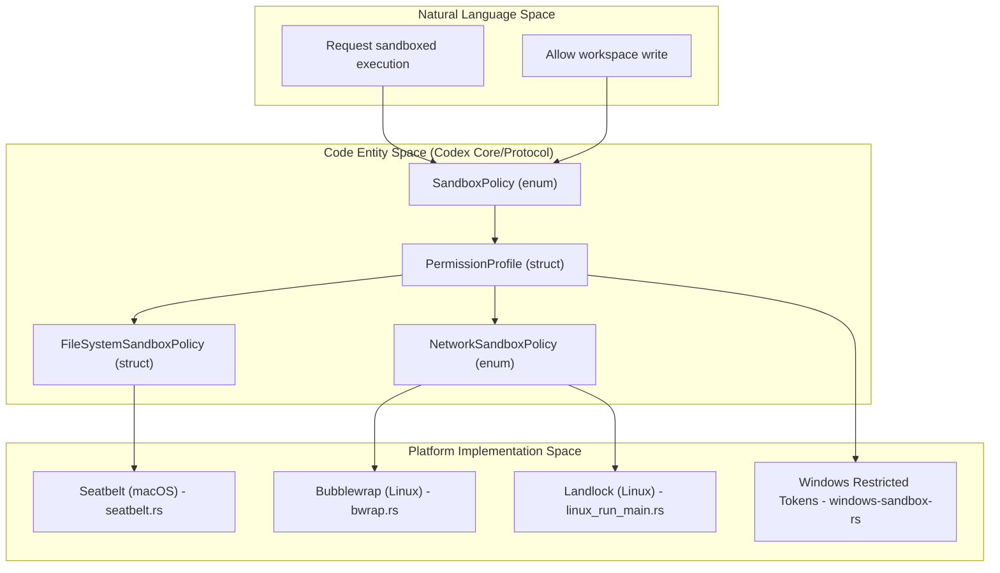
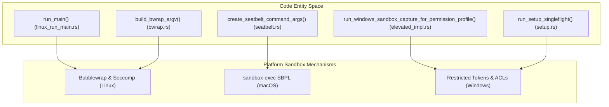
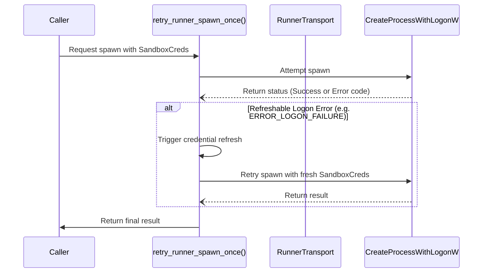

<!-- source: DeepWiki mcp.deepwiki.com · repo openai/codex · page 5.6 Sandboxing Implementation · fetched 2026-10-26 -->

# Sandboxing Implementation

Relevant source files

The following files were used as context for generating this wiki page:

- [codex-rs/cli/tests/exec_server/pid_namespace_tests.rs](codex-rs/cli/tests/exec_server/pid_namespace_tests.rs)
- [codex-rs/core/README.md](codex-rs/core/README.md)
- [codex-rs/core/tests/suite/apply_patch_system_aliases.rs](codex-rs/core/tests/suite/apply_patch_system_aliases.rs)
- [codex-rs/linux-sandbox/Cargo.toml](codex-rs/linux-sandbox/Cargo.toml)
- [codex-rs/linux-sandbox/README.md](codex-rs/linux-sandbox/README.md)
- [codex-rs/linux-sandbox/src/bundled_bwrap.rs](codex-rs/linux-sandbox/src/bundled_bwrap.rs)
- [codex-rs/linux-sandbox/src/bwrap.rs](codex-rs/linux-sandbox/src/bwrap.rs)
- [codex-rs/linux-sandbox/src/launcher.rs](codex-rs/linux-sandbox/src/launcher.rs)
- [codex-rs/linux-sandbox/src/lib.rs](codex-rs/linux-sandbox/src/lib.rs)
- [codex-rs/linux-sandbox/src/linux_run_main.rs](codex-rs/linux-sandbox/src/linux_run_main.rs)
- [codex-rs/linux-sandbox/src/linux_run_main_tests.rs](codex-rs/linux-sandbox/src/linux_run_main_tests.rs)
- [codex-rs/linux-sandbox/src/proxy_lifecycle.rs](codex-rs/linux-sandbox/src/proxy_lifecycle.rs)
- [codex-rs/linux-sandbox/src/proxy_lifecycle_tests.rs](codex-rs/linux-sandbox/src/proxy_lifecycle_tests.rs)
- [codex-rs/linux-sandbox/src/proxy_routing.rs](codex-rs/linux-sandbox/src/proxy_routing.rs)
- [codex-rs/linux-sandbox/src/seccomp.rs](codex-rs/linux-sandbox/src/seccomp.rs)
- [codex-rs/linux-sandbox/tests/suite/bundled_bwrap.rs](codex-rs/linux-sandbox/tests/suite/bundled_bwrap.rs)
- [codex-rs/linux-sandbox/tests/suite/bwrap_path.rs](codex-rs/linux-sandbox/tests/suite/bwrap_path.rs)
- [codex-rs/linux-sandbox/tests/suite/denied_files_tests.rs](codex-rs/linux-sandbox/tests/suite/denied_files_tests.rs)
- [codex-rs/linux-sandbox/tests/suite/managed_proxy.rs](codex-rs/linux-sandbox/tests/suite/managed_proxy.rs)
- [codex-rs/linux-sandbox/tests/suite/mod.rs](codex-rs/linux-sandbox/tests/suite/mod.rs)
- [codex-rs/linux-sandbox/tests/suite/root_metadata_tests.rs](codex-rs/linux-sandbox/tests/suite/root_metadata_tests.rs)
- [codex-rs/linux-sandbox/tests/suite/sandbox.rs](codex-rs/linux-sandbox/tests/suite/sandbox.rs)
- [codex-rs/protocol/Cargo.toml](codex-rs/protocol/Cargo.toml)
- [codex-rs/protocol/src/permissions/local_aliases.rs](codex-rs/protocol/src/permissions/local_aliases.rs)
- [codex-rs/protocol/src/permissions/local_aliases_tests.rs](codex-rs/protocol/src/permissions/local_aliases_tests.rs)
- [codex-rs/protocol/src/user_input.rs](codex-rs/protocol/src/user_input.rs)
- [codex-rs/sandboxing/BUILD.bazel](codex-rs/sandboxing/BUILD.bazel)
- [codex-rs/sandboxing/src/bwrap.rs](codex-rs/sandboxing/src/bwrap.rs)
- [codex-rs/sandboxing/src/bwrap_tests.rs](codex-rs/sandboxing/src/bwrap_tests.rs)
- [codex-rs/sandboxing/src/seatbelt.rs](codex-rs/sandboxing/src/seatbelt.rs)
- [codex-rs/sandboxing/src/seatbelt_base_policy.sbpl](codex-rs/sandboxing/src/seatbelt_base_policy.sbpl)
- [codex-rs/sandboxing/src/seatbelt_network_policy.sbpl](codex-rs/sandboxing/src/seatbelt_network_policy.sbpl)
- [codex-rs/sandboxing/src/seatbelt_preferences_policy.sbpl](codex-rs/sandboxing/src/seatbelt_preferences_policy.sbpl)
- [codex-rs/sandboxing/src/seatbelt_read_only_platform_defaults.sbpl](codex-rs/sandboxing/src/seatbelt_read_only_platform_defaults.sbpl)
- [codex-rs/sandboxing/src/seatbelt_tests.rs](codex-rs/sandboxing/src/seatbelt_tests.rs)
- [codex-rs/windows-sandbox-rs/src/allow.rs](codex-rs/windows-sandbox-rs/src/allow.rs)
- [codex-rs/windows-sandbox-rs/src/bin/command_runner/main.rs](codex-rs/windows-sandbox-rs/src/bin/command_runner/main.rs)
- [codex-rs/windows-sandbox-rs/src/bin/command_runner/win.rs](codex-rs/windows-sandbox-rs/src/bin/command_runner/win.rs)
- [codex-rs/windows-sandbox-rs/src/conpty/mod.rs](codex-rs/windows-sandbox-rs/src/conpty/mod.rs)
- [codex-rs/windows-sandbox-rs/src/elevated/ipc_framed.rs](codex-rs/windows-sandbox-rs/src/elevated/ipc_framed.rs)
- [codex-rs/windows-sandbox-rs/src/elevated/runner_client.rs](codex-rs/windows-sandbox-rs/src/elevated/runner_client.rs)
- [codex-rs/windows-sandbox-rs/src/elevated_impl.rs](codex-rs/windows-sandbox-rs/src/elevated_impl.rs)
- [codex-rs/windows-sandbox-rs/src/helper_materialization.rs](codex-rs/windows-sandbox-rs/src/helper_materialization.rs)
- [codex-rs/windows-sandbox-rs/src/identity.rs](codex-rs/windows-sandbox-rs/src/identity.rs)
- [codex-rs/windows-sandbox-rs/src/identity_integration_tests.rs](codex-rs/windows-sandbox-rs/src/identity_integration_tests.rs)
- [codex-rs/windows-sandbox-rs/src/lib.rs](codex-rs/windows-sandbox-rs/src/lib.rs)
- [codex-rs/windows-sandbox-rs/src/process.rs](codex-rs/windows-sandbox-rs/src/process.rs)
- [codex-rs/windows-sandbox-rs/src/provisioning_client_tests.rs](codex-rs/windows-sandbox-rs/src/provisioning_client_tests.rs)
- [codex-rs/windows-sandbox-rs/src/resolved_permissions.rs](codex-rs/windows-sandbox-rs/src/resolved_permissions.rs)
- [codex-rs/windows-sandbox-rs/src/setup.rs](codex-rs/windows-sandbox-rs/src/setup.rs)
- [codex-rs/windows-sandbox-rs/src/spawn_prep.rs](codex-rs/windows-sandbox-rs/src/spawn_prep.rs)
- [codex-rs/windows-sandbox-rs/src/unified_exec/backends/elevated.rs](codex-rs/windows-sandbox-rs/src/unified_exec/backends/elevated.rs)
- [codex-rs/windows-sandbox-rs/src/unified_exec/backends/elevated_tests.rs](codex-rs/windows-sandbox-rs/src/unified_exec/backends/elevated_tests.rs)
- [codex-rs/windows-sandbox-rs/src/unified_exec/backends/legacy.rs](codex-rs/windows-sandbox-rs/src/unified_exec/backends/legacy.rs)
- [codex-rs/windows-sandbox-rs/src/unified_exec/mod.rs](codex-rs/windows-sandbox-rs/src/unified_exec/mod.rs)
- [codex-rs/windows-sandbox-rs/src/winutil.rs](codex-rs/windows-sandbox-rs/src/winutil.rs)
- [codex-rs/windows-sandbox-rs/src/wrapper.rs](codex-rs/windows-sandbox-rs/src/wrapper.rs)
- [codex-rs/windows-sandbox-rs/src/wrapper_tests.rs](codex-rs/windows-sandbox-rs/src/wrapper_tests.rs)
- [scripts/test-remote-env.sh](scripts/test-remote-env.sh)

This page documents the implementation of Codex's sandboxing system, which provides process isolation for tool execution across platforms. The system translates high-level sandbox policies into OS-native sandboxing mechanisms: **macOS Seatbelt sandbox (`sandbox-exec`)**, **Linux Bubblewrap and Landlock/seccomp**, and **Windows Restricted Tokens with ACLs**.

---

## Overview

Sandboxing in Codex is architected as a layered system:

- **Policy Definition**: High-level sandbox policy (`SandboxPolicy`) expresses permissions like filesystem access and network restrictions [codex-rs/sandboxing/src/seatbelt.rs:1-12]().
- **Platform-Specific Drivers**: Implementation varies by OS, translating policy into native sandbox mechanisms [codex-rs/windows-sandbox-rs/src/lib.rs:60-156](), [codex-rs/linux-sandbox/src/bwrap.rs:1-15]().
- **SandboxManager**: `SandboxManager` is the central orchestrator that selects, transforms, and applies platform sandboxing logic, producing executable sandbox commands [codex-rs/windows-sandbox-rs/src/elevated_impl.rs:100-125]().

This modular design enables extensibility and fine-grained enforcement aligned with OS capabilities.

Sources: [codex-rs/linux-sandbox/src/bwrap.rs:1-16](), [codex-rs/windows-sandbox-rs/src/lib.rs:60-156]()

---

## macOS: Seatbelt (sandbox-exec)

On macOS, Codex executes sandboxed processes using the `sandbox-exec` utility, which applies sandbox profiles written in the Sandbox Profile Language (SBPL).

### Implementation Details

- The sandbox profile is dynamically generated based on the requested `PermissionProfile` [codex-rs/sandboxing/src/seatbelt.rs:35-41]().
- `create_seatbelt_command_args` constructs command-line arguments and sandbox profiles while explicitly protecting critical folders like `.git`, `.agents`, and `.codex` [codex-rs/sandboxing/src/seatbelt_tests.rs:78-95]().
- Codex uses the system-installed `/usr/bin/sandbox-exec` executable to enforce the sandbox, reducing attack surfaces [codex-rs/sandboxing/src/seatbelt.rs:58-62]().

### Network and Filesystem Policies

- The base Seatbelt policy (`MACOS_SEATBELT_BASE_POLICY`) allows essential operations such as CPU info sysctls and specific IPC shared memory [codex-rs/sandboxing/src/seatbelt_tests.rs:133-142]().
- File system policies encode `FileSystemSandboxEntry` permissions into SBPL path rules [codex-rs/sandboxing/src/seatbelt_tests.rs:78-94]().
- Network restrictions are handled within the profile, optionally constraining proxy configuration and Unix domain socket access [codex-rs/sandboxing/src/seatbelt.rs:112-151]().

Sources: [codex-rs/sandboxing/src/seatbelt.rs:1-195](), [codex-rs/sandboxing/src/seatbelt_tests.rs:78-185]()

---

## Linux: Bubblewrap and Landlock

Codex's Linux sandboxing combines **Bubblewrap** for filesystem sandboxing and **Landlock/seccomp** as a supplementary or fallback Linux security mechanism [codex-rs/linux-sandbox/README.md:10-13]().

### Bubblewrap (bwrap)

- Bubblewrap (`bwrap`) is used to create a new filesystem namespace where the filesystem is read-only by default (`--ro-bind / /`) [codex-rs/linux-sandbox/README.md:58]().
- Explicit writable roots are mounted via bind mounts; sensitive subpaths remain read-only [codex-rs/linux-sandbox/README.md:59-60]().
- Network sandboxing modes (`BwrapNetworkMode`) include `FullAccess`, `Isolated`, and `ProxyOnly` [codex-rs/linux-sandbox/src/bwrap.rs:106-118]().
- Bubblewrap arguments are generated via `build_bwrap_argv` to enforce mounts, namespaces, and WSL interop/distro masking [codex-rs/linux-sandbox/src/bwrap.rs:72-103]().

### Seccomp and Inner Stage Execution

- The Linux sandbox helper (`LinuxSandboxCommand`) coordinates container and namespace setup [codex-rs/linux-sandbox/src/linux_run_main.rs:55-126]().
- The process applies `PR_SET_NO_NEW_PRIVS` and seccomp filters in-process after the bubblewrap filesystem view is established [codex-rs/linux-sandbox/README.md:53-57]().

Sources: [codex-rs/linux-sandbox/src/bwrap.rs:1-125](), [codex-rs/linux-sandbox/src/linux_run_main.rs:55-173](), [codex-rs/linux-sandbox/README.md:1-60]()

---

## Windows: Restricted Tokens and ACLs

On Windows, sandboxing is implemented by creating specialized restricted user tokens and managing ACLs on filesystem and registry resources [codex-rs/windows-sandbox-rs/src/lib.rs:144-156]().

### Preflight Audit and ACL Management

- Prior to sandbox execution, setup routines scan common user directories for world-writable folders to mitigate escape vectors [codex-rs/windows-sandbox-rs/src/setup.rs:59-79]().
- Codex manages ACL entries using functions like `add_deny_read_ace` and `add_deny_write_ace` [codex-rs/windows-sandbox-rs/src/lib.rs:224-226]().

### Elevated Sandbox Execution and IPC

- Sandbox capture is performed by an elevated runner launched with restricted tokens (`run_windows_sandbox_capture_for_permission_profile`) [codex-rs/windows-sandbox-rs/src/elevated_impl.rs:100-124]().
- IPC-framed channels handle command output and termination signaling [codex-rs/windows-sandbox-rs/src/elevated_impl.rs:35-42]().
- A cancellation thread (`spawn_cancel_writer`) monitors cancellation tokens and issues termination frames [codex-rs/windows-sandbox-rs/src/elevated_impl.rs:68-96]().

### Setup and Provisioning

- The `run_setup_singleflight` utility serializes provisioning requests with a single-flight pattern to avoid redundant setup work and race conditions [codex-rs/windows-sandbox-rs/src/setup.rs:149-185]().
- Sandbox directories are standardized under `.sandbox` and `.sandbox-secrets` in the Codex home directory [codex-rs/windows-sandbox-rs/src/setup.rs:187-206]().

Sources: [codex-rs/windows-sandbox-rs/src/setup.rs:59-206](), [codex-rs/windows-sandbox-rs/src/lib.rs:224-226](), [codex-rs/windows-sandbox-rs/src/elevated_impl.rs:68-124]()

---

## Sandbox Denial Detection and Retry Logic

Codex detects sandbox denial errors and supports recovery workflows.

### Denial Detection

| Platform | Detection Method | Detail | Source |
|-|-|-|-|
| **Linux Seccomp** | Stderr contains `"Operation not permitted"` | Typical seccomp or permission violation error string [codex-rs/linux-sandbox/tests/suite/linux_run_main_tests.rs:35-44](). | [codex-rs/linux-sandbox/tests/suite/linux_run_main_tests.rs:35-44]() |
| **Bubblewrap** | Stderr contains `"bubblewrap is unavailable"` or mount failures | Detects missing `bwrap` or namespace restrictions [codex-rs/linux-sandbox/tests/suite/linux_run_main_tests.rs:29-45](). | [codex-rs/linux-sandbox/tests/suite/linux_run_main_tests.rs:29-45]() |
| **Windows Setup** | Matches `SetupFailure` with known `SetupErrorCode` | Sandbox provisioning or ACL denial failures [codex-rs/windows-sandbox-rs/src/setup.rs:30-36](). | [codex-rs/windows-sandbox-rs/src/setup.rs:30-36]() |

### Windows Retry Logic

- The Windows runner client includes retry capabilities (`retry_runner_spawn_once`) to retry spawning the elevated sandbox process on handshake or startup failures [codex-rs/windows-sandbox-rs/src/elevated/runner_client.rs:156-177]().
- This logic checks for refreshable Windows errors like `ERROR_ACCOUNT_DISABLED`, `ERROR_LOGON_FAILURE`, or `ERROR_NO_SUCH_LOGON_SESSION` [codex-rs/windows-sandbox-rs/src/elevated/runner_client.rs:118-154]().

Sources: [codex-rs/linux-sandbox/tests/suite/linux_run_main_tests.rs:29-45](), [codex-rs/windows-sandbox-rs/src/elevated/runner_client.rs:118-177]()

---

## Summary of Key Classes and Functions

| Component | Responsible Code Entity | Description |
|---|---|---|
| Linux Sandbox Helper | `run_main` (`linux-sandbox/src/linux_run_main.rs`) | Coordinates bubblewrap and seccomp initialization. |
| Linux Bwrap Args | `build_bwrap_argv` (`linux-sandbox/src/bwrap.rs`) | Constructs bubblewrap mount arguments. |
| macOS Seatbelt Builder | `create_seatbelt_command_args` (`sandboxing/src/seatbelt.rs`) | Generates `sandbox-exec` arguments and SBPL profiles. |
| Windows Elevated Runner | `run_windows_sandbox_capture_for_permission_profile` (`windows-sandbox-rs/src/elevated_impl.rs`) | Runs elevated sandbox processes with IPC communication. |
| Windows Setup Singleflight | `run_setup_singleflight` (`windows-sandbox-rs/src/setup.rs`) | Serializes sandbox user provisioning. |

Sources: [codex-rs/linux-sandbox/src/linux_run_main.rs:135-173](), [codex-rs/windows-sandbox-rs/src/setup.rs:149-185]()

---

## Sandboxing Implementation Diagrams

### 1. Platform Sandbox Mapping to Code Entities

Sources: [codex-rs/linux-sandbox/src/linux_run_main.rs:135-173](), [codex-rs/windows-sandbox-rs/src/elevated_impl.rs:100-124](), [codex-rs/windows-sandbox-rs/src/setup.rs:149-185]()

### 2. Windows Elevated Runner Retry Flow

Sources: [codex-rs/windows-sandbox-rs/src/elevated/runner_client.rs:118-177]()

---

