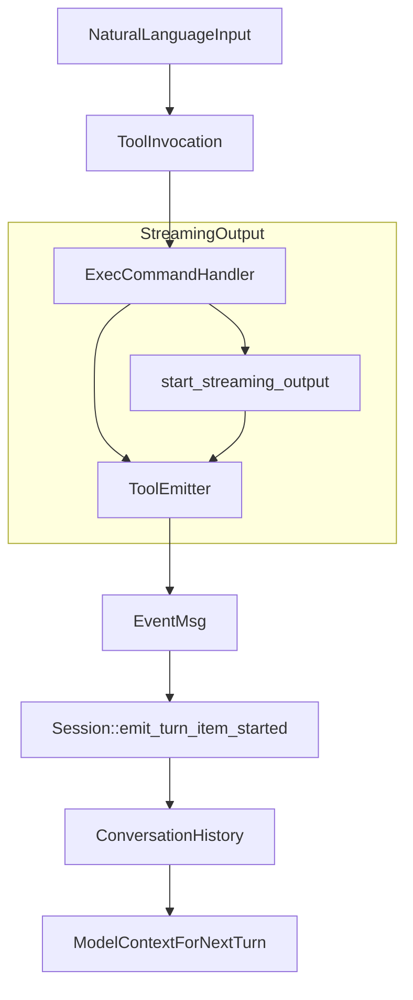
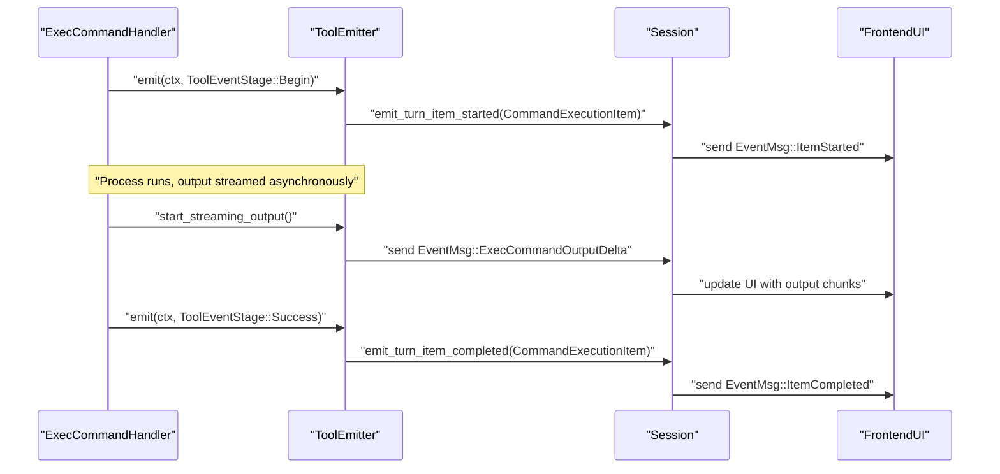
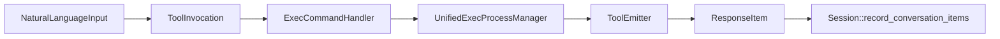
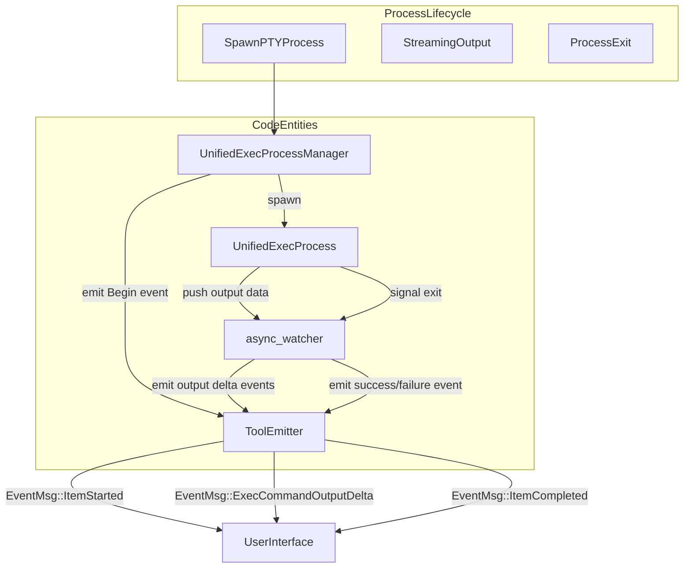
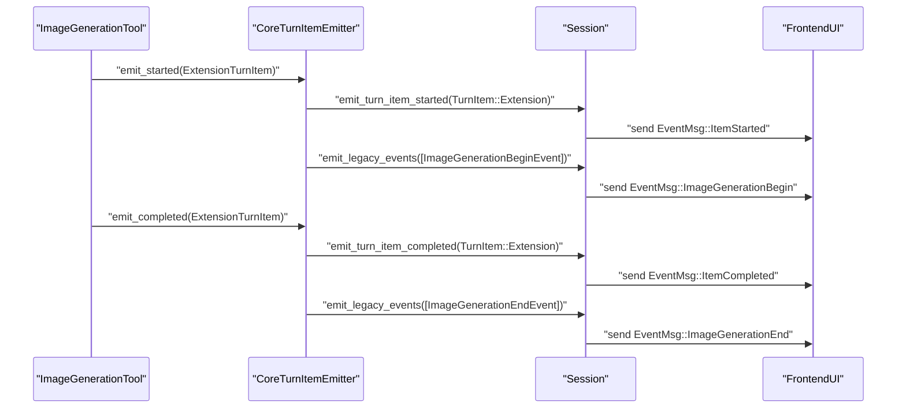

<!-- source: DeepWiki mcp.deepwiki.com · repo openai/codex · page 5.7 Tool Event Emission and Output · fetched 2026-10-26 -->

# Tool Event Emission and Output

<details>
<summary>Relevant source files</summary>

The following files were used as context for generating this wiki page:

- [codex-rs/app-server/tests/suite/v2/imagegen_extension.rs](codex-rs/app-server/tests/suite/v2/imagegen_extension.rs)
- [codex-rs/core/src/session/turn_tests.rs](codex-rs/core/src/session/turn_tests.rs)
- [codex-rs/core/src/stream_events_utils.rs](codex-rs/core/src/stream_events_utils.rs)
- [codex-rs/core/src/stream_events_utils_tests.rs](codex-rs/core/src/stream_events_utils_tests.rs)
- [codex-rs/core/src/tools/handlers/extension_tools.rs](codex-rs/core/src/tools/handlers/extension_tools.rs)
- [codex-rs/core/tests/suite/extension_sandbox.rs](codex-rs/core/tests/suite/extension_sandbox.rs)
- [codex-rs/ext/image-generation/Cargo.toml](codex-rs/ext/image-generation/Cargo.toml)
- [codex-rs/ext/image-generation/imagegen_description.md](codex-rs/ext/image-generation/imagegen_description.md)
- [codex-rs/ext/image-generation/src/backend.rs](codex-rs/ext/image-generation/src/backend.rs)
- [codex-rs/ext/image-generation/src/extension.rs](codex-rs/ext/image-generation/src/extension.rs)
- [codex-rs/ext/image-generation/src/tests.rs](codex-rs/ext/image-generation/src/tests.rs)
- [codex-rs/ext/image-generation/src/tool.rs](codex-rs/ext/image-generation/src/tool.rs)
- [codex-rs/ext/memories/src/extension.rs](codex-rs/ext/memories/src/extension.rs)
- [codex-rs/ext/memories/src/tests.rs](codex-rs/ext/memories/src/tests.rs)
- [codex-rs/tools/src/tool_call.rs](codex-rs/tools/src/tool_call.rs)

</details>


## Purpose and Scope

This page details the mechanism by which tool execution outputs are emitted as events and prepared for consumption by the AI model and frontends. It covers:

- The `ToolEmitter` factory pattern used to wrap tool invocation contexts and emit consistent lifecycle events during tool execution.
- The lifecycle stages of tool events: `Begin`, `Success`, and `Failure`.
- Background asynchronous watcher tasks (`start_streaming_output` and `spawn_exit_watcher`) important for streaming output and process termination handling, especially in the context of the Unified Exec subsystem.
- Utilities for managing stream events and converting outputs into conversation history items via `record_completed_response_item`.
- The integration of extension tools and their event emission adaptation (e.g., `ImageGenerationTool`).

This page does not delve into specific tool implementations but explains the shared infrastructure for event emission and output handling across tool families.

Sources:
- [codex-rs/core/src/tools/events.rs:45-94]()
- [codex-rs/core/src/stream_events_utils.rs:79-156]()
- [codex-rs/core/src/unified_exec/async_watcher.rs:57-181]()

---

## Core Output Types and Event Context

### `ToolEventCtx`

Defined in `codex-rs/core/src/tools/events.rs`, `ToolEventCtx` is a lightweight struct holding references to essential context required by event emission, including the current `Session`, active `TurnContext`, model info captured, the call ID string, and an optional `SharedTurnDiffTracker` to track source code deltas resulting from tool execution [codex-rs/core/src/tools/events.rs:45-75]():

```rust
pub(crate) struct ToolEventCtx<'a> {
    pub sandbox_type: Option<codex_protocol::sandbox::SandboxType>,
    pub model_context: Option<&'a ModelInvocationContext>,
    pub session: &'a Session,
    pub turn: &'a TurnContext,
    pub model_info: &'a ModelInfo,
    pub call_id: &'a str,
    pub turn_diff_tracker: Option<&'a SharedTurnDiffTracker>,
}
```

Sources:
- [codex-rs/core/src/tools/events.rs:45-75]()

---

## Tool Event Lifecycle Phases

Tool events progress through a tripartite lifecycle delineated by the `ToolEventStage` and `ToolEventFailure` enums [codex-rs/core/src/tools/events.rs:77-94]():

| Phase | Description | Key Event Emission |
|-------|-------------|--------------------|
| `Begin` | Marks the start of tool execution with initial event(s). | `emit_exec_command_begin` creates a `CommandExecutionItem` in `InProgress` state [codex-rs/core/src/tools/events.rs:77-78](). |
| `Success` | Signals normal completion with output data and optional patch deltas. | Emits completed items with `ExecToolCallOutput` [codex-rs/core/src/tools/events.rs:79-82](). |
| `Failure` | Emits failure status for failed tool execution (output, message, or rejection). | Reports failure reasons including rejection messages or output error details [codex-rs/core/src/tools/events.rs:83-93](). |

Sources:
- [codex-rs/core/src/tools/events.rs:77-94]()

---

## Streaming Event Utilities and Integration with Session

### Converting Tool Output to Conversation History Items

Tool handlers generate instances of `ToolOutput`, producing `ResponseItem` wire-types for emitting state into conversation history. Completed tool outputs are recorded via `record_completed_response_item`, ensuring they are persisted and integrated into context for model consumption [codex-rs/core/src/stream_events_utils.rs:79-105]():

```rust
pub(crate) async fn record_completed_response_item(
    sess: &Session,
    step_context: &StepContext,
    item: &ResponseItem,
) {
    record_completed_response_item_with_finalized_facts(
        sess,
        step_context,
        item,
        /*finalized_facts*/ None,
    )
    .await;
}
```

The `record_completed_response_item_with_finalized_facts` function further handles logging, deferred mailbox delivery, and memory pollution detection based on the `ResponseItem` [codex-rs/core/src/stream_events_utils.rs:93-156](). It also detects and records memory citations present in the assistant's output [codex-rs/core/src/stream_events_utils.rs:144-155]().

The `response_item_may_include_external_context` function determines if a `ResponseItem` type (e.g., `ToolSearchCall`, `WebSearchCall`, `FunctionCallOutput` without a `call_id`) indicates external context that could "pollute" the memory mode [codex-rs/core/src/stream_events_utils.rs:158-165](). This is used by `mark_thread_memory_mode_polluted_if_external_context` to disable memories if `memories.disable_on_external_context` is enabled in the configuration [codex-rs/core/src/stream_events_utils.rs:168-184]().

Sources:
- [codex-rs/core/src/stream_events_utils.rs:79-105]()
- [codex-rs/core/src/stream_events_utils.rs:93-156]()
- [codex-rs/core/src/stream_events_utils.rs:158-165]()
- [codex-rs/core/src/stream_events_utils.rs:168-184]()
- [codex-rs/core/src/stream_events_utils_tests.rs:55-93]()
- [codex-rs/core/src/stream_events_utils_tests.rs:96-153]()

---

## Background Async Watcher Tasks in Unified Exec

The Unified Exec subsystem implements interactive PTY process management with streaming output via background asynchronous tasks located in `codex-rs/core/src/unified_exec/async_watcher.rs`:

- **Output Streaming (`start_streaming_output`):** Continuously reads from process output receivers and emits `ExecCommandOutputDelta` events on UTF-8 boundaries [codex-rs/core/src/unified_exec/async_watcher.rs:57-153]().
- **Process Exit Monitoring (`spawn_exit_watcher`):** Subscribes to process cancellation tokens and output drain notifications, then emits a single `ExecCommandEnd` event with the aggregated transcript and runtime metrics [codex-rs/core/src/unified_exec/async_watcher.rs:158-181]().

Sources:
- [codex-rs/core/src/unified_exec/async_watcher.rs:57-181]()

---

## Data Flow: From Tool Execution to Event Emission and Model Input

Title: "Tool Execution Data Flow"


Sources:
- [codex-rs/core/src/tools/events.rs:118-183]()
- [codex-rs/core/src/unified_exec/async_watcher.rs:57-153]()
- [codex-rs/core/src/stream_events_utils.rs:79-156]()

---

## Detailed Event Emission Example: Unified Exec

Title: "Unified Exec Event Sequence"


Sources:
- [codex-rs/core/src/tools/events.rs:118-183]()
- [codex-rs/core/src/unified_exec/async_watcher.rs:57-181]()

---

## Bridging Natural Language Space to Code Entity Space

### Diagram: Tool Output Transformation Pipeline

Title: "Tool Output Pipeline Code Mapping"


Sources:
- [codex-rs/core/src/tools/events.rs:45-75]()
- [codex-rs/core/src/stream_events_utils.rs:79-156]()
- [codex-rs/core/src/unified_exec/process_manager.rs:170-192]()

### Diagram: Unified Exec Event Lifecycle with Code Entities

Title: "Unified Exec Component Architecture"


Sources:
- [codex-rs/core/src/unified_exec/async_watcher.rs:57-181]()
- [codex-rs/core/src/tools/events.rs:77-94]()

### Extension Tool Event Emission

Extension tools, such as the `ImageGenerationTool` [codex-rs/ext/image-generation/src/tool.rs:66-83](), interact with the core event system through the `TurnItemEmitter` trait [codex-rs/tools/src/tool_call.rs:78-83](). The `CoreTurnItemEmitter` struct, implemented in `codex-rs/core/src/tools/handlers/extension_tools.rs`, provides the concrete implementation for emitting `ExtensionTurnItem`s [codex-rs/core/src/tools/handlers/extension_tools.rs:131-134]().

When an extension tool handles a call, it uses the provided `TurnItemEmitter` to signal the start and completion of its operation. For example, the `ImageGenerationTool` emits an `ImageGenerationBeginEvent` when it starts and an `ImageGenerationEndEvent` upon completion [codex-rs/ext/image-generation/src/tool.rs:166-170](). These events are wrapped in an `ExtensionTurnItem` which includes the canonical `ExtensionItem` and any legacy `EventMsg`s for compatibility [codex-rs/tools/src/tool_call.rs:62-72](). The `CoreTurnItemEmitter` then calls `session.emit_turn_item_started` or `session.emit_turn_item_completed` and also `emit_legacy_events` to ensure all relevant events are dispatched [codex-rs/core/src/tools/handlers/extension_tools.rs:147-176]().

Title: "Extension Tool Event Lifecycle Sequence"


Sources:
- [codex-rs/ext/image-generation/src/tool.rs:66-83]()
- [codex-rs/ext/image-generation/src/tool.rs:166-170]()
- [codex-rs/tools/src/tool_call.rs:62-72]()
- [codex-rs/tools/src/tool_call.rs:78-83]()
- [codex-rs/core/src/tools/handlers/extension_tools.rs:131-134]()
- [codex-rs/core/src/tools/handlers/extension_tools.rs:147-176]()
- [codex-rs/ext/image-generation/src/extension.rs:100-110]()
- [codex-rs/ext/image-generation/src/tests.rs:47-56]()
- [codex-rs/app-server/tests/suite/v2/imagegen_extension.rs:145-157]()

---

