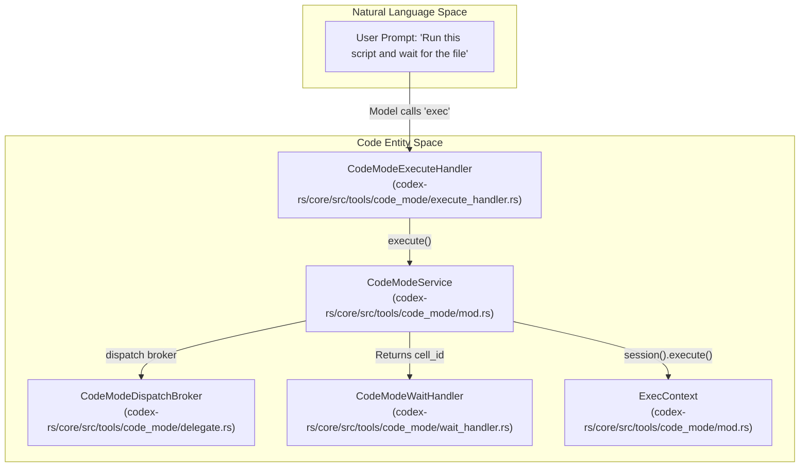
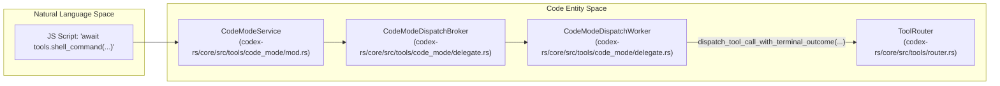

<!-- source: DeepWiki mcp.deepwiki.com · repo openai/codex · page 5.8 Code Mode and JavaScript REPL · fetched 2026-10-26 -->

# Code Mode and JavaScript REPL

Relevant source files

The following files were used as context for generating this wiki page:

- [codex-rs/core/src/tools/code_mode/delegate.rs](codex-rs/core/src/tools/code_mode/delegate.rs)
- [codex-rs/core/src/tools/code_mode/delegate_tests.rs](codex-rs/core/src/tools/code_mode/delegate_tests.rs)
- [codex-rs/core/src/tools/code_mode/execute_handler.rs](codex-rs/core/src/tools/code_mode/execute_handler.rs)
- [codex-rs/core/src/tools/code_mode/mod.rs](codex-rs/core/src/tools/code_mode/mod.rs)
- [codex-rs/core/src/tools/code_mode/wait_handler.rs](codex-rs/core/src/tools/code_mode/wait_handler.rs)
- [codex-rs/core/src/tools/context.rs](codex-rs/core/src/tools/context.rs)
- [codex-rs/core/src/tools/context_tests.rs](codex-rs/core/src/tools/context_tests.rs)
- [codex-rs/core/src/tools/executed_tool_calls.rs](codex-rs/core/src/tools/executed_tool_calls.rs)
- [codex-rs/core/src/tools/executed_tool_calls/request_metadata.rs](codex-rs/core/src/tools/executed_tool_calls/request_metadata.rs)
- [codex-rs/core/src/tools/executed_tool_calls/request_metadata_tests.rs](codex-rs/core/src/tools/executed_tool_calls/request_metadata_tests.rs)
- [codex-rs/core/src/tools/executed_tool_calls_direct_tests.rs](codex-rs/core/src/tools/executed_tool_calls_direct_tests.rs)
- [codex-rs/core/src/tools/handlers/dynamic.rs](codex-rs/core/src/tools/handlers/dynamic.rs)
- [codex-rs/core/src/tools/handlers/mcp.rs](codex-rs/core/src/tools/handlers/mcp.rs)
- [codex-rs/core/src/tools/handlers/mcp_search_tests.rs](codex-rs/core/src/tools/handlers/mcp_search_tests.rs)
- [codex-rs/core/src/tools/parallel.rs](codex-rs/core/src/tools/parallel.rs)
- [codex-rs/core/src/tools/registry.rs](codex-rs/core/src/tools/registry.rs)
- [codex-rs/core/src/tools/registry_tests.rs](codex-rs/core/src/tools/registry_tests.rs)
- [codex-rs/core/src/tools/router.rs](codex-rs/core/src/tools/router.rs)
- [codex-rs/core/src/tools/router_tests.rs](codex-rs/core/src/tools/router_tests.rs)
- [codex-rs/core/src/tools/spec_plan.rs](codex-rs/core/src/tools/spec_plan.rs)
- [codex-rs/core/src/tools/spec_plan_tests.rs](codex-rs/core/src/tools/spec_plan_tests.rs)
- [codex-rs/core/src/tools/tool_dispatch_trace_tests.rs](codex-rs/core/src/tools/tool_dispatch_trace_tests.rs)
- [codex-rs/core/tests/suite/code_mode.rs](codex-rs/core/tests/suite/code_mode.rs)
- [codex-rs/core/tests/suite/direct_tool_metadata.rs](codex-rs/core/tests/suite/direct_tool_metadata.rs)
- [codex-rs/core/tests/suite/tools.rs](codex-rs/core/tests/suite/tools.rs)
- [codex-rs/protocol/src/models/executed_tool_calls.rs](codex-rs/protocol/src/models/executed_tool_calls.rs)
- [codex-rs/protocol/src/models/executed_tool_calls_tests.rs](codex-rs/protocol/src/models/executed_tool_calls_tests.rs)

This page documents the JavaScript execution systems in Codex, focusing on the yielding execution model of Code Mode, its orchestration of nested tools, and the integration of V8 isolates for stateful REPL interactions. These systems are primarily implemented across the `code-mode`, `code-mode-host`, `code-mode-runtime`, and the `protocol` crates, with the core logic residing in `codex-rs/core/src/tools/code_mode/`.

---

## Overview and Feature Gates

Code Mode and its associated REPL capabilities are controlled by feature flags and runtime configurations. These flags determine the availability of tools and the visibility of nested tool definitions to the model.

| Feature / State   | Effect                                                                                                           |
|-------------------|------------------------------------------------------------------------------------------------------------------|
| `Feature::CodeMode` | Enables the `exec` and `wait` tools for yielding JavaScript execution.                                           |
| `ToolMode::CodeMode` | Runtime mode where the model is expected to use JavaScript for tool interaction.                                  |
| `ToolMode::CodeModeOnly` | Restricts the model to exclusively use Code Mode tools.                                                       |

The system verifies availability via the `CodeModeSessionProvider`. If unavailable, it emits a one-time warning and falls back to direct tools unless the mode enforces Code Mode only (which then fails closed).

Sources: [codex-rs/core/src/tools/code_mode/mod.rs:93-121](), [codex-rs/core/tests/suite/code_mode.rs:18-23]()

---

## Code Mode System

### Purpose and Architecture

Code Mode offers a **yielding execution model** for JavaScript scripts running in a V8 isolate. It supports asynchronous execution with intermediate yields allowing the model to "pause" scripts and resume them later, enabling node-style REPL interactions and managing nested tool calls within an active JavaScript environment. Stateful execution is maintained by managing `CellId`s for each execution instance.

Title: "Code Mode Execution and Service Flow"

Sources: [codex-rs/core/src/tools/code_mode/mod.rs:69-94](), [codex-rs/core/src/tools/code_mode/execute_handler.rs:21-177](), [codex-rs/core/src/tools/code_mode/delegate.rs:1-85]()

### Tool Registration and Specs

Code Mode primarily exposes two tools registered via dedicated handlers:

| Constant | Tool Name | Handler Class | Purpose |
|---|---|---|---|
| `PUBLIC_TOOL_NAME` | `"exec"` | `CodeModeExecuteHandler` | Execute JavaScript in a persistent V8 isolate, supporting yielding execution. [codex-rs/core/src/tools/code_mode/mod.rs:59-59]() |
| `WAIT_TOOL_NAME` | `"wait"` | `CodeModeWaitHandler` | Resume or poll a yielded cell using a `cell_id`. [codex-rs/core/src/tools/code_mode/mod.rs:60-60]() |

The yielding model allows `exec` to run for a configured maximum time (`default_exec_yield_time_ms`) before yielding control back, permitting event-driven or asynchronous waiting logic. This executes as a repeated cycle until completion or explicit termination.

Sources: [codex-rs/core/src/tools/code_mode/mod.rs:50-99](), [codex-rs/core/src/tools/code_mode/execute_spec.rs:1-7](), [codex-rs/core/src/tools/code_mode/wait_spec.rs:1-7]()

---

## Tool Orchestration and Nested Calls

### Nested Tool Discovery and Dispatch

Code Mode acts not only as an executor of JavaScript but also as a **dispatcher** for other tools invoked by scripts. It wraps nested tool sets and routes calls dynamically back to the core system, preserving permission checks, session contexts, and turn states.

The dispatch system is mediated by the `CodeModeDispatchBroker`, which holds runtime state and manages worker threads communicating between the JS isolate and the Rust tool executor layer. This broker spawns `CodeModeDispatchWorker`s that handle the bridge for nested tool invocations.

#### Flow of a Nested Tool Call from JS Execution:

Title: "Nested Tool Dispatch Flow"

The `ExecContext` used internally tracks the session and turn context to properly evaluate permissions and environment for the call stack during tool execution.

Sources: [codex-rs/core/src/tools/code_mode/mod.rs:69-91](), [codex-rs/core/src/tools/code_mode/delegate.rs:40-60](), [codex-rs/core/src/tools/parallel.rs:160-185]()

---

## Execution Management and State

### Cell Lifecycle and Management

`CodeModeService` manages the lifecycle of code cells — individual JavaScript execution instances identified by `CellId`:

- When a cell is started via `execute`, it is registered via `dispatch_broker` and associated with a specific model turn.
- The initial response is awaited upon, with the cell marked ready for dispatch using `mark_cell_ready_for_dispatch`.
- Cells can yield intermediate results and later be resumed or explicitly terminated via the `wait` tool.
- Upon completion, telemetry events for start and close are logged, and the cell lifecycle state is updated with rollout and analytic traces.

### Multi-Session Persistence

To maintain state across multiple `exec` calls, execution happens inside a `CodeModeSession` created by a `CodeModeSessionProvider`. This session keeps the V8 isolate environment active and allows REPL-style variable bindings to persist across calls during the same model conversation.

### Output Truncation and Sanitization

Result outputs are subject to controlled truncation to enforce model context window limits using the `TruncationPolicy`. Additionally, image detail objects in the results are sanitized based on whether the current session can request original image detail permissions.

The `ExecutedToolCalls` recorder [codex-rs/core/src/tools/executed_tool_calls.rs:61-66]() is responsible for best-effort recording of attempted tool calls at existing execution boundaries. It manages `DirectCallPermit` [codex-rs/core/src/tools/executed_tool_calls.rs:78-81]() to track pending direct calls and `ExecutedToolCallRecorderState` [codex-rs/core/src/tools/executed_tool_calls.rs:96-110]() to store live observations and cell states.

When attaching executed tool call metadata to a prompt, the system uses `attach_to_request` [codex-rs/core/src/tools/executed_tool_calls/request_metadata.rs:24-28]() to process `ResponseItem`s. This involves handling `direct_calls` and `retained_calls` [codex-rs/core/src/tools/executed_tool_calls/request_metadata.rs:37-47](). The `normalize_executed_tool_call_completeness` function [codex-rs/protocol/src/models/executed_tool_calls.rs:89-109]() clears completion across a cell if recorded calls or tool names were lost. `bound_executed_tool_calls_for_message` [codex-rs/protocol/src/models/executed_tool_calls.rs:113-150]() bounds optional observations to the space left in the actual outgoing message, shedding generic result metadata, result sources, and truncating call arguments if necessary.

Sources: [codex-rs/core/src/tools/code_mode/mod.rs:69-145](), [codex-rs/core/src/tools/code_mode/execute_handler.rs:32-156](), [codex-rs/core/src/tools/context.rs:1-190](), [codex-rs/core/src/tools/executed_tool_calls.rs:61-66](), [codex-rs/core/src/tools/executed_tool_calls.rs:78-81](), [codex-rs/core/src/tools/executed_tool_calls.rs:96-110](), [codex-rs/core/src/tools/executed_tool_calls/request_metadata.rs:24-28](), [codex-rs/core/src/tools/executed_tool_calls/request_metadata.rs:37-47](), [codex-rs/protocol/src/models/executed_tool_calls.rs:89-109](), [codex-rs/protocol/src/models/executed_tool_calls.rs:113-150]()

---

## JavaScript REPL Integration

### Yield Control Pattern (Exec / Wait)

Scripts executed in Code Mode can yield control asynchronously, indicating they are waiting for external input or asynchronous events. The `wait` tool polls or resumes the yielded script state by its `cell_id`, enabling stateful asynchronous execution in the REPL.

### Interruption Handling

During session shutdowns or turn interruptions, active cells can be cleanly interrupted:

- `interrupt_active_cells()` iterates over all active cells held by `dispatch_broker` and terminates them gracefully.
- This allows safe cancellation of long-running or blocked JavaScript code when session lifecycle events occur.

### Telemetry and Observability

Telemetry metrics are emitted to track:

- When a cell starts and closes.
- Duration of code mode host interactions.
- Availability warnings emitted once when code mode is unavailable (e.g., host binary missing).

This information aids in observing Code Mode system health and performance at runtime.

Sources: [codex-rs/core/src/tools/code_mode/mod.rs:102-161](), [codex-rs/core/src/tools/code_mode/execute_handler.rs:84-89](), [codex-rs/core/src/tools/code_mode/wait_handler.rs:10-60]()

---

## Crate Roles and Boundaries

| Crate | Responsibility |
|---|---|
| `code-mode` | Core logic for Code Mode tooling; Rust-side handlers for `exec` and `wait` tools; dispatch broker and cell lifecycle management. Implemented under `codex-rs/core/src/tools/code_mode/`. |
| `code-mode-host` | Provides the external binary host implementation that runs V8 isolates and executes JavaScript code cells asynchronously. Acts as a runtime environment for code-mode tooling. |
| `code-mode-runtime` | Defines runtime types and shared abstractions for the Code Mode execution environment, including session and cell interfaces, serialization, and protocol elements. |
| `protocol` | Contains message and protocol definitions (`ExecuteRequest`, `WaitRequest`, `RuntimeResponse`), shared data structures exchanged between Codex core, code-mode-host, and runtime crates. |

These crates together implement the end-to-end yield-capable JavaScript executor embedded within the Codex toolset. The `code-mode` crate integrates with the broader Codex tool orchestration infrastructure, whereas `code-mode-host` backs the actual execution environment.

Sources: [codex-rs/core/src/tools/code_mode/mod.rs:1-100]()

---

