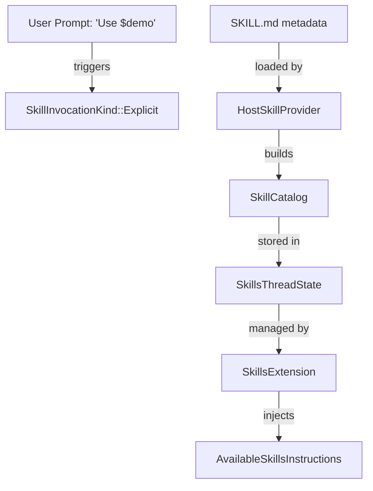
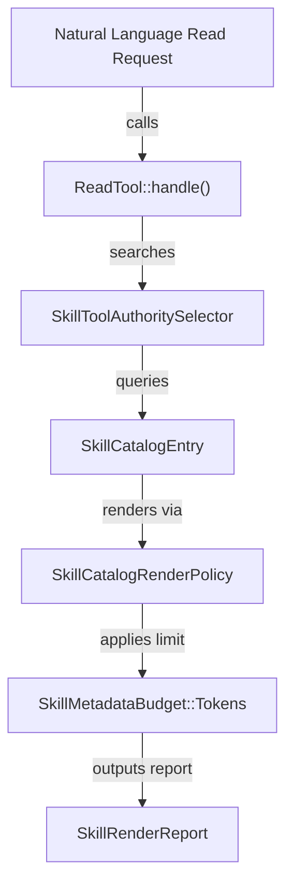
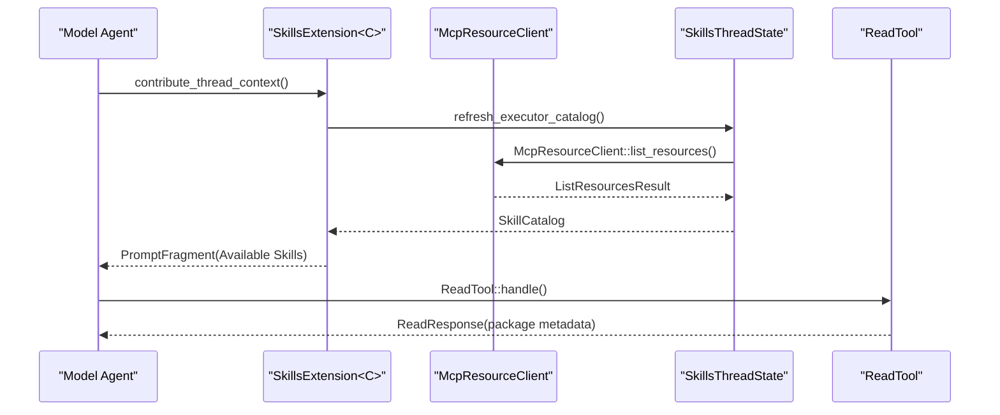
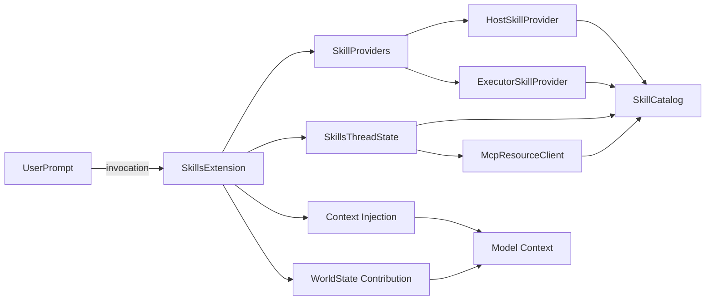

<!-- source: DeepWiki mcp.deepwiki.com · repo openai/codex · page 5.9 Skills System · fetched 2026-10-26 -->

# Skills System

Relevant source files

The following files were used as context for generating this wiki page:

- [codex-rs/app-server/src/request_processors/catalog_processor.rs](codex-rs/app-server/src/request_processors/catalog_processor.rs)
- [codex-rs/app-server/tests/suite/v2/executor_skills.rs](codex-rs/app-server/tests/suite/v2/executor_skills.rs)
- [codex-rs/app-server/tests/suite/v2/skills_list.rs](codex-rs/app-server/tests/suite/v2/skills_list.rs)
- [codex-rs/core/src/skills.rs](codex-rs/core/src/skills.rs)
- [codex-rs/core/tests/suite/skills_extension.rs](codex-rs/core/tests/suite/skills_extension.rs)
- [codex-rs/ext/extension-api/src/contributors/world_state.rs](codex-rs/ext/extension-api/src/contributors/world_state.rs)
- [codex-rs/ext/skills/Cargo.toml](codex-rs/ext/skills/Cargo.toml)
- [codex-rs/ext/skills/src/aliases.rs](codex-rs/ext/skills/src/aliases.rs)
- [codex-rs/ext/skills/src/aliases_tests.rs](codex-rs/ext/skills/src/aliases_tests.rs)
- [codex-rs/ext/skills/src/catalog.rs](codex-rs/ext/skills/src/catalog.rs)
- [codex-rs/ext/skills/src/catalog_prompt.rs](codex-rs/ext/skills/src/catalog_prompt.rs)
- [codex-rs/ext/skills/src/dynamic_skill_selector/character_routing_card_tests.rs](codex-rs/ext/skills/src/dynamic_skill_selector/character_routing_card_tests.rs)
- [codex-rs/ext/skills/src/extension.rs](codex-rs/ext/skills/src/extension.rs)
- [codex-rs/ext/skills/src/fragments.rs](codex-rs/ext/skills/src/fragments.rs)
- [codex-rs/ext/skills/src/host_aliases.rs](codex-rs/ext/skills/src/host_aliases.rs)
- [codex-rs/ext/skills/src/host_roots_tests.rs](codex-rs/ext/skills/src/host_roots_tests.rs)
- [codex-rs/ext/skills/src/host_service.rs](codex-rs/ext/skills/src/host_service.rs)
- [codex-rs/ext/skills/src/host_service_tests.rs](codex-rs/ext/skills/src/host_service_tests.rs)
- [codex-rs/ext/skills/src/invocation_tests.rs](codex-rs/ext/skills/src/invocation_tests.rs)
- [codex-rs/ext/skills/src/lib.rs](codex-rs/ext/skills/src/lib.rs)
- [codex-rs/ext/skills/src/loader/discovery.rs](codex-rs/ext/skills/src/loader/discovery.rs)
- [codex-rs/ext/skills/src/loader/discovery_tests.rs](codex-rs/ext/skills/src/loader/discovery_tests.rs)
- [codex-rs/ext/skills/src/loader/environment.rs](codex-rs/ext/skills/src/loader/environment.rs)
- [codex-rs/ext/skills/src/loader/environment_io_tests.rs](codex-rs/ext/skills/src/loader/environment_io_tests.rs)
- [codex-rs/ext/skills/src/loader/environment_tests.rs](codex-rs/ext/skills/src/loader/environment_tests.rs)
- [codex-rs/ext/skills/src/loader/host.rs](codex-rs/ext/skills/src/loader/host.rs)
- [codex-rs/ext/skills/src/loader/host_io_tests.rs](codex-rs/ext/skills/src/loader/host_io_tests.rs)
- [codex-rs/ext/skills/src/loader/host_tests.rs](codex-rs/ext/skills/src/loader/host_tests.rs)
- [codex-rs/ext/skills/src/loader/metadata.rs](codex-rs/ext/skills/src/loader/metadata.rs)
- [codex-rs/ext/skills/src/loader/mod.rs](codex-rs/ext/skills/src/loader/mod.rs)
- [codex-rs/ext/skills/src/loader/namespace.rs](codex-rs/ext/skills/src/loader/namespace.rs)
- [codex-rs/ext/skills/src/loader/namespace_tests.rs](codex-rs/ext/skills/src/loader/namespace_tests.rs)
- [codex-rs/ext/skills/src/provider.rs](codex-rs/ext/skills/src/provider.rs)
- [codex-rs/ext/skills/src/provider/host.rs](codex-rs/ext/skills/src/provider/host.rs)
- [codex-rs/ext/skills/src/provider/host_tests.rs](codex-rs/ext/skills/src/provider/host_tests.rs)
- [codex-rs/ext/skills/src/render.rs](codex-rs/ext/skills/src/render.rs)
- [codex-rs/ext/skills/src/render_tests.rs](codex-rs/ext/skills/src/render_tests.rs)
- [codex-rs/ext/skills/src/state.rs](codex-rs/ext/skills/src/state.rs)
- [codex-rs/ext/skills/src/tools/list.rs](codex-rs/ext/skills/src/tools/list.rs)
- [codex-rs/ext/skills/src/tools/mod.rs](codex-rs/ext/skills/src/tools/mod.rs)
- [codex-rs/ext/skills/src/tools/read.rs](codex-rs/ext/skills/src/tools/read.rs)
- [codex-rs/ext/skills/src/world_state.rs](codex-rs/ext/skills/src/world_state.rs)
- [codex-rs/ext/skills/src/world_state_catalogs.rs](codex-rs/ext/skills/src/world_state_catalogs.rs)
- [codex-rs/ext/skills/tests/skills_extension.rs](codex-rs/ext/skills/tests/skills_extension.rs)
- [codex-rs/skills/Cargo.toml](codex-rs/skills/Cargo.toml)
- [codex-rs/skills/src/invocation.rs](codex-rs/skills/src/invocation.rs)
- [codex-rs/skills/src/invocation_tests.rs](codex-rs/skills/src/invocation_tests.rs)
- [codex-rs/skills/src/lib.rs](codex-rs/skills/src/lib.rs)
- [codex-rs/skills/src/model.rs](codex-rs/skills/src/model.rs)
- [codex-rs/skills/src/parser.rs](codex-rs/skills/src/parser.rs)
- [codex-rs/skills/src/parser_tests.rs](codex-rs/skills/src/parser_tests.rs)
- [codex-rs/skills/src/selection_tests.rs](codex-rs/skills/src/selection_tests.rs)

The Skills System in `codex-rs` provides discovery, loading, management, and context injection of high-level natural language instructions and tooling instructions (called Skills) into the Codex AI coding agent. It enables dynamic augmentation of the agent's capabilities beyond static prompt templates by incorporating contextual skill packages stored locally, provided by execution environments, or sourced from plugins and orchestrators.

Sources: [codex-rs/ext/skills/src/lib.rs:11-56](), [codex-rs/ext/skills/src/extension.rs:79-190]()

---

## Overview

The core purpose of the Skills System is to allow Codex to reason with domain-specific instructions, policies, and tools encapsulated in Skill packages, primarily consisting of natural language instructions in `SKILL.md` files enriched with metadata. These skills become part of the prompt context during turn execution, augmenting the agent’s knowledge and toolset.

### System Architecture

- **Discovery:** Locates Skill packages from various roots:
  - Filesystem directories such as `.codex/skills` or `.agents/skills`
  - Executor environments via capability discovery
  - Cached snapshots and plugin environments

- **Loading & Cataloging:** Uses `SkillProviders`, especially `HostSkillProvider` and `ExecutorSkillProvider`, to read and parse Skill packages asynchronously, building a unified `SkillCatalog`.

- **Management:** The `SkillsExtension` integrates with Codex's extension API, managing lifecycle events, configuration changes, and dynamic context injection of Skills.

- **Injection & Prompt Rendering:** Skills are rendered into prompt fragments, obeying token and character budgets, and injected into the model context as available instructions, world state contributions, or via implicit skill invocations.

Sources: [codex-rs/ext/skills/src/lib.rs:11-15](), [codex-rs/ext/skills/src/extension.rs:79-190]()

---

## Skill Discovery and Loading

### Skill Discovery Locations

Skills are discovered by scanning and aggregating from multiple source types:

- **Host Filesystem Roots:** Search specific directories such as `.codex/skills` in the repository or local environment for skill packages [codex-rs/ext/skills/src/host_service.rs:1-40]().

- **Executor Capability Roots:** Located inside isolated execution environments, detected via `ExecutorCapabilityDiscoverySnapshot` which represents a snapshot of "executor roots" visible to that environment [codex-rs/ext/skills/src/state.rs:128-148]().

- **Cache Snapshots:** Skills snapshots are cached to speed up repeated discovery [codex-rs/ext/skills/src/state.rs:45-86]().

- **Plugin Roots:** Remote and local plugins can provide skill packages which are explicitly included or excluded by their plugin status [codex-rs/app-server/tests/suite/v2/skills_list.rs:76-132]().

### Skill Package Structure

Each skill package is a directory containing:

- `SKILL.md`: A Markdown file with a YAML frontmatter defining skill metadata such as `name`, `description`, and optionally `short_description`. The body contains instructions used to guide the agent [codex-rs/ext/skills/tests/skills_extension.rs:100-102]().

- *Optional metadata files:* Define tool dependencies, identifiers, and scope [codex-rs/app-server/src/request_processors/catalog_processor.rs:31-67]().

- Skill metadata is maintained as instances of `SkillMetadata`, which includes name, path to `SKILL.md`, scope (System, Admin, Repo, User), and potentially plugin attribution [codex-rs/core/src/skills.rs:18](), [codex-rs/ext/skills/src/render.rs:31-75]().

### Loading Process Overview

1. **Listing Skills:** The `SkillProvider::list` function is invoked with a `SkillListQuery` describing which roots and discovery snapshots to use. Providers asynchronously list the skills found [codex-rs/ext/skills/tests/skills_extension.rs:152-167]().

2. **Reading Skills:** The `SkillProvider::read` method asynchronously fetches the content of a skill's `SKILL.md`, validating paths to confirm consistency [codex-rs/ext/skills/src/tools/read.rs:130-161]().

3. **Catalog Construction:** The scanned skills are aggregated into a shared `SkillCatalog` which supports merging skills from multiple providers [codex-rs/ext/skills/src/state.rs:136-148]().

Sources: [codex-rs/ext/skills/src/host_service.rs:1-40](), [codex-rs/ext/skills/src/state.rs:45-148](), [codex-rs/ext/skills/tests/skills_extension.rs:100-167](), [codex-rs/app-server/src/request_processors/catalog_processor.rs:31-67]()

---

## SkillsManager and Host Service

### SkillsExtension and SkillsThreadState

- The `SkillsExtension<C>` struct (generic over config `C`) acts as a lifecycle manager for the skills subsystem, subscribing to thread start events and config changes to initialize or update thread-local skill data [codex-rs/ext/skills/src/extension.rs:82-182]().

- It maintains a `SkillProviders` struct wrapping different providers (`HostSkillProvider`, `ExecutorSkillProvider`, etc.) to serve skill catalogs from diverse sources [codex-rs/ext/skills/src/lib.rs:31-51]().

- Each thread has a `SkillsThreadState` instance containing:
  - The active skill configuration
  - Cached skill catalogs (executor and cloud)
  - Shadow selection state used for experiments
  - Recent skill invocation tracking [codex-rs/ext/skills/src/state.rs:43-64]()

### HostSkillsService

- The `HostSkillsService` acts as a skills loader for host-local skills, exposing APIs consuming directory roots and config stacks to produce skill catalogs.

- It is integrated with the `SkillsExtension` to maintain up-to-date skill listings during thread lifecycles and prompt injection points [codex-rs/ext/skills/src/extension.rs:141-161]().

### Skill Providers Overview

| Provider | Source | Purpose |
|:---|:---|:---|
| `HostSkillProvider` | Host filesystem, `.codex/skills` directory | Load repository or user provided skills |
| `ExecutorSkillProvider`| Executor environments via capability discovery snapshot | Load skills from isolated sandboxed execution |
| `CloudSkillProvider` | Cloud environments and plugins | Load remote/cloud based skills |

### SkillsCatalog

- The `SkillCatalog` object aggregates discovered skills, handling conflicts, duplication, and retention policies [codex-rs/ext/skills/src/render.rs:11-13]() [codex-rs/ext/skills/src/state.rs:136-148]().

Sources: [codex-rs/ext/skills/src/extension.rs:82-182](), [codex-rs/ext/skills/src/lib.rs:31-51](), [codex-rs/ext/skills/src/state.rs:43-148]()

---

## Context Injection and Usage

Skills are injected into the Codex model's input context to inform how it interprets and executes commands.

### Prompt Fragment Injection

- The `SkillsExtension` implements `ContextContributor` and `ThreadLifecycleContributor` traits to contribute prompt fragments describing the available Skills and their metadata [codex-rs/ext/skills/src/extension.rs:141-190]().

- Skills are rendered into chunks of text describing names and summaries of each skill, guarded by token/character budgets to avoid prompt bloating [codex-rs/ext/skills/src/render.rs:1-192]().

### World State Contributions

- Skills also contribute to the world state sections that augment the system context available to the agent during turn execution, dynamically updated and managed per thread and turn [codex-rs/ext/skills/tests/skills_extension.rs:112-152]().

### Implicit and Explicit Invocation

- Explicit skill invocation is logged and emitted to analytics systems when a user directly mentions a skill by name [codex-rs/core/src/skills.rs:76-166]().

- The system can detect implicit skill invocations by analyzing conversational commands and context, triggering injection even without explicit mention [codex-rs/core/src/skills.rs:168-183]().

Sources: [codex-rs/ext/skills/src/extension.rs:141-190](), [codex-rs/ext/skills/src/render.rs:1-192](), [codex-rs/core/src/skills.rs:76-183](), [codex-rs/ext/skills/tests/skills_extension.rs:112-152]()

---

## Skill Metadata Budgeting and Truncation

To prevent the agent's prompt from being overwhelmed by verbose skills instructions, the system applies strict limits and truncation rules.

### Budgeting Policy

- By default, skill metadata is limited to a small percentage (2%) of the model's token context window where available, or bounded by a fixed character count fallback (8,000 chars) [codex-rs/ext/skills/src/render.rs:19-25]().

- The budgeting considers tokens or characters depending on availability of model context window info [codex-rs/ext/skills/src/render.rs:126-152]().

### Truncation Behavior

- Skill descriptions are truncated individually when budgets are exceeded, appending ellipsis to indicate truncation [codex-rs/ext/skills/src/render.rs:24-27]().

- If truncation is insufficient, less important skills may be outright omitted, with warnings reported in a `SkillRenderReport` [codex-rs/ext/skills/src/render.rs:84-113]().

Sources: [codex-rs/ext/skills/src/render.rs:19-152]()

---

## Natural Language to Code Entity Mapping

The following diagram bridges natural language specifications (user prompts, skill markdown files) to concrete code entities inside `codex-rs/ext/skills` and `codex-core`.

### Diagram 1: Natural Language Discovery and Lifecycle Mapping

Sources: [codex-rs/ext/skills/src/extension.rs:82-160](), [codex-rs/ext/skills/src/state.rs:43-64](), [codex-rs/core/src/skills.rs:136-166]()

### Diagram 2: Tool Execution and Prompt Rendering Mapping

Sources: [codex-rs/ext/skills/src/tools/read.rs:62-126](), [codex-rs/ext/skills/src/render.rs:31-113]()

---

## MCP Integration and Remote Skill Resource Access

The Skills System integrates with the Model Context Protocol (MCP) to fetch remote skill packages or managed skill resources from other system components.

- A `McpResourceClient` instance is optionally stored in `SkillsSessionState` and used for fetching remote skill definitions or resource contents [codex-rs/ext/skills/src/state.rs:37-40]().

- The `SkillsExtension` queries this client when contributing skill context during a thread's context contribution phase [codex-rs/ext/skills/src/extension.rs:145-160]().

### MCP Context and Resource Access Sequence

Sources: [codex-rs/ext/skills/src/extension.rs:141-160](), [codex-rs/ext/skills/src/state.rs:37-48](), [codex-rs/ext/skills/src/tools/read.rs:62-126]()

---

## Data Flow Summary

### Skills System Data Flow

Sources: [codex-rs/ext/skills/src/extension.rs:82-182](), [codex-rs/ext/skills/src/lib.rs:31-51](), [codex-rs/ext/skills/src/state.rs:37-64]()

---

## Summary

The Skills System is a modular, extensible infrastructure inside Codex to discover, load, and manage heterogeneous skill packages providing the AI with domain-specific instructions and tooling metadata. It supports diverse skill sources, centralizes catalog construction, applies strict context budgeting, and integrates skill content seamlessly into the model's prompt and world state context.

Sources:
- [codex-rs/ext/skills/src/lib.rs:11-56]()
- [codex-rs/ext/skills/src/extension.rs:82-190]()
- [codex-rs/ext/skills/src/state.rs:37-64]()
- [codex-rs/core/src/skills.rs:76-183]()
- [codex-rs/ext/skills/src/render.rs:1-192]()
- [codex-rs/ext/skills/tests/skills_extension.rs:100-167]()
- [codex-rs/app-server/src/request_processors/catalog_processor.rs:31-67]()
- [codex-rs/ext/skills/src/tools/read.rs:62-126]()

---

