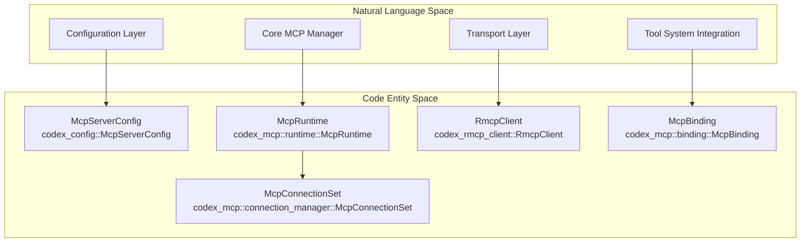
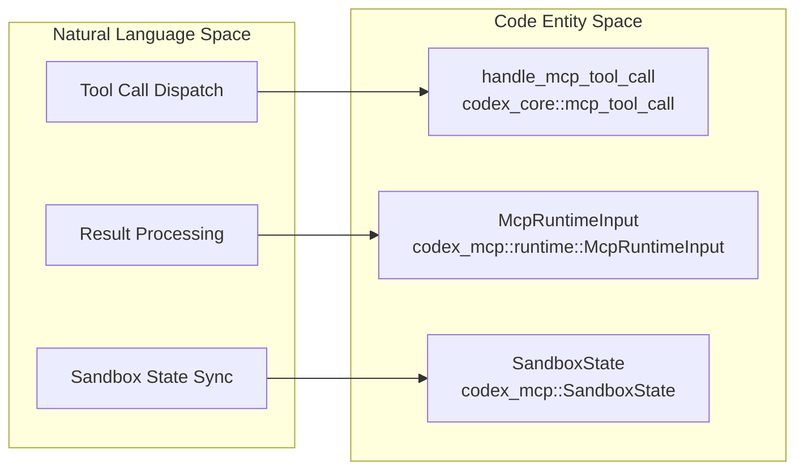

<!-- source: DeepWiki mcp.deepwiki.com · repo openai/codex · page 6 Model Context Protocol (MCP) · fetched 2026-10-26 -->

# Model Context Protocol (MCP)

Relevant source files

The following files were used as context for generating this wiki page:

- [codex-rs/app-server/tests/suite/v2/executor_mcp.rs](codex-rs/app-server/tests/suite/v2/executor_mcp.rs)
- [codex-rs/codex-mcp/src/binding.rs](codex-rs/codex-mcp/src/binding.rs)
- [codex-rs/codex-mcp/src/binding_tests.rs](codex-rs/codex-mcp/src/binding_tests.rs)
- [codex-rs/codex-mcp/src/client_tool_catalog.rs](codex-rs/codex-mcp/src/client_tool_catalog.rs)
- [codex-rs/codex-mcp/src/connection_manager.rs](codex-rs/codex-mcp/src/connection_manager.rs)
- [codex-rs/codex-mcp/src/connection_manager/tool_catalog.rs](codex-rs/codex-mcp/src/connection_manager/tool_catalog.rs)
- [codex-rs/codex-mcp/src/connection_manager_tests.rs](codex-rs/codex-mcp/src/connection_manager_tests.rs)
- [codex-rs/codex-mcp/src/lib.rs](codex-rs/codex-mcp/src/lib.rs)
- [codex-rs/codex-mcp/src/mcp/mod.rs](codex-rs/codex-mcp/src/mcp/mod.rs)
- [codex-rs/codex-mcp/src/mcp/mod_tests.rs](codex-rs/codex-mcp/src/mcp/mod_tests.rs)
- [codex-rs/codex-mcp/src/rmcp_client.rs](codex-rs/codex-mcp/src/rmcp_client.rs)
- [codex-rs/codex-mcp/src/runtime.rs](codex-rs/codex-mcp/src/runtime.rs)
- [codex-rs/codex-mcp/src/tool_catalog_cache.rs](codex-rs/codex-mcp/src/tool_catalog_cache.rs)
- [codex-rs/core/src/connectors.rs](codex-rs/core/src/connectors.rs)
- [codex-rs/core/src/connectors_tests.rs](codex-rs/core/src/connectors_tests.rs)
- [codex-rs/core/src/hook_mcp_executor.rs](codex-rs/core/src/hook_mcp_executor.rs)
- [codex-rs/core/src/mcp_tool_call.rs](codex-rs/core/src/mcp_tool_call.rs)
- [codex-rs/core/src/mcp_tool_call_tests.rs](codex-rs/core/src/mcp_tool_call_tests.rs)
- [codex-rs/core/src/plugins/discoverable.rs](codex-rs/core/src/plugins/discoverable.rs)
- [codex-rs/core/src/plugins/discoverable_tests.rs](codex-rs/core/src/plugins/discoverable_tests.rs)
- [codex-rs/core/src/session/mcp.rs](codex-rs/core/src/session/mcp.rs)
- [codex-rs/core/src/session/mcp_runtime.rs](codex-rs/core/src/session/mcp_runtime.rs)
- [codex-rs/core/tests/suite/hooks_mcp.rs](codex-rs/core/tests/suite/hooks_mcp.rs)
- [codex-rs/core/tests/suite/mcp_tool_cache.rs](codex-rs/core/tests/suite/mcp_tool_cache.rs)
- [codex-rs/core/tests/suite/mcp_turn_metadata.rs](codex-rs/core/tests/suite/mcp_turn_metadata.rs)

The Model Context Protocol (MCP) system enables Codex to integrate with external tool servers, extending its capabilities beyond built-in tools. MCP servers expose tools, resources, and prompts that the agent can invoke during conversation turns. This document provides a high-level overview of MCP server configuration, connection management, tool discovery, authentication, and elicitation handling.

For information about built-in tool execution, see [Tool System](#5). For general configuration management, see [Configuration System](#2.2).

---

## Overview

The MCP integration consists of three major subsystems working together:

1.  **Connection Management**  
    Manages the lifecycle of `RmcpClient` instances per configured MCP server. This is centrally coordinated by `McpConnectionSet` which maintains active server connections, startup status, and tool catalogs for each backend [codex-rs/codex-mcp/src/connection_manager.rs:1-7]().

2.  **Tool Aggregation and Qualification**  
    Discovers the tools exposed by each MCP server, filters and normalizes them, and constructs qualified tool names that conform to the tool-calling constraints of the Codex agent [codex-rs/codex-mcp/src/mcp/mod.rs:83-86]().

3.  **Authentication and Elicitation**  
    Supports OAuth flows for MCP server authentication, manages credentials storage, and handles elicitation requests where external MCP servers prompt Codex for user input during tool calls [codex-rs/codex-mcp/src/mcp/mod.rs:1-12]().

MCP servers are configured in global or local configuration files under `[mcp_servers]`. Each server is individually configurable with its own transport (stdio, HTTP), timeouts, OAuth settings, and tool filters. For details, see [MCP Server Configuration](#6.1).

Sources: [`codex-rs/codex-mcp/src/connection_manager.rs:1-7`](), [`codex-rs/codex-mcp/src/mcp/mod.rs:1-12`]()

---

## System Architecture

### MCP Integration & Connection Architecture

The diagram below bridges natural language architectural concepts to concrete code entities within the `codex-mcp` and `core` crates:

- **Configuration Layer**: Mapped to `McpServerConfig` structures defining server parameters [codex-rs/codex-mcp/src/mcp/mod.rs:26]().
- **Core MCP Manager**: Centered around `McpRuntime` and `McpConnectionSet` holding thread-owned mutable state [codex-rs/codex-mcp/src/runtime.rs:104-110]() [codex-rs/codex-mcp/src/connection_manager.rs:87-94]().
- **Transport Layer**: Powered by `RmcpClient` supporting stdio and HTTP streaming [codex-rs/codex-mcp/src/rmcp_client.rs:71-73]().
- **Tool System Integration**: Handled via `McpBinding` and qualified tool name transformations [codex-rs/codex-mcp/src/binding.rs:1-2]() [codex-rs/codex-mcp/src/mcp/mod.rs:83-86]().

Sources: [`codex-rs/codex-mcp/src/connection_manager.rs:87-94`](), [`codex-rs/codex-mcp/src/runtime.rs:104-110`](), [`codex-rs/codex-mcp/src/rmcp_client.rs:71-73`](), [`codex-rs/codex-mcp/src/binding.rs:1-2`](), [`codex-rs/codex-mcp/src/mcp/mod.rs:83-86`](), [`codex-rs/codex-mcp/src/mcp/mod.rs:26`]()

### Tool Delegation and Execution Pipeline

The diagram below maps the runtime delegation of tool calls from Codex core down to individual MCP connections and state propagation:

- **Tool Call Dispatch**: Handled by `handle_mcp_tool_call` which routes tool parameters to the appropriate connection [codex-rs/core/src/mcp_tool_call.rs:134-148]().
- **Result Processing**: Governed by configuration structures like `McpRuntimeInput` [codex-rs/codex-mcp/src/runtime.rs:83-95]().
- **Sandbox State Sync**: Utilizes `SandboxState` metadata definitions to align capabilities [codex-rs/codex-mcp/src/lib.rs:34]().

Sources: [`codex-rs/core/src/mcp_tool_call.rs:134-148`](), [`codex-rs/codex-mcp/src/runtime.rs:83-95`](), [`codex-rs/codex-mcp/src/lib.rs:34`]()

---

## MCP Server Configuration

MCP servers are declared using the `McpServerConfig` type, which supports multiple transport types, OAuth credentials, and tool filtering options. Global runtime settings are captured in `McpConfig`, which includes defaults like the `codex_home` directory and `approval_policy` [codex-rs/codex-mcp/src/mcp/mod.rs:124-166]().

For detailed configuration schemas, transport types (`stdio` via `LocalStdioServerLauncher`, streamable HTTP), tool filters, and OAuth settings, see [MCP Server Configuration](#6.1).

Sources: [`codex-rs/codex-mcp/src/mcp/mod.rs:124-166`](), [`codex-rs/codex-mcp/src/rmcp_client.rs:68-73`]()

---

## MCP Connection Manager

The `McpConnectionSet` manages server connections, startup coordination, and tool catalog aggregation [codex-rs/codex-mcp/src/connection_manager.rs:1-7](). It tracks server metadata, maintains active `AsyncManagedClient` handles, and coordinates timeout budgets during server initialization.

For details on the `McpConnectionSet` lifecycle, client wrapping, and elicitation routing, see [MCP Connection Manager](#6.2).

Sources: [`codex-rs/codex-mcp/src/connection_manager.rs:1-7`](), [`codex-rs/codex-mcp/src/connection_manager.rs:87-94`]()

---

## MCP CLI Commands

The `codex mcp` CLI subcommands (`list`, `add`, `remove`, `login`, `logout`) allow users to interactively inspect and modify MCP server configurations in `config.toml` and manage stored authentication tokens.

For usage guidelines and command implementations, see [MCP CLI Commands](#6.3).

Sources: [`codex-rs/cli/src/mcp_cmd.rs:56-73`]()

---

## MCP Server Implementation (codex-mcp-server)

Codex can also operate as an MCP server, exposing its internal capabilities and tools to external clients via the `codex-mcp-server` crate.

For details on how Codex exposes its capabilities as an MCP server, see [MCP Server Implementation (codex-mcp-server)](#6.4).

Sources: [`codex-rs/codex-mcp/src/lib.rs:1-35`]()

---

## OAuth Authentication for MCP

MCP servers can require OAuth authentication to access protected resources. The framework supports secure credential storage, automatic scope discovery, and login/logout flows managed through `McpOAuthLoginSupport` [codex-rs/codex-mcp/src/mcp/mod.rs:1-12]().

For complete documentation on OAuth login flows, credential backends, and token management, see [OAuth Authentication for MCP](#6.5).

Sources: [`codex-rs/codex-mcp/src/mcp/mod.rs:1-12`]()

---

## Sandbox State Synchronization

To ensure tool calls respect security and environment sandbox boundaries, Codex propagates sandbox state metadata to supporting MCP servers [codex-rs/codex-mcp/src/rmcp_client.rs:95-97](). Servers that advertise the `codex/sandbox-state-meta` capability receive this state during tool execution.

For information on capability checks and state notifications, see [Sandbox State Synchronization](#6.6).

Sources: [`codex-rs/codex-mcp/src/rmcp_client.rs:95-97`](), [`codex-rs/codex-mcp/src/lib.rs:25`]()

---

## Related Child Pages

- **[MCP Server Configuration](#6.1)** — Detailed configuration schema, transport options, tool filters, and OAuth setup.
- **[MCP Connection Manager](#6.2)** — Lifecycle and state management for MCP clients and servers, tool catalog aggregation, and elicitation handling.
- **[MCP CLI Commands](#6.3)** — User commands for managing MCP server configs and authentication.
- **[MCP Server Implementation (codex-mcp-server)](#6.4)** — How Codex runs as an MCP server, exposing its capabilities as tools to other clients.
- **[OAuth Authentication for MCP](#6.5)** — Details on OAuth login flows, token storage, and session management within MCP.
- **[Sandbox State Synchronization](#6.6)** — Mechanisms for syncing sandbox state info with MCP servers during tool execution.

Sources: [`codex-rs/codex-mcp/src/connection_manager.rs:1-7`](), [`codex-rs/codex-mcp/src/mcp/mod.rs:1-12`](), [`codex-rs/codex-mcp/src/runtime.rs:104-110`](), [`codex-rs/codex-mcp/src/rmcp_client.rs:95-97`](), [`codex-rs/cli/src/mcp_cmd.rs:56-73`]()

---

