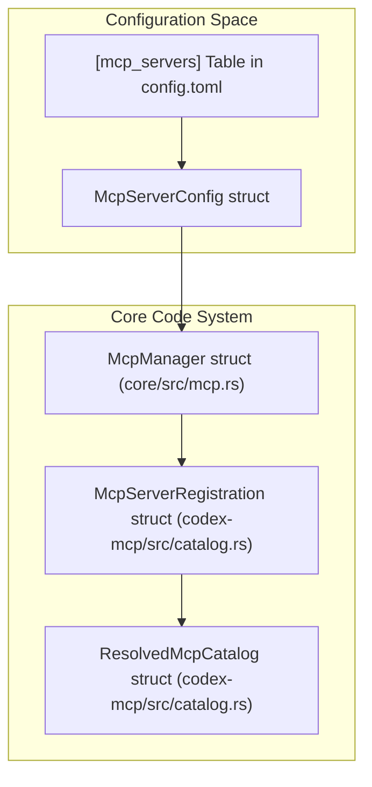
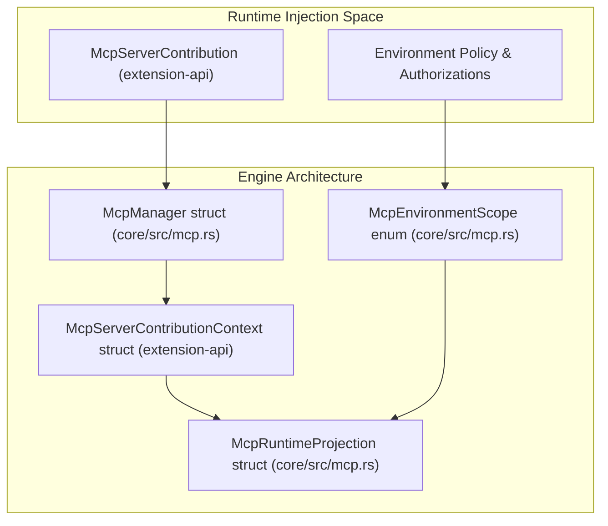

<!-- source: DeepWiki mcp.deepwiki.com · repo openai/codex · page 6.1 MCP Server Configuration · fetched 2026-10-26 -->

# MCP Server Configuration

Relevant source files

The following files were used as context for generating this wiki page:

- [codex-rs/config/src/config_toml.rs](codex-rs/config/src/config_toml.rs)
- [codex-rs/config/src/profile_toml.rs](codex-rs/config/src/profile_toml.rs)
- [codex-rs/config/src/schema.rs](codex-rs/config/src/schema.rs)
- [codex-rs/config/src/types.rs](codex-rs/config/src/types.rs)
- [codex-rs/config/src/types_tests.rs](codex-rs/config/src/types_tests.rs)
- [codex-rs/core-api/src/lib.rs](codex-rs/core-api/src/lib.rs)
- [codex-rs/core/config.schema.json](codex-rs/core/config.schema.json)
- [codex-rs/core/src/config/config_tests.rs](codex-rs/core/src/config/config_tests.rs)
- [codex-rs/core/src/config/mod.rs](codex-rs/core/src/config/mod.rs)
- [codex-rs/core/src/mcp.rs](codex-rs/core/src/mcp.rs)
- [codex-rs/core/tests/suite/scenarios.rs](codex-rs/core/tests/suite/scenarios.rs)
- [codex-rs/ext/extension-api/src/contributors/mcp.rs](codex-rs/ext/extension-api/src/contributors/mcp.rs)
- [codex-rs/ext/mcp/Cargo.toml](codex-rs/ext/mcp/Cargo.toml)
- [codex-rs/ext/mcp/src/event_stream_tests.rs](codex-rs/ext/mcp/src/event_stream_tests.rs)
- [codex-rs/ext/mcp/src/lib.rs](codex-rs/ext/mcp/src/lib.rs)
- [codex-rs/ext/mcp/src/stream_manager.rs](codex-rs/ext/mcp/src/stream_manager.rs)
- [codex-rs/ext/mcp/src/stream_manager_tests.rs](codex-rs/ext/mcp/src/stream_manager_tests.rs)
- [codex-rs/ext/mcp/tests/hosted_apps_mcp.rs](codex-rs/ext/mcp/tests/hosted_apps_mcp.rs)
- [codex-rs/ext/skills/src/provider/executor.rs](codex-rs/ext/skills/src/provider/executor.rs)
- [codex-rs/ext/skills/tests/executor_file_system_authority.rs](codex-rs/ext/skills/tests/executor_file_system_authority.rs)
- [codex-rs/features/src/feature_configs.rs](codex-rs/features/src/feature_configs.rs)
- [codex-rs/features/src/lib.rs](codex-rs/features/src/lib.rs)
- [codex-rs/features/src/tests.rs](codex-rs/features/src/tests.rs)
- [codex-rs/thread-manager-sample/src/main.rs](codex-rs/thread-manager-sample/src/main.rs)
- [codex-rs/tui/src/local_settings.rs](codex-rs/tui/src/local_settings.rs)
- [codex-rs/tui/src/local_settings_tests.rs](codex-rs/tui/src/local_settings_tests.rs)

This page explains the technical implementation, configuration structure, transport mechanisms, tool filtering, OAuth authentication, and dynamic dependency installation for Model Context Protocol (MCP) servers within the Codex system. MCP servers extend Codex's runtime capabilities by delegating tool calls to external binaries or HTTP endpoints.

Sources: 
- `codex-rs/config/src/mcp_types.rs:1-30`
- `codex-rs/core/src/mcp.rs:1-48`

---

## Configuration Structure: `[mcp_servers]` Table

MCP servers are defined declaratively in `config.toml` under the `[mcp_servers]` table. Each configured server entry maps to the `McpServerConfig` struct defined in the `codex_config` crate (`codex-rs/config/src/mcp_types.rs`), governing connection details, feature scopes, and security boundaries.

Key fields within `McpServerConfig` include:
- `transport`: Specifies the communication channel (`McpServerTransportConfig`) via Stdio subprocess or Streamable HTTP [codex-rs/config/src/mcp_types.rs:200-203]().
- `enabled`: A boolean toggle determining whether the server is active [codex-rs/config/src/mcp_types.rs:204]().
- `required`: If set to `true`, session startup fails if the server fails to initialize or connect [codex-rs/config/src/mcp_types.rs:205]().
- `environment_id`: Binds the server to a specific execution environment (defaults to `DEFAULT_MCP_SERVER_ENVIRONMENT_ID` / `"local"`) [codex-rs/config/src/mcp_types.rs:24]().
- `default_tools_approval_mode`: Baseline approval mode (`AppToolApproval::Auto`, `Prompt`, `Writes`, `Approve`) [codex-rs/config/src/mcp_types.rs:26-34]().
- `oauth`: Optional client configurations (`McpServerOAuthConfig`) for authentication [codex-rs/config/src/mcp_types.rs:156-183]().

Persistence and modification of the `[mcp_servers]` table at runtime are handled via `ConfigEdit::ReplaceMcpServers` and `ConfigEditsBuilder` [codex-rs/core/src/config/edit.rs:31-75]() (referencing `codex-rs/core/src/config/mod.rs` and configuration loading mechanisms).

Sources:
- `codex-rs/config/src/mcp_types.rs:1-230`
- `codex-rs/core/src/config/mod.rs:1-55`

---

Title: "MCP Configuration Flow to Registration"

Sources:
- `codex-rs/core/src/mcp.rs:108-144`
- `codex-rs/config/src/types.rs:10-18`

---

## Transport Types

The communication layer utilizes the `McpServerTransportConfig` enum to distinguish between local process execution and remote streaming protocols [codex-rs/config/src/mcp_types.rs:200-203]().

1. **Stdio Transport**: Launches local binaries as child processes, interacting over standard input and output streams.
    * `command`: The executable path [codex-rs/config/src/mcp_types.rs:209]().
    * `args`: Command-line arguments [codex-rs/config/src/mcp_types.rs:210]().
    * `env`: Static environment variables [codex-rs/config/src/mcp_types.rs:211]().
    * `env_vars`: Dynamic environment variables, specified as names or `McpServerEnvVar` objects with `source` (`local` or `remote`) [codex-rs/config/src/mcp_types.rs:97-135]().
    * `cwd`: Working directory for the subprocess [codex-rs/config/src/mcp_types.rs:213]().
    The `ExecutorProcessTransport` handles the byte-level translation between `rmcp` messages and the executor's process I/O.
2. **Streamable HTTP Transport**: Connects to remote endpoints via HTTP(S) streams.
    * `url`: The HTTP endpoint [codex-rs/config/src/mcp_types.rs:220]().
    * `bearer_token_env_var`: Environment variable holding a bearer token [codex-rs/config/src/mcp_types.rs:221]().
    * `http_headers`: Static HTTP headers [codex-rs/config/src/mcp_types.rs:222]().
    * `env_http_headers`: HTTP headers whose values are sourced from environment variables [codex-rs/config/src/mcp_types.rs:223]().
    * `http_headers_helper`: An optional command to execute to generate HTTP headers [codex-rs/config/src/mcp_types.rs:224]().

Sources:
- `codex-rs/config/src/mcp_types.rs:97-135`
- `codex-rs/config/src/mcp_types.rs:200-224`

---

## Tool Filters and Authorization Controls

To prevent unauthorized or unwanted tool executions, each `McpServerConfig` supports granular filtering and permission rules:

- **Enabled/Disabled Lists**: `enabled_tools` and `disabled_tools` explicitly include or exclude tool identifiers [codex-rs/config/src/mcp_types.rs:250-251]().
- **Per-Tool Configuration**: The `tools` field maps tool names to `McpServerToolConfig`, allowing custom `approval_mode` settings and output token limits (`output_token_limit`) [codex-rs/config/src/mcp_types.rs:77-95]().
- **Namespace Omitting**: `omit_tools_from` suppresses specific tool prefixes or namespaces [codex-rs/config/src/mcp_types.rs:249]().

Sources:
- `codex-rs/config/src/mcp_types.rs:77-95`
- `codex-rs/config/src/mcp_types.rs:249-251`

---

## OAuth Settings and Authentication Flow

HTTP and remote MCP servers can require token exchange or user login flows via `McpServerOAuthConfig`. 

- **OAuth Client Configuration**: Fields like `client_id`, `client_secret`, `callback_url`, `callback_port`, and `authorization_server_issuer` define client credentials [codex-rs/config/src/mcp_types.rs:156-183]().
- **Authentication Modes**: The `McpServerAuth` enum determines whether authentication relies on stored OAuth credentials (`OAuth`), API keys (`ChatGpt`), or enterprise token exchange (`EmaAuth`) [codex-rs/config/src/mcp_types.rs:185-192]().
- **Credential Storage Modes**: `OAuthCredentialsStoreMode` manages credential persistence (`Auto`, `File`, `Keyring`) [codex-rs/config/src/types.rs:148-163]().

Sources:
- `codex-rs/config/src/mcp_types.rs:156-192`
- `codex-rs/config/src/types.rs:148-163`

---

## Extension Contributions and Environment Scoping

MCP server configurations are not solely derived from static configuration files; extensions, plugins, and execution environments can dynamically contribute or scope servers using `McpServerContributionContext` and `McpEnvironmentScope` [codex-rs/core/src/mcp.rs:49-88]().

Title: "MCP Runtime Contribution and Scoping"

Sources:
- `codex-rs/core/src/mcp.rs:43-88`

---

## Skill-Driven MCP Dependency Installation

When an agent encounters a mentioned skill carrying MCP dependencies, Codex evaluates whether required MCP servers are present in the global configuration and automatically registers or admits missing dependencies.

- **Admittance**: Candidate servers are staged in memory, validated against global attachment and feature policies, and checked for protocol compliance.
- **Persistence**: Approved missing dependencies are written back to the global configuration structure via config edit layers.

Sources:
- `codex-rs/core/src/mcp.rs:108-182`
- `codex-rs/config/src/config_toml.rs:1-35`

---

