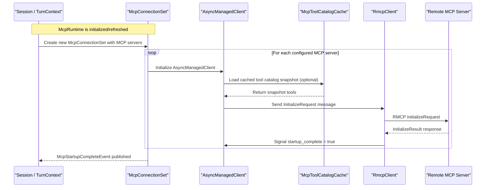
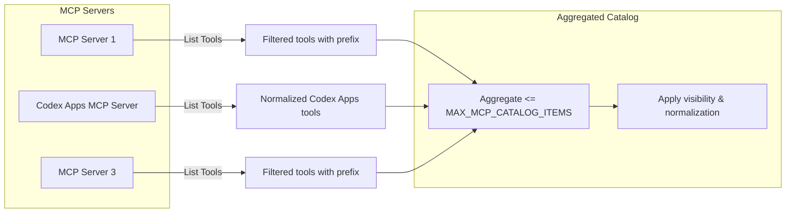
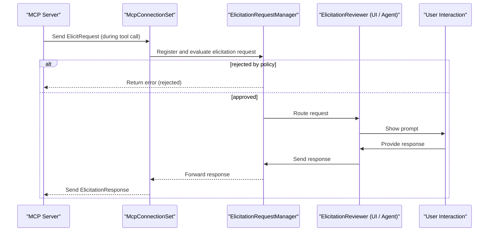
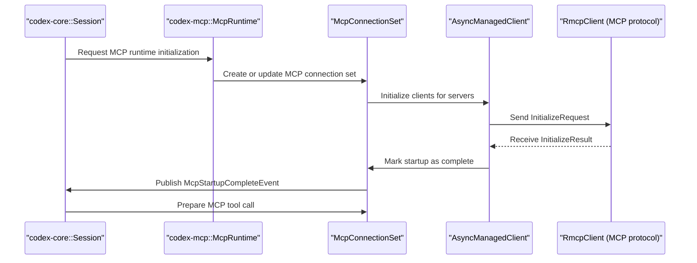

<!-- source: DeepWiki mcp.deepwiki.com · repo openai/codex · page 6.2 MCP Connection Manager · fetched 2026-10-26 -->

# MCP Connection Manager

<details>
<summary>Relevant source files</summary>

The following files were used as context for generating this wiki page:

- [codex-rs/app-server/tests/suite/v2/executor_mcp.rs](codex-rs/app-server/tests/suite/v2/executor_mcp.rs)
- [codex-rs/codex-mcp/src/agent_plugin_config.rs](codex-rs/codex-mcp/src/agent_plugin_config.rs)
- [codex-rs/codex-mcp/src/binding.rs](codex-rs/codex-mcp/src/binding.rs)
- [codex-rs/codex-mcp/src/binding_tests.rs](codex-rs/codex-mcp/src/binding_tests.rs)
- [codex-rs/codex-mcp/src/client_tool_catalog.rs](codex-rs/codex-mcp/src/client_tool_catalog.rs)
- [codex-rs/codex-mcp/src/connection_manager.rs](codex-rs/codex-mcp/src/connection_manager.rs)
- [codex-rs/codex-mcp/src/connection_manager/tool_catalog.rs](codex-rs/codex-mcp/src/connection_manager/tool_catalog.rs)
- [codex-rs/codex-mcp/src/connection_manager_tests.rs](codex-rs/codex-mcp/src/connection_manager_tests.rs)
- [codex-rs/codex-mcp/src/lib.rs](codex-rs/codex-mcp/src/lib.rs)
- [codex-rs/codex-mcp/src/mcp/mod.rs](codex-rs/codex-mcp/src/mcp/mod.rs)
- [codex-rs/codex-mcp/src/mcp/mod_tests.rs](codex-rs/codex-mcp/src/mcp/mod_tests.rs)
- [codex-rs/codex-mcp/src/rmcp_client.rs](codex-rs/codex-mcp/src/rmcp_client.rs)
- [codex-rs/codex-mcp/src/runtime.rs](codex-rs/codex-mcp/src/runtime.rs)
- [codex-rs/codex-mcp/src/tool_catalog_cache.rs](codex-rs/codex-mcp/src/tool_catalog_cache.rs)
- [codex-rs/core/src/connectors.rs](codex-rs/core/src/connectors.rs)
- [codex-rs/core/src/connectors_tests.rs](codex-rs/core/src/connectors_tests.rs)
- [codex-rs/core/src/hook_mcp_executor.rs](codex-rs/core/src/hook_mcp_executor.rs)
- [codex-rs/core/src/mcp_tool_call.rs](codex-rs/core/src/mcp_tool_call.rs)
- [codex-rs/core/src/mcp_tool_call_tests.rs](codex-rs/core/src/mcp_tool_call_tests.rs)
- [codex-rs/core/src/plugins/discoverable.rs](codex-rs/core/src/plugins/discoverable.rs)
- [codex-rs/core/src/plugins/discoverable_tests.rs](codex-rs/core/src/plugins/discoverable_tests.rs)
- [codex-rs/core/src/session/mcp.rs](codex-rs/core/src/session/mcp.rs)
- [codex-rs/core/src/session/mcp_runtime.rs](codex-rs/core/src/session/mcp_runtime.rs)
- [codex-rs/core/tests/suite/hooks_mcp.rs](codex-rs/core/tests/suite/hooks_mcp.rs)
- [codex-rs/core/tests/suite/mcp_tool_cache.rs](codex-rs/core/tests/suite/mcp_tool_cache.rs)
- [codex-rs/core/tests/suite/mcp_turn_metadata.rs](codex-rs/core/tests/suite/mcp_turn_metadata.rs)
- [codex-rs/rmcp-client/src/bin/test_mcp_2026_stdio_server.rs](codex-rs/rmcp-client/src/bin/test_mcp_2026_stdio_server.rs)
- [codex-rs/rmcp-client/src/bin/test_stdio_server.rs](codex-rs/rmcp-client/src/bin/test_stdio_server.rs)
- [codex-rs/rmcp-client/src/elicitation_client_service.rs](codex-rs/rmcp-client/src/elicitation_client_service.rs)
- [codex-rs/rmcp-client/src/executor_process_transport.rs](codex-rs/rmcp-client/src/executor_process_transport.rs)
- [codex-rs/rmcp-client/src/executor_process_transport_tests.rs](codex-rs/rmcp-client/src/executor_process_transport_tests.rs)
- [codex-rs/rmcp-client/src/http_client_adapter.rs](codex-rs/rmcp-client/src/http_client_adapter.rs)
- [codex-rs/rmcp-client/src/http_client_adapter_tests.rs](codex-rs/rmcp-client/src/http_client_adapter_tests.rs)
- [codex-rs/rmcp-client/src/lib.rs](codex-rs/rmcp-client/src/lib.rs)
- [codex-rs/rmcp-client/src/rmcp_client.rs](codex-rs/rmcp-client/src/rmcp_client.rs)
- [codex-rs/rmcp-client/src/user_verification.rs](codex-rs/rmcp-client/src/user_verification.rs)
- [codex-rs/rmcp-client/src/user_verification_cancellation_tests.rs](codex-rs/rmcp-client/src/user_verification_cancellation_tests.rs)
- [codex-rs/rmcp-client/src/user_verification_dispatch_tests.rs](codex-rs/rmcp-client/src/user_verification_dispatch_tests.rs)
- [codex-rs/rmcp-client/src/user_verification_tests.rs](codex-rs/rmcp-client/src/user_verification_tests.rs)
- [codex-rs/rmcp-client/tests/mcp_2026_discovery.rs](codex-rs/rmcp-client/tests/mcp_2026_discovery.rs)
- [codex-rs/rmcp-client/tests/mcp_2026_message_limits.rs](codex-rs/rmcp-client/tests/mcp_2026_message_limits.rs)
- [codex-rs/rmcp-client/tests/mcp_2026_mrtr.rs](codex-rs/rmcp-client/tests/mcp_2026_mrtr.rs)

</details>


The MCP Connection Manager is the runtime component in `codex-core` and `codex-mcp` responsible for establishing and maintaining connections to external MCP (Model Context Protocol) servers. It manages the lifecycle of `RmcpClient` instances by wrapping them inside higher abstractions (`ManagedClient` and `AsyncManagedClient`), aggregates tool/resource listings from multiple connected servers, routes tool calls, and handles elicitation requests from those servers. This ensures that tools exposed by MCP servers are discoverable, callable, and that user interaction flows like permission elicitation are consistently handled.

It acts as the private implementation behind public abstractions such as [`McpRuntime`](codex-rs/codex-mcp/src/runtime.rs)() and [`McpBinding`](codex-rs/codex-mcp/src/binding.rs)() and tightly integrates with session lifecycle and configuration management in Codex.
[codex-rs/codex-mcp/src/connection_manager.rs:1-7]()

---

## Structural Overview

The main structural component of the MCP Connection Manager is the `McpConnectionSet`. This struct maintains an internal map of MCP servers to `McpServerView` objects, each encapsulating a connection to a remote MCP server. Each server connection is represented by an `McpServerConnection` which owns an asynchronous client handle (`AsyncManagedClient`). This client manages an underlying [`RmcpClient`](codex-rs/codex-mcp/src/rmcp_client.rs)() that interacts with the server's RMCP protocol lifecycle: initial handshake, tool listing, and tool invocation.

The connection set also orchestrates startup sequencing, tool catalog aggregation, and elicits interaction delegation.

### Key Components and Relationships

```mermaid
classDiagram
    direction LR

    class McpConnectionSet {
        -servers: HashMap~String, McpServerView~
        -event_stream_connection: Option~Arc~EventStreamConnectionSettings~~
        -elicitation_requests: ElicitationRequestManager
        -tool_plugin_context: Arc~ToolPluginContext~
        -prefix_mcp_tool_names: bool
        +list_all_tools() Vec~ToolInfo~
        +handle_elicitation_request()
    }

    class McpServerView {
        -connection: Arc~McpServerConnection~
        -metadata: McpServerMetadata
        -tool_filter: ToolFilter
        -tool_timeout: Option~Duration~
        -catalog_item_limit: usize
        +listed_tools() Vec~ToolInfo~
        +client() Result~ManagedClient, StartupOutcomeError~
    }

    class McpServerConnection {
        -identity: Option~McpServerConnectionIdentity~
        -client: AsyncManagedClient
        -startup_timeout: Duration
        -startup_trigger: Option~watch::Sender~bool~~
        -_diagnostics_guard: GaugeGuard
        +client() Result~ManagedClient, StartupOutcomeError~
        +reusable_client() Option~ManagedClient~
        +shutdown()
    }

    class AsyncManagedClient {
        -client: ManagedClientFuture
        -is_codex_apps_mcp_server: bool
        -startup_complete: Arc~AtomicBool~
        -cancel_token: CancellationToken
        +client() Result~ManagedClient, StartupOutcomeError~
        +shutdown()
    }

    class ManagedClient {
        -client: Arc~RmcpClient~
        -server_info: McpServerInfo
        -tool_catalog: Arc~ClientToolCatalog~
        -tool_timeout: Option~Duration~
        -server_instructions: Option~String~
        -server_supports_sandbox_state_meta: bool
        -codex_apps_tools_cache_context: Option~ConnectorRuntimeContext<ToolInfo>~
        +listed_tools() Vec~ToolInfo~
    }

    class RmcpClient {
        // Implements RMCP protocol: initialize, list tools, call tools, elicit info
    }

    McpConnectionSet "1" --> "0..*" McpServerView : "aggregates"
    McpServerView "1" --> "1" McpServerConnection : "owns"
    McpServerConnection "1" --> "1" AsyncManagedClient : "manages"
    AsyncManagedClient --> ManagedClient : "resolves via Future"
    ManagedClient --> RmcpClient : "wraps"
```



Sources: [codex-rs/codex-mcp/src/connection_manager.rs:87-173](), [codex-rs/codex-mcp/src/rmcp_client.rs:121-156]()

---

## Lifecycle and Initialization

### Connection and Client Creation

- When the active MCP runtime (`McpRuntime`) is initialized or refreshed, a new `McpConnectionSet` is created or updated [codex-rs/codex-mcp/src/runtime.rs:104-111]().
- For each configured MCP server in the resolved catalog, an asynchronous client is created with server-specific configuration (authorization, transport, timeouts).
- The `AsyncManagedClient` is responsible for managing connection lifecycle including startup, authentication refresh, and shutdown [codex-rs/codex-mcp/src/rmcp_client.rs:121-137]().
- The startup includes sending an `InitializeRequest` RMCP message to the server and waiting for its reply [codex-rs/codex-mcp/src/rmcp_client.rs:191-196]().
- The client also retrieves an initial tool catalog listing during startup.

### Startup Snapshot and Tool Catalog Cache

- To avoid blocking model processing on slow server connections, `McpConnectionSet` attempts to load a "startup snapshot" of tools from a shared cache (`McpToolCatalogCache`) [codex-rs/codex-mcp/src/connection_manager.rs:181-188]().
- This cached catalog allows early availability of tool definitions while network connections continue to initialize in the background.
- Once the client finishes startup, the live catalog overrides the cached snapshot.
- Startup completion triggers publication of `McpStartupCompleteEvent` events to notify interested consumers [codex-rs/codex-mcp/src/connection_manager.rs:75-79]().

### Startup Sequence Overview:



Sources: [codex-rs/codex-mcp/src/connection_manager.rs:75-79](), [codex-rs/codex-mcp/src/rmcp_client.rs:121-156](), [codex-rs/codex-mcp/src/tool_catalog_cache.rs:1-30]()

---

## Tool Catalog Aggregation and Filtering

### Tool Listing

The MCP Connection Manager maintains an aggregated tool catalog, combining tools from all connected MCP servers.

- Each `McpServerView` can list its filtered tools via `listed_tools()` that enforces server tool filters [codex-rs/codex-mcp/src/rmcp_client.rs:133-155]().
- Codex Apps MCP servers receive special normalization and prep steps preparing tools specifically for model consumption [codex-rs/codex-mcp/src/rmcp_client.rs:49-50]().
- Multiple tool catalogs are merged together, respecting item limits (`MAX_MCP_CATALOG_ITEMS` for regular servers and `MAX_CODEX_APPS_TOOL_CATALOG_ITEMS` for Codex Apps) [codex-rs/codex-mcp/src/connection_manager.rs:42-43]().
- The aggregation respects per-server tool filters configured in `ToolFilter` [codex-rs/codex-mcp/src/connection_manager.rs:170]().
- This aggregated catalog enables the agent to route tool calls correctly.

### Tool Visibility

- Tools can specify visibility in their metadata to indicate which models or protocol modes support them.
- The function `tool_is_model_visible(tool: &ToolInfo, model_id: &str) -> bool` checks visibility by inspecting the `ui.visibility` array in tool metadata [codex-rs/codex-mcp/src/connection_manager.rs:27]().
- Tool name prefixes are added automatically (`mcp__<server_name>__<tool_name>`) to avoid collisions across servers, unless a server is explicitly opted-out from prefixing [codex-rs/codex-mcp/src/mcp/mod.rs:83-87]().

### Catalog Merging Diagram



Sources: [codex-rs/codex-mcp/src/connection_manager.rs:27-43](), [codex-rs/codex-mcp/src/mcp/mod.rs:83-87]()

---

## Elicitation Handling

Elicitation is a mechanism by which an MCP server can request interactive user input during tool execution (e.g., for OAuth login, permissions, or confirmation prompts). The MCP Connection Manager manages elicitation lifecycles and routing.

### Core Components

- `ElicitationRequestManager`: Holds active elicitation requests and routes them appropriately [codex-rs/codex-mcp/src/connection_manager.rs:37]().
- `ElicitationRequestRouter`: Routes elicitation requests to registered handlers, including the TUI or sub-agents [codex-rs/codex-mcp/src/connection_manager.rs:38]().
- The elicitation lifecycle is integrated with Codex's approval and guardrail policies.

### Flow of an Elicitation Request

1. **Receive**: An MCP server sends an elicitation request during a tool call.
2. **Policy Check**: The request is evaluated against the currently active approval policy and permission profile. If rejected by policy, an error response is generated immediately.
3. **Route**: Requests that pass policy checks are routed to the current elicitation handlers (e.g., GUI or specialized reviewers).
4. **Wait**: The system waits asynchronously for the user response or review.
5. **Response**: The elicitation response is converted back into the RMCP protocol's `ElicitationResponse` and sent back to the MCP server [codex-rs/codex-mcp/src/lib.rs:41]().

### Elicitation Lifecycle Diagram



Sources: [codex-rs/codex-mcp/src/connection_manager_tests.rs:114-125](), [codex-rs/codex-mcp/src/connection_manager.rs:37-38]()

---

## Integration with Codex Apps MCP Server

Codex Apps MCP servers are a special category recognized by the manager:

- They have a fixed server name (`"codex_apps"`) [codex-rs/codex-mcp/src/mcp/mod.rs:64]().
- Uses a shared cache (`ConnectorRuntimeManager`) for tool definitions, improving startup latency across sessions [codex-rs/codex-mcp/src/lib.rs:36]().
- Feature code handles startup retries with backoff via `CodexAppsStartupReconnect` to handle intermittent network or server availability issues [codex-rs/codex-mcp/src/connection_manager_tests.rs:13]().
- Provide extended authentication elicitation flows allowing for OAuth login flows triggered by connector auth failures [codex-rs/codex-mcp/src/lib.rs:58-67]().
- Tools from Codex Apps servers are normalized specially to fit Codex's model environment [codex-rs/codex-mcp/src/rmcp_client.rs:28-31]().

### Codex Apps Tools Cache Sharing

```mermaid
flowchart LR
    subgraph CodexApps MCP Server "codex_apps"
        Client1["AsyncManagedClient (Thread 1)"]
        Client2["AsyncManagedClient (Thread 2)"]
    end
    sharedCache["ConnectorRuntimeManager<ToolInfo>"]

    Client1 --> sharedCache
    Client2 --> sharedCache

    subgraph Other MCP Servers
        OtherClient["AsyncManagedClient"]
    end

    OtherClient -- No sharing --> OtherCatalog["Per-thread tool catalog"]

```

Sources: [codex-rs/codex-mcp/src/runtime.rs:79-96](), [codex-rs/codex-mcp/src/rmcp_client.rs:121-156]()

---

## Telemetry and Diagnostics

The MCP Connection Manager emits internal metrics and diagnostic signals:

- A `Gauge` named `mcp.connections.live` tracks the number of active MCP server connections to aid in monitoring [codex-rs/codex-mcp/src/connection_manager.rs:85]().
- Latency metrics on tool listings and refreshes [codex-rs/codex-mcp/src/rmcp_client.rs:101-104]():
  - `codex.mcp.tools.list.duration_ms`
  - `codex.mcp.tools.fetch_uncached.duration_ms`
  - `codex.apps.refresh.duration_ms`
- Internal warnings and errors are traced via `tracing` instrumentation and logs [codex-rs/codex-mcp/src/connection_manager.rs:83]().

Sources: [codex-rs/codex-mcp/src/connection_manager.rs:85](), [codex-rs/codex-mcp/src/rmcp_client.rs:101-104]()

---

# Natural Language to Code Entity Mapping Diagrams

## MCP Connection Manager Components and Code Entity Mapping

```mermaid
flowchart TB
    NL_Nodes["Natural Language Concepts"] -->|Manages| Code_Entities["Code Entities"]

    subgraph MCPConnectionManager ["MCP Connection Manager"]
        CCS[McpConnectionSet]
        MSV[McpServerView]
        MSC[McpServerConnection]
        AMC[AsyncManagedClient]
        MC[ManagedClient]
        RC[RmcpClient]
    end

    subgraph Lifecycle ["Lifecycle Control"]
        Init[Initialization: config -> McpConnectionSet]
        Start[Startup: AsyncManagedClient with background handshake]
        Ping[Connection health and shutdown]
    end

    subgraph ToolCatalog ["Tool Catalog Aggregation"]
        ListTools[list_all_tools() in McpConnectionSet]
        FilterFilter[filter_tools()]
        NormalizeTools[prepare_codex_apps_tools_for_model()]
    end

    subgraph Elicitation ["Elicitation Handling"]
        ElicitMgr[ElicitationRequestManager]
        Router[ElicitationRequestRouter]
        Reviewer[ElicitationReviewer]
    end

    NL_Nodes --> Init
    CCS --> Start
    Start --> AMC
    AMC --> MC
    MC --> RC

    CCS --> MSV
    MSV --> MSC
    MSC --> AMC

    CCS --> ListTools
    ListTools --> FilterFilter
    FilterFilter --> NormalizeTools

    CCS --> ElicitMgr
    ElicitMgr --> Router
    Router --> Reviewer
```

Sources: [codex-rs/codex-mcp/src/connection_manager.rs:87-188](), [codex-rs/codex-mcp/src/rmcp_client.rs:121-156]()

---

## Session and Runtime Interaction with MCP Connection Manager



Sources: [codex-rs/core/src/session/mcp.rs:100-154](), [codex-rs/codex-mcp/src/connection_manager.rs:75-79](), [codex-rs/codex-mcp/src/runtime.rs:104-111]()

---

This concludes the detailed technical documentation of the MCP Connection Manager, covering its lifecycle, RMCP client wrapping, tool catalog aggregation, elicitation handling, and integration points with the Codex infrastructure.

---

