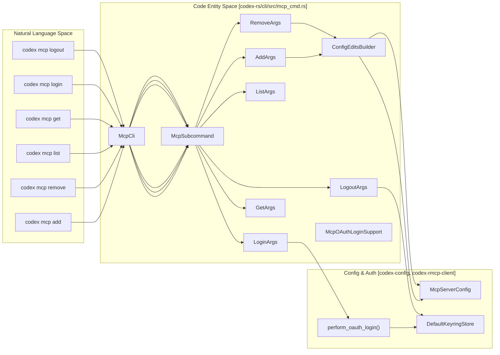
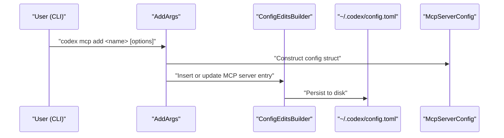
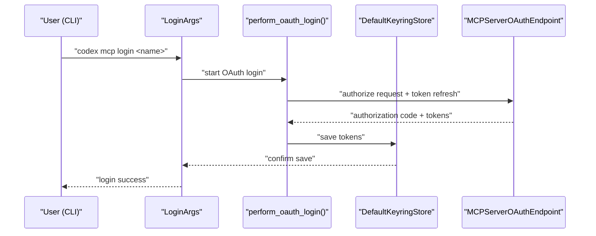

<!-- source: DeepWiki mcp.deepwiki.com · repo openai/codex · page 6.3 MCP CLI Commands · fetched 2026-10-26 -->

# MCP CLI Commands

Relevant source files

The following files were used as context for generating this wiki page:

- [codex-rs/cli/src/mcp_cmd.rs](codex-rs/cli/src/mcp_cmd.rs)
- [codex-rs/cli/src/mcp_login.rs](codex-rs/cli/src/mcp_login.rs)
- [codex-rs/cli/src/mcp_login_tests.rs](codex-rs/cli/src/mcp_login_tests.rs)
- [codex-rs/cli/tests/mcp_add_remove.rs](codex-rs/cli/tests/mcp_add_remove.rs)
- [codex-rs/cli/tests/mcp_list.rs](codex-rs/cli/tests/mcp_list.rs)
- [codex-rs/cli/tests/mcp_login.rs](codex-rs/cli/tests/mcp_login.rs)
- [codex-rs/codex-mcp/src/mcp/auth.rs](codex-rs/codex-mcp/src/mcp/auth.rs)
- [codex-rs/core/src/mcp_skill_dependencies.rs](codex-rs/core/src/mcp_skill_dependencies.rs)
- [codex-rs/core/tests/suite/mcp_startup_refresh_http_proxy.rs](codex-rs/core/tests/suite/mcp_startup_refresh_http_proxy.rs)
- [codex-rs/core/tests/suite/truncation.rs](codex-rs/core/tests/suite/truncation.rs)
- [codex-rs/rmcp-client/src/auth_status.rs](codex-rs/rmcp-client/src/auth_status.rs)
- [codex-rs/rmcp-client/src/oauth/issuer_binding.rs](codex-rs/rmcp-client/src/oauth/issuer_binding.rs)
- [codex-rs/rmcp-client/src/oauth_callback_input.rs](codex-rs/rmcp-client/src/oauth_callback_input.rs)
- [codex-rs/rmcp-client/src/oauth_callback_input_tests.rs](codex-rs/rmcp-client/src/oauth_callback_input_tests.rs)
- [codex-rs/rmcp-client/src/oauth_client_registration.rs](codex-rs/rmcp-client/src/oauth_client_registration.rs)
- [codex-rs/rmcp-client/src/oauth_client_registration_tests.rs](codex-rs/rmcp-client/src/oauth_client_registration_tests.rs)
- [codex-rs/rmcp-client/src/oauth_http_client.rs](codex-rs/rmcp-client/src/oauth_http_client.rs)
- [codex-rs/rmcp-client/src/oauth_http_client_security_tests.rs](codex-rs/rmcp-client/src/oauth_http_client_security_tests.rs)
- [codex-rs/rmcp-client/src/perform_oauth_login.rs](codex-rs/rmcp-client/src/perform_oauth_login.rs)
- [codex-rs/rmcp-client/tests/mcp_2026_oauth_discovery.rs](codex-rs/rmcp-client/tests/mcp_2026_oauth_discovery.rs)
- [codex-rs/rmcp-client/tests/streamable_http_oauth_startup.rs](codex-rs/rmcp-client/tests/streamable_http_oauth_startup.rs)

The purpose of this page is to explain the `codex mcp` subcommands, which provide a command-line interface for managing Model Context Protocol (MCP) server configurations, authentication credentials, and connection details. These commands interact with the global `config.toml` to add, remove, list, or query MCP servers, as well as triggering OAuth login and logout flows with managed credential storage.

---

## Command Overview

The CLI commands for MCP are implemented in Rust in the file `codex-rs/cli/src/mcp_cmd.rs`. The main entrypoint is the `McpCli` struct which parses subcommands using `clap` [codex-rs/cli/src/mcp_cmd.rs:54-78](). The commands operate largely by reading and writing to the global `~/.codex/config.toml` file, leveraging `ConfigEditsBuilder` for atomic edits [codex-rs/cli/src/mcp_cmd.rs:19]. OAuth login support is integrated via `McpOAuthLoginSupport` [codex-rs/cli/src/mcp_cmd.rs:27].

The primary subcommands defined in `McpSubcommand` are:

- `list`: Lists configured MCP servers along with their current configuration and optionally outputs JSON [codex-rs/cli/src/mcp_cmd.rs:74]().
- `get <name>`: Displays detailed info for a named MCP server, optionally as JSON [codex-rs/cli/src/mcp_cmd.rs:75]() (`GetArgs`).
- `add <name>`: Adds a new MCP server entry with stdio or streamable-http transport [codex-rs/cli/src/mcp_cmd.rs:76]() (`AddArgs`).
- `remove <name>`: Removes an MCP server by name from the config [codex-rs/cli/src/mcp_cmd.rs:77]() (`RemoveArgs`).
- `login <name>`: Performs OAuth authentication flow for an MCP server, storing tokens securely [codex-rs/cli/src/mcp_cmd.rs:78]() (`LoginArgs`).
- `logout <name>`: Deletes stored OAuth credentials for a specified server [codex-rs/cli/src/mcp_cmd.rs:79]() (`LogoutArgs`).

Sources: [codex-rs/cli/src/mcp_cmd.rs:54-79]()

---

## Command Dispatch and Data Flow

The command parsing starts with `McpCli` that delegates to an enum `McpSubcommand`. Each subcommand has a corresponding handler responsible for business logic. These handlers manipulate the MCP server configuration state persisted in `~/.codex/config.toml`, stored as a map of server names to `McpServerConfig` configurations defined in the `codex-config` crate [codex-rs/cli/src/mcp_cmd.rs:10-13]. `ConfigEditsBuilder` updates the config in a controlled way, preserving unrelated settings.

OAuth login involves invoking `perform_oauth_login` from `codex-rmcp-client` [codex-rs/rmcp-client/src/perform_oauth_login.rs:110-145](), handling the OAuth 2.0 authorization code flow, browser launch, redirect handling, and token cache updates.

### Diagram: MCP CLI Command Dispatch and Code Entities

Sources: [codex-rs/cli/src/mcp_cmd.rs:54-79](), [codex-rs/rmcp-client/src/perform_oauth_login.rs:110-145]()

---

## Configuration Manipulation

### Adding Servers

The `add` subcommand allows adding MCP servers with different transport types using mutually exclusive command arguments [codex-rs/cli/src/mcp_cmd.rs:100-118]():

1.  **Stdio Transport (`AddMcpStdioArgs`)** — Defines a command and arguments to launch the MCP server as a subprocess, optionally accepting environment variables [codex-rs/cli/src/mcp_cmd.rs:127-145]().
2.  **Streamable HTTP Transport (`AddMcpStreamableHttpArgs`)** — Defines a URL for an HTTP MCP server conforming to the streamable HTTP protocol, with optional bearer token environment variables or OAuth client parameters [codex-rs/cli/src/mcp_cmd.rs:148-187]().

An `McpServerConfig` struct holds the transport configuration as `McpServerTransportConfig`. After validation, `ConfigEditsBuilder` writes the entry under the `[mcp_servers."name"]` table in `config.toml`.

### Diagram: Server Addition Sequence

Sources: [codex-rs/cli/src/mcp_cmd.rs:100-187]()

### Removing Servers

The `remove` subcommand (`RemoveArgs`) deletes a server configuration from the `mcp_servers` table [codex-rs/cli/src/mcp_cmd.rs:206-210](). It loads the current map, removes the entry, and commits via `ConfigEditsBuilder`.

Sources: [codex-rs/cli/src/mcp_cmd.rs:206-210]()

### Listing and Getting Servers

The `list` (`ListArgs`) and `get` (`GetArgs`) subcommands produce human-readable or JSON output detailing server transport configurations [codex-rs/cli/src/mcp_cmd.rs:83-98]().

Sources: [codex-rs/cli/src/mcp_cmd.rs:83-98]()

---

## Authentication Flow (OAuth)

The `login` (`LoginArgs`) and `logout` (`LogoutArgs`) subcommands manage OAuth credentials for MCP servers:
- `login` triggers an OAuth 2.0 authorization code flow, supporting headless/silent options [codex-rs/cli/src/mcp_cmd.rs:213-216]().
- Tokens are stored persistently using OS native keyring services or file fallbacks [codex-rs/rmcp-client/src/perform_oauth_login.rs:110-145]().
- `perform_oauth_login` encapsulates callback handling, token saving, and error management [codex-rs/rmcp-client/src/perform_oauth_login.rs:110-145]().
- `logout` removes stored credentials using underlying rmcp client storage functions [codex-rs/cli/src/mcp_cmd.rs:41-42]().

### Diagram: OAuth Login Flow

Sources: [codex-rs/cli/src/mcp_cmd.rs:41-42](), [codex-rs/cli/src/mcp_cmd.rs:213-216](), [codex-rs/rmcp-client/src/perform_oauth_login.rs:110-145]()

---

## Implementation Details and Key Types

-   **CLI Parsing structures**: `McpCli`, `McpSubcommand`, `AddMcpStdioArgs`, and `AddMcpStreamableHttpArgs` defined in `codex-rs/cli/src/mcp_cmd.rs` [codex-rs/cli/src/mcp_cmd.rs:65-194]().
-   **Configuration Edits**: `ConfigEditsBuilder` safely mutates `config.toml` [codex-rs/cli/src/mcp_cmd.rs:19].
-   **OAuth Login Operations**: `perform_oauth_login` handles authorization requests, timeouts, and redirects [codex-rs/rmcp-client/src/perform_oauth_login.rs:110-145]().

Sources: [codex-rs/cli/src/mcp_cmd.rs:19](), [codex-rs/cli/src/mcp_cmd.rs:65-194](), [codex-rs/rmcp-client/src/perform_oauth_login.rs:110-145]()

---

