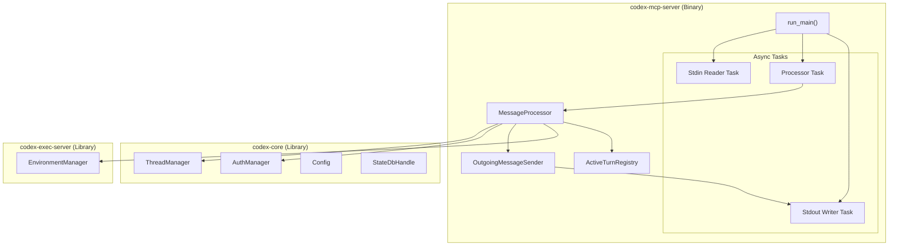
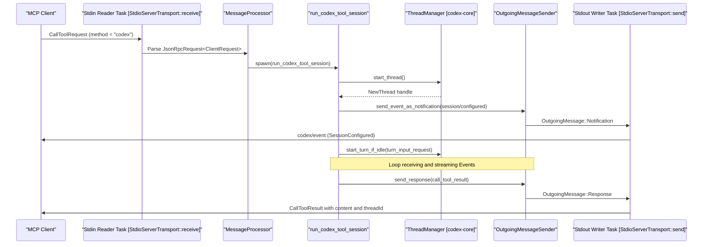

<!-- source: DeepWiki mcp.deepwiki.com · repo openai/codex · page 6.4 MCP Server Implementation (codex-mcp-server) · fetched 2026-10-26 -->

# MCP Server Implementation (codex-mcp-server)

<details>
<summary>Relevant source files</summary>

The following files were used as context for generating this wiki page:

- [codex-rs/app-server-protocol/src/protocol/v2/mcp.rs](codex-rs/app-server-protocol/src/protocol/v2/mcp.rs)
- [codex-rs/app-server/src/request_processors/mcp_processor.rs](codex-rs/app-server/src/request_processors/mcp_processor.rs)
- [codex-rs/codex-api/Cargo.toml](codex-rs/codex-api/Cargo.toml)
- [codex-rs/codex-api/src/files.rs](codex-rs/codex-api/src/files.rs)
- [codex-rs/codex-api/src/files_retry_tests.rs](codex-rs/codex-api/src/files_retry_tests.rs)
- [codex-rs/core/src/mcp_openai_file.rs](codex-rs/core/src/mcp_openai_file.rs)
- [codex-rs/core/tests/common/apps_test_server.rs](codex-rs/core/tests/common/apps_test_server.rs)
- [codex-rs/core/tests/suite/mcp_tool_exposure.rs](codex-rs/core/tests/suite/mcp_tool_exposure.rs)
- [codex-rs/core/tests/suite/openai_file_mcp.rs](codex-rs/core/tests/suite/openai_file_mcp.rs)
- [codex-rs/tui/src/app/background_requests.rs](codex-rs/tui/src/app/background_requests.rs)

</details>


## Purpose and Scope

This document details the internal implementation of the `codex-mcp-server`, which runs Codex as an MCP (Model Context Protocol) server. By functioning as an MCP server, Codex exposes its AI coding capabilities as tools accessible through any MCP-compatible client, such as Claude Desktop or Zed Editor. The MCP server accepts tool calls over stdio JSON-RPC, manages multiple concurrent conversation threads, and streams back rich event notifications and final call results. It is primarily invoked using the `codex mcp-server` subcommand.

This page focuses on the server-side architecture, key classes and functions, data flow for handling tool calls, and session multiplexing. It bridges the MCP protocol space with Codex’s core agent runtime and environment integration.

Sources: [codex-rs/rmcp-client/src/stdio_server_launcher.rs:1-13]()

---

## Overview

The `codex-mcp-server` crate implements a full stdio JSON-RPC server for the Model Context Protocol. Its main responsibilities include:

- **Handling incoming MCP JSON-RPC requests**: decoding JSON messages piped over stdio and dispatching them.
- **Managing Codex agent sessions**: spawning and controlling multiple threads (conversations) with `ThreadManager` from `codex-core`.
- **Exposing the `codex` tool and related variants** as interfaces to start and continue conversations.
- **Streaming event notifications** to the MCP client reflecting conversation progress and tool execution.
- **Integrating environment handling** by interfacing with `EnvironmentManager` to resolve capability roots and sandbox context.

The server runs as a single binary that spins up three main async tasks to handle stdio IO for JSON-RPC:

- **Stdin Reader Task**: Continuously reads line-delimited JSON, deserializes it into requests or responses, and forwards to the processor.
- **Processor Task**: Processes each incoming request through the `MessageProcessor` which manages tool invocation and session state.
- **Stdout Writer Task**: Sends encoded JSON-RPC responses and event notifications back to the MCP client.

All MCP tool calls are processed via the Codex core `ThreadManager`, maintaining isolation and lifecycle per conversation thread.

Sources: [codex-rs/rmcp-client/src/stdio_server_launcher.rs:73-85]()

---

## System Architecture

### Component Diagram (Code Entity Space)

This diagram shows the relation of `codex-mcp-server` components and their interaction with Codex core libraries and environment managers.



Sources: [codex-rs/rmcp-client/src/stdio_server_launcher.rs:73-85](), [codex-rs/rmcp-client/src/bin/test_stdio_server.rs:41-46]()

### Message Flow: Natural Language Space to Code Entity Space

This sequence diagram captures how an MCP client's JSON-RPC tool call flows through `codex-mcp-server` to Codex's core conversation engine, bridging natural language client interactions with specific code entities.



Sources: [codex-rs/rmcp-client/src/stdio_server_launcher.rs:129-137](), [codex-rs/rmcp-client/src/stdio_server_launcher.rs:113-127]()

---

## Tool Definitions

The `codex-mcp-server` exposes Codex capabilities as MCP tools to clients. The primary tools are:

- `codex`: Starts a new conversation or task.
- `codex_reply`: Used for continuing a conversation or interacting with an existing thread.

Both tools accept structured input parameters and return results containing conversation content and the associated thread IDs.

### Tool: `codex`

The tool accepts key properties:

| Field | Type | Description |
|---|---|---|
| `prompt` | string | Initial user prompt to start a conversation. |
| `model` | string | Optional model name override (e.g., `gpt-4o`). |
| `cwd` | string | Working directory context for resolving tool execution and environment. |
| `approval-policy` | string | Shell approval policy (e.g., `on-request`, `never`). |
| `sandbox` | string | Sandbox mode (e.g., `read-only`, `workspace-write`, `danger-full-access`). |
| `config` | map | Key-value overrides applied to `config.toml` settings. |
| `developer-instructions` | string | Optional developer instructions injected as a system message. |

Output:
- Returns an MCP `CallToolResult` including the generated response content and JSON `threadId` for turn tracking.

Sources: [codex-rs/rmcp-client/src/stdio_server_launcher.rs:87-96]()

---

## Message Processing

### MessageProcessor Implementation

The `MessageProcessor` struct is the core request handler in the MCP server:
- Initialized with a `ThreadManager` scoped to `SessionSource::Mcp`.
- Handles all incoming JSON-RPC requests from MCP clients.
- Routes requests by method, including `InitializeRequest`, `ListToolsRequest`, and `CallToolRequest`.

Sources: [codex-rs/rmcp-client/src/bin/test_stdio_server.rs:41-46]()

### Outgoing Message Management

The `OutgoingMessageSender` is responsible for delivering outbound JSON-RPC responses, results, notifications, and requests to the MCP client:
- Runs concurrently, receiving messages from internal channels.
- Serializes messages to JSON lines and writes to stdout.
- Maintains a map from request IDs to callbacks for elicited requests.

Sources: [codex-rs/rmcp-client/src/stdio_server_launcher.rs:113-146]()

---

## Task Orchestration

The server sets up concurrent tasks managing stdio and MCP messaging:
1. **Stdin Reader Task**: Continuously reads lines from standard input, parses to JSON-RPC messages, and passes to the message processor.
2. **Processor Task**: Runs the message processor on inbound messages to handle initialization, requests, and tool calls.
3. **Stdout Writer Task**: Receives queue of outgoing messages to write back to stdout in JSON line format.

Sources: [codex-rs/rmcp-client/src/stdio_server_launcher.rs:113-146]()

---

## Server Launchers

The `rmcp-client` crate provides different mechanisms for launching MCP stdio servers, depending on where the server process should run. This abstraction allows `RmcpClient` to interact with the server via a unified `Transport` interface, regardless of the underlying process management.

### `StdioServerLauncher` Trait

The `StdioServerLauncher` trait defines the contract for starting an MCP stdio server and returning its `Transport`. This trait is the boundary between MCP lifecycle management and process placement.
[codex-rs/rmcp-client/src/stdio_server_launcher.rs:79-85]()

### `LocalStdioServerLauncher`

This launcher starts MCP stdio servers as local child processes. It's the default behavior for local MCP servers, where the orchestrator process directly spawns the configured command and communicates via stdin/stdout pipes.
[codex-rs/rmcp-client/src/stdio_server_launcher.rs:178-182]()

```rust
// Example of LocalStdioServerLauncher usage
let launcher = Arc::new(LocalStdioServerLauncher::new(std::env::current_dir()?));
let client = RmcpClient::new_stdio_client(
    stdio_server_bin()?.into(),
    Vec::<OsString>::new(),
    /*env*/ None,
    &[],
    /*cwd*/ None,
    launcher,
)
.await?;
```
Sources: [codex-rs/rmcp-client/tests/resources.rs:42-50]()

### `ExecutorStdioServerLauncher`

This launcher starts the configured command through the `codex-exec-server` process API. This is used when the MCP server needs to run in a more controlled or sandboxed environment managed by the executor.
[codex-rs/rmcp-client/src/stdio_server_launcher.rs:6-8]()

### `StdioServerCommand`

This struct defines the command-line process shape, including the program, arguments, environment variables, and current working directory, used by both local and executor launchers.
[codex-rs/rmcp-client/src/stdio_server_launcher.rs:88-96]()

### Environment Variable Handling

The `rmcp-client` crate includes utilities for creating the environment for MCP servers:
- `create_env_for_mcp_server`: Prepares environment variables for local stdio servers, including default variables and those specified in the MCP server configuration. It filters out non-inheritable environment variables.
  [codex-rs/rmcp-client/src/utils.rs:16-59]()
- `create_env_overlay_for_remote_mcp_server`: Prepares environment variables for remote MCP servers, forwarding only explicitly named variables from the configuration.
  [codex-rs/rmcp-client/src/utils.rs:61-79]()

### Program Resolution

The `program_resolver` module handles platform-specific program resolution:
- On Unix, it returns the program name unchanged, relying on the OS to handle script execution via shebangs.
  [codex-rs/rmcp-client/src/program_resolver.rs:22-28]()
- On Windows, it uses the `which` crate to resolve the full path, including necessary script extensions (`.cmd`, `.bat`), to ensure correct execution.
  [codex-rs/rmcp-client/src/program_resolver.rs:31-65]()

This ensures that tools like `npx`, `pnpm`, and `yarn` work correctly on Windows without requiring explicit extensions in the configuration.
[codex-rs/rmcp-client/src/program_resolver.rs:31-36]()

---

## Process Management and Cleanup

The `codex-utils-pty` crate provides robust process management capabilities, crucial for the `codex-mcp-server` to reliably launch, monitor, and terminate child processes.

### `Command` and `Child`

- The `Command` struct wraps `tokio::process::Command` and adds features like `ProcessMode` (e.g., `NewGroup`, `NewSession`) for Unix-specific process group management.
  [codex-rs/utils/pty/src/child_command.rs:73-92]()
- The `Child` struct represents a local subprocess with owned stdio handles and cancellation-safe exit handling.
  [codex-rs/utils/pty/src/child.rs:23-27]()

### Process Group Cleanup

- When an `RmcpClient` is dropped, it ensures that the associated MCP server process and its entire process group are terminated. This prevents orphaned processes.
  [codex-rs/rmcp-client/tests/process_group_cleanup.rs:113-116]()
- Tests confirm that dropping the client kills the wrapper process group, including any grandchildren processes.
  [codex-rs/rmcp-client/tests/process_group_cleanup.rs:84-116]()
- The `shutdown` method on `RmcpClient` explicitly terminates the server, even if it's in the middle of a long-running operation.
  [codex-rs/rmcp-client/tests/process_group_cleanup.rs:175-176]()

### Descriptor Policy

- `DescriptorPolicy` controls whether Unix children inherit ambient descriptors or only explicit stdio and preserved file descriptors. `Explicit` policy helps in sandboxing.
  [codex-rs/utils/pty/src/child_command.rs:41-46]()
- Tests verify that descriptor inheritance matches the configured policy.
  [codex-rs/utils/pty/src/macos_child_tests.rs:167-186]()

### Child Drop Policy

- `ChildDropPolicy` determines the cleanup behavior when a child handle is dropped before its exit is collected. `KillAndReap` is the default, ensuring the child is killed and reaped. `ReapOnly` allows the child to continue running until it exits naturally.
  [codex-rs/utils/pty/src/child_command.rs:56-60]()
- Tests demonstrate that non-killing drops still reap children after the Tokio runtime shuts down.
  [codex-rs/utils/pty/src/child_tests.rs:71-134]()

---

## Testing

Integration testing harnesses utilize stdio pipes and test servers (`test_stdio_server.rs`, `test_streamable_http_server.rs`) to validate initialization handshakes, tool discovery, and full bidirectional communication.

Sources: [codex-rs/rmcp-client/src/bin/test_stdio_server.rs:1-67](), [codex-rs/rmcp-client/src/bin/test_streamable_http_server.rs:1-55]()

---

## Summary and Key Classes/Functions

| Component | Description | Location |
|---|---|---|
| `StdioServerLauncher` | Trait for launching MCP stdio servers and returning rmcp transport. | [codex-rs/rmcp-client/src/stdio_server_launcher.rs:79-85]() |
| `LocalStdioServerLauncher` | Launches MCP stdio servers as local child processes. | [codex-rs/rmcp-client/src/stdio_server_launcher.rs:178-182]() |
| `ExecutorStdioServerLauncher` | Launches MCP stdio servers via the `codex-exec-server` API. | [codex-rs/rmcp-client/src/stdio_server_launcher.rs:6-8]() |
| `StdioServerCommand` | Command-line process configuration shared by stdio launchers. | [codex-rs/rmcp-client/src/stdio_server_launcher.rs:88-96]() |
| `StdioServerTransport` | rmcp transport wrapper over child stdin/stdout streams. | [codex-rs/rmcp-client/src/stdio_server_launcher.rs:98-111]() |
| `program_resolver::resolve` | Platform-specific logic for resolving executable paths. | [codex-rs/rmcp-client/src/program_resolver.rs:22-65]() |
| `create_env_for_mcp_server` | Creates environment variables for local MCP servers. | [codex-rs/rmcp-client/src/utils.rs:16-59]() |
| `Command` (pty) | Configures and spawns local child processes with advanced options. | [codex-rs/utils/pty/src/child_command.rs:73-92]() |
| `Child` (pty) | Represents a spawned child process, managing its lifecycle and I/O. | [codex-rs/utils/pty/src/child.rs:23-27]() |
| `TestToolServer` | A test MCP server implementation for stdio and HTTP. | [codex-rs/rmcp-client/src/bin/test_stdio_server.rs:41-46](), [codex-rs/rmcp-client/src/bin/test_streamable_http_server.rs:57-61]() |

---

