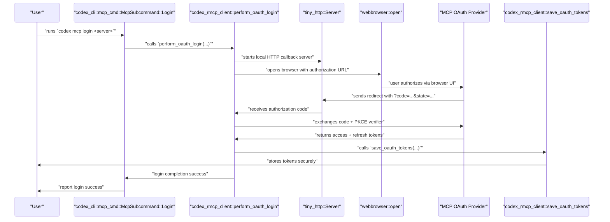
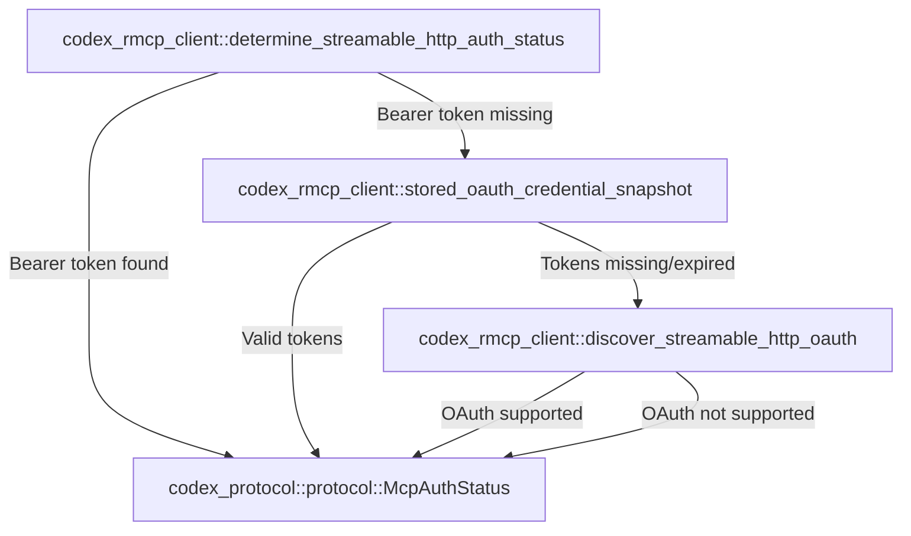
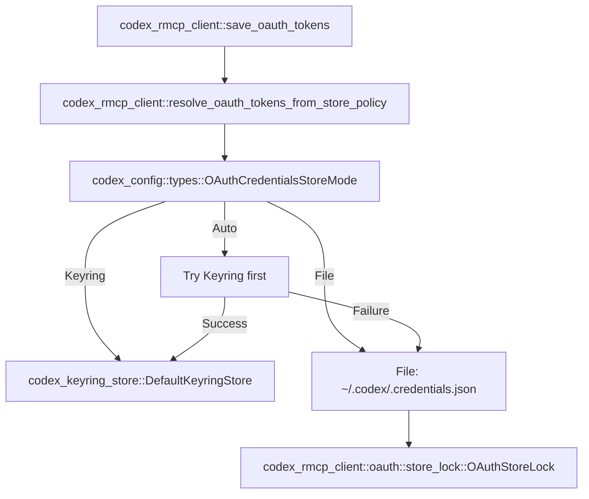
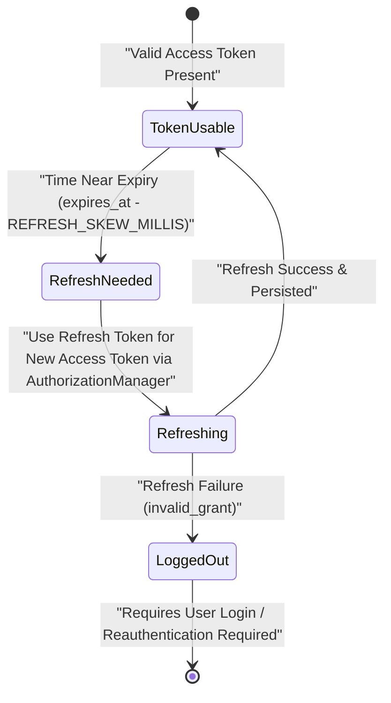

<!-- source: DeepWiki mcp.deepwiki.com · repo openai/codex · page 6.5 OAuth Authentication for MCP · fetched 2026-10-26 -->

# OAuth Authentication for MCP

<details>
<summary>Relevant source files</summary>

The following files were used as context for generating this wiki page:

- [codex-rs/core/tests/suite/mcp_oauth_refresh_tests.rs](codex-rs/core/tests/suite/mcp_oauth_refresh_tests.rs)
- [codex-rs/rmcp-client/Cargo.toml](codex-rs/rmcp-client/Cargo.toml)
- [codex-rs/rmcp-client/src/oauth.rs](codex-rs/rmcp-client/src/oauth.rs)
- [codex-rs/rmcp-client/src/oauth/credential_store.rs](codex-rs/rmcp-client/src/oauth/credential_store.rs)
- [codex-rs/rmcp-client/src/oauth/refresh_transaction.rs](codex-rs/rmcp-client/src/oauth/refresh_transaction.rs)
- [codex-rs/rmcp-client/src/oauth/resolved_store.rs](codex-rs/rmcp-client/src/oauth/resolved_store.rs)
- [codex-rs/rmcp-client/src/oauth/store_lock.rs](codex-rs/rmcp-client/src/oauth/store_lock.rs)
- [codex-rs/rmcp-client/src/oauth/test_support.rs](codex-rs/rmcp-client/src/oauth/test_support.rs)
- [codex-rs/rmcp-client/src/oauth/tests/credential_store_tests.rs](codex-rs/rmcp-client/src/oauth/tests/credential_store_tests.rs)
- [codex-rs/rmcp-client/src/oauth/tests/persistor_tests.rs](codex-rs/rmcp-client/src/oauth/tests/persistor_tests.rs)
- [codex-rs/rmcp-client/src/oauth/tests/store_lock_tests.rs](codex-rs/rmcp-client/src/oauth/tests/store_lock_tests.rs)
- [codex-rs/rmcp-client/src/streamable_http_retry.rs](codex-rs/rmcp-client/src/streamable_http_retry.rs)
- [codex-rs/rmcp-client/tests/streamable_http_oauth_store_pinning.rs](codex-rs/rmcp-client/tests/streamable_http_oauth_store_pinning.rs)
- [codex-rs/rmcp-client/tests/streamable_http_oauth_tool_call.rs](codex-rs/rmcp-client/tests/streamable_http_oauth_tool_call.rs)
- [codex-rs/rmcp-client/tests/streamable_http_test_support.rs](codex-rs/rmcp-client/tests/streamable_http_test_support.rs)

</details>


OAuth 2.0 authentication for Model Context Protocol (MCP) servers is implemented primarily for those utilizing the `StreamableHttp` transport `[codex-rs/rmcp-client/src/rmcp_client.rs:120-130]()`. Servers using `stdio` transport do not have built-in OAuth support in Codex. The system manages OAuth flows compliant with the authorization code grant with PKCE and securely stores credentials using platform-native keyrings or local file/secrets aggregate storage with cross-process locking `[codex-rs/rmcp-client/src/oauth.rs:1-18]()`.

Key aspects of the implementation include:
- A browser-based OAuth login flow with a local HTTP callback server using `tiny_http` `[codex-rs/login/src/server.rs:68-71]()`.
- Secure credential storage leveraging the `keyring` crate via `codex-keyring-store`, with file-based and encrypted secrets fallback `[codex-rs/rmcp-client/src/oauth.rs:1-18]()`.
- Discovery of OAuth provider metadata at runtime via `.well-known` endpoints `[codex-rs/rmcp-client/src/auth_status.rs:38-43]()`.
- Automatic token refresh and management inside the MCP client transport stack using `OAuthCredentialStore` and `OAuthPersistor` `[codex-rs/rmcp-client/src/oauth/credential_store.rs:1-18]()`.

Sources: `[codex-rs/rmcp-client/src/perform_oauth_login.rs:1-202]()`, `[codex-rs/rmcp-client/src/oauth.rs:1-1880]()`, `[codex-rs/rmcp-client/src/auth_status.rs:1-203]`, `[codex-rs/rmcp-client/src/rmcp_client.rs:110-130]()`, `[codex-rs/cli/src/mcp_cmd.rs:24-60]()`, `[codex-rs/login/src/server.rs:68-71]()`

---

## OAuth Flow for StreamableHttp Servers

The OAuth login process is triggered by user commands such as `codex mcp login <server>` `[codex-rs/cli/src/mcp_cmd.rs:59-60]()`. Internally, this invokes the `perform_oauth_login` async function which manages the overall flow `[codex-rs/rmcp-client/src/perform_oauth_login.rs:110-145]()`:

1. Perform OAuth client registration if needed (`AUTO`, `CIMD`, or `DCR` strategies) `[codex-rs/rmcp-client/src/perform_oauth_login.rs:40-43]()`.
2. Launch a local HTTP server (`tiny_http::Server`) to receive the OAuth redirect/callback `[codex-rs/rmcp-client/src/perform_oauth_login.rs:19-20]()`.
3. Open the user’s default browser to the authorization URL `[codex-rs/rmcp-client/src/perform_oauth_login.rs:201-202]()`.
4. Await the callback with authorization code and state `[codex-rs/rmcp-client/src/perform_oauth_login.rs:110-145]()`.
5. Exchange authorization code and PKCE verifier for access and refresh tokens `[codex-rs/login/src/oauth.rs:63-67]()`.
6. Persist the tokens securely in the configured store via `save_oauth_tokens` `[codex-rs/rmcp-client/src/perform_oauth_login.rs:47]()`.
7. Return success or error status `[codex-rs/rmcp-client/src/perform_oauth_login.rs:110-145]()`.

### Sequence Diagram: OAuth Authorization Flow (Code Entity Space)



Sources: `[codex-rs/rmcp-client/src/perform_oauth_login.rs:50-180]()`, `[codex-rs/rmcp-client/src/oauth.rs:90-110]()`, `[codex-rs/cli/src/mcp_cmd.rs:76-77]()`, `[codex-rs/login/src/oauth.rs:63-67]()`

---

## OAuth Support Discovery and Status

Before login, Codex performs runtime detection to determine if the server supports OAuth `[codex-rs/rmcp-client/src/auth_status.rs:36-43]()`. It does so by:

- Checking whether static bearer tokens are configured via environment or headers `[codex-rs/rmcp-client/src/auth_status.rs:40]()`.
- Checking stored OAuth credentials for validity and refresh status `[codex-rs/rmcp-client/src/auth_status.rs:41]()`.
- Querying `.well-known/oauth-authorization-server/mcp` metadata from the server to verify OAuth support `[codex-rs/rmcp-client/src/auth_status.rs:39]()`.

The main function `determine_streamable_http_auth_status` encapsulates this logic and returns an enum describing the auth state `[codex-rs/rmcp-client/src/auth_status.rs:40-41]`.

| Status       | Meaning                                                                                                 |
|--------------|---------------------------------------------------------------------------------------------------------|
| `BearerToken`| Static bearer token present in config or env (`Authorization` header).                                 |
| `OAuth`      | Valid OAuth refreshable tokens found in secure storage.                                                |
| `LoggedOut`  | Server supports OAuth but no tokens or requires reauthentication.                                     |
| `Unsupported`| OAuth not supported or discovery failed.                                                               |

### OAuth Status Determination Flow (Code Entities)



Sources: `[codex-rs/rmcp-client/src/auth_status.rs:36-43]()`, `[codex-rs/rmcp-client/src/auth_status.rs:180-200]()`

---

## OAuth Callback Server Details

The local callback server used during login runs on `localhost` at a dynamically selected or user-specified port `[codex-rs/login/src/server.rs:182-183]()`. It uses the `tiny_http` crate `[codex-rs/login/Cargo.toml:33]()`. Its primary responsibility is to serve the redirect request containing the OAuth authorization code.

- The server serves a simple confirmation page indicating login completion `[codex-rs/login/src/success_page.rs:1-10]()`.
- The `ShutdownHandle` struct ensures proper shutdown of the server after the flow `[codex-rs/login/src/server.rs:165-175]()`.
- The server only processes one authorization response, after which it is shut down.

Sources: `[codex-rs/login/src/server.rs:165-175]()`, `[codex-rs/login/Cargo.toml:33]`, `[codex-rs/login/src/success_page.rs:1-10]()`

---

## Credential Storage and Synchronization

### Storage Modes and Backend Architecture

Codex supports three OAuth credential storage modes via the `OAuthCredentialsStoreMode` enum `[codex-rs/rmcp-client/src/oauth.rs:38]()`:

| Mode    | Description                                                                                                      |
|---------|-----------------------------------------------------------------------------------------------------------------|
| `Keyring` | Uses OS-native credential stores (macOS Keychain, Windows Credential Manager, Linux Secret Service)       |
| `File`    | Stores credentials in a JSON file under `~/.codex/.credentials.json`                                          |
| `Auto`    | Attempts to use Keyring and falls back to File storage if unavailable                                         |

The secure storage implementation utilizes the `keyring` crate wrapped by `codex-keyring-store` for asynchronous persistent access `[codex-rs/rmcp-client/src/oauth.rs:1-18]()`. On Linux, this uses a combination of system keyutils and DBus secret service (`linux-native-async-persistent`) for reliability `[codex-rs/rmcp-client/src/oauth.rs:9-16]()`.

### Cross-Process Lock Coordination (`OAuthStoreLock`)

Because file-based and encrypted secrets stores keep multiple credentials in a single aggregate document, `OAuthStoreLock` provides cross-process serialization (`file-store.lock` and `secrets-store.lock`) across read-modify-write operations `[codex-rs/rmcp-client/src/oauth/store_lock.rs:1-47]()`. Writers acquire an exclusive lock, while readers acquire shared locks with timeouts (`STORE_LOCK_ACQUIRE_TIMEOUT`) to prevent race conditions during concurrent MCP startup and status checks `[codex-rs/rmcp-client/src/oauth/store_lock.rs:50-80]()`.

### Credential Persistence Logic (Code Entity Space)



Sources: `[codex-rs/rmcp-client/src/oauth.rs:1-124]()`, `[codex-rs/rmcp-client/src/oauth/resolved_store.rs:80-110]()`, `[codex-rs/rmcp-client/src/oauth/store_lock.rs:1-75]()`

### Stored Data Model

Credentials are encapsulated in the `StoredOAuthTokens` struct `[codex-rs/rmcp-client/src/oauth.rs:105-114]()`:

```rust
pub struct StoredOAuthTokens {
    pub server_name: String,                  // config server identifier
    pub url: String,                          // MCP server URL
    pub issuer: Option<String>,               // Optional token issuer claim
    pub client_id: String,                    // OAuth client ID used
    pub token_response: WrappedOAuthTokenResponse, // actual OAuth tokens and metadata
    pub expires_at: Option<u64>,              // Timestamp (ms since epoch) when access token expires
}
```

- `WrappedOAuthTokenResponse` wraps `rmcp` crate’s `OAuthTokenResponse` providing serialization and comparison `[codex-rs/rmcp-client/src/oauth.rs:67]()`.
- `expires_at` is used for token refresh scheduling `[codex-rs/rmcp-client/src/oauth.rs:113]()`.
- Tokens are keyed inside the store by `server_name` and `url` combination to prevent collisions.

Sources: `[codex-rs/rmcp-client/src/oauth.rs:105-140]()`

---

## Login and Logout Command Implementation

Within the `codex` CLI, the `mcp login` and `mcp logout` commands manage OAuth credentials for MCP servers `[codex-rs/cli/src/mcp_cmd.rs:59-60]()`:

- `mcp login <name>` triggers `perform_oauth_login` with parameters read from the `mcp_servers` config `[codex-rs/cli/src/mcp_cmd.rs:26-32]()`.
- Supports options such as `--no-browser` to print auth URL without launching a browser `[codex-rs/cli/src/mcp_cmd.rs:214-216]()`.
- `mcp logout <name>` removes stored OAuth tokens by calling `delete_oauth_tokens` `[codex-rs/cli/src/mcp_cmd.rs:39]()`.

### Command Structure and Options

| Subcommand      | Key Implementation Struct  | Notable Args                                               |
|-----------------|----------------------------|------------------------------------------------------------|
| `login`         | `LoginArgs`                | `--no-browser`, `--scopes`, `--oauth-client-registration`   |
| `logout`        | `LogoutArgs`               | server name                                                |
| `list` / `get`  | `ListArgs`, `GetArgs`      | `--json` output                                            |
| `add` / `remove`| `AddArgs`, `RemoveArgs`    | configure server transport, OAuth client params           |

Sources: `[codex-rs/cli/src/mcp_cmd.rs:45-217]()`

---

## Token Management, Refresh Coordination, and Retry

The MCP client (`RmcpClient`) and `OAuthCredentialStore` integrate OAuth token handling at the transport layer `[codex-rs/rmcp-client/src/rmcp_client.rs:120-130]()`:

- Uses an `AuthClient` adapter wrapping the HTTP client to inject `Authorization: Bearer <token>` headers automatically `[codex-rs/rmcp-client/src/rmcp_client.rs:124]()`.
- Refresh tokens are used to transparently obtain new access tokens before expiration via `OAuthCredentialStore::refresh_if_needed` or `OAuthPersistor::refresh_if_needed` `[codex-rs/rmcp-client/src/oauth/credential_store.rs:96-131]()`, `[codex-rs/rmcp-client/src/oauth/refresh_transaction.rs:39-42]()`.
- The `expires_at` timestamp and a safety skew of 30 seconds (`REFRESH_SKEW_MILLIS`) govern when refresh is triggered `[codex-rs/rmcp-client/src/oauth.rs:102]()`.
- Streamable HTTP connections use exponential backoff retries (`STREAMABLE_HTTP_RETRY_DELAYS_MS`) during initialization and authentication challenges `[codex-rs/rmcp-client/src/streamable_http_retry.rs:24-41]()`.

### Token Lifecycle and Refresh Flow



Sources: `[codex-rs/rmcp-client/src/rmcp_client.rs:110-130]()`, `[codex-rs/rmcp-client/src/oauth.rs:102-140]()`, `[codex-rs/rmcp-client/src/oauth/credential_store.rs:96-131]()`, `[codex-rs/rmcp-client/src/streamable_http_retry.rs:24-100]()`

---

## Summary of Key Code Entities Mapping Natural Language Terms to Code

```mermaid
graph TD
    UserCommand["User CLI command: codex mcp login"] --> McpCmdLogin["codex_cli::mcp_cmd::LoginArgs"]
    McpCmdLogin --> PerformOAuth["codex_rmcp_client::perform_oauth_login"]
    PerformOAuth --> CallbackServer["tiny_http::Server instance"]
    PerformOAuth --> OAuthServer["MCP OAuth Provider"]
    PerformOAuth --> SaveTokens["codex_rmcp_client::save_oauth_tokens"]

    TokenStorage["OAuth Credentials Storage"] --> KeyringStore["codex_keyring_store::DefaultKeyringStore"]
    TokenStorage --> FileStore["File Storage: ~/.codex/.credentials.json"]
    TokenStorage --> StoreLock["codex_rmcp_client::oauth::store_lock::OAuthStoreLock"]

    RmcpClientTransport["codex_rmcp_client::RmcpClient HTTP transport"]
    RmcpClientTransport --> AuthClient["rmcp::transport::auth::AuthClient"]
    AuthClient --> TokenRefresh["codex_rmcp_client::oauth::credential_store::OAuthCredentialStore"]

    McpCmdLogin --> DiscoverOAuth["codex_rmcp_client::determine_streamable_http_auth_status"]
    DiscoverOAuth --> OAuthMetadata["OAuth endpoint discovery (.well-known)"]

    McpCmdLogout["codex_cli::mcp_cmd::LogoutArgs"] --> DeleteTokens["codex_rmcp_client::delete_oauth_tokens"]

    subgraph CLI Layer
        UserCommand
        McpCmdLogin
        McpCmdLogout
    end

    subgraph RMCP Client Layer
        PerformOAuth
        CallbackServer
        AuthClient
        RmcpClientTransport
        DiscoverOAuth
        SaveTokens
        DeleteTokens
        TokenRefresh
    end

    subgraph Credential Storage
        KeyringStore
        FileStore
        StoreLock
    end
```



Sources: `[codex-rs/cli/src/mcp_cmd.rs:1-217]()`, `[codex-rs/rmcp-client/src/perform_oauth_login.rs:1-202]()`, `[codex-rs/rmcp-client/src/oauth.rs:1-1880]()`, `[codex-rs/rmcp-client/src/auth_status.rs:1-203]()`, `[codex-rs/rmcp-client/src/oauth/credential_store.rs:1-167]()`, `[codex-rs/rmcp-client/src/oauth/store_lock.rs:1-160]()`

---

# References

- `perform_oauth_login` for full login flow: `[codex-rs/rmcp-client/src/perform_oauth_login.rs:110-145]()`
- Credential storage and token structs: `[codex-rs/rmcp-client/src/oauth.rs:105-140]()`
- OAuth auth status computation and discovery: `[codex-rs/rmcp-client/src/auth_status.rs:80-180]()`
- MCP CLI commands for login/logout: `[codex-rs/cli/src/mcp_cmd.rs:24-217]()`
- Token attach and refresh in `RmcpClient`: `[codex-rs/rmcp-client/src/rmcp_client.rs:110-130]()`
- Aggregate store lock serialization: `[codex-rs/rmcp-client/src/oauth/store_lock.rs:50-160]()`

---

