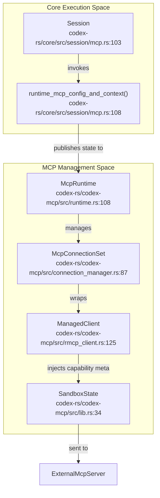
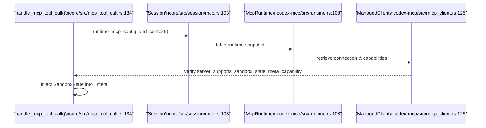
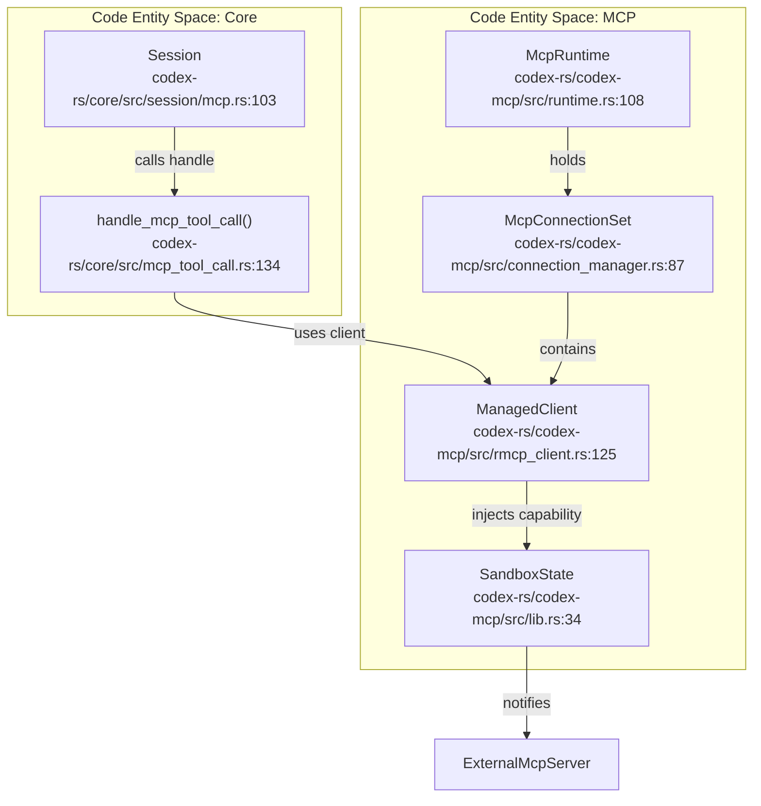

<!-- source: DeepWiki mcp.deepwiki.com · repo openai/codex · page 6.6 Sandbox State Synchronization · fetched 2026-10-26 -->

# Sandbox State Synchronization

Relevant source files

The following files were used as context for generating this wiki page:

- [codex-rs/README.md](codex-rs/README.md)
- [codex-rs/app-server/tests/suite/v2/executor_mcp.rs](codex-rs/app-server/tests/suite/v2/executor_mcp.rs)
- [codex-rs/cli/src/debug_sandbox.rs](codex-rs/cli/src/debug_sandbox.rs)
- [codex-rs/cli/src/lib.rs](codex-rs/cli/src/lib.rs)
- [codex-rs/codex-mcp/README.md](codex-rs/codex-mcp/README.md)
- [codex-rs/codex-mcp/src/binding.rs](codex-rs/codex-mcp/src/binding.rs)
- [codex-rs/codex-mcp/src/binding_tests.rs](codex-rs/codex-mcp/src/binding_tests.rs)
- [codex-rs/codex-mcp/src/client_tool_catalog.rs](codex-rs/codex-mcp/src/client_tool_catalog.rs)
- [codex-rs/codex-mcp/src/connection_manager.rs](codex-rs/codex-mcp/src/connection_manager.rs)
- [codex-rs/codex-mcp/src/connection_manager/tool_catalog.rs](codex-rs/codex-mcp/src/connection_manager/tool_catalog.rs)
- [codex-rs/codex-mcp/src/connection_manager_tests.rs](codex-rs/codex-mcp/src/connection_manager_tests.rs)
- [codex-rs/codex-mcp/src/lib.rs](codex-rs/codex-mcp/src/lib.rs)
- [codex-rs/codex-mcp/src/mcp/mod.rs](codex-rs/codex-mcp/src/mcp/mod.rs)
- [codex-rs/codex-mcp/src/mcp/mod_tests.rs](codex-rs/codex-mcp/src/mcp/mod_tests.rs)
- [codex-rs/codex-mcp/src/rmcp_client.rs](codex-rs/codex-mcp/src/rmcp_client.rs)
- [codex-rs/codex-mcp/src/runtime.rs](codex-rs/codex-mcp/src/runtime.rs)
- [codex-rs/codex-mcp/src/sandbox_metadata.rs](codex-rs/codex-mcp/src/sandbox_metadata.rs)
- [codex-rs/codex-mcp/src/sandbox_metadata_tests.rs](codex-rs/codex-mcp/src/sandbox_metadata_tests.rs)
- [codex-rs/codex-mcp/src/tool_catalog_cache.rs](codex-rs/codex-mcp/src/tool_catalog_cache.rs)
- [codex-rs/core/src/connectors.rs](codex-rs/core/src/connectors.rs)
- [codex-rs/core/src/connectors_tests.rs](codex-rs/core/src/connectors_tests.rs)
- [codex-rs/core/src/hook_mcp_executor.rs](codex-rs/core/src/hook_mcp_executor.rs)
- [codex-rs/core/src/mcp_tool_call.rs](codex-rs/core/src/mcp_tool_call.rs)
- [codex-rs/core/src/mcp_tool_call_tests.rs](codex-rs/core/src/mcp_tool_call_tests.rs)
- [codex-rs/core/src/plugins/discoverable.rs](codex-rs/core/src/plugins/discoverable.rs)
- [codex-rs/core/src/plugins/discoverable_tests.rs](codex-rs/core/src/plugins/discoverable_tests.rs)
- [codex-rs/core/src/session/mcp.rs](codex-rs/core/src/session/mcp.rs)
- [codex-rs/core/src/session/mcp_runtime.rs](codex-rs/core/src/session/mcp_runtime.rs)
- [codex-rs/core/tests/suite/hooks_mcp.rs](codex-rs/core/tests/suite/hooks_mcp.rs)
- [codex-rs/core/tests/suite/mcp_sandbox_tests.rs](codex-rs/core/tests/suite/mcp_sandbox_tests.rs)
- [codex-rs/core/tests/suite/mcp_tool_cache.rs](codex-rs/core/tests/suite/mcp_tool_cache.rs)
- [codex-rs/core/tests/suite/mcp_turn_metadata.rs](codex-rs/core/tests/suite/mcp_turn_metadata.rs)
- [docs/config.md](docs/config.md)
- [docs/example-config.md](docs/example-config.md)
- [docs/skills.md](docs/skills.md)
- [docs/slash_commands.md](docs/slash_commands.md)

## Purpose and Scope

This document describes how Codex synchronizes sandbox execution state with Model Context Protocol (MCP) servers through custom MCP capabilities (`codex/sandbox-state-meta`) [codex-rs/codex-mcp/src/lib.rs:32-33](). When Codex enforces sandbox restrictions (such as read-only access, workspace boundaries, or specific sandboxing mechanisms), external MCP servers need awareness of these constraints to adapt their tool behavior accordingly.

This page details the `codex/sandbox-state/update` notifications, capability discovery via `codex-rs/codex-mcp/src/rmcp_client.rs` [codex-rs/codex-mcp/src/rmcp_client.rs:125-134](), permission checking based on sandbox state, and how sandbox state propagates from the core agent to MCP servers. It explains the involved runtime data structures (`SandboxState`, `McpConfig`), system architecture, data flows, and highlights key implementation points in the Codex codebase.

Sources: [codex-rs/codex-mcp/src/mcp/mod.rs:91-110](), [codex-rs/codex-mcp/src/lib.rs:30-38](), [codex-rs/codex-mcp/src/rmcp_client.rs:125-134]()

---

## Overview

Sandbox state synchronization is an extension built on MCP that enables external servers to receive notifications reflecting the active execution sandbox environment in Codex. This integration offers several benefits:

- Servers learn the current sandbox policy applied, such as restricted or unrestricted enforcement.
- The working directory used for sandboxed tool invocations is communicated.
- Platform or environment-specific sandbox executor paths (e.g., helper binaries) are provided.
- Server-side tooling can align tool permissions, invocation logic, and approvals with Codex's sandbox enforcement.

The key mechanism involves the Codex runtime publishing a `SandboxState` struct (`codex-rs/codex-mcp/src/lib.rs`) [codex-rs/codex-mcp/src/lib.rs:34-34]() to MCP tooling, enabled when the server declares support for the `codex/sandbox-state-meta` capability (`codex-rs/codex-mcp/src/rmcp_client.rs`) [codex-rs/codex-mcp/src/rmcp_client.rs:128-132](). This state is injected into each MCP tool invocation under tool-call metadata (`_meta`).

Sources: [codex-rs/codex-mcp/src/rmcp_client.rs:125-134](), [codex-rs/codex-mcp/src/lib.rs:30-38]()

---

## System Architecture

The sandbox state synchronization system spans the core Codex session state to the MCP client toolkit and server connections:

- The core session (`Session` in `codex-rs/core/src/session/mcp.rs`) [codex-rs/core/src/session/mcp.rs:103-153]() aggregates configuration, permission, environment, and workspace context into a desired MCP runtime state.
- The MCP runtime (`McpRuntime` in `codex-rs/codex-mcp/src/runtime.rs`) [codex-rs/codex-mcp/src/runtime.rs:108-115]() maintains an atomic published snapshot representing current client connections and tooling.
- The MCP connection set (`McpConnectionSet` in `codex-rs/codex-mcp/src/connection_manager.rs`) [codex-rs/codex-mcp/src/connection_manager.rs:87-94]() tracks active server connections and metadata.
- MCP clients (`RmcpClient` wrappers) inject sandbox state metadata into tool call requests.

### Sandbox State Propagation Flow (Natural Language to Code Entity Space)

Sources: [codex-rs/core/src/session/mcp.rs:103-153](), [codex-rs/codex-mcp/src/connection_manager.rs:87-94](), [codex-rs/codex-mcp/src/runtime.rs:108-115](), [codex-rs/codex-mcp/src/lib.rs:30-38](), [codex-rs/codex-mcp/src/rmcp_client.rs:125-134]()

---

## SandboxState and Configuration

### SandboxState Structure

`SandboxState` is a data structure defined in the Codex MCP library (`codex-rs/codex-mcp/src/lib.rs`) [codex-rs/codex-mcp/src/lib.rs:34-34]() capturing the active sandbox and environment constraints relevant for MCP tool execution. It is attached to tool calls and communicated to servers.

Key fields typically include:
- Policy name (e.g., restricted vs unrestricted enforcement).
- Current working directory path in effect.
- Optional paths to Linux sandbox helper executables.

Sources: [codex-rs/codex-mcp/src/lib.rs:30-38]()

### McpConfig and Approval Policy

`McpConfig` (`codex-rs/codex-mcp/src/mcp/mod.rs`) [codex-rs/codex-mcp/src/mcp/mod.rs:124-166]() encapsulates the thread-level parameters used to instantiate MCP runtime state including sandbox behavior and user approval policies.

| Field | Location | Description |
|-------|----------|-------------|
| `approval_policy` | [codex-rs/codex-mcp/src/mcp/mod.rs:156]() | Controls whether user approval is required for MCP tool calls. |
| `codex_linux_sandbox_exe` | [codex-rs/codex-mcp/src/mcp/mod.rs:110]() | Optional path to the helper binary for Linux sandboxing. |
| `permission_profile` | [codex-rs/codex-mcp/src/mcp/mod.rs:158]() | Captured permission profile with connections and approval policy. |

Sources: [codex-rs/codex-mcp/src/mcp/mod.rs:124-166]()

### Auto-Approval Logic

Sandbox state influences approval decision logic for MCP tool calls. The function `mcp_permission_prompt_is_auto_approved` (`codex-rs/codex-mcp/src/mcp/mod.rs`) [codex-rs/codex-mcp/src/mcp/mod.rs:91-110]() determines if MCP permission prompts should be automatically approved based on tool approval modes, the `AskForApproval` policy, and sandbox disk write access.

Sources: [codex-rs/codex-mcp/src/mcp/mod.rs:91-110]()

---

## Tool Execution and State Ingestion

When Codex prepares to execute an MCP tool call (`handle_mcp_tool_call` in `codex-rs/core/src/mcp_tool_call.rs`) [codex-rs/core/src/mcp_tool_call.rs:134-148](), it resolves the active step context, connects to the appropriate server via the connection manager, and injects the `SandboxState` metadata if the server supports the `codex/sandbox-state-meta` capability.

### MCP Tool Call Preparation Flow

Sources: [codex-rs/core/src/mcp_tool_call.rs:134-148](), [codex-rs/core/src/session/mcp.rs:103-153](), [codex-rs/codex-mcp/src/runtime.rs:108-115](), [codex-rs/codex-mcp/src/rmcp_client.rs:125-134]()

---

## Capability Negotiation and Dynamic Updates

### Capability Declaration and Server Support

MCP servers advertise support for sandbox state synchronization during the MCP `initialize` handshake by including `codex/sandbox-state-meta` (`MCP_SANDBOX_STATE_META_CAPABILITY` in `codex-rs/codex-mcp/src/lib.rs`) [codex-rs/codex-mcp/src/lib.rs:33-33]() in advertised server capabilities.

The Codex RMCP client (`ManagedClient`) records support in `server_supports_sandbox_state_meta_capability` (`codex-rs/codex-mcp/src/rmcp_client.rs`) [codex-rs/codex-mcp/src/rmcp_client.rs:132-132]().

Sources: [codex-rs/codex-mcp/src/lib.rs:30-38](), [codex-rs/codex-mcp/src/rmcp_client.rs:125-134]()

### Dynamic Runtime Updates

The MCP runtime (`McpRuntime` in `codex-rs/codex-mcp/src/runtime.rs`) [codex-rs/codex-mcp/src/runtime.rs:108-115]() tracks session state changes to trigger connection and propagated state refreshes. When policies change, new snapshots are published atomically.

Sources: [codex-rs/core/src/session/mcp.rs:103-153](), [codex-rs/codex-mcp/src/runtime.rs:108-115]()

---

## Implementation Reference

| Entity | Location | Role and Description |
|--------|----------|----------------------|
| `Session` | [codex-rs/core/src/session/mcp.rs:103-153]() | Core agent context that tracks sandboxing-related state and runtime configuration. |
| `McpRuntime` | [codex-rs/codex-mcp/src/runtime.rs:108-115]() | Thread-owned MCP runtime managing published MCP state snapshots and connections. |
| `McpConnectionSet` | [codex-rs/codex-mcp/src/connection_manager.rs:87-94]() | Aggregates active MCP server connections, manages startup events, and tool filtering. |
| `ManagedClient` | [codex-rs/codex-mcp/src/rmcp_client.rs:125-134]() | Handles MCP server client lifecycle, tracking declared capabilities including sandbox-state-meta. |
| `SandboxState` | [codex-rs/codex-mcp/src/lib.rs:34-34]() | State snapshot sent to MCP servers in tool call metadata for sandbox synchronization. |
| `handle_mcp_tool_call` | [codex-rs/core/src/mcp_tool_call.rs:134-148]() | Dispatches MCP tool calls, injects SandboxState into `_meta` based on server capability. |

Sources: [codex-rs/core/src/session/mcp.rs:103-153](), [codex-rs/codex-mcp/src/runtime.rs:108-115](), [codex-rs/codex-mcp/src/connection_manager.rs:87-94](), [codex-rs/codex-mcp/src/rmcp_client.rs:125-134](), [codex-rs/codex-mcp/src/lib.rs:30-38](), [codex-rs/core/src/mcp_tool_call.rs:134-148]()

---

## Summary

Sandbox state synchronization in Codex extends the MCP protocol with the `codex/sandbox-state-meta` capability to share active sandboxing constraints with external MCP servers. The core agent packages sandbox context into a `SandboxState` struct that propagates through the MCP runtime, connection manager, and client wrappers to be injected into all relevant MCP tool calls.

---

# Appendix: Cross-Codebase Mapping of Sandbox State Synchronization

Sources: [codex-rs/core/src/session/mcp.rs:103-153](), [codex-rs/core/src/mcp_tool_call.rs:134-148](), [codex-rs/codex-mcp/src/runtime.rs:108-115](), [codex-rs/codex-mcp/src/connection_manager.rs:87-94](), [codex-rs/codex-mcp/src/rmcp_client.rs:125-134](), [codex-rs/codex-mcp/src/lib.rs:30-38]()

---

