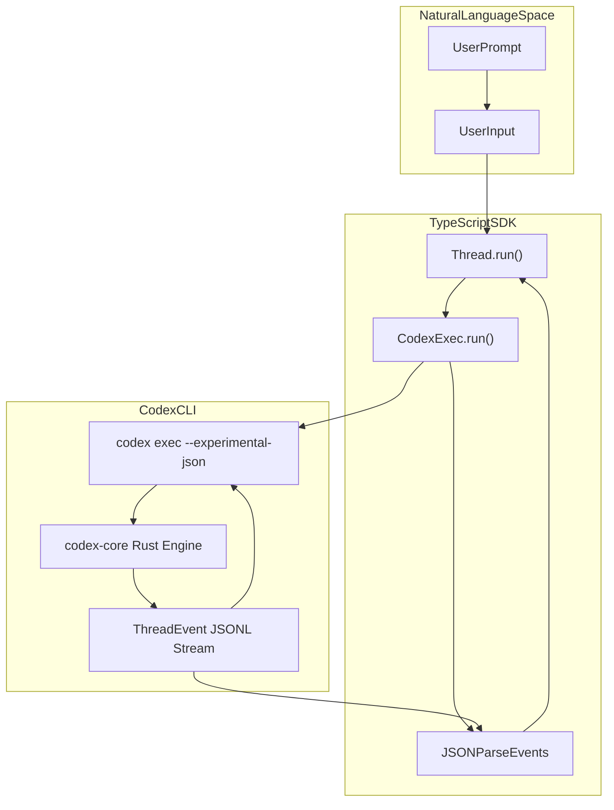
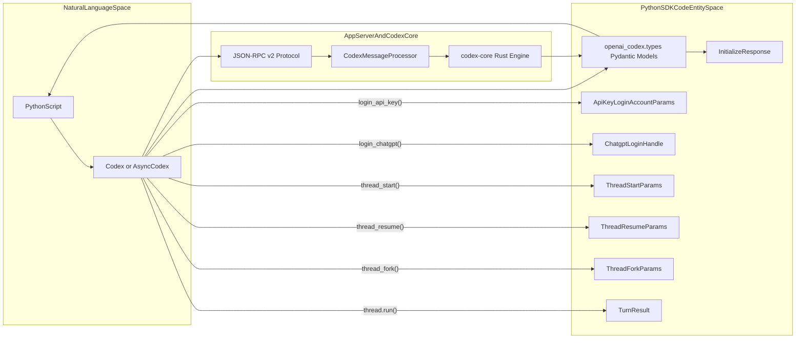

<!-- source: DeepWiki mcp.deepwiki.com · repo openai/codex · page 7 SDKs and External Integrations · fetched 2026-10-26 -->

# SDKs and External Integrations

Relevant source files

The following files were used as context for generating this wiki page:

- [.github/workflows/python-sdk-release.yml](.github/workflows/python-sdk-release.yml)
- [sdk/python/README.md](sdk/python/README.md)
- [sdk/python/docs/api-reference.md](sdk/python/docs/api-reference.md)
- [sdk/python/docs/faq.md](sdk/python/docs/faq.md)
- [sdk/python/docs/getting-started.md](sdk/python/docs/getting-started.md)
- [sdk/python/examples/README.md](sdk/python/examples/README.md)
- [sdk/python/pyproject.toml](sdk/python/pyproject.toml)
- [sdk/python/scripts/update_sdk_artifacts.py](sdk/python/scripts/update_sdk_artifacts.py)
- [sdk/python/src/openai_codex/__init__.py](sdk/python/src/openai_codex/__init__.py)
- [sdk/python/src/openai_codex/_message_router.py](sdk/python/src/openai_codex/_message_router.py)
- [sdk/python/src/openai_codex/api.py](sdk/python/src/openai_codex/api.py)
- [sdk/python/src/openai_codex/async_client.py](sdk/python/src/openai_codex/async_client.py)
- [sdk/python/src/openai_codex/client.py](sdk/python/src/openai_codex/client.py)
- [sdk/python/src/openai_codex/generated/notification_registry.py](sdk/python/src/openai_codex/generated/notification_registry.py)
- [sdk/python/src/openai_codex/models.py](sdk/python/src/openai_codex/models.py)
- [sdk/python/tests/test_artifact_workflow_and_binaries.py](sdk/python/tests/test_artifact_workflow_and_binaries.py)
- [sdk/python/tests/test_client_rpc_methods.py](sdk/python/tests/test_client_rpc_methods.py)
- [sdk/python/tests/test_contract_generation.py](sdk/python/tests/test_contract_generation.py)
- [sdk/python/tests/test_public_api_runtime_behavior.py](sdk/python/tests/test_public_api_runtime_behavior.py)
- [sdk/python/tests/test_public_api_signatures.py](sdk/python/tests/test_public_api_signatures.py)
- [sdk/python/uv.lock](sdk/python/uv.lock)

This page provides a high-level overview of the official SDKs and external integration packages that enable programmatic interaction with Codex. These components facilitate conversation management, event streaming, schema-driven outputs, and runtime packaging across languages like TypeScript and Python, alongside shell integrations via the Model Context Protocol (MCP).

As a PARENT page, this section covers the broad architectural role of each SDK. For detailed implementation mechanics, see the corresponding child pages:
- [TypeScript SDK](#7.1)
- [Python SDK](#7.2)
- [Shell Tool MCP Package](#7.3)

---

## TypeScript SDK (`@openai/codex-sdk`)

The TypeScript SDK targets Node.js applications, wrapping the `codex` CLI executable to provide an async/await interface for turn execution and event streaming [sdk/python/docs/getting-started.md:1-10]().

- **Core Classes**: Exposes `Codex` as the root client, `Thread` for managing multi-turn conversation state, and `CodexExec` for managing CLI subprocess execution [sdk/python/docs/getting-started.md:1-10]().
- **Execution Patterns**: Supports atomic runs (`run()`) that buffer events into a consolidated `TurnResult`, as well as real-time streaming (`runStreamed()`) via async generators [sdk/python/docs/getting-started.md:1-10]().
- **Resumption and Configuration**: Allows seamless thread persistence, resumption by ID, and schema-driven JSON outputs [sdk/python/docs/getting-started.md:1-10]().

For a thorough dive into features, streaming events, structured output, and session resumption, see the child page: [TypeScript SDK](#7.1).

Sources: [sdk/python/docs/getting-started.md:1-10]()

---

## Python SDK (`openai-codex`)

The Python SDK provides idiomatic synchronous (`Codex`) and asynchronous (`AsyncCodex`) clients that interface with the Codex App Server protocol [sdk/python/README.md:1-20](), [sdk/python/docs/api-reference.md:55-150]().

- **Wire Models & Type Safety**: Leverages Pydantic-generated models under `openai_codex.types` to validate wire messages, notifications, and response structures [sdk/python/src/openai_codex/api.py:46-75](). The SDK's public API signatures are tested to ensure consistency and type safety [sdk/python/tests/test_public_api_signatures.py:1-227]().
- **Runtime Packaging**: Relies on the pinned companion runtime package `openai-codex-cli-bin` to bundle the native execution binary, managed via scripts like `update_sdk_artifacts.py` [sdk/python/pyproject.toml:1-20](), [sdk/python/scripts/update_sdk_artifacts.py:1-40](). The `openai-codex-cli-bin` dependency is automatically installed and its version is strictly managed during releases [sdk/python/docs/getting-started.md:19-20](), [sdk/python/docs/faq.md:9-13](), [.github/workflows/python-sdk-release.yml:47-62]().
- **Authentication**: Supports multiple login flows including API keys via `login_api_key()`, ChatGPT browser login via `login_chatgpt()`, and device code authorization via `login_chatgpt_device_code()` [sdk/python/README.md:31-60](), [sdk/python/src/openai_codex/api.py:107-124]().
- **Thread and Turn Management**: Provides methods like `thread_start()`, `thread_resume()`, and `thread_fork()` for managing conversation lifecycles, and `run()` or `turn()` for executing turns [sdk/python/docs/api-reference.md:70-73](), [sdk/python/docs/faq.md:17-20](). The `TurnResult` object encapsulates the outcome of a turn [sdk/python/tests/test_public_api_signatures.py:141-160]().

For detailed usage, API references, and code examples, see the child page: [Python SDK](#7.2).

Sources: [sdk/python/README.md:1-60](), [sdk/python/pyproject.toml:1-20](), [sdk/python/docs/api-reference.md:55-150](), [sdk/python/scripts/update_sdk_artifacts.py:1-40](), [sdk/python/docs/getting-started.md:19-20](), [sdk/python/docs/faq.md:9-13](), [.github/workflows/python-sdk-release.yml:47-62](), [sdk/python/src/openai_codex/api.py:107-124](), [sdk/python/docs/api-reference.md:70-73](), [sdk/python/docs/faq.md:17-20](), [sdk/python/tests/test_public_api_signatures.py:141-160](), [sdk/python/tests/test_public_api_signatures.py:1-227](), [sdk/python/src/openai_codex/api.py:46-75]()

---

## Shell Tool MCP Package (`@openai/codex-shell-tool-mcp`)

This specialized NPM package extends Codex capabilities directly into Unix shell environments using the Model Context Protocol (MCP) [sdk/python/docs/getting-started.md:1-10]().

- **Patched Binaries**: Integrates custom-compiled Bash and Zsh variants featuring an `EXEC_WRAPPER` to intercept command execution [sdk/python/docs/getting-started.md:1-10]().
- **Sandbox Synchronization**: Implements the `codex/sandbox-state/update` notification channel to keep shell environments aligned with active permission profiles [sdk/python/docs/getting-started.md:1-10]().
- **Policy Enforcement**: Automatically evaluates local `.rules` configuration files to restrict unauthorized operations [sdk/python/docs/getting-started.md:1-10]().

For an in-depth treatment of its architecture and build system, see the child page: [Shell Tool MCP Package](#7.3).

Sources: [sdk/python/docs/getting-started.md:1-10]()

---

## Integration Architecture

The following diagrams bridge natural language user workflows to underlying system code entities across the TypeScript and Python SDK layers.

### Diagram: TypeScript SDK Natural Language to CLI Execution Flow

Sources: [sdk/python/docs/getting-started.md:1-10]()

### Diagram: Python SDK Session Lifecycle

Sources: [sdk/python/src/openai_codex/api.py:78-173](), [sdk/python/src/openai_codex/api.py:39-42]()

---

## Summary Table of SDKs and Integrations

| Feature | TypeScript SDK | Python SDK | Shell Tool MCP Package |
|---|---|---|---|
| **Primary Runtime** | Node.js (v18+) | Python (sync and async) | Unix Shell environments (Bash, Zsh) |
| **Communication** | Spawn codex CLI subprocess with JSONL stdio event streaming | JSON-RPC calls to Codex App Server | MCP protocol with patched shell binaries |
| **Package Name** | `@openai/codex-sdk` | `openai-codex` | `@openai/codex-shell-tool-mcp` |
| **Location in repo** | `sdk/typescript/` | `sdk/python/` | `shell-tool-mcp/` |
| **Key Client Classes** | `Codex`, `Thread`, `CodexExec` | `Codex`, `AsyncCodex`, Pydantic Models | MCP server integration, patched Bash/Zsh |
| **Streaming Support** | Yes, via async generator (`runStreamed()`) | Yes, via asynchronous `AsyncThread` and `TurnHandle.stream()` [sdk/python/docs/faq.md:26-28]() | No direct streaming; shell integration |
| **Structured Output Support** | JSON Schema-based output per turn | Strongly typed Pydantic models | Shell command policy enforcement |
| **Runtime Dependency** | `codex` CLI (installed separately) | `openai-codex-cli-bin` (pinned and auto-installed) [sdk/python/pyproject.toml:19]() | Patched Bash/Zsh binaries |

Sources: [sdk/python/pyproject.toml:1-20](), [sdk/python/docs/faq.md:26-28]()

---

