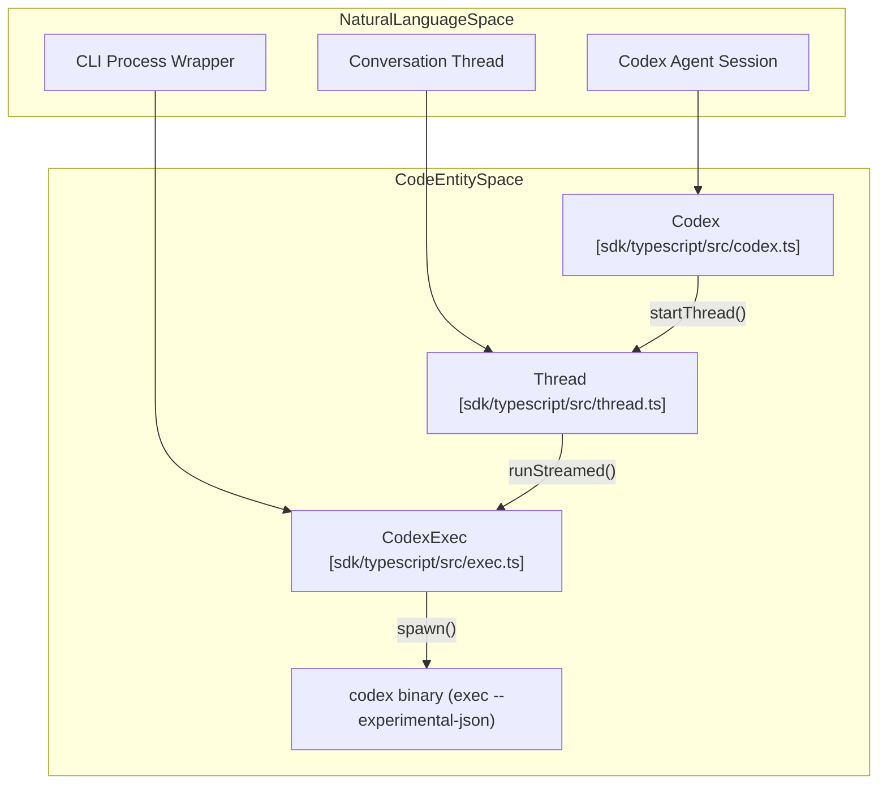
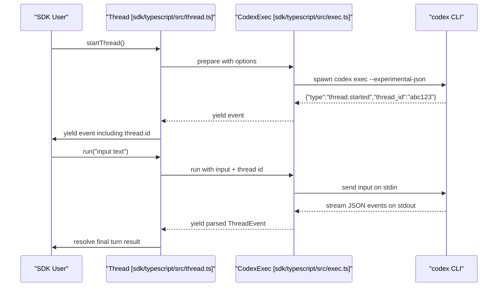
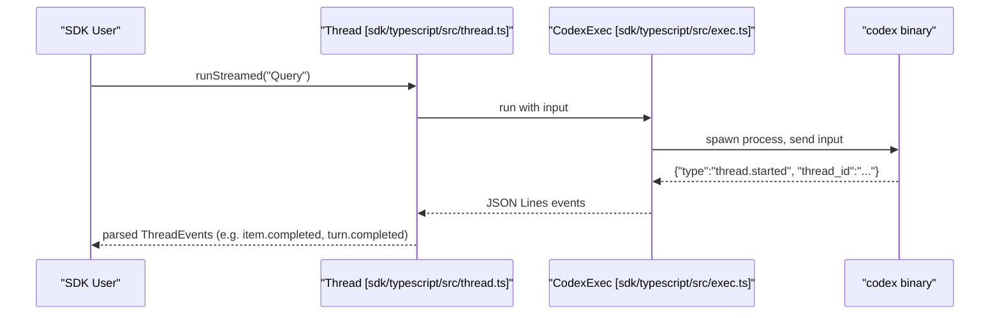
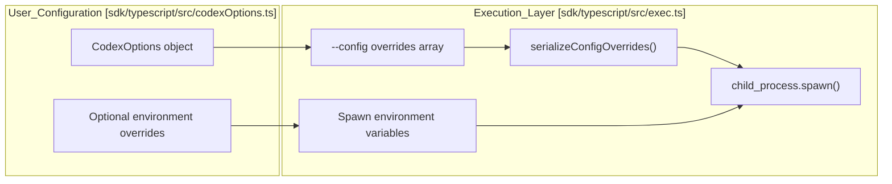

<!-- source: DeepWiki mcp.deepwiki.com · repo openai/codex · page 7.1 TypeScript SDK · fetched 2026-10-26 -->

# TypeScript SDK

Relevant source files

The following files were used as context for generating this wiki page:

- [.github/actions/linux-code-sign/action.yml](.github/actions/linux-code-sign/action.yml)
- [.github/actions/windows-code-sign/action.yml](.github/actions/windows-code-sign/action.yml)
- [.github/dotslash-config.json](.github/dotslash-config.json)
- [codex-cli/scripts/README.md](codex-cli/scripts/README.md)
- [codex-cli/scripts/build_npm_package.py](codex-cli/scripts/build_npm_package.py)
- [codex-rs/core/tests/suite/cli_stream.rs](codex-rs/core/tests/suite/cli_stream.rs)
- [codex-rs/exec/Cargo.toml](codex-rs/exec/Cargo.toml)
- [codex-rs/exec/src/cli.rs](codex-rs/exec/src/cli.rs)
- [codex-rs/exec/src/cli_tests.rs](codex-rs/exec/src/cli_tests.rs)
- [codex-rs/exec/src/event_processor_with_human_output.rs](codex-rs/exec/src/event_processor_with_human_output.rs)
- [codex-rs/exec/src/event_processor_with_human_output_tests.rs](codex-rs/exec/src/event_processor_with_human_output_tests.rs)
- [codex-rs/exec/src/event_processor_with_jsonl_output.rs](codex-rs/exec/src/event_processor_with_jsonl_output.rs)
- [codex-rs/exec/src/event_processor_with_jsonl_output_tests.rs](codex-rs/exec/src/event_processor_with_jsonl_output_tests.rs)
- [codex-rs/exec/src/exec_events.rs](codex-rs/exec/src/exec_events.rs)
- [codex-rs/exec/src/main.rs](codex-rs/exec/src/main.rs)
- [codex-rs/exec/tests/event_processor_with_json_output.rs](codex-rs/exec/tests/event_processor_with_json_output.rs)
- [codex-rs/exec/tests/suite/apply_patch.rs](codex-rs/exec/tests/suite/apply_patch.rs)
- [codex-rs/exec/tests/suite/mod.rs](codex-rs/exec/tests/suite/mod.rs)
- [codex-rs/exec/tests/suite/resume.rs](codex-rs/exec/tests/suite/resume.rs)
- [codex-rs/exec/tests/suite/seatbelt.rs](codex-rs/exec/tests/suite/seatbelt.rs)
- [codex-rs/tui/src/cli.rs](codex-rs/tui/src/cli.rs)
- [codex-rs/tui/src/main.rs](codex-rs/tui/src/main.rs)
- [codex-rs/utils/cli/src/shared_options.rs](codex-rs/utils/cli/src/shared_options.rs)
- [scripts/stage_npm_packages.py](scripts/stage_npm_packages.py)
- [sdk/typescript/README.md](sdk/typescript/README.md)
- [sdk/typescript/samples/basic_streaming.ts](sdk/typescript/samples/basic_streaming.ts)
- [sdk/typescript/src/codex.ts](sdk/typescript/src/codex.ts)
- [sdk/typescript/src/codexOptions.ts](sdk/typescript/src/codexOptions.ts)
- [sdk/typescript/src/events.ts](sdk/typescript/src/events.ts)
- [sdk/typescript/src/exec.ts](sdk/typescript/src/exec.ts)
- [sdk/typescript/src/index.ts](sdk/typescript/src/index.ts)
- [sdk/typescript/src/thread.ts](sdk/typescript/src/thread.ts)
- [sdk/typescript/src/threadOptions.ts](sdk/typescript/src/threadOptions.ts)
- [sdk/typescript/tests/exec.test.ts](sdk/typescript/tests/exec.test.ts)
- [sdk/typescript/tests/run.test.ts](sdk/typescript/tests/run.test.ts)
- [sdk/typescript/tests/runStreamed.test.ts](sdk/typescript/tests/runStreamed.test.ts)
- [sdk/typescript/tests/testCodex.ts](sdk/typescript/tests/testCodex.ts)

The purpose of this page is to document `@openai/codex-sdk`, which provides a high-level TypeScript interface for embedding the Codex AI coding agent into external workflows and applications. It acts as a wrapper around the `codex` CLI (distributed via the `@openai/codex` package), managing lifecycle tasks such as execution of the Codex binary and orchestrating communication via structured JSONL events over standard input and output [sdk/typescript/README.md:1-5](), [sdk/typescript/src/exec.ts:45-47]().

---

## Overview

The SDK is structured around managing conversations with the Codex agent as **Threads** consisting of multiple **Turns**. Each turn represents a single interaction where the user provides input and receives a response. The SDK handles process spawning, environment management, event parsing, and input normalization transparently to the developer [sdk/typescript/src/thread.ts:9-25]().

### Key Components

| Component | Role |
|---|---|
| `Codex` | The main SDK entry point managing sessions and thread lifecycle [sdk/typescript/src/codex.ts:11-20](). |
| `Thread` | Represents a conversation thread — manages multiple turns, handles state and IDs [sdk/typescript/src/thread.ts:41-63](). |
| `CodexExec` | Low-level executor which spawns the CLI process and streams JSON events [sdk/typescript/src/exec.ts:65-89](). |

Diagram bridging system conceptual names to code entities:

Sources: [sdk/typescript/src/codex.ts:11-39](), [sdk/typescript/src/thread.ts:41-80](), [sdk/typescript/src/exec.ts:65-199]()

---

## Codex / Thread / Turn API

The SDK exposes a clear layered API for interacting with Codex:

- `Codex` manages **Threads**.
- A `Thread` manages conversation history and runs **Turns**.
- A Turn is manifested by invoking `run()` or `runStreamed()` on a `Thread`, which sends input to the agent and receives output.

This layered model supports both simple interactions and complex workflows involving session resumption, streaming, and structured output [sdk/typescript/src/thread.ts:66-115]().

### Thread Lifecycle

- **Creation:** Using `Codex.startThread(options)`, a new thread context is initialized without a thread ID, managed locally.
- **Resumption:** With `Codex.resumeThread(threadId)`, a thread session persisted on disk (in `~/.codex/sessions`) may be resumed, passing the `threadId` to the CLI `resume` command.
- **Turn Execution:** The `run` or `runStreamed` methods on `Thread` execute a single turn, sending input to the agent and collecting output events. The thread's `_id` is set when the CLI emits `thread.started`.

Sources: [sdk/typescript/src/thread.ts:48-50](), [sdk/typescript/src/thread.ts:66-115](), [sdk/typescript/src/codex.ts:25-38](), [sdk/typescript/src/exec.ts:166-168]()

---

## Streaming Events

The `runStreamed(input)` method on `Thread` provides an async generator that yields granular, typed `ThreadEvent`s in real time. This supports fine-grained UI updates or monitoring of the agent's reasoning, tool calls, and outputs [sdk/typescript/src/thread.ts:66-115]().

### Event Types

The event stream corresponds to message types defined in Rust in `codex-rs/exec/src/exec_events.rs`:

- `thread.started`: Indicates initialization with `thread_id`.
- `item.started`, `item.updated`, `item.completed`: Lifecycle events for individual output items such as agent messages, tool calls, or reasoning steps.
- `turn.completed`: Indicates end of turn with usage stats (e.g. token cost).
- `turn.failed`: Terminal error signaling failure of the turn.

Sources: [codex-rs/exec/src/exec_events.rs:9-37](), [sdk/typescript/src/events.ts:1-13]()

### Event Data Flow

Sources: [sdk/typescript/src/thread.ts:70-115](), [sdk/typescript/src/exec.ts:231-240]()

---

## Structured Output

The SDK supports instructing the agent to produce JSON structured output conforming to user-supplied JSON Schemas [sdk/typescript/README.md:55-84](), [sdk/typescript/src/thread.ts:74-88]().

### Implementation Details

1.  **Schema Input:**
    The user passes a JSON schema object as the `outputSchema` property in the `TurnOptions` parameter to `Thread.run()` or `runStreamed()` [sdk/typescript/src/turnOptions.ts:6]().

2.  **Temporary Schema File:**
    The SDK serializes this schema to a temporary `.json` file on disk using `createOutputSchemaFile`. This file path is passed to the CLI via `--output-schema <filepath>` [sdk/typescript/src/thread.ts:74-88]().

3.  **CLI Integration:**
    The `CodexExec` runner receives this path and adds the `--output-schema` flag accordingly to the CLI command line [sdk/typescript/src/exec.ts:139-141](). The `codex exec` command's `output_schema` argument is defined in [codex-rs/exec/src/cli.rs:52-54]().

4.  **Agent Behavior and SDK Parsing:**
    The Codex CLI constrains its output to this schema, and the SDK parses the structured JSON from the assistant message items [sdk/typescript/src/items.ts:75-80](), [codex-rs/exec/src/exec_events.rs:138-140]().

Sources: [sdk/typescript/README.md:55-84](), [sdk/typescript/src/thread.ts:74-88](), [sdk/typescript/src/turnOptions.ts:6](), [sdk/typescript/src/exec.ts:139-141](), [codex-rs/exec/src/cli.rs:52-54](), [sdk/typescript/src/items.ts:75-80](), [codex-rs/exec/src/exec_events.rs:138-140]()

---

## Session Resumption

Thread sessions created by the `codex` CLI are persisted on disk under `~/.codex/sessions`. The SDK enables continuing these sessions through its `resumeThread(threadId)` API and passing the associated ID to subsequent CLI executions [sdk/typescript/README.md:98-106](), [sdk/typescript/src/codex.ts:36-38]().

### Details

- The `CodexExec` class includes a `threadId` argument which triggers sending `codex exec resume <threadId>` commands [sdk/typescript/src/exec.ts:166-168](). The `codex exec resume` command is defined in [codex-rs/exec/src/cli.rs:174-175]().
- The CLI restores prior context and event state from persisted sessions, allowing continued conversation seamlessly. This is handled by the `exec_resume_last_appends_to_existing_file` test case in [codex-rs/exec/tests/suite/resume.rs:159-196]().
- The SDK maintains the `Thread.id` property and ensures events from resumed sessions correctly populate prior context [sdk/typescript/src/thread.ts:48-50](), [sdk/typescript/src/exec.ts:166-168]().

Sources: [sdk/typescript/README.md:98-106](), [sdk/typescript/src/codex.ts:36-38](), [sdk/typescript/src/exec.ts:166-168](), [codex-rs/exec/src/cli.rs:174-175](), [codex-rs/exec/tests/suite/resume.rs:159-196](), [sdk/typescript/src/thread.ts:48-50]()

---

## Configuration and Environment

The SDK exposes advanced options to control execution details and environment variables:

-   **Base URL and API Key:**
    Passed as `--config openai_base_url=...` CLI flags and the `CODEX_API_KEY` environment variable [sdk/typescript/src/exec.ts:106-111,189-191]().
-   **Sandbox Modes:**
    Provides security restrictions on filesystem and network access with `--sandbox` flag values: `"read-only"`, `"workspace-write"`, `"danger-full-access"` [sdk/typescript/src/threadOptions.ts:3](), [sdk/typescript/src/exec.ts:121-123]().
-   **Config Overrides:**
    Arbitrary key/value configuration is flattened and serialized into repeated `--config key=value` parameters [sdk/typescript/src/exec.ts:94-104](), [sdk/typescript/src/codexOptions.ts:5-22](). The `CliConfigOverrides` struct in `codex-rs/utils/cli/src/shared_options.rs:10-12` handles these overrides.
-   **Internal Originator:**
    The environment variable `CODEX_INTERNAL_ORIGINATOR_OVERRIDE` is set to `"codex_sdk_ts"` automatically [sdk/typescript/src/exec.ts:45-47,186-188]().

### SDK Configuration Data Flow

Sources: [sdk/typescript/src/exec.ts:94-104](), [sdk/typescript/src/exec.ts:176-195](), [sdk/typescript/src/codexOptions.ts:5-22](), [codex-rs/utils/cli/src/shared_options.rs:10-12]()

---

# Sources

-   .github/actions/linux-code-sign/action.yml
-   .github/dotslash-config.json
-   codex-cli/scripts/README.md
-   codex-cli/scripts/build_npm_package.py
-   codex-rs/cli/Cargo.toml:1-146
-   codex-rs/cli/src/main.rs:1-209
-   codex-rs/core/tests/suite/cli_stream.rs:1-192
-   codex-rs/exec/src/cli.rs:1-206
-   codex-rs/exec/src/cli_tests.rs
-   codex-rs/exec/src/event_processor_with_human_output.rs:1-174
-   codex-rs/exec/src/event_processor_with_jsonl_output.rs:1-178
-   codex-rs/exec/src/event_processor_with_jsonl_output_tests.rs
-   codex-rs/exec/src/exec_events.rs:9-37,138-140
-   codex-rs/exec/src/lib.rs:1-158
-   codex-rs/exec/src/lib_tests.rs:1-217
-   codex-rs/exec/src/main.rs
-   codex-rs/exec/tests/event_processor_with_json_output.rs:1-178
-   codex-rs/exec/tests/suite/daybreak.rs
-   codex-rs/exec/tests/suite/mod.rs:1-24
-   codex-rs/exec/tests/suite/resume.rs:1-196
-   codex-rs/exec/tests/suite/seatbelt.rs
-   codex-rs/tui/src/cli.rs
-   codex-rs/tui/src/main.rs:1-63
-   codex-rs/utils/cli/src/shared_options.rs:10-12
-   scripts/stage_npm_packages.py
-   sdk/typescript/README.md:1-150
-   sdk/typescript/samples/basic_streaming.ts
-   sdk/typescript/src/codex.ts:11-39
-   sdk/typescript/src/codexOptions.ts:5-22
-   sdk/typescript/src/events.ts:1-13
-   sdk/typescript/src/exec.ts:45-47,65-89,94-104,106-111,121-123,139-141,166-168,176-195,196-199,231-240
-   sdk/typescript/src/index.ts
-   sdk/typescript/src/items.ts:75-80
-   sdk/typescript/src/thread.ts:9-25,41-63,48-50,66-115,70-115,74-88,77-80
-   sdk/typescript/src/threadOptions.ts:3
-   sdk/typescript/src/turnOptions.ts:6
-   sdk/typescript/tests/exec.test.ts:48-191
-   sdk/typescript/tests/run.test.ts:19-185
-   sdk/typescript/tests/runStreamed.test.ts
-   sdk/typescript/tests/testCodex.ts

---

