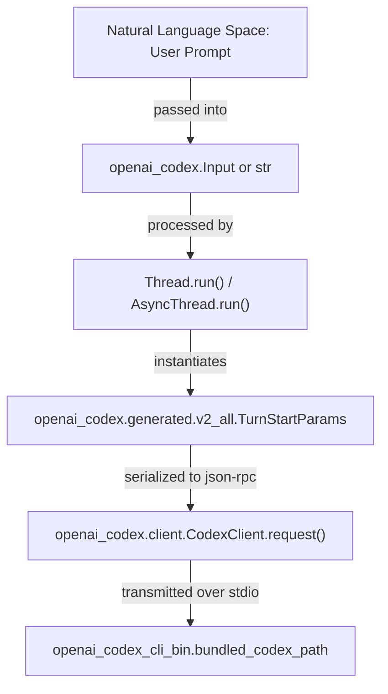
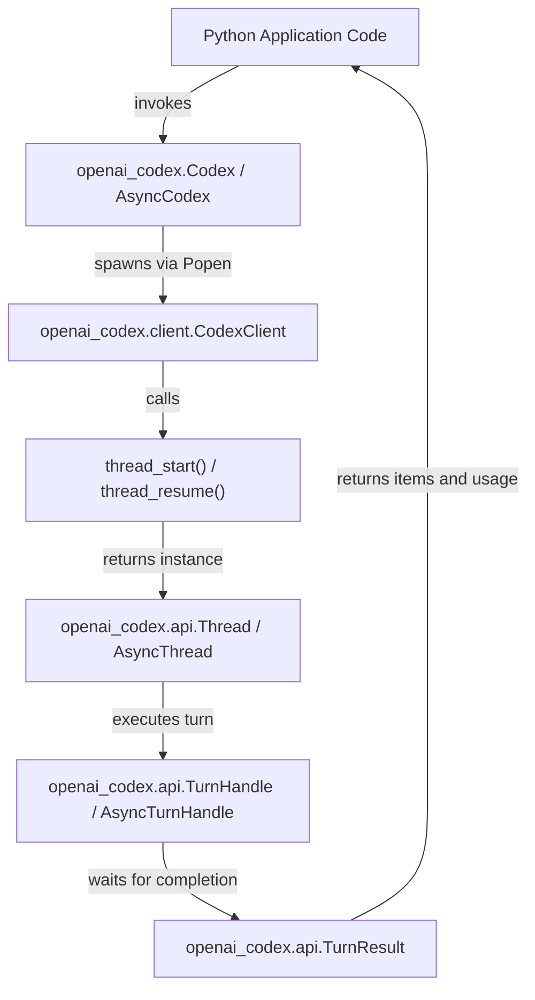

<!-- source: DeepWiki mcp.deepwiki.com · repo openai/codex · page 7.2 Python SDK · fetched 2026-10-26 -->

# Python SDK

Relevant source files

The following files were used as context for generating this wiki page:

- [.github/workflows/python-sdk-release.yml](.github/workflows/python-sdk-release.yml)
- [codex-rs/app-server-protocol/schema/json/ClientRequest.json](codex-rs/app-server-protocol/schema/json/ClientRequest.json)
- [codex-rs/app-server-protocol/schema/json/ServerNotification.json](codex-rs/app-server-protocol/schema/json/ServerNotification.json)
- [codex-rs/app-server-protocol/schema/json/codex_app_server_protocol.schemas.json](codex-rs/app-server-protocol/schema/json/codex_app_server_protocol.schemas.json)
- [codex-rs/app-server-protocol/schema/json/codex_app_server_protocol.v2.schemas.json](codex-rs/app-server-protocol/schema/json/codex_app_server_protocol.v2.schemas.json)
- [codex-rs/app-server-protocol/schema/precomputed/app-server-exports-experimental.json.zst](codex-rs/app-server-protocol/schema/precomputed/app-server-exports-experimental.json.zst)
- [codex-rs/app-server-protocol/schema/precomputed/app-server-exports-stable.json.zst](codex-rs/app-server-protocol/schema/precomputed/app-server-exports-stable.json.zst)
- [codex-rs/app-server-protocol/schema/typescript/ClientRequest.ts](codex-rs/app-server-protocol/schema/typescript/ClientRequest.ts)
- [codex-rs/app-server-protocol/schema/typescript/v2/index.ts](codex-rs/app-server-protocol/schema/typescript/v2/index.ts)
- [codex-rs/app-server-protocol/src/protocol/common.rs](codex-rs/app-server-protocol/src/protocol/common.rs)
- [codex-rs/app-server-protocol/src/protocol/v2/tests.rs](codex-rs/app-server-protocol/src/protocol/v2/tests.rs)
- [codex-rs/app-server-protocol/src/protocol/v2/thread.rs](codex-rs/app-server-protocol/src/protocol/v2/thread.rs)
- [codex-rs/app-server/README.md](codex-rs/app-server/README.md)
- [codex-rs/app-server/src/lib.rs](codex-rs/app-server/src/lib.rs)
- [codex-rs/app-server/src/message_processor.rs](codex-rs/app-server/src/message_processor.rs)
- [codex-rs/app-server/src/request_processors.rs](codex-rs/app-server/src/request_processors.rs)
- [codex-rs/app-server/src/request_processors/thread_lifecycle.rs](codex-rs/app-server/src/request_processors/thread_lifecycle.rs)
- [codex-rs/app-server/src/request_processors/thread_processor.rs](codex-rs/app-server/src/request_processors/thread_processor.rs)
- [codex-rs/app-server/src/thread_state.rs](codex-rs/app-server/src/thread_state.rs)
- [codex-rs/app-server/tests/suite/v2/mod.rs](codex-rs/app-server/tests/suite/v2/mod.rs)
- [codex-rs/app-server/tests/suite/v2/thread_fork.rs](codex-rs/app-server/tests/suite/v2/thread_fork.rs)
- [codex-rs/app-server/tests/suite/v2/thread_resume.rs](codex-rs/app-server/tests/suite/v2/thread_resume.rs)
- [codex-rs/app-server/tests/suite/v2/thread_start.rs](codex-rs/app-server/tests/suite/v2/thread_start.rs)
- [codex-rs/app-server/tests/suite/v2/thread_unsubscribe.rs](codex-rs/app-server/tests/suite/v2/thread_unsubscribe.rs)
- [codex-rs/app-server/tests/suite/v2/turn_start.rs](codex-rs/app-server/tests/suite/v2/turn_start.rs)
- [sdk/python/README.md](sdk/python/README.md)
- [sdk/python/docs/api-reference.md](sdk/python/docs/api-reference.md)
- [sdk/python/docs/faq.md](sdk/python/docs/faq.md)
- [sdk/python/docs/getting-started.md](sdk/python/docs/getting-started.md)
- [sdk/python/examples/README.md](sdk/python/examples/README.md)
- [sdk/python/pyproject.toml](sdk/python/pyproject.toml)
- [sdk/python/scripts/update_sdk_artifacts.py](sdk/python/scripts/update_sdk_artifacts.py)
- [sdk/python/src/openai_codex/__init__.py](sdk/python/src/openai_codex/__init__.py)
- [sdk/python/src/openai_codex/_message_router.py](sdk/python/src/openai_codex/_message_router.py)
- [sdk/python/src/openai_codex/api.py](sdk/python/src/openai_codex/api.py)
- [sdk/python/src/openai_codex/async_client.py](sdk/python/src/openai_codex/async_client.py)
- [sdk/python/src/openai_codex/client.py](sdk/python/src/openai_codex/client.py)
- [sdk/python/src/openai_codex/generated/notification_registry.py](sdk/python/src/openai_codex/generated/notification_registry.py)
- [sdk/python/src/openai_codex/generated/v2_all.py](sdk/python/src/openai_codex/generated/v2_all.py)
- [sdk/python/src/openai_codex/models.py](sdk/python/src/openai_codex/models.py)
- [sdk/python/tests/test_artifact_workflow_and_binaries.py](sdk/python/tests/test_artifact_workflow_and_binaries.py)
- [sdk/python/tests/test_client_rpc_methods.py](sdk/python/tests/test_client_rpc_methods.py)
- [sdk/python/tests/test_contract_generation.py](sdk/python/tests/test_contract_generation.py)
- [sdk/python/tests/test_public_api_runtime_behavior.py](sdk/python/tests/test_public_api_runtime_behavior.py)
- [sdk/python/tests/test_public_api_signatures.py](sdk/python/tests/test_public_api_signatures.py)
- [sdk/python/uv.lock](sdk/python/uv.lock)

The Python SDK (`openai-codex`) provides a high-level, type-safe interface for embedding the Codex agent into Python applications. It acts as a wrapper around the Codex CLI and the App Server JSON-RPC v2 protocol, facilitating thread management, turn execution, and structured data exchange [sdk/python/src/openai_codex/api.py:75-81](), [sdk/python/README.md:3-20]().

Sources: [sdk/python/src/openai_codex/api.py:75-81](), [sdk/python/README.md:3-20]()

---

## 1. Overview and System Architecture

The SDK allows developers to interact with Codex using either synchronous or asynchronous clients. It manages the lifecycle of the underlying `codex` process, handles JSON-RPC communication over stdio, and provides Pydantic models for type-safe interaction with the protocol's wire format [sdk/python/src/openai_codex/api.py:75-86](), [sdk/python/src/openai_codex/api.py:377-407](), [sdk/python/src/openai_codex/generated/v2_all.py:10-20]().

### Key Components
*   `Codex` / `AsyncCodex`: The primary client entry points managing process lifecycle and RPC calls [sdk/python/src/openai_codex/api.py:75-86](), [sdk/python/src/openai_codex/api.py:377-407]().
*   `Thread` / `AsyncThread`: Represents persistent conversation sessions supporting turn submission and state retrieval [sdk/python/src/openai_codex/api.py:274-285]().
*   `TurnHandle` / `AsyncTurnHandle`: Provides control over active turns, supporting event streaming, steering inputs, or interruptions [sdk/python/src/openai_codex/api.py:377-400]().
*   Pydantic Wire Models: Auto-generated classes in `openai_codex.generated.v2_all` that mirror the JSON schema of the app-server v2 protocol [sdk/python/src/openai_codex/generated/v2_all.py:10-25](), [sdk/python/tests/test_client_rpc_methods.py:13-39]().
*   `openai-codex-cli-bin`: Separately published dependency package containing the native `codex` executable bound to the matching SDK release [sdk/python/pyproject.toml:19-19](), [sdk/python/scripts/update_sdk_artifacts.py:20-136]().

Sources: [sdk/python/src/openai_codex/api.py:75-86, 274-285, 377-407](), [sdk/python/src/openai_codex/generated/v2_all.py:10-25](), [sdk/python/tests/test_client_rpc_methods.py:13-39](), [sdk/python/pyproject.toml:19-19](), [sdk/python/scripts/update_sdk_artifacts.py:20-136]()

---

## 2. Client and Thread Management

### Lifecycle and Operations

The abstraction of a conversation is encapsulated in the `Thread` and `AsyncThread` classes [sdk/python/src/openai_codex/api.py:274-310]().
- **Start**: `thread_start()` creates a new thread with optional initial instructions, model configurations, and approval modes [sdk/python/src/openai_codex/api.py:130-170]().
- **Resume**: `thread_resume(thread_id)` reloads an existing conversation by ID [sdk/python/src/openai_codex/api.py:195-234]().
- **Fork**: `thread_fork(thread_id)` forks an existing thread state to establish a branching conversation [sdk/python/src/openai_codex/api.py:236-267]().
- **Execution**: `run()` launches a turn, blocks until completion, and returns a `TurnResult` containing the final response and items [sdk/python/src/openai_codex/api.py:333-356](), [sdk/python/tests/test_public_api_signatures.py:158-169]().

### Sandbox Access Control (`Sandbox`)

The SDK exposes the `Sandbox` enum to control filesystem access scopes during thread and turn execution, mapping directly to underlying app-server security policies [sdk/python/src/openai_codex/api.py:40-46]().
- `Sandbox.read_only`: Read-only access to the workspace filesystem.
- `Sandbox.workspace_write`: Read/write access confined inside the workspace and configured writable roots.
- `Sandbox.full_access`: Unrestricted filesystem access.

Sources: [sdk/python/src/openai_codex/api.py:40-46, 130-270, 274-356](), [sdk/python/tests/test_public_api_signatures.py:158-169]()

---

## 3. Protocol, Wire Models, and Authentication

### Pydantic Wire Models

The SDK relies heavily on Pydantic models generated from the app-server JSON-RPC v2 schema [sdk/python/src/openai_codex/generated/v2_all.py:10-30](). These models accept snake_case arguments in Python and serialize them to camelCase wire representations automatically [sdk/python/tests/test_client_rpc_methods.py:55-66]().

### Authentication Flows

Clients support multiple login flows:
- API Key: `login_api_key(api_key: str)` [sdk/python/docs/api-reference.md:65-65]()
- ChatGPT Browser: `login_chatgpt()` returns a `ChatgptLoginHandle` exposing an `auth_url` [sdk/python/docs/api-reference.md:66-66](), [sdk/python/docs/api-reference.md:158-164]()
- Device Code: `login_chatgpt_device_code()` returns a `DeviceCodeLoginHandle` with `verification_url` and `user_code` [sdk/python/docs/api-reference.md:67-67](), [sdk/python/docs/api-reference.md:167-171]()

Sources: [sdk/python/src/openai_codex/generated/v2_all.py:10-30](), [sdk/python/tests/test_client_rpc_methods.py:55-66](), [sdk/python/docs/api-reference.md:65-67, 158-171]()

---

## 4. Runtime Packaging and Release Infrastructure

The Python SDK installs `openai-codex-cli-bin` as an exact runtime dependency to bundle the native `codex` binary [sdk/python/pyproject.toml:19-19](). Version synchronization and distribution are managed via `sdk/python/scripts/update_sdk_artifacts.py` [sdk/python/scripts/update_sdk_artifacts.py:10-136]().

- **Staging**: `stage_python_sdk_package()` and `stage_python_runtime_package()` assemble packaging structures and rewrite `pyproject.toml` dependency pins [sdk/python/scripts/update_sdk_artifacts.py:147-207]().
- **CI/CD Integration**: The `.github/workflows/python-sdk-release.yml` workflow enforces tag rules (`python-v*`), builds the runtime wheels, and publishes both packages to PyPI [.github/workflows/python-sdk-release.yml:1-158]().

Sources: [sdk/python/pyproject.toml:19-19](), [sdk/python/scripts/update_sdk_artifacts.py:10-207](), [.github/workflows/python-sdk-release.yml:1-158]()

---

## 5. Summary Diagrams Bridging Natural Language Space to Code Entities

Title: "Natural Language Input to Protocol Model Serialization Flow"

Sources: [sdk/python/src/openai_codex/api.py:333-356](), [sdk/python/src/openai_codex/client.py:135-192](), [sdk/python/src/openai_codex/generated/v2_all.py:10-30]()

Title: "Thread and Turn Lifecycle in Python SDK"

Sources: [sdk/python/src/openai_codex/api.py:75-170](), [sdk/python/src/openai_codex/api.py:274-356](), [sdk/python/src/openai_codex/client.py:135-192]()

---

