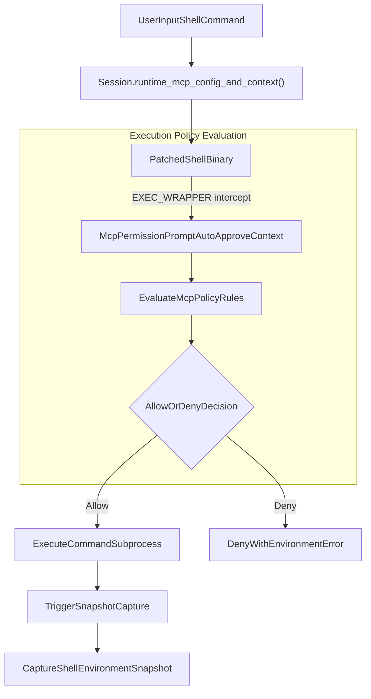
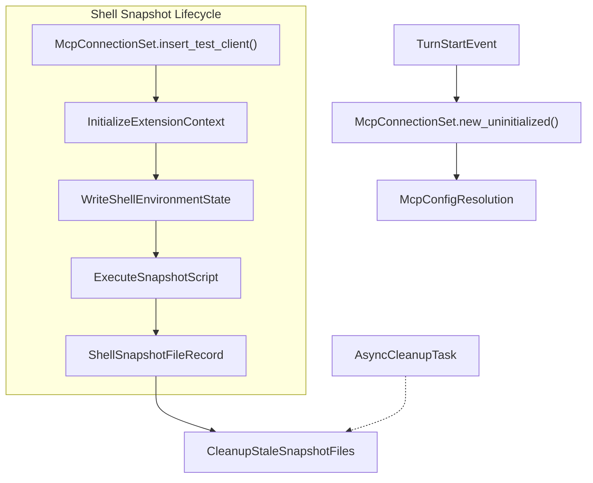

<!-- source: DeepWiki mcp.deepwiki.com · repo openai/codex · page 7.3 Shell Tool MCP Package · fetched 2026-10-26 -->

# Shell Tool MCP Package

Relevant source files

The following files were used as context for generating this wiki page:

- [.bazelrc](.bazelrc)
- [.github/scripts/archive-release-symbols-and-strip-binaries.sh](.github/scripts/archive-release-symbols-and-strip-binaries.sh)
- [.github/scripts/check_ci_results.py](.github/scripts/check_ci_results.py)
- [.github/scripts/run-bazel-ci.sh](.github/scripts/run-bazel-ci.sh)
- [.github/scripts/run-bazel-query-ci.sh](.github/scripts/run-bazel-query-ci.sh)
- [.github/scripts/run_bazel_with_buildbuddy.py](.github/scripts/run_bazel_with_buildbuddy.py)
- [.github/scripts/rusty_v8_bazel.py](.github/scripts/rusty_v8_bazel.py)
- [.github/scripts/test_run_bazel_with_buildbuddy.py](.github/scripts/test_run_bazel_with_buildbuddy.py)
- [.github/scripts/test_rusty_v8_bazel.py](.github/scripts/test_rusty_v8_bazel.py)
- [.github/workflows/README.md](.github/workflows/README.md)
- [.github/workflows/bazel.yml](.github/workflows/bazel.yml)
- [.github/workflows/blob-size-policy.yml](.github/workflows/blob-size-policy.yml)
- [.github/workflows/blocking-ci.yml](.github/workflows/blocking-ci.yml)
- [.github/workflows/cargo-deny.yml](.github/workflows/cargo-deny.yml)
- [.github/workflows/close-stale-contributor-prs.yml](.github/workflows/close-stale-contributor-prs.yml)
- [.github/workflows/codespell.yml](.github/workflows/codespell.yml)
- [.github/workflows/issue-deduplicator.yml](.github/workflows/issue-deduplicator.yml)
- [.github/workflows/issue-labeler.yml](.github/workflows/issue-labeler.yml)
- [.github/workflows/postmerge-ci.yml](.github/workflows/postmerge-ci.yml)
- [.github/workflows/repo-checks.yml](.github/workflows/repo-checks.yml)
- [.github/workflows/rust-ci-full.yml](.github/workflows/rust-ci-full.yml)
- [.github/workflows/rust-ci.yml](.github/workflows/rust-ci.yml)
- [.github/workflows/rust-release-argument-comment-lint.yml](.github/workflows/rust-release-argument-comment-lint.yml)
- [.github/workflows/rust-release-windows.yml](.github/workflows/rust-release-windows.yml)
- [.github/workflows/rust-release.yml](.github/workflows/rust-release.yml)
- [.github/workflows/rusty-v8-release.yml](.github/workflows/rusty-v8-release.yml)
- [.github/workflows/sdk.yml](.github/workflows/sdk.yml)
- [.github/workflows/v8-canary.yml](.github/workflows/v8-canary.yml)
- [codex-rs/core-plugins/src/plugin_metrics.rs](codex-rs/core-plugins/src/plugin_metrics.rs)
- [codex-rs/core-plugins/src/script_attribution.rs](codex-rs/core-plugins/src/script_attribution.rs)
- [codex-rs/core-plugins/src/script_attribution_tests.rs](codex-rs/core-plugins/src/script_attribution_tests.rs)
- [codex-rs/core/src/exec_policy.rs](codex-rs/core/src/exec_policy.rs)
- [codex-rs/core/src/exec_policy/executable_identity.rs](codex-rs/core/src/exec_policy/executable_identity.rs)
- [codex-rs/core/src/exec_policy/executable_identity_tests.rs](codex-rs/core/src/exec_policy/executable_identity_tests.rs)
- [codex-rs/core/src/exec_policy_tests.rs](codex-rs/core/src/exec_policy_tests.rs)
- [codex-rs/core/src/exec_policy_windows_tests.rs](codex-rs/core/src/exec_policy_windows_tests.rs)
- [codex-rs/core/tests/suite/approvals.rs](codex-rs/core/tests/suite/approvals.rs)
- [codex-rs/core/tests/suite/exec_policy.rs](codex-rs/core/tests/suite/exec_policy.rs)
- [codex-rs/docs/bazel.md](codex-rs/docs/bazel.md)
- [codex-rs/shell-command/BUILD.bazel](codex-rs/shell-command/BUILD.bazel)
- [codex-rs/shell-command/Cargo.toml](codex-rs/shell-command/Cargo.toml)
- [codex-rs/shell-command/src/bash.rs](codex-rs/shell-command/src/bash.rs)
- [codex-rs/shell-command/src/command_safety/fixtures/powershell_lowering.json](codex-rs/shell-command/src/command_safety/fixtures/powershell_lowering.json)
- [codex-rs/shell-command/src/command_safety/is_dangerous_command.rs](codex-rs/shell-command/src/command_safety/is_dangerous_command.rs)
- [codex-rs/shell-command/src/command_safety/mod.rs](codex-rs/shell-command/src/command_safety/mod.rs)
- [codex-rs/shell-command/src/command_safety/powershell_parser.ps1](codex-rs/shell-command/src/command_safety/powershell_parser.ps1)
- [codex-rs/shell-command/src/command_safety/powershell_parser.rs](codex-rs/shell-command/src/command_safety/powershell_parser.rs)
- [codex-rs/shell-command/src/command_safety/powershell_tree_sitter.rs](codex-rs/shell-command/src/command_safety/powershell_tree_sitter.rs)
- [codex-rs/shell-command/src/command_safety/powershell_tree_sitter_tests.rs](codex-rs/shell-command/src/command_safety/powershell_tree_sitter_tests.rs)
- [codex-rs/shell-command/src/command_safety/windows_dangerous_commands.rs](codex-rs/shell-command/src/command_safety/windows_dangerous_commands.rs)
- [codex-rs/shell-command/src/lib.rs](codex-rs/shell-command/src/lib.rs)
- [codex-rs/shell-command/src/parse_command.rs](codex-rs/shell-command/src/parse_command.rs)
- [codex-rs/shell-command/src/powershell.rs](codex-rs/shell-command/src/powershell.rs)
- [codex-rs/shell-command/src/startup.rs](codex-rs/shell-command/src/startup.rs)
- [justfile](justfile)
- [scripts/list-bazel-clippy-targets.sh](scripts/list-bazel-clippy-targets.sh)

The `@openai/codex-shell-tool-mcp` npm package provides a native extension featuring a patched shell environment integrated with the Codex Model Context Protocol (MCP) server infrastructure [.github/workflows/rust-release.yml:85-134](). It enables deep interaction between the Codex AI agent and local shell environments while enforcing advanced sandboxing, policy checks, and state synchronization [codex-rs/codex-mcp/src/rmcp_client.rs:95-97]().

## Overview and Purpose

The primary purpose of this package is to facilitate AI-driven shell interactions within a tightly controlled and sandboxed terminal environment. It achieves this by:

- Supplying patched Bash and Zsh shell binaries that incorporate an `EXEC_WRAPPER` mechanism to intercept and analyze every command before execution [.github/workflows/rust-release.yml:85-134]().
- Propagating sandbox state updates and environmental policy enforcement dynamically through the MCP server protocol [codex-rs/codex-mcp/src/rmcp_client.rs:95-97]().
- Maintaining consistent shell state snapshots that capture environment variables, aliases, and other shell session state.
- Enforcing `.rules` files and the Codex exec policy engine to restrict permissible shell commands and filesystem operations [codex-rs/codex-mcp/src/mcp/mod.rs:91-109]().
- Integrating with Codex's unified execution and approval framework to manage subprocess lifecycles, signal handling, and background tasks.

Sources: [.github/workflows/rust-release.yml:85-134](), [codex-rs/codex-mcp/src/mcp/mod.rs:91-109](), [codex-rs/codex-mcp/src/rmcp_client.rs:95-97]()

---

## Patched Shell Implementation

### EXEC_WRAPPER Interception Mechanism

At the heart of the patched shell is support for the environment variable `EXEC_WRAPPER`, which intercepts all command executions within Bash or Zsh. Instead of invoking binaries directly, commands are wrapped through this executable, allowing the Codex execution policy engine to:

- Evaluate whether the requested command complies with the current security and sandboxing policy [codex-rs/codex-mcp/src/mcp/mod.rs:91-109]().
- Potentially modify, deny, or allow execution in real time.
- Record monitoring data and enforce environment constraints.

This mechanism leverages source code patches to the shells deployed in the system, replacing internal calls to command execution (`fork/execve`) with wrapped calls.

The `Shell` struct from the core library abstracts shell detection and execution argument generation with support for these patched environments:
- It determines which shell type is used (e.g., Bash, Zsh, PowerShell, Cmd) [codex-rs/core/src/mcp_tool_call.rs:127-148]().
- It generates appropriate execution arguments like `-lc` or `-c` for launching commands under respective shells.
- Patched shells use these execution arguments augmented with the `EXEC_WRAPPER` environment variable to ensure policy intercepts.

Sources: [.github/workflows/rust-release.yml:85-134](), [codex-rs/core/src/mcp_tool_call.rs:127-148](), [codex-rs/codex-mcp/src/mcp/mod.rs:91-109]()

### Shell Snapshot System

To maintain session continuity and sandboxing state across potentially long-running or restarted shells, Codex implements a shell snapshot system:

- The `ShellSnapshot` abstraction manages lifecycle and persistence of shell session state.
- It saves environment variables, aliases, shell options, and working directories into snapshot script files.
- Snapshots are stored inside the `.codex/shell_snapshots/` directory and named with session identifiers.
- Snapshot content is generated by running a `snapshot_capture_script` in the patched shell, exporting current state.
- Snapshots enable restoring shell state during agent turns, preserving environment consistency for the AI.

| Entity | Role |
|---|---|
| `McpManager` | Struct managing MCP runtime configurations, extensions, and tool catalog caches [codex-rs/core/src/connectors.rs:197]() |
| `McpConfig` | Struct holding MCP configuration, plugin availability, and selected plugins [codex-rs/codex-mcp/src/mcp/mod.rs:123-166]() |
| `McpEnvironmentScope` | Enum determining environment scopes (HostOnly or Selected) [codex-rs/core/src/session/mcp.rs:147]() |
| `McpThreadIdentity` | Struct holding thread identification, auth change status, and session sources [codex-rs/core/src/session/mcp.rs:140-147]() |

Sources: [codex-rs/core/src/connectors.rs:197](), [codex-rs/core/src/session/mcp.rs:140-147](), [codex-rs/core/src/session/mcp.rs:147](), [codex-rs/codex-mcp/src/mcp/mod.rs:123-166]()

---

## Build and Distribution

### Cross-Platform Patched Shell Compilation

The native patched binaries (Bash and Zsh) are built and packaged as platform-specific npm packages for a total of 11 OS/architecture variants, notably including Linux (MUSL), macOS (x64 and arm64), and Windows MSVC builds [.github/workflows/rust-release.yml:85-134](), [.github/workflows/rust-release-windows.yml:34-37](). These binaries are integrated into the `@openai/codex` unified package, which selects and loads the correct platform binary at runtime [.github/workflows/rust-release.yml:85-134]().

### Release Pipeline

- Builds are orchestrated in GitHub Actions workflows, producing reproducible MUSL-linked Linux binaries [.github/workflows/rust-release.yml:119-143]().
- Primary CLI and app-server components are bundled along with these shell binaries for distribution [.github/workflows/rust-release.yml:97-100]().
- Binaries are surfaced via npm packages named like `@openai/codex-linux-x64`, `@openai/codex-darwin-arm64`, and `@openai/codex-win32-x64` [.github/workflows/rust-release.yml:85-134](), [.github/workflows/rust-release-windows.yml:34-37]().

| Platform Target | npm Package / Bundle |
|---|---|
| `x86_64-unknown-linux-musl` | `@openai/codex-linux-x64` [.github/workflows/rust-release.yml:121-125]() |
| `aarch64-apple-darwin` | `@openai/codex-darwin-arm64` [.github/workflows/rust-release.yml:95-100]() |
| `x86_64-pc-windows-msvc` | `@openai/codex-win32-x64` [.github/workflows/rust-release-windows.yml:40-43]() |

Sources: [.github/workflows/rust-release.yml:85-134](), [.github/workflows/rust-release-windows.yml:34-37](), [.github/workflows/rust-release.yml:95-100](), [.github/workflows/rust-release.yml:119-143](), [.github/workflows/rust-release.yml:121-125](), [.github/workflows/rust-release-windows.yml:40-43]()

---

## Execution Environment and Policy Enforcement

### Shell Detection and Executable Argument Derivation

Codex detects the user's shell or uses injected shell paths provided by models to configure shell invocation:
- `Session::runtime_mcp_config_and_context()` produces the configuration and capability availability required for active thread execution [codex-rs/core/src/session/mcp.rs:105-155]().
- Environment policies are evaluated via `McpPermissionPromptAutoApproveContext` to restrict capability access per environment ID [codex-rs/codex-mcp/src/mcp/mod.rs:113-115]().

### Command Execution Flow (Natural Language to Code Entities)

Diagram: Shell Command Execution and Policy Flow

Sources: [codex-rs/core/src/session/mcp.rs:105-155](), [codex-rs/codex-mcp/src/mcp/mod.rs:113-115]()

---

## Data Flow: Shell State Persistence Lifecycle

This diagram illustrates how shell state snapshots flow through Codex components to maintain sandboxed shell sessions.

Diagram: Shell State Snapshot Lifecycle Flow

Sources: [codex-rs/codex-mcp/src/connection_manager_tests.rs:100-159]()

---

## Sandbox State Synchronization and Policy Enforcement

The shell tool MCP package integrates tightly with Codex's sandbox-state synchronization system:
- Received state updates include filesystem access rules, environment variables, network restrictions, and platform-specific sandbox levels [codex-rs/codex-mcp/src/rmcp_client.rs:95-97]().
- `McpConnectionSet` coordinates runtime projections with thread identity and execution capability discoveries [codex-rs/codex-mcp/src/connection_manager_tests.rs:100-159]().
- On shell startup or turn execution, sandbox policies and approval modes are enforced to restrict behavior [codex-rs/codex-mcp/src/mcp/mod.rs:91-109]().
- Long-lived shell processes synchronize state via the MCP server, ensuring dynamic policy updates propagate accurately [codex-rs/codex-mcp/src/connection_manager_tests.rs:100-159]().

Sources: [codex-rs/codex-mcp/src/connection_manager_tests.rs:100-159](), [codex-rs/codex-mcp/src/mcp/mod.rs:91-109](), [codex-rs/codex-mcp/src/rmcp_client.rs:95-97]()

---

# Summary

The `@openai/codex-shell-tool-mcp` package consists of patched Bash and Zsh shells enhanced with an `EXEC_WRAPPER` for policy enforcement, integrated with the Codex MCP server framework. It supports sandbox synchronization, fine-grained exec policy evaluation, shell snapshotting for stateful environment management, and secure, policy-aware shell command execution within the Codex agent's ecosystem.

Sources: [.github/workflows/rust-release.yml:85-134](), [codex-rs/codex-mcp/src/mcp/mod.rs:91-109](), [codex-rs/codex-mcp/src/rmcp_client.rs:95-97]()

---

