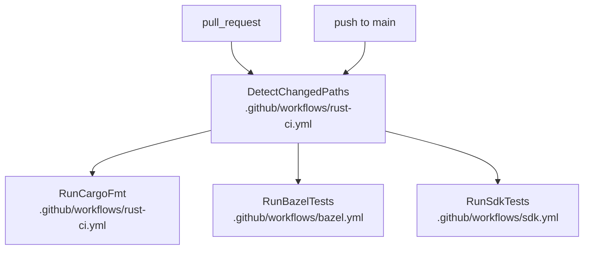
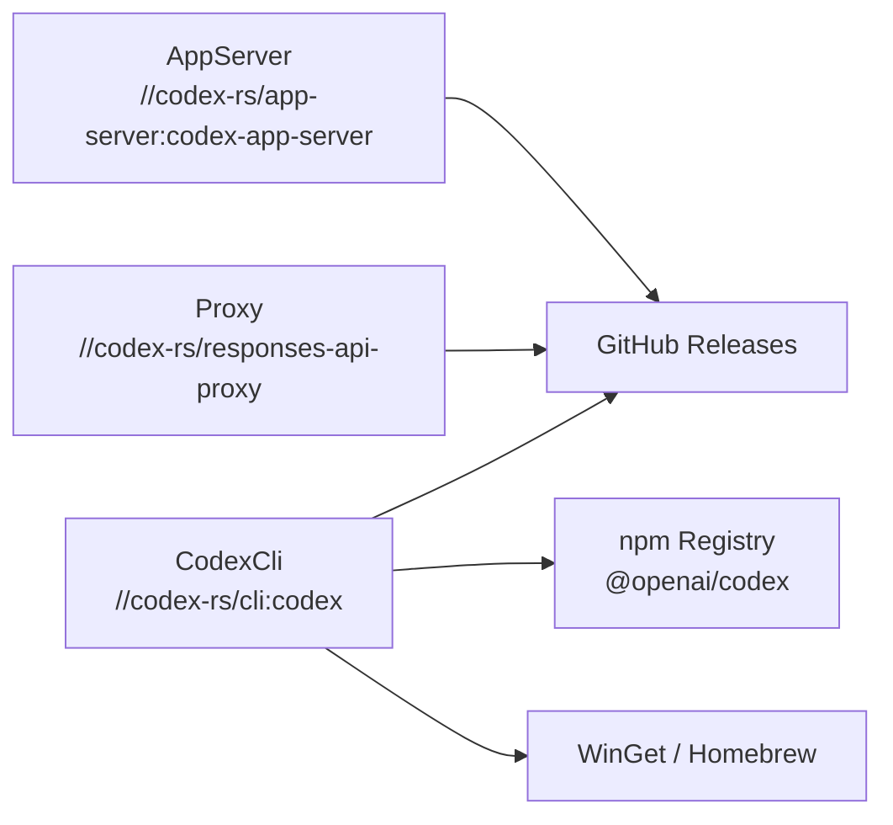

<!-- source: DeepWiki mcp.deepwiki.com · repo openai/codex · page 8 Build and Distribution · fetched 2026-10-26 -->

# Build and Distribution

Relevant source files

The following files were used as context for generating this wiki page:

- [.bazelrc](.bazelrc)
- [.github/scripts/archive-release-symbols-and-strip-binaries.sh](.github/scripts/archive-release-symbols-and-strip-binaries.sh)
- [.github/scripts/check_ci_results.py](.github/scripts/check_ci_results.py)
- [.github/scripts/run-bazel-ci.sh](.github/scripts/run-bazel-ci.sh)
- [.github/scripts/run-bazel-query-ci.sh](.github/scripts/run-bazel-query-ci.sh)
- [.github/scripts/run_bazel_with_buildbuddy.py](.github/scripts/run_bazel_with_buildbuddy.py)
- [.github/scripts/rusty_v8_bazel.py](.github/scripts/rusty_v8_bazel.py)
- [.github/scripts/test_run_bazel_with_buildbuddy.py](.github/scripts/test_run_bazel_with_buildbuddy.py)
- [.github/scripts/test_rusty_v8_bazel.py](.github/scripts/test_rusty_v8_bazel.py)
- [.github/workflows/README.md](.github/workflows/README.md)
- [.github/workflows/bazel.yml](.github/workflows/bazel.yml)
- [.github/workflows/blob-size-policy.yml](.github/workflows/blob-size-policy.yml)
- [.github/workflows/blocking-ci.yml](.github/workflows/blocking-ci.yml)
- [.github/workflows/cargo-deny.yml](.github/workflows/cargo-deny.yml)
- [.github/workflows/close-stale-contributor-prs.yml](.github/workflows/close-stale-contributor-prs.yml)
- [.github/workflows/codespell.yml](.github/workflows/codespell.yml)
- [.github/workflows/issue-deduplicator.yml](.github/workflows/issue-deduplicator.yml)
- [.github/workflows/issue-labeler.yml](.github/workflows/issue-labeler.yml)
- [.github/workflows/postmerge-ci.yml](.github/workflows/postmerge-ci.yml)
- [.github/workflows/repo-checks.yml](.github/workflows/repo-checks.yml)
- [.github/workflows/rust-ci-full.yml](.github/workflows/rust-ci-full.yml)
- [.github/workflows/rust-ci.yml](.github/workflows/rust-ci.yml)
- [.github/workflows/rust-release-argument-comment-lint.yml](.github/workflows/rust-release-argument-comment-lint.yml)
- [.github/workflows/rust-release-windows.yml](.github/workflows/rust-release-windows.yml)
- [.github/workflows/rust-release.yml](.github/workflows/rust-release.yml)
- [.github/workflows/rusty-v8-release.yml](.github/workflows/rusty-v8-release.yml)
- [.github/workflows/sdk.yml](.github/workflows/sdk.yml)
- [.github/workflows/v8-canary.yml](.github/workflows/v8-canary.yml)
- [codex-rs/docs/bazel.md](codex-rs/docs/bazel.md)
- [justfile](justfile)
- [scripts/list-bazel-clippy-targets.sh](scripts/list-bazel-clippy-targets.sh)

This document provides a high-level overview of the build system, CI/CD pipelines, and distribution infrastructure for the Codex project. It outlines how the Cargo workspace and Bazel build system interoperate to produce artifacts across supported platforms, details the CI and release workflows managed via GitHub Actions, and covers the multiple distribution channels for delivering binaries and packages.

This page serves as a parent overview and links to child pages for in-depth technical details on each topic area.

---

## Overview and Platform Matrix

The Codex build and distribution system encompasses coordinated pipelines and infrastructure components supporting development, verification, release, and delivery for a cross-platform AI coding agent. 

The build matrix covers key platform triples across Cargo and Bazel build configurations:

| Platform | Target Triples | Build Configuration / Runner |
|---|---|---|
| macOS | `aarch64-apple-darwin`, `x86_64-apple-darwin` | `macos-15-xlarge` [.github/workflows/rust-release.yml:88-90]() |
| Linux | `x86_64-unknown-linux-musl`, `aarch64-unknown-linux-musl` | MUSL cross-compilation [.github/workflows/rust-release.yml:91-92]() |
| Windows | `x86_64-pc-windows-msvc`, `aarch64-pc-windows-msvc` | MSVC static CRT policy [.github/workflows/rust-release-windows.yml:35-36](), [.bazelrc:19]() |

For more in-depth explanations, refer to child pages:
- For workspace organization, crate dependencies, and Bazel rules, see [Cargo Workspace and Bazel Build](#8.1).
- For workflows and changed path detection, see [CI Pipeline](#8.2).
- For platform build matrices and code signing, see [Release Pipeline](#8.3).
- For packaging scripts and registry publishing, see [Distribution Channels](#8.4).
- For patched shell compilation, see [Shell Tool MCP Build System](#8.5).

**Sources:**  
[.github/workflows/rust-release.yml:84-93](), [.github/workflows/rust-release-windows.yml:30-37](), [.bazelrc:19]()

---

## Cargo Workspace and Bazel Structure

Codex adopts a hybrid build system combining Cargo for Rust package management with Bazel (`.bazelrc`) for hermetic builds, caching, and remote execution.

- **Cargo Workspace:** Manages dependencies within `codex-rs/`, runs tests, and builds development binaries.
- **Bazel Build:** Orchestrates complex cross-platform builds with support for multiple toolchains, remote caching via BuildBuddy, and strict hermeticity. A shared stack size of 8 MiB (`RUST_MIN_STACK=8388608`) is configured for Rust tests to ensure stability [.bazelrc:51]().
- **Toolchain Pinned Versions:** The Rust compiler version is pinned for primary builds, with specialized nightly toolchains used for linting [.github/workflows/rust-ci.yml:73-75]().

For detailed workspace organization, crate dependency graphs, and Bzlmod rules, see [Cargo Workspace and Bazel Build](#8.1).

**Sources:**  
[.bazelrc:1-131](), [.github/workflows/rust-ci.yml:73-81](), [.bazelrc:51]()

---

## CI Pipeline

The continuous integration system ensures code quality, correctness, and compatibility across supported platforms and toolchains.

### Workflow and Change Detection

The `rust-ci.yml` workflow begins with a `changed` job (`[.github/workflows/rust-ci.yml:8-16]()`) that detects modified areas in pull requests or pushes, selectively running sub-jobs to minimize unnecessary execution.

### Diagram: CI Workflow Execution Architecture

*Sources:* [.github/workflows/rust-ci.yml:8-161](), [.github/workflows/bazel.yml:1-181](), [.github/workflows/sdk.yml:1-161]()

For details on workflow steps, test matrix configuration, and MUSL cross-compilation, see [CI Pipeline](#8.2).

**Sources:**  
[.github/workflows/rust-ci.yml:8-161](), [.github/workflows/bazel.yml:1-181](), [.github/workflows/sdk.yml:1-161]()

---

## Release Pipeline

The release workflow automates building signed, optimized production binaries and packages upon tagging a release version.

### Tag-Based Release Triggers

Releases trigger on git tags matching the regex `rust-v*.*.*` [.github/workflows/rust-release.yml:11-16]. The pipeline validates that the tag version matches the version in the `codex-rs/Cargo.toml` manifest file [.github/workflows/rust-release.yml:34-57].

### Platform Build Matrix

The release pipeline builds signed binaries and bundles for macOS, Linux (MUSL targets), and Windows (MSVC targets including PDB symbol files) [.github/workflows/rust-release.yml:84-132](), [.github/workflows/rust-release-windows.yml:25-80]().

For detailed information on platform build matrices, code signing, symbol archiving scripts, and patches, see [Release Pipeline](#8.3).

**Sources:**  
[.github/workflows/rust-release.yml:1-168](), [.github/workflows/rust-release-windows.yml:1-145]()

---

## Channels and Distribution

Codex binaries and packages are distributed through multiple channels to satisfy different user needs and platforms.

### Diagram: Distribution Target Mapping

*Sources:* [.github/workflows/rust-release.yml:90-133](), [.github/workflows/rust-release-windows.yml:7-11](), [.github/workflows/sdk.yml:147-151]()

For details on npm publishing, packaging scripts, and repository integrations, see [Distribution Channels](#8.4).

**Sources:**  
[.github/workflows/rust-release.yml:90-133](), [.github/workflows/rust-release-windows.yml:7-11](), [.github/workflows/sdk.yml:147-151]()

---

## Shell Tool MCP Build System

A specialized build pipeline exists for the `@openai/codex-shell-tool-mcp` npm package, which provides patched versions of Bash and Zsh shells supporting sandbox enforcement via an `EXEC_WRAPPER` environment variable.

For specific details on the build steps, patching, and OS variant handling, see [Shell Tool MCP Build System](#8.5).

**Sources:**  
[.github/workflows/rust-ci.yml:13-60]()

---

## References to Child Pages

- [Cargo Workspace and Bazel Build](#8.1)  
- [CI Pipeline](#8.2)  
- [Release Pipeline](#8.3)  
- [Distribution Channels](#8.4)  
- [Shell Tool MCP Build System](#8.5)

---

