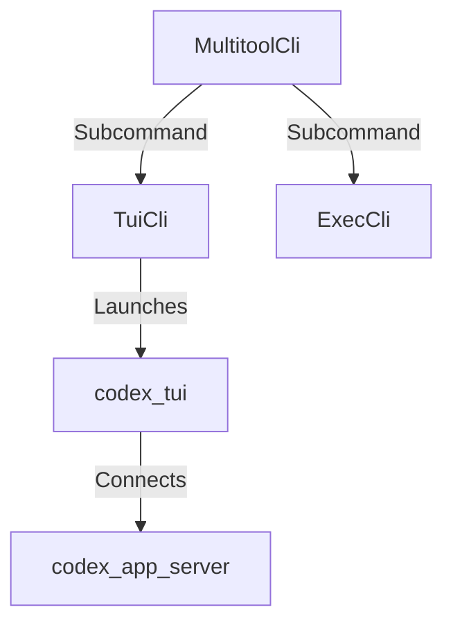
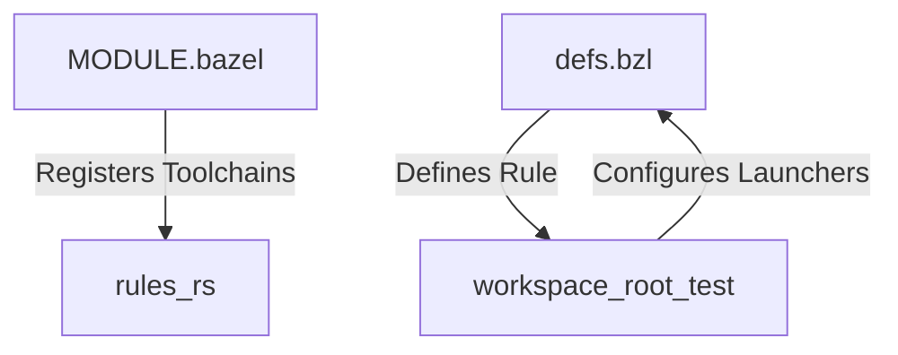

<!-- source: DeepWiki mcp.deepwiki.com · repo openai/codex · page 8.1 Cargo Workspace and Bazel Build · fetched 2026-10-26 -->

# Cargo Workspace and Bazel Build

<details>
<summary>Relevant source files</summary>

The following files were used as context for generating this wiki page:

- [BUILD.bazel](BUILD.bazel)
- [MODULE.bazel](MODULE.bazel)
- [MODULE.bazel.lock](MODULE.bazel.lock)
- [SECURITY.md](SECURITY.md)
- [codex-rs/.config/nextest.toml](codex-rs/.config/nextest.toml)
- [codex-rs/Cargo.lock](codex-rs/Cargo.lock)
- [codex-rs/Cargo.toml](codex-rs/Cargo.toml)
- [codex-rs/app-server-daemon/src/remote_control_client.rs](codex-rs/app-server-daemon/src/remote_control_client.rs)
- [codex-rs/app-server/BUILD.bazel](codex-rs/app-server/BUILD.bazel)
- [codex-rs/app-server/Cargo.toml](codex-rs/app-server/Cargo.toml)
- [codex-rs/app-server/src/extensions.rs](codex-rs/app-server/src/extensions.rs)
- [codex-rs/app-server/src/mcp_refresh.rs](codex-rs/app-server/src/mcp_refresh.rs)
- [codex-rs/cli/BUILD.bazel](codex-rs/cli/BUILD.bazel)
- [codex-rs/cli/Cargo.toml](codex-rs/cli/Cargo.toml)
- [codex-rs/cli/src/main.rs](codex-rs/cli/src/main.rs)
- [codex-rs/cli/src/remote_control_cmd.rs](codex-rs/cli/src/remote_control_cmd.rs)
- [codex-rs/cli/tests/app_server_daemon/package.rs](codex-rs/cli/tests/app_server_daemon/package.rs)
- [codex-rs/cli/tests/app_server_daemon/support.rs](codex-rs/cli/tests/app_server_daemon/support.rs)
- [codex-rs/core/BUILD.bazel](codex-rs/core/BUILD.bazel)
- [codex-rs/core/Cargo.toml](codex-rs/core/Cargo.toml)
- [codex-rs/core/src/lib.rs](codex-rs/core/src/lib.rs)
- [codex-rs/core/tests/windows_sandbox.rs](codex-rs/core/tests/windows_sandbox.rs)
- [codex-rs/tui/BUILD.bazel](codex-rs/tui/BUILD.bazel)
- [codex-rs/tui/Cargo.toml](codex-rs/tui/Cargo.toml)
- [codex-rs/utils/cargo-bin/BUILD.bazel](codex-rs/utils/cargo-bin/BUILD.bazel)
- [codex-rs/voice-host/BUILD.bazel](codex-rs/voice-host/BUILD.bazel)
- [codex-rs/windows-sandbox-rs/BUILD.bazel](codex-rs/windows-sandbox-rs/BUILD.bazel)
- [codex-rs/windows-sandbox-rs/Cargo.toml](codex-rs/windows-sandbox-rs/Cargo.toml)
- [codex-rs/windows-sandbox-rs/build.rs](codex-rs/windows-sandbox-rs/build.rs)
- [codex-rs/windows-sandbox-rs/codex-windows-sandbox-setup.manifest](codex-rs/windows-sandbox-rs/codex-windows-sandbox-setup.manifest)
- [codex-rs/windows-sandbox-rs/src/unified_exec/tests.rs](codex-rs/windows-sandbox-rs/src/unified_exec/tests.rs)
- [codex-rs/windows-sandbox-rs/tests/helper_manifest.rs](codex-rs/windows-sandbox-rs/tests/helper_manifest.rs)
- [defs.bzl](defs.bzl)
- [patches/BUILD.bazel](patches/BUILD.bazel)
- [patches/mxc-sdk_utf8_resources.patch](patches/mxc-sdk_utf8_resources.patch)
- [patches/rules_rs_windows_msvc_linker.patch](patches/rules_rs_windows_msvc_linker.patch)
- [patches/rules_rust_windows_msvc_direct_link_args.patch](patches/rules_rust_windows_msvc_direct_link_args.patch)
- [workspace_root_test_launcher.bat.tpl](workspace_root_test_launcher.bat.tpl)
- [workspace_root_test_launcher.sh.tpl](workspace_root_test_launcher.sh.tpl)

</details>


This page explains workspace organization, crate dependencies, Bazel and Bzlmod build integration in `bazel/` and `defs.bzl`, third-party vendoring, and shared tooling infrastructure across the Codex codebase.

---

## Workspace Root and Cargo Workspace Structure

The Rust workspace root is defined in `codex-rs/Cargo.toml` [codex-rs/Cargo.toml:1-160](). It unifies over 140 member crates using Cargo's workspace feature with these key properties:

- **Cargo Resolver:** Uses `resolver = "2"` for dependency resolution and feature unification [codex-rs/Cargo.toml:159]().
- **Versioning:** Workspace packages share a common development version `"0.0.0"` [codex-rs/Cargo.toml:164]().
- **Edition and License:** All crates inherit `edition = "2024"` and `license = "Apache-2.0"` centrally [codex-rs/Cargo.toml:169-170]().

```toml
[workspace]
members = [
    "core",
    "cli",
    "tui",
    "app-server",
    # ... over 140 total member crates
]

resolver = "2"

[workspace.package]
version = "0.0.0"
edition = "2024"
license = "Apache-2.0"

[workspace.dependencies]
# all shared dependencies defined here with version or path
```

This centralized workspace setup enforces consistent compiler and dependency semantics across crates and simplifies dependency upgrades.

Sources: [codex-rs/Cargo.toml:1-160]()

---

## Cargo Crate Membership and Functional Partitioning

The workspace consists of over 140 member crates defined as workspace members [codex-rs/Cargo.toml:2-160](). These are organized functionally to modularize concerns:

| Functional Area | Example Crates | Description |
|-|-|-|
| **Core Engine** | `codex-core`, `codex-protocol`, `codex-config`, `codex-rollout`, `codex-models-manager` | Core agent logic (`codex-core`), protocol data types (`codex-protocol`), configuration (`codex-config`), session persistence, model discovery. |
| **User Interfaces** | `codex-cli`, `codex-tui`, `codex-exec`, `codex-app-server` | Command-line multitool (`codex-cli` [codex-rs/cli/Cargo.toml:2]()), interactive terminal UI (`codex-tui` [codex-rs/tui/Cargo.toml:2]()), headless execution mode, JSON-RPC app server (`codex-app-server` [codex-rs/app-server/Cargo.toml:2]()). |
| **Infrastructure & Tools** | `codex-mcp`, `codex-sandboxing`, `codex-shell-command`, `codex-otel` | MCP client/server, cross-platform sandboxing, shell execution backends, telemetry. |

The modularity ensures single responsibility and supports cross-crate references with controlled dependencies via `{ workspace = true }`.

Sources: [codex-rs/Cargo.toml:2-160](), [codex-rs/core/src/lib.rs:1-190](), [codex-rs/tui/Cargo.toml:1-20](), [codex-rs/cli/Cargo.toml:1-25](), [codex-rs/app-server/Cargo.toml:1-25]()

---

## Bazel Build and Bzlmod Rules

The project uses Bazel for complex build orchestration, native dependency vendoring, and cross-language integration alongside the Cargo workspace.

### Bazel MODULE.bazel and MODULE.bazel.lock

- `MODULE.bazel` defines external Bazel module dependencies, such as `bazel_lib`, `protobuf`, `llvm`, and platform SDKs like the Windows SDK and macOS SDK [MODULE.bazel:1-144](). It includes patching rules for LLVM [MODULE.bazel:14-22]() and Abseil [MODULE.bazel:78-84]() tailored for Codex needs, managing Windows MSVC and gnullvm linker flags, and registering toolchains [MODULE.bazel:86]().
- `MODULE.bazel.lock` locks external Bazel module versions and verifies integrity hashes to ensure reproducible, hermetic build environments [MODULE.bazel.lock:1-56]().

### Bazel Build Rules and Extensions (`defs.bzl`)

- `defs.bzl` provides Bazel macro rules to wrap Rust binaries and tests, generating platform-specific launchers and environment setups [defs.bzl:1-175](). These handle Windows and bash environments, environment variable exports, and working directory setups for tests.
- Linker flags for Windows MSVC and gnullvm ABIs (`WINDOWS_RUSTC_LINK_FLAGS` [defs.bzl:16-25]()) are configured to enforce uniform binary stack sizes and proper standard library linking.
- macOS WebRTC Objective-C category requirements are preserved using `MACOS_WEBRTC_RUSTC_LINK_FLAGS` [defs.bzl:39-47]().

Sources: [MODULE.bazel:1-192](), [MODULE.bazel.lock:1-56](), [defs.bzl:1-175]()

---

## Third-Party Vendoring and Dependency Management

### Cargo Dependency Locking

- The workspace maintains a single `Cargo.lock` at `codex-rs/Cargo.lock` that is automatically generated and committed to ensure identical dependency versions across environments [codex-rs/Cargo.lock:1-263]().
- This file records checksum and version info for hundreds of packages, including cryptographic, async, and low-level crates.

### Workspace-Defined Dependencies

- All intra-workspace crates specify external dependencies under the `[workspace.dependencies]` block in the root manifest, enabling consistent versioning across all crates with minimal duplication [codex-rs/Cargo.toml:172-224]().
- Downstream crates use `{ workspace = true }` dependency declarations referencing these centralized versions [codex-rs/core/Cargo.toml:14-150](), [codex-rs/app-server/Cargo.toml:28-121]().

Sources: [codex-rs/Cargo.lock:1-263](), [codex-rs/Cargo.toml:172-224](), [codex-rs/core/Cargo.toml:14-150](), [codex-rs/app-server/Cargo.toml:28-121]()

---

## Shared Tooling and Configuration

### `workspace_root_test` Rule

The `workspace_root_test` rule defined in `defs.bzl` [defs.bzl:144-175]() is a custom Bazel test rule that ensures tests run with the correct workspace root context. This is crucial for tests that rely on relative paths or environment variables like `INSTA_WORKSPACE_ROOT`.

- **Platform-Specific Launchers**: It generates a `.bat` launcher for Windows and a shell script for Unix-like systems [defs.bzl:51-52]().
- **Environment Setup**: It sets `INSTA_WORKSPACE_ROOT` and changes the current directory to the workspace root if `chdir_workspace_root` is true [defs.bzl:133-142]().
- **Runfile Resolution**: It resolves runfiles and exports them as environment variables, allowing tests to locate data dependencies correctly [defs.bzl:104-118]().

This rule is essential for snapshot testing and other tests that depend on a consistent file system layout.

Sources: [defs.bzl:49-175]()

---

## System Architecture: Mapping Concepts to Code Entities

### Interactive CLI and UI Code Entity Mapping


Sources: [codex-rs/cli/src/main.rs:130-145](), [codex-rs/tui/Cargo.toml:17-18](), [codex-rs/app-server/Cargo.toml:20-21]()

### Bazel Build & Test Rule Entity Mapping


Sources: [MODULE.bazel:86-165](), [defs.bzl:44-143]()

---

# Summary

This page outlines how the Codex Rust codebase is structured as a large Cargo workspace with over 140 crates under unified tooling:

- A single root `Cargo.toml` controls crate membership, shared dependencies, edition, and versioning.
- Crates are grouped by functionality: core engine, user interfaces, tooling, and extensions.
- Bazel is integrated as an advanced build orchestration tool managing patches, external native dependencies, cross-platform builds, and specialized build/test wrappers.
- Strict vendoring and version locking with `Cargo.lock` and Bazel module lock files ensure reproducible builds.
- Build rules and macros in `defs.bzl` handle platform idiosyncrasies for tests and binaries.

Sources: [codex-rs/Cargo.toml:1-160](), [MODULE.bazel:1-192](), [defs.bzl:1-175]()

---

