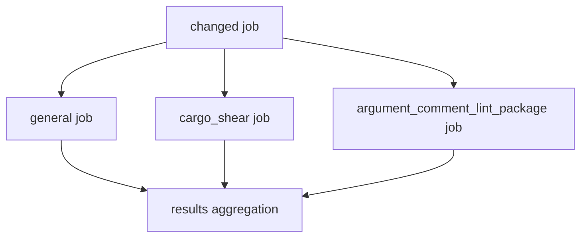
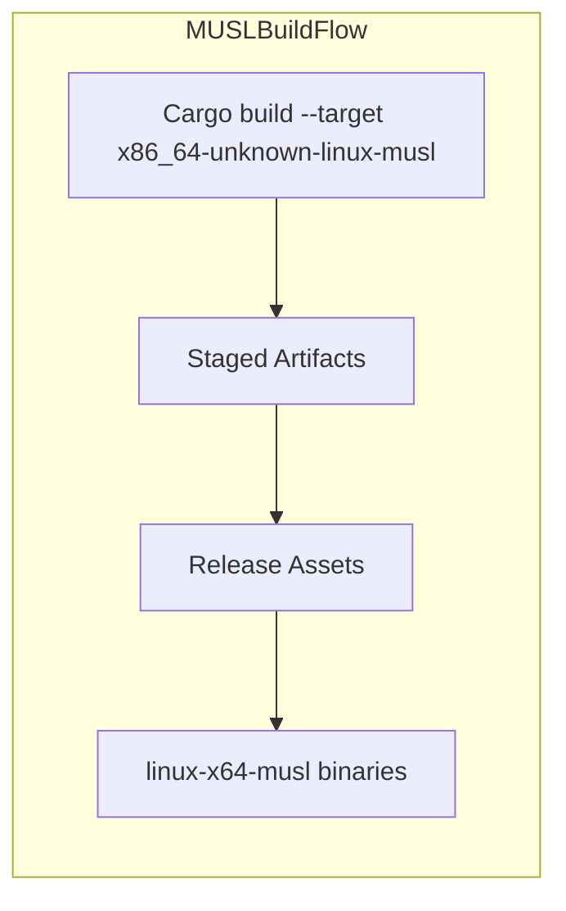
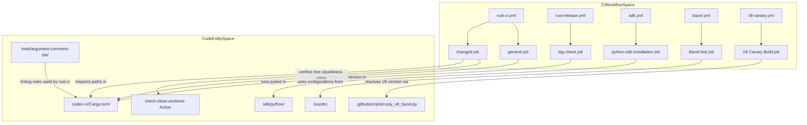
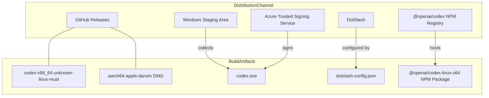

<!-- source: DeepWiki mcp.deepwiki.com · repo openai/codex · page 8.2 CI Pipeline · fetched 2026-10-26 -->

# CI Pipeline

Relevant source files

The following files were used as context for generating this wiki page:

- [.bazelrc](.bazelrc)
- [.github/scripts/archive-release-symbols-and-strip-binaries.sh](.github/scripts/archive-release-symbols-and-strip-binaries.sh)
- [.github/scripts/check_ci_results.py](.github/scripts/check_ci_results.py)
- [.github/scripts/run-bazel-ci.sh](.github/scripts/run-bazel-ci.sh)
- [.github/scripts/run-bazel-query-ci.sh](.github/scripts/run-bazel-query-ci.sh)
- [.github/scripts/run_bazel_with_buildbuddy.py](.github/scripts/run_bazel_with_buildbuddy.py)
- [.github/scripts/rusty_v8_bazel.py](.github/scripts/rusty_v8_bazel.py)
- [.github/scripts/test_run_bazel_with_buildbuddy.py](.github/scripts/test_run_bazel_with_buildbuddy.py)
- [.github/scripts/test_rusty_v8_bazel.py](.github/scripts/test_rusty_v8_bazel.py)
- [.github/workflows/README.md](.github/workflows/README.md)
- [.github/workflows/bazel.yml](.github/workflows/bazel.yml)
- [.github/workflows/blob-size-policy.yml](.github/workflows/blob-size-policy.yml)
- [.github/workflows/blocking-ci.yml](.github/workflows/blocking-ci.yml)
- [.github/workflows/cargo-deny.yml](.github/workflows/cargo-deny.yml)
- [.github/workflows/close-stale-contributor-prs.yml](.github/workflows/close-stale-contributor-prs.yml)
- [.github/workflows/codespell.yml](.github/workflows/codespell.yml)
- [.github/workflows/issue-deduplicator.yml](.github/workflows/issue-deduplicator.yml)
- [.github/workflows/issue-labeler.yml](.github/workflows/issue-labeler.yml)
- [.github/workflows/postmerge-ci.yml](.github/workflows/postmerge-ci.yml)
- [.github/workflows/repo-checks.yml](.github/workflows/repo-checks.yml)
- [.github/workflows/rust-ci-full.yml](.github/workflows/rust-ci-full.yml)
- [.github/workflows/rust-ci.yml](.github/workflows/rust-ci.yml)
- [.github/workflows/rust-release-argument-comment-lint.yml](.github/workflows/rust-release-argument-comment-lint.yml)
- [.github/workflows/rust-release-windows.yml](.github/workflows/rust-release-windows.yml)
- [.github/workflows/rust-release.yml](.github/workflows/rust-release.yml)
- [.github/workflows/rusty-v8-release.yml](.github/workflows/rusty-v8-release.yml)
- [.github/workflows/sdk.yml](.github/workflows/sdk.yml)
- [.github/workflows/v8-canary.yml](.github/workflows/v8-canary.yml)
- [codex-rs/docs/bazel.md](codex-rs/docs/bazel.md)
- [justfile](justfile)
- [scripts/list-bazel-clippy-targets.sh](scripts/list-bazel-clippy-targets.sh)

This page documents the continuous integration (CI) workflows that gate pull requests and pushes to the `main` branch of the `openai/codex` repository. It covers the Rust-specific `rust-ci` workflow, the Bazel-backed build and test system, the specialized argument-comment linting, and the MUSL cross-compilation setup. Also included are details on changed path detection, lint/test matrix, and integration of SDK testing.

---

## Trigger Conditions

| Workflow | File | Triggers |
|---|---|---|
| `rust-ci` | [`.github/workflows/rust-ci.yml:2-4`]() | `workflow_call`, `workflow_dispatch` |
| `rust-ci-full` | [`.github/workflows/rust-ci-full.yml:2-9`]() | `push` to `main` or `**full-ci**`, `workflow_dispatch` |
| `rust-release` | [`.github/workflows/rust-release.yml:12-15`]() | Tag push `rust-v*.*.*` |
| `sdk` | [`.github/workflows/sdk.yml:3-4`]() | `workflow_call` |
| `rust-release-windows`| [`.github/workflows/rust-release-windows.yml:3-4`]() | `workflow_call` |
| `bazel` | [`.github/workflows/bazel.yml:7-8`]() | `workflow_call`, `workflow_dispatch` |
| `v8-canary` | [`.github/workflows/v8-canary.yml:8-10`]() | `workflow_call`, `pull_request`, `workflow_dispatch` |

Sources: [`.github/workflows/rust-ci.yml:2-4`](), [`.github/workflows/rust-ci-full.yml:2-9`](), [`.github/workflows/rust-release.yml:12-15`](), [`.github/workflows/sdk.yml:3-4`](), [`.github/workflows/rust-release-windows.yml:3-4`](), [`.github/workflows/bazel.yml:7-8`](), [`.github/workflows/v8-canary.yml:8-10`]()

---

## rust-ci Workflow Overview

The `rust-ci` workflow is optimized for quick pull request feedback by detecting changed paths and running only relevant jobs. It primarily handles formatting checks, lightweight linting, and dependency auditing.

### rust-ci Job Dependency Diagram

Sources: [`.github/workflows/rust-ci.yml:6-168`]()

---

## Change Detection (`changed` job)

The `changed` job detects which areas of the codebase have been modified in the pull request or manual workflow dispatch:

- Uses `git diff --name-only` between PR base and head commits [`.github/workflows/rust-ci.yml:32-33`]().
- On manual triggers with no diffs, falls back to a forced set of changed paths [`.github/workflows/rust-ci.yml:35-36`]().
- Sets boolean outputs gating subsequent job execution [`.github/workflows/rust-ci.yml:50-53`]().

| Output | Detection Logic / Paths Checked |
|---|---|
| `codex` | True if any file under `codex-rs/*` changed [`.github/workflows/rust-ci.yml:43`]() |
| `argument_comment_lint` | True if files in `codex-rs/*`, `tools/argument-comment-lint/*`, or `justfile`, `defs.bzl`, or `.tpl` changed [`.github/workflows/rust-ci.yml:44-45`]() |
| `argument_comment_lint_package` | True if files under `tools/argument-comment-lint/*` or workflows `rust-ci.yml` or `rust-ci-full.yml` changed [`.github/workflows/rust-ci.yml:46`]() |
| `workflows` | True if any file under `.github/*` changed [`.github/workflows/rust-ci.yml:47`]() |

This gating mechanism enables fast feedback by limiting which jobs are run based on the scope of changes.

Sources: [`.github/workflows/rust-ci.yml:8-54`]()

---

## Lint/Test Matrix

The CI runs a matrix of lint and build jobs across multiple targeted platforms and profiles. This ensures cross-platform correctness and performance safety.

| OS | Target Triple | Profile | Use Case | Source Reference |
|---|---|---|---|---|
| macOS 15 | `aarch64-apple-darwin` | `dev` / `release` | Primary Apple Silicon | [rust-ci-full.yml:142-144]() |
| macOS 15 | `x86_64-apple-darwin` | `dev` / `release` | Legacy Intel Mac | [rust-ci-full.yml:145-147]() |
| Ubuntu 24.04 | `x86_64-unknown-linux-musl`| `dev` / `release` | Static Linux Binaries | [rust-ci-full.yml:148-150]() |
| Ubuntu 24.04 | `aarch64-unknown-linux-musl`| `dev` / `release` | ARM64 Linux | [rust-ci-full.yml:160-162]() |
| Windows | `x86_64-pc-windows-msvc` | `release`| Standard Windows | [rust-release-windows.yml:33-40]()|
| Windows | `aarch64-pc-windows-msvc` | `release`| ARM64 Windows | [rust-release-windows.yml:33-47]()|

### Additional Validation and Security Auditing

- **Cargo Shear**: Detects and removes unused dependencies in workspace `Cargo.toml` files to ensure minimal dependencies and reduce attack surface [`.github/workflows/rust-ci.yml:103`]().
- **Clean Worktree Checks**: `check-clean-worktree` GitHub Action ensures no uncommitted modifications remain after CI steps [`.github/workflows/rust-ci.yml:55-57`]().

Sources: [`.github/workflows/rust-ci-full.yml:123-172`](), [`.github/workflows/rust-release-windows.yml:30-81`](), [`.github/workflows/rust-ci.yml:85-107`]()

---

## Argument Comment Linting

Codex enforces a coding style requiring inline argument name comments for literal positional arguments (like `true`, `false`, `None`) to improve code clarity and maintainability.

### Implementation Details

- Custom lint implemented with the Dylint framework in the `tools/argument-comment-lint/` directory.
- Requires a nightly Rust toolchain with components: `rustc-dev`, `rust-src`, `llvm-tools-preview` [`.github/workflows/rust-ci.yml:126-132`]().
- Uses `cargo-dylint` and `dylint-link` version `6.1.0` [`.github/workflows/rust-ci.yml:115-116`]().
- Python scripts (`run.py` and `wrapper_common.py`) integrate the linter for tests and CI [`.github/workflows/rust-ci.yml:150-153`]().
- Bazel integration enforces argument comment linting via the `--config=argument-comment-lint` Bazel build configuration [`.bazelrc:127`]().

The lint runs conditionally in `rust-ci` [`.github/workflows/rust-ci.yml:109-113`]() and more exhaustively in `rust-ci-full` CI jobs [`.github/workflows/rust-ci-full.yml:92-121`()].

Sources: [`.github/workflows/rust-ci.yml:109-161`](), [`.github/workflows/rust-ci-full.yml:50-121`](), [`.bazelrc:127`]()

---

## MUSL Cross-Compilation Setup

To produce portable, static Linux binaries that run across various Linux distributions without glibc issues, Codex cross-compiles several binaries targeting MUSL.

### MUSL Build Pipeline Details

- `rust-release.yml` workflow provisions specialized Linux runners:
  - Linux x64 MUSL: `x86_64-unknown-linux-musl` [`.github/workflows/rust-release.yml:121`]().
  - Linux ARM64 MUSL: `aarch64-unknown-linux-musl` [`.github/workflows/rust-release.yml:133`]().
- These runners build the `primary` bundle binaries: `codex`, `codex-code-mode-host`, `codex-responses-api-proxy`, and additionally the `bwrap` sandboxing utility [`.github/workflows/rust-release.yml:124-125`]().
- Rust toolchain uses `dtolnay/rust-toolchain` action configured at version `1.95.0` to build targets [`.github/workflows/rust-release.yml:33`]().

### MUSL Binary Build Flow

Sources: [`.github/workflows/rust-release.yml:110-144`]()

---

## Bazel Workflow

A separate Bazel-backed workflow manages large-scale testing and build verification, supporting:

- MacOS Intel & Apple Silicon [`.github/workflows/bazel.yml:28-32`]().
- Linux GNU and MUSL variants [`.github/workflows/bazel.yml:34-38`]().
- Windows with cross-compilation and multiple shards for test parallelism [`.github/workflows/bazel.yml:142-155`]().

### Bazel CI Matrix

The Bazel workflow runs tests across multiple OS/targets defined in a matrix including a sharded Windows cross-compiled test job for better scalability [`.github/workflows/bazel.yml:24-45`](). It uses a custom `prepare-bazel-ci` GitHub Action for environment setup and caching [`.github/workflows/bazel.yml:59-64`]().

The Bazel tests exclude some V8 targets to reduce flakiness but build all other project targets [`.github/workflows/bazel.yml:88-100`](). The workflow uploads execution logs [`.github/workflows/bazel.yml:119-126`]() and preserves Bazel repository caches for faster incremental builds [`.github/workflows/bazel.yml:130-137`()].

Sources: [`.github/workflows/bazel.yml:16-180`](), [.github/actions/prepare-bazel-ci/action.yml]()

---

## SDK Testing Integration

The `sdk.yml` workflow validates both the Python and TypeScript SDKs to ensure stable external integration.

### Python SDK Testing

- Runs in a `python:3.12-slim` container [`.github/workflows/sdk.yml:28`]().
- Builds and installs the SDK wheel using `uv` [`.github/workflows/sdk.yml:31-34`]().
- Runs smoke tests with `pytest` [`.github/workflows/sdk.yml:35`]().
- Isolated environment setup with temporary home and virtual environments ensure cleanliness [`.github/workflows/sdk.yml:22-26`]().

### TypeScript SDK Testing

- Uses `pnpm` tool for dependency installation, build, lint, and test [`.github/workflows/sdk.yml:60-68`]().
- Depends on Bazel-built `codex` and `codex-code-mode-host` binaries staged to a known directory to test against a real CLI [`.github/workflows/sdk.yml:77-96`]().

Sources: [`.github/workflows/sdk.yml:7-167`]()

---

## Issue Triage Automation

The CI includes GitHub Actions for issue triage:

- **Issue Labeler**: Uses `openai/codex-action` to classify new issues into labels such as `bug`, `enhancement`, `documentation`, along with product-specific and area labels [`.github/workflows/issue-labeler.yml:22-83`]().
- **Issue Deduplicator**: Runs a two-phase AI-assisted duplicate detection:
  - Pass 1 compares the new issue to all recent issues.
  - Pass 2 (fallback) searches open issues if no duplicates are found in pass 1.

This automation uses Codex-powered analysis to support maintainers.

Sources: [`.github/workflows/issue-labeler.yml:1-154`](), [.github/workflows/issue-deduplicator.yml]()

---

## Release and Distribution

The `rust-release` workflow handles production builds triggered on version tags (`rust-v*.*.*`) [`.github/workflows/rust-release.yml:12-15`]().

### Release Bundles

- **Primary bundle**: `codex`, `codex-code-mode-host`, `codex-responses-api-proxy` [`.github/workflows/rust-release.yml:99`]().
- **App-server bundle**: `codex-app-server` + `codex-code-mode-host` [`.github/workflows/rust-release.yml:105`]().
- **Helpers bundle (Windows only)**: contains sandbox and command runner utilities [`.github/workflows/rust-release-windows.yml:56`]().

### Signing and Packaging

- Windows binaries are signed with Azure Trusted Signing via a dedicated GitHub Action [`.github/workflows/rust-release-windows.yml:121-124`]().
- The `build_npm_package.py` script stages native binaries into platform-specific npm packages (e.g., for Linux x64) [codex-cli/scripts/build_npm_package.py]().
- The `.github/dotslash-config.json` configures DotSlash for managing platform-specific releases and tool paths [.github/dotslash-config.json]().

Sources: [`.github/workflows/rust-release.yml:84-144`](), [`.github/workflows/rust-release-windows.yml:30-81`](), [.github/dotslash-config.json](), [.github/actions/windows-code-sign/action.yml](), [codex-cli/scripts/build_npm_package.py]()

---

## Natural Language to Code Entity Mapping

### CI Workflow Entity Mapping

Sources: [`.github/workflows/rust-ci.yml:8-58`](), [`.github/workflows/rust-release.yml:27-59`](), [`.github/workflows/sdk.yml:7-40`](), [`.github/workflows/bazel.yml:17-107`](), [`.github/workflows/v8-canary.yml:38-44`](), [`.bazelrc:1-282`](), [`.github/scripts/rusty_v8_bazel.py`]()

---

### Distribution Entity Mapping

Sources: [`.github/workflows/rust-release.yml:84-144`](), [`.github/workflows/rust-release-windows.yml:120-135`](), [.github/dotslash-config.json](), [.github/actions/windows-code-sign/action.yml](), [codex-cli/scripts/build_npm_package.py]()

---

# Summary

The Codex CI pipeline uses a combination of Rust-native, Bazel, and custom GitHub Action workflows that intelligently detect changes, run selective jobs, and cross-compile for multiple platforms including MUSL static Linux binaries. This ensures fast feedback during development, high-quality consistent releases, and comprehensive SDK validation, all coordinated by sophisticated dependency and linting workflows plus AI-assisted issue triage automation.

---

