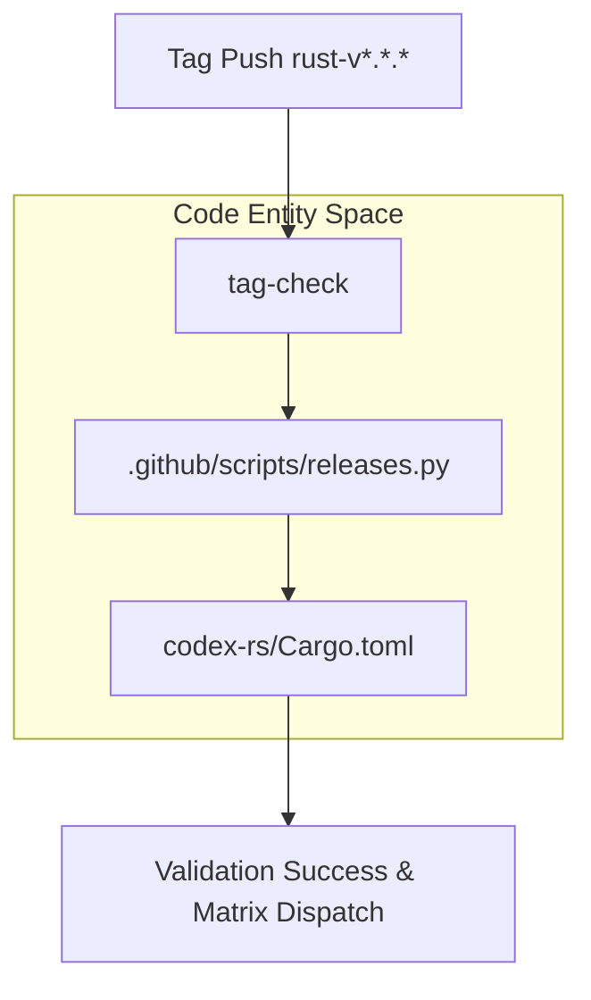
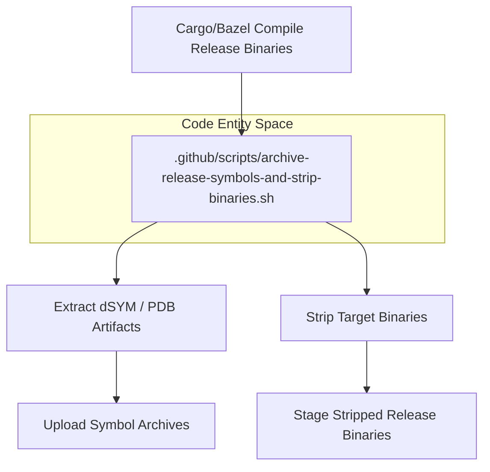

<!-- source: DeepWiki mcp.deepwiki.com · repo openai/codex · page 8.3 Release Pipeline · fetched 2026-10-26 -->

# Release Pipeline

Relevant source files

The following files were used as context for generating this wiki page:

- [.bazelrc](.bazelrc)
- [.github/scripts/archive-release-symbols-and-strip-binaries.sh](.github/scripts/archive-release-symbols-and-strip-binaries.sh)
- [.github/scripts/check_ci_results.py](.github/scripts/check_ci_results.py)
- [.github/scripts/run-bazel-ci.sh](.github/scripts/run-bazel-ci.sh)
- [.github/scripts/run-bazel-query-ci.sh](.github/scripts/run-bazel-query-ci.sh)
- [.github/scripts/run_bazel_with_buildbuddy.py](.github/scripts/run_bazel_with_buildbuddy.py)
- [.github/scripts/rusty_v8_bazel.py](.github/scripts/rusty_v8_bazel.py)
- [.github/scripts/test_run_bazel_with_buildbuddy.py](.github/scripts/test_run_bazel_with_buildbuddy.py)
- [.github/scripts/test_rusty_v8_bazel.py](.github/scripts/test_rusty_v8_bazel.py)
- [.github/workflows/README.md](.github/workflows/README.md)
- [.github/workflows/bazel.yml](.github/workflows/bazel.yml)
- [.github/workflows/blob-size-policy.yml](.github/workflows/blob-size-policy.yml)
- [.github/workflows/blocking-ci.yml](.github/workflows/blocking-ci.yml)
- [.github/workflows/cargo-deny.yml](.github/workflows/cargo-deny.yml)
- [.github/workflows/close-stale-contributor-prs.yml](.github/workflows/close-stale-contributor-prs.yml)
- [.github/workflows/codespell.yml](.github/workflows/codespell.yml)
- [.github/workflows/issue-deduplicator.yml](.github/workflows/issue-deduplicator.yml)
- [.github/workflows/issue-labeler.yml](.github/workflows/issue-labeler.yml)
- [.github/workflows/postmerge-ci.yml](.github/workflows/postmerge-ci.yml)
- [.github/workflows/repo-checks.yml](.github/workflows/repo-checks.yml)
- [.github/workflows/rust-ci-full.yml](.github/workflows/rust-ci-full.yml)
- [.github/workflows/rust-ci.yml](.github/workflows/rust-ci.yml)
- [.github/workflows/rust-release-argument-comment-lint.yml](.github/workflows/rust-release-argument-comment-lint.yml)
- [.github/workflows/rust-release-windows.yml](.github/workflows/rust-release-windows.yml)
- [.github/workflows/rust-release.yml](.github/workflows/rust-release.yml)
- [.github/workflows/rusty-v8-release.yml](.github/workflows/rusty-v8-release.yml)
- [.github/workflows/sdk.yml](.github/workflows/sdk.yml)
- [.github/workflows/v8-canary.yml](.github/workflows/v8-canary.yml)
- [MODULE.bazel](MODULE.bazel)
- [MODULE.bazel.lock](MODULE.bazel.lock)
- [codex-rs/Cargo.lock](codex-rs/Cargo.lock)
- [codex-rs/Cargo.toml](codex-rs/Cargo.toml)
- [codex-rs/app-server/Cargo.toml](codex-rs/app-server/Cargo.toml)
- [codex-rs/app-server/src/extensions.rs](codex-rs/app-server/src/extensions.rs)
- [codex-rs/app-server/src/mcp_refresh.rs](codex-rs/app-server/src/mcp_refresh.rs)
- [codex-rs/cli/Cargo.toml](codex-rs/cli/Cargo.toml)
- [codex-rs/cli/src/main.rs](codex-rs/cli/src/main.rs)
- [codex-rs/core/Cargo.toml](codex-rs/core/Cargo.toml)
- [codex-rs/core/src/lib.rs](codex-rs/core/src/lib.rs)
- [codex-rs/docs/bazel.md](codex-rs/docs/bazel.md)
- [codex-rs/tui/Cargo.toml](codex-rs/tui/Cargo.toml)
- [justfile](justfile)
- [patches/BUILD.bazel](patches/BUILD.bazel)
- [patches/mxc-sdk_utf8_resources.patch](patches/mxc-sdk_utf8_resources.patch)
- [patches/rules_rs_windows_msvc_linker.patch](patches/rules_rs_windows_msvc_linker.patch)
- [patches/rules_rust_windows_msvc_direct_link_args.patch](patches/rules_rust_windows_msvc_direct_link_args.patch)
- [scripts/list-bazel-clippy-targets.sh](scripts/list-bazel-clippy-targets.sh)

## Purpose and Scope

The Codex release pipeline defines the CI/CD execution flow responsible for compiling, code signing, symbol archiving, and packaging Codex binaries across target platforms. Defined primarily in [.github/workflows/rust-release.yml]() and [.github/workflows/rust-release-windows.yml](), the pipeline handles target triples for macOS (`aarch64-apple-darwin`, `x86_64-apple-darwin`), Linux (`x86_64-unknown-linux-musl`, `aarch64-unknown-linux-musl`), and Windows (`x86_64-pc-windows-msvc`, `aarch64-pc-windows-msvc`) [[.github/workflows/rust-release.yml:88-92](), [.github/workflows/rust-release-windows.yml:34-36]()].

The pipeline produces modular distribution bundles categorized by binary sets (`primary`, `app-server`, and `helpers`), applies platform-specific cryptographic code signing, archives debug symbols, and stages artifacts for npm and DotSlash publishing.

Sources: [.github/workflows/rust-release.yml:1-19](), [.github/workflows/rust-release-windows.yml:1-10]()

---

## Release Trigger and Tag Validation

Release execution is strictly gated by version-matching Git tags conforming to the `rust-v*.*.*` pattern [[.github/workflows/rust-release.yml:12-15]()]. The initial validation step is handled by the `tag-check` GitHub Actions job [[.github/workflows/rust-release.yml:27-58]()].

**Diagram: Release Trigger and Tag Validation Flow**

### Validation Steps
1. **Ref Type Verification:** Asserts that `GITHUB_REF_TYPE` equals `tag` [[.github/workflows/rust-release.yml:41-42]()].
2. **Format and Version Parse:** Invokes `.github/scripts/releases.py` with the extracted tag version [[.github/workflows/rust-release.yml:44-47]()].
3. **Manifest Alignment:** Parses `codex-rs/Cargo.toml` to verify that the version string matches the Git tag version [[.github/workflows/rust-release.yml:49-54]()].

Sources: [.github/workflows/rust-release.yml:12-59]()

---

## Platform Build Matrix and Bundles

The build infrastructure fans out across high-performance runners, using target-specific profiles, environment variables, and binary groupings.

### Build Matrix Configuration

| Runner | Target Triple | Bundle | Binaries Included | Source Configuration |
| :--- | :--- | :--- | :--- | :--- |
| `macos-15-xlarge` | `aarch64-apple-darwin` | `primary` | `codex codex-code-mode-host codex-responses-api-proxy` | [.github/workflows/rust-release.yml:95-100]() |
| `macos-15-xlarge` | `aarch64-apple-darwin` | `app-server` | `codex-app-server codex-code-mode-host` | [.github/workflows/rust-release.yml:101-106]() |
| `linux-x64-xl` | `x86_64-unknown-linux-musl` | `primary` | `codex codex-code-mode-host codex-responses-api-proxy bwrap` | [.github/workflows/rust-release.yml:120-125]() |
| `windows-x64` | `x86_64-pc-windows-msvc` | `helpers` | `codex-windows-sandbox-setup codex-windows-sandbox-service codex-command-runner` | [.github/workflows/rust-release-windows.yml:53-56]() |

### Build Environment Adjustments
- **Split Debug Info:** macOS builds set `CARGO_PROFILE_RELEASE_SPLIT_DEBUGINFO=packed` to bundle `dSYM` debug information before stripping [[.github/workflows/rust-release.yml:79-80]()].
- **Git Transport:** `CARGO_NET_GIT_FETCH_WITH_CLI="true"` forces Cargo to use the system git executable, bypassing SecureTransport failures with nested submodules on macOS runners [[.github/workflows/rust-release.yml:81-82]()].

Sources: [.github/workflows/rust-release.yml:59-144](), [.github/workflows/rust-release-windows.yml:10-81]()

---

## Code Signing and Security Practices

Artifact security and cryptographic integrity are enforced per platform prior to distribution:

- **macOS Signing:** Binaries and disk images are signed with Apple Developer credentials inside a protected `codesigning` GitHub Actions environment [[.github/workflows/rust-release.yml:8-9]()].
- **Windows Trusted Signing:** Executables (`.exe`) and program database files (`.pdb`) are signed using Azure Trusted Signing via Azure Key Vault integration [[.github/workflows/rust-release-windows.yml:10-17]()].
- **Linux Cosign:** MUSL-linked static Linux binaries are signed using `cosign` to support verified independent deployments [[.github/workflows/rust-release.yml:8-9]()].

Sources: [.github/workflows/rust-release.yml:8-9](), [.github/workflows/rust-release-windows.yml:10-20]()

---

## Symbol Archiving and Debug Info Stripping

To keep release binaries lightweight while preserving crash analysis capabilities, debug symbols are extracted, archived, and stripped prior to packaging.

**Diagram: Symbol Archiving and Stripping Workflow**

The script `.github/scripts/archive-release-symbols-and-strip-binaries.sh` handles symbol extraction for platform binaries, ensuring symbol server compatibility and clean stripping of release deliverables.

Sources: [.github/workflows/rust-release.yml:78-80](), [.github/workflows/rust-release-windows.yml:151-162]()

---

## Patches Directory and Cross-Compilation Infrastructure

Codex maintains a dedicated `patches/` directory integrated via Bazel (`MODULE.bazel`) to resolve upstream limitations and build dependencies across target architectures.

### Key Patch Definitions

| Patch File | Target Dependency / Subsystem | Purpose | Source Reference |
| :--- | :--- | :--- | :--- |
| `llvm_rusty_v8_custom_libcxx.patch` | `llvm` / `v8` | Customizes libc++ configuration for hermetic cross-compilation | [MODULE.bazel:14-22]() |
| `llvm_windows_arm64_powl.patch` | `llvm` | Fixes missing math symbols for Windows ARM64 targets | [MODULE.bazel:14-22]() |
| `abseil_windows_gnullvm_thread_identity.patch` | `abseil-cpp` | Forces portable C++11 thread-local storage for Windows gnullvm toolchains | [MODULE.bazel:78-84]() |
| `rules_cc_rusty_v8_custom_libcxx.patch` | `rules_cc` | Customizes libc++ configuration for `rules_cc` | [MODULE.bazel:154-160]() |
| `rules_foreign_cc_make_cppflags.patch` | `rules_foreign_cc` | Adjusts `cppflags` for foreign C/C++ builds | [MODULE.bazel:167-176]() |

Sources: [MODULE.bazel:11-34](), [MODULE.bazel:78-84](), [MODULE.bazel:154-176]()

---

## Artifact Packaging and Distribution

The final stages of the pipeline organize compiled binaries into structured distribution packages and DotSlash configurations.

- **NPM Packaging Script:** Scripts package raw platform outputs into architecture-specific sub-packages and a root `@openai/codex` wrapper [[.github/workflows/rust-release.yml:1-135]()].
- **DotSlash Integration:** Configuration indexes compressed `zstd` binary artifacts to enable fast execution via DotSlash across developer environments [[.github/workflows/rust-release.yml:1-135]()].

Sources: [.github/workflows/rust-release.yml:1-135]()

---

