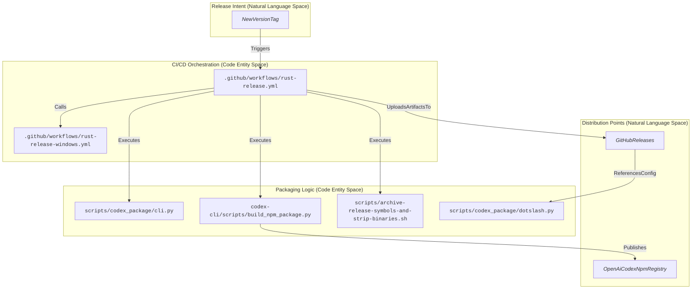
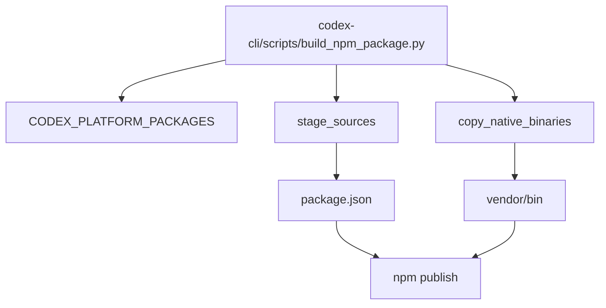
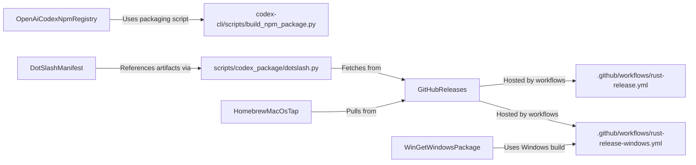
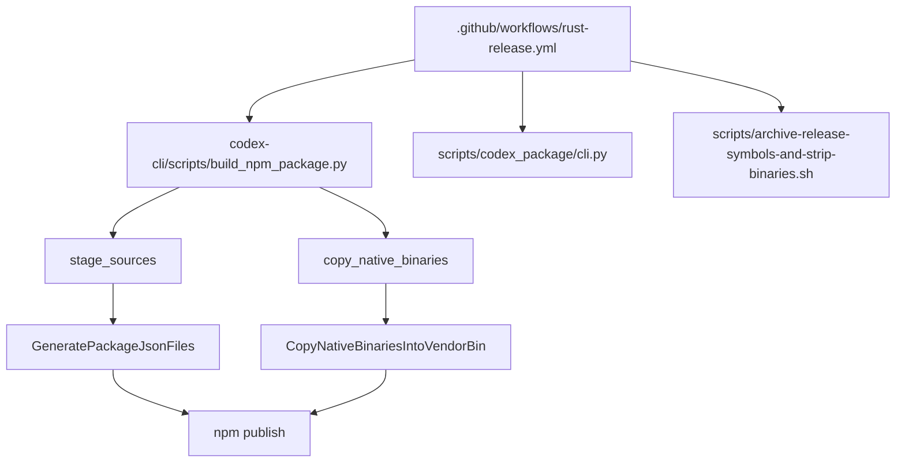

<!-- source: DeepWiki mcp.deepwiki.com · repo openai/codex · page 8.4 Distribution Channels · fetched 2026-10-26 -->

# Distribution Channels

<details>
<summary>Relevant source files</summary>

The following files were used as context for generating this wiki page:

- [.github/actions/linux-code-sign/action.yml](.github/actions/linux-code-sign/action.yml)
- [.github/actions/windows-code-sign/action.yml](.github/actions/windows-code-sign/action.yml)
- [.github/dotslash-config.json](.github/dotslash-config.json)
- [codex-cli/scripts/README.md](codex-cli/scripts/README.md)
- [codex-cli/scripts/build_npm_package.py](codex-cli/scripts/build_npm_package.py)
- [codex-rs/app-server-daemon/Cargo.toml](codex-rs/app-server-daemon/Cargo.toml)
- [codex-rs/app-server-daemon/README.md](codex-rs/app-server-daemon/README.md)
- [codex-rs/app-server-daemon/src/backend/mod.rs](codex-rs/app-server-daemon/src/backend/mod.rs)
- [codex-rs/app-server-daemon/src/backend/pid.rs](codex-rs/app-server-daemon/src/backend/pid.rs)
- [codex-rs/app-server-daemon/src/backend/pid_start.rs](codex-rs/app-server-daemon/src/backend/pid_start.rs)
- [codex-rs/app-server-daemon/src/backend/pid_tests.rs](codex-rs/app-server-daemon/src/backend/pid_tests.rs)
- [codex-rs/app-server-daemon/src/background_command.rs](codex-rs/app-server-daemon/src/background_command.rs)
- [codex-rs/app-server-daemon/src/client.rs](codex-rs/app-server-daemon/src/client.rs)
- [codex-rs/app-server-daemon/src/lib.rs](codex-rs/app-server-daemon/src/lib.rs)
- [codex-rs/app-server-daemon/src/managed_install.rs](codex-rs/app-server-daemon/src/managed_install.rs)
- [codex-rs/app-server-daemon/src/managed_install_path_tests.rs](codex-rs/app-server-daemon/src/managed_install_path_tests.rs)
- [codex-rs/app-server-daemon/src/managed_install_tests.rs](codex-rs/app-server-daemon/src/managed_install_tests.rs)
- [codex-rs/app-server-daemon/src/manual_update.rs](codex-rs/app-server-daemon/src/manual_update.rs)
- [codex-rs/app-server-daemon/src/migration.rs](codex-rs/app-server-daemon/src/migration.rs)
- [codex-rs/app-server-daemon/src/prepare_install.rs](codex-rs/app-server-daemon/src/prepare_install.rs)
- [codex-rs/app-server-daemon/src/prepare_install_tests.rs](codex-rs/app-server-daemon/src/prepare_install_tests.rs)
- [codex-rs/app-server-daemon/src/prepare_install_windows.rs](codex-rs/app-server-daemon/src/prepare_install_windows.rs)
- [codex-rs/app-server-daemon/src/prepare_install_windows_tests.rs](codex-rs/app-server-daemon/src/prepare_install_windows_tests.rs)
- [codex-rs/app-server-daemon/src/release_pruning.rs](codex-rs/app-server-daemon/src/release_pruning.rs)
- [codex-rs/app-server-daemon/src/settings.rs](codex-rs/app-server-daemon/src/settings.rs)
- [codex-rs/app-server-daemon/src/settings_tests.rs](codex-rs/app-server-daemon/src/settings_tests.rs)
- [codex-rs/app-server-daemon/src/update_loop.rs](codex-rs/app-server-daemon/src/update_loop.rs)
- [codex-rs/app-server-daemon/src/update_loop_tests.rs](codex-rs/app-server-daemon/src/update_loop_tests.rs)
- [codex-rs/app-server-transport/src/daemon_shutdown.rs](codex-rs/app-server-transport/src/daemon_shutdown.rs)
- [codex-rs/app-server/tests/suite/v2/otel.rs](codex-rs/app-server/tests/suite/v2/otel.rs)
- [codex-rs/cli/tests/app_server_daemon.rs](codex-rs/cli/tests/app_server_daemon.rs)
- [codex-rs/cli/tests/app_server_daemon_windows.rs](codex-rs/cli/tests/app_server_daemon_windows.rs)
- [codex-rs/cli/tests/daemon_startup.rs](codex-rs/cli/tests/daemon_startup.rs)
- [codex-rs/cli/tests/daemon_telemetry.rs](codex-rs/cli/tests/daemon_telemetry.rs)
- [codex-rs/cli/tests/worktree.rs](codex-rs/cli/tests/worktree.rs)
- [codex-rs/core/tests/suite/cli_stream.rs](codex-rs/core/tests/suite/cli_stream.rs)
- [codex-rs/exec/src/cli.rs](codex-rs/exec/src/cli.rs)
- [codex-rs/exec/src/cli_tests.rs](codex-rs/exec/src/cli_tests.rs)
- [codex-rs/exec/tests/suite/mod.rs](codex-rs/exec/tests/suite/mod.rs)
- [codex-rs/exec/tests/suite/resume.rs](codex-rs/exec/tests/suite/resume.rs)
- [codex-rs/exec/tests/suite/seatbelt.rs](codex-rs/exec/tests/suite/seatbelt.rs)
- [codex-rs/tui/src/cli.rs](codex-rs/tui/src/cli.rs)
- [codex-rs/tui/src/daemon_startup.rs](codex-rs/tui/src/daemon_startup.rs)
- [codex-rs/tui/src/daemon_startup_tests.rs](codex-rs/tui/src/daemon_startup_tests.rs)
- [codex-rs/tui/src/daemon_telemetry.rs](codex-rs/tui/src/daemon_telemetry.rs)
- [codex-rs/tui/src/startup_orchestration.rs](codex-rs/tui/src/startup_orchestration.rs)
- [codex-rs/utils/cli/src/shared_options.rs](codex-rs/utils/cli/src/shared_options.rs)
- [scripts/install/install.ps1](scripts/install/install.ps1)
- [scripts/install/install.sh](scripts/install/install.sh)
- [scripts/install/test_install_sh.py](scripts/install/test_install_sh.py)
- [scripts/stage_npm_packages.py](scripts/stage_npm_packages.py)
- [sdk/typescript/README.md](sdk/typescript/README.md)
- [sdk/typescript/src/codex.ts](sdk/typescript/src/codex.ts)
- [sdk/typescript/src/codexOptions.ts](sdk/typescript/src/codexOptions.ts)
- [sdk/typescript/src/exec.ts](sdk/typescript/src/exec.ts)
- [sdk/typescript/src/index.ts](sdk/typescript/src/index.ts)
- [sdk/typescript/src/thread.ts](sdk/typescript/src/thread.ts)
- [sdk/typescript/src/threadOptions.ts](sdk/typescript/src/threadOptions.ts)
- [sdk/typescript/tests/exec.test.ts](sdk/typescript/tests/exec.test.ts)
- [sdk/typescript/tests/run.test.ts](sdk/typescript/tests/run.test.ts)
- [sdk/typescript/tests/testCodex.ts](sdk/typescript/tests/testCodex.ts)

</details>


## Purpose and Scope

This document details the distribution methods for Codex, covering the packaging, publishing, and installation pipelines. It includes explanations of the npm publishing process (`codex-cli/scripts/build_npm_package.py`), packaging scripts for the `codex-cli` package, Homebrew formula distribution, Windows WinGet packaging, the DotSlash simplified binary distribution system (`scripts/codex_package/dotslash.py`), and GitHub Releases (`.github/workflows/rust-release.yml`) for hosting official builds and archives.

The goal is to provide a comprehensive view of how Codex binaries and related artifacts propagate from build to user install across Linux, macOS, and Windows platforms, leveraging modern package management ecosystems and CI/CD pipeline automation.

---

## Distribution Architecture

Codex utilizes multiple complementary channels to distribute its binaries and packages, with a CI/CD-driven release pipeline coordinating artifact production, packaging, and publishing. Below is a high-level data flow bridging the semantic "Natural Language Space" of release intents to the exact code entities implementing release infrastructure in the GitHub repository.

### Release and Distribution Pipeline



This diagram shows the flow from tagging new versions, through the GitHub Actions workflows and packaging scripts, into final distribution points.

**Sources:**  
`[.github/workflows/rust-release.yml:11-135]()`  
`[scripts/codex_package/dotslash.py:1-229]()`  
`[codex-cli/scripts/build_npm_package.py:10-93]()`  
`[scripts/codex_package/cli.py:1-270]()`

---

## Standalone Distribution and DotSlash

Codex supports direct binary distribution through **DotSlash**, a simple JSON-based manifest system that maps user platform identifiers to specific release assets. The `scripts/codex_package/dotslash.py` module handles fetching these artifacts.

### DotSlash Configuration and Usage

- The `scripts/codex_package/dotslash.py` module provides functions like `fetch_dotslash_executable()` to download and verify executables based on a manifest.
- Manifests (e.g., `scripts/codex_package/rg`) define artifacts for different platforms, including size, SHA-256 digest, archive format, and URL.
- `TargetSpec` objects (`scripts/codex_package/targets.py:19-24]`) define the target platform (e.g., `x86_64-unknown-linux-gnu`) and its corresponding `dotslash_platform` identifier (e.g., `linux-x86_64`).

Example of how `ripgrep` is fetched using DotSlash:
```python
# scripts/codex_package/ripgrep.py
def fetch_rg(
    spec: TargetSpec,
    *,
    manifest_path: Path = RG_MANIFEST,
) -> Path:
    rg_bin = fetch_dotslash_executable(
        spec,
        manifest_path=manifest_path,
        artifact_label="ripgrep",
        cache_key=f"{spec.target}-rg",
        dest_name=spec.rg_name,
    )
    if rg_bin is None:
        raise AssertionError("ripgrep is required for all package targets")
    return rg_bin
```
`[scripts/codex_package/ripgrep.py:18-32]()`

This configuration allows installers or scripts to query the manifest for their platform, download the appropriate artifact, and extract the binary without bespoke platform-specific logic.

**Sources:**  
`[scripts/codex_package/dotslash.py:1-229]()`  
`[scripts/codex_package/ripgrep.py:1-32]()`  
`[scripts/codex_package/targets.py:19-24]()`

---

## npm Registry

The npm channel provides a JavaScript/TypeScript wrapper package (`@openai/codex`) that delegates to platform-specific native binaries bundled as optional dependencies.

### npm Packaging Strategy

- The `codex-cli/scripts/build_npm_package.py` script orchestrates assembling multiple npm packages:
  - The `codex` main CLI package.
  - `codex-responses-api-proxy` standalone proxy package.
  - `codex-sdk` TypeScript SDK package.

- It uses the mapping `CODEX_PLATFORM_PACKAGES` to correlate npm package tags with Rust target triples and platform filters.

#### Platform to Target Mapping Highlights

| npm Tag         | Rust Target Triple               | OS/CPU Filters                   |
|-----------------|--------------------------------|---------------------------------|
| `linux-x64`     | `x86_64-unknown-linux-musl`    | Linux x86_64                    |
| `linux-arm64`   | `aarch64-unknown-linux-musl`   | Linux aarch64                   |
| `darwin-x64`    | `x86_64-apple-darwin`          | macOS x86_64                   |
| `darwin-arm64`  | `aarch64-apple-darwin`         | macOS arm64                    |
| `win32-x64`     | `x86_64-pc-windows-msvc`       | Windows x86_64                 |
| `win32-arm64`   | `aarch64-pc-windows-msvc`      | Windows arm64                  |

This mapping drives which binaries get included in which npm packages.

### Packaging Process Flow



- `stage_sources()` prepares JavaScript source files and `package.json`.
- `copy_native_binaries()` populates platform-specific binaries under `vendor/bin`.
- Resulting npm packages are published to the registry as separate entries.

**Sources:**  
`[codex-cli/scripts/build_npm_package.py:20-80]()`  
`[codex-cli/scripts/build_npm_package.py:156-176]()`  

---

## GitHub Releases and the Rust Release Workflows

GitHub Releases are the central artifact repository providing native binary bundles and packaged tools for all supported platforms. The `scripts/codex_package/cli.py` script, invoked by CI, is central to creating these packages.

### Release Trigger and Validation

- Releases are triggered by tags matching the pattern `rust-v*.*.*` handled in `[.github/workflows/rust-release.yml]`.
- The workflow validates the release tag against the version in `codex-rs/Cargo.toml`.
- Release artifacts are built across:
  - macOS (x86_64, arm64).
  - Linux musl (x86_64, arm64).
  - Windows MSVC (x86_64, arm64).

### Package Assembly with `scripts/codex_package/cli.py`

The `scripts/codex_package/cli.py` script is the core utility for building canonical Codex package directories and archives. It takes various arguments to control the target, variant, and input binaries.

```mermaid
graph TD
    Start[".github/scripts/build-codex-package-archive.sh"] --> AssemblePackage[assemble_package(args)]
    AssemblePackage --> BuildSourceBinaries[build_source_binaries]
    AssemblePackage --> PreparePackageDir[prepare_package_dir]
    AssemblePackage --> BuildPackageDir[build_package_dir]
    AssemblePackage --> ValidatePackageDir[validate_package_dir]
    AssemblePackage --> ArchivePackage[archive_package]

    BuildSourceBinaries --> ResolveCodexV8CargoEnv[resolve_codex_v8_cargo_env]
    BuildSourceBinaries --> FetchCodexV8Artifacts[fetch_codex_v8_artifacts]
    BuildSourceBinaries --> ResolveRgBin[resolve_rg_bin]
    BuildSourceBinaries --> FetchRg[fetch_rg]

    BuildPackageDir --> CopyExecutable[copy_executable]
    BuildPackageDir --> WriteJson[write_json]

    ArchivePackage --> WriteArchive[write_archive]
    WriteArchive --> WriteTarArchive[write_tar_archive]
    WriteArchive --> WriteTarZstArchive[write_tar_zst_archive]
    WriteArchive --> WriteZipArchive[write_zip_archive]

    class Start,AssemblePackage,BuildSourceBinaries,PreparePackageDir,BuildPackageDir,ValidatePackageDir,ArchivePackage,ResolveCodexV8CargoEnv,FetchCodexV8Artifacts,ResolveRgBin,FetchRg,CopyExecutable,WriteJson,WriteArchive,WriteTarArchive,WriteTarZstArchive,WriteZipArchive code;
```
**Diagram: Codex Package Builder Flow**

- `assemble_package(args)`: Main function to build the package directory.
  - It determines the `TargetSpec` (`scripts/codex_package/targets.py:19-24]`) and `PackageVariant` (`scripts/codex_package/targets.py:35-39]`).
  - Calls `build_source_binaries()` (`scripts/codex_package/cargo.py:26-105]`) to compile Rust binaries (e.g., `codex`, `codex-code-mode-host`, `bwrap`, Windows sandbox helpers). This function can use pre-built binaries if provided via arguments like `--entrypoint-bin` (`scripts/codex_package/cli.py:128-134]`).
  - `resolve_codex_v8_cargo_env()` (`scripts/codex_package/v8.py:31-49]`) and `fetch_codex_v8_artifacts()` (`scripts/codex_package/v8.py:52-98]`) are used to set up the environment for building with Codex-built V8 artifacts.
  - `resolve_rg_bin()` (`scripts/codex_package/ripgrep.py:11-15]`) and `fetch_rg()` (`scripts/codex_package/ripgrep.py:18-32]`) handle fetching the `ripgrep` binary, typically from DotSlash manifests.
  - `prepare_package_dir()` (`scripts/codex_package/layout.py:16-31]`) ensures the output directory is ready.
  - `build_package_dir()` (`scripts/codex_package/layout.py:34-87]`) copies all necessary binaries and resources into the canonical package structure and writes `codex-package.json` metadata.
  - `validate_package_dir()` (`scripts/codex_package/layout.py:90-156]`) verifies the integrity of the created package directory.
- `archive_package(package_dir, args)`: Creates archives (e.g., `.tar.gz`, `.tar.zst`, `.zip`) from the package directory using `write_archive()` (`scripts/codex_package/archive.py:17-38]`).

### Windows Binaries and Helpers

- Handled in the `[.github/workflows/rust-release-windows.yml]` workflow.
- Includes primary CLI binaries, helper tools like `codex-windows-sandbox-setup`, and `codex-command-runner`.
- Symbol files (PDB) for debugging are staged and uploaded separately.

### Mac and Windows Code Signing

- macOS artifacts (executables, DMGs) are signed using a protected GitHub environment `codesigning` that interfaces with Azure Key Vault.
- Windows executables are signed through a dedicated `[windows-code-sign]` GitHub action using Azure Trusted Signing services.

### Artifact Upload

- Built executables and bundles are uploaded to GitHub Releases to be served directly or consumed by other distribution mechanisms.

### Platform Build Matrix Sample

| Platform | Label     | Binaries                                                                                   |
|----------|-----------|--------------------------------------------------------------------------------------------|
| macOS aarch64 | Primary | `codex`, `codex-code-mode-host`, `codex-responses-api-proxy`                             |
| macOS x86_64  | Primary | Same as above                                                                              |
| Linux x86_64  | Primary | `codex`, `codex-code-mode-host`, `codex-responses-api-proxy`, `bwrap` (sandbox tool)      |
| Windows x86_64| Primary | `codex.exe`, `codex-code-mode-host.exe`, `codex-responses-api-proxy.exe`                   |
| Windows x86_64| Helpers | `codex-windows-sandbox-setup.exe`, `codex-windows-sandbox-service.exe`, `codex-command-runner.exe` |
| Windows x86_64| App Server | `codex-app-server.exe`, `codex-code-mode-host.exe`                                        |

**Sources:**  
`[.github/workflows/rust-release.yml:11-135]()`  
`[.github/workflows/rust-release-windows.yml:1-165]()`  
`[.github/actions/windows-code-sign/action.yml:1-73]()`  
`[scripts/codex_package/cli.py:1-270]()`  
`[scripts/codex_package/targets.py:1-169]()`  
`[scripts/codex_package/cargo.py:1-194]()`  
`[scripts/codex_package/layout.py:1-172]()`  
`[scripts/codex_package/archive.py:1-118]()`  
`[scripts/codex_package/ripgrep.py:1-32]()`  
`[scripts/codex_package/v8.py:1-221]()`  
`[.github/scripts/build-codex-package-archive.sh:1-233]()`

---

## Homebrew Distribution

Codex supports macOS users via Homebrew, a popular macOS package manager that simplifies installing CLI tools.

- The `codex` formula in Homebrew points to the GitHub Release tarballs built by the workflows.
- Users can install Codex with `brew install openai/codex/codex`.
- The Homebrew tap is maintained to regularly update formula with new release URLs and checksums.

This channel gives users a familiar, integrated macOS installation experience alongside automatic updates.

**Sources:**  
`[.github/workflows/rust-release.yml:1-135]()`  
`[scripts/codex_package/cli.py:1-270]()`  

---

## Windows WinGet Distribution

Windows users get native packaging via WinGet:

- WinGet packages consume the Windows executables and helpers produced in the Windows release workflow (`[.github/workflows/rust-release-windows.yml]`).
- The `scripts/codex_package/test_layout.py` includes a test case `test_winget_preserves_signed_files_and_voice_hashes` (`scripts/codex_package/test_layout.py:93-152]`) which demonstrates the preparation of a WinGet package, ensuring signed files and voice hashes are preserved.
- Manifest files and package metadata ensure compatibility with the Windows Package Manager.
- Installation commands such as `winget install openai.codex` allow users to install Codex conveniently.

The CI pipelines produce these packages and artifacts automatically aligning with Windows releases.

**Sources:**  
`[.github/workflows/rust-release-windows.yml:1-165]()`  
`[scripts/codex_package/test_layout.py:93-152]()`  

---

## codex-cli Packaging Scripts and npm Publishing

The npm publishing workflow revolves around the `codex-cli/scripts/build_npm_package.py` script and CI events:

- The script stages all npm package sources, generates `package.json` files, and copies platform-specific binaries.
- CLI package ships with platform-specific bindings as optional dependencies using well-defined platform tags matching Rust compilation targets.
- Publishing is triggered as part of the `[.github/workflows/rust-release.yml]` workflow after artifacts are built.
- The npm packages enable users to interact with Codex binaries via the Node.js ecosystem seamlessly.

CLI packaging unifies the JavaScript wrapper, native binaries, and proxy tools under one ecosystem.

**Sources:**  
`[codex-cli/scripts/build_npm_package.py:20-90]()`  
`[.github/workflows/rust-release.yml:60-130]()`  

---

## Summary Table of Distribution Channels

| Distribution Channel | Target Platform(s)        | Package/Format                   | Key Code Entities                      | Source of Artifacts                |
|----------------------|---------------------------|---------------------------------|---------------------------------------|----------------------------------|
| GitHub Releases      | All                       | Tarballs, Zip, DMGs, EXEs        | `[.github/workflows/rust-release.yml]`, `[.github/workflows/rust-release-windows.yml]`, `[scripts/codex_package/cli.py]` | Built Rust native builds         |
| npm Registry (codex-cli) | All (via Node.js)       | npm package with native binaries | `[codex-cli/scripts/build_npm_package.py]`                        | Outputs from Rust builds          |
| DotSlash             | All                       | Simple JSON manifest linking binaries to archives | `[scripts/codex_package/dotslash.py]`, `[scripts/codex_package/ripgrep.py]`                                   | Artifacts on GitHub Releases      |
| Homebrew             | macOS                     | Homebrew formula & tarball       | Homebrew tap (defined externally), relies on GitHub Releases     | GitHub Release tarballs           |
| WinGet               | Windows                   | WinGet package manifests & EXEs  | `[.github/workflows/rust-release-windows.yml]`, `[scripts/codex_package/test_layout.py]` | Windows release binaries          |

---

## Diagram: Natural Language Distribution Channels to Code Entities



---

## Diagram: Packaging Scripts and Their Roles



---

## Sources

- `[.github/workflows/rust-release.yml:1-168]()`  
- `[.github/workflows/rust-release-windows.yml:1-165]()`  
- `[codex-cli/scripts/build_npm_package.py:10-90]()`  
- `[codex-cli/scripts/build_npm_package.py:150-180]()`  
- `[scripts/codex_package/cli.py:1-270]()`  
- `[scripts/codex_package/dotslash.py:1-229]()`  
- `[scripts/codex_package/targets.py:1-169]()`  
- `[scripts/codex_package/cargo.py:1-194]()`  
- `[scripts/codex_package/layout.py:1-172]()`  
- `[scripts/codex_package/archive.py:1-118]()`  
- `[scripts/codex_package/ripgrep.py:1-32]()`  
- `[scripts/codex_package/v8.py:1-221]()`  
- `[.github/scripts/build-codex-package-archive.sh:1-233]()`
- `[.github/actions/windows-code-sign/action.yml:1-73]()`
- `[scripts/codex_package/test_layout.py:93-152]()`

---

