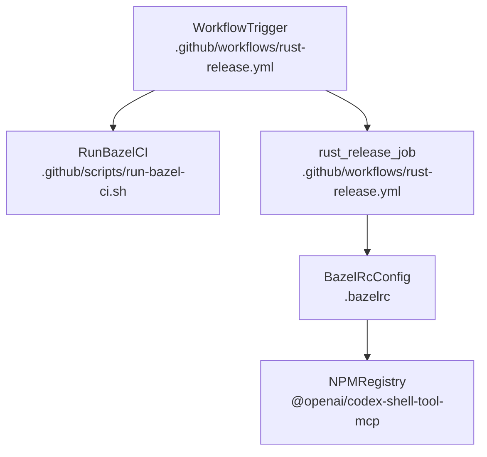
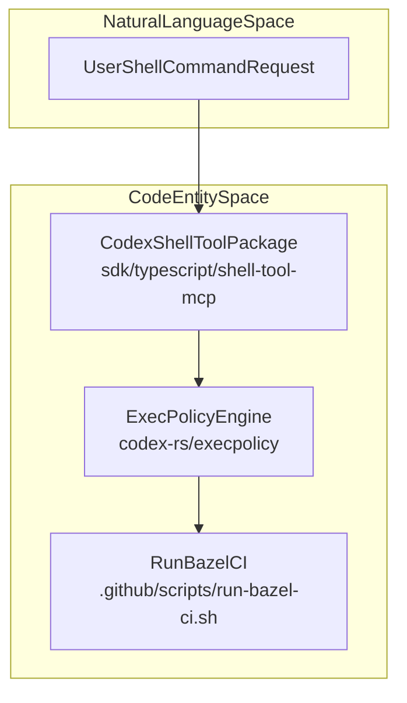
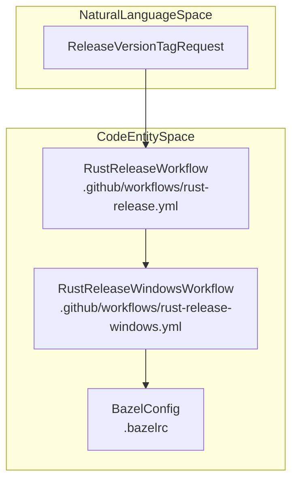

<!-- source: DeepWiki mcp.deepwiki.com · repo openai/codex · page 8.5 Shell Tool MCP Build System · fetched 2026-10-26 -->

# Shell Tool MCP Build System

Relevant source files

The following files were used as context for generating this wiki page:

- [.bazelrc](.bazelrc)
- [.github/scripts/archive-release-symbols-and-strip-binaries.sh](.github/scripts/archive-release-symbols-and-strip-binaries.sh)
- [.github/scripts/check_ci_results.py](.github/scripts/check_ci_results.py)
- [.github/scripts/run-bazel-ci.sh](.github/scripts/run-bazel-ci.sh)
- [.github/scripts/run-bazel-query-ci.sh](.github/scripts/run-bazel-query-ci.sh)
- [.github/scripts/run_bazel_with_buildbuddy.py](.github/scripts/run_bazel_with_buildbuddy.py)
- [.github/scripts/rusty_v8_bazel.py](.github/scripts/rusty_v8_bazel.py)
- [.github/scripts/test_run_bazel_with_buildbuddy.py](.github/scripts/test_run_bazel_with_buildbuddy.py)
- [.github/scripts/test_rusty_v8_bazel.py](.github/scripts/test_rusty_v8_bazel.py)
- [.github/workflows/README.md](.github/workflows/README.md)
- [.github/workflows/bazel.yml](.github/workflows/bazel.yml)
- [.github/workflows/blob-size-policy.yml](.github/workflows/blob-size-policy.yml)
- [.github/workflows/blocking-ci.yml](.github/workflows/blocking-ci.yml)
- [.github/workflows/cargo-deny.yml](.github/workflows/cargo-deny.yml)
- [.github/workflows/close-stale-contributor-prs.yml](.github/workflows/close-stale-contributor-prs.yml)
- [.github/workflows/codespell.yml](.github/workflows/codespell.yml)
- [.github/workflows/issue-deduplicator.yml](.github/workflows/issue-deduplicator.yml)
- [.github/workflows/issue-labeler.yml](.github/workflows/issue-labeler.yml)
- [.github/workflows/postmerge-ci.yml](.github/workflows/postmerge-ci.yml)
- [.github/workflows/repo-checks.yml](.github/workflows/repo-checks.yml)
- [.github/workflows/rust-ci-full.yml](.github/workflows/rust-ci-full.yml)
- [.github/workflows/rust-ci.yml](.github/workflows/rust-ci.yml)
- [.github/workflows/rust-release-argument-comment-lint.yml](.github/workflows/rust-release-argument-comment-lint.yml)
- [.github/workflows/rust-release-windows.yml](.github/workflows/rust-release-windows.yml)
- [.github/workflows/rust-release.yml](.github/workflows/rust-release.yml)
- [.github/workflows/rusty-v8-release.yml](.github/workflows/rusty-v8-release.yml)
- [.github/workflows/sdk.yml](.github/workflows/sdk.yml)
- [.github/workflows/v8-canary.yml](.github/workflows/v8-canary.yml)
- [codex-rs/docs/bazel.md](codex-rs/docs/bazel.md)
- [justfile](justfile)
- [scripts/list-bazel-clippy-targets.sh](scripts/list-bazel-clippy-targets.sh)

## Purpose and Scope
The Shell Tool MCP Build System coordinates the compilation, packaging, and distribution of patched shells and companion binaries that support execution interception for Codex's shell tools. It handles multi-variant and multi-architecture builds across Linux (glibc/musl), macOS, and Windows (`x86_64` and `aarch64`), integrating them into npm distributions and release channels.

Sources: [.github/workflows/rust-release.yml:1-19](), [.github/workflows/rust-release-windows.yml:1-12]()

---

## System Overview
The build system utilizes GitHub Actions workflows, Bazel hermetic toolchains (`.bazelrc`), and Cargo workspace configurations to produce optimized binaries like `codex`, `codex-code-mode-host`, `codex-responses-api-proxy`, and platform-specific helper utilities.

### Build and Distribution Flow
Title: "Shell Tool MCP Build and Distribution Pipeline"

Sources: [.github/workflows/rust-release.yml:11-30](), [.bazelrc:1-25](), [.github/scripts/run-bazel-ci.sh:1-15]()

---

## Workflow Architecture and Build Matrices
The build system implements distinct release pipelines for Unix-like systems and Windows environments, configuring platform-specific build parameters and target matrices.

### Release Build Matrix (Unix)
| Job Name | Target Triple | Binaries Included | Sources |
| --- | --- | --- | --- |
| `build` | `aarch64-apple-darwin` | `codex`, `codex-code-mode-host`, `codex-responses-api-proxy` | [.github/workflows/rust-release.yml:95-99]() |
| `build` | `x86_64-unknown-linux-musl` | `codex`, `codex-code-mode-host`, `codex-responses-api-proxy`, `bwrap` | [.github/workflows/rust-release.yml:120-125]() |

Sources: [.github/workflows/rust-release.yml:84-143]()

### Release Build Matrix (Windows)
| Job Name | Target Triple | Bundle / Binaries | Sources |
| --- | --- | --- | --- |
| `build-windows-binaries` | `x86_64-pc-windows-msvc` | `codex`, `codex-code-mode-host`, `codex-responses-api-proxy` | [.github/workflows/rust-release-windows.yml:33-42]() |
| `build-windows-binaries` | `x86_64-pc-windows-msvc` | helpers: `codex-windows-sandbox-setup`, `codex-windows-sandbox-service`, `codex-command-runner` | [.github/workflows/rust-release-windows.yml:53-56]() |

Sources: [.github/workflows/rust-release-windows.yml:30-81]()

---

## Natural Language Space to Code Entity Space Mappings

### Diagram 1: Shell Execution Interception Mapping
Title: "Natural Language Space to Code Entity Space: Shell Interception"

Sources: [.github/workflows/sdk.yml:126-137](), [.github/scripts/run-bazel-ci.sh:1-15]()

### Diagram 2: Release and Packaging Workflow Mapping
Title: "Natural Language Space to Code Entity Space: Release Pipeline"

Sources: [.github/workflows/rust-release.yml:11-25](), [.github/workflows/rust-release-windows.yml:1-10](), [.bazelrc:1-20]()

---

## Build Infrastructure and Tooling Configuration
Bazel and Cargo are configured via `.bazelrc` and `justfile` to ensure hermeticity and reliable execution across CI nodes.

- **Hermetic Toolchains:** Enforced via `BAZEL_DO_NOT_DETECT_CPP_TOOLCHAIN=1` and `BAZEL_NO_APPLE_CPP_TOOLCHAIN=1` [.bazelrc:1-2]().
- **Stack Allocation:** `RUST_MIN_STACK=8388608` is passed globally for test environments to support large async callstacks on Windows [.bazelrc:51]().
- **Caching & RBE:** Integration with BuildBuddy remote execution endpoints under `common:buildbuddy-*` configurations [.bazelrc:64-87]().

Sources: [.bazelrc:1-90](), [justfile:1-30]()

---

## Summary
The Shell Tool MCP Build System standardizes the compilation, verification, and distribution of patched shell components and core daemon binaries. Through robust GitHub Actions workflows, Bazel configurations, and npm packaging structures, it provides reproducible execution environments for Codex.

Sources: [.github/workflows/rust-release.yml:1-25](), [.bazelrc:1-15]()

---

