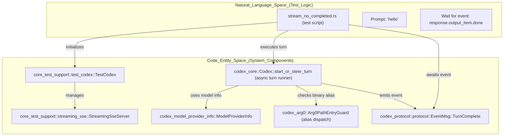
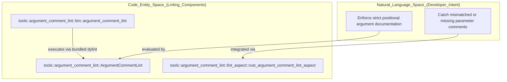

<!-- source: DeepWiki mcp.deepwiki.com · repo openai/codex · page 9 Development and Testing · fetched 2026-10-26 -->

# Development and Testing

Relevant source files

The following files were used as context for generating this wiki page:

- [.bazelrc](.bazelrc)
- [.github/scripts/archive-release-symbols-and-strip-binaries.sh](.github/scripts/archive-release-symbols-and-strip-binaries.sh)
- [.github/scripts/check_ci_results.py](.github/scripts/check_ci_results.py)
- [.github/scripts/run-bazel-ci.sh](.github/scripts/run-bazel-ci.sh)
- [.github/scripts/run-bazel-query-ci.sh](.github/scripts/run-bazel-query-ci.sh)
- [.github/scripts/run_bazel_with_buildbuddy.py](.github/scripts/run_bazel_with_buildbuddy.py)
- [.github/scripts/rusty_v8_bazel.py](.github/scripts/rusty_v8_bazel.py)
- [.github/scripts/test_run_bazel_with_buildbuddy.py](.github/scripts/test_run_bazel_with_buildbuddy.py)
- [.github/scripts/test_rusty_v8_bazel.py](.github/scripts/test_rusty_v8_bazel.py)
- [.github/workflows/README.md](.github/workflows/README.md)
- [.github/workflows/bazel.yml](.github/workflows/bazel.yml)
- [.github/workflows/blob-size-policy.yml](.github/workflows/blob-size-policy.yml)
- [.github/workflows/blocking-ci.yml](.github/workflows/blocking-ci.yml)
- [.github/workflows/cargo-deny.yml](.github/workflows/cargo-deny.yml)
- [.github/workflows/close-stale-contributor-prs.yml](.github/workflows/close-stale-contributor-prs.yml)
- [.github/workflows/codespell.yml](.github/workflows/codespell.yml)
- [.github/workflows/issue-deduplicator.yml](.github/workflows/issue-deduplicator.yml)
- [.github/workflows/issue-labeler.yml](.github/workflows/issue-labeler.yml)
- [.github/workflows/postmerge-ci.yml](.github/workflows/postmerge-ci.yml)
- [.github/workflows/repo-checks.yml](.github/workflows/repo-checks.yml)
- [.github/workflows/rust-ci-full.yml](.github/workflows/rust-ci-full.yml)
- [.github/workflows/rust-ci.yml](.github/workflows/rust-ci.yml)
- [.github/workflows/rust-release-argument-comment-lint.yml](.github/workflows/rust-release-argument-comment-lint.yml)
- [.github/workflows/rust-release-windows.yml](.github/workflows/rust-release-windows.yml)
- [.github/workflows/rust-release.yml](.github/workflows/rust-release.yml)
- [.github/workflows/rusty-v8-release.yml](.github/workflows/rusty-v8-release.yml)
- [.github/workflows/sdk.yml](.github/workflows/sdk.yml)
- [.github/workflows/v8-canary.yml](.github/workflows/v8-canary.yml)
- [codex-rs/docs/bazel.md](codex-rs/docs/bazel.md)
- [justfile](justfile)
- [scripts/list-bazel-clippy-targets.sh](scripts/list-bazel-clippy-targets.sh)

This page provides a high-level guide for developers contributing to the Codex codebase. It covers the essential setup, testing philosophies, coding standards, and observability patterns required to maintain system reliability and performance across multiple platforms and execution modes.

For detailed setup instructions, see [Development Setup](#9.1). For an in-depth look at our testing tools, see [Testing Infrastructure](#9.2).

---

## Core Development Principles

The Codex codebase follows strict Rust idioms and organizational patterns to ensure maintainability across a large workspace. Key constraints include:

- **Module Size**: Target Rust modules under 500 lines of code (LoC) excluding tests. If a file exceeds roughly 800 LoC, functionality should be extracted into new modules [AGENTS.md:49-53](). This applies especially to central orchestration modules like `chatwidget.rs`, `app.rs`, and `chat_composer.rs` [AGENTS.md:54-57]().
- **API Design**: Avoid ambiguous `bool` or `Option` parameters that force hard-to-read code such as `foo(false)` or `bar(None)` [AGENTS.md:14](). Prefer enums, named methods, or newtypes for self-documenting callsites [AGENTS.md:14]().
- **Crate Naming**: All crates in the workspace are prefixed with `codex-` (e.g., the `core` folder contains `codex-core`) [AGENTS.md:1-5]().
- **Tooling**: The project relies on `just` as a command runner, `cargo-nextest` for fast and parallel test execution, and `cargo-insta` for snapshot testing [AGENTS.md:7](), [justfile:81-92]().
- **Linting**: The codebase uses a custom `argument-comment-lint` Dylint library and Bazel aspect to enforce documentation on literal arguments passed by position, using `/*param_name*/` comments [tools/argument-comment-lint/README.md:1-19](), [tools/argument-comment-lint/lint_aspect.bzl:1-22]().

These principles help maintain code clarity, prevent technical debt, and ensure consistent practices across developers.

Sources: [AGENTS.md:1-67](), [tools/argument-comment-lint/README.md:1-19]()

---

## Development Setup and Workflow

Development tasks are primarily managed using the `justfile` at the repository root, providing a uniform interface for common commands such as formatting, linting, testing, and schema generation [justfile:1-190](). 

Commonly used commands include:

| Command | Purpose |
|---|---|
| `just fmt` | Formats code automatically across the repo (Rust, Justfile, Bazel, Python) [justfile:49-51](). |
| `just fix` | Runs `cargo clippy --fix` on targeted crates for lint fixes [justfile:57-58](). |
| `just write-config-schema` | Updates configuration schema files after modifying configuration types [justfile:173-174](). |
| `just argument-comment-lint` | Runs a Bazel-powered lint aspect to check for argument comment compliance [justfile:166-168](). |
| `just bazel-lock-update` | Refreshes Bazel Cargo lockfile after dependency changes to keep builds consistent [justfile:144-145](). |

Developers should target specific projects when running `just test` or `just fix` to keep builds fast and focused [AGENTS.md:64-67]().

For full environment configuration, formatting conventions, and schema generation details, see [Development Setup](#9.1).

Sources: [AGENTS.md:64-67](), [justfile:1-190](), [docs/install.md:15-50]()

---

## Testing Infrastructure

Codex employs a multi-layered testing strategy, ranging from unit tests to complex integration and system tests that simulate realistic model interactions and runtime conditions [codex-rs/core/tests/suite/live_cli.rs:1-152]().

### Integration and Model Testing

Integration tests cover scenarios such as retrying on early SSE termination, recovering from model provider 500 errors, and validating tools like `apply_patch` [codex-rs/core/tests/suite/live_cli.rs:1-152](). Tests often instantiate harnesses managed by `core_test_support` which manage server mocks, submission queues, and event completion.

Testing Flow from Prompt to System Verification

Sources: [codex-rs/core/tests/suite/stream_no_completed.rs:1-100](), [codex-rs/core/tests/common/lib.rs:50-81]()

### Key Testing Patterns

- **Snapshot Testing:** Uses `cargo-insta` for UI and state snapshot testing to catch regressions.
- **Binary Dispatch:** `codex-arg0` crate provides alias dispatch behavior to re-execute the main binary with different semantics.
- **Deterministic IDs:** Tests enable deterministic process and thread IDs to ensure repeatable results during test runs.

For comprehensive details on testing tools, utilities, harnesses, and mock infrastructure, see [Testing Infrastructure](#9.2).

Sources: [codex-rs/core/tests/common/lib.rs:50-81](), [AGENTS.md:1-67]()

---

## Code Organization Patterns

The repository enforces strict code organization rules to maintain clarity and separation of concerns across crates:

Quality Assurance and Linting Flow

Sources: [tools/argument-comment-lint/src/lib.rs:37-125](), [tools/argument-comment-lint/lint_aspect.bzl:71-160]()

### Contributor Guidance Highlights

- Use exhaustive `match` expressions without wildcard arms to ensure coverage at compile time [AGENTS.md:21]().
- Inline variables in `format!` macros instead of separate concatenations [AGENTS.md:6]().
- Use method references instead of closure wrappers where feasible [AGENTS.md:13]().
- Prefer native RPITIT async trait method signatures with explicit `Send` bounds rather than `#[async_trait]` [AGENTS.md:23-26]().
- Instrument async functions with `#[tracing::instrument]` at the definition level instead of per-call-site span attachments [AGENTS.md:45-48]().

For more detailed standards and project-specific norms, see [Code Organization Patterns](#9.3).

Sources: [AGENTS.md:1-68](), [tools/argument-comment-lint/src/lib.rs:37-125]()

---

## Observability and Telemetry

Codex incorporates observability using OpenTelemetry via the `codex-otel` crate, providing:

- Metrics collection with well-defined names and lifecycles.
- Trace spans correlating incoming requests, model calls, and turn execution for latency measurement and debugging.
- Session telemetry tracking user interactions and feature usage.
- Flexible export routing to multiple backends.
- An `analytics` crate capturing usage events for product insights.

This telemetry infrastructure enables deep monitoring of system health and performance across environments.

For full details on metrics, traces, spans, and session eventing, see [Observability and Telemetry](#9.4).

Sources: [AGENTS.md:45-48](), [codex-rs/core/tests/common/Cargo.toml:37-47]()

---

This high-level overview connects the major development and testing facets in the Codex repository. Explore each child page for the specific details needed to set up, test, organize, and monitor the system effectively as a contributor.

# Links to Child Pages

- [Development Setup](#9.1)
- [Testing Infrastructure](#9.2)
- [Code Organization Patterns](#9.3)
- [Observability and Telemetry](#9.4)

---

