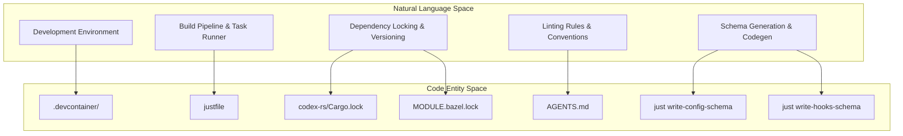
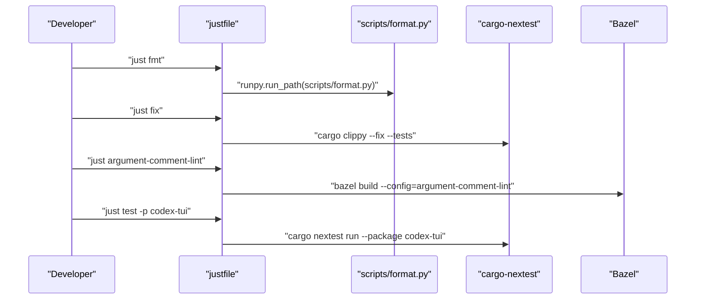

<!-- source: DeepWiki mcp.deepwiki.com · repo openai/codex · page 9.1 Development Setup · fetched 2026-10-26 -->

# Development Setup

<details>
<summary>Relevant source files</summary>

The following files were used as context for generating this wiki page:

- [.bazelrc](.bazelrc)
- [.github/scripts/archive-release-symbols-and-strip-binaries.sh](.github/scripts/archive-release-symbols-and-strip-binaries.sh)
- [.github/scripts/check_ci_results.py](.github/scripts/check_ci_results.py)
- [.github/scripts/run-bazel-ci.sh](.github/scripts/run-bazel-ci.sh)
- [.github/scripts/run-bazel-query-ci.sh](.github/scripts/run-bazel-query-ci.sh)
- [.github/scripts/run_bazel_with_buildbuddy.py](.github/scripts/run_bazel_with_buildbuddy.py)
- [.github/scripts/rusty_v8_bazel.py](.github/scripts/rusty_v8_bazel.py)
- [.github/scripts/test_run_bazel_with_buildbuddy.py](.github/scripts/test_run_bazel_with_buildbuddy.py)
- [.github/scripts/test_rusty_v8_bazel.py](.github/scripts/test_rusty_v8_bazel.py)
- [.github/workflows/README.md](.github/workflows/README.md)
- [.github/workflows/bazel.yml](.github/workflows/bazel.yml)
- [.github/workflows/blob-size-policy.yml](.github/workflows/blob-size-policy.yml)
- [.github/workflows/blocking-ci.yml](.github/workflows/blocking-ci.yml)
- [.github/workflows/cargo-deny.yml](.github/workflows/cargo-deny.yml)
- [.github/workflows/close-stale-contributor-prs.yml](.github/workflows/close-stale-contributor-prs.yml)
- [.github/workflows/codespell.yml](.github/workflows/codespell.yml)
- [.github/workflows/issue-deduplicator.yml](.github/workflows/issue-deduplicator.yml)
- [.github/workflows/issue-labeler.yml](.github/workflows/issue-labeler.yml)
- [.github/workflows/postmerge-ci.yml](.github/workflows/postmerge-ci.yml)
- [.github/workflows/repo-checks.yml](.github/workflows/repo-checks.yml)
- [.github/workflows/rust-ci-full.yml](.github/workflows/rust-ci-full.yml)
- [.github/workflows/rust-ci.yml](.github/workflows/rust-ci.yml)
- [.github/workflows/rust-release-argument-comment-lint.yml](.github/workflows/rust-release-argument-comment-lint.yml)
- [.github/workflows/rust-release-windows.yml](.github/workflows/rust-release-windows.yml)
- [.github/workflows/rust-release.yml](.github/workflows/rust-release.yml)
- [.github/workflows/rusty-v8-release.yml](.github/workflows/rusty-v8-release.yml)
- [.github/workflows/sdk.yml](.github/workflows/sdk.yml)
- [.github/workflows/v8-canary.yml](.github/workflows/v8-canary.yml)
- [codex-rs/README.md](codex-rs/README.md)
- [codex-rs/cli/src/debug_sandbox.rs](codex-rs/cli/src/debug_sandbox.rs)
- [codex-rs/cli/src/lib.rs](codex-rs/cli/src/lib.rs)
- [codex-rs/codex-mcp/README.md](codex-rs/codex-mcp/README.md)
- [codex-rs/codex-mcp/src/sandbox_metadata.rs](codex-rs/codex-mcp/src/sandbox_metadata.rs)
- [codex-rs/codex-mcp/src/sandbox_metadata_tests.rs](codex-rs/codex-mcp/src/sandbox_metadata_tests.rs)
- [codex-rs/core/tests/suite/mcp_sandbox_tests.rs](codex-rs/core/tests/suite/mcp_sandbox_tests.rs)
- [codex-rs/docs/bazel.md](codex-rs/docs/bazel.md)
- [docs/config.md](docs/config.md)
- [docs/example-config.md](docs/example-config.md)
- [docs/skills.md](docs/skills.md)
- [docs/slash_commands.md](docs/slash_commands.md)
- [justfile](justfile)
- [scripts/list-bazel-clippy-targets.sh](scripts/list-bazel-clippy-targets.sh)

</details>


## Purpose and Scope

This page documents the development environment setup, task runner commands, code formatting conventions, schema generation workflows, and configuration of `.vscode` and `.devcontainer` environments for the Codex codebase. It is intended to guide developers through establishing a consistent, reproducible local engineering environment.

Sources: [AGENTS.md:1-67](), [justfile:1-187]()

---

## Prerequisites and Toolchain

The Codex project relies on a standardized Rust toolchain, a task runner (`just`), and build dependencies to maintain cross-platform compatibility across macOS, Linux, and Windows (WSL2).

- **Rust Toolchain:** Managed via `rustup`. Version constraints and nightly requirements (such as those needed for `argument-comment-lint`) are specified in the repository configuration [AGENTS.md:1-67]().
- **Task Runner (`just`):** Commands are centralized in the workspace `justfile`, backed by a Python shell wrapper (`scripts/just-shell.py`) for cross-platform execution [justfile:1-6]().
- **Testing (`cargo-nextest`):** Routine testing uses `cargo nextest` via the `just test` target, which enables `--no-fail-fast` by default [justfile:81-93]().
- **Linting & Formatting:** `rustfmt` handles code formatting (`just fmt`), while `clippy` and the custom Dylint-based `argument-comment-lint` enforce style rules and argument annotations [AGENTS.md:6-20](), [justfile:50-62]().

Sources: [AGENTS.md:1-67](), [justfile:1-187]()

---

## Workspace Structure and Build Organization

The repository is structured as a Cargo workspace containing core agent logic, terminal interfaces, CLI entry points, and protocol servers.

### Development Setup Architecture Mapping (Natural Language Space to Code Entity Space)

This diagram bridges high-level development setup concepts to the concrete files, scripts, and build modules in the codebase:



Sources: [AGENTS.md:1-67](), [justfile:1-187]()

---

## Development Workflows and `justfile` Commands

Development routines are invoked through `just` commands defined in `justfile`. A Python-based shell interpreter (`scripts/just-shell.py`) standardizes environment variables and execution semantics across Unix and Windows hosts [justfile:1-6]().

### Core `justfile` Reference

| Task | Command | Description |
| :--- | :--- | :--- |
| **Format Code** | `just fmt` | Formats Rust, Python, and other files using `scripts/format.py` [justfile:50-52]() |
| **Check Formatting** | `just fmt-check` | Verifies formatting without modifying files [justfile:54-56]() |
| **Lint Fix** | `just fix` | Automatically applies clippy fixes via `cargo clippy --fix` [justfile:57-59]() |
| **Run Tests** | `just test` | Executes the test suite using `cargo nextest` [justfile:87-93]() |
| **Build/Run CLI** | `just codex` | Runs the `codex` binary with arguments [justfile:17-18]() |
| **Exec Mode** | `just exec` | Runs non-interactive execution mode (`codex exec`) [justfile:21-23]() |
| **Config Schema** | `just write-config-schema` | Regenerates `config.schema.json` from config structs [justfile:173-175]() |
| **App Server Schema** | `just write-app-server-schema` | Updates app-server protocol schemas and SDK bindings [justfile:177-179]() |
| **Hooks Schema** | `just write-hooks-schema` | Rebuilds hooks JSON schema fixtures [justfile:181-183]() |
| **Argument Lint** | `just argument-comment-lint` | Enforces explicit `/*param_name*/` literal annotations [justfile:166-168]() |

### Dependency Locking and Bazel Integration

When modifying Rust dependencies in `Cargo.toml` or `Cargo.lock`, developers must update the Bazel workspace lockfile to prevent CI verification failures [AGENTS.md:37-39](), [justfile:144-146]():

```bash
just bazel-lock-update
```

Sources: [AGENTS.md:1-67](), [justfile:1-187]()

---

## Code Conventions and Formatting

### Operational and Formatting Rules

- **Inline `format!` Arguments:** Always inline variables inside `{}` placeholders when using `format!` [AGENTS.md:6, 12]().
- **Clippy Compliance:** Adhere to clippy suggestions such as `collapsible_if` and `redundant_closure_for_method_calls` [AGENTS.md:11, 13]().
- **Argument Comment Linting:** Pass opaque literals (such as `None`, booleans, and numeric literals) by position with an exact preceding `/*param_name*/` comment, unless exempted by rule (e.g., single-argument methods where name matches parameter) [AGENTS.md:15-18]().
- **Async Traits:** Avoid `#[async_trait]` or `#[allow(async_fn_in_trait)]`. Use native RPITIT methods returning `impl Future + Send` [AGENTS.md:23-28]().
- **Module Size Limits:** Keep Rust modules under 500 lines of code (excluding tests) and extract logic into new modules if a file approaches 800 lines [AGENTS.md:49-53]().

### Workflow Execution Mapping (Natural Language Space to Code Entity Space)

This sequence diagram maps developer intent and task runner invocations to underlying orchestration scripts and test harnesses:



Sources: [AGENTS.md:1-67](), [justfile:1-187]()

---

## Development Environment Configuration

- **Editor Integration (`.vscode/`):** Provides launch configurations, workspace settings, and task runners for debugging Rust binaries, TUI execution, and app-server clients.
- **Containerized Development (`.devcontainer/`):** Supplies pre-configured container profiles that encapsulate the complete toolchain, Bazel, and required system dependencies for contributors and secure environments [AGENTS.md:5]().
- **Sandbox Environment Flags:** Child processes spawned by testing or execution tools honor environment controls such as `CODEX_SANDBOX_NETWORK_DISABLED=1` and `CODEX_SANDBOX=seatbelt` [AGENTS.md:8-10]().

Sources: [AGENTS.md:1-67]()

---

