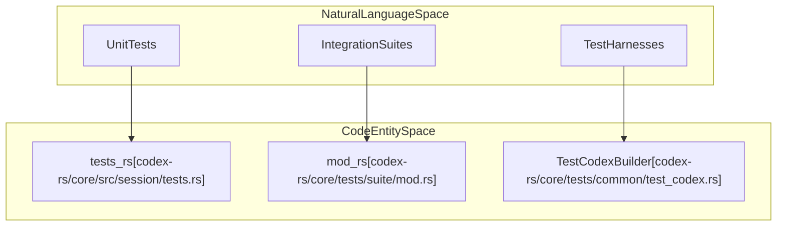
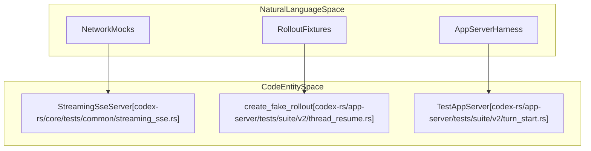
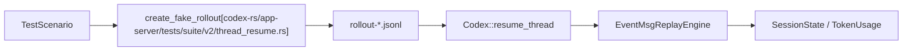

<!-- source: DeepWiki mcp.deepwiki.com · repo openai/codex · page 9.2 Testing Infrastructure · fetched 2026-10-26 -->

# Testing Infrastructure

Relevant source files

The following files were used as context for generating this wiki page:

- [BUILD.bazel](BUILD.bazel)
- [SECURITY.md](SECURITY.md)
- [codex-rs/.config/nextest.toml](codex-rs/.config/nextest.toml)
- [codex-rs/app-server-daemon/src/remote_control_client.rs](codex-rs/app-server-daemon/src/remote_control_client.rs)
- [codex-rs/app-server/BUILD.bazel](codex-rs/app-server/BUILD.bazel)
- [codex-rs/app-server/src/bespoke_event_handling.rs](codex-rs/app-server/src/bespoke_event_handling.rs)
- [codex-rs/cli/BUILD.bazel](codex-rs/cli/BUILD.bazel)
- [codex-rs/cli/src/remote_control_cmd.rs](codex-rs/cli/src/remote_control_cmd.rs)
- [codex-rs/cli/tests/app_server_daemon/package.rs](codex-rs/cli/tests/app_server_daemon/package.rs)
- [codex-rs/cli/tests/app_server_daemon/support.rs](codex-rs/cli/tests/app_server_daemon/support.rs)
- [codex-rs/core/BUILD.bazel](codex-rs/core/BUILD.bazel)
- [codex-rs/core/src/codex_delegate.rs](codex-rs/core/src/codex_delegate.rs)
- [codex-rs/core/src/codex_delegate_tests.rs](codex-rs/core/src/codex_delegate_tests.rs)
- [codex-rs/core/src/codex_thread.rs](codex-rs/core/src/codex_thread.rs)
- [codex-rs/core/src/compact.rs](codex-rs/core/src/compact.rs)
- [codex-rs/core/src/compact_remote_v2.rs](codex-rs/core/src/compact_remote_v2.rs)
- [codex-rs/core/src/compact_remote_v2_attempt.rs](codex-rs/core/src/compact_remote_v2_attempt.rs)
- [codex-rs/core/src/compact_tests.rs](codex-rs/core/src/compact_tests.rs)
- [codex-rs/core/src/environment_selection.rs](codex-rs/core/src/environment_selection.rs)
- [codex-rs/core/src/session/environment.rs](codex-rs/core/src/session/environment.rs)
- [codex-rs/core/src/session/handlers.rs](codex-rs/core/src/session/handlers.rs)
- [codex-rs/core/src/session/mod.rs](codex-rs/core/src/session/mod.rs)
- [codex-rs/core/src/session/session.rs](codex-rs/core/src/session/session.rs)
- [codex-rs/core/src/session/tests.rs](codex-rs/core/src/session/tests.rs)
- [codex-rs/core/src/session/tests/guardian_tests.rs](codex-rs/core/src/session/tests/guardian_tests.rs)
- [codex-rs/core/src/session/turn.rs](codex-rs/core/src/session/turn.rs)
- [codex-rs/core/src/session/turn_context.rs](codex-rs/core/src/session/turn_context.rs)
- [codex-rs/core/src/state/mod.rs](codex-rs/core/src/state/mod.rs)
- [codex-rs/core/src/state/turn.rs](codex-rs/core/src/state/turn.rs)
- [codex-rs/core/src/tasks/mod.rs](codex-rs/core/src/tasks/mod.rs)
- [codex-rs/core/src/thread_manager.rs](codex-rs/core/src/thread_manager.rs)
- [codex-rs/core/src/thread_manager_tests.rs](codex-rs/core/src/thread_manager_tests.rs)
- [codex-rs/core/tests/common/test_codex.rs](codex-rs/core/tests/common/test_codex.rs)
- [codex-rs/core/tests/suite/compact.rs](codex-rs/core/tests/suite/compact.rs)
- [codex-rs/core/tests/suite/compact_remote.rs](codex-rs/core/tests/suite/compact_remote.rs)
- [codex-rs/core/tests/suite/mod.rs](codex-rs/core/tests/suite/mod.rs)
- [codex-rs/core/tests/suite/remote_env.rs](codex-rs/core/tests/suite/remote_env.rs)
- [codex-rs/core/tests/windows_sandbox.rs](codex-rs/core/tests/windows_sandbox.rs)
- [codex-rs/protocol/src/environment.rs](codex-rs/protocol/src/environment.rs)
- [codex-rs/protocol/src/protocol.rs](codex-rs/protocol/src/protocol.rs)
- [codex-rs/tui/BUILD.bazel](codex-rs/tui/BUILD.bazel)
- [codex-rs/utils/cargo-bin/BUILD.bazel](codex-rs/utils/cargo-bin/BUILD.bazel)
- [codex-rs/voice-host/BUILD.bazel](codex-rs/voice-host/BUILD.bazel)
- [codex-rs/windows-sandbox-rs/BUILD.bazel](codex-rs/windows-sandbox-rs/BUILD.bazel)
- [codex-rs/windows-sandbox-rs/Cargo.toml](codex-rs/windows-sandbox-rs/Cargo.toml)
- [codex-rs/windows-sandbox-rs/build.rs](codex-rs/windows-sandbox-rs/build.rs)
- [codex-rs/windows-sandbox-rs/codex-windows-sandbox-setup.manifest](codex-rs/windows-sandbox-rs/codex-windows-sandbox-setup.manifest)
- [codex-rs/windows-sandbox-rs/src/unified_exec/tests.rs](codex-rs/windows-sandbox-rs/src/unified_exec/tests.rs)
- [codex-rs/windows-sandbox-rs/tests/helper_manifest.rs](codex-rs/windows-sandbox-rs/tests/helper_manifest.rs)
- [defs.bzl](defs.bzl)
- [workspace_root_test_launcher.bat.tpl](workspace_root_test_launcher.bat.tpl)
- [workspace_root_test_launcher.sh.tpl](workspace_root_test_launcher.sh.tpl)

This document describes the testing infrastructure for the Codex Rust codebase, covering execution tools like `cargo nextest`, snapshot regression testing with `insta`, core integration harnesses such as `TestCodexBuilder`, app-server test utilities, and networking/mock utilities.

For overall development setup, see [codex-rs/core/tests/common/lib.rs:1-20]() and [9.1](). For code organization patterns and conventions, see [9.3]().

## Overview

The Codex testing framework combines parallel test runners, snapshot validation, and specialized asynchronous harnesses to simulate complex LLM interactions, tool executions, and multi-agent sessions.

Key architectural pillars of the testing infrastructure:
- **Test Runner:** [`cargo nextest`](codex-rs/core/tests/suite/mod.rs:1-37) for fast, isolated, parallel test execution.
- **Snapshot Validation:** [`insta`](codex-rs/core/tests/common/lib.rs:63-81) for regression testing of serialized data structures, prompt templates, and protocol outputs.
- **Test Harnesses:** `TestCodexBuilder` and `TestCodexHarness` (`core_test_support::test_codex`) for orchestrating end-to-end sessions.
- **Mock Utilities:** [`wiremock`](codex-rs/app-server/tests/suite/v2/turn_start.rs:112-117) and `StreamingSseServer` (`codex-rs/core/tests/common/streaming_sse.rs`) for deterministic network mocking.

Sources: [codex-rs/core/tests/common/lib.rs:1-81](), [codex-rs/core/tests/suite/mod.rs:1-34]()

---

## Test Organization and Code Entity Mapping

The testing suite spans unit tests colocated in source files and integration suites gathered under test directories. The diagram below bridges natural language concepts to their underlying code entities.

Sources: [codex-rs/core/tests/common/lib.rs:27-37](), [codex-rs/core/tests/common/test_codex.rs:1-100](), [codex-rs/core/tests/suite/mod.rs:1-37]()

---

## Key Testing Dependencies

### cargo nextest and Binary Dispatch

`cargo nextest` runs integration and unit tests concurrently. Because Codex subprocess utilities (such as sandboxing helpers and patch applicators) rely on `argv[0]` dispatch, the test suite initializes a global test binary dispatch guard (`TestBinaryDispatchGuard`) using `#[ctor]`:

- Configures arg0 aliasing via `configure_test_binary_dispatch` in [codex-rs/core/tests/suite/mod.rs:7-37]().
- Ensures deterministic process and thread identifiers during concurrent test execution.

Sources: [codex-rs/core/tests/suite/mod.rs:7-37](), [codex-rs/core/tests/common/lib.rs:52-61]()

---

### Snapshot Testing with `insta`

The `insta` crate manages snapshot regression tests. To ensure stability across distinct development hosts and continuous integration environments, the test support module fixes the workspace root environment variable `INSTA_WORKSPACE_ROOT` during initialization:

- Serialized states, JSON-RPC events, and rollout files are compared against committed `.snap` baseline files.
- Configuration loading uses isolated temporary directories (`TempDir`) to prevent pollution across test boundaries.

Sources: [codex-rs/core/tests/common/lib.rs:63-81]()

---

### HTTP and WebSocket Mocking

Integration tests mock external LLM provider endpoints and web services without relying on live network access:

- **`wiremock` Crate:** Intercepts HTTP requests, matching paths and request bodies (e.g., `/codex/analytics-events/events`) to return pre-configured responses (`wiremock::ResponseTemplate`) [codex-rs/app-server/tests/suite/v2/turn_start.rs:112-117]().
- **`StreamingSseServer`:** Simulates chunked Server-Sent Events (SSE) data streams, allowing tests to validate stream retry behavior, cancellation tokens, and mid-stream errors [codex-rs/core/tests/common/streaming_sse.rs:21-62]().

Sources: [codex-rs/core/tests/common/streaming_sse.rs:21-62](), [codex-rs/app-server/tests/suite/v2/turn_start.rs:112-117]()

---

## Network Mocks and Test Harness Mapping

The following diagram bridges high-level network and rollout testing abstractions to their implementing code symbols in the codebase.

Sources: [codex-rs/core/tests/common/streaming_sse.rs:21-62](), [codex-rs/app-server/tests/suite/v2/thread_resume.rs:1-15]()

---

## Specialized Testing Patterns

### Rollout Fixtures and Resumption

The app-server and core test suites generate `.jsonl` rollout files to test session persistence, thread resumption, and token usage history replay.

- `create_fake_rollout`: Generates minimal rollout files containing session metadata for `Codex::resume_thread` [codex-rs/app-server/tests/suite/v2/thread_resume.rs:1-15]().
- `create_fake_paginated_rollout`: Sets up thread history modes and ordinals to test pagination [codex-rs/app-server/tests/suite/v2/thread_resume.rs:1-20]().

Sources: [codex-rs/app-server/tests/suite/v2/thread_resume.rs:1-148]()

---

## Important Test Harnesses and Utilities

### TestCodexBuilder and TestCodexHarness

`TestCodexBuilder` (defined in `codex-rs/core/tests/common/test_codex.rs`) constructs fully initialized Codex thread instances for integration testing. It manages:
- Temporary workspace generation and isolated `codex_home` paths.
- Configuration overrides via closures (`ConfigMutator`).
- Mock server binding and provider selection.
- `TestCodexHarness` wrapping, providing high-level helpers to submit turns and await event outputs.

Sources: [codex-rs/core/tests/common/test_codex.rs:1-120]()

### App-Server Test Harnesses

App-server integration tests (located under `codex-rs/app-server/tests/`) use `test_app_server` harnesses to validate JSON-RPC request-response cycles, client subscriptions, and event translation layers:
- `TestAppServer` spawns an in-process server instance or connects via transport loops.
- Simulates method calls (`thread/*`, `turn/*`) and validates outgoing notifications.

Sources: [codex-rs/app-server/tests/suite/v2/turn_start.rs:1-142](), [codex-rs/app-server/tests/suite/v2/thread_resume.rs:1-148](), [codex-rs/app-server/tests/suite/v2/thread_fork.rs]()

### Mock Utilities

The `codex-rs/core/src/session/tests.rs` module contains various test utilities and sub-modules for specific testing scenarios:
- `notification_tests`: Tests related to event notifications [codex-rs/core/src/session/tests.rs:2-3]().
- `turn_start_mcp_tests`: Tests for MCP (Model Context Protocol) interactions at the start of a turn [codex-rs/core/src/session/tests.rs:6-7]().
- `config_refresh_tests`: Tests for configuration refresh mechanisms [codex-rs/core/src/session/tests.rs:14-15]().

These modules leverage `TestCodexBuilder` and `TestCodexHarness` to set up controlled environments for testing specific session behaviors, such as:
- `update_selected_settings_for_test`: A utility function to modify session settings for testing purposes [codex-rs/core/src/session/tests.rs:11]().
- Mocking `McpRefresh` behavior [codex-rs/core/src/session/tests.rs:5]().
- Simulating `TurnInputRequest` and `ExternalTurnInputRequest` for turn submissions [codex-rs/core/src/session/tests.rs:54-55]().

Sources: [codex-rs/core/src/session/tests.rs:1-157]()

---

