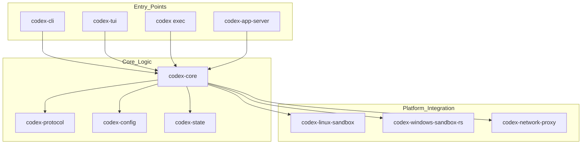
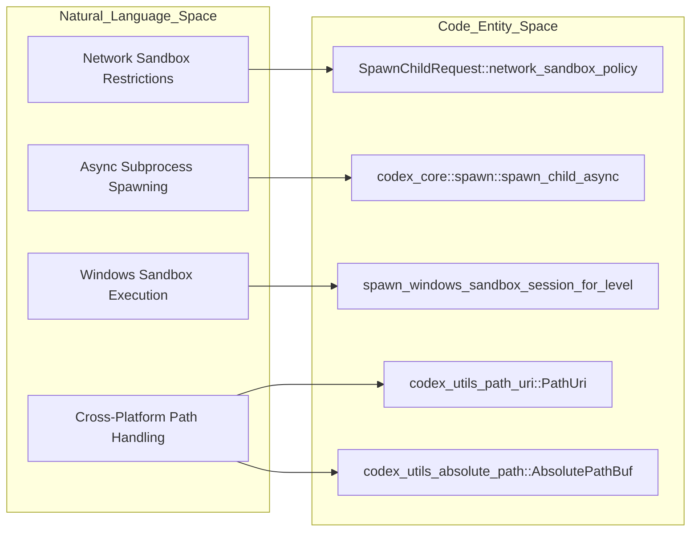

<!-- source: DeepWiki mcp.deepwiki.com · repo openai/codex · page 9.3 Code Organization Patterns · fetched 2026-10-26 -->

# Code Organization Patterns

<details>
<summary>Relevant source files</summary>

The following files were used as context for generating this wiki page:

- [codex-rs/app-server-protocol/schema/typescript/LegacyAppPathString.ts](codex-rs/app-server-protocol/schema/typescript/LegacyAppPathString.ts)
- [codex-rs/codex-home/BUILD.bazel](codex-rs/codex-home/BUILD.bazel)
- [codex-rs/codex-home/Cargo.toml](codex-rs/codex-home/Cargo.toml)
- [codex-rs/codex-home/src/instructions/mod.rs](codex-rs/codex-home/src/instructions/mod.rs)
- [codex-rs/codex-home/src/instructions/tests.rs](codex-rs/codex-home/src/instructions/tests.rs)
- [codex-rs/core/src/agents_md.rs](codex-rs/core/src/agents_md.rs)
- [codex-rs/core/src/agents_md_manager.rs](codex-rs/core/src/agents_md_manager.rs)
- [codex-rs/core/src/agents_md_tests.rs](codex-rs/core/src/agents_md_tests.rs)
- [codex-rs/core/tests/suite/agents_md.rs](codex-rs/core/tests/suite/agents_md.rs)
- [codex-rs/ext/extension-api/src/user_instructions.rs](codex-rs/ext/extension-api/src/user_instructions.rs)
- [codex-rs/protocol/src/permissions/deny_read_validator.rs](codex-rs/protocol/src/permissions/deny_read_validator.rs)
- [codex-rs/protocol/src/permissions/windows_glob.rs](codex-rs/protocol/src/permissions/windows_glob.rs)
- [codex-rs/utils/absolute-path/Cargo.toml](codex-rs/utils/absolute-path/Cargo.toml)
- [codex-rs/utils/absolute-path/src/lib.rs](codex-rs/utils/absolute-path/src/lib.rs)
- [codex-rs/utils/path-uri/src/absolute_path_normalization.rs](codex-rs/utils/path-uri/src/absolute_path_normalization.rs)
- [codex-rs/utils/path-uri/src/api_path_string.rs](codex-rs/utils/path-uri/src/api_path_string.rs)
- [codex-rs/utils/path-uri/src/api_path_string_tests.rs](codex-rs/utils/path-uri/src/api_path_string_tests.rs)
- [codex-rs/utils/path-uri/src/lib.rs](codex-rs/utils/path-uri/src/lib.rs)
- [codex-rs/utils/path-uri/src/tests.rs](codex-rs/utils/path-uri/src/tests.rs)
- [codex-rs/windows-sandbox-rs/src/deny_read_resolver.rs](codex-rs/windows-sandbox-rs/src/deny_read_resolver.rs)
- [codex-rs/windows-sandbox-rs/src/deny_read_resolver_access_tests.rs](codex-rs/windows-sandbox-rs/src/deny_read_resolver_access_tests.rs)
- [codex-rs/windows-sandbox-rs/src/deny_read_walker.rs](codex-rs/windows-sandbox-rs/src/deny_read_walker.rs)

</details>


## Purpose and Scope

This page documents the code organization patterns, conventions, and architectural guidelines applied throughout the Codex Rust codebase. It focuses primarily on development conventions enforced by `AGENTS.md`, automation patterns in the `.codex/skills` repository, standards for the **app-server protocol v2**, the internal `argument-comment-lint` tool in `tools/`, and the design of **Bazel build targets** supporting hermetic cross-platform builds and linting.

These patterns collectively ensure code quality, cross-platform consistency, clear APIs, and maintainability for a system powered by AI-assisted development and multi-protocol integration.

Sources: [codex-rs/core/src/agents_md.rs:1-19]()

---

## Workspace Structure and Crate Categorization

The Codex codebase is organized as a multi-crate Cargo workspace. Crate names consistently use the `codex-` prefix (e.g., the core library is `codex-core`). The structure clearly separates core logic, frontend UI layers, platform-specific sandboxes, remote control tooling, and external client integrations.

### Crate Categories Diagram



Sources: [codex-rs/core/src/agents_md.rs:1-19]()

---

## AGENTS.md Conventions and Module Architecture

The `AGENTS.md` file codifies key development and code style rules to be followed strictly by human and AI contributors.

### Key Development Rules

- **Module Size:**  
  Rust modules should target under 500 lines of code (LoC), excluding tests. Files exceeding ~800 LoC must be split into smaller modules to avoid monolithic and hard-to-maintain files. This rule applies especially to high-touch orchestration modules such as UI components and chat widgets.

- **Sandbox Environment Variables:**  
  Do not modify or add code that relies on environment variables `CODEX_SANDBOX_NETWORK_DISABLED_ENV_VAR` or `CODEX_SANDBOX_ENV_VAR`. These reflect sandbox execution contexts and are critical for security enforcement [codex-rs/windows-sandbox-rs/src/deny_read_resolver.rs:1-12]().

- **Argument Comments for Literals:**  
  When passing opaque literals such as `None`, boolean flags, or numeric literals by position, annotate them with exact `/*param_name*/` comments referencing the callee’s parameter name. Exemptions apply to string/char literals and single-argument methods where method and parameter names match. Run `just argument-comment-lint` locally to check conformance.

- **Compilation Coordination & Bazel Lockfiles:**  
  If Rust dependencies are updated in `Cargo.toml` or `Cargo.lock`, run `just bazel-lock-update` to refresh `MODULE.bazel.lock` and prevent drift.

- **Build-Time File Access:**  
  Bazel does not automatically expose source-tree files to compile-time macros like `include_str!`, `include_bytes!`, or `sqlx::migrate!`. Update the crate's `BUILD.bazel` (`compile_data`, `build_script_data`, or test data) accordingly.

- **Async Traits:**  
  Avoid `#[async_trait]` or `#[allow(async_fn_in_trait)]`. Prefer native RPITIT trait methods with explicit `Send` bounds, such as `fn foo(&self, ...) -> impl std::future::Future<Output = T> + Send;`.

Sources: [codex-rs/core/src/agents_md.rs:1-40](), [codex-rs/core/src/agents_md_manager.rs:1-35]()

---

## Bazel Build Targets and Hermetic Packaging

The Codex repository employs Bazel extensively for cross-platform builds, testing, and hermetic packaging.

- **Lockfile Management:**  
  `MODULE.bazel.lock` is verified in CI and updated via `just bazel-lock-update`.
- **Lint Integration:**  
  `just bazel-argument-comment-lint` builds and executes the custom lint rules across all workspace targets.
- **Test Execution:**  
  `just test` uses `cargo nextest`, while `bazel test` runs hermetic Bazel test suites across targets.
- **Platform-Specific Linker Flags:**  
  `defs.bzl` defines platform-specific linker flags for Rust binaries, reserving stack space on Windows and statically linking the CRT on MSVC, or keeping category symbols alive for `libwebrtc` on macOS.
- **`codex_rust_crate` Macro:**  
  This custom Bazel macro is used to define Rust crates. It handles common configurations like `compile_data`, `extra_binaries`, `test_data_extra`, and `test_shard_counts`. It also supports `run_tests_with_wine_exec` for Windows tests on non-Windows platforms.
- **`workspace_root_test` Rule:**  
  This custom Bazel rule is used for tests that need to run with the workspace root as the current directory, often for snapshot tests that rely on `INSTA_WORKSPACE_ROOT`. It generates platform-specific launcher scripts (`.bat` for Windows, `.sh` for Bash).

Sources: [codex-rs/windows-sandbox-rs/src/deny_read_resolver.rs:37-61]()

---

## Argument Comment Lint (`argument-comment-lint`)

The `argument-comment-lint` tool is a Dylint-based static analysis utility that enforces argument comment rules for positional literal arguments.

- **Implementation:**  
  Located in `tools/argument-comment-lint/`, the lint inspects AST nodes for calls passing boolean literals, `None`, or numeric values without a preceding exact `/*param_name*/` comment.
- **Invocation:**  
  Developers can run the lint check via `just argument-comment-lint`.

Sources: [codex-rs/core/src/agents_md_manager.rs:1-25]()

---

## App-Server Protocol v2 Guidelines

The `codex-app-server` crate implements the JSON-RPC protocol gateway for IDE integrations and remote control.

- **Request Routing:**  
  Incoming requests (`thread/*`, `turn/*`, `config/*`, `mcp/*`) are handled by message processors and task dispatchers.
- **Protocol Schemas:**  
  Protocol definitions and generated types are synchronized using schema fixtures via `just write-app-server-schema`.
- **Path Handling:**  
  The `LegacyAppPathString` struct [codex-rs/utils/path-uri/src/api_path_string.rs:38]() is used to preserve raw path compatibility at the app-server API boundary while migrating to `PathUri` [codex-rs/utils/path-uri/src/api_path_string.rs:15-16](). It supports converting to and from `PathUri` using an explicitly selected native path convention [codex-rs/utils/path-uri/src/api_path_string.rs:69-81]().
- **`PathUri` for Cross-Platform Paths:**  
  The `PathUri` struct [codex-rs/utils/path-uri/src/lib.rs:67]() provides an immutable, cross-platform representation of `file:` URIs. It handles path parsing, validation, and conversion between native paths and URIs, including special handling for Windows drive letters and UNC paths [codex-rs/utils/path-uri/src/lib.rs:40-64](). Equality and hashing for `PathUri` are sensitive to the inferred path convention (POSIX vs. Windows) [codex-rs/utils/path-uri/src/tests.rs:133-145]().

Sources: [codex-rs/utils/path-uri/src/api_path_string.rs:15-81](), [codex-rs/utils/path-uri/src/lib.rs:40-67](), [codex-rs/utils/path-uri/src/tests.rs:133-145]()

---

## Skills Repository Automation (`.codex/skills`)

The `.codex/skills` repository structure governs runtime skill discovery, dependency loading, and context injection for AI agent sessions.

- **Skills Discovery:**  
  The skills system loads manifests and mounts modular execution helpers into the Codex execution context.
- **Automation:**  
  Sync and validation tasks ensure skill dependencies remain consistent across workspace runs.

Sources: [codex-rs/core/src/agents_md.rs:1-19]()

---

## Natural Language to Code Entity Bridges

### 1. Development Process and Environment Mapping

```mermaid
graph TD
    subgraph "Natural_Language_Space"
        DevSetup[""Developer Environment Setup""]
        LintChecks[""Argument Comment Linting""]
        DependencyUpdates[""Cargo Dependency Update""]
        CrossPlatformTesting[""Cross-Platform Testing (Windows on Linux)""]
    end

    subgraph "Code_Entity_Space"
        JustfileTarget[""justfile: argument-comment-lint""]
        DylintEngine[""tools/argument-comment-lint/src/bin/argument-comment-lint.rs""]
        LockfileSync[""just: bazel-lock-update""]
        WineExec[""codex_rust_crate: run_tests_with_wine_exec""]
    end

    DevSetup --> JustfileTarget
    LintChecks --> DylintEngine
    DependencyUpdates --> LockfileSync
    CrossPlatformTesting --> WineExec
```

Sources: [codex-rs/core/src/agents_md_manager.rs:1-35]()

### 2. Runtime Subprocess Spawning and Sandbox Policy Mapping



Sources: [codex-rs/utils/path-uri/src/lib.rs:67](), [codex-rs/utils/absolute-path/src/lib.rs:25](), [codex-rs/windows-sandbox-rs/src/deny_read_resolver.rs:37-56]()

---

## References and Further Reading

- `AGENTS.md`: Development guidelines and coding standards [codex-rs/core/src/agents_md.rs:1-19]()
- `tools/argument-comment-lint/`: Source for positional literal lint checks
- `codex-rs/utils/path-uri/src/lib.rs`: `PathUri` implementation for cross-platform file URIs [codex-rs/utils/path-uri/src/lib.rs:40-67]()
- `codex-rs/utils/path-uri/src/api_path_string.rs`: `LegacyAppPathString` for app-server API path compatibility [codex-rs/utils/path-uri/src/api_path_string.rs:35-81]()

Sources: [codex-rs/core/src/agents_md.rs:1-19](), [codex-rs/utils/path-uri/src/lib.rs:40-67](), [codex-rs/utils/path-uri/src/api_path_string.rs:35-81]()

---

