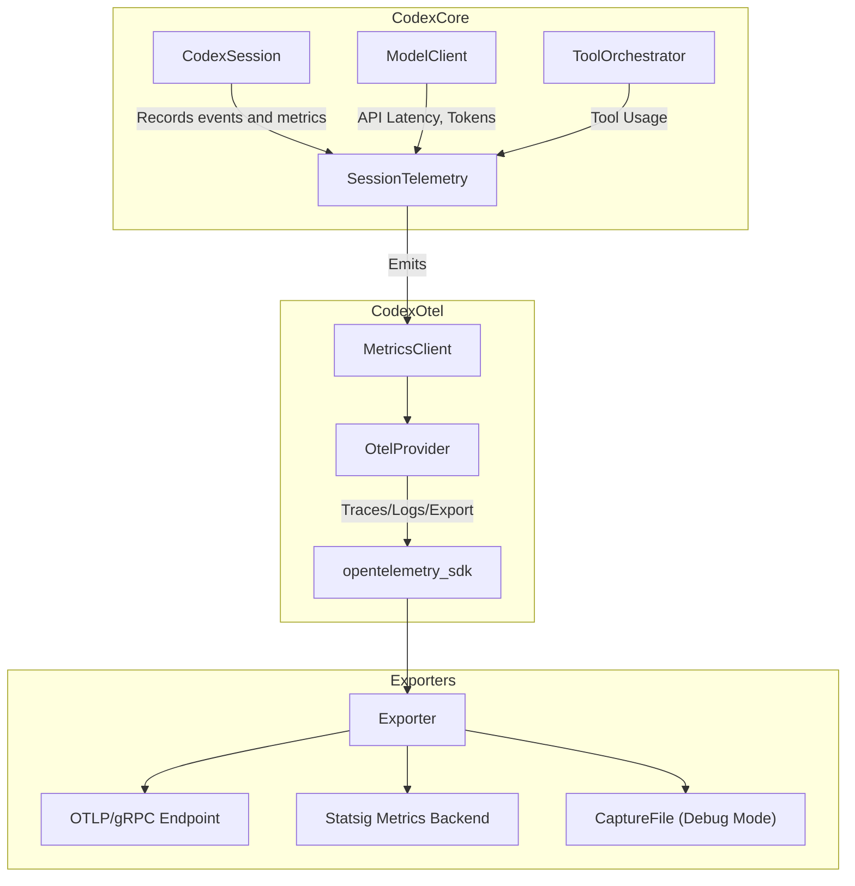
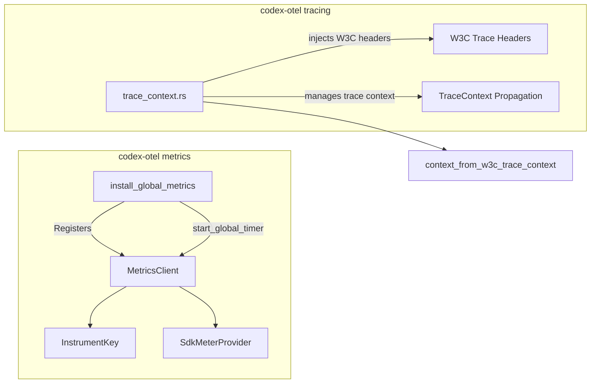
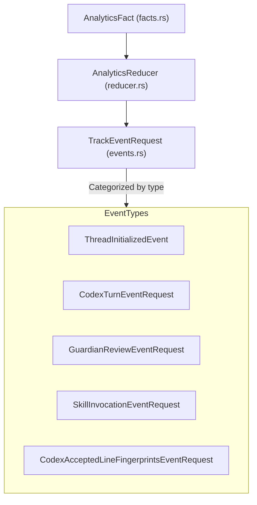

<!-- source: DeepWiki mcp.deepwiki.com · repo openai/codex · page 9.4 Observability and Telemetry · fetched 2026-10-26 -->

# Observability and Telemetry

Relevant source files

The following files were used as context for generating this wiki page:

- [.github/scripts/verify_cargo_workspace_manifests.py](.github/scripts/verify_cargo_workspace_manifests.py)
- [codex-rs/analytics/src/client.rs](codex-rs/analytics/src/client.rs)
- [codex-rs/analytics/src/client_tests.rs](codex-rs/analytics/src/client_tests.rs)
- [codex-rs/analytics/src/events.rs](codex-rs/analytics/src/events.rs)
- [codex-rs/analytics/src/facts.rs](codex-rs/analytics/src/facts.rs)
- [codex-rs/analytics/src/lib.rs](codex-rs/analytics/src/lib.rs)
- [codex-rs/analytics/src/reducer.rs](codex-rs/analytics/src/reducer.rs)
- [codex-rs/app-server-client/Cargo.toml](codex-rs/app-server-client/Cargo.toml)
- [codex-rs/app-server-client/src/lib.rs](codex-rs/app-server-client/src/lib.rs)
- [codex-rs/app-server-client/src/remote.rs](codex-rs/app-server-client/src/remote.rs)
- [codex-rs/app-server/src/in_process.rs](codex-rs/app-server/src/in_process.rs)
- [codex-rs/app-server/src/message_processor_tracing_tests.rs](codex-rs/app-server/src/message_processor_tracing_tests.rs)
- [codex-rs/app-server/src/outgoing_message.rs](codex-rs/app-server/src/outgoing_message.rs)
- [codex-rs/app-server/tests/suite/v2/analytics.rs](codex-rs/app-server/tests/suite/v2/analytics.rs)
- [codex-rs/core/src/config/otel.rs](codex-rs/core/src/config/otel.rs)
- [codex-rs/core/src/context/world_state/snapshots/codex_core__context__world_state__top_level_tools__tests__snapshots_namespace_transitions.snap](codex-rs/core/src/context/world_state/snapshots/codex_core__context__world_state__top_level_tools__tests__snapshots_namespace_transitions.snap)
- [codex-rs/core/src/context/world_state/top_level_tools.rs](codex-rs/core/src/context/world_state/top_level_tools.rs)
- [codex-rs/core/src/context/world_state/top_level_tools_tests.rs](codex-rs/core/src/context/world_state/top_level_tools_tests.rs)
- [codex-rs/core/src/context/world_state/world_state_tests.rs](codex-rs/core/src/context/world_state/world_state_tests.rs)
- [codex-rs/core/src/context_manager/updates_tests.rs](codex-rs/core/src/context_manager/updates_tests.rs)
- [codex-rs/core/src/otel_init.rs](codex-rs/core/src/otel_init.rs)
- [codex-rs/core/src/session/world_state_item_tests.rs](codex-rs/core/src/session/world_state_item_tests.rs)
- [codex-rs/core/src/turn_timing.rs](codex-rs/core/src/turn_timing.rs)
- [codex-rs/core/src/turn_timing_tests.rs](codex-rs/core/src/turn_timing_tests.rs)
- [codex-rs/core/src/util.rs](codex-rs/core/src/util.rs)
- [codex-rs/core/src/util_tests.rs](codex-rs/core/src/util_tests.rs)
- [codex-rs/core/tests/suite/codex_delegate.rs](codex-rs/core/tests/suite/codex_delegate.rs)
- [codex-rs/core/tests/suite/otel.rs](codex-rs/core/tests/suite/otel.rs)
- [codex-rs/core/tests/suite/scenarios_incremental_tools.rs](codex-rs/core/tests/suite/scenarios_incremental_tools.rs)
- [codex-rs/core/tests/suite/scenarios_incremental_tools_resume.rs](codex-rs/core/tests/suite/scenarios_incremental_tools_resume.rs)
- [codex-rs/core/tests/suite/snapshots/all__suite__scenarios__incremental_tools__incremental_tool_removals.snap](codex-rs/core/tests/suite/snapshots/all__suite__scenarios__incremental_tools__incremental_tool_removals.snap)
- [codex-rs/core/tests/suite/snapshots/all__suite__scenarios__incremental_tools__incremental_tools.snap](codex-rs/core/tests/suite/snapshots/all__suite__scenarios__incremental_tools__incremental_tools.snap)
- [codex-rs/core/tests/suite/snapshots/all__suite__scenarios__incremental_tools__incremental_tools_responses_api.snap](codex-rs/core/tests/suite/snapshots/all__suite__scenarios__incremental_tools__incremental_tools_responses_api.snap)
- [codex-rs/core/tests/suite/snapshots/all__suite__scenarios__incremental_tools_resume__disable_incremental_tools.snap](codex-rs/core/tests/suite/snapshots/all__suite__scenarios__incremental_tools_resume__disable_incremental_tools.snap)
- [codex-rs/core/tests/suite/snapshots/all__suite__scenarios__incremental_tools_resume__legacy_resume_remote_compaction.snap](codex-rs/core/tests/suite/snapshots/all__suite__scenarios__incremental_tools_resume__legacy_resume_remote_compaction.snap)
- [codex-rs/core/tests/suite/snapshots/all__suite__scenarios__incremental_tools_resume__legacy_resume_window_reset.snap](codex-rs/core/tests/suite/snapshots/all__suite__scenarios__incremental_tools_resume__legacy_resume_window_reset.snap)
- [codex-rs/otel/Cargo.toml](codex-rs/otel/Cargo.toml)
- [codex-rs/otel/README.md](codex-rs/otel/README.md)
- [codex-rs/otel/src/config.rs](codex-rs/otel/src/config.rs)
- [codex-rs/otel/src/events/session_telemetry.rs](codex-rs/otel/src/events/session_telemetry.rs)
- [codex-rs/otel/src/lib.rs](codex-rs/otel/src/lib.rs)
- [codex-rs/otel/src/metrics/client.rs](codex-rs/otel/src/metrics/client.rs)
- [codex-rs/otel/src/metrics/client_tests.rs](codex-rs/otel/src/metrics/client_tests.rs)
- [codex-rs/otel/src/metrics/config.rs](codex-rs/otel/src/metrics/config.rs)
- [codex-rs/otel/src/metrics/error.rs](codex-rs/otel/src/metrics/error.rs)
- [codex-rs/otel/src/metrics/mod.rs](codex-rs/otel/src/metrics/mod.rs)
- [codex-rs/otel/src/metrics/names.rs](codex-rs/otel/src/metrics/names.rs)
- [codex-rs/otel/src/metrics/runtime_metrics.rs](codex-rs/otel/src/metrics/runtime_metrics.rs)
- [codex-rs/otel/src/provider.rs](codex-rs/otel/src/provider.rs)
- [codex-rs/otel/src/provider_shutdown_tests.rs](codex-rs/otel/src/provider_shutdown_tests.rs)
- [codex-rs/otel/src/trace_context.rs](codex-rs/otel/src/trace_context.rs)
- [codex-rs/otel/tests/suite/manager_metrics.rs](codex-rs/otel/tests/suite/manager_metrics.rs)
- [codex-rs/otel/tests/suite/mod.rs](codex-rs/otel/tests/suite/mod.rs)
- [codex-rs/otel/tests/suite/otel_export_routing_policy.rs](codex-rs/otel/tests/suite/otel_export_routing_policy.rs)
- [codex-rs/otel/tests/suite/otlp_http_loopback.rs](codex-rs/otel/tests/suite/otlp_http_loopback.rs)
- [codex-rs/otel/tests/suite/runtime_summary.rs](codex-rs/otel/tests/suite/runtime_summary.rs)
- [codex-rs/otel/tests/suite/send.rs](codex-rs/otel/tests/suite/send.rs)
- [codex-rs/otel/tests/suite/snapshot.rs](codex-rs/otel/tests/suite/snapshot.rs)
- [codex-rs/otel/tests/suite/timing.rs](codex-rs/otel/tests/suite/timing.rs)
- [codex-rs/rollout/src/sqlite_metrics.rs](codex-rs/rollout/src/sqlite_metrics.rs)
- [codex-rs/state/src/log_write_telemetry_tests.rs](codex-rs/state/src/log_write_telemetry_tests.rs)
- [codex-rs/tui/src/app/tests/terminal_size_telemetry_tests.rs](codex-rs/tui/src/app/tests/terminal_size_telemetry_tests.rs)
- [codex-rs/windows-sandbox-rs/src/wfp.rs](codex-rs/windows-sandbox-rs/src/wfp.rs)
- [codex-rs/windows-sandbox-rs/src/wfp_setup.rs](codex-rs/windows-sandbox-rs/src/wfp_setup.rs)

This page documents the observability infrastructure of the Codex project, focusing on how internal metrics, tracing spans, and usage analytics are recorded, exported, and consumed. The key crates involved are `codex-otel` for OpenTelemetry (OTEL) integration, and `codex-analytics` for high-level usage event aggregation and export. We cover the `codex-otel` crate architecture, metric naming conventions, trace span design patterns, session telemetry metadata, export routing policies, and the analytics event pipeline.

---

## Overview

Codex leverages OpenTelemetry standards to collect metrics, traces, and logs that provide visibility into AI agent operations, tool invocation, and model API calls. This telemetry infrastructure supports both long-lived interactive sessions and ephemeral CLI executions. Telemetry data is routed and exported to diverse backends:

- OTLP endpoints (HTTP or gRPC)
- Internal proprietary endpoints (e.g., Statsig)
- On-disk capture files (in debug mode)

The telemetry system supports fine-grained tagging, contextual metadata, and efficient batching. The `codex-analytics` crate complements metrics by transforming rich internal facts into structured usage events for long-term product analytics.

Sources:  
`[codex-rs/otel/src/lib.rs:1-30]()`  
`[codex-rs/otel/src/provider.rs:20-165]()`  

---

## Data Flow and Architecture

Telemetry data flows from Codex core components through a layered observability stack, connecting high-level execution components directly to low-level OpenTelemetry and analytics clients.

Title: "Codex Telemetry Data Flow and Code Entity Mapping"

The `OtelProvider` initializes and bridges between Codex components and the OTEL runtime `[codex-rs/otel/src/provider.rs:56-130]()`. Session telemetry records context-rich metrics and trace spans tagged with session, model, agent, and authorization metadata `[codex-rs/otel/src/events/session_telemetry.rs:94-123]()`.

Sources:  
`[codex-rs/otel/src/lib.rs:1-30]()`  
`[codex-rs/otel/src/provider.rs:20-165]()`  
`[codex-rs/otel/src/events/session_telemetry.rs:94-123]()`  

---

## The codex-otel Crate

The `codex-otel` crate is the core telemetry framework within Codex, wrapping the OpenTelemetry SDK and exposing idiomatic Rust APIs for metric instruments, trace spans, and structured session telemetry.

### OtelProvider and Initialization

- `OtelProvider` encapsulates the OTEL metric meter (via `MetricsClient`), tracer provider, and logging bridge `[codex-rs/otel/src/provider.rs:56-130]()`.
- Initialization is typically done via the `build_provider` function in the core startup logic, mapping Codex configuration (`Config`) to OTEL settings (`OtelSettings`).
- Exporter kinds supported are enumerated by the `OtelExporter` enum and include:
  - `None` (no export)
  - `OtlpGrpc` (gRPC-based OTLP export)
  - `OtlpHttp` (HTTP OTLP export)
  - `Statsig` (internal Statsig metrics backend)
  `[codex-rs/otel/src/config.rs:73-90]()`
- A filter `codex_export_filter` prevents noise from unrelated instrumentation by exporting only events with the `codex_otel` target `[codex-rs/otel/src/provider.rs:39-48]()`.
- Process start metrics (`codex.process.start`) are recorded once at provider initialization `[codex-rs/otel/src/metrics/names.rs:12-12]()`.
- The crate also supports connecting SQLite database telemetry from `codex-rollout` and `codex-state` to OTEL metrics collectors `[codex-rs/otel/src/provider.rs:90-110]()`.
- Traces propagate context globally using standard OTEL `TraceContextPropagator`.
- Logging events are bridged from Rust `tracing` crate to OTEL logs via an `OpenTelemetryTracingBridge`.

Sources:  
`[codex-rs/otel/src/provider.rs:39-130]()`  
`[codex-rs/otel/src/config.rs:73-90]()`  
`[codex-rs/otel/src/metrics/names.rs:12-12]()`  

---

### Export Routing Policies

Telemetry exports are carefully routed:

| Data Type | Export Method                          | Details                                  |
|-----------|--------------------------------------|------------------------------------------|
| Metrics   | Managed by `MetricsClient`            | Supports Statsig and OTLP exporters      |
| Traces    | `SdkTracerProvider`                   | Uses OTLP via HTTP/gRPC                   |
| Logs      | `OpenTelemetryTracingBridge`          | Converts `tracing` events to OTEL logs   |

Trace state context is process-global. Metrics are tagged and filtered based on configuration.

Sources:  
`[codex-rs/otel/src/provider.rs:130-165]()`  
`[codex-rs/otel/src/config.rs:73-90]()`  

---

## Metrics and Names

Standardized metric names are declared to ensure consistent telemetry across the system. These are defined in `codex-rs/otel/src/metrics/names.rs`.

| Metric Name                                     | Description                                  | Source Location                         |
|-----------------------------------------------|----------------------------------------------|---------------------------------------|
| `codex.tool.call`                              | Count of tool invocations                      | `[codex-rs/otel/src/metrics/names.rs:3-3]()`   |
| `codex.api_request`                            | Count of inference API requests                | `[codex-rs/otel/src/metrics/names.rs:15-15]()` |
| `codex.turn.e2e_duration_ms`                   | End-to-end latency of a conversation turn     | `[codex-rs/otel/src/metrics/names.rs:35-35]()` |
| `codex.turn.token_usage`                       | Tokens consumed per turn                        | `[codex-rs/otel/src/metrics/names.rs:41-41]()` |
| `codex.guardian.review`                        | Count of security review operations            | `[codex-rs/otel/src/metrics/names.rs:45-45]()` |
| `codex.startup.phase.duration_ms`              | Latency of specific startup phases             | `[codex-rs/otel/src/metrics/names.rs:64-64]()` |
| `codex.responses_api_overhead.duration_ms`    | Internal overhead of Responses API calls       | `[codex-rs/otel/src/metrics/names.rs:24-24]()` |
| `codex.goal.created`                           | Count of goal creation                          | `[codex-rs/otel/src/metrics/names.rs:49-49]()` |
| `codex.hooks.run`                             | Count of hook executions                        | `[codex-rs/otel/src/metrics/names.rs:61-61]()` |

These names are used consistently when instruments are created and updated.

Sources:  
`[codex-rs/otel/src/metrics/names.rs:1-101]()`  

---

## Session Telemetry

The `SessionTelemetry` struct coordinates metadata-rich telemetry within an individual Codex session or thread. It centralizes collection of labeled metrics and events.

### Metadata Tagging

- `SessionTelemetryMetadata` tracks core identifying data such as conversation ID, agent name, authorization mode, account info, session source, and model details `[codex-rs/otel/src/events/session_telemetry.rs:94-115]()`.
- `AuthEnvTelemetryMetadata` coarsens environment variable presence and provider credentials into fields usable for telemetry `[codex-rs/otel/src/events/session_telemetry.rs:84-92]()`.
- Authentication modes from `codex-core`'s `AuthMode` are mapped to `TelemetryAuthMode` (`ApiKey` or `Chatgpt`) to break code dependency cycles `[codex-rs/otel/src/lib.rs:57-76]()`.
- The telemetry metadata can be augmented dynamically with details such as model slug or inference request plans.

Sources:  
`[codex-rs/otel/src/events/session_telemetry.rs:84-115]()`  
`[codex-rs/otel/src/lib.rs:57-76]()`  

---

### Runtime Metrics Aggregation

The struct `RuntimeMetricsSummary` consolidates per-session counts and durations including:

- Tool call counts and durations (`codex.tool.call`, `codex.tool.call.duration_ms`)
- API call count and latency, including inference engine TTFT and TBT metrics during the responses API lifecycle
- Streaming event counts and latencies for SSE and WebSocket transports
- Turn costs in micro-dollars (`codex.turn.cost_microusd`)

Sources:  
`[codex-rs/otel/src/metrics/runtime_metrics.rs:1-85]()`  
`[codex-rs/otel/src/metrics/names.rs:3-42]()`  

---

### Metrics Implementation

- Metrics instruments use OpenTelemetry SDK primitives (`Counter`, `Gauge`, `Histogram`) and are managed in `MetricsClient` `[codex-rs/otel/src/metrics/client.rs:103-114]()`.
- A global metrics client is installed at startup for process-wide metrics aggregation `[codex-rs/otel/src/lib.rs:83-85]()`.
- Timers (`Timer` struct) provide convenient duration measurement and recording `[codex-rs/otel/src/metrics/timer.rs:1-41]()`.
- Metrics names and units follow semantic conventions, with validation on names and tags to ensure telemetry quality `[codex-rs/otel/src/metrics/client.rs:124-194]()`.

Title: "Metrics and Tracing Integration"

Sources:  
`[codex-rs/otel/src/lib.rs:36-85]()`  
`[codex-rs/otel/src/trace_context.rs:1-50]()`  
`[codex-rs/otel/src/events/session_telemetry.rs:118-124]()`  
`[codex-rs/otel/src/metrics/client.rs:103-194]()`  

---

## Trace Spans and Attributes

In the OpenTelemetry system, Codex uses trace spans extensively to represent high-level operations:

- Each session turn creates trace spans with rich attributes like turn ID, thread ID, user prompts, and model configurations.
- Tool calls and command executions generate nested spans, correlated by unique IDs, enabling detailed bottleneck analysis.
- Span attributes include sanitized string values to conform to OTEL tag restrictions.
- Trace context is propagated to external calls such as inference API clients and exec server interactions.

This design supports connection of distributed traces across components, HTTP calls, and subprocess invocations.

Sources:  
`[codex-rs/app-server/src/outgoing_message.rs:64-114]()`  
`[codex-rs/otel/src/trace_context.rs:1-50]()`  

---

## Analytics Crate (`codex-analytics`) — Usage Event Tracking

The `codex-analytics` crate handles higher-level behavioral telemetry. It converts internal domain facts about thread lifecycle, tool usage, plugin state, and completion events into analytics event batches destined for the product analytics backend.

### Analytics Event Flow

Title: "Analytics Event Reduction Pipeline"

The reducer ingests raw analytics facts, filters duplicates, correlates start and end facts, and produces structured events tagged with session and turn context.

Sources:  
`[codex-rs/analytics/src/reducer.rs:80-123]()`  
`[codex-rs/analytics/src/events.rs:70-106]()`  
`[codex-rs/analytics/src/facts.rs:1-40]()`  

---

### Key Event Categories and Their Meaning

- **Thread Initialization:**  
  Tracks how threads are created, forked, or resumed using `ThreadInitializedEvent`. This event is emitted by `thread_initialized_event` `[codex-rs/app-server/tests/suite/v2/thread_fork.rs:101-101]()` and `assert_basic_thread_initialized_event` `[codex-rs/app-server/tests/suite/v2/thread_start.rs:65-65]()` is used to assert its presence in tests. Used for session lifecycle analytics `[codex-rs/analytics/src/events.rs:72-72]()`.

- **Guardian Reviews:**  
  Captures user and automated security review outcomes, including decisions like `approved`, `denied`, or `aborted` with failure reasons for audit QA `[codex-rs/analytics/src/events.rs:74-75]()`.

- **History Compaction:**  
  Tracks the performance and reason for conversation history compaction phases `[codex-rs/analytics/src/events.rs:79-79]()`.

- **Skill Invocations:**  
  Logs explicit and implicit skill usage, including plugin IDs for plugin telemetry `[codex-rs/analytics/src/events.rs:71-71]()`. `sample_skill_track_event` `[codex-rs/analytics/src/client_tests.rs:150-150]()` provides an example of how this event is constructed for testing.

- **Accepted Line Fingerprints:**  
  Reports source code changes accepted in the editor, useful for correlating code changes with agent suggestions `[codex-rs/analytics/src/events.rs:94-94]()`. `sample_accepted_line_fingerprint_event` `[codex-rs/analytics/src/client_tests.rs:130-130]()` demonstrates its creation.

- **Plugin Telemetry:**  
  Observes plugin installation requested/completed, usage, enable/disable state changes `[codex-rs/analytics/src/events.rs:97-103]()`.

- **Artifact Operations:**  
  Monitors artifact creation/modification with detailed lifecycle and provenance data for reproducibility and debugging `[codex-rs/analytics/src/events.rs:84-84]()`. The `codex_artifact_operation_event_request` function `[codex-rs/analytics/src/events.rs:134-137]()` is responsible for creating these events.

Sources:  
`[codex-rs/analytics/src/events.rs:70-106]()`  
`[codex-rs/app-server/tests/suite/v2/thread_fork.rs:101-101]()`  
`[codex-rs/app-server/tests/suite/v2/thread_start.rs:65-65]()`  
`[codex-rs/analytics/src/client_tests.rs:150-150]()`  
`[codex-rs/analytics/src/client_tests.rs:130-130]()`  
`[codex-rs/analytics/src/events.rs:134-137]()`  

---

### AnalyticsReducer Implementation

- Keeps a hashmap for ongoing turn and request state to correlate start/end events `[codex-rs/analytics/src/reducer.rs:1-50]()`.
- Deduplicates app used and plugin used events per turn to avoid spam `[codex-rs/analytics/src/client.rs:107-108]()`.
- Handles reporting of error kinds (`CodexErrKind`) such as `ContextWindowExceeded`, `UsageLimitReached` `[codex-rs/analytics/src/facts.rs:19-20]()`.
- Emits batched `TrackEventRequest` on flush or asynchronously to the configured backend `[codex-rs/analytics/src/client.rs:93-101]()`.
- Manages event serialization including flattening complex enums into JSON-friendly formats `[codex-rs/analytics/src/events.rs:52-56]()`.

Sources:  
`[codex-rs/analytics/src/reducer.rs:1-123]()`  
`[codex-rs/analytics/src/client.rs:93-108]()`  
`[codex-rs/analytics/src/facts.rs:19-20]()`  

---

### Integration with OutgoingMessageSender

Within the app-server crate, telemetry events from API requests and user interactions are sent to `AnalyticsEventsClient` which queues events for background batch sending `[codex-rs/app-server/src/outgoing_message.rs:10-15]()`. This includes usage stats per user request, plugin lifecycle events, and turn completion markers `[codex-rs/app-server/src/outgoing_message.rs:185-197]()`.

Sources:  
`[codex-rs/app-server/src/outgoing_message.rs:10-15]()`  
`[codex-rs/app-server/src/outgoing_message.rs:185-197]()`  

---

## Summary

The Codex observability and telemetry system is a multifaceted architecture providing:

- Robust, contextual metrics collection with OpenTelemetry standards.
- Rich trace spans with W3C trace context propagation.
- Session-scoped telemetry with detailed metadata tracking.
- An analytics pipeline transforming internal operational facts into structured usage events.
- Export routing to multiple backends supporting internal and external monitoring needs.

The `codex-otel` and `codex-analytics` crates form the backbone, integrating deeply with Codex core components and APIs.

Sources:  
`[codex-rs/otel/src/lib.rs:1-40]()`  
`[codex-rs/analytics/src/lib.rs:1-30]()`

---

