# Page: Overview

# Overview

<details>
<summary>Relevant source files</summary>

The following files were used as context for generating this wiki page:

- [MODULE.bazel](MODULE.bazel)
- [MODULE.bazel.lock](MODULE.bazel.lock)
- [codex-rs/Cargo.lock](codex-rs/Cargo.lock)
- [codex-rs/Cargo.toml](codex-rs/Cargo.toml)
- [codex-rs/app-server/Cargo.toml](codex-rs/app-server/Cargo.toml)
- [codex-rs/app-server/src/extensions.rs](codex-rs/app-server/src/extensions.rs)
- [codex-rs/app-server/src/mcp_refresh.rs](codex-rs/app-server/src/mcp_refresh.rs)
- [codex-rs/cli/Cargo.toml](codex-rs/cli/Cargo.toml)
- [codex-rs/cli/src/main.rs](codex-rs/cli/src/main.rs)
- [codex-rs/core/Cargo.toml](codex-rs/core/Cargo.toml)
- [codex-rs/core/src/lib.rs](codex-rs/core/src/lib.rs)
- [codex-rs/tui/Cargo.toml](codex-rs/tui/Cargo.toml)
- [patches/BUILD.bazel](patches/BUILD.bazel)
- [patches/mxc-sdk_utf8_resources.patch](patches/mxc-sdk_utf8_resources.patch)
- [patches/rules_rs_windows_msvc_linker.patch](patches/rules_rs_windows_msvc_linker.patch)
- [patches/rules_rust_windows_msvc_direct_link_args.patch](patches/rules_rust_windows_msvc_direct_link_args.patch)

</details>


Codex CLI is an AI coding agent developed by OpenAI that runs locally on your computer. It facilitates interactive terminal usage, non-interactive automation, and IDE integration for AI-assisted coding tasks. The system is implemented primarily in Rust as a comprehensive Cargo workspace and supports multiple execution modes, sandboxed tool execution, extensible tools via the Model Context Protocol (MCP), and multi-agent workflows. This page introduces the project's purpose, architecture, and main components at a high level.

For detailed technical information, see the child pages:
- [Installation and Setup](#1.1) — Installation options and initial authentication
- [Repository Structure](#1.2) — Cargo workspace and crates organization
- [Architecture Overview](#1.3) — Detailed system architecture diagrams and data flow

---

## Project Purpose and Architecture

Codex is designed as a native executable that manages conversation state, interacts with AI models, orchestrates tool execution within sandboxed environments, and supports multi-agent collaboration. The codebase is modular and organized as a Rust workspace, with a clear separation between core logic, user interfaces, and integration components.

The workspace is specified in `codex-rs/Cargo.toml` [codex-rs/Cargo.toml:1-160]() and includes over 150 crates. Key crates provide core agent functionality (`codex-core`), terminal UI (`codex-tui`), CLI dispatch (`codex-cli`), and app-server for IDE integration (`codex-app-server`) among others.

### High-Level System Architecture

The diagram below maps major system components to their concrete implementations in the source code. It clarifies component boundaries from entry points through core engine layers and tool execution to configuration and persistent state management.

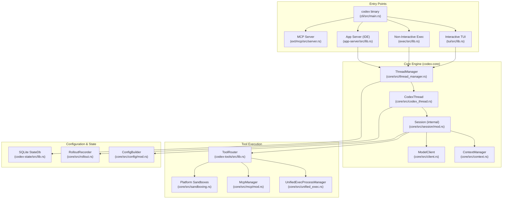

Sources: [codex-rs/cli/src/main.rs:114-216](), [codex-rs/core/src/lib.rs:1-202](), [codex-rs/Cargo.toml:1-160]()

---

## Execution Modes

Codex supports several primary modes tailored for different workflows but sharing the same core thread management.

| Mode | Entry Point | Use Case | Session Persistence | User Interaction |
|:---|:---|:---|:---|:---|
| **TUI** | `codex` (default) | Interactive development | Yes (rollout files) | Full interactive terminal UI |
| **Exec** | `codex exec` | Automation and CI scripts | Yes (unless ephemeral) | Non-interactive, headless |
| **App Server** | `codex app-server` | IDE integration | Yes | Client-server JSON-RPC |
| **MCP Server** | `codex mcp-server` | Tool delegation protocol | Yes | Stdio-based MCP protocol |
| **Cloud** | `codex cloud` | Remote task/cloud management | Remote | CLI and TUI for Cloud Tasks |

### CLI Command Dispatch and Runtime Initialization

The multi-purpose `codex` CLI dispatches subcommands to appropriate modules and controls feature toggles and configuration layering.

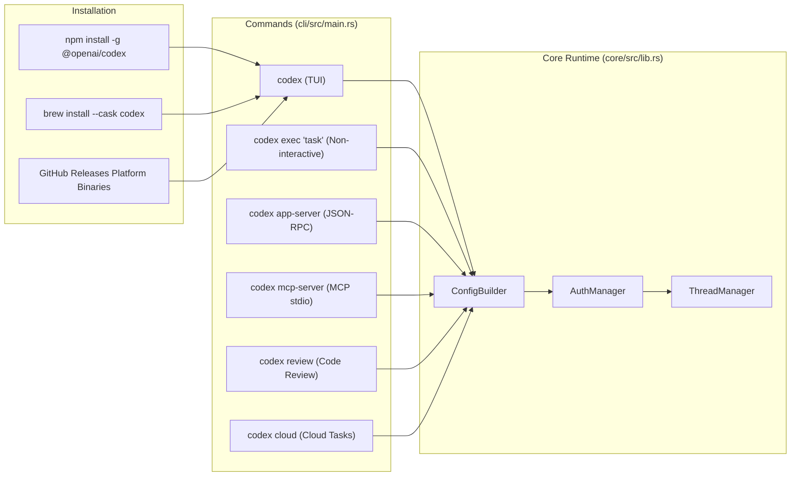

Sources: [codex-rs/cli/src/main.rs:114-216](), [codex-rs/core/src/lib.rs:1-202]()

---

## Core Crate Organization

The Rust workspace under `codex-rs` contains many crates; key crates and their roles summarized below:

| Crate | Path | Purpose |
|:---|:---|:---|
| `codex-core` | `core/` | Core agent engine: conversation, model client, tool routing |
| `codex-tui` | `tui/` | Terminal User Interface based on Ratatui |
| `codex-exec` | `exec/` | Headless CLI mode for scripted runs |
| `codex-cli` | `cli/` | CLI dispatcher and subcommand routing |
| `codex-app-server` | `app-server/` | JSON-RPC server supporting IDE integrations |
| `codex-mcp` | `codex-mcp/` | Model Context Protocol support for external tool servers |
| `codex-config` | `config/` | Configuration loading and management |
| `codex-cloud-tasks` | `cloud-tasks/` | Client interface for Codex Cloud task submissions |

This modular architecture facilitates focused development and flexible deployment of components.

Sources: [codex-rs/Cargo.toml:1-160]()

---

## Core Architecture Components

The core execution engine is layered roughly as follows:

- **ThreadManager**: Manages lifecycle, state persistence, and threading of agent conversations.
- **CodexThread**: Controls the submission queue, event emission system, and task management per thread.
- **Session (internal)**: Coordinates prompt building, turn execution, event streaming, and tool invocations.
- **ContextManager**: Handles conversation history, normalization of messages, token budget management, and context compaction.
- **ModelClient**: Interfaces with AI model APIs, handles retries, streaming response events, and protocol communication.
- **RolloutRecorder**: Persists conversation events for replay and session resumption using rollout files.

### Interaction Flow from User to Core

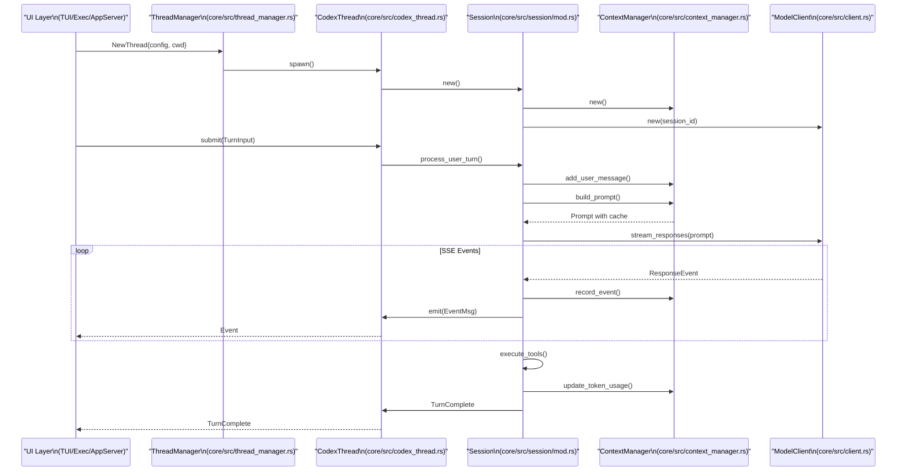

Sources: [codex-rs/core/src/lib.rs:17-123]()

---

## Configuration System

Codex employs a layered configuration system. Starting from built-in defaults, multiple override sources are combined, including global and project config files, environment variables, feature toggles, profile selections, and finally CLI arguments, which take highest precedence.

The `ConfigBuilder` [codex-rs/core/src/config/mod.rs]() consolidates these sources into a unified runtime configuration structure used system-wide.

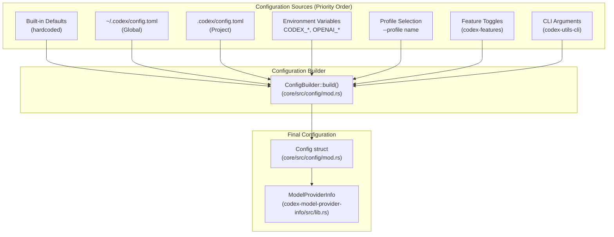

This design enables flexible management of runtime behavior, including model selection, authentication modes, and feature toggling.

Sources: [codex-rs/cli/src/main.rs:114-129](), [codex-rs/core/src/lib.rs:56]()

---

## Session Persistence and Replay

Agent conversations are recorded as **rollout files**, which serialize event streams containing user messages, model responses, agent actions, and tool invocations. This event sourcing approach allows robust session resumption, offline review, and replay capabilities.

The `RolloutRecorder` subsystem handles efficient saving, filtering, and incremental update of these logs. Active and archived sessions are stored under designated directory constants `SESSIONS_SUBDIR` and `ARCHIVED_SESSIONS_SUBDIR` in the core crate.

This persistent log model supports rehydrating conversation state faithfully across runs and provides traceability for debugging or auditing.

Sources: [codex-rs/core/src/lib.rs:159-182]()

---

# Summary and Next Steps

This page provided a high-level introduction to the Codex project, its purpose as an AI coding assistant, and its main architectural components. The focus was on mapping conceptual layers to concrete crates and files, and illustrating how execution modes and configurations integrate with the core engine.

To deepen your understanding, please consult these detailed child pages in the documentation:

- [Installation and Setup](#1.1) — Learn how to install Codex, set up authentication, and configure your environment.
- [Repository Structure](#1.2) — Explore the Cargo workspace organization, primary crates, and their roles.
- [Architecture Overview](#1.3) — Review comprehensive architecture diagrams explaining data flow and component interactions.

Sources:
[codex-rs/cli/src/main.rs:114-216](), [codex-rs/core/src/lib.rs:1-202](), [codex-rs/Cargo.toml:1-160]()

---

# Page: Installation and Setup

# Installation and Setup

<details>
<summary>Relevant source files</summary>

The following files were used as context for generating this wiki page:

- [.github/actions/linux-code-sign/action.yml](.github/actions/linux-code-sign/action.yml)
- [.github/actions/windows-code-sign/action.yml](.github/actions/windows-code-sign/action.yml)
- [.github/dotslash-config.json](.github/dotslash-config.json)
- [codex-cli/scripts/README.md](codex-cli/scripts/README.md)
- [codex-cli/scripts/build_npm_package.py](codex-cli/scripts/build_npm_package.py)
- [codex-rs/app-server-daemon/Cargo.toml](codex-rs/app-server-daemon/Cargo.toml)
- [codex-rs/app-server-daemon/README.md](codex-rs/app-server-daemon/README.md)
- [codex-rs/app-server-daemon/src/backend/mod.rs](codex-rs/app-server-daemon/src/backend/mod.rs)
- [codex-rs/app-server-daemon/src/backend/pid.rs](codex-rs/app-server-daemon/src/backend/pid.rs)
- [codex-rs/app-server-daemon/src/backend/pid_start.rs](codex-rs/app-server-daemon/src/backend/pid_start.rs)
- [codex-rs/app-server-daemon/src/backend/pid_tests.rs](codex-rs/app-server-daemon/src/backend/pid_tests.rs)
- [codex-rs/app-server-daemon/src/background_command.rs](codex-rs/app-server-daemon/src/background_command.rs)
- [codex-rs/app-server-daemon/src/client.rs](codex-rs/app-server-daemon/src/client.rs)
- [codex-rs/app-server-daemon/src/lib.rs](codex-rs/app-server-daemon/src/lib.rs)
- [codex-rs/app-server-daemon/src/managed_install.rs](codex-rs/app-server-daemon/src/managed_install.rs)
- [codex-rs/app-server-daemon/src/managed_install_path_tests.rs](codex-rs/app-server-daemon/src/managed_install_path_tests.rs)
- [codex-rs/app-server-daemon/src/managed_install_tests.rs](codex-rs/app-server-daemon/src/managed_install_tests.rs)
- [codex-rs/app-server-daemon/src/manual_update.rs](codex-rs/app-server-daemon/src/manual_update.rs)
- [codex-rs/app-server-daemon/src/migration.rs](codex-rs/app-server-daemon/src/migration.rs)
- [codex-rs/app-server-daemon/src/prepare_install.rs](codex-rs/app-server-daemon/src/prepare_install.rs)
- [codex-rs/app-server-daemon/src/prepare_install_tests.rs](codex-rs/app-server-daemon/src/prepare_install_tests.rs)
- [codex-rs/app-server-daemon/src/prepare_install_windows.rs](codex-rs/app-server-daemon/src/prepare_install_windows.rs)
- [codex-rs/app-server-daemon/src/prepare_install_windows_tests.rs](codex-rs/app-server-daemon/src/prepare_install_windows_tests.rs)
- [codex-rs/app-server-daemon/src/release_pruning.rs](codex-rs/app-server-daemon/src/release_pruning.rs)
- [codex-rs/app-server-daemon/src/settings.rs](codex-rs/app-server-daemon/src/settings.rs)
- [codex-rs/app-server-daemon/src/settings_tests.rs](codex-rs/app-server-daemon/src/settings_tests.rs)
- [codex-rs/app-server-daemon/src/update_loop.rs](codex-rs/app-server-daemon/src/update_loop.rs)
- [codex-rs/app-server-daemon/src/update_loop_tests.rs](codex-rs/app-server-daemon/src/update_loop_tests.rs)
- [codex-rs/app-server-transport/src/daemon_shutdown.rs](codex-rs/app-server-transport/src/daemon_shutdown.rs)
- [codex-rs/app-server/tests/suite/v2/otel.rs](codex-rs/app-server/tests/suite/v2/otel.rs)
- [codex-rs/cli/tests/app_server_daemon.rs](codex-rs/cli/tests/app_server_daemon.rs)
- [codex-rs/cli/tests/app_server_daemon_windows.rs](codex-rs/cli/tests/app_server_daemon_windows.rs)
- [codex-rs/cli/tests/daemon_startup.rs](codex-rs/cli/tests/daemon_startup.rs)
- [codex-rs/cli/tests/daemon_telemetry.rs](codex-rs/cli/tests/daemon_telemetry.rs)
- [codex-rs/cli/tests/worktree.rs](codex-rs/cli/tests/worktree.rs)
- [codex-rs/core/tests/suite/cli_stream.rs](codex-rs/core/tests/suite/cli_stream.rs)
- [codex-rs/exec/src/cli.rs](codex-rs/exec/src/cli.rs)
- [codex-rs/exec/src/cli_tests.rs](codex-rs/exec/src/cli_tests.rs)
- [codex-rs/exec/tests/suite/mod.rs](codex-rs/exec/tests/suite/mod.rs)
- [codex-rs/exec/tests/suite/resume.rs](codex-rs/exec/tests/suite/resume.rs)
- [codex-rs/exec/tests/suite/seatbelt.rs](codex-rs/exec/tests/suite/seatbelt.rs)
- [codex-rs/tui/src/cli.rs](codex-rs/tui/src/cli.rs)
- [codex-rs/tui/src/daemon_startup.rs](codex-rs/tui/src/daemon_startup.rs)
- [codex-rs/tui/src/daemon_startup_tests.rs](codex-rs/tui/src/daemon_startup_tests.rs)
- [codex-rs/tui/src/daemon_telemetry.rs](codex-rs/tui/src/daemon_telemetry.rs)
- [codex-rs/tui/src/startup_orchestration.rs](codex-rs/tui/src/startup_orchestration.rs)
- [codex-rs/utils/cli/src/shared_options.rs](codex-rs/utils/cli/src/shared_options.rs)
- [scripts/install/install.ps1](scripts/install/install.ps1)
- [scripts/install/install.sh](scripts/install/install.sh)
- [scripts/install/test_install_sh.py](scripts/install/test_install_sh.py)
- [scripts/stage_npm_packages.py](scripts/stage_npm_packages.py)
- [sdk/typescript/README.md](sdk/typescript/README.md)
- [sdk/typescript/src/codex.ts](sdk/typescript/src/codex.ts)
- [sdk/typescript/src/codexOptions.ts](sdk/typescript/src/codexOptions.ts)
- [sdk/typescript/src/exec.ts](sdk/typescript/src/exec.ts)
- [sdk/typescript/src/index.ts](sdk/typescript/src/index.ts)
- [sdk/typescript/src/thread.ts](sdk/typescript/src/thread.ts)
- [sdk/typescript/src/threadOptions.ts](sdk/typescript/src/threadOptions.ts)
- [sdk/typescript/tests/exec.test.ts](sdk/typescript/tests/exec.test.ts)
- [sdk/typescript/tests/run.test.ts](sdk/typescript/tests/run.test.ts)
- [sdk/typescript/tests/testCodex.ts](sdk/typescript/tests/testCodex.ts)

</details>


This page covers installing Codex CLI, authenticating, and performing initial configuration. Codex is a coding agent from OpenAI that runs locally on your computer [README.md:1](). It is distributed as a native binary through npm, Homebrew, direct download, or shell installation scripts [README.md:14-49]().

## System Requirements

**Supported Platforms:**

| Operating System | Details |
|---|---|
| **macOS** | macOS 12+ (Apple Silicon / arm64 and x86_64) [README.md:57-59](), [docs/install.md:7]() |
| **Linux** | Ubuntu 20.04+ / Debian 10+ (x86_64 and arm64 via MUSL) [README.md:60-62](), [docs/install.md:7]() |
| **Windows** | Windows 11 **via WSL2** (Recommended) [docs/install.md:7]() or Native x86_64/arm64 [README.md:22-26]() |

**Resource Requirements:**

- **RAM:** 4 GB minimum (8 GB recommended) [docs/install.md:9]().

**Development Requirements:**

- **Node.js:** >= 22 (for workspace maintenance) [package.json:35]() or >= 16 (for CLI packaging) [codex-cli/package.json:11]().

- **Rust:** 1.85+ (standard for the `codex-rs` workspace) [AGENTS.md:24]().

- **pnpm:** v10.34.5+ (used for workspace dependency management) [package.json:38](), [pnpm-lock.yaml:21]().

Sources: [README.md:57-62](), [codex-cli/package.json:10-22](), [package.json:34-39](), [docs/install.md:5-10](), [pnpm-lock.yaml:21]()

---

## Installation Methods

### Standalone Install Scripts

The official installation scripts are the primary entry point for users. They default to downloading from `releases.openai.com` and fall back to GitHub Releases if the primary source is unavailable. The install scripts handle platform detection, fallback URLs, timeout settings, and download verification for complete and safe installation of the `codex` binary [scripts/install/install.sh:1-247](), [scripts/install/install.ps1:1-195]().

- **Mac/Linux (Shell):**

  ```shell
  curl -fsSL https://chatgpt.com/codex/install.sh | sh
  ```

  To force downloads from GitHub Releases explicitly, set:

  ```shell
  CODEX_INSTALLER_USE_RELEASES_OPENAI_COM=false curl -fsSL https://chatgpt.com/codex/install.sh | sh
  ```

- **Windows (PowerShell):**

  ```powershell
  powershell -ExecutionPolicy ByPass -c "irm https://chatgpt.com/codex/install.ps1 | iex"
  ```

  To force GitHub Releases explicitly:

  ```powershell
  $env:CODEX_INSTALLER_USE_RELEASES_OPENAI_COM='false'; irm https://chatgpt.com/codex/install.ps1 | iex
  ```

These scripts install Codex binaries into user-writeable directories such as `$HOME/.local/bin` (Unix) or `%USERPROFILE%\bin` (Windows). They also manage version normalization, validation, and fallback handling for download URLs [scripts/install/install.sh:1-247](), [scripts/install/install.ps1:1-195]().

Sources: [scripts/install/install.sh:1-247](), [scripts/install/install.ps1:1-195]()

---

### Package Managers

- **npm**

  The `@openai/codex` npm package acts as a shim wrapping native binaries per platform. The included `bin/codex.js` script dynamically detects the user's OS and CPU architecture at runtime, then spawns the corresponding native binary from `vendor/{targetTriple}/bin/codex` folder, enabling one package to support multiple platforms transparently [scripts/codex_package/cli.py:1-205](), [codex-cli/package.json:1-22]().

  Install with:

  ```shell
  npm install -g @openai/codex
  ```

- **Homebrew**

  For macOS users, install via the cask:

  ```shell
  brew install --cask codex
  ```

  This installs the native executable directly for supported macOS versions [README.md:46-48]().

The package managers ease installation, update management, and platform detection compared to direct downloads.

Sources: [README.md:38-49](), [codex-cli/package.json:1-22](), [scripts/codex_package/cli.py:1-205]()

---

### Direct Binary and DotSlash Distribution

Prebuilt binary archives for various platforms are available on GitHub Releases. For example:

| Target Triple                 | Archive Filename                             |
|------------------------------|---------------------------------------------|
| `aarch64-apple-darwin`        | `codex-package-aarch64-apple-darwin.tar.zst` |
| `x86_64-apple-darwin`         | `codex-package-x86_64-apple-darwin.tar.zst`  |
| `x86_64-unknown-linux-musl`   | `codex-package-x86_64-unknown-linux-musl.tar.zst` |
| `aarch64-unknown-linux-musl`  | `codex-package-aarch64-unknown-linux-musl.tar.zst` |

Users can manually extract these archives and rename the executable `codex` for local use [scripts/codex_package/README.md:1-101](), [README.md:53-65]().

Additionally, the repository offers a **DotSlash** distribution, a minimal portable shim executable named `codex`. This shim automatically fetches and executes the correct native binary on-demand, ensuring consistent CLI usage without full installation overhead. It is useful for cross-platform teams to commit a lightweight executable that manages platform-specific binaries transparently [scripts/codex_package/dotslash.py:1-136](), [docs/install.md:11-14]().

Sources: [scripts/codex_package/README.md:1-101](), [README.md:53-65](), [docs/install.md:11-14](), [.github/dotslash-config.json:1-136]()

---

## Authentication Setup

Codex requires authentication to access AI services. The recommended method is authenticating with your ChatGPT account, providing access under Plus, Pro, Business, Edu, or Enterprise plans using an OAuth flow. Alternatively, users can manually provide an API key via environment variables or config [README.md:68-72]().

### Authentication Modes

| Mode        | User Action/Configuration              | Notes                                                      |
|-------------|--------------------------------------|------------------------------------------------------------|
| **ChatGPT** | Run `codex` and select "Sign in"    | Browser-based OAuth login; uses a local OAuth callback server on localhost:1455. Recommended. |
| **API Key** | Set `CODEX_API_KEY` environment variable or config | Manual provisioning. Requires copying API key into env/config. |

The ChatGPT login flow starts a local HTTP server on port 1455 which listens for OAuth redirect callbacks. It opens the default browser for user authentication, then securely exchanges the authorization code for tokens via PKCE. The flow manages token refresh and stores access tokens securely. The CLI integrates this authentication management during runtime [codex-rs/login/src/server.rs:113-190](), [codex-rs/cli/src/login.rs:140-168]().

Sources: [README.md:68-72](), [codex-rs/login/src/server.rs:113-190](), [codex-rs/cli/src/login.rs:140-168]()

---

### Internal Authentication Components

Authentication implementation primarily resides in the `codex-login` Rust crate, which organizes auth workflow, credential storage, and token lifecycle:

- **`CodexAuth` enum**: Models different authentication forms including API key, ChatGPT OAuth tokens, Bedrock-style credentials, personal tokens, and Agent identities [codex-rs/login/src/auth/manager.rs:75-86]().

- **`AuthManager` struct**: Coordinates login/logout processes, triggers token refresh, and persists credentials securely using pluggable storage backends [codex-rs/login/src/auth/manager.rs:40-70]().

- **Auth Storage Backends**: The `AuthStorageBackend` trait abstracts storage, with concrete implementations supporting local file storage or platform-specific secure stores (e.g., OS keyrings). The crate API `create_auth_storage` facilitates appropriate backend selection [codex-rs/login/src/auth/storage.rs]().

- **OAuth Callback Server (`LoginServer`)**: Runs a local HTTP listener to handle OAuth redirects for PKCE. Interfaces with the CLI binary for interprocess token handoff [codex-rs/login/src/server.rs:113-144]().

Sources: [codex-rs/login/src/auth/manager.rs:1-192](), [codex-rs/login/src/server.rs:113-190](), [codex-rs/login/src/auth/storage.rs]()

---

## Installation and Authentication Data Flow Diagrams

### Installation Distribution and Execution Flow

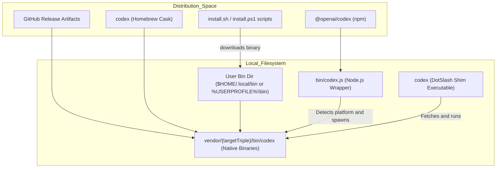

This diagram maps the user-facing installation methods—standalone install scripts, the npm package, Homebrew cask, direct GitHub releases, and the DotSlash shim—to their final deployment on the user's system filesystem and executable invocation. The `codex.js` Node.js launcher dynamically selects and spawns the platform-appropriate native binary at runtime [scripts/codex_package/cli.py:1-205](), [README.md:14-65](), [codex-cli/bin/codex.js:16-110](), [docs/install.md:11-14]().

Sources: [README.md:14-65](), [codex-cli/bin/codex.js:16-110](), [scripts/codex_package/cli.py:1-205](), [docs/install.md:11-14]()

---

### Authentication Flow and Runtime Initialization

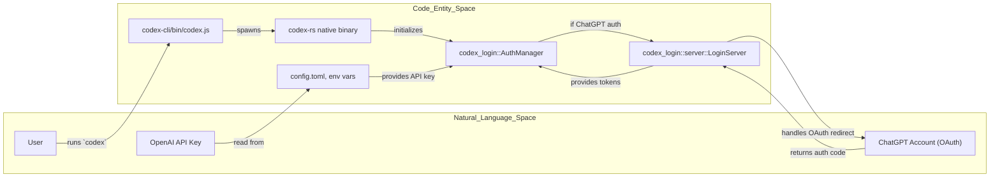

Users launch Codex through the JavaScript wrapper `codex.js`, which spawns the native binary containing the core logic. At runtime, the `AuthManager` component from the `codex_login` crate orchestrates authentication state by integrating OAuth tokens obtained via ChatGPT sign-in or API key authentication configured via environment variables or config files. The `LoginServer` handles the OAuth callback flow. The layered configuration system funnels auth parameters securely into the native binary's runtime session [README.md:68-72](), [codex-cli/bin/codex.js:195-198](), [codex-rs/login/src/lib.rs:1-68](), [codex-rs/login/src/server.rs:113-190]().

Sources: [README.md:68-72](), [codex-cli/bin/codex.js:195-198](), [codex-rs/login/src/lib.rs:1-68](), [codex-rs/login/src/server.rs:113-190]()

---

## Development and Environment Setup

### Development Tools

Codex development uses the Rust workspace alongside Node.js tooling; essential tools include:

- **just**: Task runner for commands like build, test, and lint [`justfile:1-190`]().

- **cargo-nextest**: Parallel test runner to improve Rust test performance.

- **Rust toolchain**: Includes `rustfmt` and `clippy` for code formatting and linting [docs/install.md:25-26]().

### Building from Source

Typical source build steps:

```bash
git clone https://github.com/openai/codex.git
cd codex/codex-rs
cargo build
cargo run --bin codex -- "explain this codebase"
```

### Nix and Devcontainer Profiles

The repository provides [Nix](https://nixos.org/) build support through `flake.nix` and `codex-rs/default.nix` defining pinned Rust, Node, and tooling versions. Visual Studio Code devcontainer profiles under `.devcontainer/` include `codex-install` which prepares a fresh environment replicating install conditions for testing install workflows [codex-rs/default.nix:1-55](), [.devcontainer/codex-install/package.json:1-5]().

Sources: [justfile:1-190](), [docs/install.md:17-38](), [codex-rs/default.nix:1-55](), [AGENTS.md:1-67]()

---

# Summary

This document described:

- Codex installation via standalone shell/PowerShell scripts that detect platform and fetch verified binaries.
- Packaging methods through npm with dynamic native binary spawning or Homebrew cask for macOS.
- Manual direct binary downloads from GitHub Releases and the DotSlash shim for portable on-demand execution.
- Authentication workflows including ChatGPT OAuth-based login or manual API key configuration handled by the `codex-login` crate at runtime.
- Development setup with Rust, Node.js, just, cargo-nextest, and reproducible devcontainers.

Two detailed diagrams illustrate the relationships between installation methods and executables on disk, and the authentication flow from user actions through code components at runtime.

---

**Sources:**  
[README.md:1-78](), [codex-cli/package.json:1-22](), [codex-cli/bin/codex.js:16-110](), [docs/install.md:5-38](), [scripts/install/install.sh:1-247](), [scripts/install/install.ps1:1-195](), [scripts/codex_package/cli.py:1-205](), [codex-rs/login/src/auth/manager.rs:1-192](), [codex-rs/login/src/server.rs:113-190](), [codex-rs/cli/src/login.rs:10-180](), [justfile:1-190](), [codex-rs/default.nix:1-55](), [AGENTS.md:1-67]()

---

# Page: Repository Structure

# Repository Structure

<details>
<summary>Relevant source files</summary>

The following files were used as context for generating this wiki page:

- [BUILD.bazel](BUILD.bazel)
- [MODULE.bazel](MODULE.bazel)
- [MODULE.bazel.lock](MODULE.bazel.lock)
- [SECURITY.md](SECURITY.md)
- [codex-rs/.config/nextest.toml](codex-rs/.config/nextest.toml)
- [codex-rs/Cargo.lock](codex-rs/Cargo.lock)
- [codex-rs/Cargo.toml](codex-rs/Cargo.toml)
- [codex-rs/app-server-daemon/src/remote_control_client.rs](codex-rs/app-server-daemon/src/remote_control_client.rs)
- [codex-rs/app-server/BUILD.bazel](codex-rs/app-server/BUILD.bazel)
- [codex-rs/app-server/Cargo.toml](codex-rs/app-server/Cargo.toml)
- [codex-rs/app-server/src/extensions.rs](codex-rs/app-server/src/extensions.rs)
- [codex-rs/app-server/src/mcp_refresh.rs](codex-rs/app-server/src/mcp_refresh.rs)
- [codex-rs/cli/BUILD.bazel](codex-rs/cli/BUILD.bazel)
- [codex-rs/cli/Cargo.toml](codex-rs/cli/Cargo.toml)
- [codex-rs/cli/src/main.rs](codex-rs/cli/src/main.rs)
- [codex-rs/cli/src/remote_control_cmd.rs](codex-rs/cli/src/remote_control_cmd.rs)
- [codex-rs/cli/tests/app_server_daemon/package.rs](codex-rs/cli/tests/app_server_daemon/package.rs)
- [codex-rs/cli/tests/app_server_daemon/support.rs](codex-rs/cli/tests/app_server_daemon/support.rs)
- [codex-rs/core/BUILD.bazel](codex-rs/core/BUILD.bazel)
- [codex-rs/core/Cargo.toml](codex-rs/core/Cargo.toml)
- [codex-rs/core/src/lib.rs](codex-rs/core/src/lib.rs)
- [codex-rs/core/tests/windows_sandbox.rs](codex-rs/core/tests/windows_sandbox.rs)
- [codex-rs/tui/BUILD.bazel](codex-rs/tui/BUILD.bazel)
- [codex-rs/tui/Cargo.toml](codex-rs/tui/Cargo.toml)
- [codex-rs/utils/cargo-bin/BUILD.bazel](codex-rs/utils/cargo-bin/BUILD.bazel)
- [codex-rs/voice-host/BUILD.bazel](codex-rs/voice-host/BUILD.bazel)
- [codex-rs/windows-sandbox-rs/BUILD.bazel](codex-rs/windows-sandbox-rs/BUILD.bazel)
- [codex-rs/windows-sandbox-rs/Cargo.toml](codex-rs/windows-sandbox-rs/Cargo.toml)
- [codex-rs/windows-sandbox-rs/build.rs](codex-rs/windows-sandbox-rs/build.rs)
- [codex-rs/windows-sandbox-rs/codex-windows-sandbox-setup.manifest](codex-rs/windows-sandbox-rs/codex-windows-sandbox-setup.manifest)
- [codex-rs/windows-sandbox-rs/src/unified_exec/tests.rs](codex-rs/windows-sandbox-rs/src/unified_exec/tests.rs)
- [codex-rs/windows-sandbox-rs/tests/helper_manifest.rs](codex-rs/windows-sandbox-rs/tests/helper_manifest.rs)
- [defs.bzl](defs.bzl)
- [patches/BUILD.bazel](patches/BUILD.bazel)
- [patches/mxc-sdk_utf8_resources.patch](patches/mxc-sdk_utf8_resources.patch)
- [patches/rules_rs_windows_msvc_linker.patch](patches/rules_rs_windows_msvc_linker.patch)
- [patches/rules_rust_windows_msvc_direct_link_args.patch](patches/rules_rust_windows_msvc_direct_link_args.patch)
- [workspace_root_test_launcher.bat.tpl](workspace_root_test_launcher.bat.tpl)
- [workspace_root_test_launcher.sh.tpl](workspace_root_test_launcher.sh.tpl)

</details>


This page documents the Cargo workspace organization, key crates, and dependency relationships in the `codex-rs` repository. It also covers the top-level TypeScript package, the Rust workspace crates, and the top-level tooling.

## Scope and Organization

The `codex-rs` repository is organized as a Cargo workspace containing over 140 member crates and packages [codex-rs/Cargo.toml:2-160](). The workspace uses a monorepo structure where all crates share common tooling, dependency versions, and build configuration via a root `Cargo.toml` manifest [codex-rs/Cargo.toml:1-160]().

The project uses a dual-build system for flexibility:
- **Cargo** is the primary Rust package manager for local development.
- **Bazel** is used for hermetic builds, dependency patching, cross-platform integration, and CI/CD workflows [MODULE.bazel:1-201](), [MODULE.bazel.lock:1-56]().

---

## Workspace Structure

The Cargo workspace is declared in the root `codex-rs/Cargo.toml` under the `[workspace]` section. It standardizes the Rust edition to 2024 and the Apache-2.0 license across all workspace members, ensuring consistent build policies [codex-rs/Cargo.toml:1-160]().

### Primary Crates and Packages

The workspace bundles many crates organized by functional areas, including core engine, user interfaces, protocol and server, tools and policies, SDKs, configuration, and utilities:

| Category | Key Crates / Packages | Description |
|---|---|---|
| **Core Engine** | `core` (`codex-core`) | Core agent engine managing conversation threads, turns, state, and APIs. |
| **User Interfaces** | `tui` (`codex-tui`), `cli` (`codex-cli`), `exec` (`codex-exec`) | Terminal UI, CLI multitool, and non-interactive execution mode. |
| **App Server & Protocol** | `app-server` (`codex-app-server`), `app-server-client`, `app-server-protocol` | JSON-RPC app server daemon with protocol definitions for IDE integration. |
| **Tools and Extensibility** | `tools`, `skills`, `execpolicy`, `sandboxing`, `plugin` | Tool execution, sandbox policies, skills, and plugin infrastructure. |
| **SDKs and External Support** | `@openai/codex` (TypeScript), `sdk/python` (Python) | TypeScript and Python SDKs for external Codex embedding. |
| **Configuration & State** | `config`, `state`, `secrets` | Layered configuration system, persistent state storage, and secrets management. |
| **Infrastructure Utilities** | `utils/*` (40+ utility crates) | Various helper crates for path handling, CLI, sandbox summary, approval presets, etc. |

The root manifest acts as the single source of truth, tying these components together and specifying dependencies and versions centrally, facilitating broad code reuse and shared versions [codex-rs/Cargo.toml:2-160]().

---

### Workspace Component Overview Diagram

```mermaid
graph TB
    subgraph WorkspaceRoot["Workspace Root"]
        CargoToml["Cargo.toml<br/>(workspace manifest)"]
        CargoLock["Cargo.lock<br/>(dependency lock)"]
        Justfile["justfile<br/>(command recipes)"]
        Bazel["MODULE.bazel.lock<br/>(bazel dependency lock)"]
    end

    subgraph EntryPoints["Entry Point Binaries"]
        CLI["cli/<br/>codex (multitool)"]
        TUI["tui/<br/>codex-tui (terminal UI)"]
        EXEC["exec/<br/>codex-exec (headless exec mode)"]
        APPSERVER_BIN["app-server/<br/>codex-app-server"]
        EXECSERVER_BIN["app-server/<br/>exec-server"]
    end

    subgraph CoreEngine["Core Engine"]
        CORE["core/<br/>codex-core (business logic library)"]
    end

    subgraph ProtocolAndServer["Protocol & Communication"]
        PROTOCOL["protocol/<br/>codex-protocol"]
        APPPROTO["app-server-protocol/"]
        APPSERVER_LIB["app-server/<br/>codex_app_server (library)"]
        APPCLIENT["app-server-client/"]
    end

    subgraph ConfigurationAndState["Config & State"]
        CONFIG["config/"]
        STATE["state/"]
        SECRETS["secrets/"]
    end

    subgraph ToolsSandbox["Tool & Execution"]
        SHELLCMD["shell-command/"]
        TOOLS["tools/"]
        SKILLS["skills/"]
        EXECPOLICY["execpolicy/"]
        SANDBOX["sandboxing/"]
        MCP["codex-mcp/"]
        PLUGIN["plugin/"]
    end

    subgraph SDKs["SDKs & External Interfaces"]
        TS_SDK["@openai/codex<br/>TypeScript SDK (npm)"]
        PY_SDK["sdk/python<br/>Python SDK"]
    end

    subgraph Utilities["Utility Crates"]
        UTILS["utils/*<br/>(~40 utility crates)"]
    end

    CargoToml --> CLI
    CargoToml --> TUI
    CargoToml --> EXEC
    CargoToml --> APPSERVER_BIN
    CargoToml --> EXECSERVER_BIN
    CargoToml --> CORE
    CargoToml --> PROTOCOL
    CargoToml --> APPPROTO
    CargoToml --> APPSERVER_LIB
    CargoToml --> APPCLIENT
    CargoToml --> CONFIG
    CargoToml --> STATE
    CargoToml --> SECRETS
    CargoToml --> SHELLCMD
    CargoToml --> TOOLS
    CargoToml --> SKILLS
    CargoToml --> EXECPOLICY
    CargoToml --> SANDBOX
    CargoToml --> MCP
    CargoToml --> PLUGIN
    CargoToml --> TS_SDK
    CargoToml --> PY_SDK
    CargoToml --> UTILS

    CLI --> CORE
    CLI --> TUI
    CLI --> EXEC
    CLI --> APPSERVER_BIN

    TUI --> CORE
    TUI --> APPCLIENT
    TUI --> APPPROTO

    EXEC --> CORE

    APPSERVER_BIN --> APPSERVER_LIB
    EXECSERVER_BIN --> APPSERVER_LIB

    CORE --> PROTOCOL
    CORE --> CONFIG
    CORE --> STATE
    CORE --> SHELLCMD
    CORE --> SKILLS
    CORE --> TOOLS
    CORE --> SANDBOX
    CORE --> MCP
    CORE --> PLUGIN
```

This diagram depicts the workspace root manifests orchestrating the main Rust components, UI frontends, protocol definitions, tooling, SDKs, and utilities.

**Sources:** [codex-rs/Cargo.toml:1-160](), [MODULE.bazel:1-201](), [MODULE.bazel.lock:1-56]()

---

## Entry Point Crates

### CLI Multitool (`cli/`)

The `cli` crate provides the `codex` multitool binary, which supports many subcommands [codex-rs/cli/Cargo.toml:9-11](), [codex-rs/cli/src/main.rs:114-214]().

- Routes commands for interactive TUI, non-interactive exec, login/logout, plugin management, cloud tasks, and app-server control.
- Uses the `MultitoolCli` struct (from clap) to parse and dispatch subcommands [codex-rs/cli/src/main.rs:130]().
- Major subcommands include:
  - `exec`: invokes `codex-exec` headless mode [codex-rs/cli/src/main.rs:157]().
  - `mcp`: manages Model Context Protocol servers [codex-rs/cli/src/main.rs:169]().
  - `review`: code review flow [codex-rs/cli/src/main.rs:160]().
  - `app-server`: app server controls [codex-rs/cli/src/main.rs:175]().
  
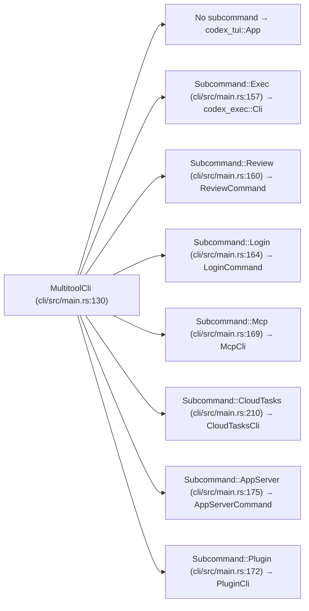

**Sources:** [codex-rs/cli/Cargo.toml:9-11](), [codex-rs/cli/src/main.rs:114-214](), [codex-rs/cli/src/main.rs:130](), [codex-rs/cli/src/main.rs:157](), [codex-rs/cli/src/main.rs:169](), [codex-rs/cli/src/main.rs:160](), [codex-rs/cli/src/main.rs:175](), [codex-rs/cli/src/main.rs:172]()

---

### Interactive Terminal UI (`tui/`)

The terminal UI implemented in the `tui` crate (`codex-tui`) offers a fullscreen interface for Codex operations [codex-rs/tui/Cargo.toml:2-20](), [codex-rs/tui/src/lib.rs:23]().

- Built on `ratatui` terminal UI library [codex-rs/tui/Cargo.toml:93-98]().
- Provides conversation rendering, input handling, popups, status indicators, and overlays.
- Uses the main `App` struct to manage UI state and event loops.
- Communicates with the app server using `codex-app-server-client` [codex-rs/tui/Cargo.toml:32]().
- Supports session resumption, multiple threads, agent roles, and rich text markdown rendering.

**Sources:** [codex-rs/tui/Cargo.toml:2-20](), [codex-rs/tui/src/lib.rs:23](), [codex-rs/tui/Cargo.toml:93-98](), [codex-rs/tui/Cargo.toml:32]()

---

### Headless Execution Mode (`exec/`)

The `exec` crate implements a headless, non-interactive Codex mode focused on batch execution, event replay, and output formatting [codex-rs/cli/src/main.rs:22](), [codex-rs/exec/src/lib.rs:114]().

- Parses and processes event logs without user interface.
- Produces human-readable output in terminal or JSONL format.
- Responsible for approval handling and event serialization/deserialization.
- The CLI multitool's `exec` subcommand delegates here [codex-rs/cli/src/main.rs:22]().

**Sources:** [codex-rs/cli/src/main.rs:22](), [codex-rs/exec/src/lib.rs:114]()

---

### App Server (`app-server/`)

The `app-server` crate is the JSON-RPC daemon server for IDE integration and remote control [codex-rs/app-server/Cargo.toml:2-21]().

- Provides the `codex-app-server` binary and sub-bin `exec-server` for exec mode RPC [codex-rs/app-server/Cargo.toml:8-17]().
- Depends on related crates `app-server-protocol` and `app-server-client` for RPC protocols and client interfaces [codex-rs/app-server/Cargo.toml:88-89]().
- Implements request processors, authentication, threading APIs, event streaming, and extension management [codex-rs/app-server/src/extensions.rs:50-128]().
- Integrates tightly with core to manage session lifecycles.

**Sources:** [codex-rs/app-server/Cargo.toml:2-21](), [codex-rs/app-server/Cargo.toml:8-17](), [codex-rs/app-server/Cargo.toml:88-89](), [codex-rs/app-server/src/extensions.rs:50-128]()

---

## Core Engine (`codex-core` crate)

The `core` crate (`codex-core`) is the fundamental Rust library implementing the agent core engine [codex-rs/core/Cargo.toml:1-140](), [codex-rs/core/src/lib.rs:1-192]().

### Key Types and Responsibilities

| Type / Module | Role / Description | Location |
|---|---|---|
| `CodexThread` | Manages conversation threads, turn execution, turn context. | [codex-rs/core/src/lib.rs:51]() |
| `ThreadManager` | Controls spawning, forking, resuming threads and sessions. | [codex-rs/core/src/lib.rs:163]() |
| `ModelClient` | Handles interactions with language model APIs including retries. | [codex-rs/core/src/client.rs]() |
| `RolloutRecorder` | Records and persists event streams (conversation history). | [codex-rs/core/src/rollout.rs]() |
| `McpManager` | Manages Model Context Protocol (MCP) server connections. | [codex-rs/core/src/lib.rs:110]() |

The core crate additionally provides:
- Agent orchestration and multi-agent support for complex conversation trees.
- Turn context, prompt building with override support.
- Event processing and state synchronization including rollout and compaction.
- Plugin and skill management interfaces.
- Network proxy and sandbox enforcement integration.
- State database bridging and rollout persistence.

### Core Engine Class Diagram

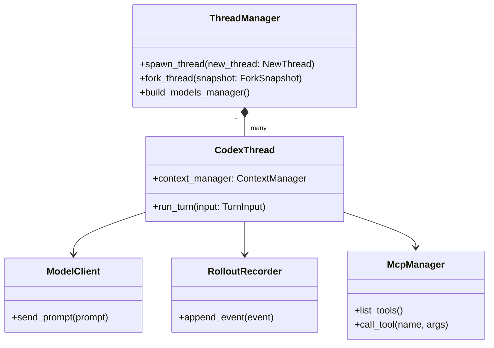

This shows the runtime relationships: `ThreadManager` supervises multiple `CodexThread` instances, each engaging with the LLM API (`ModelClient`), recording events (`RolloutRecorder`), and interacting with MCP servers (`McpManager`).

**Sources:** [codex-rs/core/src/lib.rs:1-192](), [codex-rs/core/Cargo.toml:10-130](), [codex-rs/core/src/lib.rs:51](), [codex-rs/core/src/lib.rs:163](), [codex-rs/core/src/client.rs](), [codex-rs/core/src/rollout.rs](), [codex-rs/core/src/lib.rs:110]()

---

## TypeScript Package (`codex-cli` and `sdk/typescript`)

The repository also packages `codex-cli` as a TypeScript npm module `@openai/codex` to enable programmatic access to Codex features from Node.js environments.

- The `cli` crate exposes the Rust CLI interface as a native binary [codex-rs/cli/Cargo.toml:9-11]().
- The `sdk/typescript/` directory supplies a TypeScript SDK implementing APIs such as `Codex`, `Thread`, and `Turn`.
- This SDK supports event streaming, structured output parsing, and session resumption.
- It facilitates integration in web applications and tools without requiring Rust.

**Sources:** [codex-rs/cli/Cargo.toml:9-11]()

---

## Additional Workspace Directories

- **`sdk/` Directory:** Contains language-specific SDK implementations, including TypeScript and Python SDKs, providing idiomatic client libraries to consume Codex APIs.
- **`third_party/` Directory:** Houses vendored or patched external third-party dependencies crucial for build hermeticity and platform support, e.g., `third_party/v8/` contains the V8 JavaScript engine integration.
- **`tools/` Directory:** Implements Codex tools—standalone or extendable command handlers invoked during agent execution (shell commands, file searchers, oracles, etc.).
- **`bazel/` Directory:** Contains Bazel build rules, macros, and workspace initialization files, supporting cross-platform builds, sandboxed environments, and hermetic dependency resolution [MODULE.bazel:1-201](), [defs.bzl:1-175]().

**Sources:** [MODULE.bazel:1-201](), [defs.bzl:1-175]()

---

## Natural Language Concepts to Code Entities

The following diagrams map high-level system concepts (Natural Language Space) to key code entities (Code Entity Space) for better orientation.

### Diagram 1: Codex User Interfaces and Core Interaction

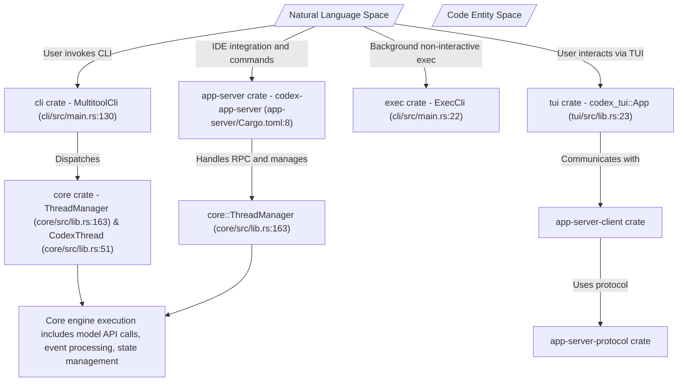

This diagram shows how the user-facing CLI and TUI interact with the core engine and how the app server and its protocol crates mediate IDE integrations.

**Sources:** [codex-rs/cli/src/main.rs:130](), [codex-rs/tui/src/lib.rs:23](), [codex-rs/cli/src/main.rs:22](), [codex-rs/app-server/Cargo.toml:8](), [codex-rs/core/src/lib.rs:163](), [codex-rs/core/src/lib.rs:51]()

---

### Diagram 2: Tooling and SDK Layers from Natural Language to Code

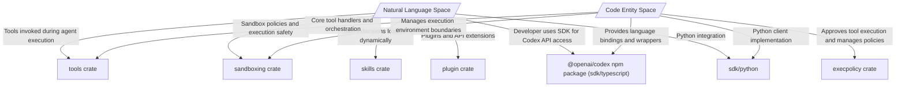

This diagram maps how tools, execution policies, sandboxing, and extensions are represented in the codebase and how SDKs provide interfaces for external consumers.

---

# Summary

The `codex-rs` repository is a comprehensive Cargo workspace meticulously organized for modularity, scalability, and extensibility in AI-assisted code generation:

- **Core Engine (`codex-core`)** manages conversation threads, model interaction, event processing, and nested multi-agent logic.
- **Multiple UI Frontends** include an interactive terminal UI (`tui`), a multitool CLI entry-point (`cli`), and a headless exec mode (`exec`).
- **App Server** (`app-server`) provides JSON-RPC daemon support facilitating IDE integrations and service orchestration.
- **Rich Tooling and Extension System** covers execution policies, sandboxing, tools, skills, and plugins, enabling safe and flexible code manipulation.
- **External SDKs** in TypeScript and Python enable embedding Codex in diverse environments.
- **Monorepo Build Configuration** uses both Cargo and Bazel with strict version controls, patches, and platform-specific defaults.
- **Utility Crates and Libraries** support shared needs like path handling, CLI helpers, sandbox summaries, and logging.

This structure enables Codex to operate robustly both as a local interactive agent and as a background service integrating tightly with editors and external services.

---

**All citations:**
- [codex-rs/Cargo.toml:2-160]()
- [codex-rs/Cargo.toml:1-160]()
- [MODULE.bazel:1-201]()
- [MODULE.bazel.lock:1-56]()
- [codex-rs/cli/Cargo.toml:9-11]()
- [codex-rs/cli/src/main.rs:114-214]()
- [codex-rs/cli/src/main.rs:130]()
- [codex-rs/cli/src/main.rs:157]()
- [codex-rs/cli/src/main.rs:169]()
- [codex-rs/cli/src/main.rs:160]()
- [codex-rs/cli/src/main.rs:175]()
- [codex-rs/cli/src/main.rs:172]()
- [codex-rs/tui/Cargo.toml:2-20]()
- [codex-rs/tui/src/lib.rs:23]()
- [codex-rs/tui/Cargo.toml:93-98]()
- [codex-rs/tui/Cargo.toml:32]()
- [codex-rs/cli/src/main.rs:22]()
- [codex-rs/exec/src/lib.rs:114]()
- [codex-rs/app-server/Cargo.toml:2-21]()
- [codex-rs/app-server/Cargo.toml:8-17]()
- [codex-rs/app-server/Cargo.toml:88-89]()
- [codex-rs/app-server/src/extensions.rs:50-128]()
- [codex-rs/core/Cargo.toml:1-140]()
- [codex-rs/core/src/lib.rs:1-192]()
- [codex-rs/core/src/lib.rs:51]()
- [codex-rs/core/src/lib.rs:163]()
- [codex-rs/core/src/client.rs]()
- [codex-rs/core/src/rollout.rs]()
- [codex-rs/core/src/lib.rs:110]()
- [defs.bzl:1-175]()

---

# Page: Architecture Overview

# Architecture Overview

<details>
<summary>Relevant source files</summary>

The following files were used as context for generating this wiki page:

- [codex-rs/app-server-protocol/schema/json/ClientRequest.json](codex-rs/app-server-protocol/schema/json/ClientRequest.json)
- [codex-rs/app-server-protocol/schema/json/ServerNotification.json](codex-rs/app-server-protocol/schema/json/ServerNotification.json)
- [codex-rs/app-server-protocol/schema/json/codex_app_server_protocol.schemas.json](codex-rs/app-server-protocol/schema/json/codex_app_server_protocol.schemas.json)
- [codex-rs/app-server-protocol/schema/json/codex_app_server_protocol.v2.schemas.json](codex-rs/app-server-protocol/schema/json/codex_app_server_protocol.v2.schemas.json)
- [codex-rs/app-server-protocol/schema/precomputed/app-server-exports-experimental.json.zst](codex-rs/app-server-protocol/schema/precomputed/app-server-exports-experimental.json.zst)
- [codex-rs/app-server-protocol/schema/precomputed/app-server-exports-stable.json.zst](codex-rs/app-server-protocol/schema/precomputed/app-server-exports-stable.json.zst)
- [codex-rs/app-server-protocol/schema/typescript/ClientRequest.ts](codex-rs/app-server-protocol/schema/typescript/ClientRequest.ts)
- [codex-rs/app-server-protocol/schema/typescript/v2/index.ts](codex-rs/app-server-protocol/schema/typescript/v2/index.ts)
- [codex-rs/app-server-protocol/src/protocol/common.rs](codex-rs/app-server-protocol/src/protocol/common.rs)
- [codex-rs/app-server-protocol/src/protocol/v2/tests.rs](codex-rs/app-server-protocol/src/protocol/v2/tests.rs)
- [codex-rs/app-server-protocol/src/protocol/v2/thread.rs](codex-rs/app-server-protocol/src/protocol/v2/thread.rs)
- [codex-rs/app-server/README.md](codex-rs/app-server/README.md)
- [codex-rs/app-server/src/bespoke_event_handling.rs](codex-rs/app-server/src/bespoke_event_handling.rs)
- [codex-rs/app-server/src/lib.rs](codex-rs/app-server/src/lib.rs)
- [codex-rs/app-server/src/message_processor.rs](codex-rs/app-server/src/message_processor.rs)
- [codex-rs/app-server/src/request_processors.rs](codex-rs/app-server/src/request_processors.rs)
- [codex-rs/app-server/src/request_processors/thread_lifecycle.rs](codex-rs/app-server/src/request_processors/thread_lifecycle.rs)
- [codex-rs/app-server/src/request_processors/thread_processor.rs](codex-rs/app-server/src/request_processors/thread_processor.rs)
- [codex-rs/app-server/src/thread_state.rs](codex-rs/app-server/src/thread_state.rs)
- [codex-rs/app-server/tests/suite/v2/mod.rs](codex-rs/app-server/tests/suite/v2/mod.rs)
- [codex-rs/app-server/tests/suite/v2/thread_fork.rs](codex-rs/app-server/tests/suite/v2/thread_fork.rs)
- [codex-rs/app-server/tests/suite/v2/thread_resume.rs](codex-rs/app-server/tests/suite/v2/thread_resume.rs)
- [codex-rs/app-server/tests/suite/v2/thread_start.rs](codex-rs/app-server/tests/suite/v2/thread_start.rs)
- [codex-rs/app-server/tests/suite/v2/thread_unsubscribe.rs](codex-rs/app-server/tests/suite/v2/thread_unsubscribe.rs)
- [codex-rs/app-server/tests/suite/v2/turn_start.rs](codex-rs/app-server/tests/suite/v2/turn_start.rs)
- [codex-rs/core/src/codex_delegate.rs](codex-rs/core/src/codex_delegate.rs)
- [codex-rs/core/src/codex_delegate_tests.rs](codex-rs/core/src/codex_delegate_tests.rs)
- [codex-rs/core/src/codex_thread.rs](codex-rs/core/src/codex_thread.rs)
- [codex-rs/core/src/compact.rs](codex-rs/core/src/compact.rs)
- [codex-rs/core/src/compact_remote_v2.rs](codex-rs/core/src/compact_remote_v2.rs)
- [codex-rs/core/src/compact_remote_v2_attempt.rs](codex-rs/core/src/compact_remote_v2_attempt.rs)
- [codex-rs/core/src/compact_tests.rs](codex-rs/core/src/compact_tests.rs)
- [codex-rs/core/src/environment_selection.rs](codex-rs/core/src/environment_selection.rs)
- [codex-rs/core/src/session/environment.rs](codex-rs/core/src/session/environment.rs)
- [codex-rs/core/src/session/handlers.rs](codex-rs/core/src/session/handlers.rs)
- [codex-rs/core/src/session/mod.rs](codex-rs/core/src/session/mod.rs)
- [codex-rs/core/src/session/session.rs](codex-rs/core/src/session/session.rs)
- [codex-rs/core/src/session/tests.rs](codex-rs/core/src/session/tests.rs)
- [codex-rs/core/src/session/tests/guardian_tests.rs](codex-rs/core/src/session/tests/guardian_tests.rs)
- [codex-rs/core/src/session/turn.rs](codex-rs/core/src/session/turn.rs)
- [codex-rs/core/src/session/turn_context.rs](codex-rs/core/src/session/turn_context.rs)
- [codex-rs/core/src/state/mod.rs](codex-rs/core/src/state/mod.rs)
- [codex-rs/core/src/state/turn.rs](codex-rs/core/src/state/turn.rs)
- [codex-rs/core/src/tasks/mod.rs](codex-rs/core/src/tasks/mod.rs)
- [codex-rs/core/src/thread_manager.rs](codex-rs/core/src/thread_manager.rs)
- [codex-rs/core/src/thread_manager_tests.rs](codex-rs/core/src/thread_manager_tests.rs)
- [codex-rs/core/tests/common/test_codex.rs](codex-rs/core/tests/common/test_codex.rs)
- [codex-rs/core/tests/suite/compact.rs](codex-rs/core/tests/suite/compact.rs)
- [codex-rs/core/tests/suite/compact_remote.rs](codex-rs/core/tests/suite/compact_remote.rs)
- [codex-rs/core/tests/suite/mod.rs](codex-rs/core/tests/suite/mod.rs)
- [codex-rs/core/tests/suite/remote_env.rs](codex-rs/core/tests/suite/remote_env.rs)
- [codex-rs/protocol/src/environment.rs](codex-rs/protocol/src/environment.rs)
- [codex-rs/protocol/src/protocol.rs](codex-rs/protocol/src/protocol.rs)
- [sdk/python/src/openai_codex/generated/v2_all.py](sdk/python/src/openai_codex/generated/v2_all.py)

</details>


Codex is an AI coding agent supporting multiple execution modes—including terminal UI, CLI multitool, integrated app server for IDEs, headless exec mode, and cloud tasks—all powered by a shared core runtime. The architecture is centered around an asynchronous submission-event queue protocol that enables interruptible, streaming workflows. These workflows coordinate input submission, conversation turns, model interactions, dynamic tool invocations, and multi-agent concurrency.

---

## System Organization

The overall system architecture is organized into the following major components:

- **User Interfaces:**
  - Terminal UI (`codex-rs/tui`)
  - CLI multitool with exec mode (`codex-rs/cli` and `codex-rs/exec`)
  - App Server for IDEs (`codex-rs/app-server`) providing a JSON-RPC protocol
  - Cloud tasks UI/CLI (`codex-rs/cloud-tasks`)

- **Core Engine** (`codex-rs/core`):
  - Manages sessions, conversation turns, and event flow.
  - Major components:
    - `ThreadManager`: manages lifecycle of active conversation threads.
    - `CodexThread`: represents a conversation thread/agent.
    - `Session`: manages state and logic for a running conversation turn.

- **Execution and Tools** (`codex-rs/tools`, `codex-rs/codex-mcp`):
  - Implements built-in tools (shell commands, permissions requests).
  - Orchestrates tool calls to remote Model Context Protocol (MCP) servers.
  - Enforces sandboxing and approval policies.

- **Configuration and Model Management** (`codex-rs/config`, `codex-rs/models-manager`, `codex-rs/login`):
  - Layered configuration loading, including profiles and overrides.
  - Model discovery and caching.
  - Authentication and access control.

- **External Services:**
  - Model provider APIs (OpenAI, Ollama, LM Studio, Bedrock).
  - MCP servers exposing remote tool execution services.

- **App Server Protocol** (`codex-rs/app-server-protocol`):
  - Defines JSON-RPC message and notification schema for IDE-integration.

This modular layered design embraces the **asynchronous submission/event queue** pattern facilitating interactive, extensible, and streaming agent workflows.

Sources: [codex-rs/app-server/README.md:1-127](), [codex-rs/core/src/session/mod.rs:1-155]()

---

## Complete System Architecture

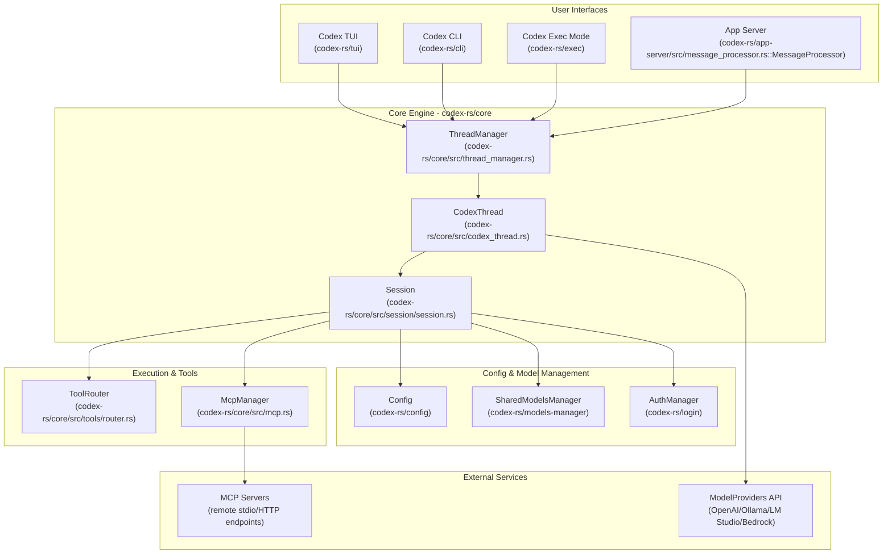

**Explanation:**

- User Interfaces submit requests to the `ThreadManager`. The app server uses a `MessageProcessor` to handle incoming JSON-RPC requests and manages communication with clients.
- The core engine’s `ThreadManager` maintains active `CodexThread` instances, each representing an agent’s conversation thread. Each thread manages a `Session` that maintains conversation state and handles turn execution.
- During turn execution, the `Session` uses the `ToolRouter` to dispatch tool requests and the `McpManager` to interact with external MCP servers providing additional capabilities.
- Configuration, model information, and authentication data are centralized services accessed by the core engine.
- External model providers and MCP servers provide external compute and tool capabilities.

Sources: [codex-rs/core/src/session/mod.rs:1-155](), [codex-rs/core/src/session/session.rs:58-101](), [codex-rs/core/src/thread_manager.rs:1-167](), [codex-rs/app-server/src/message_processor.rs:143-158]()

---

## Submission/Event Queue Pattern

The core operational pattern uses asynchronous submission and event queues to decouple input from output streaming and support interrupts or approvals mid-turn.

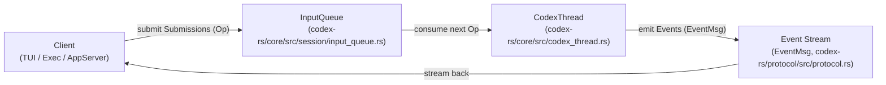

- The client UI or interface constructs and submits `Submissions` representing operations (`Op`) with metadata, trace info, cancellation tokens, and expected input mode [codex-rs/core/src/session/mod.rs:116-120]().
- The `InputQueue` buffers and orders submissions asynchronously [codex-rs/core/src/session/session.rs:94]() and supplies them to the `CodexThread`.
- The `CodexThread` polls the queue, executes turns or other operations, and emits streaming partial or full response events (`EventMsg`) [codex-rs/core/src/codex_thread.rs]() that represent assistant messages, tool outputs, state updates, and approvals.
- The Events stream back through the protocol to the client, enabling real-time streaming chat or command responses.

This asynchronous pattern facilitates responsive interaction, turn cancellation, and extensibility across UI types.

Sources: [codex-rs/core/src/session/mod.rs:59-60](), [codex-rs/protocol/src/protocol.rs:1-151]()

---

## Request/Response Flow: From Natural Language to Code Execution

This section details the flow from user input (often natural language) through conversation turn execution involving model calls and tool invocations.

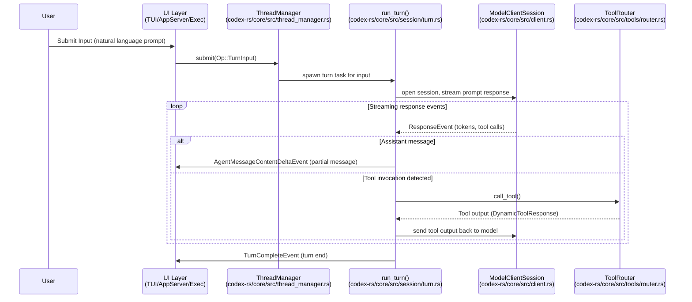

- Upon user input, the corresponding Op (`TurnInput`) is submitted.
- `ThreadManager` creates a turn task which calls the model API via a `ModelClientSession`.
- Model responses stream asynchronously as `ResponseEvent`s.
- If model requests tool invocation, `ToolRouter` routes it to internal or MCP tools.
- Tool outputs can be fed back to the model for further reasoning.
- Final turn completion event signals end of turn processing.

This pipeline effectively bridges user natural language input with structured code execution workflows.

Sources: [codex-rs/protocol/src/protocol.rs:33](), [codex-rs/core/src/thread_manager.rs:1-167](), [codex-rs/core/src/tools/router.rs](), [codex-rs/core/src/session/turn.rs:1-151]()

---

## Execution Modes and Entry Points

Codex supports multiple runtime modes, all initiated from the CLI multitool binary `codex`.

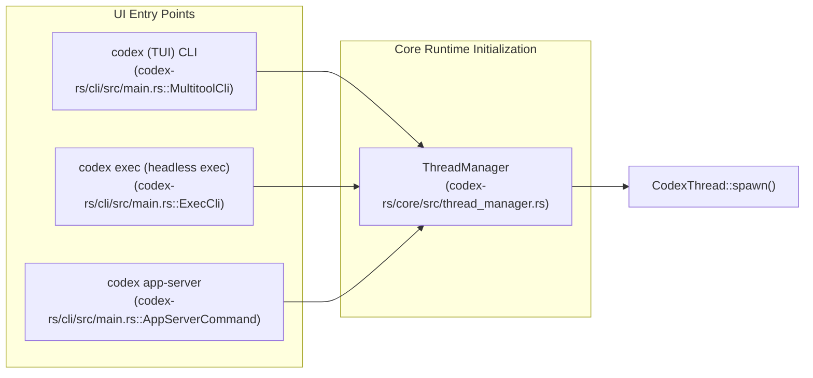

| Mode            | Entry Point                                    | Purpose                             | Notes                                                 |
|-----------------|------------------------------------------------|-----------------------------------|-------------------------------------------------------|
| **TUI**         | `MultitoolCli` (cli/src/main.rs)                | Interactive terminal UI            | Handles prompt, commands, event streaming             |
| **Exec**        | `ExecCli` (cli/src/main.rs)                      | Headless exec and review mode      | Processes event streams without interactive UI        |
| **App Server**  | `AppServerCommand` (cli/src/main.rs)             | IDE integration via JSON-RPC server| Remote control of threads and turns over stdio/websocket |
| **MCP Server**  | MCP CLI subcommands                               | Tool provider server mode           | Runs Codex as MCP server to external tool clients     |

All modes internally initialize a central `ThreadManager` which manages conversation threads and agent sessions.

Sources: [codex-rs/app-server/README.md:1-127](), [codex-rs/core/src/thread_manager.rs:1-167]()

---

## Multi-Agent and Persistence Architecture

Codex supports multi-agent concurrency with specialized sub-agent threads and persistent conversation storage.

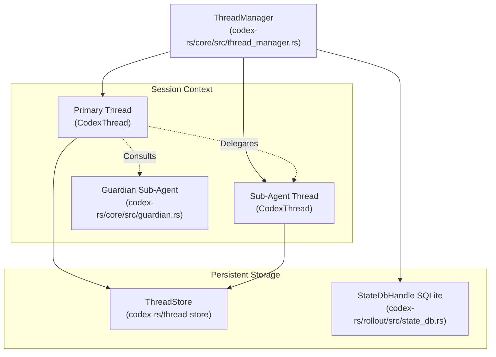

- The `ThreadManager` manages multiple live conversation threads (`CodexThread` instances).
- Threads can spawn specialized sub-agent threads for delegated roles or forked conversations.
- A Guardian sub-agent performs safety assessments, policy enforcement, and approval handling.
- Persistent history and thread metadata storage is provided by `ThreadStore` backed by a SQLite `StateDbHandle`.
- Multi-agent orchestration supports workflows such as delegated review, concurrent reasoning, and multi-turn collaboration.

Sources: [codex-rs/core/src/session/mod.rs:14-18](), [codex-rs/core/src/thread_manager.rs:1-167](), [codex-rs/core/src/codex_thread.rs]()

---

## Tool System and MCP Integration

The Codex tool system is extensible, integrating both built-in tools and remote MCP-based tool providers.

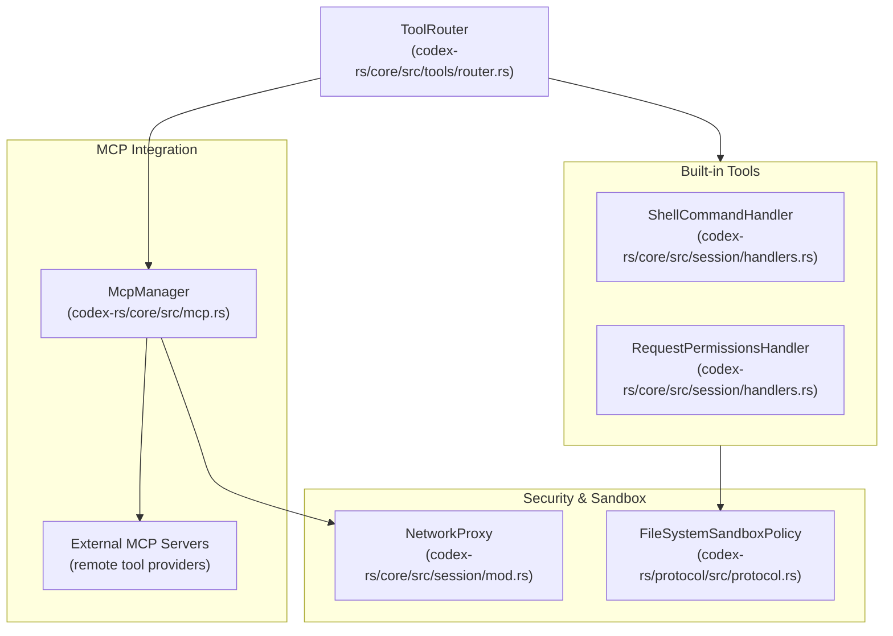

- The `ToolRouter` dispatches tool calls invoked during turn execution either to internal built-in tool handlers or to injected MCP servers.
- Built-in handlers execute commands such as shell script execution and access permission requests with sandbox enforcement [codex-rs/core/src/session/handlers.rs]().
- `McpManager` forwards tool invocations to MCP servers, orchestrating remote execution and managing approval states.
- Network policies and sandboxing are enforced via `NetworkProxy` and sandbox policies defined by permission profiles.

This layered design enables safe, extensible tool execution with external server augmentation.

Sources: [codex-rs/core/src/session/mod.rs:99-100](), [codex-rs/core/src/session/tests.rs:127](), [codex-rs/core/src/tools/router.rs](), [codex-rs/protocol/src/protocol.rs:114]()

---

# Summary

Codex's architecture is a modular, asynchronous, and extensible framework comprising:

- Multiple user interface clients converging on a core runtime managing conversation threads.
- An asynchronous submission/event queue pattern enabling streaming responses, interruptions, and interactive approvals.
- A layered turn execution pipeline bridging natural language input to streaming model API calls and dynamic tool invocations.
- Support for multi-agent concurrency with specialized sub-agents, delegation, and guarded approval workflows.
- An extensible tool system integrating built-in sandboxed tooling and MCP protocol-based remote tool providers.
- Robust configuration layering, model management, and authentication abstractions.
- Persistent storage for history, approvals, and state recovery via SQLite-backed thread stores.

This design allows Codex to flexibly serve interactive terminals, IDE integrations, automated exec modes, and cloud deployments with consistent semantics.

---

Sources:

- [codex-rs/core/src/session/mod.rs:1-155]()
- [codex-rs/core/src/session/session.rs:58-101]()
- [codex-rs/core/src/thread_manager.rs:1-167]()
- [codex-rs/app-server/README.md:1-127]()
- [codex-rs/protocol/src/protocol.rs:1-151]()
- [codex-rs/core/src/codex_thread.rs]()
- [codex-rs/core/src/session/turn.rs:1-151]()
- [codex-rs/core/src/session/tests.rs:127]()
- [codex-rs/core/src/tools/router.rs]()

---

# Page: Core Concepts

# Core Concepts

<details>
<summary>Relevant source files</summary>

The following files were used as context for generating this wiki page:

- [codex-rs/config/src/config_toml.rs](codex-rs/config/src/config_toml.rs)
- [codex-rs/config/src/profile_toml.rs](codex-rs/config/src/profile_toml.rs)
- [codex-rs/config/src/schema.rs](codex-rs/config/src/schema.rs)
- [codex-rs/config/src/types.rs](codex-rs/config/src/types.rs)
- [codex-rs/config/src/types_tests.rs](codex-rs/config/src/types_tests.rs)
- [codex-rs/core-api/src/lib.rs](codex-rs/core-api/src/lib.rs)
- [codex-rs/core/config.schema.json](codex-rs/core/config.schema.json)
- [codex-rs/core/src/config/config_tests.rs](codex-rs/core/src/config/config_tests.rs)
- [codex-rs/core/src/config/mod.rs](codex-rs/core/src/config/mod.rs)
- [codex-rs/core/tests/suite/scenarios.rs](codex-rs/core/tests/suite/scenarios.rs)
- [codex-rs/features/src/feature_configs.rs](codex-rs/features/src/feature_configs.rs)
- [codex-rs/features/src/lib.rs](codex-rs/features/src/lib.rs)
- [codex-rs/features/src/tests.rs](codex-rs/features/src/tests.rs)
- [codex-rs/thread-manager-sample/src/main.rs](codex-rs/thread-manager-sample/src/main.rs)
- [codex-rs/tui/src/local_settings.rs](codex-rs/tui/src/local_settings.rs)
- [codex-rs/tui/src/local_settings_tests.rs](codex-rs/tui/src/local_settings_tests.rs)

</details>


This page documents the fundamental architectural patterns and systems that form the foundation of the Codex codebase. These core concepts are consistent across all execution modes (TUI, CLI, IDE integration, or MCP server) and provide essential abstractions for session management, configuration, security, and feature gating.

For detailed information about specific subsystems built on these concepts, see:  
- [Protocol Layer (Submission/Event System)](#2.1) — Document the `Op` submission queue and `Event` stream pattern that coordinates asynchronous communication between the core and frontends.  
- [Configuration System](#2.2) — Explain the layered configuration system (CLI args → env vars → `config.toml` → defaults), `ConfigBuilder`, profiles, and cloud requirements.  
- [Feature Flags](#2.3) — Document the feature flag system, lifecycle stages (`UnderDevelopment`/`Experimental`/`Stable`/`Deprecated`), and runtime toggles.  
- [Sandbox and Approval Policies](#2.4) — Explain sandbox modes (`ReadOnly`/`WorkspaceWrite`/`DangerFullAccess`), approval policies, permission profiles, and the execpolicy engine.

---

## 2.1 The Submission/Event Protocol

Codex employs a **Submission Queue (SQ) / Event Queue (EQ)** asynchronous messaging architecture to decouple UI clients from core agent logic. This design supports:

- Long-running model calls and interactions.  
- Interleaved calls to tools and subprocesses.  
- Multiplexing multiple threads and frontends observing live state.  

### Protocol Flow Overview

- **Frontend** submits user commands as **Operations (`Op`)** into a submission queue.  
- **Core** asynchronously consumes these `Op`s, driving conversation turns, model calls, and tool executions.  
- **Core** emits **Events (`EventMsg`)** streamed back to clients, reflecting turn progress, approvals, and results.  

### Natural Language to Code Entity Mapping: Submission Flow

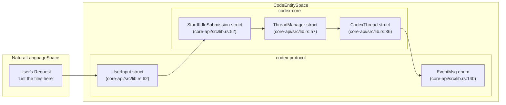

In this flow, a user's natural language request is wrapped as a `UserInput` protocol message, converted into a submission (here `StartIfIdleSubmission`), managed by the `ThreadManager` which controls multiple `CodexThread` sessions, and finally processed to emit streaming `EventMsg`s consumed by the frontend.

**Sources:**  
[codex-rs/thread-manager-sample/src/main.rs:21-63](),  
[codex-rs/core-api/src/lib.rs:62-62](),  
[codex-rs/core-api/src/lib.rs:140-140](),  
[codex-rs/core-api/src/lib.rs:57-57](),  
[codex-rs/core-api/src/lib.rs:36-36](),  
[codex-rs/core-api/src/lib.rs:52-52]()

---

## 2.2 Configuration System

Codex features a **layered configuration system** that merges settings supplied via CLI arguments, environment variables, user and project config files, cloud bundles, and built-in defaults into a unified runtime configuration.

### Configuration Layer Hierarchy

Configuration layers are managed by the `ConfigLayerStack` abstraction and combined in priority order:

- **CLI arguments** (highest priority)  
- **Environment variables**  
- **User profile config files** (`~/.codex/config.toml`)  
- **Project-local config** (`.codex/config.toml`)  
- **Cloud-provided config bundles**  
- **Hardcoded defaults** (lowest priority)  

This layering supports flexible deployment scenarios such as local overrides, CI/CD-driven config, and cloud policy enforcement.

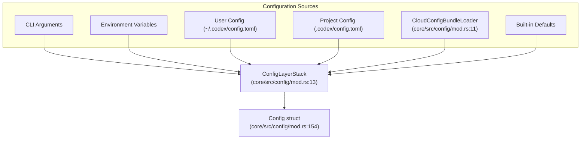

### Key Configuration Structures

| Symbol                 | Location                                | Purpose                                             |
|------------------------|---------------------------------------|-----------------------------------------------------|
| `ConfigToml`           | [config/src/config_toml.rs:164]()     | Defines schema for `config.toml` files used by users and projects. |
| `ConfigLayerStack`     | [core/src/config/mod.rs:13]()          | Manages multiple configuration sources and their priorities. |
| `ConfigEditsBuilder`   | [core/src/config/mod.rs:2]()           | Builder to apply programmatic edits to configurations. |
| `Config`               | [core/src/config/mod.rs:154]()     | The resolved runtime configuration used by core components. |

The system provides support for profiles, layered overrides, and requirement validations (e.g., cloud-managed settings, permissions).

**Sources:**  
[codex-rs/core/src/config/mod.rs:1-154](),  
[codex-rs/config/src/config_toml.rs:164-186](),  
[codex-rs/core/src/config/mod.rs:13-13](),  
[codex-rs/core/src/config/mod.rs:2-2]()

---

## 2.3 Feature Flag System

Codex governs feature accessibility using a centralized **feature flag system** that classifies features by lifecycle stage and enables runtime toggling.

### Feature Lifecycle Stages

Features have defined lifecycle stages modeled by the `Stage` enum:

- **UnderDevelopment**: Internal features not enabled externally.  
- **Experimental**: Opt-in features visible in experimental menus with metadata like announcements.  
- **Stable**: Fully supported features with standard enable/disable toggles.  
- **Deprecated**: Features marked for removal but still present for compatibility.  
- **Removed**: Flags kept only for backward compatibility with no effect.  

These stages are declared in `features/src/lib.rs` [lines 47-63]().

### Feature Definition and Resolution

Features are represented by the `Feature` enum [features/src/lib.rs:95-162]() and may include optional structured TOML configurations for granular control (e.g., `CodeModeConfigToml`).

At runtime, a `Features` instance merges feature flag states from configuration layers:

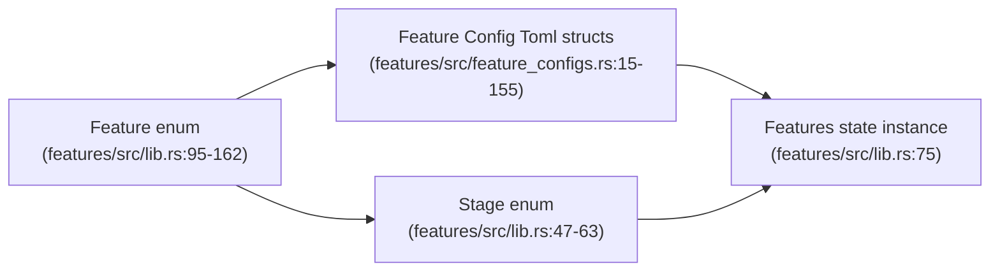

Feature toggles influence UI visibility, internal logic branching, experimental flags, and API behaviors.

**Sources:**  
[codex-rs/features/src/lib.rs:47-63](),  
[codex-rs/features/src/lib.rs:95-162](),  
[codex-rs/features/src/feature_configs.rs:15-155](),  
[codex-rs/features/src/lib.rs:75]()

---

## 2.4 Sandbox and Approval Policies

Codex enforces security and execution isolation using **sandbox modes**, **approval policies**, and **permission profiles**, regulating filesystem and network access, tool execution rights, and user confirmations.

### Sandbox Modes

Sandbox modes are defined in the `SandboxMode` enum and constrain the allowed level of filesystem and environment access during tool and command execution:

- **ReadOnly**: Prohibits all writable filesystem and environment mutations.  
- **WorkspaceWrite**: Allows writes only in designated workspace directories.  
- **DangerFullAccess**: Grants unrestricted access to the filesystem and environment; use with caution.

These modes are resolved per session or environment and help enforce least privilege execution.

### Permission Profiles and Enforcement

`PermissionProfile` structs (defined in Codex protocol models) specify fine-grained policies controlling:

- Allowed filesystem paths with granular access modes.  
- Network permissions and proxy enforcement.  
- Sandbox policies applied at runtime.  
- Approvals requirements for sensitive actions.

Profiles may be built-in (e.g., `read_only`, `workspace`) or user-defined in config.

### Approval Reviewers and Policies

Approval flows utilize the `ApprovalsReviewer` enum to designate who reviews approval requests for potentially sensitive operations:

- **user**: Requires explicit human approval.  
- **auto_review**: Delegates review to an internal automated sub-agent for streamlined flow.

This reviewer setting integrates into sandbox policies and controls how approval prompts are issued or suppressed.

---

### Natural Language to Code Entity Mapping: Security Enforcement Flow

```mermaid
graph TD
    subgraph "NaturalLanguageSpace"
        DangerousRequest["User Request<br/>'Delete all files in /etc'"]
    end

    subgraph "CodeEntitySpace"
        subgraph "codex-core Security"
            Reviewer["ApprovalsReviewer enum<br/>(core/src/config/mod.rs:41)"]
            AskApproval["AskForApproval struct<br/>(core/src/config/mod.rs:128)"]
        end

        subgraph "codex-protocol Models"
            AccessMode["FileSystemAccessMode enum<br/>(codex-protocol/src/permissions.rs)"]
            SandboxMode["SandboxMode enum<br/>(core/src/config/mod.rs:106)"]
        end
    end

    DangerousRequest --> Reviewer
    Reviewer --> AskApproval
    AskApproval --> AccessMode
    AccessMode --> SandboxMode
```

This flow shows how a user's potentially dangerous request triggers permission checks via configured approval reviewers, which lead to approval requests (`AskForApproval`). These requests enforce restrictions on filesystem access modes, all confined within the chosen sandbox mode.

---

## Summary of Core Data Structures

| Symbol               | Location                                   | Role                                                                   |
|----------------------|--------------------------------------------|-------------------------------------------------------------------------|
| `CodexThread`        | [core-api/src/lib.rs:36]()                  | Manages a single agent thread handling conversation turns.              |
| `ThreadManager`      | [core-api/src/lib.rs:57]()                  | Coordinates multiple `CodexThread`s and session concurrency.             |
| `Op`                 | [core-api/src/lib.rs:141]()                 | Represents commands or requests submitted into the core.                 |
| `EventMsg`           | [core-api/src/lib.rs:140]()                 | Streamed events emitted by core to frontends, reflecting turn state.     |
| `ConfigLayerStack`   | [core/src/config/mod.rs:13]()               | Merges layered configuration sources into a unified runtime config.      |
| `ConfigToml`         | [config/src/config_toml.rs:164]()           | Defines configuration schema for user and project TOML files.            |
| `Feature`            | [features/src/lib.rs:95-162]()              | Enumeration of feature flags with lifecycle metadata.                    |
| `ApprovalsReviewer`  | [core/src/config/mod.rs:41]()               | Enum determining who reviews approval prompts.                          |
| `PermissionProfile`  | [core/src/config/mod.rs:116]()              | Policy struct defining filesystem, network, and sandbox permissions.     |

---

This page provides a high-level conceptual overview of Codex's foundational systems. For detailed explanations, implementation specifics, and usage examples, refer to the following child pages:

- [Protocol Layer (Submission/Event System)](#2.1)  
- [Configuration System](#2.2)  
- [Feature Flags](#2.3)  
- [Sandbox and Approval Policies](#2.4)  

**Sources:**  
[codex-rs/thread-manager-sample/src/main.rs:21-63](),  
[codex-rs/core-api/src/lib.rs:141-141](),  
[codex-rs/core-api/src/lib.rs:140-140](),  
[codex-rs/core/src/config/mod.rs:1-154](),  
[codex-rs/config/src/config_toml.rs:164-186](),  
[codex-rs/features/src/lib.rs:95-162](),  
[codex-rs/core/src/config/mod.rs:116-116](),  
[codex-rs/core/src/config/mod.rs:41-41]()

---

# Page: Protocol Layer (Submission/Event System)

# Protocol Layer (Submission/Event System)

<details>
<summary>Relevant source files</summary>

The following files were used as context for generating this wiki page:

- [codex-rs/app-server-protocol/schema/json/v2/RawResponseItemCompletedNotification.json](codex-rs/app-server-protocol/schema/json/v2/RawResponseItemCompletedNotification.json)
- [codex-rs/app-server-protocol/schema/json/v2/ThreadForkParams.json](codex-rs/app-server-protocol/schema/json/v2/ThreadForkParams.json)
- [codex-rs/app-server-protocol/schema/json/v2/ThreadResumeParams.json](codex-rs/app-server-protocol/schema/json/v2/ThreadResumeParams.json)
- [codex-rs/app-server-protocol/schema/json/v2/ThreadStartParams.json](codex-rs/app-server-protocol/schema/json/v2/ThreadStartParams.json)
- [codex-rs/app-server-protocol/schema/json/v2/TurnStartParams.json](codex-rs/app-server-protocol/schema/json/v2/TurnStartParams.json)
- [codex-rs/app-server-protocol/schema/typescript/ResponseItem.ts](codex-rs/app-server-protocol/schema/typescript/ResponseItem.ts)
- [codex-rs/app-server-protocol/schema/typescript/v2/ThreadForkParams.ts](codex-rs/app-server-protocol/schema/typescript/v2/ThreadForkParams.ts)
- [codex-rs/app-server-protocol/schema/typescript/v2/ThreadResumeParams.ts](codex-rs/app-server-protocol/schema/typescript/v2/ThreadResumeParams.ts)
- [codex-rs/app-server/src/bespoke_event_handling.rs](codex-rs/app-server/src/bespoke_event_handling.rs)
- [codex-rs/core/src/codex_delegate.rs](codex-rs/core/src/codex_delegate.rs)
- [codex-rs/core/src/codex_delegate_tests.rs](codex-rs/core/src/codex_delegate_tests.rs)
- [codex-rs/core/src/codex_thread.rs](codex-rs/core/src/codex_thread.rs)
- [codex-rs/core/src/compact.rs](codex-rs/core/src/compact.rs)
- [codex-rs/core/src/compact_remote_v2.rs](codex-rs/core/src/compact_remote_v2.rs)
- [codex-rs/core/src/compact_remote_v2_attempt.rs](codex-rs/core/src/compact_remote_v2_attempt.rs)
- [codex-rs/core/src/compact_tests.rs](codex-rs/core/src/compact_tests.rs)
- [codex-rs/core/src/environment_selection.rs](codex-rs/core/src/environment_selection.rs)
- [codex-rs/core/src/session/environment.rs](codex-rs/core/src/session/environment.rs)
- [codex-rs/core/src/session/handlers.rs](codex-rs/core/src/session/handlers.rs)
- [codex-rs/core/src/session/mod.rs](codex-rs/core/src/session/mod.rs)
- [codex-rs/core/src/session/session.rs](codex-rs/core/src/session/session.rs)
- [codex-rs/core/src/session/tests.rs](codex-rs/core/src/session/tests.rs)
- [codex-rs/core/src/session/tests/guardian_tests.rs](codex-rs/core/src/session/tests/guardian_tests.rs)
- [codex-rs/core/src/session/turn.rs](codex-rs/core/src/session/turn.rs)
- [codex-rs/core/src/session/turn_context.rs](codex-rs/core/src/session/turn_context.rs)
- [codex-rs/core/src/state/mod.rs](codex-rs/core/src/state/mod.rs)
- [codex-rs/core/src/state/turn.rs](codex-rs/core/src/state/turn.rs)
- [codex-rs/core/src/tasks/mod.rs](codex-rs/core/src/tasks/mod.rs)
- [codex-rs/core/src/thread_manager.rs](codex-rs/core/src/thread_manager.rs)
- [codex-rs/core/src/thread_manager_tests.rs](codex-rs/core/src/thread_manager_tests.rs)
- [codex-rs/core/tests/common/test_codex.rs](codex-rs/core/tests/common/test_codex.rs)
- [codex-rs/core/tests/suite/compact.rs](codex-rs/core/tests/suite/compact.rs)
- [codex-rs/core/tests/suite/compact_remote.rs](codex-rs/core/tests/suite/compact_remote.rs)
- [codex-rs/core/tests/suite/mod.rs](codex-rs/core/tests/suite/mod.rs)
- [codex-rs/core/tests/suite/remote_env.rs](codex-rs/core/tests/suite/remote_env.rs)
- [codex-rs/protocol/src/environment.rs](codex-rs/protocol/src/environment.rs)
- [codex-rs/protocol/src/models.rs](codex-rs/protocol/src/models.rs)
- [codex-rs/protocol/src/protocol.rs](codex-rs/protocol/src/protocol.rs)

</details>


## Purpose and Scope

This page documents the core asynchronous communication protocol used to coordinate the interaction between the core `codex-core` agent and all user-facing frontends, including the Terminal User Interface (TUI), headless exec mode, the App Server, and MCP servers. The protocol employs a **Submission Queue / Event Queue** (SQ/EQ) pattern enabling decoupled, async communication for requests and agent-generated events.

Key abstractions documented here include:

- The submission queue carrying client requests wrapped as `Submission` structs.
- The event queue streaming back notifications wrapped as `Event` structs.
- The `Op` enum defining all client-initiated operations.
- The `EventMsg` enum defining all agent-initiated notifications.
- How these abstractions are integrated into the `CodexThread` and `Session` structs.
- The role of the protocol layer in enabling tool calls, approvals, and turn lifecycle coordination.

For session lifecycle and turn execution details, see the sibling leaf pages under section 3. For protocol externalization in the App Server see section 4.5.

---

## Core Abstractions

### Submission and Op

A `Submission` represents a client request placed on the submission queue. It pairs a unique identifier with a payload operation (`Op`) and optional distributed tracing context for async handoff tracing.

```rust
pub struct Submission {
    /// Unique id for this Submission to correlate with Events
    pub id: String,
    /// Payload operation requested by client
    pub op: Op,
    /// Optional client-provided id for the user message represented by `Op::UserInput`.
    pub client_user_message_id: Option<String>,
    /// Optional W3C trace carrier propagated across async submission handoffs.
    pub trace: Option<W3cTraceContext>,
}
```

The optional `trace` field supports OpenTelemetry-style distributed tracing across async boundaries, carrying `traceparent` and `tracestate` context.

The `Op` enum describes all actionable commands clients may request from the agent, including starting turns, interrupting ongoing ones, approving exec commands, and managing configuration and context [codex-rs/protocol/src/protocol.rs:209-510]().

Key `Op` variants include:

- `UserInput`: Submit user messages and input commands to the agent, optionally updating thread settings.
- `Interrupt`: Cancel any currently running turn.
- `ExecApproval` / `PatchApproval`: Respond to pending tool or patch approval requests.
- `Compact`, `Undo`, `ThreadRollback`: Manage conversation history and context state.

Sources:
- [codex-rs/core/src/session/mod.rs:5124]()
- [codex-rs/protocol/src/protocol.rs:209-510]()

---

### Event and EventMsg

The `Event` struct packages agent notifications on the event queue:

```rust
pub struct Event {
    pub id: String,       // Echoes the Submission.id which triggered this event
    pub msg: EventMsg,    // Tagged union notification payload
}
```

`EventMsg` is a comprehensive enum encapsulating all agent event notifications, such as streaming assistant message deltas, tool execution starts/ends, approval requests, and turn lifecycle events [codex-rs/protocol/src/protocol.rs:586-1115]().

Notable `EventMsg` variants:

- `TurnStarted`: Signals the beginning of an agent turn.
- `AgentMessageDelta`: Contains streaming increments of assistant-generated text.
- `ItemCompleted`: Marks the completion of a response item.
- `ExecCommandBegin`/`ExecCommandEnd`: Notify start/end of shell command execution.
- `ExecApprovalRequest` / `ApplyPatchApprovalRequest`: Ask the user for approval before executing privileged operations.
- `TurnComplete`: Marks the end of a turn with summary data.

Sources:
- [codex-rs/protocol/src/protocol.rs:586-1115]()

---

## The Async Queue Model

The protocol communication implements a Submission Queue (SQ) and Event Queue (EQ) asynchronous pattern, backed by `async-channel` channels. This design enables decoupling between client threads submitting requests and the internal agent execution flow processing those requests, especially turn-level execution.

The key components and data flow of this model in the core codebase are illustrated in the following diagram:

### Queue Architecture: CodexThread, Session, and Turn Execution

```mermaid
flowchart LR
    subgraph Caller["Caller (TUI/CLI/AppServer)"]
        submit["CodexThread::submit(op)"]
        next["CodexThread::io.next_event()"]
    end

    subgraph CodexThreadStruct["CodexThread struct\n(codex-rs/core/src/codex_thread.rs)"]
        session_handle["session: Arc<Session>"]
        io_handle["io: SessionIo"]
    end

    subgraph SessionImpl["Session Implementation\n(codex-rs/core/src/session/session.rs)"]
        input_queue["input_queue: InputQueue"]
        tx_event["tx_event: Sender<Event>"]
    end

    subgraph TurnExecution["Turn Execution\n(codex-rs/core/src/session/turn.rs)"]
        run_turn["Session::handle_submission()"]
        hooks["run_hooks_and_record_inputs()"]
    end

    submit -->|"Op"| input_queue
    input_queue --> run_turn
    run_turn --> hooks
    hooks -->|"emit events"| tx_event
    tx_event -->|"Event"| next
```

- `CodexThread` exposes the public interface for submitting `Op` requests and retrieving `Event` notifications [codex-rs/core/src/codex_thread.rs:8]() (referring to `SessionIo` which contains the event receiver).
- Submitted ops enter the `InputQueue` managed by `Session` [codex-rs/core/src/session/session.rs:94]().
- The session asynchronously runs turns (`handle_submission()`) processing the ops, including executing hooks [codex-rs/core/src/session/turn.rs:34]().
- Hooks and turn execution emit `Event` messages on `tx_event` [codex-rs/core/src/session/session.rs:61]().
- Clients receive `Event`s asynchronously by polling `next_event()` [codex-rs/core/src/codex_thread.rs:8]() (via `SessionIo`).

This architecture provides efficient asynchronous agent communication across the diverse frontends while preserving turn granularity and event streaming fidelity.

Sources:
- [codex-rs/protocol/src/protocol.rs:3-4]()
- [codex-rs/core/src/codex_thread.rs:8]()
- [codex-rs/core/src/session/session.rs:61]()
- [codex-rs/core/src/session/session.rs:94]()
- [codex-rs/core/src/session/turn.rs:34]()

---

## App Server Protocol Bridge

The `codex-app-server` component translates the internal protocol into an external JSON-RPC interface enabling IDE and remote clients to communicate with the agent.

Key features:

- **Request Serialization Queues** ensure ordered handling of requests keyed by resources like `thread_id` or shell process, even with an asynchronous transport [codex-rs/app-server/src/bespoke_event_handling.rs:100-125]().
- The App Server converts internal `Event` items into JSON-RPC `ServerNotification` messages via bespoke event handling [codex-rs/app-server/src/bespoke_event_handling.rs:100-125]().

This bridge isolates the internal protocol from transport details while preserving the rich event semantics.

Sources:
- [codex-rs/app-server/src/bespoke_event_handling.rs:100-125]()

---

## Op Variants Reference

### Op Enum Taxonomy

The `Op` enum subdivides into categories of client requests:

```mermaid
graph LR
    Op(["Op enum\n(codex-rs/protocol/src/protocol.rs)"])

    Op --> UserInputOps["User Input"]
    Op --> TurnControlOps["Turn Control"]
    Op --> ApprovalOps["Approval Responses"]
    Op --> ContextOps["Context & Memory"]
    Op --> RealtimeOps["Realtime Conversation"]
    Op --> ConfigOps["Configuration"]

    UserInputOps --> UserInput["UserInput"]
    UserInputOps --> UserTurn["UserTurn"]

    TurnControlOps --> Interrupt["Interrupt"]
    TurnControlOps --> Shutdown["Shutdown"]
    TurnControlOps --> InterAgentCommunication["InterAgentCommunication"]

    ApprovalOps --> ExecApproval["ExecApproval"]
    ApprovalOps --> PatchApproval["PatchApproval"]
    ApprovalOps --> DynamicToolResponse["DynamicToolResponse"]
    ApprovalOps --> RequestPermissionsResponse["RequestPermissionsResponse"]
    ApprovalOps --> RequestUserInputResponse["RequestUserInputResponse"]

    ContextOps --> Compact["Compact"]
    ContextOps --> Undo["Undo"]
    ContextOps --> ThreadRollback["ThreadRollback"]

    RealtimeOps --> RealtimeConversationStart["RealtimeConversationStart"]
    RealtimeOps --> RealtimeConversationClose["RealtimeConversationClose"]

    ConfigOps --> UpdateThreadSettings["UpdateThreadSettings"]
    ConfigOps --> UpdateSessionSettings["UpdateSessionSettings"]
```

### Key Op Variants

| Variant | Key Fields | Behavior |
|---------|------------|----------|
| `UserInput` | `items: Vec<ResponseItem>`, `thread_settings` | Submits user messages and commands to start or continue threads/turns. Supports updating thread config [codex-rs/protocol/src/protocol.rs:213-224](). |
| `Interrupt` | None | Requests immediate abortion of the active turn [codex-rs/protocol/src/protocol.rs:270](). |
| `ExecApproval` | `id: String`, `decision: ReviewDecision` | Responds to a pending exec (shell command) approval request [codex-rs/protocol/src/protocol.rs:288-292](). |
| `PatchApproval` | `id: String`, `decision: ReviewDecision` | Responds to a pending file patch approval request [codex-rs/protocol/src/protocol.rs:294-298](). |
| `Compact` | `input: Vec<UserInput>` | Triggers a manual compaction of the conversation history, summarizing it with the provided input [codex-rs/core/src/compact.rs:146-163](). |
| `RealtimeConversationStart` | `params: ConversationStartParams` | Initiates a real-time conversation session [codex-rs/protocol/src/protocol.rs:400-403](). |
| `RealtimeConversationClose` | None | Closes an active real-time conversation session [codex-rs/protocol/src/protocol.rs:405](). |
| `InterAgentCommunication` | `communication: InterAgentCommunication`, `start_options: TurnStartOptions` | Allows agents to communicate with each other, potentially starting new turns [codex-rs/protocol/src/protocol.rs:300-303](). |
| `UpdateThreadSettings` | `settings: ThreadSettingsOverrides` | Updates the settings for the current thread [codex-rs/protocol/src/protocol.rs:226-229](). |
| `UpdateSessionSettings` | `settings: SessionSettingsUpdate` | Updates session-wide settings [codex-rs/protocol/src/protocol.rs:231-234](). |

Sources:
- [codex-rs/protocol/src/protocol.rs:213-224]()
- [codex-rs/protocol/src/protocol.rs:270]()
- [codex-rs/protocol/src/protocol.rs:288-292]()
- [codex-rs/protocol/src/protocol.rs:294-298]()
- [codex-rs/core/src/compact.rs:146-163]()
- [codex-rs/protocol/src/protocol.rs:400-403]()
- [codex-rs/protocol/src/protocol.rs:405]()
- [codex-rs/protocol/src/protocol.rs:300-303]()
- [codex-rs/protocol/src/protocol.rs:226-229]()
- [codex-rs/protocol/src/protocol.rs:231-234]()

---

## EventMsg Variants Reference

### EventMsg Enum Taxonomy

The `EventMsg` enum organizes notifications into major groups:

```mermaid
graph LR
    EventMsg(["EventMsg enum\n(codex-rs/protocol/src/protocol.rs)"])

    EventMsg --> SessionEvs["Session Lifecycle"]
    EventMsg --> AgentOutEvs["Agent Output"]
    EventMsg --> ToolEvs["Tool Execution"]
    EventMsg --> ApprovalReqEvs["Approval Requests"]
    EventMsg --> RealtimeEvs["Realtime Conversation"]
    EventMsg --> ConfigEvs["Configuration"]
    EventMsg --> ErrorEvs["Errors"]

    SessionEvs --> SessionConfigured["SessionConfigured"]
    SessionEvs --> TurnStarted["TurnStarted"]
    SessionEvs --> TurnComplete["TurnComplete"]
    SessionEvs --> TurnAborted["TurnAborted"]
    SessionEvs --> SessionMeta["SessionMeta"]
    SessionEvs --> SubAgentSessionStarted["SubAgentSessionStarted"]

    AgentOutEvs --> AgentMessageDelta["AgentMessageDelta"]
    AgentOutEvs --> AgentReasoningDelta["AgentReasoningDelta"]
    AgentOutEvs --> ItemCompleted["ItemCompleted"]
    AgentOutEvs --> Warning["WarningEvent"]
    AgentOutEvs --> RawResponseItem["RawResponseItemEvent"]

    ToolEvs --> ExecCommandBegin["ExecCommandBegin"]
    ToolEvs --> ExecCommandEnd["ExecCommandEnd"]
    ToolEvs --> PatchApplyBegin["PatchApplyBegin"]
    ToolEvs --> PatchApplyEnd["PatchApplyEnd"]
    ToolEvs --> DynamicToolCall["DynamicToolCallEvent"]
    ToolEvs --> DynamicToolCallOutput["DynamicToolCallOutputEvent"]
    ToolEvs --> HookCompleted["HookCompletedEvent"]

    ApprovalReqEvs --> ExecApprovalRequest["ExecApprovalRequest"]
    ApprovalReqEvs --> ApplyPatchApprovalRequest["ApplyPatchApprovalRequest"]
    ApprovalReqEvs --> ElicitationRequest["ElicitationRequestEvent"]
    ApprovalReqEvs --> RequestPermissions["RequestPermissionsEvent"]
    ApprovalReqEvs --> RequestUserInput["RequestUserInputEvent"]

    RealtimeEvs --> RealtimeConversationStarted["RealtimeConversationStarted"]
    RealtimeEvs --> RealtimeConversationClosed["RealtimeConversationClosed"]
    RealtimeEvs --> RealtimeConversationRealtime["RealtimeConversationRealtime"]

    ConfigEvs --> ThreadSettingsUpdated["ThreadSettingsUpdatedEvent"]
    ConfigEvs --> SessionSettingsUpdated["SessionSettingsUpdatedEvent"]

    ErrorEvs --> Error["ErrorEvent"]
```

### Key EventMsg Variants

| Variant | Key Fields | Description |
|---------|------------|-------------|
| `TurnStarted` | `TurnStartedEvent` | Signals start of a new turn [codex-rs/protocol/src/protocol.rs:608](). |
| `AgentMessageDelta` | `AgentMessageContentDeltaEvent` | Streaming incremental assistant message content [codex-rs/protocol/src/protocol.rs:639](). |
| `ExecCommandBegin` | `ExecCommandBeginEvent` | Indicates shell command execution has started [codex-rs/protocol/src/protocol.rs:695](). |
| `ExecApprovalRequest` | `ExecApprovalRequestEvent` | Requests user approval to execute a privileged command [codex-rs/protocol/src/protocol.rs:855](). |
| `TurnComplete` | `TurnCompleteEvent` | Marks the completion of a turn including final usage and response text [codex-rs/protocol/src/protocol.rs:620](). |
| `TurnAborted` | `TurnAbortedEvent` | Indicates that the current turn was aborted, potentially with a reason [codex-rs/protocol/src/protocol.rs:622](). |
| `Warning` | `WarningEvent` | Emits a warning message to the user, e.g., about long threads and compaction [codex-rs/protocol/src/protocol.rs:1000](). |
| `RealtimeConversationStarted` | `RealtimeConversationStartedEvent` | Notifies that a real-time conversation has successfully started [codex-rs/protocol/src/protocol.rs:970](). |
| `RealtimeConversationClosed` | `RealtimeConversationClosedEvent` | Notifies that a real-time conversation has been closed [codex-rs/protocol/src/protocol.rs:972](). |
| `RealtimeConversationRealtime` | `RealtimeConversationRealtimeEvent` | Carries real-time conversation events, such as session updates [codex-rs/protocol/src/protocol.rs:974](). |
| `SubAgentSessionStarted` | `SubAgentSessionStartedEvent` | Notifies that a sub-agent session has been started [codex-rs/protocol/src/protocol.rs:606](). |
| `ThreadSettingsUpdated` | `ThreadSettingsSnapshot` | Notifies that the thread settings have been updated [codex-rs/protocol/src/protocol.rs:624](). |
| `SessionSettingsUpdated` | `SessionSettingsSnapshot` | Notifies that session-wide settings have been updated [codex-rs/protocol/src/protocol.rs:626](). |
| `ElicitationRequest` | `ElicitationRequestEvent` | Requests user input for an elicitation, e.g., for an OAuth flow [codex-rs/protocol/src/protocol.rs:857](). |
| `RequestPermissions` | `RequestPermissionsEvent` | Requests user approval for specific permissions [codex-rs/protocol/src/protocol.rs:859](). |
| `RequestUserInput` | `RequestUserInputEvent` | Requests arbitrary user input [codex-rs/protocol/src/protocol.rs:861](). |

Sources:
- [codex-rs/protocol/src/protocol.rs:586-1115]()
- [codex-rs/protocol/src/protocol.rs:608]()
- [codex-rs/protocol/src/protocol.rs:639]()
- [codex-rs/protocol/src/protocol.rs:695]()
- [codex-rs/protocol/src/protocol.rs:855]()
- [codex-rs/protocol/src/protocol.rs:620]()
- [codex-rs/protocol/src/protocol.rs:622]()
- [codex-rs/protocol/src/protocol.rs:1000]()
- [codex-rs/protocol/src/protocol.rs:970]()
- [codex-rs/protocol/src/protocol.rs:972]()
- [codex-rs/protocol/src/protocol.rs:974]()
- [codex-rs/protocol/src/protocol.rs:606]()
- [codex-rs/protocol/src/protocol.rs:624]()
- [codex-rs/protocol/src/protocol.rs:626]()
- [codex-rs/protocol/src/protocol.rs:857]()
- [codex-rs/protocol/src/protocol.rs:859]()
- [codex-rs/protocol/src/protocol.rs:861]()

---

## Tool Execution and MCP Interaction

The protocol layer orchestrates complex asynchronous tool calls and approvals, particularly integrating with the Model Context Protocol (MCP) for external tool servers.

### MCP Tool Call Flow within the Protocol Layer

```mermaid
flowchart TD
    subgraph MessageProcessor["codex-app-server/src/bespoke_event_handling.rs"]
        MP["apply_bespoke_event_handling()"]
    end

    subgraph ProtocolMCP["codex-rs/protocol/src/protocol.rs"]
        MTCI["McpToolCallItem"]
        ER["ElicitationRequestEvent"]
    end

    MP -->|"translates event"| ER
```

- The `apply_bespoke_event_handling` function in `codex-app-server` is responsible for translating internal `Event` messages into `ServerNotification` messages for the app server clients [codex-rs/app-server/src/bespoke_event_handling.rs:100-125]().
- Internal events like `ElicitationRequestEvent` are translated for frontend consumption.
- The `McpToolCallItem` encapsulates active MCP tool invocations within event streams.

### Approval Elicitation in MCP

Certain MCP tool calls require explicit user approvals (e.g., for access tokens or permission grants). The protocol utilizes `ElicitationRequestEvent` to signal these needs toward the frontend UI [codex-rs/protocol/src/protocol.rs:22]().

The frontend can then render an appropriate approval UI and respond via `Op` approval variants.

Sources:
- [codex-rs/protocol/src/protocol.rs:22]()
- [codex-rs/app-server/src/bespoke_event_handling.rs:100-125]()

---

# Summary

The protocol layer is the foundational asynchronous message bus between Codex's agent core and its frontends. Submissions encapsulate requested client operations (`Op`), which the agent consumes via an input queue and processes asynchronously. Agent-generated notifications (`EventMsg`) stream back through an event queue, enabling streaming UI updates and rich interaction feedback.

This design supports extensibility (new ops/events), natural concurrency, reliable event correlation, and observability via tracing contexts. It further underpins higher-level functionalities like turn management, sandboxing, approval workflows, and tool invocation orchestration.

---

## Sources

- [codex-rs/protocol/src/protocol.rs:209-1115]()
- [codex-rs/core/src/codex_thread.rs:8]()
- [codex-rs/core/src/session/session.rs:61]()
- [codex-rs/core/src/session/session.rs:94]()
- [codex-rs/core/src/session/turn.rs:34]()
- [codex-rs/app-server/src/bespoke_event_handling.rs:100-125]()
- [codex-rs/core/src/compact.rs:146-163]()
- [codex-rs/protocol/src/protocol.rs:22]()

---

# Page: Configuration System

# Configuration System

<details>
<summary>Relevant source files</summary>

The following files were used as context for generating this wiki page:

- [codex-rs/app-server/src/config_manager.rs](codex-rs/app-server/src/config_manager.rs)
- [codex-rs/app-server/src/config_manager_service.rs](codex-rs/app-server/src/config_manager_service.rs)
- [codex-rs/app-server/src/config_manager_service_credential_edits.rs](codex-rs/app-server/src/config_manager_service_credential_edits.rs)
- [codex-rs/app-server/src/config_manager_service_tests.rs](codex-rs/app-server/src/config_manager_service_tests.rs)
- [codex-rs/app-server/src/request_processors/account_processor.rs](codex-rs/app-server/src/request_processors/account_processor.rs)
- [codex-rs/app-server/tests/suite/v2/account.rs](codex-rs/app-server/tests/suite/v2/account.rs)
- [codex-rs/config/src/config_toml.rs](codex-rs/config/src/config_toml.rs)
- [codex-rs/config/src/key_aliases.rs](codex-rs/config/src/key_aliases.rs)
- [codex-rs/config/src/loader/layer_io.rs](codex-rs/config/src/loader/layer_io.rs)
- [codex-rs/config/src/loader/local.rs](codex-rs/config/src/loader/local.rs)
- [codex-rs/config/src/loader/managed_project_discovery_tests.rs](codex-rs/config/src/loader/managed_project_discovery_tests.rs)
- [codex-rs/config/src/loader/mod.rs](codex-rs/config/src/loader/mod.rs)
- [codex-rs/config/src/loader/tests.rs](codex-rs/config/src/loader/tests.rs)
- [codex-rs/config/src/merge.rs](codex-rs/config/src/merge.rs)
- [codex-rs/config/src/merge_tests.rs](codex-rs/config/src/merge_tests.rs)
- [codex-rs/config/src/profile_toml.rs](codex-rs/config/src/profile_toml.rs)
- [codex-rs/config/src/schema.rs](codex-rs/config/src/schema.rs)
- [codex-rs/config/src/state.rs](codex-rs/config/src/state.rs)
- [codex-rs/config/src/state_tests.rs](codex-rs/config/src/state_tests.rs)
- [codex-rs/config/src/types.rs](codex-rs/config/src/types.rs)
- [codex-rs/config/src/types_tests.rs](codex-rs/config/src/types_tests.rs)
- [codex-rs/core-api/src/lib.rs](codex-rs/core-api/src/lib.rs)
- [codex-rs/core/config.schema.json](codex-rs/core/config.schema.json)
- [codex-rs/core/src/config/config_loader_tests.rs](codex-rs/core/src/config/config_loader_tests.rs)
- [codex-rs/core/src/config/config_tests.rs](codex-rs/core/src/config/config_tests.rs)
- [codex-rs/core/src/config/mod.rs](codex-rs/core/src/config/mod.rs)
- [codex-rs/core/src/config/runtime_refresh.rs](codex-rs/core/src/config/runtime_refresh.rs)
- [codex-rs/core/src/session/config_refresh.rs](codex-rs/core/src/session/config_refresh.rs)
- [codex-rs/core/tests/suite/scenarios.rs](codex-rs/core/tests/suite/scenarios.rs)
- [codex-rs/features/src/feature_configs.rs](codex-rs/features/src/feature_configs.rs)
- [codex-rs/features/src/lib.rs](codex-rs/features/src/lib.rs)
- [codex-rs/features/src/tests.rs](codex-rs/features/src/tests.rs)
- [codex-rs/thread-manager-sample/src/main.rs](codex-rs/thread-manager-sample/src/main.rs)
- [codex-rs/tui/src/local_settings.rs](codex-rs/tui/src/local_settings.rs)
- [codex-rs/tui/src/local_settings_tests.rs](codex-rs/tui/src/local_settings_tests.rs)

</details>


## Purpose and Scope

The Configuration System manages all runtime settings for Codex, including model selection, sandbox policies, permissions, feature flags, MCP server configurations, and profiles. It consolidates configuration data from multiple layered sources—command-line arguments, environment variables, `.toml` files at various scopes, and internal defaults—into a unified and authoritative runtime `Config` struct.

This page explains the layered configuration model, the main components (`ConfigBuilder`, `config_loader`), profile handling, and enforcement of cloud/enterprise requirements in detail. It covers the data flow, key structs/classes, and configuration sources with technical depth.

Sources: [codex-rs/core/src/config/mod.rs:1-154]()

---

## Configuration Architecture

### Configuration Sources and Precedence

Codex uses a **layered configuration system** with a strict precedence hierarchy, from highest priority to lowest:

| Priority | Layer                       | Source Description                            | Scope                          |
|----------|-----------------------------|----------------------------------------------|--------------------------------|
| 1        | CLI arguments & runtime edits | Command-line flags and runtime config edits | Per execution instance          |
| 2        | Repository config            | `.codex/config.toml` at git repository root | Per repository                  |
| 3        | Tree config                 | `.codex/config.toml` in parent directories  | Directory hierarchy             |
| 4        | CWD config                  | `config.toml` in current working directory  | Project-specific local config   |
| 5        | User config                 | `${CODEX_HOME}/config.toml`                   | User-global                    |
| 6        | System config               | E.g., `/etc/codex/config.toml`               | Machine-wide                   |
| 7        | Managed/admin preferences   | Device management or cloud-enforced policies | Enterprise-managed constraints |

Higher layers override lower ones, enabling flexible per-project and per-user customization, while also allowing managed enterprise control over security sensitive settings and features.

Sources: [codex-rs/config/src/loader/mod.rs:123-135](), [codex-rs/config/src/config_toml.rs:163-186]()

---

### Configuration Layer Merging

The merging of these configuration layers is orchestrated by the async function `load_config_layers_state()`, which loads and combines layers in correct precedence order into a `ConfigLayerStack`.

```mermaid
flowchart TD
    CLI["build_cli_overrides_layer()<br/>(CLI Overrides)"]
    Runtime["ConfigEditsBuilder<br/>(Runtime Edits)"]
    RepoConfig[".codex/config.toml<br/>(Git Repository Root)"]
    TreeConfig["./.codex/config.toml<br/>(Parent Directories)"]
    CwdConfig["config.toml<br/>(Current Working Directory)"]
    UserConfig["${CODEX_HOME}/config.toml<br/>(User Global)"]
    SystemConfig["System Config<br/>(/etc/codex or ProgramData)"]
    CloudRequirements["CloudConfigBundleLoader<br/>(Enterprise Managed Requirements)"]

    subgraph "Loading & Validation"
        Merge["load_config_layers_state()<br/>(ConfigLayerStack)"]
        Validate["ConfigRequirements Validation"]
    end

    FinalConfig["Config (Final Merged Runtime Config)"]

    CLI --> Merge
    Runtime --> Merge
    RepoConfig --> Merge
    TreeConfig --> Merge
    CwdConfig --> Merge
    UserConfig --> Merge
    SystemConfig --> Merge

    Merge --> Validate
    CloudRequirements --> Validate

    Validate --> FinalConfig
```

This process:

- Loads config files as TOML from each source.
- Applies CLI and runtime edits last.
- Validates merged config against enterprise restrictions.
- Produces a constrained, fully validated runtime `Config`.

Enterprise cloud bundles enforce constraints such as allowed sandbox modes, feature flags, and login policies via managed requirements.

Sources: [codex-rs/config/src/loader/mod.rs:145-171](), [codex-rs/core/src/config/mod.rs:11-26]()

---

## Config Loading Process and Data Flow

### Key Data Types and Relationships

```mermaid
classDiagram
    class ConfigLayerStack {
        +requirements() ConfigRequirements
        +all_layers_low_to_high() Iterator<ConfigLayerEntry>
    }
    class ConfigToml {
        +model: Option<String>
        +sandbox_mode: Option<SandboxMode>
        +permissions: Option<PermissionsToml>
        +mcp_servers: Option<BTreeMap<String, McpServerConfig>>
        +profiles: Option<HashMap<String, ConfigProfile>>
        +features: Option<FeaturesToml>
    }
    class ConfigRequirements {
        +allowed_sandbox_modes: Vec<SandboxMode>
        +managed_settings: ConfigToml
    }
    class ConstrainedWithSource~T~ {
        +value: T
        +source: ConfigLayerSource
        +constraint_state: ValidationStatus
    }
    class Config {
        +config_layer_stack: ConfigLayerStack
        +model: ConstrainedWithSource<String>
        +permission_profile: PermissionProfile
        +features: Features
        +mcp_servers: HashMap<String, McpServerConfig>
        +profiles: HashMap<String, ConfigProfile>
    }
    
    ConfigLayerStack --> ConfigToml : merged config data
    ConfigToml --> ConfigRequirements : constraint info
    ConfigToml --> Config : runtime config built
    ConfigRequirements --> Config : constraints enforced
```

- `ConfigLayerStack` holds the full stack of layered config sources with provenance.
- `ConfigToml` is the merged, deserialized representation of the config files.
- `ConfigRequirements` encodes system, cloud, and managed constraints for validation.
- `ConstrainedWithSource<T>` wraps config values with source provenance and validation status.
- `Config` is the final struct used at runtime, with all config resolved and validated.

Sources: [codex-rs/core/src/config/mod.rs:11-26](), [codex-rs/config/src/config_toml.rs:163-186](), [codex-rs/config/src/state.rs:40-44]()

---

### Step-by-Step Config Initialization

1.  **Normalize paths:** `codex_home` (user config root), `cwd` (current working directory), and other directories are normalized via helpers like `normalize_for_native_workdir()` [codex-rs/core/src/config/mod.rs:4]().

2.  **Load layered configs:** Layered config files are loaded asynchronously with `load_config_layers_state()`. These include system, user, repo, tree, cwd configs plus cloud-managed bundles and CLI/runtime overrides [codex-rs/config/src/loader/mod.rs:145-171]().

3.  **Merge layers:** The layers are merged bottom-up, treating later layers as overrides.

4.  **Deserialize:** The merged data is deserialized into `ConfigToml`, a strongly typed config struct.

5.  **Validate and constraint check:** Using `ConfigRequirements` derived from managed layers, constraints are enforced preventing disallowed config values.

6.  **Build `Config`:** Finally, a `Config` instance is built that tracks the layered config stack, feature flags, permission profiles, MCP server info, and active profiles.

Sources: [codex-rs/core/src/config/mod.rs:4-26](), [codex-rs/config/src/loader/mod.rs:145-171]()

---

## The `Config` Struct and Runtime Representation

The `Config` struct aggregates key runtime config state with provenance and constraint tracking.

| Category               | Important Fields                 | Purpose                                   |
|------------------------|--------------------------------|-------------------------------------------|
| **Provenance**         | `config_layer_stack`            | Merged layered config with source info    |
| **Model selection**    | `model`, `model_provider`       | Selected model ID and provider info       |
| **Sandbox & Permissions** | `permission_profile`           | Effective sandbox mode and permission profile |
| **Feature flags**      | `features`                     | Enabled/disabled runtime features          |
| **MCP Servers**        | `mcp_servers`                  | Config for external MCP tool servers       |
| **Profiles**           | `profiles`                    | Named profiles defined in config files      |

This struct offers traceability of each setting's source, aiding diagnostics and security enforcement.

Sources: [codex-rs/core/src/config/mod.rs:11-26](), [codex-rs/config/src/config_toml.rs:163-186]()

---

## Configuration Profiles

### Overview

Profiles are named sets of configuration overrides, enabling easy switching between environment-specific or task-specific configs.

- Defined under the `profiles` key in `config.toml` as a map from profile name to `ConfigProfile` objects [codex-rs/config/src/config_toml.rs:166](), [codex-rs/config/src/profile_toml.rs:13-15]().
- `ConfigProfile` may override model selection, sandbox mode, features, and other settings.
- Profiles are tracked internally as `ProfileV2Name` and integrated into final `Config`.
- Active profiles apply on top of base configuration, merging their settings.

```mermaid
classDiagram
    class ConfigToml {
        +Option<HashMap<String, ConfigProfile>> profiles
        +Option<String> default_profile
    }
    class ConfigProfile {
        +Option<String> model
        +Option<SandboxMode> sandbox_mode
        +Option<FeaturesToml> features
    }
    
    ConfigToml --> "profiles" ConfigProfile : map<string, ConfigProfile>
```

Profiles simplify maintaining multiple configurations per user or project, e.g., a `dev` profile for development models and `prod` for production.

Sources: [codex-rs/config/src/config_toml.rs:163-186](), [codex-rs/config/src/profile_toml.rs:5-20](), [codex-rs/core/src/config/mod.rs:23]()

---

## MCP Server Configuration

Model Context Protocol (MCP) servers provide external tool integrations accessible to Codex sessions.

- Configured in `[mcp_servers]` table in config files [codex-rs/config/src/config_toml.rs:22]().
- Each named server maps to an `McpServerConfig` struct [codex-rs/config/src/types.rs:10-15](), specifying:
  - Transport mode:
    - `Stdio` (command plus args)
    - `StreamableHttp` (URL + bearer tokens)
  - Authorization method and OAuth credentials
  - Enabled and disabled tools per server
  - Approval modes per server and per individual tool

Example configuration snippet:

```toml
[mcp_servers.docs]
transport = { type = "stdio", command = "docs-server", args = [] }
supports_parallel_tool_calls = true
default_tools_approval_mode = "approve"

[mcp_servers.docs.tools.search]
approval_mode = "prompt"
```

These are loaded and merged as part of the config stack to yield runtime `McpServerConfig`s.

Sources: [codex-rs/core/src/config/config_tests.rs:127-159](), [codex-rs/config/src/config_toml.rs:170-186](), [codex-rs/config/src/types.rs:10-15]()

---

## Configuration Editing and Persistence

### `ConfigEditsBuilder` and `ConfigEdit`

Runtime and UI-driven configuration changes use:

- `ConfigEditsBuilder`: constructs a list of targeted, discrete config changes.
- `ConfigEdit`: enum describing atomic mutations such as `SetModel`, `ReplaceMcpServers`, `SetPath`, `ClearPath`, `SetProjectTrustLevel`, and `AddToolSuggestDisabledTool`.

```mermaid
classDiagram
    class ConfigEditsBuilder {
        +with_edit(ConfigEdit) Self
        +apply(DocumentMut) Result
        +into_edits() Vec<ConfigEdit>
    }
    class ConfigEdit {
        <<enumeration>>
        SetModel
        ReplaceMcpServers
        SetPath
        ClearPath
        SetProjectTrustLevel
        AddToolSuggestDisabledTool
    }
    
    ConfigEditsBuilder --> ConfigEdit : applies edits
```

The edits internally operate on `toml_edit::DocumentMut`, preserving formatting and comments. They respect managed layers and enforce allowed per-layer mutations.

This abstraction supports seamless updates from CLI, TUI, or app server config APIs.

Sources: [codex-rs/core/src/config/edit.rs:1-179]()

---

## Cloud and Managed Configuration Requirements

### Enterprise and Cloud Constraints

Enterprise administrations enforce security and policy constraints via:

- System profiles, `requirements.toml`, or cloud-managed config bundles loaded by `CloudConfigBundleLoader`.
- Managed requirements restrict config values:
  - Allowed sandbox modes
  - Forced feature flags
  - Login and authentication policies
  - Managed hooks enforcement active (`allow_managed_hooks_only`)

Config is validated with these rules using the `ConfigRequirements` abstraction.

Each config field is wrapped as `ConstrainedWithSource<T>`, tying values to origin layers and validation status, enabling denial of disallowed or conflicting settings.

Sources: [codex-rs/core/src/config/mod.rs:11-26](), [codex-rs/config/src/loader/mod.rs:108-130]()

---

## Configuration File Locations and Roles

| File Path                                      | Description                                    |
|------------------------------------------------|-----------------------------------------------|
| `${CODEX_HOME}/config.toml`                     | User's global config root                      |
| `.codex/config.toml` (at git repository root)  | Repository local configuration file            |
| `config.toml` (current working directory)      | Local project or directory config               |
| `/etc/codex/config.toml` (Unix) or `%ProgramData%\OpenAI\Codex\config.toml` (Windows) | System-wide config file |
| `requirements.toml`                            | Enterprise/Cloud-managed requirements file     |
| `config.schema.json`                           | JSON Schema defining config structure and validation |

The loader seeks these config files in precedence order, applying overrides and enforcing managed policy layers.

Sources: [codex-rs/config/src/config_toml.rs:163-186](), [codex-rs/core/config.schema.json:1-3](), [codex-rs/config/src/loader/mod.rs:79-83]()

---

## Summary Diagram: Natural Language Concepts to Code Entities

```mermaid
graph LR
    CLI["CLI Arguments / Runtime Overrides"]
    Env["Environment Variables"]
    Repo["Repository Config (.codex/config.toml)"]
    Tree["Tree Config (.codex/config.toml)"]
    CWD["CWD Config (config.toml)"]
    User["User Config (~/.codex/config.toml)"]
    System["System Config (/etc/codex/config.toml)"]
    Cloud["Cloud/Enterprise Requirements (requirements.toml)"]
    LayerStack["ConfigLayerStack (merged layers)"]
    Toml["ConfigToml (merged deserialized config)"]
    Req["ConfigRequirements (constraint policies)"]
    Constrained["ConstrainedWithSource<T> (value + source)"]
    ConfigObj["Config (final runtime struct)"]
    Profiles["Profiles (ProfileV2Name)"]
    MCPServ["MCP Server Config (mcp_servers table)"]
    Features["Features (feature flags state)"]
    Permissions["PermissionProfile (sandbox, permission)"]
    Edits["ConfigEditsBuilder / ConfigEdit"]

    CLI --> LayerStack
    Env --> LayerStack
    Repo --> LayerStack
    Tree --> LayerStack
    CWD --> LayerStack
    User --> LayerStack
    System --> LayerStack
    Cloud --> Req

    LayerStack --> Toml
    Toml --> Req
    Req --> ConfigObj

    Toml --> Profiles
    Toml --> MCPServ
    ConfigObj --> Features
    ConfigObj --> Permissions

    Edits --> LayerStack
```

This diagram connects high-level configuration concepts from CLI args, environment vars, layered config files, and cloud policies to internal code entities and runtime structures, illustrating data flow and layering.

---

## References

- Layered config loading and validation: [codex-rs/core/src/config/mod.rs:1-154]()
- Config TOML schemas and profiles: [codex-rs/config/src/config_toml.rs:163-186](), [codex-rs/config/src/profile_toml.rs:5-20]()
- Config requirements and constraints: [codex-rs/core/src/config/mod.rs:11-26]()
- Feature flags integration: [codex-rs/features/src/lib.rs:1-90]()
- MCP Server configuration details: [codex-rs/config/src/types.rs:10-15]()
- Config editing abstractions: [codex-rs/core/src/config/edit.rs:1-179]()
- Cloud requirements and managed hooks: [codex-rs/core/src/config/mod.rs:11-26]()
- Config layering loader: [codex-rs/config/src/loader/mod.rs:145-171]()

---

Sources:
[codex-rs/core/src/config/mod.rs:1-154](),
[codex-rs/config/src/config_toml.rs:163-186](),
[codex-rs/config/src/profile_toml.rs:5-20](),
[codex-rs/config/src/loader/mod.rs:79-171](),
[codex-rs/core/src/config/config_tests.rs:127-159](),
[codex-rs/core/src/config/edit.rs:1-179](),
[codex-rs/features/src/lib.rs:1-90](),
[codex-rs/config/src/types.rs:10-15](),
[codex-rs/core/config.schema.json:1-3]()

---

# Page: Feature Flags

# Feature Flags

<details>
<summary>Relevant source files</summary>

The following files were used as context for generating this wiki page:

- [codex-rs/config/src/config_toml.rs](codex-rs/config/src/config_toml.rs)
- [codex-rs/config/src/profile_toml.rs](codex-rs/config/src/profile_toml.rs)
- [codex-rs/config/src/schema.rs](codex-rs/config/src/schema.rs)
- [codex-rs/config/src/types.rs](codex-rs/config/src/types.rs)
- [codex-rs/config/src/types_tests.rs](codex-rs/config/src/types_tests.rs)
- [codex-rs/core-api/src/lib.rs](codex-rs/core-api/src/lib.rs)
- [codex-rs/core/config.schema.json](codex-rs/core/config.schema.json)
- [codex-rs/core/src/config/config_tests.rs](codex-rs/core/src/config/config_tests.rs)
- [codex-rs/core/src/config/mod.rs](codex-rs/core/src/config/mod.rs)
- [codex-rs/core/tests/suite/scenarios.rs](codex-rs/core/tests/suite/scenarios.rs)
- [codex-rs/features/src/feature_configs.rs](codex-rs/features/src/feature_configs.rs)
- [codex-rs/features/src/lib.rs](codex-rs/features/src/lib.rs)
- [codex-rs/features/src/tests.rs](codex-rs/features/src/tests.rs)
- [codex-rs/thread-manager-sample/src/main.rs](codex-rs/thread-manager-sample/src/main.rs)
- [codex-rs/tui/src/local_settings.rs](codex-rs/tui/src/local_settings.rs)
- [codex-rs/tui/src/local_settings_tests.rs](codex-rs/tui/src/local_settings_tests.rs)

</details>


This document describes the feature flag system employed in Codex to centralize toggling of experimental, optional, and platform-specific features. Feature flags facilitate gradual rollout, controlled exposure of functionality, and runtime configurability.

For related details on configuring features through config files and CLI, see the [Configuration System (2.2)]() page.

---

## Overview

Codex uses a centralized feature flag system that defines features with associated metadata (key names, lifecycle stages, defaults) within a uniform registry. Rather than ad-hoc boolean flags scattered across the codebase, features are encapsulated in an enum (`Feature`) and governed via the `Features` struct.

This approach supports:

- Lifecycle-aware feature management (under development, experimental, stable, deprecated, removed).
- Deterministic feature enablement using prioritized config sources and CLI flags.
- Support for legacy toggles and aliasing to ease migrations and backward compatibility.
- Structured per-feature configurations beyond simple booleans.

**Key code elements:**
- The `Feature` enum and lifecycle `Stage` enum in [codex-rs/features/src/lib.rs:45-91]().
- The `Features` struct for runtime enabled-state queries and dependency normalization.
- Support modules like `feature_configs.rs` for feature-specific TOML config structs.
- Legacy feature mapping in the `legacy` module.

Sources: [codex-rs/features/src/lib.rs:1-92]()

---

## Feature Lifecycle Stages

Each feature is assigned a lifecycle `Stage` describing its maturity and how it should be exposed or treated by the system.

```mermaid
stateDiagram-v2
    [*] --> UnderDevelopment: "New feature"
    UnderDevelopment --> Experimental: "Ready for users"
    Experimental --> Stable: "Production ready"
    Stable --> Deprecated: "Superseded"
    Deprecated --> Removed: "Cleanup complete"
    Removed --> [*]: "Flag retired"
    
    note right of UnderDevelopment
        "Hidden from users"
        "Internal development"
    end note
    
    note right of Experimental
        "Appears in /experimental menu"
        "User opt-in required"
    end note
    
    note right of Stable
        "Production quality"
        "May be default behavior"
    end note
    
    note right of Deprecated
        "Triggers warnings"
        "Scheduled for removal"
    end note
    
    note right of Removed
        "No-op flag"
        "Kept for config compatibility"
    end note
```

| Stage             | Visibility           | Default State | Purpose                                                                                |
|-------------------|----------------------|---------------|----------------------------------------------------------------------------------------|
| `UnderDevelopment` | Internal only        | `false`       | Features under active development, not user exposed.                                  |
| `Experimental`     | `/experimental` menu | `false`       | Available for user opt-in in experimental menus.                                      |
| `Stable`           | Standard config      | Varies        | Production-ready features; kept enabled or togglable.                                 |
| `Deprecated`       | Standard config      | `false`       | Features slated for removal; warn on usage.                                           |
| `Removed`          | Config compatibility | `false`       | Retired flags preserved solely for backward compatibility.                            |

Sources: [codex-rs/features/src/lib.rs:45-89]()

---

## Feature Registry

The feature registry enumerates all feature toggles in the `Feature` enum. Each variant corresponds to a named toggle available in configuration and code.

### Code Entity to UI Mapping of Selected Features

```mermaid
graph TB
    subgraph "Code_Space_codex_rs_features_src_lib"
        FeatureEnum["enum Feature"]
        
        ShellTool["Feature::ShellTool"]
        CodeMode["Feature::CodeMode"]
        UnifiedExec["Feature::UnifiedExec"]
        NetworkProxy["Feature::NetworkProxy"]
        MultiAgentV2["Feature::MultiAgentV2"]
        GuardianV2["Feature::GuardianV2"]
    end
    
    subgraph "Natural_Language_UI_Space"
        NL_ShellTool["'shell_tool': Default shell tool"]
        NL_CodeMode["'code_mode': V8 JS runtime"]
        NL_UnifiedExec["'unified_exec': PTY-backed exec"]
        NL_NetworkProxy["'network_proxy': Sandboxed proxy"]
        NL_MultiAgentV2["'multi_agent_v2': Path-based routing"]
        NL_GuardianV2["'guardianv2': Safety classifier"]
    end
    
    ShellTool -.-> NL_ShellTool
    CodeMode -.-> NL_CodeMode
    UnifiedExec -.-> NL_UnifiedExec
    NetworkProxy -.-> NL_NetworkProxy
    MultiAgentV2 -.-> NL_MultiAgentV2
    GuardianV2 -.-> NL_GuardianV2
```

The feature enum contains stable features like:

- `ShellTool` [codex-rs/features/src/lib.rs:108](): main shell tool integration.
- `CodexHooks` [codex-rs/features/src/lib.rs:113](): enables Claude-style lifecycle hooks.
- `ViewImage` [codex-rs/features/src/lib.rs:110](): embedded image viewer.
- `SleepTool` [codex-rs/features/src/lib.rs:112](): built-in sleep tool.

Execution and sandboxing features include:

- `CodeMode` [codex-rs/features/src/lib.rs:134](): JavaScript code mode using the V8 runtime.
- `UnifiedExec` [codex-rs/features/src/lib.rs:154](): PTY-backed unified exec system.
- `NetworkProxy` [codex-rs/features/src/lib.rs:173](): sandboxed network proxy.

Agent orchestration and security include:

- `MultiAgentV2` [codex-rs/features/src/lib.rs:170](): advanced path-based multi-agent routing.
- `GuardianV2` [codex-rs/features/src/lib.rs:167](): safety classifier for tool calls.

External integrations and extensions such as `Apps`, `Plugins`, and `ImageGeneration` are also feature-gated.

Each feature is annotated with a `Stage` for lifecycle and optionally fields for experimental menu descriptions.

Sources: [codex-rs/features/src/lib.rs:90-226](), [codex-rs/features/src/tests.rs:1-62]()

---

## Configuration Sources and Precedence

Feature flags can be configured via multiple configuration layers, which combine in a defined order of precedence:

```mermaid
graph LR
    CLI["CLI Flags (--enable, --disable)"]
    Profile["Config Profile Layer [profiles.X.features]"]
    Base["Base Config [features] in config.toml"]
    Defaults["Code Built-in Defaults"]

    ConfigToml["ConfigToml struct (core config)"]
    FeaturesToml["FeaturesToml (feature toggles + configs)"]
    RuntimeConfig["Runtime Config (merged)"]
    FeaturesStruct["Features struct (runtime API)"]

    CLI --> ConfigToml
    Profile --> ConfigToml
    Base --> ConfigToml
    Defaults --> ConfigToml
    ConfigToml --> FeaturesToml
    FeaturesToml --> RuntimeConfig
    RuntimeConfig --> FeaturesStruct
```

- CLI Flags have the highest precedence allowing runtime enable/disable.
- Profile-specific config sections override the base config.
- The base configuration in `config.toml` holds default toggle values and structured feature configs.
- Code defaults supply fallback values when layers do not specify.

### Internal Representation

- The `ConfigToml` Rust struct (in [codex-rs/config/src/config_toml.rs:164-166]()) contains an optional `features` field typed to `FeaturesToml`.
- `FeaturesToml` maps feature keys to boolean toggles or nested TOML blocks (for features supporting structured config).
- JSON and TOML schemas validate and provide IDE hints for valid feature keys and config shape. For example, `features_schema` in [codex-rs/config/src/schema.rs:42-178]() defines the schema for the `[features]` map.
- Common updates and additions are centralized in feature configs (e.g. `CodeModeConfigToml` [codex-rs/features/src/feature_configs.rs:38-61]()).

Sources:  
[codex-rs/config/src/config_toml.rs:155-201](),  
[codex-rs/config/src/schema.rs:42-178](),  
[codex-rs/features/src/lib.rs:230-240]()

---

## Runtime Feature Detection and Toggles

At runtime, the `Features` struct encapsulates the effective enabled state and configuration of all features.

### Feature Query and Resolution

- Use the method `.enabled(feature: Feature) -> bool` to test if a feature is active.
- Enablement considers all config sources, CLI flags, feature dependencies, and applies normalization.
- For example, enabling `CodeModeOnly` also ensures `CodeMode` is enabled implicitly to maintain internal consistency [codex-rs/features/src/tests.rs:160-165]().
- Legacy feature keys mapped to current toggles are handled transparently to avoid breaking config files.

### Structured Feature Config Access

Several features offer complex configuration types accessible at runtime:

| Feature          | Config Struct                | Description                                         |
|------------------|-----------------------------|-----------------------------------------------------|
| `GuardianV2`     | `GuardianV2ConfigToml` [codex-rs/features/src/feature_configs.rs:151-155]()       | Settings for safety classifier prompts and scope.  |
| `CodeMode`       | `CodeModeConfigToml` [codex-rs/features/src/feature_configs.rs:38-61]()         | JS runtime yield timeouts, namespace exclusions.   |
| `TokenBudget`    | `TokenBudgetConfigToml` [codex-rs/features/src/lib.rs:80]()      | Limits and reminders for token consumption.        |
| `NetworkProxy`   | `NetworkProxyConfigToml` [codex-rs/features/src/lib.rs:78]()     | Proxy mode, domain permission rules.                |

These are deserialized from TOML and merged with the boolean toggle state.

Sources: [codex-rs/features/src/feature_configs.rs:9-284](), [codex-rs/features/src/tests.rs:130-165]()

---

## Legacy Feature Support

The feature flags system retains compatibility with legacy feature keys and aliases via the `LegacyFeatureToggles` subsystem.

### Common Legacy Aliases

| Legacy Key          | Current Feature          | Description / Context                    |
|---------------------|-------------------------|----------------------------------------|
| `telepathy`         | `Chronicle`             | Legacy sidecar alias                    |
| `collab`            | `Collab`                | Collaboration feature                   |
| `codex_hooks`       | `CodexHooks`            | Hooks lifecycle system                  |
| `imagegenext`       | `ImageGeneration`       | AI image generation extension           |

This layer supports gradual migration of old configs without disruption.

Sources: [codex-rs/features/src/lib.rs:41](), [codex-rs/features/src/legacy.rs:1-40]()

---

## Experimental Menu Integration

Features marked as `Experimental` in their lifecycle stage are surfaced in the TUI's `/experimental` menu, enabling user opt-in.

- `experimental_menu_name()` [codex-rs/features/src/lib.rs:66]() returns user-facing menu names.
- `experimental_menu_description()` [codex-rs/features/src/lib.rs:73]() gives brief explanatory help.
- `experimental_announcement()` [codex-rs/features/src/lib.rs:82]() optionally provides additional announcement text.

These APIs allow dynamic exposure of experimental capabilities to users in a controlled manner.

Sources: [codex-rs/features/src/lib.rs:62-88]()

---

## Summary Mermaid Diagrams

### Mapping Natural Language Feature Concepts to Code Entities

```mermaid
graph TD
    subgraph "Natural_Language_Space"
        NL_ShellTool["Default Shell Tool"]
        NL_CodeMode["JavaScript Code Mode"]
        NL_UnifiedExec["PTY Exec"]
        NL_NetworkProxy["Sandboxed Proxy"]
        NL_MultiAgentV2["Multi-Agent Routing"]
        NL_GuardianV2["Safety Classifier"]
    end

    subgraph "Code_Entity_Space_codex_rs_features_src_lib_rs"
        Code_FeatureEnum["enum Feature"]
        ShellTool["Feature::ShellTool"]
        CodeMode["Feature::CodeMode"]
        UnifiedExec["Feature::UnifiedExec"]
        NetworkProxy["Feature::NetworkProxy"]
        MultiAgentV2["Feature::MultiAgentV2"]
        GuardianV2["Feature::GuardianV2"]
        Code_StageEnum["enum Stage"]
    end

    NL_ShellTool ---> ShellTool
    NL_CodeMode ---> CodeMode
    NL_UnifiedExec ---> UnifiedExec
    NL_NetworkProxy ---> NetworkProxy
    NL_MultiAgentV2 ---> MultiAgentV2
    NL_GuardianV2 ---> GuardianV2

    Code_FeatureEnum --> ShellTool
    Code_FeatureEnum --> CodeMode
    Code_FeatureEnum --> UnifiedExec
    Code_FeatureEnum --> NetworkProxy
    Code_FeatureEnum --> MultiAgentV2
    Code_FeatureEnum --> GuardianV2

    Code_FeatureEnum --> Code_StageEnum
```

### Feature Flag Configuration and Runtime Data Flow

```mermaid
graph TD
    CLI_FLAGS["CLI Flags (--enable, --disable)"]
    PROFILE_FEATURES["Profile Layer: [profiles.X.features]"]
    BASE_FEATURES["Base Config Layer: [features] in config.toml"]
    DEFAULTS["Code Default Feature Flags"]

    CONFIG_TOML["ConfigToml Struct (codex-rs/config/src/config_toml.rs)"]
    FEATURES_TOML["FeaturesToml (feature toggles + configs)"]
    RUNTIME_CONFIG["Config (merged runtime state)"]
    FEATURE_STRUCT["Features Struct (runtime API)"]

    CLI_FLAGS --> CONFIG_TOML
    PROFILE_FEATURES --> CONFIG_TOML
    BASE_FEATURES --> CONFIG_TOML
    DEFAULTS --> CONFIG_TOML

    CONFIG_TOML --> FEATURES_TOML
    FEATURES_TOML --> RUNTIME_CONFIG
    RUNTIME_CONFIG --> FEATURE_STRUCT
```

---

## Technical Summary

- Codex defines named features in a central `Feature` enum [codex-rs/features/src/lib.rs:94]().
- Each feature carries metadata including a lifecycle `Stage` [codex-rs/features/src/lib.rs:48](), default enablement, and descriptive strings for experimentation.
- Features can be simple boolean toggles or complex, structured configs (e.g., `CodeModeConfigToml` [codex-rs/features/src/feature_configs.rs:38-61]()).
- Configuration layers from CLI > profile > base > defaults merge into effective runtime settings.
- Features are queried at runtime through a `Features` struct exposing `.enabled()` and config accessors.
- Legacy feature aliases ensure backward compatibility.
- Experimental features appear in a dedicated menu for user opt-in.
- The system improves maintainability and visibility of feature rollout across the codebase.

---

Sources:  
[codex-rs/features/src/lib.rs:1-90](),  
[codex-rs/features/src/tests.rs:1-165](),  
[codex-rs/features/src/feature_configs.rs:1-284](),  
[codex-rs/config/src/config_toml.rs:155-201](),  
[codex-rs/config/src/schema.rs:42-178](),  
[codex-rs/features/src/legacy.rs:1-40]()

---

# Page: Sandbox and Approval Policies

# Sandbox and Approval Policies

<details>
<summary>Relevant source files</summary>

The following files were used as context for generating this wiki page:

- [codex-rs/app-server-protocol/src/protocol/v2/permissions.rs](codex-rs/app-server-protocol/src/protocol/v2/permissions.rs)
- [codex-rs/config/src/permissions_toml.rs](codex-rs/config/src/permissions_toml.rs)
- [codex-rs/core-plugins/src/plugin_metrics.rs](codex-rs/core-plugins/src/plugin_metrics.rs)
- [codex-rs/core-plugins/src/script_attribution.rs](codex-rs/core-plugins/src/script_attribution.rs)
- [codex-rs/core-plugins/src/script_attribution_tests.rs](codex-rs/core-plugins/src/script_attribution_tests.rs)
- [codex-rs/core/src/config/permissions.rs](codex-rs/core/src/config/permissions.rs)
- [codex-rs/core/src/config/permissions_tests.rs](codex-rs/core/src/config/permissions_tests.rs)
- [codex-rs/core/src/context/environment_context.rs](codex-rs/core/src/context/environment_context.rs)
- [codex-rs/core/src/exec_policy.rs](codex-rs/core/src/exec_policy.rs)
- [codex-rs/core/src/exec_policy/executable_identity.rs](codex-rs/core/src/exec_policy/executable_identity.rs)
- [codex-rs/core/src/exec_policy/executable_identity_tests.rs](codex-rs/core/src/exec_policy/executable_identity_tests.rs)
- [codex-rs/core/src/exec_policy_tests.rs](codex-rs/core/src/exec_policy_tests.rs)
- [codex-rs/core/src/exec_policy_windows_tests.rs](codex-rs/core/src/exec_policy_windows_tests.rs)
- [codex-rs/core/tests/suite/approvals.rs](codex-rs/core/tests/suite/approvals.rs)
- [codex-rs/core/tests/suite/exec_policy.rs](codex-rs/core/tests/suite/exec_policy.rs)
- [codex-rs/core/tests/suite/request_permissions.rs](codex-rs/core/tests/suite/request_permissions.rs)
- [codex-rs/core/tests/suite/request_permissions_tool.rs](codex-rs/core/tests/suite/request_permissions_tool.rs)
- [codex-rs/protocol/src/permissions.rs](codex-rs/protocol/src/permissions.rs)
- [codex-rs/sandboxing/src/policy_transforms.rs](codex-rs/sandboxing/src/policy_transforms.rs)
- [codex-rs/sandboxing/src/policy_transforms_tests.rs](codex-rs/sandboxing/src/policy_transforms_tests.rs)
- [codex-rs/shell-command/BUILD.bazel](codex-rs/shell-command/BUILD.bazel)
- [codex-rs/shell-command/Cargo.toml](codex-rs/shell-command/Cargo.toml)
- [codex-rs/shell-command/src/bash.rs](codex-rs/shell-command/src/bash.rs)
- [codex-rs/shell-command/src/command_safety/fixtures/powershell_lowering.json](codex-rs/shell-command/src/command_safety/fixtures/powershell_lowering.json)
- [codex-rs/shell-command/src/command_safety/is_dangerous_command.rs](codex-rs/shell-command/src/command_safety/is_dangerous_command.rs)
- [codex-rs/shell-command/src/command_safety/mod.rs](codex-rs/shell-command/src/command_safety/mod.rs)
- [codex-rs/shell-command/src/command_safety/powershell_parser.ps1](codex-rs/shell-command/src/command_safety/powershell_parser.ps1)
- [codex-rs/shell-command/src/command_safety/powershell_parser.rs](codex-rs/shell-command/src/command_safety/powershell_parser.rs)
- [codex-rs/shell-command/src/command_safety/powershell_tree_sitter.rs](codex-rs/shell-command/src/command_safety/powershell_tree_sitter.rs)
- [codex-rs/shell-command/src/command_safety/powershell_tree_sitter_tests.rs](codex-rs/shell-command/src/command_safety/powershell_tree_sitter_tests.rs)
- [codex-rs/shell-command/src/command_safety/windows_dangerous_commands.rs](codex-rs/shell-command/src/command_safety/windows_dangerous_commands.rs)
- [codex-rs/shell-command/src/lib.rs](codex-rs/shell-command/src/lib.rs)
- [codex-rs/shell-command/src/parse_command.rs](codex-rs/shell-command/src/parse_command.rs)
- [codex-rs/shell-command/src/powershell.rs](codex-rs/shell-command/src/powershell.rs)
- [codex-rs/shell-command/src/startup.rs](codex-rs/shell-command/src/startup.rs)

</details>


This page documents the sandbox and approval policy systems in Codex that govern how code execution and tool invocations are controlled for security and trust. It covers sandbox modes (ReadOnly, WorkspaceWrite, DangerFullAccess), approval policies, permission profiles, and the execpolicy engine’s prefix-rule language. It explains metadata such as `host_executable`, runtime policy evaluation, and the data flow of approval enforcement.

---

## Overview of Security Policies

Codex enforces tool execution security via two complementary policy systems:

| Policy Type | Purpose | Code Entity |
| :---------- | :------ | :---------- |
| **PermissionProfile** | Determines filesystem write access, network access, and sandbox execution mode | `codex_protocol::models::PermissionProfile` [codex-rs/protocol/src/models.rs:21-24]() |
| **AskForApproval** | Specifies when user approval is required before executing commands | `codex_protocol::protocol::AskForApproval` [codex-rs/protocol/src/protocol.rs:26-40]() |

At runtime, the current session’s configured permission profile and approval policy govern whether commands run immediately, get sandboxed, or require explicit user consent. This state is communicated explicitly via events like `SessionConfigured` and `ExecApprovalRequest`.

Sources: [codex-rs/protocol/src/models.rs:21-24](), [codex-rs/protocol/src/protocol.rs:26-40]()

---

## Sandbox Policy System

### Sandbox Modes and Permission Profiles

Codex implements multiple sandbox modes by selecting appropriate permission profiles that define allowed filesystem and network capabilities. There are built-in profiles representing canonical levels of trust and access:

| Profile Name (`&str`) | Description | Reference |
| :-------------------- | :---------- | :-------- |
| `:read_only` | Pure read-only sandbox, no write access | Returns `PermissionProfile::read_only()` [codex-rs/core/src/config/permissions.rs:99]() |
| `:workspace` | Workspace write access with restricted network (optional) | Workspace profile allowing writes only within workspace roots [codex-rs/core/src/config/permissions.rs:100-115]() |
| `:danger_full_access` | Fully disables sandbox, unrestricted filesystem and network | Represents `PermissionProfile::Disabled` [codex-rs/core/src/config/permissions.rs:116-118]() |

The function `builtin_permission_profile` maps these profile names into concrete `PermissionProfile` instances, influenced by optional workspace write settings.

Permissions combine restrictions on filesystem entries, network access, and sandboxing mode. Profiles may be extended or overridden via configuration files.

Sources: [codex-rs/core/src/config/permissions.rs:94-120]()

---

### PermissionProfile and Composition Diagram

Permission profiles consist primarily of:

- **Filesystem permissions** specifying allowed paths and access modes.
- **Network permissions** controlling outbound connectivity.
- Sandbox kind (e.g., Restricted, Unrestricted).

```mermaid
graph TB
    subgraph "Permission Profile Composition [codex-rs/protocol/src/models.rs]"
        PP["PermissionProfile"]
        FS["FileSystemPermissions"]
        NET["NetworkPermissions"]
        
        PP --> FS
        PP --> NET
    end
    
    subgraph "Filesystem Sandbox Policy Components [codex-rs/protocol/src/permissions.rs]"
        FSPOLICY["FileSystemSandboxPolicy"]
        FS_KIND["FileSystemSandboxKind"]
        RESTRICTED["Restricted"]
        UNRESTRICTED["Unrestricted"]
        EXTERNAL["External Sandbox"]
        
        FS_KIND --> RESTRICTED
        FS_KIND --> UNRESTRICTED
        FS_KIND --> EXTERNAL
    end
    
    PP --> FSPOLICY
    FSPOLICY --> FS_KIND
```

Sources: [codex-rs/protocol/src/models.rs:21-24](), [codex-rs/protocol/src/permissions.rs:180-186]()

---

### Filesystem Access Control

The `FileSystemSandboxPolicy` provides a list of `FileSystemSandboxEntry` elements; each specifies a path and an access mode (`Read`, `Write`, `Deny`):

- `FileSystemAccessMode` enum defines these modes [codex-rs/protocol/src/permissions.rs:120-126]().
- Special paths like `:project_roots`, `:tmpdir`, and `:slash_tmp` allow the sandbox to specify portable paths relative to the environment [codex-rs/protocol/src/permissions.rs:141-165]().
- The sandbox system protects workspace metadata directories (e.g., `.git`, `.agents`, `.codex`) by denying unauthorized writes [codex-rs/protocol/src/permissions.rs:46-78]().

This policy enforces restricting write capabilities to authorized paths and preventing accidental modification of critical project files inside the sandbox.

Sources: [codex-rs/protocol/src/permissions.rs:46-78](), [codex-rs/protocol/src/permissions.rs:120-126](), [codex-rs/protocol/src/permissions.rs:141-165]()

---

### Managed Network and Proxy Controls

Network sandboxing is managed by the `NetworkSandboxPolicy` enum controlling whether network access is `Restricted` or `Enabled` [codex-rs/protocol/src/permissions.rs:87-97](). At runtime, network permissions are represented by `NetworkPermissions` which include enabled domains, proxy configuration, and other details.

Codex integrates with the `codex-network-proxy` crate for dynamic enforcement of network permissions inside sandboxed subprocesses, configuring proxy settings without enabling the proxy automatically [codex-rs/core/src/config/permissions.rs:144-155]() (specifically, `network_proxy_config_from_profile_network` sets `config.enabled = false`).

Sources: [codex-rs/protocol/src/permissions.rs:87-97](), [codex-rs/core/src/config/permissions.rs:144-155]()

---

## Approval Policy System

### AskForApproval Enum

`AskForApproval` configures when user approval is required before command execution. Its variants govern interactive approval prompting in scenarios including automation, trust, or enforced rule-based approvals.

Variants include [codex-rs/protocol/src/protocol.rs:26-40]():

- `Never`: No approval prompts allowed; commands requiring approval are blocked.
- `OnRequest`: Always prompt when approval is requested.
- `UnlessTrusted`: Automatically approve commands within trusted workspace contexts; prompt otherwise.
- `Granular`: Fine-grained controls indicating whether rule-based or sandbox-based approvals are enabled (flags `rules` and `sandbox_approval`).

### Approval Evaluation Flow

Approval evaluation examines a command or tool call to determine if it requires approval based on configured rules and policy context. If approval is required but disabled (`Never`), the prompt is rejected with a predefined reason.

```mermaid
graph TD
    subgraph "AskForApproval Evaluation [codex-rs/core/src/exec_policy.rs]"
        Input["Command / Tool Call"]
        Policy{"AskForApproval variant?"}
        
        Granular["Granular (GranularApprovalConfig)"]
        RulesCheck{"allows_rules_approval?"}
        SandboxCheck{"allows_sandbox_approval?"}
        
        Never["Never"]
        Reject["Reject (PROMPT_CONFLICT_REASON)"]
        
        AskUser["Emit ExecApprovalRequestEvent"]
    end
    
    Input --> Policy
    Policy -->|Granular| Granular
    Granular --> RulesCheck
    Granular --> SandboxCheck
    
    RulesCheck -->|False| Reject["Reject (REJECT_RULES_APPROVAL_REASON)"]
    SandboxCheck -->|False| Reject["Reject (REJECT_SANDBOX_APPROVAL_REASON)"]
    
    Policy -->|Never| Never
    Never --> Reject["Reject (PROMPT_CONFLICT_REASON)"]
    
    RulesCheck -->|True| AskUser
    SandboxCheck -->|True| AskUser
```

If approval is granted or not required, the command progresses toward execution.

Sources: [codex-rs/core/src/exec_policy.rs:48-55](), [codex-rs/core/src/exec_policy.rs:210-230](), [codex-rs/protocol/src/protocol.rs:26-40]()

---

### ExecPolicy Prefix Rules and Dangerous Commands

Codex uses the `execpolicy` crate to parse and evaluate execution policies expressed in `.rules` files, such as `default.rules` which reside in config folders and project config layers [codex-rs/core/src/exec_policy.rs:10-22]().

- Policies define allowed, forbidden, or approval-required command prefixes.
- There is a curated list of banned or suspicious command prefixes (`BANNED_PREFIX_SUGGESTIONS`), such as shell invocations with `-c` or `-lc` options, which circumvent sandbox controls or security guidelines [codex-rs/core/src/exec_policy.rs:57-146]().
- The `ExecPolicyCommandOrigin` enum distinguishes whether a command is a generic shell command or lowered PowerShell command to apply appropriate heuristic checks [codex-rs/core/src/exec_policy.rs:157-165](). This is further detailed in `shell-command/src/command_safety/is_dangerous_command.rs` which defines `DangerousCommandPlatform` and `dangerous_command_match_for_platform` [codex-rs/shell-command/src/command_safety/is_dangerous_command.rs:8-13]().

Runtime uses the `PolicyParser` to combine layered policy sources into an effective `Policy` instance, handling amendments dynamically with `ExecPolicyAmendment`.

Sources: [codex-rs/core/src/exec_policy.rs:10-22](), [codex-rs/core/src/exec_policy.rs:57-146](), [codex-rs/core/src/exec_policy.rs:157-165](), [codex-rs/shell-command/src/command_safety/is_dangerous_command.rs:8-13]()

---

## Permission Profiles and Sandbox Modes Summary

| Sandbox Mode | Profile Name | Permissions | Description |
| :----------- | :----------- | :---------- | :---------- |
| **ReadOnly** | `:read_only` | Filesystem: read-only; Network: blocked | Minimal permissions; safest sandbox. |
| **WorkspaceWrite** | `:workspace` | Workspace-only write; restricted network | Permits writes inside workspace roots; limited network access. |
| **DangerFullAccess** | `:danger_full_access` | Full filesystem & network access | Disabled sandbox for unsafe or trusted runs. |

These profiles are selected depending on project trust levels and configured sandbox enforcement. The effective profile is used to derive capabilities for sandbox runners on Linux, macOS, and Windows.

---

## Platform-Specific Sandboxing

- **Linux (Landlock):** Codex applies Landlock sandbox policies, restricting filesystem and network access for commands running under the Linux sandbox environment [codex-rs/cli/src/debug_sandbox.rs:96-130]().

- **macOS (Seatbelt):** Execution is wrapped inside Seatbelt sandbox profiles that restrict capabilities based on permission profiles [codex-rs/cli/src/debug_sandbox.rs:49-85]().

- **Windows (Restricted Token Sandbox):** Uses Windows sandbox levelling with restricted token levels or elevated mode, applying policies and provisioning via the Windows sandbox backend [codex-rs/core/src/exec_policy_windows_tests.rs](). The `WindowsSandboxLevel` enum defines the different levels of sandboxing on Windows [codex-rs/protocol/src/config_types.rs:17]().

Sources: [codex-rs/cli/src/debug_sandbox.rs:49-85](), [codex-rs/cli/src/debug_sandbox.rs:96-130](), [codex-rs/core/src/exec_policy_windows_tests.rs](), [codex-rs/protocol/src/config_types.rs:17]()

---

## Implementation and Data Flow

### Unified Execution Flow and Approval Handling

The high-level tool execution orchestration involves:

1. Receiving a tool call such as a shell command.
2. The `ToolOrchestrator::run()` method executes [codex-rs/core/tests/suite/approvals.rs:160-181]() (example of a shell event).
3. The `ExecPolicy` engine checks if the command is rejected or requires approval using `prompt_is_rejected_by_policy()` [codex-rs/core/src/exec_policy.rs:210-230]().
4. If rejected, an immediate error is returned.
5. If approval is required, an `ExecApprovalRequestEvent` is emitted [codex-rs/protocol/src/protocol.rs:31]() (part of `AskForApproval`).
6. The CLI/TUI frontend prompts for user input.
7. Upon approval, execution proceeds via `UnifiedExecRuntime::run()` (not shown in provided files).
8. The process is spawned and managed by `UnifiedExecProcessManager` (not shown in provided files).

```mermaid
graph TD
    A["Tool Call (e.g., shell_command)"]
    B["ToolOrchestrator::run (e.g., shell_event) [codex-rs/core/tests/suite/approvals.rs]"]
    C["ExecPolicy::prompt_is_rejected_by_policy [codex-rs/core/src/exec_policy.rs]"]
    D["Return ToolError::Rejected"]
    E["Emit ExecApprovalRequestEvent [codex-rs/protocol/src/protocol.rs]"]
    F["User Input (TUI/CLI)"]
    G["UnifiedExecRuntime::run"]
    H["Spawn process via UnifiedExecProcessManager"]

    A --> B
    B --> C
    C -- "Rejected" --> D
    C -- "Approval needed" --> E
    E --> F
    F -- "Approved" --> G
    G --> H
```

Sources: [codex-rs/core/tests/suite/approvals.rs:160-181](), [codex-rs/core/src/exec_policy.rs:210-230](), [codex-rs/protocol/src/protocol.rs:31]()

---

### Patch Safety Assessment in ApplyPatch

The `apply_patch` tool uses an assessment method `assess_patch_safety` (not shown in provided files) to decide if a patch:

- Is fully contained within writable workspace roots.
- Avoids forbidden metadata paths.
- Respects current sandbox permissions.

Patches not meeting criteria require explicit approval; safe patches can be auto-applied. The assessment result informs the runtime whether to request user consent before executing the patch [codex-rs/protocol/src/protocol.rs:31]() (ApplyPatchApprovalRequestEvent).

Sources: [codex-rs/protocol/src/protocol.rs:31]()

---

## Mapping Natural Language Concepts to Code Entities

This diagram maps user-level concepts, configuration, and commands down to code implementation objects and policy enforcement layers.

```mermaid
graph TD
    subgraph "Natural Language Context"
        UserReq["User command to run"]
        TrustLvl["Workspace trust level"]
        EnvIso["Environment sandbox level"]
    end

    subgraph "Code Entities (core / protocol)"
        UserReq --> Op["Op::UserInput (codex_protocol::protocol::Op)"]
        
        TrustLvl --> ModeKind["ModeKind (codex_protocol::config_types::ModeKind)"]
        
        EnvIso --> PP["PermissionProfile (codex_protocol::models::PermissionProfile)"]
        PP --> FS_Policy["FileSystemSandboxPolicy (codex_protocol::permissions::FileSystemSandboxPolicy)"]
    end

    subgraph "ExecPolicy and Approval"
        PP -.-> ExecPolicy["ExecPolicy (codex_core::exec_policy::ExecPolicy)"]
        ExecPolicy --> ApprovalPolicy["AskForApproval (codex_protocol::protocol::AskForApproval)"]

        ApprovalPolicy --> ApprovalEvent["ExecApprovalRequestEvent (codex_protocol::protocol::ExecApprovalRequestEvent)"]
    end
```

Sources: [codex-rs/protocol/src/protocol.rs:26-40](), [codex-rs/protocol/src/models.rs:21-24](), [codex-rs/protocol/src/permissions.rs:181-186](), [codex-rs/core/src/exec_policy.rs:150-230]()

---

## Key Implementation Classes and Functions

| Symbol | File (Lines) | Description |
| :----- | :----------- | :---------- |
| `PermissionProfile` | `codex-rs/protocol/src/models.rs:21-24` | Represents comprehensive permissions including filesystem and network access |
| `AskForApproval` | `codex-rs/protocol/src/protocol.rs:26-40` | Approval settings enum and related approval event structs |
| `builtin_permission_profile()` | `codex-rs/core/src/config/permissions.rs:94-120` | Maps permission profile names to built-in PermissionProfile instances |
| `ExecPolicy::prompt_is_rejected_by_policy()` | `codex-rs/core/src/exec_policy.rs:210-230` | Checks if a command is rejected or requires approval |
| `child_uses_parent_exec_policy()` | `codex-rs/core/src/exec_policy.rs:185-203` | Checks if child process can reuse parent's exec policy configuration |
| `normalize_additional_permissions()` | `codex-rs/sandboxing/src/policy_transforms.rs:19-53` | Normalizes additional permissions, ensuring glob patterns are deny-only for filesystem. |
| `materialize_additional_permissions_with_context()` | `codex-rs/sandboxing/src/policy_transforms.rs:82-91` | Resolves context-dependent permission entries without filtering their authority. |
| `intersect_permission_profiles_with_context()` | `codex-rs/sandboxing/src/policy_transforms.rs:147-163` | Intersects requested and granted permissions, ensuring the effective permissions are the most restrictive. |
| `ToolOrchestrator::run()` | `codex-rs/core/tests/suite/approvals.rs:160-181` | Top-level orchestrator for tool execution with approval checks |

Sources: [codex-rs/protocol/src/models.rs:21-24](), [codex-rs/protocol/src/protocol.rs:26-40](), [codex-rs/core/src/config/permissions.rs:94-120](), [codex-rs/core/src/exec_policy.rs:185-203](), [codex-rs/core/src/exec_policy.rs:210-230](), [codex-rs/core/tests/suite/approvals.rs:160-181](), [codex-rs/sandboxing/src/policy_transforms.rs:19-53](), [codex-rs/sandboxing/src/policy_transforms.rs:82-91](), [codex-rs/sandboxing/src/policy_transforms.rs:147-163]()

---

## ExecPolicy Crate and `.rules` Files

The `execpolicy` engine processes `.rules` files that declare execution policy rules using a prefix-rule DSL:

- `.rules` files may be placed in `$CODEX_HOME/config_layer/*.rules` or project config folders.
- `PolicyParser` aggregates these sources into a combined `Policy`.
- Policies define allowed, forbidden, or approval-required command prefixes [codex-rs/core/src/exec_policy.rs:17-22]().
- The runtime supports dynamic amendments of policies via `ExecPolicyAmendment` [codex-rs/core/src/exec_policy.rs:22]().
- Commands are identified by metadata including their executable path and command-line arguments.
- The eval returns decisions like `Allowed`, `Forbidden`, or `RequiresApproval`, which drive downstream behavior.

The global banned prefix suggestions reduce risk from invoking executable shells with direct command flags.

Sources: [codex-rs/core/src/exec_policy.rs:10-22](), [codex-rs/core/src/exec_policy.rs:22]()

---

## Summary

Codex employs a robust sandbox and approval system integrating:

- **Sandbox modes** (ReadOnly, WorkspaceWrite, DangerFullAccess) via `PermissionProfile`, shaping filesystem and network permissions.
- **Approval policies** controlled by the `AskForApproval` enum and fine-grained approval rules in execpolicy.
- **Prefix-rule execpolicy files** enabling layered, declarative command execution control.
- **Runtime policy evaluation** rejecting unsafe commands or requesting user approval before execution.
- **Cross-platform sandboxes**: Landlock (Linux), Seatbelt (macOS), and Windows restricted tokens.
- **Integrated approval eventing**: TUI/CLI prompts triggered by `ExecApprovalRequestEvent`.
- **Tool orchestration** ensuring that every exec passes through policy checks before actual execution.

This system provides strong guarantees of safe, auditable, and user-controllable code execution within Codex workflows.

---

# References

| File Path | Lines |
| :-------- | :---- |
| `codex-rs/protocol/src/models.rs` | 21-24 |
| `codex-rs/protocol/src/permissions.rs` | 46-78; 87-97; 120-126; 141-165; 181-186 |
| `codex-rs/protocol/src/protocol.rs` | 26-40; 31 |
| `codex-rs/protocol/src/config_types.rs` | 17 |
| `codex-rs/core/src/config/permissions.rs` | 94-120; 144-155 |
| `codex-rs/core/src/exec_policy.rs` | 10-22; 48-55; 57-146; 157-165; 185-203; 210-230 |
| `codex-rs/core/src/exec_policy_windows_tests.rs` | |
| `codex-rs/core/tests/suite/approvals.rs` | 160-181 |
| `codex-rs/cli/src/debug_sandbox.rs` | 49-85; 96-130 |
| `codex-rs/sandboxing/src/policy_transforms.rs` | 19-53; 82-91; 147-163 |
| `codex-rs/shell-command/src/command_safety/is_dangerous_command.rs` | 8-13 |

Sources:
[codex-rs/protocol/src/models.rs:21-24](), [codex-rs/protocol/src/permissions.rs:46-78](), [codex-rs/protocol/src/permissions.rs:87-97](), [codex-rs/protocol/src/permissions.rs:120-126](), [codex-rs/protocol/src/permissions.rs:141-165](), [codex-rs/protocol/src/permissions.rs:181-186](), [codex-rs/protocol/src/protocol.rs:26-40](), [codex-rs/protocol/src/protocol.rs:31](), [codex-rs/protocol/src/config_types.rs:17](), [codex-rs/core/src/config/permissions.rs:94-120](), [codex-rs/core/src/config/permissions.rs:144-155](), [codex-rs/core/src/exec_policy.rs:10-22](), [codex-rs/core/src/exec_policy.rs:48-55](), [codex-rs/core/src/exec_policy.rs:57-146](), [codex-rs/core/src/exec_policy.rs:157-165](), [codex-rs/core/src/exec_policy.rs:185-203](), [codex-rs/core/src/exec_policy.rs:210-230](), [codex-rs/core/src/exec_policy_windows_tests.rs](), [codex-rs/core/tests/suite/approvals.rs:160-181](), [codex-rs/cli/src/debug_sandbox.rs:49-85](), [codex-rs/cli/src/debug_sandbox.rs:96-130](), [codex-rs/sandboxing/src/policy_transforms.rs:19-53](), [codex-rs/sandboxing/src/policy_transforms.rs:82-91](), [codex-rs/sandboxing/src/policy_transforms.rs:147-163](), [codex-rs/shell-command/src/command_safety/is_dangerous_command.rs:8-13]()

---

# Page: Core Agent System (codex-core)

# Core Agent System (codex-core)

<details>
<summary>Relevant source files</summary>

The following files were used as context for generating this wiki page:

- [codex-rs/app-server/src/bespoke_event_handling.rs](codex-rs/app-server/src/bespoke_event_handling.rs)
- [codex-rs/core/src/codex_delegate.rs](codex-rs/core/src/codex_delegate.rs)
- [codex-rs/core/src/codex_delegate_tests.rs](codex-rs/core/src/codex_delegate_tests.rs)
- [codex-rs/core/src/codex_thread.rs](codex-rs/core/src/codex_thread.rs)
- [codex-rs/core/src/compact.rs](codex-rs/core/src/compact.rs)
- [codex-rs/core/src/compact_remote_v2.rs](codex-rs/core/src/compact_remote_v2.rs)
- [codex-rs/core/src/compact_remote_v2_attempt.rs](codex-rs/core/src/compact_remote_v2_attempt.rs)
- [codex-rs/core/src/compact_tests.rs](codex-rs/core/src/compact_tests.rs)
- [codex-rs/core/src/environment_selection.rs](codex-rs/core/src/environment_selection.rs)
- [codex-rs/core/src/session/environment.rs](codex-rs/core/src/session/environment.rs)
- [codex-rs/core/src/session/handlers.rs](codex-rs/core/src/session/handlers.rs)
- [codex-rs/core/src/session/mod.rs](codex-rs/core/src/session/mod.rs)
- [codex-rs/core/src/session/session.rs](codex-rs/core/src/session/session.rs)
- [codex-rs/core/src/session/tests.rs](codex-rs/core/src/session/tests.rs)
- [codex-rs/core/src/session/tests/guardian_tests.rs](codex-rs/core/src/session/tests/guardian_tests.rs)
- [codex-rs/core/src/session/turn.rs](codex-rs/core/src/session/turn.rs)
- [codex-rs/core/src/session/turn_context.rs](codex-rs/core/src/session/turn_context.rs)
- [codex-rs/core/src/state/mod.rs](codex-rs/core/src/state/mod.rs)
- [codex-rs/core/src/state/turn.rs](codex-rs/core/src/state/turn.rs)
- [codex-rs/core/src/tasks/mod.rs](codex-rs/core/src/tasks/mod.rs)
- [codex-rs/core/src/thread_manager.rs](codex-rs/core/src/thread_manager.rs)
- [codex-rs/core/src/thread_manager_tests.rs](codex-rs/core/src/thread_manager_tests.rs)
- [codex-rs/core/tests/common/test_codex.rs](codex-rs/core/tests/common/test_codex.rs)
- [codex-rs/core/tests/suite/compact.rs](codex-rs/core/tests/suite/compact.rs)
- [codex-rs/core/tests/suite/compact_remote.rs](codex-rs/core/tests/suite/compact_remote.rs)
- [codex-rs/core/tests/suite/mod.rs](codex-rs/core/tests/suite/mod.rs)
- [codex-rs/core/tests/suite/remote_env.rs](codex-rs/core/tests/suite/remote_env.rs)
- [codex-rs/protocol/src/environment.rs](codex-rs/protocol/src/environment.rs)
- [codex-rs/protocol/src/protocol.rs](codex-rs/protocol/src/protocol.rs)

</details>


The Core Agent System is the central orchestration layer of Codex, responsible for managing conversation turns, coordinating model API interactions, and maintaining session state. This document provides a high-level overview of the core engine that drives the Codex AI agent, focusing on the key abstractions, execution patterns, and relationships between subsystems.

For details on user interfaces interacting with this system, see [User Interfaces](#4). For information on tool execution and approval workflows, see [Tool System](#5). For configuration and permissions management, see [Sandbox and Approval Policies](#2.4).

## Architecture Overview

The Core Agent System implements a **Submission Queue (SQ) / Event Queue (EQ)** asynchronous communication pattern between frontends and the agent, as defined in the protocol crate [codex-rs/protocol/src/protocol.rs:1-4]().

Users issue requests such as prompts or approvals by submitting operations (`Op`) to the `CodexThread` interface. The agent processes these via internal `Session` objects and emits events (`EventMsg`) back to the thread, which streams them to the UI.

```mermaid
graph TB
    subgraph "Natural Language Space (Client)"
        UI["User Interface"] -->|submit(Op)| CodexThread["CodexThread"]
    end

    subgraph "Code Entity Space (codex-core)"
        CodexThread -->|"submission channel"| Session["Session"]
        ThreadManager["ThreadManager"] -->|spawn()| Session
        Session -->|"control messages"| AgentControl["AgentControl"]
    end

    subgraph "Model Communication"
        Session -->|"request"| ModelClientSession["ModelClientSession"]
        ModelClientSession -->|"response stream"| ModelAPI["Model API (OpenAI, LM Studio, Ollama)"]
    end

    ModelAPI -->|"ResponseEvent"| Session
    Session -->|"event channel"| CodexThread
    CodexThread -->|rx_event| UI

    style CodexThread stroke-dasharray: 5 5
    style Session stroke-width: 2px
```

This diagram highlights the core flow: user commands enter through `CodexThread` as ops, sessions execute turns interacting with model clients, and events stream back for UI consumption.

**Sources:**  
[codex-rs/protocol/src/protocol.rs:1-4](),  
[codex-rs/core/src/session/mod.rs:59-60](),  
[codex-rs/core/src/codex_thread.rs:1-164](),  
[codex-rs/core/src/thread_manager.rs:1-167]()

### Key Components Overview

| Component               | Role                                                                                | Location (lines)                     |
|-------------------------|-------------------------------------------------------------------------------------|------------------------------------|
| `Op`                    | Submission queue entries for user actions (prompts, approvals, interrupts).         | [codex-rs/protocol/src/protocol.rs:2325-2350]() |
| `EventMsg`              | Event queue entries for agent notifications (text, tool start/stop, errors).        | [codex-rs/protocol/src/protocol.rs:2075-2120]() |
| `Session`               | Core orchestrator managing turns, state, tools, and task lifecycle.                 | [codex-rs/core/src/session/session.rs:60-101]()|
| `TurnContext`           | Per-turn data such as environment, model settings, and permissions.                 | [codex-rs/core/src/session/turn_context.rs:67-77]() |
| `SessionTask`           | Trait for async tasks performing session work (Regular turn, Review, Compaction).   | [codex-rs/core/src/tasks/mod.rs:181-196]()    |
| `ThreadManager`         | Oversees threads, handling thread lifecycle, forks, and sub-agent sessions.         | [codex-rs/core/src/thread_manager.rs:1-167]()  |
| `AgentControl`          | Support for multi-agent coordination and inter-agent messaging.                     | [codex-rs/core/src/agent/api.rs:1-10]()      |
| `SharedModelProvider`    | Handles communication with language model providers via streaming APIs.            | [codex-rs/core/src/session/session.rs:105]()     |

**Sources:**  
[codex-rs/core/src/session/session.rs:60-101](),  
[codex-rs/core/src/tasks/mod.rs:181-196](),  
[codex-rs/core/src/thread_manager.rs:1-167](),  
[codex-rs/core/src/session/turn_context.rs:67-77](),  
[codex-rs/core/src/agent/api.rs:1-10](),  
[codex-rs/core/src/session/session.rs:105]()

## Session Lifecycle

At the heart of Codex execution is the `Session` entity, representing a single agent's stateful context tied to a conversation thread. The session manages one active task at a time, such as processing user input or running a review.

```mermaid
stateDiagram-v2
    [*] --> ThreadManager_Start_Thread: "ThreadManager::start_thread()"
    ThreadManager_Start_Thread --> Session_Spawn: "Session::spawn()"
    Session_Spawn --> Session_Idle: "Begin session loop"
    Session_Idle --> Session_Receive_User_Op: "Op::UserInput received"
    Session_Receive_User_Op --> Session_Run_Task: "SessionTask::run()"
    Session_Run_Task --> ToolExec: "ToolRouter::call()"
    ToolExec --> Session_Run_Task: "DynamicToolResponse"
    Session_Run_Task --> Session_Idle: "TurnCompleteEvent / TaskFinished"
    Session_Idle --> Session_Terminated: "Cancelled (CancellationToken)"
    Session_Terminated --> [*]
```

- The `ThreadManager` starts or resumes threads, which wrap a `Session` [codex-rs/core/src/thread_manager.rs:32-34]().
- The `Session` listens on a submission queue and drives turn execution tasks implementing the `SessionTask` trait [codex-rs/core/src/session/session.rs:94]().
- Each `SessionTask` instance ties to a turn or workflow (regular chat turn, compaction, review).
- During turns, `Session` routes tool calls via `ToolRouter`, handles model streaming, and emits events.
- The session serializes state changes and observes cancellation tokens allowing user interrupts.

This lifecycle ensures resource-efficient serialization of agent work and responsiveness to user requests [codex-rs/core/src/session/session.rs:60-101]().

### Multi-Agent Coordination

Codex supports multi-agent setups where a main agent may spawn specialized sub-agents (e.g., review, guardian). Key facets include:

- **Multi-Agent Versions:** Codex supports versioned multi-agent protocols (e.g., `MultiAgentVersion::V2`) that influence agent interactions, interruption signals, and turn rendering [codex-rs/protocol/src/protocol.rs:150-151]().
- **Inter-Agent Communication:** Agents communicate via structured messages (`InterAgentCommunication`) mediated by `AgentControl`, enabling messages and requests to cross agent boundaries [codex-rs/protocol/src/protocol.rs:147-148]().
- **Thread Graph Persistence:** The `codex_agent_graph_store` crate maintains parent/child thread relationships to archive session lineage and enable UI navigation and debugging [codex-rs/core/src/thread_manager.rs:40-41]().

These multi-agent constructs enable advanced workflows, such as background checks and layered review processes, enhancing Codex’s safety and extensibility.

**Sources:**  
[codex-rs/protocol/src/protocol.rs:150-151](),  
[codex-rs/protocol/src/protocol.rs:147-148](),  
[codex-rs/core/src/thread_manager.rs:40-41]()

## Model Client and API Communication

The Core Agent System communicates with language models via the `SharedModelProvider` abstraction, managing streaming request/responses with retry logic and local model provider integrations.

- The `Session`'s `provider` field holds the `SharedModelProvider` [codex-rs/core/src/session/session.rs:105]() for configuration.
- The `SharedModelsManager` handles model discovery, caching, TTL-based refresh, and metadata overrides to reflect dynamic configuration [codex-rs/core/src/session/mod.rs:98-99]().
- Model clients connect to different backends like OpenAI, LM Studio or Ollama via pluggable session clients with either HTTP or websocket transports [codex-rs/core/src/codex_thread.rs:1-164]().
- Specialized support covers delta events for reasoning content and section breaks, supporting structured and interactive assistant outputs.

This layered client abstraction supports modular addition of new model providers and transport mechanisms.

**Sources:**  
[codex-rs/core/src/session/session.rs:105](),  
[codex-rs/core/src/session/mod.rs:98-99](),  
[codex-rs/core/src/codex_thread.rs:1-164]()

## Turn Execution and Prompt Construction

The agent executes turns asynchronously, transforming user input into model calls and processing streamed outputs.

### Turn Execution Flow

1.  **Turn Context Setup:** Each turn initializes a `TurnContext` instance capturing the model, environments, developer and enforcement instructions, and permissions [codex-rs/core/src/session/turn_context.rs:67-77]().
2.  **Hooks Execution:** Pre-turn and pre-tool-use hooks run in the hooks engine to support telemetry, input validation, or modifications.
3.  **Auto-Compaction:** Token budget limits trigger inline compaction tasks to reduce history token count before sending prompts [codex-rs/core/src/compact.rs:118-152]().
4.  **Tool Routing & Execution:** If the model output requests tool operations, `ToolRouter` dispatches to appropriate handlers asynchronously [codex-rs/core/src/session/turn.rs:57]().

### State Tracking and Persistence

- The session state is incrementally updated via streaming event flow, providing fine-grained turn progress.
- Events propagate through `ResponseEvent → EventMsg` translation layers, synchronizing with the session for persistence and UI updates [codex-rs/app-server/src/bespoke_event_handling.rs:104]().
- Rollout persistence logs full turn event histories for recovery and replay [codex-rs/core/src/codex_thread.rs:22]().
- Token usage per turn is tracked for budgeting and analytics [codex-rs/core/src/tasks/mod.rs:55]().

These layers enable responsive, interruptible turn execution while safeguarding token budgets and state integrity.

**Sources:**  
[codex-rs/core/src/session/turn_context.rs:67-77](),  
[codex-rs/core/src/compact.rs:118-152](),  
[codex-rs/core/src/session/turn.rs:57](),  
[codex-rs/app-server/src/bespoke_event_handling.rs:104](),  
[codex-rs/core/src/codex_thread.rs:22](),  
[codex-rs/core/src/tasks/mod.rs:55]()

## Core Subsystems and Related Documentation

The Core Agent System spans multiple specialized subsystems. These are documented in dedicated child pages, linked below:

-   **[Codex Interface and Session Lifecycle](#3.1)**: Describes the `CodexThread` API implementing submission and event processing loops, session spawn/resume/fork semantics, and thread lifecycle management.
-   **[Model Client and API Communication](#3.2)**: Details the `ModelClient` abstraction, differences between session-scoped and turn-scoped clients, websocket vs HTTP transports, retry strategies, and integrations with LM Studio/Ollama providers.
-   **[Turn Execution and Prompt Construction](#3.3)**: Covers `TurnContext` lifecycle, prompt construction with cached prefixes, override patterns, authentication headers, and the `prompts` crate which provides template systems for compact, review, goals, permissions, and realtime prompts.
-   **[Event Processing and State Management](#3.4)**: Explains the translation of `ResponseEvent` stream items into agent `EventMsg`s, event emission, and how session state is synchronized and persisted.
-   **[Conversation History Management](#3.5)**: Details the `ContextManager`, storage and normalization of `ResponseItem`s, token estimation, and the history lifecycle. Includes child pages for compaction and rollout persistence.
-   **[Thread Management and Multi-Agent](#3.6)**: Describes the `ThreadManager`, handling primary and sub-agent threads (review, guardian, custom), thread switching, `ThreadEventStore` usage, and use of the `agent-graph-store` crate to persist thread topology.
-   **[Session Tasks and Turn State](#3.7)**: Documents the `SessionTask` trait, asynchronous task lifecycles including spawn and abort operations, and token usage tracking within `TurnState`.
-   **[Models Manager](#3.8)**: Covers model discovery, remote fetch, caching with TTL, and `ModelInfo` resolution including overrides. Explains the `models-manager` crate and collaboration mode presets.
-   **[Memories System](#3.9)**: Describes the multi-phase conversation memory extraction and consolidation system, storage, and memory injection at startup. Covers `memories/write`, `memories/read`, and the read-only `memories/mcp` server crates.
-   **[Realtime Conversation](#3.10)**: Details realtime interaction APIs (WebSocket, WebRTC) for low-latency audio and text, session lifecycle management, protocol versions, and native macOS WebRTC support through the `realtime-webrtc` crate.
-   **[Hooks System](#3.11)**: Documents the Claude-style hooks engine, supporting hook event types like `PreToolUse`, `PostToolUse`, session start/stop, and prompt submit. Explains `HooksConfig`, event discovery, dispatch pipeline, and abort semantics.
-   **[Network Proxy](#3.12)**: Explains the sandboxed network proxy enforcing HTTP/SOCKS5 policies, allow/deny configuration, read-only limited mode, MITM capability, and integration with permission profiles. Also covers the `codex-responses-api-proxy` binary for injecting privileged API keys.
-   **[Goal Extension and State Runtime](#3.13)**: Documents the goal tracking framework with objectives, token budgets, status management for threads, and the `codex-state` crate’s SQLite-backed runtime managing goals, logs, memories, jobs, and remote control enrollment.

---

This page is intended to provide engineers with a high-level understanding of the core agent engine foundation. For deep technical detail, please refer to each subsystem’s dedicated child page.

**Sources:**  
[codex-rs/protocol/src/protocol.rs:1-155](),  
[codex-rs/core/src/session/session.rs:60-101](),  
[codex-rs/core/src/tasks/mod.rs:181-196](),  
[codex-rs/core/src/session/turn_context.rs:67-77](),  
[codex-rs/core/src/thread_manager.rs:1-167](),  
[codex-rs/core/src/codex_thread.rs:1-164](),
[codex-rs/core/src/session/mod.rs:1-155](),
[codex-rs/core/src/session/turn.rs:1-151]()

---

# Page: Codex Interface and Session Lifecycle

# Codex Interface and Session Lifecycle

<details>
<summary>Relevant source files</summary>

The following files were used as context for generating this wiki page:

- [codex-rs/app-server/src/bespoke_event_handling.rs](codex-rs/app-server/src/bespoke_event_handling.rs)
- [codex-rs/core/src/codex_delegate.rs](codex-rs/core/src/codex_delegate.rs)
- [codex-rs/core/src/codex_delegate_tests.rs](codex-rs/core/src/codex_delegate_tests.rs)
- [codex-rs/core/src/codex_thread.rs](codex-rs/core/src/codex_thread.rs)
- [codex-rs/core/src/compact.rs](codex-rs/core/src/compact.rs)
- [codex-rs/core/src/compact_remote_v2.rs](codex-rs/core/src/compact_remote_v2.rs)
- [codex-rs/core/src/compact_remote_v2_attempt.rs](codex-rs/core/src/compact_remote_v2_attempt.rs)
- [codex-rs/core/src/compact_tests.rs](codex-rs/core/src/compact_tests.rs)
- [codex-rs/core/src/environment_selection.rs](codex-rs/core/src/environment_selection.rs)
- [codex-rs/core/src/session/environment.rs](codex-rs/core/src/session/environment.rs)
- [codex-rs/core/src/session/handlers.rs](codex-rs/core/src/session/handlers.rs)
- [codex-rs/core/src/session/mod.rs](codex-rs/core/src/session/mod.rs)
- [codex-rs/core/src/session/session.rs](codex-rs/core/src/session/session.rs)
- [codex-rs/core/src/session/tests.rs](codex-rs/core/src/session/tests.rs)
- [codex-rs/core/src/session/tests/guardian_tests.rs](codex-rs/core/src/session/tests/guardian_tests.rs)
- [codex-rs/core/src/session/turn.rs](codex-rs/core/src/session/turn.rs)
- [codex-rs/core/src/session/turn_context.rs](codex-rs/core/src/session/turn_context.rs)
- [codex-rs/core/src/state/mod.rs](codex-rs/core/src/state/mod.rs)
- [codex-rs/core/src/state/turn.rs](codex-rs/core/src/state/turn.rs)
- [codex-rs/core/src/tasks/mod.rs](codex-rs/core/src/tasks/mod.rs)
- [codex-rs/core/src/thread_manager.rs](codex-rs/core/src/thread_manager.rs)
- [codex-rs/core/src/thread_manager_tests.rs](codex-rs/core/src/thread_manager_tests.rs)
- [codex-rs/core/tests/common/test_codex.rs](codex-rs/core/tests/common/test_codex.rs)
- [codex-rs/core/tests/suite/compact.rs](codex-rs/core/tests/suite/compact.rs)
- [codex-rs/core/tests/suite/compact_remote.rs](codex-rs/core/tests/suite/compact_remote.rs)
- [codex-rs/core/tests/suite/mod.rs](codex-rs/core/tests/suite/mod.rs)
- [codex-rs/core/tests/suite/remote_env.rs](codex-rs/core/tests/suite/remote_env.rs)
- [codex-rs/protocol/src/environment.rs](codex-rs/protocol/src/environment.rs)
- [codex-rs/protocol/src/protocol.rs](codex-rs/protocol/src/protocol.rs)

</details>


This document describes the core interface for interacting with the Codex agent system and the complete lifecycle of a session from initialization through execution to shutdown. The `CodexThread` struct provides the public API for all user interfaces, while the `Session` manages the agent's execution context, state, and services.

## Core Components

### The Codex Public API

The `CodexThread` struct serves as the high-level interface to the Codex system, implementing a queue-pair pattern where clients submit operations (`Op`) asynchronously and receive event notifications (`Event`) asynchronously. It encapsulates the communication channels and shared session state.

### Codex Public API Structure

```mermaid
graph TB
    subgraph "CodexThread Struct [codex-rs/core/src/codex_thread.rs]"
        Codex["CodexThread<br/>session: Arc&lt;Session&gt;<br/>io: SessionIo<br/>session_source: SessionSource"]
    end

    subgraph "Client Methods"
        Submit["submit(op: Op)<br/>→ Result&lt;String&gt;"]
        NextEvent["next_event()<br/>→ Result&lt;Event&gt;"]
        AgentStatus["agent_status()<br/>→ watch::Receiver&lt;AgentStatus&gt;"]
    end

    subgraph "Channel Architecture [codex-rs/core/src/session/input_queue.rs]"
        SubQueue["InputQueue<br/>tx_sub / rx_sub"]
        EventQueue["SessionIo<br/>tx_event / rx_event<br/>async_channel::unbounded()"]
    end

    subgraph "Background Processing"
        Session["Session"]
        SubmissionLoop["submission_loop(session, rx_sub)"]
    end

    Codex --> Submit
    Codex --> NextEvent
    Codex --> AgentStatus

    Submit -.enqueues.-> SubQueue
    SubQueue -.feeds.-> SubmissionLoop
    SubmissionLoop -.processes via.-> Session
    Session -.emits events to.-> EventQueue
    EventQueue -.consumed by.-> NextEvent
    Codex -.owns.-> Session
    Codex -.owns.-> EventQueue
```

**Key Responsibilities:**

- **Operation Submission:** Clients call `CodexThread::submit(Op)` which enqueues operations via `InputQueue` and returns a submission ID to track the request lifecycle. Internally, this involves creating a unique submission ID tied to the operation and sending it through a bounded channel for processing. This process can include operations such as user inputs, inter-agent communication, or control commands [codex-rs/core/src/codex_thread.rs:190-205]().
- **Event Consumption:** Clients consume events asynchronously from a receiver that delivers fully processed `Event`s coming from the background `Session` context. Events represent lifecycle states, model responses, approvals, and other session updates [codex-rs/core/src/codex_thread.rs:222-224]().
- **Status Tracking:** The current state of the agent (Idle, Busy, etc.) is exposed as a `watch::Receiver<AgentStatus>` that updates whenever the session's status changes, offering clients a means to monitor agent activity and readiness [codex-rs/core/src/session/session.rs:61-63]().

Sources:
- [codex-rs/core/src/codex_thread.rs:190-205]()
- [codex-rs/core/src/codex_thread.rs:222-224]()
- [codex-rs/core/src/session/session.rs:61-63]()

### Session Architecture

The `Session` struct represents the core agent context maintaining conversation state, execution environment, and service handles required for a single conversation thread.

### Session Structure

```mermaid
graph TB
    subgraph "Session [codex-rs/core/src/session/session.rs]"
        Session["Session (Arc shared)"]
        State["SessionState (Mutex protected)"]
        Config["SessionConfiguration (Arc)"]
        Services["SessionServices (shared resources)"]
        ActiveTurn["ActiveTurn (Mutex<Option<ActiveTurn>>)<br/>Current running turn/task"]

        Session --> State
        State --> Config
        Session --> Services
        Session --> ActiveTurn
    end
```

- **SessionState:** Holds all mutable data such as conversation history, configuration, and thread settings. This is protected by a mutex to allow safe concurrent access and mutation during asynchronous operations [codex-rs/core/src/session/session.rs:63-63]().
- **SessionConfiguration:** Contains immutable configuration snapshots for the session's lifetime, such as model provider info, environment selections, and permission profiles. It is reference-counted (`Arc`) for efficient sharing [codex-rs/core/src/session/session.rs:101-137]().
- **SessionServices:** A collection of shared infrastructure components needed for the session, including the model client manager, MCP manager, agent control, analytics, environment manager, and more [codex-rs/core/src/session/session.rs:95-95]().
- **ActiveTurn:** Represents the currently executing turn/task state, allowing interruption and monitoring of ongoing interactions [codex-rs/core/src/session/session.rs:90-91]().

Sources:
- [codex-rs/core/src/session/session.rs:63-63]()
- [codex-rs/core/src/session/session.rs:101-137]()
- [codex-rs/core/src/session/session.rs:95-95]()
- [codex-rs/core/src/session/session.rs:90-91]()

## Session Lifecycle Management

### Thread Lifecycle: Spawn, Resume, and Fork

The lifecycle of a Codex thread (conversation) is managed primarily by the `ThreadManager`, which oversees the creation, restoration, and forking of sessions:

- **Spawn:** The session is initialized fresh, given a configuration and optional startup instructions. This process resolves model metadata, environment states, and permission profiles before creating the `Session` instance and starting the submission loop. The spawn handles constructing the session, initializing environment managers, permissions, and launching background management for MCP, extensions, etc. [codex-rs/core/src/thread_manager.rs:32-35]().
- **Resume:** A previously persisted session is restored from its stored history and settings. This includes replaying prior events, rebuilding thread state, reinitializing histories, and reconstructing conversation context [codex-rs/core/src/thread_manager.rs:62-62]().
- **Fork:** New threads may be created branching from existing session state (history). Forking enables concurrent experimental branches or sub-agent interactions, preserving the parent's context and optionally sharing some state. Forking involves creating a snapshot of the current thread state for duplication and divergence [codex-rs/core/src/thread_manager.rs:103-103]().

### Initialization Sequence Diagram

```mermaid
sequenceDiagram
    participant Client
    participant ThreadManager
    participant ModelsManager as SharedModelsManager
    participant Session
    participant SubmissionLoop

    Client->>ThreadManager: spawn_thread(StartThreadOptions)
    ThreadManager->>ModelsManager: resolve_model_info()
    ModelsManager-->>ThreadManager: ModelInfo
    ThreadManager->>Session: create_new(SessionConfiguration)
    Session->>Session: initialize services (MCP, InputQueue, agent control)
    ThreadManager->>SubmissionLoop: tokio::spawn(submission_loop(session, rx_sub))
    ThreadManager-->>Client: CodexThread { session, io, session_source }
```

Key details:

- `ThreadManager` uses `SharedModelsManager` to resolve the selected AI model metadata needed for the session [codex-rs/core/src/thread_manager.rs:73-73]().
- The `Session` is set up with a fresh or resumed context, its services initialized including MPC extensions, turn environment manager, and agent control [codex-rs/core/src/session/session.rs:95-95]().
- The asynchronous `submission_loop` task is spawned to drive the processing of submitted operations [codex-rs/core/src/codex_thread.rs:206-206]().
- The `CodexThread` public interface is returned to the client, granting access to submit ops and receive events.

Sources:
- [codex-rs/core/src/thread_manager.rs:32-35]()
- [codex-rs/core/src/thread_manager.rs:62-62]()
- [codex-rs/core/src/thread_manager.rs:103-103]()
- [codex-rs/core/src/thread_manager.rs:73-73]()
- [codex-rs/core/src/session/session.rs:95-95]()
- [codex-rs/core/src/codex_thread.rs:206-206]()

## The Op/Event Communication Pattern

Codex implements a Submission Queue / Event Queue pattern for asynchronous communication between the user-facing client and internal agent processing.

### Operations (`Op`)

Operations are the commands or requests submitted by clients which the session consumes and acts upon asynchronously. Common operation types include:

- **UserInput:** Submitting a user message, instruction, or query to the agent, triggering turn execution and response generation [codex-rs/protocol/src/protocol.rs:66-66]().
- **InterAgentCommunication:** For multi-agent scenarios, messages exchanged between sub-agents or the agent message board facilitating multi-agent workflows [codex-rs/protocol/src/protocol.rs:147-151]().
- **Interrupt:** Requests to cancel the current turn or running task, handled gracefully by the session [codex-rs/core/src/thread_manager.rs:150-150]().
- **RealtimeConversationControl:** Operations to start or stop realtime interactive sessions with streaming capabilities [codex-rs/protocol/src/protocol.rs:142-143]().

### Events (`EventMsg`)

Events broadcast outcomes from session processing and agent state updates back to clients. Key event types include:

- **AgentMessageContentDelta:** Streaming partial content updates from the AI model output to the client as it is generated [codex-rs/core/src/session/turn.rs:104-104]().
- **TurnStartedEvent:** Signals that a new turn of processing has started, updating status and initializing context [codex-rs/app-server/src/bespoke_event_handling.rs:84-84]().
- **TurnCompleteEvent:** The completion of a turn reporting token usage, success or failure, and results [codex-rs/core/src/tasks/mod.rs:58-58]().

Sources:
- [codex-rs/protocol/src/protocol.rs:66-66]()
- [codex-rs/protocol/src/protocol.rs:147-151]()
- [codex-rs/core/src/thread_manager.rs:150-150]()
- [codex-rs/protocol/src/protocol.rs:142-143]()
- [codex-rs/core/src/session/turn.rs:104-104]()
- [codex-rs/app-server/src/bespoke_event_handling.rs:84-84]()
- [codex-rs/core/src/tasks/mod.rs:58-58]()

## Session Execution Runtime

### The Submission Loop

The `submission_loop` is the core asynchronous function that processes incoming operations sequentially and manages the lifecycle of turn execution tasks.

```mermaid
graph TB
    Start["submission_loop()"]
    Receive["rx_sub.recv().await"]
    MatchOp{"Match on Op"}

    UserInput["Op::UserInput<br/>→ spawn_task(RegularTask)"]
    Interrupt["Op::Interrupt<br/>→ session.interrupt_task()"]
    InterAgent["Op::InterAgentCommunication<br/>→ session.process_inter_agent()"]

    Emit["session.send_event(Event)"]

    Start --> Receive
    Receive --> MatchOp
    MatchOp --> UserInput
    MatchOp --> Interrupt
    MatchOp --> InterAgent
    Emit --> Receive
```

Behavior details:

- The loop continuously awaits the next operation from the submission queue (`rx_sub`).
- Each operation is matched on its variant and dispatched accordingly:
  - `UserInput` leads to spawning a new asynchronous task implementing the conversation turn (commonly using the `RegularTask`).
  - `Interrupt` triggers interruption and cancellation of any running tasks [codex-rs/core/src/thread_manager.rs:150-150]().
  - `InterAgentCommunication` handles passing messages between sub-agents [codex-rs/core/src/thread_manager.rs:151-157]().
- Events generated by these tasks are emitted back to the clients via the session's event sender.
- Sequential processing enforced here maintains consistent and stateful interaction ordering [codex-rs/core/src/codex_thread.rs:50-105]().

Sources:
- [codex-rs/core/src/thread_manager.rs:150-150]()
- [codex-rs/core/src/thread_manager.rs:151-157]()
- [codex-rs/core/src/codex_thread.rs:50-105]()

### Task Management and Sub-Agents

Turns are executed via implementations of the `SessionTask` trait, representing discrete asynchronous units of work within a session:

- **Task Lifecycle:** Tasks announce their kind, manage a tracing span, and implement async `run()` methods that perform interaction logic to completion or cancellation [codex-rs/core/src/tasks/mod.rs:181-195]().
- **RegularTask:** Handles standard conversational user turns, submitting prompts to the AI model and processing streaming responses [codex-rs/core/src/tasks/regular.rs]()
- **ReviewTask:** Implements specialized sub-agent tasks for code review or analysis [codex-rs/core/src/tasks/review.rs]().
- **CompactTask:** Runs background conversation history compaction and summarization to maintain state size and token budgets [codex-rs/core/src/tasks/compact.rs]().
- **UserShellCommandTask:** Executes user shell commands in sandboxed environments [codex-rs/core/src/tasks/user_shell.rs]().
- **AgentControl:** A subsystem managing agent state, spawn/wait of sub-agents, multi-agent synchronization, and turn interruption [codex-rs/core/src/agent/control.rs:15-17]().

Multiple concurrent sub-agents (threads) may run within a session, typically coordinated by `AgentControl`, each with isolated execution but sharing the session's underlying state and resources.

Sources:
- [codex-rs/core/src/tasks/mod.rs:181-195]()
- [codex-rs/core/src/tasks/regular.rs]()
- [codex-rs/core/src/tasks/review.rs]()
- [codex-rs/core/src/tasks/compact.rs]()
- [codex-rs/core/src/tasks/user_shell.rs]()
- [codex-rs/core/src/agent/control.rs:15-17]()

## Bridging Natural Language Interfaces and Code Entities

### Natural Language to CodexThread Architecture

This diagram relates the user interaction model (natural language messages and commands) to the code entities managing requests and responses:

```mermaid
graph LR
    Client["User / Client Interface"]
    CodexThread["CodexThread [codex-rs/core/src/codex_thread.rs]"]
    InputQueue["InputQueue (Tx/Rx Submissions) [codex-rs/core/src/session/input_queue.rs]"]
    SubmissionLoop["submission_loop() [codex-rs/core/src/codex_thread.rs]"]
    Session["Session [codex-rs/core/src/session/session.rs]"]
    EventStream["SessionIo (Tx/Rx Events) [codex-rs/core/src/session/input_queue.rs]"]
    Client <--event-- EventStream
    Client --submit(op)-- > CodexThread
    CodexThread --queue op--> InputQueue
    InputQueue --ops--> SubmissionLoop
    SubmissionLoop --runs--> Session
    Session --emits event--> EventStream
```

- Users submit commands or chat messages wrapped in `Op` types asynchronously through the `CodexThread`.
- `InputQueue` provides backpressure and controlled sequencing of operations.
- `submission_loop` processes these operations by invoking logic within the `Session`.
- The `Session` encapsulates turn execution, agent coordination, model interaction, and state mutation.
- Processed `Event` messages are emitted back to clients via an event channel for UI consumption or automation.

Sources:
- [codex-rs/core/src/codex_thread.rs]()
- [codex-rs/core/src/session/input_queue.rs]()
- [codex-rs/core/src/session/session.rs]()

### Interactions and Session Lifecycle Entities

This diagram shows key struct interactions involved in session lifecycle and operation processing:

```mermaid
graph TB
    CodexThread["CodexThread [codex-rs/core/src/codex_thread.rs]"]
    InputQueue["InputQueue [codex-rs/core/src/session/input_queue.rs]"]
    SubmissionLoop["submission_loop(rx_sub: Receiver<Op>) [codex-rs/core/src/codex_thread.rs]"]
    Session["Session [codex-rs/core/src/session/session.rs]"]
    ActiveTurn["ActiveTurn (Running turn/task) [codex-rs/core/src/state/turn.rs]"]
    SessionTask["SessionTask trait [codex-rs/core/src/tasks/mod.rs]"]
    AgentControl["AgentControl [codex-rs/core/src/agent/control.rs]"]

    CodexThread --> InputQueue
    InputQueue --> SubmissionLoop
    SubmissionLoop --> Session
    Session --> ActiveTurn
    ActiveTurn --> SessionTask
    SessionTask --> AgentControl
```

- `CodexThread` exposes the public interface for submitting operations and receiving events.
- `InputQueue` buffers and orders submitted `Op`s.
- `submission_loop` drives turn/task execution and event propagation asynchronously.
- `Session` maintains shared conversation state, configurations, and service runtimes.
- `ActiveTurn` tracks the current Turn or Task in progress [codex-rs/core/src/state/turn.rs]().
- `SessionTask` implementations perform work specific to chat turns, reviews, compactions, or shell commands [codex-rs/core/src/tasks/mod.rs:181-195]().
- `AgentControl` manages agent coordination, including spawning sub-agents and interrupt handling [codex-rs/core/src/agent/control.rs:15-17]().

Sources:
- [codex-rs/core/src/codex_thread.rs]()
- [codex-rs/core/src/session/input_queue.rs]()
- [codex-rs/core/src/codex_thread.rs]()
- [codex-rs/core/src/session/session.rs]()
- [codex-rs/core/src/state/turn.rs]()
- [codex-rs/core/src/tasks/mod.rs:181-195]()
- [codex-rs/core/src/agent/control.rs:15-17]()

This page details the `CodexThread` API and the underpinning session lifecycle and processing structures that drive Codex's agent behavior from user input to model response, thread management, and multi-agent coordination.

---

**Sources:**
- [codex-rs/core/src/session/mod.rs:1-155]()
- [codex-rs/core/src/session/tests.rs:1-157]()
- [codex-rs/protocol/src/protocol.rs:1-151]()
- [codex-rs/core/src/session/turn.rs:1-151]()
- [codex-rs/core/src/session/session.rs:1-138]()
- [codex-rs/core/src/codex_thread.rs:1-164]()
- [codex-rs/core/src/tasks/mod.rs:1-196]()
- [codex-rs/app-server/src/bespoke_event_handling.rs:1-117]()
- [codex-rs/core/src/compact.rs:1-188]()
- [codex-rs/core/tests/suite/mod.rs:1-227]()
- [codex-rs/core/src/thread_manager.rs:1-167]()
- [codex-rs/core/src/session/turn_context.rs:1-168]()

---

# Page: Model Client and API Communication

# Model Client and API Communication

<details>
<summary>Relevant source files</summary>

The following files were used as context for generating this wiki page:

- [codex-rs/app-server-protocol/schema/json/v2/ModelProviderCapabilitiesReadResponse.json](codex-rs/app-server-protocol/schema/json/v2/ModelProviderCapabilitiesReadResponse.json)
- [codex-rs/app-server-protocol/schema/typescript/v2/ModelProviderCapabilitiesReadResponse.ts](codex-rs/app-server-protocol/schema/typescript/v2/ModelProviderCapabilitiesReadResponse.ts)
- [codex-rs/app-server/tests/suite/v2/model_provider_capabilities_read.rs](codex-rs/app-server/tests/suite/v2/model_provider_capabilities_read.rs)
- [codex-rs/app-server/tests/suite/v2/web_search.rs](codex-rs/app-server/tests/suite/v2/web_search.rs)
- [codex-rs/aws-auth/Cargo.toml](codex-rs/aws-auth/Cargo.toml)
- [codex-rs/aws-auth/src/config.rs](codex-rs/aws-auth/src/config.rs)
- [codex-rs/codex-api/src/auth.rs](codex-rs/codex-api/src/auth.rs)
- [codex-rs/codex-api/src/common.rs](codex-rs/codex-api/src/common.rs)
- [codex-rs/codex-api/src/endpoint/images.rs](codex-rs/codex-api/src/endpoint/images.rs)
- [codex-rs/codex-api/src/endpoint/mod.rs](codex-rs/codex-api/src/endpoint/mod.rs)
- [codex-rs/codex-api/src/endpoint/models.rs](codex-rs/codex-api/src/endpoint/models.rs)
- [codex-rs/codex-api/src/endpoint/responses.rs](codex-rs/codex-api/src/endpoint/responses.rs)
- [codex-rs/codex-api/src/endpoint/responses_websocket.rs](codex-rs/codex-api/src/endpoint/responses_websocket.rs)
- [codex-rs/codex-api/src/endpoint/search.rs](codex-rs/codex-api/src/endpoint/search.rs)
- [codex-rs/codex-api/src/endpoint/session.rs](codex-rs/codex-api/src/endpoint/session.rs)
- [codex-rs/codex-api/src/images.rs](codex-rs/codex-api/src/images.rs)
- [codex-rs/codex-api/src/lib.rs](codex-rs/codex-api/src/lib.rs)
- [codex-rs/codex-api/src/requests/headers.rs](codex-rs/codex-api/src/requests/headers.rs)
- [codex-rs/codex-api/src/requests/responses.rs](codex-rs/codex-api/src/requests/responses.rs)
- [codex-rs/codex-api/src/search.rs](codex-rs/codex-api/src/search.rs)
- [codex-rs/codex-api/src/sse/responses.rs](codex-rs/codex-api/src/sse/responses.rs)
- [codex-rs/codex-api/tests/clients.rs](codex-rs/codex-api/tests/clients.rs)
- [codex-rs/codex-api/tests/sse_end_to_end.rs](codex-rs/codex-api/tests/sse_end_to_end.rs)
- [codex-rs/core/src/client.rs](codex-rs/core/src/client.rs)
- [codex-rs/core/src/client_common.rs](codex-rs/core/src/client_common.rs)
- [codex-rs/core/src/client_common_tests.rs](codex-rs/core/src/client_common_tests.rs)
- [codex-rs/core/src/client_tests.rs](codex-rs/core/src/client_tests.rs)
- [codex-rs/core/tests/common/responses.rs](codex-rs/core/tests/common/responses.rs)
- [codex-rs/core/tests/responses_headers.rs](codex-rs/core/tests/responses_headers.rs)
- [codex-rs/core/tests/suite/agent_websocket.rs](codex-rs/core/tests/suite/agent_websocket.rs)
- [codex-rs/core/tests/suite/bedrock_multi_agent_tests.rs](codex-rs/core/tests/suite/bedrock_multi_agent_tests.rs)
- [codex-rs/core/tests/suite/client.rs](codex-rs/core/tests/suite/client.rs)
- [codex-rs/core/tests/suite/client_websockets.rs](codex-rs/core/tests/suite/client_websockets.rs)
- [codex-rs/core/tests/suite/web_search.rs](codex-rs/core/tests/suite/web_search.rs)
- [codex-rs/core/tests/suite/web_search_system_proxy_tests.rs](codex-rs/core/tests/suite/web_search_system_proxy_tests.rs)
- [codex-rs/ext/web-search/Cargo.toml](codex-rs/ext/web-search/Cargo.toml)
- [codex-rs/ext/web-search/src/extension.rs](codex-rs/ext/web-search/src/extension.rs)
- [codex-rs/ext/web-search/src/output.rs](codex-rs/ext/web-search/src/output.rs)
- [codex-rs/ext/web-search/src/tool.rs](codex-rs/ext/web-search/src/tool.rs)
- [codex-rs/model-provider-info/src/lib.rs](codex-rs/model-provider-info/src/lib.rs)
- [codex-rs/model-provider-info/src/model_provider_info_tests.rs](codex-rs/model-provider-info/src/model_provider_info_tests.rs)
- [codex-rs/model-provider/Cargo.toml](codex-rs/model-provider/Cargo.toml)
- [codex-rs/model-provider/src/amazon_bedrock/auth.rs](codex-rs/model-provider/src/amazon_bedrock/auth.rs)
- [codex-rs/model-provider/src/amazon_bedrock/catalog.rs](codex-rs/model-provider/src/amazon_bedrock/catalog.rs)
- [codex-rs/model-provider/src/amazon_bedrock/mantle.rs](codex-rs/model-provider/src/amazon_bedrock/mantle.rs)
- [codex-rs/model-provider/src/amazon_bedrock/mod.rs](codex-rs/model-provider/src/amazon_bedrock/mod.rs)
- [codex-rs/model-provider/src/amazon_bedrock/runtime_catalog.rs](codex-rs/model-provider/src/amazon_bedrock/runtime_catalog.rs)
- [codex-rs/model-provider/src/amazon_bedrock/runtime_catalog_tests.rs](codex-rs/model-provider/src/amazon_bedrock/runtime_catalog_tests.rs)
- [codex-rs/model-provider/src/lib.rs](codex-rs/model-provider/src/lib.rs)
- [codex-rs/model-provider/src/provider.rs](codex-rs/model-provider/src/provider.rs)
- [codex-rs/model-provider/src/shared_state.rs](codex-rs/model-provider/src/shared_state.rs)
- [codex-rs/tools/src/tool_output.rs](codex-rs/tools/src/tool_output.rs)
- [codex-rs/tui/src/chatwidget/snapshots/codex_tui__chatwidget__tests__bedrock_mantle_astra_advanced_reasoning.snap](codex-rs/tui/src/chatwidget/snapshots/codex_tui__chatwidget__tests__bedrock_mantle_astra_advanced_reasoning.snap)
- [codex-rs/tui/src/chatwidget/snapshots/codex_tui__chatwidget__tests__bedrock_mantle_astra_reasoning.snap](codex-rs/tui/src/chatwidget/snapshots/codex_tui__chatwidget__tests__bedrock_mantle_astra_reasoning.snap)
- [codex-rs/tui/src/chatwidget/snapshots/codex_tui__chatwidget__tests__bedrock_mantle_models.snap](codex-rs/tui/src/chatwidget/snapshots/codex_tui__chatwidget__tests__bedrock_mantle_models.snap)
- [codex-rs/tui/src/chatwidget/snapshots/codex_tui__chatwidget__tests__bedrock_runtime_astra_reasoning.snap](codex-rs/tui/src/chatwidget/snapshots/codex_tui__chatwidget__tests__bedrock_runtime_astra_reasoning.snap)
- [codex-rs/tui/src/chatwidget/snapshots/codex_tui__chatwidget__tests__bedrock_runtime_models.snap](codex-rs/tui/src/chatwidget/snapshots/codex_tui__chatwidget__tests__bedrock_runtime_models.snap)
- [codex-rs/tui/src/chatwidget/tests/bedrock_catalog_tests.rs](codex-rs/tui/src/chatwidget/tests/bedrock_catalog_tests.rs)

</details>


This page documents how the `codex-core` crate constructs and sends requests to model provider APIs. It covers the design and implementation of `ModelClient` (session-scoped) and `ModelClientSession` (turn-scoped), discusses transport selection between WebSocket and HTTP SSE, connection reuse strategies, sticky-routing tokens, prewarm mechanisms, and fallback retry logic. This also covers integration with local model providers like LM Studio and Ollama, as well as managed providers like Amazon Bedrock.

For complementary information on prompt construction and event processing, see the pages [Turn Execution and Prompt Construction (3.3)]() and [Event Processing and State Management (3.4)]().

---

## Key Types

| Type | Scope | File | Role |
|---|---|---|---|
| `ModelClient` | Session | `core/src/client.rs` | Shared config, auth, transport fallback state |
| `ModelClientState` | Session (inner) | `core/src/client.rs` | `Arc`-shared internal state behind `ModelClient` |
| `ModelClientSession` | Turn | `core/src/client.rs` | Streaming client per turn, manages WS connection and sticky token |
| `WebsocketSession` | Turn (inner) | `core/src/client.rs` | Live WS connection state and last request for append operations |
| `Prompt` | Turn | `core/src/client_common.rs` | API request payload assembled each turn |
| `ResponsesApiRequest` | Wire (HTTP/WS) | `codex-api/src/common.rs` | Serialized JSON request format for Responses API |
| `ResponseEvent` | Stream item | `codex-api/src/common.rs` | Parsed incremental events from SSE or WS stream |
| `ResponseStream` | Stream | `core/src/client_common.rs` | Wrapped asynchronous stream of `ResponseEvent` |

Sources: [codex-rs/core/src/client.rs:1-15](), [codex-rs/core/src/client_common.rs:18-36](), [codex-rs/codex-api/src/common.rs:81-132]()

---

## Ownership and Lifetime Diagram

**Type lifetimes and ownership relationships**

```mermaid
graph TD
  Session["Codex\n(codex.rs)"]
  ModelClient["ModelClient\n(session-scoped)"]
  ModelClientState["Arc<ModelClientState>\n(auth_manager, provider, disable_websockets,\ncached_websocket_session)"]
  ModelClientSession["ModelClientSession\n(turn-scoped)"]
  WebsocketSession["WebsocketSession\n(connection, last_request,\nlast_response_rx)"]
  TurnState["Arc<OnceLock<String>>\n(x-codex-turn-state token)"]
  RegularTask["RegularTask\n(tasks/regular.rs)"]

  Session -->|"creates once"| ModelClient
  ModelClient -->|"Arc clone"| ModelClientState
  ModelClient -->|"new_session()"| ModelClientSession
  ModelClientSession -->|"owns"| WebsocketSession
  ModelClientSession -->|"owns"| TurnState
  RegularTask -->|"prewarm_websocket()"| ModelClientSession
  ModelClientSession -->|"drop -> store_cached_websocket_session()"| ModelClientState
```

This diagram shows that the `ModelClient` is created once per Codex session and internally shares `ModelClientState` via an `Arc`. Each turn creates a `ModelClientSession`, which has ownership over both the active WebSocket session and turn-scoped sticky-routing state. The session drop returns the WebSocket connection back to the shared cache for reuse in later turns.

Sources: [codex-rs/core/src/client.rs:1-15]()

---

## `ModelClient`: Session-Scoped State

`ModelClient` is the top-level API client holding configuration and state stable across the entire Codex session. It is cheap to clone because it internally wraps `Arc<ModelClientState>`.

Key fields inside `ModelClientState`:

- **`auth_manager: Option<Arc<AuthManager>>`**
  Handles authentication flow and token management for the selected model provider, e.g., OpenAI, Azure, or local providers. [codex-rs/core/src/client.rs:204]()

- **`conversation_id: ThreadId`**
  Uniquely identifies the conversation, included in the `session_id` header and other metadata headers on API requests. [codex-rs/core/src/client.rs:205]()

- **`provider: SharedModelProvider`**
  Contains provider metadata such as base URL, supported wire API (Responses API vs Legacy Chat Completions), retry limits, and headers. [codex-rs/core/src/client.rs:206]()

- **`session_source: SessionSource`**
  Encodes the source of the session (e.g., "review" subagent), used for the `x-openai-subagent` HTTP header. [codex-rs/core/src/client.rs:207]()

- **`disable_websockets: AtomicBool`**
  Controls permanent fallback to HTTP SSE transport when WebSocket fails or is disabled. [codex-rs/core/src/client.rs:210]()

- **`cached_websocket_session: StdMutex<Option<WebsocketSession>>`**
  A pool of size 1 caching an open WebSocket connection to be reused across turns and reduce handshake overhead. [codex-rs/core/src/client.rs:211]()

The constructor `ModelClient::new()` creates `ModelClientState` by assembling these fields from session configuration and authentication. [codex-rs/core/src/client.rs:213-283]()

Sources: [codex-rs/core/src/client.rs:204-211](), [codex-rs/core/src/client.rs:213-283]()

---

## Local and Cloud Model Providers

Codex supports local inference and various cloud backends via a unified provider abstraction.

### Local Providers: LM Studio and Ollama

Local providers are identified via `ModelProviderInfo`. For example, Ollama and LM Studio are identified via their distinct base URLs typically targeting local host addresses (such as `http://localhost:11434` for Ollama and `http://localhost:1234` for LM Studio). [codex-rs/model-provider-info/src/lib.rs:23-92]()

Local providers have specific capability profiles, with some features disabled such as image generation or web search depending on their implementation.

### Amazon Bedrock Integration

Amazon Bedrock is integrated via a dedicated `AmazonBedrockModelProvider` offering special handling:

- Supports both Mantle and Runtime endpoints for Bedrock models. [codex-rs/model-provider/src/amazon_bedrock/mod.rs:1-101]()
- Implements AWS SDK-based authentication mechanisms. [codex-rs/model-provider/src/amazon_bedrock/auth.rs:1-100]()
- Applies capabilities that might restrict certain features like multimodal tool usage. [codex-rs/model-provider/src/amazon_bedrock/catalog.rs:120-133]()

This integration enables Codex to interact with Bedrock as a managed cloud provider within the same provider abstraction as other backends.

Sources: [codex-rs/model-provider-info/src/lib.rs:23-92](), [codex-rs/model-provider/src/provider.rs:29](), [codex-rs/model-provider/src/amazon_bedrock/mod.rs:1-101](), [codex-rs/model-provider/src/amazon_bedrock/auth.rs:1-100](), [codex-rs/model-provider/src/amazon_bedrock/catalog.rs:120-133]()

---

## Transport Selection Logic

The transport method for streaming requests depends on the provider capabilities, enabled feature flags, and client-side configuration.

This decision logic is implemented in `ModelClient::active_ws_version()` [codex-rs/core/src/client.rs:430-442](). It checks if the provider supports WebSockets and if WebSockets are not disabled due to previous failures. It then considers feature gating based on flags like `ResponsesWebsocketsV2` or if the model strongly prefers WebSockets.

The logic flow is:

```mermaid
flowchart TD
  A["active_ws_version(model_info)"]
  B{"provider.supports_websockets\n&& !disable_websockets"}
  C{"Feature::ResponsesWebsocketsV2\nenabled?"}
  D["WebSocket V2"]
  E{"model_info.prefer_websockets?"}
  F["WebSocket V2"]
  G["HTTP SSE"]

  A --> B
  B -->|"No"| G
  B -->|"Yes"| C
  C -->|"Yes"| D
  C -->|"No"| E
  E -->|"true"| F
  E -->|"false"| G
```

The client prefers WebSocket V2 when supported and enabled, otherwise falls back to HTTP SSE streaming.

Sources: [codex-rs/core/src/client.rs:430-442](), [codex-rs/core/src/client.rs:210]()

---

## Sticky Routing with `x-codex-turn-state`

To support sticky backend routing for conversation consistency, Codex uses the `x-codex-turn-state` HTTP header:

- The server sends a sticky routing token in the `x-codex-turn-state` header of streaming response chunks. [codex-rs/codex-api/src/sse/responses.rs:66-73]()

- This token is cached in an `Arc<OnceLock<String>>` inside `ModelClientSession` for the current turn. [codex-rs/core/src/client.rs:11-14]()

- Subsequent requests within the same turn send this token in the `x-codex-turn-state` request header. [codex-rs/codex-api/src/endpoint/responses_websocket.rs:162]()

- This enables sticky routing to the same backend service instance, improving consistency and performance.

Headers of note:

| Constant | Header Value | Defined In |
|---|---|---|
| `X_CODEX_TURN_STATE_HEADER` | `"x-codex-turn-state"` | `codex-rs/codex-api/src/endpoint/responses_websocket.rs:162` |
| `X_CODEX_ROUTING_HINT_HEADER` | `"x-codex-routing-hint"` | `codex-rs/core/tests/suite/client.rs:10` |
| `OPENAI_BETA_HEADER` | `"OpenAI-Beta"` | `codex-rs/core/tests/suite/client_websockets.rs:81` |

Sources: [codex-rs/core/src/client.rs:11-14](), [codex-rs/core/tests/suite/client.rs:10](), [codex-rs/core/tests/suite/client_websockets.rs:81](), [codex-rs/codex-api/src/endpoint/responses_websocket.rs:162](), [codex-rs/codex-api/src/sse/responses.rs:66-73]()

---

## Incremental Append of Input Items within a Turn

`ModelClientSession` supports sending multiple incremental requests during a single Codex turn:

- The first request in a turn is a full `response.create` request to the Responses API. [codex-rs/core/src/client.rs:1-15]()

- Subsequent requests in that turn can append inputs by referencing the `previous_response_id`, enabling incremental conversation updates (e.g., appending tool call outputs or reasoning content). [codex-rs/core/src/client.rs:1-15]()

- The active cached WebSocket connection (`WebsocketSession`) and prior request are used to append inputs efficiently. [codex-rs/core/src/client.rs:1-15]()

This allows rich interleaving of model generation and tool executions within one turn.

Sources: [codex-rs/core/src/client.rs:1-15]()

---

## Bridging Natural Language Space to Code Entity Space

### Model Client and Turn Interaction Mapping

```mermaid
graph TD
  NLSession["Codex Session (Natural Language)"]
  NLTurn["Agent Turn / Interaction"]

  MC["ModelClient\n(codex-rs/core/src/client.rs)"]
  MCS["ModelClientSession\n(codex-rs/core/src/client.rs)"]
  WSConn["WebsocketSession\n(codex-rs/core/src/client.rs)"]
  Prompt["Prompt object\n(codex-rs/core/src/client_common.rs)"]
  ResponseStream["ResponseStream\n(codex-rs/core/src/client_common.rs)"]

  NLSession --> MC
  MC -->|"new_session()"| MCS
  MCS -->|"owns"| WSConn
  MCS -->|"stream(...)"| ResponseStream
  Prompt -->|"input for request"| MCS

  Note[Note: ModelClient is session-scoped;\nModelClientSession is per turn.]
```

This diagram illustrates the flow from a natural language conversation session and turn to the code entities managing API communication, notably that the `ModelClient` spans the whole session, while the `ModelClientSession` and `WebsocketSession` relate to individual turns.

Sources: [codex-rs/core/src/client.rs:1-15](), [codex-rs/core/src/client_common.rs:18-36]()

---

### Transport Layer and API Wire Format Mapping

```mermaid
flowchart TD
  API["OpenAI Responses API\n(HTTP / WebSocket)"]
  HTTP["spawn_response_stream\n(codex-rs/codex-api/src/sse/responses.rs)"]
  WS["WsStream\n(codex-rs/codex-api/src/endpoint/responses_websocket.rs)"]
  Req["ResponsesWsRequest\n(codex-rs/codex-api/src/common.rs)"]
  RespEv["ResponseEvent\n(codex-rs/codex-api/src/common.rs)"]
  Client["ModelClientSession\n(codex-rs/core/src/client.rs)"]

  Client --> Req
  Client -->|"Sends via HTTP SSE"| HTTP
  Client -->|"Sends via WS"| WS
  HTTP --> RespEv
  WS --> RespEv
  RespEv -->|"Streamed events to UI"| Client

  subgraph "WebSocket client lifecycle"
    WSConn["ResponsesWebsocketConnection\n(codex-rs/codex-api/src/endpoint/responses_websocket.rs)"]
    Client --> WSConn
    WSConn --> WS
  end
```

This diagram maps the transport layer and wire API request/response entities and their relationships to the model client code.

Sources: [codex-rs/core/src/client.rs:1-15](), [codex-rs/codex-api/src/common.rs:81-132](), [codex-rs/codex-api/src/endpoint/responses_websocket.rs:52-154](), [codex-rs/codex-api/src/sse/responses.rs:38-105]()

---

# Summary

- `ModelClient` encapsulates stable per-session state, including provider config and auth.
- `ModelClientSession` manages per-turn artifacts like WebSocket sessions and sticky routing tokens.
- The client chooses WebSocket or HTTP SSE transport dynamically, falling back on failures.
- Sticky routing via `x-codex-turn-state` ensures backend affinity.
- Amazon Bedrock, LM Studio, Ollama and other providers are supported via the unified model provider interface.
- Incremental append of inputs within a turn allows rich interactive conversations with tool calls.

This comprehensive mechanism tightly integrates model provider APIs with Codex's conversational architecture for robust and efficient AI code agent operation.

Sources:
[codex-rs/core/src/client.rs]()
[codex-rs/core/src/client_common.rs]()
[codex-rs/codex-api/src/common.rs]()
[codex-rs/codex-api/src/endpoint/responses_websocket.rs]()
[codex-rs/codex-api/src/sse/responses.rs]()
[codex-rs/model-provider/src/provider.rs]()
[codex-rs/model-provider/src/amazon_bedrock/mod.rs]()
[codex-rs/model-provider-info/src/lib.rs]()

---

# Page: Turn Execution and Prompt Construction

# Turn Execution and Prompt Construction

<details>
<summary>Relevant source files</summary>

The following files were used as context for generating this wiki page:

- [codex-rs/app-server/tests/suite/v2/client_metadata.rs](codex-rs/app-server/tests/suite/v2/client_metadata.rs)
- [codex-rs/app-server/tests/suite/v2/turn_steer.rs](codex-rs/app-server/tests/suite/v2/turn_steer.rs)
- [codex-rs/context-fragments/src/annotated_content.rs](codex-rs/context-fragments/src/annotated_content.rs)
- [codex-rs/context-fragments/src/fragment.rs](codex-rs/context-fragments/src/fragment.rs)
- [codex-rs/context-fragments/src/lib.rs](codex-rs/context-fragments/src/lib.rs)
- [codex-rs/core/src/context/compaction_summary.rs](codex-rs/core/src/context/compaction_summary.rs)
- [codex-rs/core/src/context/contextual_user_message.rs](codex-rs/core/src/context/contextual_user_message.rs)
- [codex-rs/core/src/context/contextual_user_message_tests.rs](codex-rs/core/src/context/contextual_user_message_tests.rs)
- [codex-rs/core/src/context/guardian_approved_action.rs](codex-rs/core/src/context/guardian_approved_action.rs)
- [codex-rs/core/src/context/hook_additional_context.rs](codex-rs/core/src/context/hook_additional_context.rs)
- [codex-rs/core/src/context/internal_model_context.rs](codex-rs/core/src/context/internal_model_context.rs)
- [codex-rs/core/src/context/memory.rs](codex-rs/core/src/context/memory.rs)
- [codex-rs/core/src/context/mod.rs](codex-rs/core/src/context/mod.rs)
- [codex-rs/core/src/context/multi_agent_usage_hint.rs](codex-rs/core/src/context/multi_agent_usage_hint.rs)
- [codex-rs/core/src/context/unsupported_media.rs](codex-rs/core/src/context/unsupported_media.rs)
- [codex-rs/core/src/context/user_goal.rs](codex-rs/core/src/context/user_goal.rs)
- [codex-rs/core/src/context/user_instructions.rs](codex-rs/core/src/context/user_instructions.rs)
- [codex-rs/core/src/context/world_state/environment.rs](codex-rs/core/src/context/world_state/environment.rs)
- [codex-rs/core/src/context/world_state/environment_render_tests.rs](codex-rs/core/src/context/world_state/environment_render_tests.rs)
- [codex-rs/core/src/context/world_state/environment_tests.rs](codex-rs/core/src/context/world_state/environment_tests.rs)
- [codex-rs/core/src/context/world_state/mod.rs](codex-rs/core/src/context/world_state/mod.rs)
- [codex-rs/core/src/context_manager/updates.rs](codex-rs/core/src/context_manager/updates.rs)
- [codex-rs/core/src/responses_metadata.rs](codex-rs/core/src/responses_metadata.rs)
- [codex-rs/core/src/session/review.rs](codex-rs/core/src/session/review.rs)
- [codex-rs/core/src/session/step_context.rs](codex-rs/core/src/session/step_context.rs)
- [codex-rs/core/src/session/world_state.rs](codex-rs/core/src/session/world_state.rs)
- [codex-rs/core/src/tasks/compact.rs](codex-rs/core/src/tasks/compact.rs)
- [codex-rs/core/src/tasks/regular.rs](codex-rs/core/src/tasks/regular.rs)
- [codex-rs/core/src/tasks/review.rs](codex-rs/core/src/tasks/review.rs)
- [codex-rs/core/src/turn_metadata.rs](codex-rs/core/src/turn_metadata.rs)
- [codex-rs/core/src/turn_metadata_tests.rs](codex-rs/core/src/turn_metadata_tests.rs)
- [codex-rs/core/tests/suite/collaboration_instructions.rs](codex-rs/core/tests/suite/collaboration_instructions.rs)
- [codex-rs/core/tests/suite/override_updates.rs](codex-rs/core/tests/suite/override_updates.rs)
- [codex-rs/core/tests/suite/permissions_messages.rs](codex-rs/core/tests/suite/permissions_messages.rs)
- [codex-rs/core/tests/suite/prompt_caching.rs](codex-rs/core/tests/suite/prompt_caching.rs)
- [codex-rs/core/tests/suite/review.rs](codex-rs/core/tests/suite/review.rs)
- [codex-rs/ext/extension-api/examples/enabled_extensions.rs](codex-rs/ext/extension-api/examples/enabled_extensions.rs)
- [codex-rs/ext/extension-api/examples/enabled_extensions/shared_state_extension.rs](codex-rs/ext/extension-api/examples/enabled_extensions/shared_state_extension.rs)
- [codex-rs/ext/extension-api/src/contributors/prompt.rs](codex-rs/ext/extension-api/src/contributors/prompt.rs)
- [codex-rs/ext/extension-api/src/state.rs](codex-rs/ext/extension-api/src/state.rs)
- [codex-rs/prompts/src/multi_agent_instructions.rs](codex-rs/prompts/src/multi_agent_instructions.rs)
- [codex-rs/tools/src/tool_config.rs](codex-rs/tools/src/tool_config.rs)
- [codex-rs/tools/src/tool_config_tests.rs](codex-rs/tools/src/tool_config_tests.rs)

</details>


This document provides a comprehensive overview of how Codex manages the execution of a single conversational turn. It covers the creation and role of the `TurnContext` struct which encapsulates per-turn configuration and state, the process of constructing prompts using cached prefixes, the injection of the dynamic "World State" context, the application of overrides, and the use of structured templates from the `prompts` crate. This page is a deep dive into the data flow, key structs and functions, and integration with the model and environment subsystems to orchestrate effective turn executions.

For a broader understanding of Codex’s session lifecycle and model interactions, see also [3.1 Codex Interface and Session Lifecycle](), [3.2 Model Client and API Communication](), and [3.4 Event Processing and State Management]().

---

## TurnContext: Per-Turn Configuration and State

Every conversational turn in Codex is associated with a **`TurnContext`** object, which acts as the canonical source of truth for all configuration, environmental context, policies, and metadata valid during that turn. This encapsulation supports safe concurrent execution of turns, turn retries, and guarantees isolation of per-turn settings.

The `TurnContext` is constructed early in the turn execution pipeline, synthesizing global session configuration with per-turn overrides and environment selections.

### Key Fields in `TurnContext`

| Category                  | Fields                                      | Description                                                                                     |
|---------------------------|---------------------------------------------|------------------------------------------------------------------------------------------------|
| **Identity and Routing**   | `sub_id`, `session_source`, `trace_id`     | Unique per-turn identifier; origin of turn (CLI, TUI, etc.); W3C trace context for distributed tracing. [source](codex-rs/core/src/session/turn_context.rs:18-19) |
| **Model and Provider**     | `model_info`, `provider`, `reasoning_effort`| Metadata and capabilities of the selected LLM; provider details; reasoning effort level settings. [source](codex-rs/core/src/session/turn_context.rs:23-24)     |
| **Environment Context**    | `environments`, `cwd`                        | Multiple environment attachments for execution (local, SSH, containers); current working directory. [source](codex-rs/core/src/session/turn_context.rs:47-60)       |
| **Contextual Data**        | `cached_prompt_prefixes`, `world_state_cache`| Cached prompt prefix templates and rendered world state sections for prompt building efficiency. [source](codex-rs/core/src/session/turn_context.rs:70-130)          |
| **Permissions and Policies** | `permission_profile`, `approval_policy`, `sandbox_policy` | Sandbox and permission profiles controlling API and tool access for the turn’s environment. [source](codex-rs/core/src/session/turn_context.rs:120-150)              |
| **Overrides**              | `overrides`                                  | Thread-level or turn-level setting overrides applied selectively for this turn. [source](codex-rs/core/src/session/turn_context.rs)                                 |

### TurnContext Construction Data Flow

```mermaid
flowchart TB
    Session["Session (codex-rs/core/src/session/session.rs)"]
    SessionConfig["SessionConfiguration (codex-rs/core/src/session/session.rs)"]
    EnvironmentManager["EnvironmentManager (codex-rs/core/src/environment_selection.rs)"]
    TurnContextBuilder["TurnContext::new() (codex-rs/core/src/session/turn_context.rs)"]
    TurnContextObj["TurnContext instance"]

    Session -->|Holds config & environment| SessionConfig
    SessionConfig -->|Provides base instructions and settings| TurnContextBuilder
    EnvironmentManager -->|Resolves environment context| TurnContextBuilder

    TurnContextBuilder -->|Constructs| TurnContextObj
    TurnContextObj -->|Provides| ModelInfo
    TurnContextObj --> Environments["TurnEnvironmentSnapshots"]
    TurnContextObj --> Permissions["PermissionProfile"]
    TurnContextObj --> CachedPrefixes["Cached Prompt Prefixes"]
```

The `TurnContext` creation involves merging base instructions, model info, environment snapshots, permission profiles, and cached prefix fragments. This structured approach reduces redundant prompt computation by caching prefix fragments per environment and per turn settings, improving responsiveness and throughput.

Sources: [codex-rs/core/src/session/turn_context.rs:10-165](), [codex-rs/core/src/session/session.rs:40-132](), [codex-rs/core/src/environment_selection.rs:39-150]()

---

## Turn Execution and Sampling Loop

The core logic to process a conversational turn resides in the function typically called `run_turn` in the core session module. This function orchestrates a sampling loop that interacts with the model API, handles tool calls requested by the model, and manages turn completion.

### High-Level Turn Sampling Process

1. **Pre-Sampling Compaction:**  
   Before issuing a model request, Codex may trigger history compaction if needed to reduce the conversation history to fit within token constraints. This uses inline or remote compaction mechanisms to compress old conversation into summarized fragments. The compaction functions like `run_inline_auto_compact_task` can be called prior to turn start to ensure efficient prompt sizes.  
   [source: codex-rs/core/src/session/turn.rs:10-13, codex-rs/core/src/tasks/compact.rs:100-180]

2. **Model Client Session Initialization:**  
   Codex creates or reuses a `ModelClientSession` instance that manages the underlying streaming connection to the model API for the current turn, maintaining session parameters and retry state.  
   [source: codex-rs/core/src/session/turn.rs:160-210]

3. **Prompt Assembly:**  
   The prompt is assembled by combining:  
   - Cached prompt prefixes and base instructions, reused across turns.  
   - Conversation history and tool descriptions available for this session.  
   - Dynamically injected **World State** fragments representing environment, plugins, tool availability, permissions, etc.  
   This prompt construction uses cached prefixes for performance and is templated using the `codex_prompts` crate.  
   [source: codex-rs/core/src/session/turn.rs:1-165]

4. **Model Interaction & Streaming Responses:**  
   Codex streams responses from the model, concurrently handling:  
   - Assistant messages, appending them to the turn output and emitting UI events.  
   - Tool call requests invoked by model completions, which are then executed and their output inserted into the prompt for continuation.  
   The sampling loop continues until the turn is complete or an error/cancellation occurs.  
   [source: codex-rs/core/src/session/turn.rs:140-210]

5. **Turn Completion:**  
   The turn finishes upon stable assistant response completion without further tool calls. Completion events are emitted, and metrics are recorded.  
   [source: codex-rs/core/src/session/turn.rs:140-160]

### The `SessionTask` Abstraction

Turn workflows conform to the `SessionTask` trait which abstracts specific behaviors per task type such as regular chat or special review tasks.

| Method           | Purpose                                                              |
|------------------|----------------------------------------------------------------------|
| `kind()`         | Returns the type of task, e.g., `Regular`, `Review`, or `Compact`. [source](codex-rs/core/src/tasks/mod.rs:179-198) |
| `span_name()`    | Provides the tracing span name for telemetry instrumentation.        |
| `run()`          | Executes the turn logic asynchronously with support for cancellation and event streaming. [source](codex-rs/core/src/tasks/mod.rs:187-197) |
| `abort()`        | Optional task abortion logic, cleaning up resources if needed.       |

This interface promotes modularity and separation of concerns in turn execution.

Sources: [codex-rs/core/src/session/turn.rs:8-165](), [codex-rs/core/src/tasks/mod.rs:175-210]()

---

## Prompt Construction and World State Injection

Codex constructs the text prompt sent to the LLM using a composition of:

- **Static and Cached Prompt Prefixes:**  
  Base instructions, user instructions, personality text, and other stable context injected early to reduce token waste. These are cached to avoid redundant rendering.  

- **Dynamic World State Fragments:**  
  Contextual information collected on each turn such as environment info, token budgets, permissions, multi-agent collaboration states, plugins instructions, and API capabilities.

- **Overrides and Configuration Variables:**  
  Per-thread or per-turn overrides that can replace or append base instruction sections, allowing user or deployment-specific customizations.

- **Structured Templates from the `codex_prompts` crate:**  
  A crate that manages string templates, interpolation, rendering, and conditional inclusion of instruction fragments and policy texts.

### Protocol Tags and Prompt Sections

Codex uses special tags to segment injected context in prompts, improving organization and parsing:

| Tag                         | Purpose                                                               |
|-----------------------------|-----------------------------------------------------------------------|
| `<environment_context>`      | Contains current working directory, shell info, and execution environments. |
| `<tools>`                   | Lists available tools and usage instructions.                        |
| `<user_instructions>`        | Project or user-added instructions or overrides.                      |
| `<permissions_instructions>` | Describes sandbox and approval policies affecting this turn.         |

These facilitate reliable context injection and modular prompt construction.

### How World State is Built

World state assembly happens in the method `build_world_state_for_step` on the `Session` object. It aggregates multiple context providers into the `WorldState` data structure ([source](codex-rs/core/src/session/world_state.rs:33-154)).

#### Components of WorldState:

- **Model Instructions:**  
  Cached system/personal instructions tied to the model's metadata, combined with any custom or overridden instructions. They ensure consistent initial guidance for the LLM.

- **Token Budget Context:**  
  Injects prompt token usage monitoring and advisory messages to prevent exceeding model context limits.

- **Permissions and Approval Context:**  
  Human-readable explanations of sandboxing, approval and permission policies active on this turn.

- **Multi-Agent and Plugin Instructions:**  
  Context describing collaborating agents, multi-agent modes, and installed plugins to enable sophisticated orchestration.

- **Environment Context:**  
  Structured details about execution environments, paths, shells, and environment variables aggregated from multiple environment attachments.

```mermaid
flowchart TD
    Session["Session (core/src/session/session.rs)"]
    StepContext["StepContext (core/src/session/step_context.rs)"]
    WorldState["WorldState (core/src/context/world_state/mod.rs)"]

    Session -- "build_world_state_for_step()" --> WorldState
    StepContext --> WorldState

    subgraph Contributors ["WorldState Sections"]
        ModelInstructions["ModelInstructionsState"]
        TokenBudget["TokenBudgetContext"]
        Permissions["PermissionsState"]
        MultiAgent["MultiAgentModeState"]
        EnvironmentContext["EnvironmentsState"]
        PluginsInstructions["PluginsInstructionsState"]
    end

    WorldState --> ModelInstructions
    WorldState --> TokenBudget
    WorldState --> Permissions
    WorldState --> MultiAgent
    WorldState --> EnvironmentContext
    WorldState --> PluginsInstructions
```

The world state sections produce text fragments that are merged with the conversation history and cached prefixes into the final prompt.

### Cached Prompt Prefixes

To optimize prompt construction, stable segments such as base instructions, environment context, and tool prompts are cached in `TurnContext.cached_prompt_prefixes`. This avoids recomputing these static portions every turn. Cache keys depend on environment state and configuration so prefix invalidation is deterministic.

Sources: [codex-rs/core/src/session/turn_context.rs:70-130](), [codex-rs/core/src/session/world_state.rs:38-155](), [codex-rs/prompts/src/model_messages.rs]()

---

## Overrides and Prompt Templates (`codex_prompts` crate)

Codex supports flexible per-thread and per-turn overrides encapsulated in `ThreadSettingsOverrides`. These can modify:

- Base instructions,
- Developer instructions,
- Permissions and sandbox overrides,
- Approval policies,
- Other configuration that influences prompt shaping.

The override mechanism merges user or workload-specific changes with base settings to yield the final prompt components.

The `codex_prompts` crate provides:

- Template definitions for model prompts and instruction fragments,
- Helpers for rendering conditionally included instructions (e.g., disabling update plan instructions),
- Utilities for multi-agent role instructions and approval prompt contexts,
- Standardized instruction rendering ensuring consistent formatting and style.

This crate is core to prompt construction, allowing reusable templates and textual instructions that represent complex policy or environment configurations succinctly.

Sources: [codex-rs/core/src/session/world_state.rs:45-57](), [codex-rs/prompts/src/model_messages.rs:5-120]()

---

## Data Flow Summary: From Natural Language Input to Prompt Construction

```mermaid
flowchart TD
    subgraph NaturalLanguageSpace ["Natural Language Space (User / UI)"]
        UserInput ["User Input / Message"]
        ConversationHistory ["Conversation History"]
        PromptView ["Prompt View (Cached Prefixes + History)"]
        AssistantResponse ["Assistant's Response"]
    end

    subgraph CodeEntitySpace ["Code Entity Space"]
        TurnContext ["TurnContext (core/src/session/turn_context.rs)"]
        WorldStateBuild ["build_world_state_for_step() (core/src/session/world_state.rs)"]
        PromptBuild ["Prompt Building Logic (core/src/session/turn.rs)"]
        ModelClient ["ModelClientSession (core/src/session/turn.rs)"]
        ModelAPI ["Language Model API (OpenAI/Bedrock/etc)"]
        EnvironmentManager ["EnvironmentManager (core/src/environment_selection.rs)"]
        Policies ["PermissionProfile and Policies (core/src/session/turn_context.rs)"]
        Overrides ["ThreadSettingsOverrides"]
        PromptsCrate ["codex_prompts crate templates"]
    end

    UserInput --> TurnContext
    ConversationHistory --> PromptView
    TurnContext -->|Holds| EnvironmentManager
    TurnContext -->|Holds| Policies
    TurnContext -->|Has| Overrides
    TurnContext --> WorldStateBuild
    WorldStateBuild --> PromptBuild
    PromptView --> PromptBuild
    Overrides --> PromptBuild
    PromptsCrate --> PromptBuild
    PromptBuild --> ModelClient
    ModelClient --> ModelAPI
    ModelAPI --> AssistantResponse
```

This diagram illustrates how natural language inputs and conversation history flow through the Codex system, with the `TurnContext` as a central hub that binds environmental states, permissions, and configuration overrides. The world state construction and cached prefixes feed into prompt construction, which is then submitted to the model client to interact with the LLM API.

Sources:  
- [codex-rs/core/src/session/turn_context.rs:18-165]()  
- [codex-rs/core/src/session/world_state.rs:33-154]()  
- [codex-rs/core/src/session/turn.rs:1-165]()  
- [codex-rs/prompts/src/model_messages.rs]()  
- [codex-rs/core/src/environment_selection.rs:39-150]()

---

## Summary

- **`TurnContext`** acts as the per-turn encapsulation for configuration, environment snapshots, permissions, and cached prompt elements.
- Prompt construction is a compositional process merging cached prefixes, injected dynamic **World State** context, conversation history, and overrides, using templates from the `codex_prompts` crate.
- The turn execution loop (`run_turn`) streams model outputs, handles tool calls, and manages turn lifecycle events.
- The **World State** injection embeds rich context like environment details, policy instructions, tools, plugins, and multi-agent information transparently into the prompt.
- Caching of prompt fragments and world state sub-sections reduces prompt building latency and improves response time on successive turns.
- The modular `SessionTask` trait abstracts different conversational workflows such as regular chat and review tasks, enabling extensibility.

This architecture provides a flexible, extensible, and efficient foundation for prompt engineering and conversational turn execution within the Codex AI agent.

---

# References

- `TurnContext` implementation and data flow: [codex-rs/core/src/session/turn_context.rs:10-165]()
- Turn execution loop and sampling: [codex-rs/core/src/session/turn.rs:1-165]()
- World state construction and injection: [codex-rs/core/src/session/world_state.rs:33-154]()
- Environment context and environment selection: [codex-rs/core/src/environment_selection.rs:39-150]()
- Session tasks and turn lifecycle: [codex-rs/core/src/tasks/mod.rs:175-210]()
- Prompts crate templates and model instructions: [codex-rs/prompts/src/model_messages.rs:5-120]()

---

# Page: Event Processing and State Management

# Event Processing and State Management

<details>
<summary>Relevant source files</summary>

The following files were used as context for generating this wiki page:

- [codex-rs/app-server-protocol/src/protocol/thread_history.rs](codex-rs/app-server-protocol/src/protocol/thread_history.rs)
- [codex-rs/app-server-protocol/src/protocol/v2/item.rs](codex-rs/app-server-protocol/src/protocol/v2/item.rs)
- [codex-rs/app-server/tests/suite/v2/imagegen_extension.rs](codex-rs/app-server/tests/suite/v2/imagegen_extension.rs)
- [codex-rs/core/src/context/token_budget_context.rs](codex-rs/core/src/context/token_budget_context.rs)
- [codex-rs/core/src/event_mapping.rs](codex-rs/core/src/event_mapping.rs)
- [codex-rs/core/src/event_mapping_tests.rs](codex-rs/core/src/event_mapping_tests.rs)
- [codex-rs/core/src/session/token_budget.rs](codex-rs/core/src/session/token_budget.rs)
- [codex-rs/core/src/session/turn_tests.rs](codex-rs/core/src/session/turn_tests.rs)
- [codex-rs/core/src/state/auto_compact_window.rs](codex-rs/core/src/state/auto_compact_window.rs)
- [codex-rs/core/src/stream_events_utils.rs](codex-rs/core/src/stream_events_utils.rs)
- [codex-rs/core/src/stream_events_utils_tests.rs](codex-rs/core/src/stream_events_utils_tests.rs)
- [codex-rs/core/src/tools/handlers/extension_tools.rs](codex-rs/core/src/tools/handlers/extension_tools.rs)
- [codex-rs/core/tests/suite/extension_sandbox.rs](codex-rs/core/tests/suite/extension_sandbox.rs)
- [codex-rs/core/tests/suite/snapshots/all__suite__token_budget__token_budget_new_context_window_tool_full_context.snap](codex-rs/core/tests/suite/snapshots/all__suite__token_budget__token_budget_new_context_window_tool_full_context.snap)
- [codex-rs/core/tests/suite/token_budget.rs](codex-rs/core/tests/suite/token_budget.rs)
- [codex-rs/ext/image-generation/Cargo.toml](codex-rs/ext/image-generation/Cargo.toml)
- [codex-rs/ext/image-generation/imagegen_description.md](codex-rs/ext/image-generation/imagegen_description.md)
- [codex-rs/ext/image-generation/src/backend.rs](codex-rs/ext/image-generation/src/backend.rs)
- [codex-rs/ext/image-generation/src/extension.rs](codex-rs/ext/image-generation/src/extension.rs)
- [codex-rs/ext/image-generation/src/tests.rs](codex-rs/ext/image-generation/src/tests.rs)
- [codex-rs/ext/image-generation/src/tool.rs](codex-rs/ext/image-generation/src/tool.rs)
- [codex-rs/ext/memories/src/extension.rs](codex-rs/ext/memories/src/extension.rs)
- [codex-rs/ext/memories/src/tests.rs](codex-rs/ext/memories/src/tests.rs)
- [codex-rs/protocol/src/items.rs](codex-rs/protocol/src/items.rs)
- [codex-rs/protocol/src/legacy_events.rs](codex-rs/protocol/src/legacy_events.rs)
- [codex-rs/tools/src/tool_call.rs](codex-rs/tools/src/tool_call.rs)

</details>


This page documents how the core agent system translates raw model provider response events (`ResponseEvent`) into protocol-level `EventMsg` variants, manages event emission, and synchronizes session state across turns. The focus is on the technical implementation of event translation, event emission pipeline, and session-wide state updates supporting conversation continuity, tooling approvals, and token budgeting.

For the submission side of the asynchronous protocol, see **2.1 Protocol Layer (Submission/Event System)**. For detailed conversation history mechanics, see **3.5 Conversation History Management**.

---

## Event Processing Pipeline

The raw event stream emitted by model clients (such as streaming completion fragments) is ingested by the turn executor to produce structured protocol messages that are dispatched to frontends and persisted in session state.

### Overview of ResponseEvent → EventMsg Flow

- The **Model Provider API** streams raw `ResponseEvent`s, which encapsulate incremental text deltas, turn item lifecycle signals, and intermediate statuses.
- The **ModelClientSession** within `codex-rs/core/src/session/turn.rs` consumes these raw events and interprets them into domain-specific `TurnItem`s (such as user messages, agent messages, and tool calls).
- The **SessionTask::run** method orchestrates the lifecycle of a turn, producing event streams including both partial content deltas and finalized turn items.
- When a turn item is completed, the system emits an `ItemCompletedEvent` which wraps the fully constructed `TurnItem`.
- All events are sent through the session's internal event sender channel as `EventMsg` variants, which are consumed by frontends or other system components.
- The `CodexThread` abstraction is the interface for consuming these events, providing asynchronous access for UI or other consumers.

```mermaid
flowchart TD
    API["Model Provider API\n(ResponseEvent Stream)"]
    MC["ModelClientSession\n(codex-rs/core/src/session/turn.rs)"]
    ST["SessionTask::run\n(codex-rs/core/src/tasks/mod.rs)"]
    RT["run_turn\n(codex-rs/core/src/session/turn.rs)"]
    SEU["record_completed_response_item_with_finalized_facts\n(codex-rs/core/src/session/turn.rs)"]
    RI["ResponseItem\n(codex-protocol/src/models.rs)"]
    TXE["Session::send_event_raw\n(codex-rs/core/src/session/handlers.rs)"]
    CT["CodexThread::next_event\n(codex-rs/core/src/codex_thread.rs)"]

    API --> MC
    MC --> ST
    ST --> RT
    RT --> SEU
    SEU --> RI
    RT -->|"streaming partial deltas"| TXE
    SEU -->|"item completion"| TXE
    TXE --> CT
```

**Key points:**

- Streaming partial content, such as `AgentMessageContentDeltaEvent`s representing incremental assistant content, are emitted in real time.
- Completed turn items cause emission of `ItemCompletedEvent`s with their fully materialized `TurnItem` data.
- External context citations (e.g., memory references) are recognized during item finalization to update memory usage state.
- Tool calls—including those from Model Context Protocol (MCP) servers—generate corresponding events (e.g., tool call begin/end, approval requests).

Sources:  
[codex-rs/core/src/session/turn.rs:42-126](),  
[codex-rs/core/src/session/handlers.rs:67-77](),  
[codex-rs/core/src/tasks/mod.rs:179-196]()  

---

## EventMsg and TurnItem Translation

The system bridges model raw responses (`ResponseItem` types) and the protocol-level events (`EventMsg`) by transforming and filtering message content into structured `TurnItem`s, which are building blocks of conversation turns.

### Parsing and Filtering Contextual Content

- The system distinguishes **contextual fragments**—system-injected developer or tooling messages such as token budget annotations, environment instructions, or skill instructions—from user-authored messages.
- Contextual fragments are detected using prefix strings or XML-like tag markers such as `<tools>`, `<environment_context>`, `<skills_instructions>`.
- The `is_contextual_dev_message_content` function (in `core/src/event_mapping.rs`) identifies such fragments to filter them out of pure user input.
- To extract user messages cleanly, the system skips over image/audio label fragments and only includes recognized user text or media.

### Parsing User Messages

The `parse_user_message` function ingests a slice of `ContentItem`s from a `ResponseItem::Message` and returns a sanitized `UserMessageItem`:

- Filters out contextual fragments and their markers.
- Excludes media wrapper labels, preserving inline images and audio content where appropriate.
- Constructs a vector of `UserInput` representing textual and media input segments.

This produces a clean user input model that becomes a `TurnItem::UserMessage`.

### Mapping of Important Event Variants

| Protocol Event Variant           | Description                                          | Code Reference                                         |
| ------------------------------- | -------------------------------------------------- | ----------------------------------------------------- |
| `ItemStartedEvent`               | Signals the start of a `TurnItem` lifecycle         | [codex-rs/core/src/session/mod.rs:129-130]()          |
| `ItemCompletedEvent`             | Signals completion of a `TurnItem`                  | [codex-rs/core/src/session/mod.rs:129-130]()          |
| `AgentMessageContentDeltaEvent` | Streaming assistant content delta                    | [codex-rs/core/src/session/turn.rs:96-108]()          |
| `TurnCompleteEvent`              | Signals turn closure and triggers state updates     | [codex-rs/core/src/tasks/mod.rs:56-66]()              |
| `ElicitationRequestEvent`        | Requests user approval or input                      | [codex-rs/core/src/session/mod.rs:96-110]()           |

Sources:  
[codex-rs/core/src/event_mapping.rs:90-147](),  
[codex-rs/codex-protocol/src/protocol.rs:117-149](),  
[codex-rs/core/src/session/mod.rs:129-130](),  
[codex-rs/core/src/session/turn.rs:96-108]()  

---

## Session State and Synchronization

The `Session` struct manages global session state that persists across turns. This ensures the conversation context, token usage, permission profiles, and tooling state remain synchronized and consistent.

### SessionState Structure and Key Fields

The core mutable session state is encapsulated in the `SessionState` struct defined in `codex-rs/core/src/state/session.rs`. This struct manages:

- **Session Configuration:** Runtime settings, feature flags, and policy profiles.
- **Conversation History:** Managed by `ContextManager`, including turns and message items.
- **Token Usage and Rate Limits:** Used for telemetry and abiding by provider limits.
- **Auto-compaction:** Tracks rolling token windows and context trimming logic via `AutoCompactWindow`.
- **Permission Profiles:** Tracks granted permissions for sandbox environments and tools.
- **Turn Metadata and Latest Session Information:** Including last started turn, startup handles, shell state snapshots, and shutdown flags.
- **Additional Context:** Supplemental context fragments injected into turns, e.g., those from memory or environment systems.

Example snippet of `SessionState` fields:

```rust
pub(crate) struct SessionState {
    pub(crate) session_configuration: SessionConfiguration,
    pub(crate) active_disabled_plugin_ids: Vec<String>,
    pub(crate) base_instructions_provenance: Option<BaseInstructionsProvenance>,
    pub(crate) history: ContextManager,
    pub(crate) history_reset: CancellationToken,
    pub(crate) latest_rate_limits: Option<RateLimitSnapshot>,
    pub(crate) latest_token_usage_record: Option<TokenUsageRecord>,
    pub(crate) server_reasoning_included: bool,
    pub(crate) mcp_dependency_prompted: HashSet<String>,
    pub(crate) additional_context: AdditionalContextStore,
    previous_turn_settings: Option<PreviousTurnSettings>,
    pub(crate) last_started_turn_id: Option<String>,
    auto_compact_window: AutoCompactWindow,
    pub(crate) reasoning_effort_pin: ReasoningEffortPin,
    pub(crate) shutting_down: bool,
    pub(crate) startup_prewarm: Option<SessionStartupPrewarmHandle>,
    pub(crate) shell_snapshot_prewarm: Option<AbortOnDropHandle<()>>,
    pub(crate) current_time_reminder: CurrentTimeReminderState,
    pub(crate) active_connector_selection: HashSet<String>,
    pub(crate) pending_session_start_sources: VecDeque<codex_hooks::SessionStartSource>,
    granted_permissions_by_environment_id: HashMap<String, AdditionalPermissionProfile>,
    next_turn_is_first: bool,
}
```

### Turn Environment and Sandbox Context

The `TurnEnvironment` struct reflects the per-turn execution context (in `core/src/session/turn_context.rs`), including:

- **Sandbox Environment:** Composed of sandbox policies, permission profiles, and optional base policy snapshot used to merge additional permissions dynamically.
- **Shell Snapshots:** Supporting sandbox shell state reuse across turns.
- **Environment Metadata:** IDs and labels describing the runtime environment and permission sets.

This design allows ephemeral elevation of permissions or policy changes at a turn granularity without global side effects.

### Metadata Tracking with TurnMetadataState and Usage Information

- `TurnMetadataState` manages mutable turn-related metadata such as working directory, repo root, sandbox mode, environment IDs, and reasoner path.
- `ResponseUsageMetadata` records token counts and reasoner effort used by a turn.
- These metadata structs are used downstream for telemetry, state synchronization, and contextual tracking after a turn completes.

Sources:  
[codex-rs/core/src/state/session.rs:1-159](),  
[codex-rs/core/src/session/turn_context.rs:40-110](),  
[codex-rs/core/src/session/mod.rs:45-90]()  

---

## Token Budget and Context Window Management

Token budget management ensures conversation prompts respect model context window limits, maintain coherence, and optimize token usage by triggering context compaction when appropriate.

- The `AutoCompactWindow` (in `core/src/state/auto_compact_window.rs`) manages sequential context window IDs tied to token counts, enabling triggering of compaction when the token budget is exceeded.
- `TokenBudgetContext` (in `core/src/context/token_budget_context.rs`) represents context window information injected as contextual user fragments in developer messages that the model sees.
- The system injects reminders and fallback prompts based on threshold conditions, avoiding repeated alerts per session.
- Session flags track whether reminders or fallback compaction prompts have been sent for the current session.

Example `TokenBudgetContext` implementation excerpt:

```rust
pub(crate) struct TokenBudgetContext {
    agent_path: AgentPath,
    first_window_id: Uuid,
    previous_window_id: Option<Uuid>,
    window_id: Uuid,
}

impl ContextualUserFragment for TokenBudgetContext {
    fn content_kind(&self) -> ContentItemKind {
        ContentItemKind("token_budget.context_window".to_string())
    }
    fn role(&self) -> &'static str {
        "developer"
    }
    fn markers(&self) -> (&'static str, &'static str) {
        Self::type_markers()
    }
    fn type_markers() -> (&'static str, &'static str) {
        (CONTEXT_WINDOW_OPEN_TAG, CONTEXT_WINDOW_CLOSE_TAG)
    }
    fn body(&self) -> ContentItem {
        let first_window_id = self.first_window_id;
        let window_id = self.window_id;
        let mut lines = vec![
            format!("Agent name: {}", self.agent_path),
            format!("First context window id: {first_window_id}"),
            format!("Current context window id: {window_id}"),
        ];
        if let Some(previous_window_id) = self.previous_window_id {
            lines.push(format!("Previous context window id: {previous_window_id}"));
        }
        input_text(format!("\n{}\n", lines.join("\n")))
    }
}
```

Sources:  
[codex-rs/core/src/state/auto_compact_window.rs:1-192](),  
[codex-rs/core/src/context/token_budget_context.rs:1-242](),  
[codex-rs/core/src/session/token_budget.rs:21-193]()  

---

## Data Flow Diagrams: Bridging Natural Language to Code Entities

### 1) User Input and Event Flow to Session and Turn Context

```mermaid
flowchart LR
    subgraph "Natural Language Space (User / UI)"
        UserMsg["User: 'Fix the bug in main.rs'"]
        StreamDeltas["Assistant streaming content"]
        ApprovalReq["User approval needed: 'Allow shell_command?'"]
    end

    subgraph "Code Entity Space (codex-core)"
        UMI["UserMessageItem\n(codex-protocol/src/items.rs)"]
        AMCD["AgentMessageContentDeltaEvent\n(codex-protocol/src/protocol.rs)"]
        ERA["ElicitationRequestEvent\n(codex-protocol/src/approvals.rs)"]
        S["Session\n(codex-rs/core/src/session/session.rs)"]
        TE["TurnEnvironment\n(codex-rs/core/src/session/turn_context.rs)"]
        TR["ToolRouter\n(codex-rs/core/src/session/turn.rs)"]
    end

    UserMsg --> UMI
    UMI --> S
    StreamDeltas --> AMCD
    ApprovalReq --> ERA
    S --> TE
    S --> TR
    TR --> ERA
```

This diagram maps user-visible inputs and system events to their internal Rust struct counterparts and processing components in the core.

Sources:  
[codex-rs/core/src/session/session.rs:50-110](),  
[codex-rs/codex-protocol/src/items.rs:180-210](),  
[codex-rs/codex-protocol/src/protocol.rs:25-65]()  

---

### 2) Turn Execution and Event Emission Sequence

```mermaid
sequenceDiagram
    participant U as User/Frontend
    participant S as Session (session.rs)
    participant T as RegularTask (tasks/regular.rs)
    participant RT as run_turn (turn.rs)
    participant MC as ModelClientSession

    U->>S: Submit Op::TurnStart
    S->>T: spawn_task(RegularTask)
    T->>RT: run_turn(ctx)
    RT->>MC: request(Prompt)
    MC-->>RT: stream ResponseEvents (deltas, items)
    RT->>S: send_event_raw(AgentMessageContentDeltaEvent)
    S-->>U: EventMsg::AgentMessageContentDelta
    RT->>S: record_completed_response_item_with_finalized_facts
    T->>S: on_task_finished
    S-->>U: EventMsg::TurnCompleteEvent
```

This sequence illustrates how a turn is initiated by the user, streamed partial content is emitted, finished turn items are recorded, and turn completion events propagate for client consumption.

Sources:  
[codex-rs/core/src/session/session.rs:125-130](),  
[codex-rs/core/src/session/turn.rs:148-154](),  
[codex-rs/core/src/session/handlers.rs:125-130](),  
[codex-rs/core/src/tasks/mod.rs:188-196]()  

---

## Summary

- The event processing pipeline translates raw model responses (`ResponseEvent`) into structured protocol-level events (`EventMsg`) for history persistence and frontend rendering.
- Session state (`SessionState`) maintains comprehensive, consistent state including conversation history, token budgets, permission profiles, and tooling metadata.
- The per-turn environment encapsulates sandbox state and metadata to control runtime contexts for tools and executions.
- Token budgeting and context window tracking via `AutoCompactWindow` and contextual user fragments guide model interactions within token limits.
- The event lifecycle supports partial streaming, item lifecycle events, and user approval flows.
- The diagrams bridge natural language view (user inputs and frontend events) with the underlying Rust code entities managing event processing and session synchronization.

---

Sources:  
- [codex-rs/core/src/session/turn.rs:42-154]()  
- [codex-rs/core/src/session/handlers.rs:67-77]()  
- [codex-rs/core/src/tasks/mod.rs:179-196]()  
- [codex-rs/core/src/event_mapping.rs:30-147]()  
- [codex-rs/core/src/state/session.rs:1-159]()  
- [codex-rs/core/src/session/turn_context.rs:40-110]()  
- [codex-rs/core/src/state/auto_compact_window.rs:1-192]()  
- [codex-rs/core/src/context/token_budget_context.rs:1-242]()  
- [codex-rs/core/src/session/token_budget.rs:21-193]()  
- [codex-rs/core/src/session/session.rs:100-130]()

---

# Page: Conversation History Management

# Conversation History Management

<details>
<summary>Relevant source files</summary>

The following files were used as context for generating this wiki page:

- [codex-rs/core/src/context_manager/history.rs](codex-rs/core/src/context_manager/history.rs)
- [codex-rs/core/src/context_manager/history_tests.rs](codex-rs/core/src/context_manager/history_tests.rs)
- [codex-rs/core/src/context_manager/normalize.rs](codex-rs/core/src/context_manager/normalize.rs)

</details>


This document explains how Codex maintains and manipulates the conversation history that forms the model's context window. It covers the `ContextManager` data structure, item recording and normalization, token estimation, and history lifecycle management.

For details on **summarizing and compacting** conversation history when context limits are approached, see [History Compaction System](#3.5.1). For information on **persisting history to disk** and replaying it during session resumption, see [Rollout Persistence and Replay](#3.5.2).

---

## Overview

The conversation history manager is responsible for:

- Storing `ResponseItem` entries (user messages, assistant messages, tool calls, tool outputs, reasoning items, and compaction summaries) wrapped in `ResponseItemEnvelope` to preserve metadata [codex-rs/core/src/context_manager/history.rs:91-125]().
- Normalizing history to maintain invariants, such as ensuring every tool call has a corresponding output, and automatically inserting missing outputs where needed [codex-rs/core/src/context_manager/normalize.rs:20-138]().
- Tracking token usage reported from API responses and estimating tokens for locally-added items to maintain budget awareness [codex-rs/core/src/context_manager/history.rs:110-111]().
- Managing the **World State** baseline snapshot to emit minimal diffs of environment and agent settings into the history [codex-rs/core/src/context_manager/history.rs:121-124]().
- Preparing history for prompt construction by filtering, transforming, and truncating items according to configured policies.

The primary entry point is the `ContextManager` struct, used by the `Session` to manage the transcript of a conversation thread [codex-rs/core/src/context_manager/history.rs:91-125]().

---

## ContextManager Structure

The `ContextManager` serves as the core data structure bridging the session state and the low-level `ResponseItem` storage used for API communication and history persistence. It stores conversation items ordered from oldest to newest inside an immutable reference-counted vector to enable efficient snapshotting.

```mermaid
graph TB
    subgraph "ContextManager [codex-rs/core/src/context_manager/history.rs]"
        Items["items: Arc&lt;Vec&lt;ResponseItemEnvelope&gt;&gt;<br/>(ordered oldest → newest)"]
        ReviewHistory["review_history: Option&lt;TranscriptHistory&gt;<br/>Legacy compatibility"]
        RetainedContext["retained_context: Arc&lt;RetainedContext&gt;<br/>Host-kept context facts"]
        GuardianMode["guardian_review_mode: GuardianContextMode<br/>Reviewer policy mode"]
        RetainInheritedUserMessages["retain_inherited_user_messages: bool"]
        HistoryVersion["history_version: u64<br/>Bumped on history rewrite"]
        ResetVersion["reset_version: u64<br/>Last destructive replacement"]
        UserRevision["user_message_revision: u64<br/>User input monotonic counter"]
        GuardianRevision["guardian_review_context_revision: u64<br/>Process-unique revision"]
        TokenInfo["token_info: Option&lt;TokenUsageInfo&gt;<br/>API token usage data"]
        RefContext["reference_context_item: Option&lt;TurnContextItem&gt;<br/>Baseline for context diffing"]
        WorldStateBaseline["world_state_baseline: Option&lt;WorldStateSnapshot&gt;<br/>Diff baseline"]
    end
    
    Items --> TokenInfo
    Items --> ReviewHistory
    Items --> RetainedContext
    Items --> GuardianMode
    Items --> RetainInheritedUserMessages
    Items --> HistoryVersion
    Items --> ResetVersion
    Items --> UserRevision
    Items --> GuardianRevision
    RefContext --> WorldStateBaseline
    TokenInfo --> RefContext
```

### Key Fields

| Field                       | Type                                     | Purpose                                                                                         |
|-----------------------------|------------------------------------------|-------------------------------------------------------------------------------------------------|
| `items`                     | `Arc<Vec<ResponseItemEnvelope>>`         | Immutable, reference-counted vector of conversation history entries [codex-rs/core/src/context_manager/history.rs:94]() |
| `review_history`            | `Option<TranscriptHistory>`               | Compatibility history for legacy reviewer contexts [codex-rs/core/src/context_manager/history.rs:96]()             |
| `retained_context`          | `Arc<RetainedContext>`                     | Non-model-visible host facts shared immutably across snapshots [codex-rs/core/src/context_manager/history.rs:98]()   |
| `guardian_review_mode`      | `GuardianContextMode`                      | Reviewer policy mode associated with snapshot [codex-rs/core/src/context_manager/history.rs:100]()               |
| `retain_inherited_user_messages` | `bool`                                | Flag to retain inherited user messages [codex-rs/core/src/context_manager/history.rs:102]() |
| `history_version`           | `u64`                                     | Monotonically incremented on destructive history rewrites like compaction or rollback [codex-rs/core/src/context_manager/history.rs:103]() |
| `reset_version`             | `u64`                                     | Marks last destructive history replacement [codex-rs/core/src/context_manager/history.rs:105]()                  |
| `user_message_revision`     | `u64`                                     | Monotonic revision counting user inputs or resets [codex-rs/core/src/context_manager/history.rs:107]()          |
| `guardian_review_context_revision` | `u64`                               | Process-unique revision tracking context changes for reviewer state [codex-rs/core/src/context_manager/history.rs:109]() |
| `token_info`                | `Option<TokenUsageInfo>`                  | Last known model API token usage statistics [codex-rs/core/src/context_manager/history.rs:110]()                |
| `reference_context_item`    | `Option<TurnContextItem>`                  | Snapshot baseline for diffing and producing model-visible settings updates [codex-rs/core/src/context_manager/history.rs:121]() |
| `world_state_baseline`      | `Option<WorldStateSnapshot>`               | Snapshot of environment and model-visible world state to optimize diff emission [codex-rs/core/src/context_manager/history.rs:123]() |

**Sources:** [codex-rs/core/src/context_manager/history.rs:91-125]()

---

## World State and Contextual Fragments

Codex integrates environment and agent runtime state with conversation history using *World State* snapshots:

- These snapshots capture facts such as environment variables, active tools, shell status, and other runtime metadata to provide up-to-date model-visible context [codex-rs/core/src/context_manager/history.rs:121-124]().
- The `ContextManager` maintains a `world_state_baseline` member representing the last known world state snapshot appended to history.
- When world state changes, diffs (`WorldStateItem`s) are recorded in the conversation history to capture only incremental updates.
- This design efficiently conveys environment changes to the model per turn, minimizing redundant context injection and token usage.

**Sources:** [codex-rs/core/src/context_manager/history.rs:121-124]()

---

## Recording and Normalization

### Recording Items

History entries enter the conversation via the `ContextManager`'s `record_items` method:

- It accepts any iterator of `ResponseItemEnvelope`s which wrap `ResponseItem`s with associated metadata.
- Items are recorded with adherence to a truncation or token budget policy, ensuring the conversation history doesn't exceed model token limits.
- The truncation policy can be token-based, byte-based, or custom [codex-rs/core/src/context_manager/history_tests.rs:138-140]().

### Normalization

Before history snapshots are exposed for prompt construction or saved to disk, Codex enforces several *normalization* invariants:

- All function and tool calls must have matching output items; missing outputs are synthesized and inserted immediately after their calls [codex-rs/core/src/context_manager/normalize.rs:20-138]().
- Orphaned outputs without a call are removed to avoid inconsistency.
- Contextual filtering identifies developer or internal messages separate from model-visible user messages to respect privacy and focus.
- Normalization stabilizes prompt cache IDs and improves robustness to history changes.

This processing ensures the conversation items represent a well-formed, consistent conversation transcript that can be safely used by the model and clients.

**Sources:**  
- [codex-rs/core/src/context_manager/normalize.rs:20-138]()  
- [codex-rs/core/src/context_manager/history_tests.rs:138-140]()

---

## Token Estimation and Budgets

Token budget management is critical due to model context window limits:

- API responses supply token usage information (`TokenUsageInfo`) recorded in `ContextManager.token_info` to track actual usage [codex-rs/core/src/context_manager/history.rs:110]().
- For local inputs and items yet to be sent to the model, estimated token counts are computed heuristically using an internal function (`estimate_item_token_count`), leveraging rough token counting utilities [codex-rs/core/src/context_manager/history.rs:64-70]().
- These token counts enable truncation policies to limit conversation size and prioritize newer or more relevant messages.
- Proactive monitoring of token usage triggers history compaction or rollback before hitting constraints, preserving system responsiveness.

```mermaid
graph LR
    subgraph "Natural Language Space"
        UserPrompt["User Prompt"]
        AssistantReply["Assistant Response"]
        ToolOutput["Tool Output"]
    end

    subgraph "Code Entity Space"
        CM["ContextManager<br/>[codex-rs/core/src/context_manager/history.rs]"]
        TokenEstimation["estimate_audio_token_count()<br/>[codex-rs/core/src/context_manager/history.rs:64]"]
        TokenUsageInfoStruct["TokenUsageInfo struct<br/>[codex_protocol::protocol::TokenUsageInfo]"]
        TruncationPolicy["TruncationPolicy<br/>[codex_utils_output_truncation::TruncationPolicy]"]
    end

    UserPrompt --> CM
    AssistantReply --> CM
    ToolOutput --> CM
    CM -- "calls for token estimation" --> TokenEstimation
    CM -- "stores usage" --> TokenUsageInfoStruct
    CM -- "guides truncation" --> TruncationPolicy
```

**Sources:** [codex-rs/core/src/context_manager/history.rs:64-70](), [codex-rs/core/src/context_manager/history.rs:110-111]()

---

## History Lifecycle and Compaction

Conversation history is continually evolving and may be rewritten to remain efficient and relevant:

- **Local (Inline) Compaction** is triggered during runtime by token budget exhaustion. It summarizes conversation history into a condensed representation using summarization prompts, preserving critical context like recent user messages and environment state.
- **Remote Compaction (V2)** performs server-side legacy or large history compaction with extended token budgets, supporting richer reinjection of initial context and detailed retention policies.
- Compaction replaces the existing items vector atomically and updates the `history_version`, enabling consistent rollback and replay semantics [codex-rs/core/src/context_manager/history.rs:103]().
- Injecting initial context fragments (like user instructions, world state, or guardian policy) during compaction ensures the model retains continuity without sending full history each turn.

For complete implementation and workflows, see [History Compaction System](#3.5.1).

**Sources:**  
- [codex-rs/core/src/context_manager/history.rs:103]()  

---

## Integration with Session and Persistence

`ContextManager` is closely integrated with broader session and persistence layers:

- The `Session` layer injects new conversation items into the history and manages trusted metadata and approvals.
- The input queue buffers pending user inputs and system messages before they are added to history and model prompts.
- Rollout persistence modules serialize history snapshots and replay events to durable storage for crash recovery and session resumption.

This collaboration enables Codex to maintain consistent and recoverable conversation state, synchronized across multi-agent scenarios and client interfaces.

---

## Related Topics

- **[History Compaction System](#3.5.1)** — Detailed documentation of local and remote compaction workflows, summarization prompts, and initial context reinjection strategies.
- **[Rollout Persistence and Replay](#3.5.2)** — Covers rollout file format, filtering persistent events, session resumption mechanics, and thread-store history materialization via rollout crates.

---

# Summary Diagram: From User Conversation to Core Code Entities

```mermaid
graph TD
    UserSpace["User Conversation History"]
    CM["ContextManager<br/>[codex-rs/core/src/context_manager/history.rs]"]
    Session["Session Layer"]
    InputQueue["InputQueue"]
    Normalize["Normalization Logic<br/>[codex-rs/core/src/context_manager/normalize.rs]"]
    TokenEst["Token Estimation<br/>[codex-rs/core/src/context_manager/history.rs]"]
    Compaction["Compaction System"]
    Persistence["Rollout Persistence"]

    UserSpace -->|New Input| Session
    Session -->|Injects Items| CM
    CM -->|Normalizes Items| Normalize
    CM -->|Tracks Tokens| TokenEst
    CM -->|Triggers| Compaction
    CM -->|Exposes History Snapshots| Persistence
    InputQueue -->|Buffers Pending Inputs| Session
    Compaction -->|Replaces History| CM
```

---

This overview describes how Codex manages conversation history, balancing efficient storage, token budgeting, normalization, and integration with session and persistence layers. For detailed implementation and workflows, consult the referenced child pages and source files.

**Sources:**

- [codex-rs/core/src/context_manager/history.rs:91-125]()
- [codex-rs/core/src/context_manager/normalize.rs:20-138]()

---

# Page: History Compaction System

# History Compaction System

<details>
<summary>Relevant source files</summary>

The following files were used as context for generating this wiki page:

- [codex-rs/app-server/src/bespoke_event_handling.rs](codex-rs/app-server/src/bespoke_event_handling.rs)
- [codex-rs/core/src/codex_delegate.rs](codex-rs/core/src/codex_delegate.rs)
- [codex-rs/core/src/codex_delegate_tests.rs](codex-rs/core/src/codex_delegate_tests.rs)
- [codex-rs/core/src/codex_thread.rs](codex-rs/core/src/codex_thread.rs)
- [codex-rs/core/src/compact.rs](codex-rs/core/src/compact.rs)
- [codex-rs/core/src/compact_remote_v2.rs](codex-rs/core/src/compact_remote_v2.rs)
- [codex-rs/core/src/compact_remote_v2_attempt.rs](codex-rs/core/src/compact_remote_v2_attempt.rs)
- [codex-rs/core/src/compact_tests.rs](codex-rs/core/src/compact_tests.rs)
- [codex-rs/core/src/environment_selection.rs](codex-rs/core/src/environment_selection.rs)
- [codex-rs/core/src/session/environment.rs](codex-rs/core/src/session/environment.rs)
- [codex-rs/core/src/session/handlers.rs](codex-rs/core/src/session/handlers.rs)
- [codex-rs/core/src/session/mod.rs](codex-rs/core/src/session/mod.rs)
- [codex-rs/core/src/session/session.rs](codex-rs/core/src/session/session.rs)
- [codex-rs/core/src/session/tests.rs](codex-rs/core/src/session/tests.rs)
- [codex-rs/core/src/session/tests/guardian_tests.rs](codex-rs/core/src/session/tests/guardian_tests.rs)
- [codex-rs/core/src/session/turn.rs](codex-rs/core/src/session/turn.rs)
- [codex-rs/core/src/session/turn_context.rs](codex-rs/core/src/session/turn_context.rs)
- [codex-rs/core/src/state/mod.rs](codex-rs/core/src/state/mod.rs)
- [codex-rs/core/src/state/turn.rs](codex-rs/core/src/state/turn.rs)
- [codex-rs/core/src/tasks/mod.rs](codex-rs/core/src/tasks/mod.rs)
- [codex-rs/core/src/thread_manager.rs](codex-rs/core/src/thread_manager.rs)
- [codex-rs/core/src/thread_manager_tests.rs](codex-rs/core/src/thread_manager_tests.rs)
- [codex-rs/core/tests/common/test_codex.rs](codex-rs/core/tests/common/test_codex.rs)
- [codex-rs/core/tests/suite/compact.rs](codex-rs/core/tests/suite/compact.rs)
- [codex-rs/core/tests/suite/compact_remote.rs](codex-rs/core/tests/suite/compact_remote.rs)
- [codex-rs/core/tests/suite/mod.rs](codex-rs/core/tests/suite/mod.rs)
- [codex-rs/core/tests/suite/remote_env.rs](codex-rs/core/tests/suite/remote_env.rs)
- [codex-rs/protocol/src/environment.rs](codex-rs/protocol/src/environment.rs)
- [codex-rs/protocol/src/protocol.rs](codex-rs/protocol/src/protocol.rs)

</details>


## Purpose and Scope

The History Compaction System manages conversation history within Codex sessions by condensing older conversation turns into summaries. This preserves essential context required for model coherence while controlling token usage to fit within model context window limits.

Key objectives of the system include:

- Maintaining conversational continuity with bounded token budgets.
- Supporting both **local** and **remote** compaction workflows.
- Handling manual and automatic compaction triggers.
- Incorporating initial context injection strategies to maintain context integrity after compaction.
- Integrating tightly with token usage tracking, truncation policies, and event emissions indicating history replacements.

The system distinguishes three main compaction workflows:

- **Local Compaction:** Runs client-side summarization using a summarization prompt and model inference to generate condensed assistant summaries.
- **Remote Compaction (v1):** Uses specialized remote API endpoints of certain model providers to receive compacted histories directly from the server.
- **Remote Compaction (v2):** An advanced remote compaction variant with streaming incremental responses, retry logic, and improved token budget control.

**Sources:** [codex-rs/core/src/compact.rs:1-63](), [codex-rs/core/src/compact_remote_v2.rs:1-105](), [codex-rs/core/tests/suite/compact.rs:1-185]()

---

## Compaction Types Comparison

| Aspect | Local Compaction | Remote Compaction (v1 & v2) |
| :---------------------------- | :---------------------------------------------------- | :------------------------------------------------------------- |
| Provider Support | General via standard model API | Requires `supports_remote_compaction` capability on provider |
| Entry Point | `run_compact_task_inner_impl()` | `run_remote_compact_task_inner_impl()` |
| Trigger | Synthesized summarization prompt user input | Remote API request for compacted conversation history |
| Output | Assistant message summary in conversation | `ResponseItem::Compaction` with pre-compacted history |
| Retry Logic | Manual retry loop dropping oldest messages on overflow | Automatic retries (v2) with fallback model support |

**Sources:** [codex-rs/core/src/compact.rs:110-175](), [codex-rs/core/src/compact_remote_v2.rs:80-140](), [codex-rs/core/tests/suite/compact.rs:160-185]()

---

## Compaction Decision Flow

The compaction system chooses a workflow based on provider support and configuration:

- Checks if remote compaction should be used via `should_use_remote_compact_task()` based on the model provider's declared capabilities.
- If supported, decides between Remote V1 or V2 compaction depending on `supports_remote_compaction()` on the `ModelProviderInfo`.
- If remote compaction is not supported or disabled, falls back to local compaction.
- Compaction results in a replacement conversation history containing a condensed summary.
- Injects initial context either immediately during replacement or defers it to the next turn via initial context injection modes.

### Execution Flow Diagram

```mermaid
flowchart TB
    Start["Trigger: User input or Token Limit Reached"]
    CheckProvider["should_use_remote_compact_task()"]
    CheckV2["ModelProviderInfo::supports_remote_compaction()"]
    LocalPath["run_inline_auto_compact_task() (Local)"]
    RemoteV1["run_inline_remote_auto_compact_task() (Remote V1)"]
    RemoteV2["run_inline_remote_auto_compact_task_v2() (Remote V2)"]

    Start --> CheckProvider
    CheckProvider -->|"false"| LocalPath
    CheckProvider -->|"true"| CheckV2
    CheckV2 -->|"false"| RemoteV1
    CheckV2 -->|"true"| RemoteV2

    LocalPath --> LocalBuild["Synthesize summarization user input"]
    RemoteV1 --> RemoteTrim["Trim history to fit context window"]
    RemoteV2 --> RemoteTrim

    LocalBuild --> LocalLoop["Run summarization inference, retry on overflow"]
    RemoteTrim --> RemoteCall["Call remote compact_conversation_history() API"]

    LocalLoop --> Build["build_compaction_replacement_history()"]
    RemoteCall --> Build

    Build --> InjContext{"InitialContextInjection mode?"}
    InjContext -->|"BeforeLastUserMessage"| InsertContext["insert_initial_context_before_last_real_user_or_summary()"]
    InjContext -->|"DoNotInject"| SkipContext["Defer context injection to next turn"]

    InsertContext --> Replace["Session::replace_history()"]
    SkipContext --> Replace

    Replace --> EmitEvent["Emit EventMsg::ContextCompacted"]
    EmitEvent --> End["Compaction complete"]
```

**Sources:** [codex-rs/core/src/compact.rs:118-151](), [codex-rs/core/src/compact.rs:155-175](), [codex-rs/core/src/compact_remote_v2.rs:12-13](), [codex-rs/core/src/compact_remote_v2.rs:134-180]()

---

## Token Budget and History Management Interaction

The conversation history and token accounting uses the `ContextManager` as the core structure:

- Holds an immutable vector of `ResponseItemEnvelope` representing conversation history items.
- Maintains a `token_info` struct with `TokenUsageInfo` to track token counts on conversation items as they are recorded or mutated.
- On destructive edits such as compaction or rollback, increments a `history_version` counter to coordinate safe snapshots.
- Normalizes conversation history by validating tool call pairs and removing orphan outputs before replacement.
- Truncates textual content (including function outputs) according to policy rules to meet token limits efficiently.

**Sources:** [codex-rs/core/src/session/mod.rs:146-146](), [codex-rs/core/src/session/mod.rs:107-107]()

---

## Trigger Conditions

### Manual Compaction

- Triggered by explicit user command that sends an `Op::Compact` operation (e.g., slash command).
- Calls `run_compact_task()` which emits a `TurnStarted` event then calls `run_compact_task_inner()` to start compaction.
- Uses `InitialContextInjection::DoNotInject` to omit immediate context reinjection, deferring to the next turn to re-inject full context.
- Emits a warning about potential accuracy degradation with multiple compactions.

### Automatic (Mid-Turn) Compaction

- Triggered automatically within conversation turns when token limits are approached or exceeded.
- Uses `run_inline_auto_compact_task()` (local) or `run_inline_remote_auto_compact_task_v2()` (remote).
- Uses `InitialContextInjection::BeforeLastUserMessage` so injected initial context is placed before the last user message or summary in replacement history, preserving conversation flow mid-turn.

**Sources:** [codex-rs/core/src/compact.rs:118-151](), [codex-rs/core/src/compact.rs:155-175](), [codex-rs/core/src/session/turn.rs:10-12]()

---

## Local Compaction Implementation

### Summarization Prompt

- Uses a base prompt `SUMMARIZATION_PROMPT` that instructs the model to summarize conversation history.
- Optionally prepends a `SUMMARY_PREFIX` system message to frame the summarization behavior.
- The synthesized prompt is transformed into a user input used for summarization inference.

### Execution Loop

- The local compaction invokes `ModelClientSession::drain_to_completed()` to run the summarization request.
- If inference fails due to context window overflow during token sampling, the oldest conversation messages are removed iteratively using `ContextManager::remove_first_item()`.
- The summarization is retried until success or failure conditions are met.
- This ensures the summarization prompt fits within the model's token window, producing a valid summary assistant message.

**Sources:** [codex-rs/core/src/compact.rs:62-63](), [codex-rs/core/src/compact.rs:127-136](), [codex-rs/core/src/compact.rs:210-270]()

---

## Remote Compaction Implementation

### History Trimming

- Remote compaction APIs require history trimmed to fit a fixed token budget of approximately 64,000 tokens (`RETAINED_MESSAGE_TOKEN_BUDGET`).
- Calls `trim_function_call_history_to_fit_context_window()` to remove oldest function calls and internal reasoning items.
- Ensures the remaining history fits provider-context constraints before remote compaction calls.

### Remote Streaming and Retry (V2)

- The v2 remote compaction method supports streaming incremental responses.
- It incorporates retry logic on fallback model scenarios for resilience.
- Remote compaction returns fully compacted `ResponseItem::Compaction` items that directly replace conversation history.

**Sources:** [codex-rs/core/src/compact_remote_v2.rs:40-80]()

---

## Initial Context Injection Strategies

Compaction replacement history handling supports two modes via the enum `InitialContextInjection`:

| Mode | Behavior | Typical Use Case |
| :---------------------- | :--------------------------------------------------------------------------------------------- | :---------------------------------------------- |
| `BeforeLastUserMessage` | Injects the initial context (world state, step context, etc.) right before the last user message or summary item in replacement history. | Mid-turn automatic compaction preserving flow. |
| `DoNotInject` | Skips injecting initial context during replacement; expects full reinjection context to occur on the next conversation turn. | Manual or standalone compaction replacing the entire history immediately. |

These modes influence history mutation and model context reconstruction strategies in subsequent turns.

**Sources:** [codex-rs/core/src/compact.rs:107-116]()

---

## History Replacement Logic

After compaction content is produced (local or remote):

1. `build_compaction_replacement_history()` assembles the full replacement conversation history — a vector of `ResponseItemEnvelope`.
2. Keeps recent user messages up to a token budget of 20,000 tokens (`COMPACT_USER_MESSAGE_MAX_TOKENS`) to maintain immediate context.
3. Inserts the compaction summary as an assistant message (local) or a `ResponseItem::Compaction` variant (remote).
4. Calls `Session::replace_history()` to atomically replace the live session and `ContextManager` conversation history.
5. Emits `EventMsg::ContextCompacted` to notify frontends and other subsystems about the compacted context.

This process guarantees coherent conversation continuation with efficient token usage.

**Sources:** [codex-rs/core/src/compact.rs:85-100](), [codex-rs/core/src/compact.rs:64-64](), [codex-rs/core/src/session/session.rs:60-60]()

---

## Bridging Natural Language System to Code Entities

### Local Compaction Data Flow

```mermaid
graph LR
    UserInput["User Input or Token Limit Trigger"]
    SessionRun["codex_core::session::turn::run_turn()"]
    CompactTask["codex_core::compact::run_inline_auto_compact_task()"]
    ContextMgr["codex_core::context_manager::ContextManager::record_items()"]
    ModelClient["codex_core::client::ModelClientSession::drain_to_completed()"]
    AIModel["Model generates assistant summary message"]
    BuildHistory["codex_core::compact::build_compaction_replacement_history()"]
    ReplaceHistory["codex_core::session::session::Session::replace_history()"]

    UserInput --> SessionRun
    SessionRun --> CompactTask
    CompactTask --> ContextMgr
    ContextMgr --> ModelClient
    ModelClient --> AIModel
    AIModel --> BuildHistory
    BuildHistory --> ReplaceHistory
```

**Explanation:**

- Triggered by user input or automatic token limit detection during a turn run.
- Compaction task synthesizes summarization prompt user input and records it to the history context.
- Model client session runs inference to produce a summarized assistant message.
- Compacted history is assembled and atomically replaces current session history.

**Sources:** [codex-rs/core/src/session/turn.rs:1-3409](), [codex-rs/core/src/compact.rs:118-151](), [codex-rs/core/src/compact.rs:85-100]()

---

### Remote Compaction Data Flow

```mermaid
graph TD
    Trigger["Token limit exceeded or manual trigger"]
    RemoteCompactTask["codex_core::compact_remote_v2::run_inline_remote_auto_compact_task_v2()"]
    TrimHistory["codex_core::compact_remote_v2::trim_function_call_history_to_fit_context_window()"]
    ContextMgr["codex_core::context_manager::ContextManager::for_prompt()"]
    ModelClient["codex_core::client::ModelClient::compact_conversation_history()"]
    RemoteProvider["Remote Model Provider API"]
    CompactedHistory["ResponseItem::Compaction returned"]
    ReplaceHistory["codex_core::session::session::Session::replace_history()"]

    Trigger --> RemoteCompactTask
    RemoteCompactTask --> TrimHistory
    TrimHistory --> ContextMgr
    ContextMgr --> ModelClient
    ModelClient --> RemoteProvider
    RemoteProvider --> CompactedHistory
    CompactedHistory --> ReplaceHistory
```

**Explanation:**

- Compaction triggered on token limit or user request.
- History is trimmed to meet token constraints.
- Model client calls the remote compaction API.
- Receives fully compacted history items.
- Replaces session history atomically.

**Sources:** [codex-rs/core/src/compact_remote_v2.rs:12-13](), [codex-rs/core/src/compact_remote_v2.rs:40-80](), [codex-rs/core/src/session/session.rs:60-60]()

---

## Summary

The History Compaction System is critical in maintaining the Codex conversation transcript within the model's token window, crucial for coherent AI responses. By supporting both local and remote compaction mechanisms, Codex adapts to provider capabilities and operational contexts. Careful token management, truncation policies, and initial context injection ensure natural conversational flow and accuracy post-compaction. Manual and automatic compaction routes afford flexibility, robustness, and observability for developers and users alike.

---

# References

- `codex-rs/core/src/compact.rs`
- `codex-rs/core/src/compact_remote.rs`
- `codex-rs/core/src/compact_remote_v2.rs`
- `codex-rs/core/src/context_manager/history.rs`
- `codex-rs/core/src/context_manager/normalize.rs`
- `codex-rs/core/tests/suite/compact.rs`

**Sources:** All above files as cited throughout the page

---

# Page: Rollout Persistence and Replay

# Rollout Persistence and Replay

<details>
<summary>Relevant source files</summary>

The following files were used as context for generating this wiki page:

- [codex-rs/app-server/src/request_processors/rollout.rs](codex-rs/app-server/src/request_processors/rollout.rs)
- [codex-rs/app-server/tests/suite/conversation_summary.rs](codex-rs/app-server/tests/suite/conversation_summary.rs)
- [codex-rs/app-server/tests/suite/v2/remote_thread_store.rs](codex-rs/app-server/tests/suite/v2/remote_thread_store.rs)
- [codex-rs/app-server/tests/suite/v2/thread_read.rs](codex-rs/app-server/tests/suite/v2/thread_read.rs)
- [codex-rs/app-server/tests/suite/v2/thread_unarchive.rs](codex-rs/app-server/tests/suite/v2/thread_unarchive.rs)
- [codex-rs/core/src/session/rollout_reconstruction.rs](codex-rs/core/src/session/rollout_reconstruction.rs)
- [codex-rs/core/src/session/rollout_reconstruction_tests.rs](codex-rs/core/src/session/rollout_reconstruction_tests.rs)
- [codex-rs/core/tests/suite/resume_warning.rs](codex-rs/core/tests/suite/resume_warning.rs)
- [codex-rs/rollout/Cargo.toml](codex-rs/rollout/Cargo.toml)
- [codex-rs/rollout/src/compression.rs](codex-rs/rollout/src/compression.rs)
- [codex-rs/rollout/src/compression/access_metadata.rs](codex-rs/rollout/src/compression/access_metadata.rs)
- [codex-rs/rollout/src/compression/error_metrics.rs](codex-rs/rollout/src/compression/error_metrics.rs)
- [codex-rs/rollout/src/compression/read_metrics.rs](codex-rs/rollout/src/compression/read_metrics.rs)
- [codex-rs/rollout/src/compression_tests.rs](codex-rs/rollout/src/compression_tests.rs)
- [codex-rs/rollout/src/lib.rs](codex-rs/rollout/src/lib.rs)
- [codex-rs/rollout/src/list.rs](codex-rs/rollout/src/list.rs)
- [codex-rs/rollout/src/metadata.rs](codex-rs/rollout/src/metadata.rs)
- [codex-rs/rollout/src/metadata_tests.rs](codex-rs/rollout/src/metadata_tests.rs)
- [codex-rs/rollout/src/model_context.rs](codex-rs/rollout/src/model_context.rs)
- [codex-rs/rollout/src/ordinal.rs](codex-rs/rollout/src/ordinal.rs)
- [codex-rs/rollout/src/recorder.rs](codex-rs/rollout/src/recorder.rs)
- [codex-rs/rollout/src/recorder_tests.rs](codex-rs/rollout/src/recorder_tests.rs)
- [codex-rs/rollout/src/search.rs](codex-rs/rollout/src/search.rs)
- [codex-rs/rollout/src/search_tests.rs](codex-rs/rollout/src/search_tests.rs)
- [codex-rs/rollout/src/seekable_reader.rs](codex-rs/rollout/src/seekable_reader.rs)
- [codex-rs/rollout/src/seekable_reader_tests.rs](codex-rs/rollout/src/seekable_reader_tests.rs)
- [codex-rs/rollout/src/session_index.rs](codex-rs/rollout/src/session_index.rs)
- [codex-rs/rollout/src/session_index_tests.rs](codex-rs/rollout/src/session_index_tests.rs)
- [codex-rs/rollout/src/state_db.rs](codex-rs/rollout/src/state_db.rs)
- [codex-rs/rollout/src/state_db_tests.rs](codex-rs/rollout/src/state_db_tests.rs)
- [codex-rs/rollout/src/tests.rs](codex-rs/rollout/src/tests.rs)
- [codex-rs/state/src/extract.rs](codex-rs/state/src/extract.rs)
- [codex-rs/state/src/runtime/threads.rs](codex-rs/state/src/runtime/threads.rs)
- [codex-rs/thread-store/src/in_memory.rs](codex-rs/thread-store/src/in_memory.rs)
- [codex-rs/thread-store/src/lib.rs](codex-rs/thread-store/src/lib.rs)
- [codex-rs/thread-store/src/live_thread.rs](codex-rs/thread-store/src/live_thread.rs)
- [codex-rs/thread-store/src/local/compression_writer_tests.rs](codex-rs/thread-store/src/local/compression_writer_tests.rs)
- [codex-rs/thread-store/src/local/live_writer.rs](codex-rs/thread-store/src/local/live_writer.rs)
- [codex-rs/thread-store/src/local/mod.rs](codex-rs/thread-store/src/local/mod.rs)
- [codex-rs/thread-store/src/local/model_context.rs](codex-rs/thread-store/src/local/model_context.rs)
- [codex-rs/thread-store/src/local/model_context_tests.rs](codex-rs/thread-store/src/local/model_context_tests.rs)
- [codex-rs/thread-store/src/local/rollout_lineage.rs](codex-rs/thread-store/src/local/rollout_lineage.rs)
- [codex-rs/thread-store/src/local/rollout_lineage_tests.rs](codex-rs/thread-store/src/local/rollout_lineage_tests.rs)
- [codex-rs/thread-store/src/local/search_threads.rs](codex-rs/thread-store/src/local/search_threads.rs)
- [codex-rs/thread-store/src/local/thread_history.rs](codex-rs/thread-store/src/local/thread_history.rs)
- [codex-rs/thread-store/src/local/thread_history/read.rs](codex-rs/thread-store/src/local/thread_history/read.rs)
- [codex-rs/thread-store/src/local/thread_history/read_tests.rs](codex-rs/thread-store/src/local/thread_history/read_tests.rs)
- [codex-rs/thread-store/src/local/thread_history/search.rs](codex-rs/thread-store/src/local/thread_history/search.rs)
- [codex-rs/thread-store/src/local/thread_history/segment_paging.rs](codex-rs/thread-store/src/local/thread_history/segment_paging.rs)
- [codex-rs/thread-store/src/local/thread_history_materialization.rs](codex-rs/thread-store/src/local/thread_history_materialization.rs)
- [codex-rs/thread-store/src/local/thread_history_materialization_pipeline.rs](codex-rs/thread-store/src/local/thread_history_materialization_pipeline.rs)
- [codex-rs/thread-store/src/local/thread_history_materialization_tests.rs](codex-rs/thread-store/src/local/thread_history_materialization_tests.rs)
- [codex-rs/thread-store/src/store.rs](codex-rs/thread-store/src/store.rs)
- [codex-rs/thread-store/src/types.rs](codex-rs/thread-store/src/types.rs)
- [codex-rs/tui/src/worktree_startup.rs](codex-rs/tui/src/worktree_startup.rs)

</details>


## Purpose and Scope

This document describes the rollout persistence and replay subsystem in Codex. It details the rollout file format, event persistence filters, session resumption and reconstruction, and the role of the rollout and rollout-trace crates. Additionally, it explains the materialization of thread history through the thread-store crate implementations. These components ensure that conversation history and metadata are durably recorded, efficiently queried, and safely replayed for thread resumption or analysis.

---

## Rollout File Format

Codex persists conversation history and session metadata in **rollout files** that are JSON Lines (JSONL) documents. Each line encodes a `RolloutLine` wrapping a `RolloutItem`.

- **Storage layout:** Rollout files are organized hierarchically by date under the `sessions` directory. For example:  
  `~/.codex/sessions/YYYY/MM/DD/rollout-TIMESTAMP-UUID.jsonl`  
  This storage pattern is managed by the rollout crate, mainly by the `RolloutRecorder` component which writes these session files asynchronously [[codex-rs/rollout/src/recorder.rs:77-84]]().

### RolloutLine Structure

```rust
pub struct RolloutLine {
    pub timestamp: String,          // RFC3339 timestamp, e.g. "2026-07-09T00:00:00Z"
    pub ordinal: Option<u64>,       // Optional monotonic sequence number within the rollout
    pub item: RolloutItem,          // The payload item representing an event or metadata
}
```

- Each line records an exact timestamp and a monotonic ordinal to maintain a stable, ordered history inside a file.
- The `RolloutItem` enum captures all types of persisted data: metadata, events, model responses, and compacted summaries [[codex-rs/rollout/src/lib.rs:34-62]]().

### Compression and Materialization

- Older or inactive rollout files are compressed using Zstandard (`.jsonl.zst`) to economize disk storage.  
- Codex automatically **materializes** (decompresses) a compressed rollout if the session requires appending data to it, ensuring the format remains append-friendly for live persistence.  
- Reading rollout files transparently handles either compressed or plain JSONL. Brief retries on `NotFound` errors accommodate in-flight file representation transitions [[codex-rs/rollout/src/compression.rs:18-70,65-113]]().

---

## RolloutItem Types and Metadata Extraction

Below is a summary of `RolloutItem` variants and their interaction with thread metadata:

| Variant                       | Description                                               | Thread Metadata Effect                                            |
|------------------------------|-----------------------------------------------------------|------------------------------------------------------------------|
| `SessionMeta`                | Session-level metadata describing thread IDs, source info | Updates thread metadata in SQLite and in-memory models [[codex-rs/state/src/extract.rs:28-118]]() |
| `TurnContext`                | Turn environment and model configuration snapshot          | Updates metadata fields like model, sandbox policy, reasoning effort [[codex-rs/state/src/extract.rs:119-129]]() |
| `EventMsg`                   | Protocol events such as `UserMessage`, `TokenCount`, `ThreadGoalUpdated`, `ThreadSettingsApplied` | Applies updates to thread metadata (e.g., token usage, previews) when relevant [[codex-rs/state/src/extract.rs:130-159]]() |
| `ResponseItem`               | Tool/model response items                                   | Does *not* update SQLite metadata directly [[codex-rs/state/src/extract.rs:37-38]]() |
| `Compacted`, `InterAgentCommunication`, `SecurityRiskScore`, etc. | Snapshot summaries, inter-agent messages, risk scoring | No direct metadata effect [[codex-rs/state/src/extract.rs:38-45]]() |

The key function `apply_rollout_item` interprets these variants and mutates an in-memory `ThreadMetadata` structure accordingly, keeping persistent state aligned with the recorded history [[codex-rs/state/src/extract.rs:28-49]]().

- User messages and goals influence preview text — used as thread titles or contextual summaries.  
- Git info (commit, branch, repo URL) is extracted from session metadata lines and applies to thread metadata [[codex-rs/state/src/extract.rs:99-116]]().

---

## Rollout Persistence Filters

To efficiently maintain history and metadata:

- The predicate function `rollout_item_affects_thread_metadata` designates which rollout items update persistent thread metadata (e.g., `SessionMeta`, `TurnContext`, key `EventMsg` types) [[codex-rs/state/src/extract.rs:52-77]]().  
- The rollout crate only persists canonical and stable event variants to disk, filtering transient or duplicated events [[codex-rs/rollout/src/lib.rs:130-141]]().  
- Token usage events (`TokenCount`) update token counters tracked per-thread metadata [[codex-rs/state/src/extract.rs:131-135]]().

---

## RolloutRecorder Architecture

The `RolloutRecorder` provides an asynchronous, background writer interface for persisting rollout items. It decouples the main thread from expensive disk I/O:

- API exposes an asynchronous channel using `tokio::sync::mpsc::Sender<RolloutCmd>` to enqueue writes [[codex-rs/rollout/src/recorder.rs:86-143]]().
- Supports commands:
  - `AddItems(Vec<RolloutItem>)` for appending new events.
  - `Persist` to explicitly flush buffers.
  - `Flush` to await durable writing.
  - `Shutdown` to gracefully terminate the writer.
  
### Data Flow Diagram: RolloutRecorder Writing

```mermaid
graph TB
    subgraph "AgentCore"
        CodexCore["codex_core::Session / ContextManager"]
    end

    subgraph "RolloutCrate (codex-rs/rollout)"
        Recorder["RolloutRecorder"]
        CmdSender["mpsc::Sender<RolloutCmd>"]
        Writer["RolloutWriterTask (background tokio task)"]
    end

    subgraph "DiskStorage"
        SessionFiles["sessions/YYYY/MM/DD/*.jsonl"]
    end

    CodexCore -->|record rollout items| Recorder
    Recorder -->|enqueue AddItems| CmdSender
    CmdSender --> Writer
    Writer -->|writes JSONL lines| SessionFiles
```

---

## Session Metadata and SQLite Indexing

Thread metadata is simultaneously persisted in an SQLite-based index managed by the `StateRuntime` component [[codex-rs/state/src/runtime/threads.rs:8-170]]():

- Metadata includes thread creation/update timestamps, rollout paths, model identifiers, sandbox policies, originators, reasoning efforts, and archival status.
- Rollout items that affect thread metadata trigger transactional updates to this SQLite index to enable fast lookups and thread listing operations.
- Relationships between threads, such as spawned children and their status, are tracked in the SQLite schema with support for querying and updating spawn edges [[codex-rs/state/src/runtime/threads.rs:70-202]]().
- Memory-related state and multi-phase extraction/consolidation jobs tied to threads are managed in the separate state DB by the `MemoryStore` subsystem [[codex-rs/state/src/runtime/memories.rs:28-206]]().

### Metadata Storage and Query Diagram

```mermaid
graph LR
    subgraph "ThreadStore Layer (codex-rs/thread-store/local)"
        LocalStore["LocalThreadStore"]
        WriterLocks["WriterLockCoordinator"]
        RolloutRecorderRef["RolloutRecorder"]
    end

    subgraph "StateDB Layer (codex-rs/state)"
        StateDBHandle["StateDbHandle"]
        StateRuntime["StateRuntime (handles SQLite)"]
        ThreadMetadata["ThreadMetadata (SQLite thread table rows)"]
    end

    subgraph "Filesystem Layer"
        RolloutFiles["rollout-*.jsonl files"]
    end

    LocalStore --> RolloutRecorderRef
    LocalStore --> StateDBHandle
    RolloutRecorderRef --> RolloutFiles
    RolloutFiles -->|Event parsing + metadata extraction| ThreadMetadata
    StateDBHandle --> StateRuntime
    StateRuntime --> ThreadMetadata
    ThreadMetadata --> StateDBHandle
```

---

## Session Resumption and Replay

Codex supports thread resumption by reconstructing conversation state through replaying rollout files:

- The `RolloutReconstruction` module interprets raw rollout JSONL and reconstructs thread history, including user messages, approvals, and model responses [[codex-rs/core/src/session/rollout_reconstruction.rs:10-163]]().
- It preserves user input ordering and sender delivery context across session resumes to maintain chronological and contextual fidelity [[codex-rs/core/src/session/rollout_reconstruction.rs:34-120]]().
- Warning layers alert when resumed session metadata, such as model versions, differ from expected values, helping visibility of deprecated or incompatible state [[codex-rs/core/tests/suite/resume_warning.rs:93-146]]().

### Replay and Reconstruction Flow Diagram

```mermaid
graph TD
    JSONL["rollout-*.jsonl file"]
    Loader["RolloutRecorder::load_rollout_items()"]
    RolloutItems["Vec<RolloutItem>"]
    Session["Session::reconstruct_history_from_rollout()"]
    Reconstruction["RolloutReconstruction (hydrate history + metadata)"]
    ContextManager["ContextManager (live thread state)"]

    JSONL --> Loader --> RolloutItems
    RolloutItems --> Session 
    Session --> Reconstruction
    Reconstruction --> ContextManager
```

---

## Rollout-Tracing and Diagnostics

The `rollout-trace` crate provides diagnostic and indexing utilities supplementing rollout persistence:

- `ReverseJsonlScanner` supports scanning rollout JSONL files backward, enabling inspection of the latest events without loading the full file [[codex-rs/rollout/src/lib.rs:146-147]]().
- Full-text search over rollout archives is supported by facilities like `search_rollout_paths` and `search_rollout_matches`, facilitating historical event investigations [[codex-rs/rollout/src/lib.rs:150-151]]().
- The `RolloutMaintenanceGuard` coordinates exclusive access to maintenance tasks like compression and archiving during active persistence to prevent data races [[codex-rs/rollout/src/lib.rs:130-131]]().

---

## Thread-Store History Materialization

The `LocalThreadStore` in the thread-store crate implements durable thread persistence by combining JSONL rollout files and an SQLite metadata index [[codex-rs/thread-store/src/local/mod.rs:133-172]]():

- Rollout files provide an append-only durable source of all conversation events, session metadata, and user actions.
- SQLite serves as a fast, queryable index enabling thread list views, metadata retrieval, and thread filtering/scoping capabilities.
- Live writes are coordinated using per-thread writer locks managed by the `WriterLockCoordinator`. Writing appends asynchronously to rollout files is handled by `RolloutRecorder` instances held in-memory [[codex-rs/thread-store/src/local/mod.rs:149-172]]().
- When reading a thread, `LocalThreadStore::read_thread` merges SQLite metadata with replayed rollout history to reconstruct full thread state, with options to include/exclude archived threads or limit history scopes [[codex-rs/thread-store/src/local/read_thread.rs:30-158]]().

### Thread-Store Materialization Diagram

```mermaid
graph LR
    LocalThreadStore["LocalThreadStore (thread-store/local/mod.rs)"]
    WriterLocks["WriterLockCoordinator"]
    RolloutRecorder["RolloutRecorder (rollout/src/recorder.rs)"]
    SQLiteStateDB["StateDbHandle / StateRuntime (state/src/runtime/threads.rs)"]
    RolloutFile["rollout-UUID.jsonl file"]
    ThreadMetadata["ThreadMetadata (SQLite table rows)"]

    LocalThreadStore --> WriterLocks
    LocalThreadStore --> RolloutRecorder
    LocalThreadStore --> SQLiteStateDB
    RolloutRecorder --> RolloutFile
    RolloutFile --> ThreadMetadata
    SQLiteStateDB --> ThreadMetadata
    LocalThreadStore -->|read_thread() merges| RolloutFile & ThreadMetadata
```

---

# Summary

Codex's rollout persistence and replay subsystem uses a layered architecture:

- **Rollout files:** append-only JSON Lines containing rich event and metadata payloads, stored per session by date.
- **RolloutRecorder:** an async background writer abstracting file I/O from execution.
- **Compression and materialization:** reduce storage with transparent compression/decompression enabling live file appends.
- **SQLite metadata index:** fast queryable thread metadata and spawn relationships synchronizing with rollout events.
- **Session resumption:** reconstructs conversation history by replaying checkpointed rollout files.
- **rollout-trace crate:** supports deep diagnostics, reverse file scanning, and text search over rollout histories.
- **thread-store crate:** combines low-level JSONL rollouts with SQLite and locking to materialize full thread state consistently.

This subsystem guarantees durable conversation histories, efficient metadata queries, robust session resumption, and advanced diagnostic tooling to support Codex’s core AI agent functionalities.

---

**Sources:**  
- codex-rs/rollout/src/recorder.rs:[77-189]()  
- codex-rs/rollout/src/lib.rs:[34-62],[130-151]()  
- codex-rs/state/src/extract.rs:[15-162]()  
- codex-rs/state/src/runtime/threads.rs:[8-202]()  
- codex-rs/state/src/runtime/memories.rs:[28-206]()  
- codex-rs/core/src/session/rollout_reconstruction.rs:[10-163]()  
- codex-rs/core/tests/suite/resume_warning.rs:[93-146]()  
- codex-rs/rollout/src/compression.rs:[18-70,65-113]()  
- codex-rs/thread-store/src/local/mod.rs:[133-172]()  
- codex-rs/thread-store/src/local/read_thread.rs:[30-158]()

---

# Page: Thread Management and Multi-Agent

# Thread Management and Multi-Agent

<details>
<summary>Relevant source files</summary>

The following files were used as context for generating this wiki page:

- [codex-rs/app-server/tests/suite/v2/agent_message_board.rs](codex-rs/app-server/tests/suite/v2/agent_message_board.rs)
- [codex-rs/core/src/agent/api.rs](codex-rs/core/src/agent/api.rs)
- [codex-rs/core/src/agent/control.rs](codex-rs/core/src/agent/control.rs)
- [codex-rs/core/src/agent/control/api.rs](codex-rs/core/src/agent/control/api.rs)
- [codex-rs/core/src/agent/control/completion.rs](codex-rs/core/src/agent/control/completion.rs)
- [codex-rs/core/src/agent/control/delivery.rs](codex-rs/core/src/agent/control/delivery.rs)
- [codex-rs/core/src/agent/control/inspection.rs](codex-rs/core/src/agent/control/inspection.rs)
- [codex-rs/core/src/agent/control/interrupt.rs](codex-rs/core/src/agent/control/interrupt.rs)
- [codex-rs/core/src/agent/control/spawn.rs](codex-rs/core/src/agent/control/spawn.rs)
- [codex-rs/core/src/agent/control/spawn_guard.rs](codex-rs/core/src/agent/control/spawn_guard.rs)
- [codex-rs/core/src/agent/control_tests.rs](codex-rs/core/src/agent/control_tests.rs)
- [codex-rs/core/src/agent/registry.rs](codex-rs/core/src/agent/registry.rs)
- [codex-rs/core/src/agent/registry_tests.rs](codex-rs/core/src/agent/registry_tests.rs)
- [codex-rs/core/src/agent/role.rs](codex-rs/core/src/agent/role.rs)
- [codex-rs/core/src/agent/role_tests.rs](codex-rs/core/src/agent/role_tests.rs)
- [codex-rs/core/src/agent_message_board.rs](codex-rs/core/src/agent_message_board.rs)
- [codex-rs/core/src/context/agent_message_board_notification.rs](codex-rs/core/src/context/agent_message_board_notification.rs)
- [codex-rs/core/src/session/thread_settings.rs](codex-rs/core/src/session/thread_settings.rs)
- [codex-rs/core/src/session/turn_input.rs](codex-rs/core/src/session/turn_input.rs)
- [codex-rs/core/src/session/turn_input_tests.rs](codex-rs/core/src/session/turn_input_tests.rs)
- [codex-rs/core/src/session/turn_suspension.rs](codex-rs/core/src/session/turn_suspension.rs)
- [codex-rs/core/src/session_prefix.rs](codex-rs/core/src/session_prefix.rs)
- [codex-rs/core/src/session_prefix_tests.rs](codex-rs/core/src/session_prefix_tests.rs)
- [codex-rs/core/src/tools/handlers/multi_agents.rs](codex-rs/core/src/tools/handlers/multi_agents.rs)
- [codex-rs/core/src/tools/handlers/multi_agents/close_agent.rs](codex-rs/core/src/tools/handlers/multi_agents/close_agent.rs)
- [codex-rs/core/src/tools/handlers/multi_agents/resume_agent.rs](codex-rs/core/src/tools/handlers/multi_agents/resume_agent.rs)
- [codex-rs/core/src/tools/handlers/multi_agents/send_input.rs](codex-rs/core/src/tools/handlers/multi_agents/send_input.rs)
- [codex-rs/core/src/tools/handlers/multi_agents/spawn.rs](codex-rs/core/src/tools/handlers/multi_agents/spawn.rs)
- [codex-rs/core/src/tools/handlers/multi_agents/wait.rs](codex-rs/core/src/tools/handlers/multi_agents/wait.rs)
- [codex-rs/core/src/tools/handlers/multi_agents_common.rs](codex-rs/core/src/tools/handlers/multi_agents_common.rs)
- [codex-rs/core/src/tools/handlers/multi_agents_tests.rs](codex-rs/core/src/tools/handlers/multi_agents_tests.rs)
- [codex-rs/core/src/tools/handlers/multi_agents_v2.rs](codex-rs/core/src/tools/handlers/multi_agents_v2.rs)
- [codex-rs/core/src/tools/handlers/multi_agents_v2/followup_task.rs](codex-rs/core/src/tools/handlers/multi_agents_v2/followup_task.rs)
- [codex-rs/core/src/tools/handlers/multi_agents_v2/interrupt_agent.rs](codex-rs/core/src/tools/handlers/multi_agents_v2/interrupt_agent.rs)
- [codex-rs/core/src/tools/handlers/multi_agents_v2/message_tool.rs](codex-rs/core/src/tools/handlers/multi_agents_v2/message_tool.rs)
- [codex-rs/core/src/tools/handlers/multi_agents_v2/send_message.rs](codex-rs/core/src/tools/handlers/multi_agents_v2/send_message.rs)
- [codex-rs/core/src/tools/handlers/multi_agents_v2/spawn.rs](codex-rs/core/src/tools/handlers/multi_agents_v2/spawn.rs)
- [codex-rs/core/tests/suite/abort_tasks.rs](codex-rs/core/tests/suite/abort_tasks.rs)
- [codex-rs/core/tests/suite/agent_control_tests.rs](codex-rs/core/tests/suite/agent_control_tests.rs)
- [codex-rs/core/tests/suite/guardian_subagent_notification_tests.rs](codex-rs/core/tests/suite/guardian_subagent_notification_tests.rs)
- [codex-rs/core/tests/suite/multi_agent_restore_tests.rs](codex-rs/core/tests/suite/multi_agent_restore_tests.rs)
- [codex-rs/core/tests/suite/multi_agent_resume.rs](codex-rs/core/tests/suite/multi_agent_resume.rs)
- [codex-rs/core/tests/suite/pending_input_persistence.rs](codex-rs/core/tests/suite/pending_input_persistence.rs)
- [codex-rs/core/tests/suite/scenarios_agent_message_board.rs](codex-rs/core/tests/suite/scenarios_agent_message_board.rs)
- [codex-rs/core/tests/suite/snapshots/all__suite__scenarios__agent_message_board__agent_message_board_context.snap](codex-rs/core/tests/suite/snapshots/all__suite__scenarios__agent_message_board__agent_message_board_context.snap)
- [codex-rs/core/tests/suite/snapshots/all__suite__scenarios__agent_message_board__board_connections.snap](codex-rs/core/tests/suite/snapshots/all__suite__scenarios__agent_message_board__board_connections.snap)
- [codex-rs/core/tests/suite/snapshots/all__suite__scenarios__child_completion_wakes_parent_after_final_answer.snap](codex-rs/core/tests/suite/snapshots/all__suite__scenarios__child_completion_wakes_parent_after_final_answer.snap)
- [codex-rs/core/tests/suite/subagent_notifications.rs](codex-rs/core/tests/suite/subagent_notifications.rs)
- [codex-rs/core/tests/suite/turn_input_submission.rs](codex-rs/core/tests/suite/turn_input_submission.rs)
- [codex-rs/ext/agent-message-board/Cargo.toml](codex-rs/ext/agent-message-board/Cargo.toml)
- [codex-rs/ext/agent-message-board/README.md](codex-rs/ext/agent-message-board/README.md)
- [codex-rs/ext/agent-message-board/examples/configure_board.rs](codex-rs/ext/agent-message-board/examples/configure_board.rs)
- [codex-rs/ext/agent-message-board/src/api.rs](codex-rs/ext/agent-message-board/src/api.rs)
- [codex-rs/ext/agent-message-board/src/extension.rs](codex-rs/ext/agent-message-board/src/extension.rs)
- [codex-rs/ext/agent-message-board/src/host.rs](codex-rs/ext/agent-message-board/src/host.rs)
- [codex-rs/ext/agent-message-board/src/in_memory.rs](codex-rs/ext/agent-message-board/src/in_memory.rs)
- [codex-rs/ext/agent-message-board/src/in_memory_tests.rs](codex-rs/ext/agent-message-board/src/in_memory_tests.rs)
- [codex-rs/ext/agent-message-board/src/lib.rs](codex-rs/ext/agent-message-board/src/lib.rs)
- [codex-rs/ext/agent-message-board/src/local.rs](codex-rs/ext/agent-message-board/src/local.rs)
- [codex-rs/ext/agent-message-board/src/local/connection.rs](codex-rs/ext/agent-message-board/src/local/connection.rs)
- [codex-rs/ext/agent-message-board/src/local/lifecycle.rs](codex-rs/ext/agent-message-board/src/local/lifecycle.rs)
- [codex-rs/ext/agent-message-board/src/local/pool.rs](codex-rs/ext/agent-message-board/src/local/pool.rs)
- [codex-rs/ext/agent-message-board/src/local/pools_tests.rs](codex-rs/ext/agent-message-board/src/local/pools_tests.rs)
- [codex-rs/ext/agent-message-board/src/local/queries.rs](codex-rs/ext/agent-message-board/src/local/queries.rs)
- [codex-rs/ext/agent-message-board/src/local/setup.rs](codex-rs/ext/agent-message-board/src/local/setup.rs)
- [codex-rs/ext/agent-message-board/src/permissions.rs](codex-rs/ext/agent-message-board/src/permissions.rs)
- [codex-rs/ext/agent-message-board/src/tools.rs](codex-rs/ext/agent-message-board/src/tools.rs)
- [codex-rs/ext/agent-message-board/src/tools/arguments.rs](codex-rs/ext/agent-message-board/src/tools/arguments.rs)
- [codex-rs/ext/agent-message-board/src/tools/spec.rs](codex-rs/ext/agent-message-board/src/tools/spec.rs)
- [codex-rs/ext/agent-message-board/src/types.rs](codex-rs/ext/agent-message-board/src/types.rs)
- [codex-rs/ext/agent-message-board/tests/local_board.rs](codex-rs/ext/agent-message-board/tests/local_board.rs)
- [codex-rs/protocol/src/turn_input.rs](codex-rs/protocol/src/turn_input.rs)

</details>


## Purpose and Scope

This page provides an in-depth technical overview of Codex's thread management system and multi-agent infrastructure. We cover the implementation of `ThreadManager` as the central controller of conversation threads, distinction between primary threads and sub-agents, the role-based agent configuration, multi-agent spawning and messaging tools, the `AgentMessageBoard` communication system, and the `AgentGraphStore` for tracking agent relationships. This document is aimed at developers contributing to or extending multi-agent capabilities within Codex.

---

## ThreadManager and Thread Lifecycle

At the core of Codex's thread management is the `ThreadManager` struct, responsible for managing the lifecycle of all conversation threads (`CodexThread` instances). This includes starting new threads, resuming existing ones, and forking from other threads. `ThreadManager` provides a concurrency-safe interface over an internal `ThreadManagerState` wrapped in an `Arc`, which stores all live threads.

```mermaid
classDiagram
    class ThreadManager {
        -state: Arc~ThreadManagerState~
        +start_thread(options: StartThreadOptions) NewThread
        +fork_thread(...) CodexThread
        +list_thread_ids() Vec~ThreadId~
    }
    class ThreadManagerState {
        -threads: Arc~RwLock~HashMap~ThreadId, CodexThread~~~
        -auth_manager: Arc~AuthManager~
        -models_manager: Arc~ModelsManager~
        -mcp_manager: Arc~McpManager~
        -agent_control: LocalAgentControl
        -thread_store: Arc~dyn ThreadStore~
        -agent_graph_store: Arc~dyn AgentGraphStore~
    }
    class NewThread {
        +thread_id: ThreadId
        +thread: Arc~CodexThread~
        +session_configured: SessionConfiguredEvent
    }
    ThreadManager *-- ThreadManagerState
    ThreadManagerState o-- CodexThread
    ThreadManager ..> NewThread : "creates"
```

`ThreadManager` orchestrates thread startup by invoking `Session::spawn` underneath, passing relevant startup arguments such as configuration, authentication providers, and model managers. It handles loading initial histories (new, resumed, or forked) from persistent storage and manages data persistence via `ThreadStore`. Shared services like `AuthManager` and `McpManager` provide capabilities needed by agent sessions and are integrated at the manager level.

This architecture ensures safe and controlled creation, resumption, and management of the entire set of active threads in Codex.

Sources: [codex-rs/core/src/thread_manager.rs:21-22](), [codex-rs/core/src/thread_manager.rs:181-182](), [codex-rs/core/src/thread_manager.rs:223-228]()

---

## Primary Threads vs Sub-Agents

- **Primary Threads (Sessions):** User-facing conversation threads with full capabilities, owning session lifecycle, event history, and user interaction.
- **Sub-Agents:** Child threads spawned from primary threads or other agents to perform delegated or specialized tasks. They operate within the root session's context but with potentially modified roles and reduced capabilities.

Sub-agents operate in an isolated but linked environment, preserving scoped thread state and hierarchical relationships through the agent graph.

---

## LocalAgentControl: Multi-Agent Control Plane

The `LocalAgentControl` struct is the session-scoped controller for managing multi-agent interactions. It owns the `LocalAgentRuntime` that interfaces with the thread manager state for spawning, messaging, waiting, and managing sub-agents.

```mermaid
classDiagram
    class LocalAgentControl {
        -session_id: SessionId
        -runtime: LocalAgentRuntime
        +send_input(agent_id: ThreadId, input: Vec~UserInput~, options: TurnStartOptions) -> String
        +send_inter_agent_communication(agent_id: ThreadId, message: InterAgentCommunication, context: AgentCommunicationContext, options: TurnStartOptions) -> String
        +emit_sub_agent_activity(thread_id: ThreadId, turn_id: String, item: SubAgentActivityItem) -> ()
        +spawn(request: SpawnRequest) -> LiveAgent
        +wait(agent_ids: Vec~ThreadId~) -> ()
        +session_id() -> SessionId
    }
```

### Behavior Highlights

- `send_input` asynchronously delivers rich user inputs to a sub-agent's thread and starts or steers its turn. [codex-rs/core/src/agent/control.rs:137-163]()
- `send_inter_agent_communication` sends inter-agent messages with optional turn triggering. [codex-rs/core/src/agent/control.rs:165-188]()
- `spawn` launches a new sub-agent thread with specific configurations, spawn options, and input type. [codex-rs/core/src/agent/control_tests.rs:135-147]()
- `wait` allows awaiting one or more agent completions.
- Controls execution capacity and rollout budgets to enforce resource limits.
- Generates unique thread IDs scoped to the session.

Internally, `LocalAgentControl` upgrades a weak reference of the shared `ThreadManagerState`, ensuring the control remains valid only within the root session's lifetime. [codex-rs/core/src/agent/control.rs:115-123]()

Sources: [codex-rs/core/src/agent/control.rs:90-189]()

---

## Agent Roles and Configuration Overrides

Agent roles customize sub-agent behavior by layering bounded config overrides on top of the parent's configuration. This system restricts or specializes child agents without increasing privilege.

### Role Resolution and Application Flow

```mermaid
flowchart TD
    A[Spawn Request with role_name]
    B[resolve_role_config(config, role_name)]
    C[apply_role_to_config(config, AgentRoleConfig) -> Overridden Config]
    D[Spawn Agent with new Config]
    A --> B --> C --> D
```

- `resolve_role_config` obtains role config from agent_roles or built-in defaults by name. [codex-rs/core/src/agent/role.rs:164-172]()
- `apply_role_to_config` asynchronously merges the role config as an overlay to produce a confined child config. [codex-rs/core/src/agent/role.rs:51-66]()
- Roles adjust developer notes, model info, reasoning parameters, service tiers, feature toggles, and skill enablement. [codex-rs/core/src/agent/role.rs:81-117]()
- The parent session's authority always restricts the sub-agent's scope; roles cannot grant extra privileges.

This layering approach enables spawning agents with specialized capabilities, e.g., isolated reviewers or reduced-permission workers.

Sources: [codex-rs/core/src/agent/role.rs:50-130]()

---

## Multi-Agent Spawn and Control Tools

Codex exposes multi-agent orchestration capabilities through a suite of core tool handlers that mediate between model function calls and internal multi-agent APIs. They allow spawning, messaging, waiting, and querying sub-agents efficiently.

### Major Multi-Agent Tools

| Tool Name           | Handler                    | Description                                        |
|---------------------|----------------------------|--------------------------------------------------|
| `spawn_agent`       | `SpawnAgentHandlerV2`       | Spawn a sub-agent asynchronously with config and input. |
| `send_message`      | `SendMessageHandlerV2`      | Send textual messages asynchronously to agents.  |
| `followup_task`     | `FollowupTaskHandlerV2`     | Like send_message, but triggers immediate turn start. |
| `wait_agent`        | `WaitAgentHandlerV2`        | Wait asynchronously for agents to complete.       |
| `list_agents`       | `ListAgentsHandlerV2`       | Returns active agents within session scope.       |

### Tool Handler Architecture

- Each handler parses incoming tool invocation payloads (usually JSON). [codex-rs/core/src/tools/handlers/multi_agents_v2/spawn.rs:114-115]()
- Calls into `LocalAgentControl` APIs for spawning or messaging. [codex-rs/core/src/tools/handlers/multi_agents_v2/spawn.rs:124-135]()
- Handles errors translating internal errors into user-appropriate responses. [codex-rs/core/src/tools/handlers/multi_agents_v2/spawn.rs:138-152]()
- Reports analytics events for spawn success/failure and tool calls. [codex-rs/core/src/tools/handlers/multi_agents_v2/spawn.rs:49-87]()
- Supports multiple multi-agent protocol versions: V1 (legacy), V2 (preferred, with usage hints and full history). [codex-rs/core/src/tools/handlers/multi_agents_v2/spawn.rs:149]()

Sources: [codex-rs/core/src/tools/handlers/multi_agents_v2/spawn.rs:1-185](), [codex-rs/core/src/tools/handlers/multi_agents.rs:1-99]()

---

## Agent Message Board

The `AgentMessageBoard` abstraction enables asynchronous, decoupled messaging among agents in the same root session.

- Manages message posts, subscriptions, notifications, and channels scoped by session ID. [codex-rs/ext/agent-message-board/src/local.rs:10-12]()
- Core implementation is `LocalAgentMessageBoard` backed by SQLite for persistence and concurrency-safe live handles. [codex-rs/ext/agent-message-board/src/local.rs:15-16]()
- Supports creation of named channels, posting messages, deduplication by request ID, and subscription management. [codex-rs/ext/agent-message-board/src/local.rs:10-12]()
- Sends fan-out notifications to subscribed agents through asynchronous delivery. [codex-rs/ext/agent-message-board/src/local/pool.rs:10-12]()
- Ensures delivery attempts survive caller disconnections, uses immediate transactions to serialize state. [codex-rs/ext/agent-message-board/src/local/lifecycle.rs:10-12]()

### Excerpt from `LocalAgentMessageBoard` functionality

- `open`: Open or reopen a message board by session ID using shared SQLite config. [codex-rs/ext/agent-message-board/src/local.rs:10-12]()
- `create_channel`: Create channels scoped to the board with validation. [codex-rs/ext/agent-message-board/src/local.rs:10-12]()
- `post`: Submit message posts that survive process unloads. [codex-rs/ext/agent-message-board/src/local.rs:10-12]()
- `subscribe`: Manage subscriptions to channels or message sources. [codex-rs/ext/agent-message-board/src/local.rs:10-12]()

```mermaid
sequenceDiagram
    participant AgentA
    participant MessageBoard
    participant AgentB

    AgentA->>MessageBoard: Post message to Channel "alerts"
    MessageBoard->>AgentB: Notify subscribed AgentB asynchronously
```

Reliable message boards serve as the backbone for agent collaboration and notifications without synchronous dependencies.

Sources: [codex-rs/ext/agent-message-board/src/local.rs](), [codex-rs/ext/agent-message-board/tests/local_board.rs:1-197]()

---

## AgentGraphStore: Tracking Agent Relationships

The `AgentGraphStore` records the parent-child edges among agent threads, forming the multi-agent session graph.

- Keeps track of thread spawn ancestry and relationships. [codex-rs/core/src/thread_manager.rs:26-27]()
- Supports queries for lineage, siblings, descendants, and subgraphs. [codex-rs/core/src/thread_manager.rs:26-27]()
- Persists graph edges to durable storage integrated with `ThreadManager`. [codex-rs/core/src/thread_manager.rs:26-27]()
- Supports functionalities such as listing descendants, authority resolution, and session provenance. [codex-rs/core/src/thread_manager.rs:26-27]()

```mermaid
graph TD
    RootAgent["Root Agent (Primary Thread)"]
    SubAgent1["Sub-Agent 1"]
    SubAgent2["Sub-Agent 2"]
    SubSubAgent["Sub-Sub-Agent"]

    RootAgent --> SubAgent1
    RootAgent --> SubAgent2
    SubAgent1 --> SubSubAgent
```

This data structure underlies session scoping for multi-agent orchestration and delegation.

Sources: [codex-rs/core/src/thread_manager.rs:26-27]()

---

## Sub-Agent Runtime Delegation (`codex_delegate`)

`codex_delegate` enables running sub-agents as fully isolated interactive Codex sessions delegated from a parent session.

- Launches a new sub-agent session by calling `Session::spawn`.
- Receives the event stream from the sub-agent and proxies it back to the parent.
- Implements bidirectional forwarding of operations (Ops) between parent and sub-agent.
- Runs spawned sub-agent sessions with strict approval policy `Never` to avoid approval cycles.
- Inherits or isolates environments and sandbox state as needed.

```mermaid
sequenceDiagram
    participant Parent as Parent Session
    participant Delegate as codex_delegate.rs
    participant SubAgent as Sub-Agent Session

    Parent->>Delegate: run_codex_thread_interactive(...)
    Delegate->>SubAgent: Session::spawn()
    loop Event streaming
        SubAgent->>Delegate: EventMsg (Agent events)
        Delegate->>Parent: Forward events
    end
    loop Operation forwarding
        Parent->>Delegate: Op
        Delegate->>SubAgent: Forward Op
    end
```

This delegation mechanism offers seamless integration of fully-featured sub-agents with isolation guarantees.

Sources: [codex-rs/core/src/codex_delegate.rs:44-152]()

---

## Summary Diagram: Bridging Natural Language to Code Entities in Multi-Agent Spawning

```mermaid
graph TD
    NL_User["User intent: 'Create sub-agent for task'"]
    ToolHandler["SpawnAgentHandlerV2 (multi_agents_v2/spawn.rs)"]
    AgentControl["LocalAgentControl (agent/control.rs)"]
    ThreadManager["ThreadManager (thread_manager.rs)"]
    SessionSpawn["Session::spawn() (session.rs)"]
    AgentRegistry["AgentRegistry (agent/registry.rs)"]
    AgentGraphStore["AgentGraphStore (thread_manager.rs)"]

    NL_User -->|Triggers spawn| ToolHandler
    ToolHandler -->|Calls spawn API| AgentControl
    AgentControl -->|Generates ThreadId and config| ThreadManager
    ThreadManager -->|Creates new CodexThread| SessionSpawn
    AgentControl -->|Records meta| AgentRegistry
    AgentControl -->|Updates parent-child edges| AgentGraphStore
```

This diagram illustrates the end-to-end workflow transforming a natural language tool call into creation and registration of a sub-agent session managed by core thread management and graph persistence.

Sources: [codex-rs/core/src/tools/handlers/multi_agents_v2/spawn.rs:10-60](), [codex-rs/core/src/agent/control.rs:25-65](), [codex-rs/core/src/thread_manager.rs:4-30](), [codex-rs/ext/agent-message-board/src/local.rs]()

---

## Multi-Agent Messaging Flow

The `send_message` and `followup_task` tools facilitate inter-agent communication. Both use a shared message submission path but differ in whether they trigger an immediate turn start in the target agent.

```mermaid
sequenceDiagram
    participant SourceAgent["Source Agent (Model)"]
    participant SendMessageTool["SendMessageHandlerV2 (multi_agents_v2/message_tool.rs)"]
    participant LocalAgentControl["LocalAgentControl (agent/control.rs)"]
    participant TargetAgent["Target Agent (CodexThread)"]

    SourceAgent->>SendMessageTool: Call send_message(target, message)
    SendMessageTool->>LocalAgentControl: handle_message_string_tool(invocation, mode, target, message)
    LocalAgentControl->>TargetAgent: send_inter_agent_communication(agent_id, communication, context, options)
    TargetAgent-->>LocalAgentControl: Receipt (submission_id)
    LocalAgentControl-->>SendMessageTool: Result
    SendMessageTool-->>SourceAgent: Tool output (success)
```

- `SendMessageHandlerV2` and `FollowupTaskHandlerV2` both delegate to `handle_message_string_tool`. [codex-rs/core/src/tools/handlers/multi_agents_v2/message_tool.rs:42-47]()
- `message_content` validates the message to ensure it's not empty. [codex-rs/core/src/tools/handlers/multi_agents_v2/message_tool.rs:32-39]()
- `resolve_agent_target` determines the `ThreadId` of the target agent.
- `build_agent_resume_config` prepares the necessary configuration for resuming the target agent. [codex-rs/core/src/tools/handlers/multi_agents_v2/message_tool.rs:60-61]()
- `LocalAgentControl::send` is invoked to deliver the message, potentially triggering a turn based on `MessageDeliveryMode`. [codex-rs/core/src/tools/handlers/multi_agents_v2/message_tool.rs:62-80]()
- `emit_sub_agent_activity` records the interaction for telemetry. [codex-rs/core/src/tools/handlers/multi_agents_v2/message_tool.rs:81-98]()

Sources: [codex-rs/core/src/tools/handlers/multi_agents_v2/message_tool.rs:1-101](), [codex-rs/core/src/agent/control.rs:165-188]()

---

# References

- `ThreadManager` and thread lifecycle: [codex-rs/core/src/thread_manager.rs:1-173]()
- `LocalAgentControl`: [codex-rs/core/src/agent/control.rs:1-189]()
- Agent role application: [codex-rs/core/src/agent/role.rs:1-184]()
- Multi-agent v2 tool handlers: [codex-rs/core/src/tools/handlers/multi_agents_v2/spawn.rs:1-196](), [codex-rs/core/src/tools/handlers/multi_agents.rs:1-99]()
- `codex_delegate` interactive session spawn and event forwarding: [codex-rs/core/src/codex_delegate.rs:40-152]()
- Agent message board in `agent-message-board` crate: [codex-rs/ext/agent-message-board/src/local.rs]()
- Agent graph store persistence: [codex-rs/core/src/thread_manager.rs:26-27]()
- Multi-agent messaging: [codex-rs/core/src/tools/handlers/multi_agents_v2/message_tool.rs:1-101]()

---

This document is a leaf wiki page capturing the technical details of thread management and multi-agent orchestration in Codex core.

---

# Page: Session Tasks and Turn State

# Session Tasks and Turn State

<details>
<summary>Relevant source files</summary>

The following files were used as context for generating this wiki page:

- [codex-rs/app-server/tests/suite/v2/client_metadata.rs](codex-rs/app-server/tests/suite/v2/client_metadata.rs)
- [codex-rs/app-server/tests/suite/v2/thread_goal_empty_responses.rs](codex-rs/app-server/tests/suite/v2/thread_goal_empty_responses.rs)
- [codex-rs/app-server/tests/suite/v2/turn_steer.rs](codex-rs/app-server/tests/suite/v2/turn_steer.rs)
- [codex-rs/core/src/responses_metadata.rs](codex-rs/core/src/responses_metadata.rs)
- [codex-rs/core/src/session/inject.rs](codex-rs/core/src/session/inject.rs)
- [codex-rs/core/src/session/input_queue.rs](codex-rs/core/src/session/input_queue.rs)
- [codex-rs/core/src/session/review.rs](codex-rs/core/src/session/review.rs)
- [codex-rs/core/src/tasks/compact.rs](codex-rs/core/src/tasks/compact.rs)
- [codex-rs/core/src/tasks/regular.rs](codex-rs/core/src/tasks/regular.rs)
- [codex-rs/core/src/tasks/review.rs](codex-rs/core/src/tasks/review.rs)
- [codex-rs/core/src/turn_metadata.rs](codex-rs/core/src/turn_metadata.rs)
- [codex-rs/core/src/turn_metadata_tests.rs](codex-rs/core/src/turn_metadata_tests.rs)
- [codex-rs/core/tests/suite/image_rollout.rs](codex-rs/core/tests/suite/image_rollout.rs)
- [codex-rs/core/tests/suite/pending_input.rs](codex-rs/core/tests/suite/pending_input.rs)
- [codex-rs/core/tests/suite/review.rs](codex-rs/core/tests/suite/review.rs)
- [codex-rs/ext/goal/BUILD.bazel](codex-rs/ext/goal/BUILD.bazel)
- [codex-rs/ext/goal/Cargo.toml](codex-rs/ext/goal/Cargo.toml)
- [codex-rs/ext/goal/src/accounting.rs](codex-rs/ext/goal/src/accounting.rs)
- [codex-rs/ext/goal/src/api.rs](codex-rs/ext/goal/src/api.rs)
- [codex-rs/ext/goal/src/extension.rs](codex-rs/ext/goal/src/extension.rs)
- [codex-rs/ext/goal/src/lib.rs](codex-rs/ext/goal/src/lib.rs)
- [codex-rs/ext/goal/src/runtime.rs](codex-rs/ext/goal/src/runtime.rs)
- [codex-rs/ext/goal/src/spec.rs](codex-rs/ext/goal/src/spec.rs)
- [codex-rs/ext/goal/src/steering.rs](codex-rs/ext/goal/src/steering.rs)
- [codex-rs/ext/goal/src/tool.rs](codex-rs/ext/goal/src/tool.rs)
- [codex-rs/ext/goal/templates/goals/budget_limit.md](codex-rs/ext/goal/templates/goals/budget_limit.md)
- [codex-rs/ext/goal/templates/goals/continuation.md](codex-rs/ext/goal/templates/goals/continuation.md)
- [codex-rs/ext/goal/templates/goals/objective_updated.md](codex-rs/ext/goal/templates/goals/objective_updated.md)
- [codex-rs/ext/goal/tests/accounting.rs](codex-rs/ext/goal/tests/accounting.rs)
- [codex-rs/ext/goal/tests/goal_extension_backend.rs](codex-rs/ext/goal/tests/goal_extension_backend.rs)
- [codex-rs/tools/src/tool_config.rs](codex-rs/tools/src/tool_config.rs)
- [codex-rs/tools/src/tool_config_tests.rs](codex-rs/tools/src/tool_config_tests.rs)

</details>


This page explains the `SessionTask` trait for defining asynchronous session tasks, their lifecycle managed within a `Session`, the `TurnState` structure that tracks pending operations during a turn, and the system's approach to token usage tracking for telemetry and UI.

---

## Overview

The Codex core system models every AI interaction or workflow—such as chat turns, reviews, and terminal commands—as a **Session Task**. These tasks run asynchronously on Tokio background tasks owned by the `Session` instance. This architecture enables multitasking, interruptions, long-running operations, and cancellation to be handled gracefully, preserving a responsive user experience and consistent internal state.

This page covers:

- The `SessionTask` trait and its core contract
- The lifecycle steps of task execution, including cancellation and abort handling
- The `TurnState` struct and how it manages asynchronous pending operations during a turn
- How token usage statistics are collected for telemetry and UI presentation

---

## SessionTask Trait and Lifecycle

The `SessionTask` trait defines a unit of asynchronous work executed as part of a `Session` turn [codex-rs/core/src/tasks/mod.rs:172-200](). The trait is intentionally small, focusing on identifying the task kind, running the task asynchronously, and optionally cleaning up on abort [codex-rs/core/src/tasks/mod.rs:176-200]().

### `SessionTask` Trait Definition

```rust
pub(crate) trait SessionTask: Send + Sync + 'static {
    /// Describes the type of work the task performs so the session can
    /// surface it in telemetry and UI.
    fn kind(&self) -> TaskKind;

    /// Returns the tracing span name for the spawned task.
    fn span_name(&self) -> &'static str;

    /// Executes the task until completion or cancellation.
    ///
    /// Implementations typically stream protocol events using `session` and
    /// `ctx`, returning an optional final agent message when finished. The
    /// provided `cancellation_token` is cancelled when the session requests an
    /// abort; implementers should watch for it and terminate quickly once it
    /// fires. Returning [`Some`] yields a final message that
    /// [`Session::on_task_finished`] will emit to the client. Returning
    /// [`CodexErr::TurnAborted`] completes the task through the aborted-turn
    /// lifecycle instead.
    fn run(
        self: Arc<Self>,
        session: Arc<Session>,
        ctx: Arc<TurnContext>,
        input: Vec<TurnInput>,
        cancellation_token: CancellationToken,
    ) -> BoxFuture<'static, SessionTaskResult>;

    /// Optional abort handler called on cancellation to release resources.
    fn abort(
        &self,
        session: Arc<Session>,
        ctx: Arc<TurnContext>,
    ) -> BoxFuture<'static, ()> {
        async move {}.boxed()
    }
}
```

- `kind()` identifies the task's type, for example, `RegularTask`, `ReviewTask`, or `CompactTask` [codex-rs/core/src/tasks/mod.rs:64-66, 183]().
- `span_name()` provides the tracing span name for diagnostics [codex-rs/core/src/tasks/mod.rs:186]().
- `run(...)` takes ownership of the task, the immutable turn context, user inputs, and a cancellation token that signals when to stop early [codex-rs/core/src/tasks/mod.rs:189-196]().
- `abort()` gives an opportunity for clean shutdown in case the task is cancelled [codex-rs/core/src/tasks/mod.rs:198-204]().

This trait supports interruption-aware asynchronous workflows managed by `Session` [codex-rs/core/src/tasks/mod.rs:172-175]().

### Task Lifecycle (Spawning and Cancellation)

The `Session` owns task instances via the `ActiveTurn` and manages the lifecycle including spawning, cancellation, and completion [codex-rs/core/src/session/session.rs:92]().

#### Lifecycle Sequence Diagram

Title: "SessionTask Lifecycle Sequence"

```mermaid
sequenceDiagram
    participant S as "Session (session.rs)"
    participant AT as "ActiveTurn (state/mod.rs)"
    participant ST as "SessionTask Impl"
    participant CT as "CancellationToken"
    participant TM as "Telemetry (codex-otel)"

    Note over S, AT: New submission or user operation triggers new turn
    S->>S: call interrupt_task() cancels previous task
    S->>AT: drop previous RunningTask handle
    AT->>CT: cancellation_token.cancel()
    S->>TM: start TURN_E2E_DURATION_METRIC span
    S->>CT: create new CancellationToken for current task
    S->>ST: tokio::spawn(task.run(...))
    
    alt Task completes normally
        ST-->>S: returns SessionTaskResult
        S->>TM: emit TurnCompleteEvent telemetry
    else Task cancelled or user interrupted
        S->>CT: cancellation token triggered
        S->>ST: call abort(session, turn_ctx)
        S->>TM: emit TurnAbortedEvent (reason: Interrupted)
    end
```

- When a new turn starts (such as on user input), `Session::interrupt_task` cancels any currently running task [codex-rs/core/src/session/session.rs:60-61]().
- The cancellation propagates through `CancellationToken` [codex-rs/core/src/tasks/mod.rs:17-18]().
- The new task is spawned as a Tokio background task [codex-rs/core/src/tasks/mod.rs:172-179]().
- Completion or cancellation triggers telemetry events marking turn outcome [codex-rs/core/src/tasks/mod.rs:43-58]().

This model ensures robust and interruptible session task execution [codex-rs/core/src/tasks/mod.rs:172-179]().

Sources:
- `codex-rs/core/src/tasks/mod.rs:171-204`
- `codex-rs/core/src/session/session.rs:57-95`
- `codex-rs/core/src/state/mod.rs:18-40`

---

## Turn State and Pending Operations

During an active turn, the mutable state is captured by a `TurnMetadataState` struct that tracks pending asynchronous operations and user interactions that must resolve before the turn completes [codex-rs/core/src/turn_metadata.rs:159-176]().

### Key Pending Operations in TurnMetadataState

| Operation                    | Responsible Component              | Description                                                                                      |
|------------------------------|----------------------------------|--------------------------------------------------------------------------------------------------|
| MCP Elicitation Requests     | MCP (`McpRefresh`) handles async calls | Tracks asynchronous function calls to MCP servers with approval or child invocations pending.    |
| User Input and Message Queue | `InputQueue`                     | Queues for incoming user messages and mailbox requests to process asynchronously.                 |
| Async Hook Results           | Async Hook Runtime               | Manages receivers for results of async hooks, e.g., session start hooks or turn stop hooks.      |
| Guardian Review Sessions     | `GuardianReviewSessionManager`  | Handles safety review flows requiring tool approval or policy compliance checks asynchronously.   |

These pending operations represent asynchronous work that can overlap, be awaited, or cancelled during a turn [codex-rs/core/src/turn_metadata.rs:159-176]().

`TurnMetadataState` assists ownership and tracking of these resources for efficient lifecycle management [codex-rs/core/src/turn_metadata.rs:159-176]().

Sources:
- `codex-rs/core/src/turn_metadata.rs:159-176`
- `codex-rs/core/src/session/input_queue.rs:1-20`

---

## TurnContext and Turn Environment

Every turn operates within an immutable `TurnContext` providing configuration, environment snapshot, and state relevant to the turn [codex-rs/core/src/session/turn_context.rs:68-83]().

An embedded `TurnEnvironment` struct encapsulates:

- Selected execution environment snapshot (working directory, sandbox policy, shell configuration) [codex-rs/core/src/session/turn_context.rs:68-83]()
- Metadata about configuration origin [codex-rs/core/src/session/turn_context.rs:70]()
- Details on shell snapshot caches and filesystem sandbox contexts [codex-rs/core/src/session/turn_context.rs:79-82]()

This allows consistent reproduction of environment-dependent behavior during turn execution [codex-rs/core/src/session/turn_context.rs:68-106]().

Sources:
- `codex-rs/core/src/session/turn_context.rs:68-106`

---

## Token Usage Tracking

Token usage during turns is centrally collected and exposed for telemetry, usage planning, and UI feedback [codex-rs/core/src/tasks/mod.rs:41-55]().

### Token Usage Data Flow Diagram

Title: "Token Usage Data Flow"

```mermaid
flowchart LR
    subgraph "Code Entity Space"
        RT["run_turn (core/src/session/turn.rs)"]
        S["Session (core/src/session/session.rs)"]
        ST["SessionTelemetry (codex-otel)"]
        TUF["TurnTokenUsageFact (codex-analytics)"]
    end

    RT -- "TokenUsage event" --> S
    S -- "Emit TURN_TOKEN_USAGE_METRIC" --> ST
    S -- "Record detailed usage fact" --> TUF
```

- The `run_turn` function processes model output and emits `TokenUsage` events capturing input/output token counts [codex-rs/core/src/session/turn.rs:1-155]().
- The `Session` records telemetry counters for token usage [codex-rs/core/src/tasks/mod.rs:41-48]().
- Detailed facts are generated for analytics pipelines enabling usage monitoring and quota enforcement [codex-rs/core/src/tasks/mod.rs:41]().

This comprehensive token tracking supports effective model prompt shaping and billing [codex-rs/core/src/tasks/mod.rs:41-55]().

Sources:
- `codex-rs/core/src/tasks/mod.rs:41-55`
- `codex-rs/core/src/session/turn.rs:1-155`

---

## Specialized Task Implementations

`SessionTask` trait implementations encapsulate different AI interaction scenarios [codex-rs/core/src/tasks/mod.rs:64-68]():

| Task Type            | Location and Description                                      |
|----------------------|---------------------------------------------------------------|
| `RegularTask`        | `tasks/regular.rs` — Main chat loop including tool calls and streaming output. [codex-rs/core/src/tasks/mod.rs:65]() |
| `ReviewTask`         | `tasks/review.rs` — Sub-agent workflow for code review or auditing runs. [codex-rs/core/src/tasks/mod.rs:66]() |
| `CompactTask`        | `tasks/compact.rs` — History summarization and thread compaction tasks. [codex-rs/core/src/tasks/mod.rs:64]() |
| `UserShellCommandTask`| `tasks/user_shell.rs` — Direct terminal user shell command execution tasks. [codex-rs/core/src/tasks/mod.rs:67-68]() |

### Example: ReviewTask Workflow Bridging Natural Language to Code

Title: "ReviewTask Workflow Bridging"

```mermaid
flowchart TD
    subgraph Natural_Language_Space
        UserInput["User triggers Op::Review"]
    end

    subgraph Code_Entity_Space
        ReviewTask["ReviewTask (tasks/review.rs)"]
        Session["Session (session/session.rs)"]
    end

    UserInput --> ReviewTask
    ReviewTask -- "Produces EventMsg stream" --> Session
```

This shows how a user review operation results in spawning the `ReviewTask`, which asynchronously produces events to the owning `Session` [codex-rs/core/src/tasks/review.rs:1-100]().

Sources:
- `codex-rs/core/src/tasks/mod.rs:64-68`
- `codex-rs/core/src/tasks/review.rs:1-100`

---

## Summary

- The `SessionTask` trait abstracts asynchronous session work with interruption support [codex-rs/core/src/tasks/mod.rs:172-180]().
- `Session` manages the lifecycle of tasks, including task spawning, cancellation, and abort workflows [codex-rs/core/src/session/session.rs:57-95]().
- `TurnMetadataState` tracks asynchronous pending operations within each turn [codex-rs/core/src/turn_metadata.rs:159-176]().
- Turn environment and context are captured immutably via `TurnContext` for consistent behavior [codex-rs/core/src/session/turn_context.rs:68-83]().
- Token usage is tracked meticulously for telemetry, usage control, and UI presentation [codex-rs/core/src/tasks/mod.rs:41-55]().
- Multiple task types implement this framework to provide modular and extensible workflows [codex-rs/core/src/tasks/mod.rs:64-68]().

Sources:
- `codex-rs/core/src/tasks/mod.rs:64-68, 172-200`
- `codex-rs/core/src/session/session.rs:57-95`
- `codex-rs/core/src/turn_metadata.rs:159-176`
- `codex-rs/core/src/session/turn_context.rs:68-83`

---

# Page: Models Manager

# Models Manager

<details>
<summary>Relevant source files</summary>

The following files were used as context for generating this wiki page:

- [codex-rs/app-server-protocol/schema/json/v2/ModelListResponse.json](codex-rs/app-server-protocol/schema/json/v2/ModelListResponse.json)
- [codex-rs/app-server-protocol/schema/typescript/v2/Model.ts](codex-rs/app-server-protocol/schema/typescript/v2/Model.ts)
- [codex-rs/app-server/src/models.rs](codex-rs/app-server/src/models.rs)
- [codex-rs/app-server/tests/common/models_cache.rs](codex-rs/app-server/tests/common/models_cache.rs)
- [codex-rs/app-server/tests/suite/v2/model_list.rs](codex-rs/app-server/tests/suite/v2/model_list.rs)
- [codex-rs/codex-api/tests/models_integration.rs](codex-rs/codex-api/tests/models_integration.rs)
- [codex-rs/core/src/tools/handlers/multi_agents_spec.rs](codex-rs/core/src/tools/handlers/multi_agents_spec.rs)
- [codex-rs/core/src/tools/handlers/multi_agents_spec_tests.rs](codex-rs/core/src/tools/handlers/multi_agents_spec_tests.rs)
- [codex-rs/core/tests/suite/catalog_permission_messages.rs](codex-rs/core/tests/suite/catalog_permission_messages.rs)
- [codex-rs/core/tests/suite/gateway_auth.rs](codex-rs/core/tests/suite/gateway_auth.rs)
- [codex-rs/core/tests/suite/injected_models_cache.rs](codex-rs/core/tests/suite/injected_models_cache.rs)
- [codex-rs/core/tests/suite/model_switching.rs](codex-rs/core/tests/suite/model_switching.rs)
- [codex-rs/core/tests/suite/models_cache_auth.rs](codex-rs/core/tests/suite/models_cache_auth.rs)
- [codex-rs/core/tests/suite/models_cache_ttl.rs](codex-rs/core/tests/suite/models_cache_ttl.rs)
- [codex-rs/core/tests/suite/personality.rs](codex-rs/core/tests/suite/personality.rs)
- [codex-rs/core/tests/suite/remote_models.rs](codex-rs/core/tests/suite/remote_models.rs)
- [codex-rs/core/tests/suite/rmcp_client.rs](codex-rs/core/tests/suite/rmcp_client.rs)
- [codex-rs/core/tests/suite/search_tool.rs](codex-rs/core/tests/suite/search_tool.rs)
- [codex-rs/core/tests/suite/spawn_agent_description.rs](codex-rs/core/tests/suite/spawn_agent_description.rs)
- [codex-rs/core/tests/suite/view_image.rs](codex-rs/core/tests/suite/view_image.rs)
- [codex-rs/ext/guardian-v2/src/async_scorer/sampler/connection_pool.rs](codex-rs/ext/guardian-v2/src/async_scorer/sampler/connection_pool.rs)
- [codex-rs/ext/guardian-v2/src/async_scorer/sampler/connection_pool_tests.rs](codex-rs/ext/guardian-v2/src/async_scorer/sampler/connection_pool_tests.rs)
- [codex-rs/model-provider/src/combined_auth.rs](codex-rs/model-provider/src/combined_auth.rs)
- [codex-rs/model-provider/src/models_endpoint.rs](codex-rs/model-provider/src/models_endpoint.rs)
- [codex-rs/model-provider/src/models_endpoint_timeout_tests.rs](codex-rs/model-provider/src/models_endpoint_timeout_tests.rs)
- [codex-rs/model-provider/src/models_identity.rs](codex-rs/model-provider/src/models_identity.rs)
- [codex-rs/model-provider/src/shared_state_tests.rs](codex-rs/model-provider/src/shared_state_tests.rs)
- [codex-rs/models-manager/models.json](codex-rs/models-manager/models.json)
- [codex-rs/models-manager/src/api_key_discovery_tests.rs](codex-rs/models-manager/src/api_key_discovery_tests.rs)
- [codex-rs/models-manager/src/cache.rs](codex-rs/models-manager/src/cache.rs)
- [codex-rs/models-manager/src/manager.rs](codex-rs/models-manager/src/manager.rs)
- [codex-rs/models-manager/src/manager_tests.rs](codex-rs/models-manager/src/manager_tests.rs)
- [codex-rs/models-manager/src/model_info.rs](codex-rs/models-manager/src/model_info.rs)
- [codex-rs/models-manager/src/model_info_tests.rs](codex-rs/models-manager/src/model_info_tests.rs)
- [codex-rs/protocol/src/openai_models.rs](codex-rs/protocol/src/openai_models.rs)
- [codex-rs/tui/src/chatwidget/model_popups.rs](codex-rs/tui/src/chatwidget/model_popups.rs)
- [codex-rs/tui/src/chatwidget/rate_limits.rs](codex-rs/tui/src/chatwidget/rate_limits.rs)
- [codex-rs/tui/src/chatwidget/reasoning_shortcuts.rs](codex-rs/tui/src/chatwidget/reasoning_shortcuts.rs)
- [codex-rs/tui/src/chatwidget/snapshots/codex_tui__chatwidget__tests__model_reasoning_selection_popup.snap](codex-rs/tui/src/chatwidget/snapshots/codex_tui__chatwidget__tests__model_reasoning_selection_popup.snap)
- [codex-rs/tui/src/chatwidget/snapshots/codex_tui__chatwidget__tests__model_selection_popup.snap](codex-rs/tui/src/chatwidget/snapshots/codex_tui__chatwidget__tests__model_selection_popup.snap)
- [codex-rs/tui/src/chatwidget/snapshots/codex_tui__chatwidget__tests__reasoning_shortcut_max_footer.snap](codex-rs/tui/src/chatwidget/snapshots/codex_tui__chatwidget__tests__reasoning_shortcut_max_footer.snap)
- [codex-rs/tui/src/chatwidget/snapshots/codex_tui__chatwidget__tests__reasoning_shortcut_max_plan_footer.snap](codex-rs/tui/src/chatwidget/snapshots/codex_tui__chatwidget__tests__reasoning_shortcut_max_plan_footer.snap)
- [codex-rs/tui/src/chatwidget/snapshots/codex_tui__chatwidget__tests__ultra_reasoning_selection_high_multi_agent_concurrency_warning.snap](codex-rs/tui/src/chatwidget/snapshots/codex_tui__chatwidget__tests__ultra_reasoning_selection_high_multi_agent_concurrency_warning.snap)
- [codex-rs/tui/src/chatwidget/tests/status_command_tests.rs](codex-rs/tui/src/chatwidget/tests/status_command_tests.rs)
- [codex-rs/tui/src/status/card.rs](codex-rs/tui/src/status/card.rs)
- [codex-rs/tui/src/status/snapshots/codex_tui__status__tests__status_snapshot_local_background_server.snap](codex-rs/tui/src/status/snapshots/codex_tui__status__tests__status_snapshot_local_background_server.snap)
- [codex-rs/tui/src/status/snapshots/codex_tui__status__tests__status_snapshot_remote_server.snap](codex-rs/tui/src/status/snapshots/codex_tui__status__tests__status_snapshot_remote_server.snap)
- [codex-rs/tui/src/status/snapshots/codex_tui__status__tests__status_snapshot_uses_default_reasoning_when_config_empty.snap](codex-rs/tui/src/status/snapshots/codex_tui__status__tests__status_snapshot_uses_default_reasoning_when_config_empty.snap)
- [codex-rs/tui/src/status/tests.rs](codex-rs/tui/src/status/tests.rs)

</details>


## Purpose and Scope

The Models Manager is the subsystem within `codex-core` and `codex-models-manager` responsible for discovering, remotely fetching, caching with TTL, and resolving model metadata. It acts as a bridge between the remote `/models` endpoint, local cache layers, and the rest of the agent system. The manager makes detailed model capabilities available for prompt construction, tool configuration, and user interface model pickers, while supporting configuration overrides and collaboration mode presets to adapt agent behavior dynamically.

Sources: [codex-rs/models-manager/src/manager.rs:1-100](), [codex-rs/core/tests/suite/remote_models.rs:1-50]()

---

## Core Types

The principal model metadata types are defined in `codex-protocol/src/openai_models.rs` [codex-rs/protocol/src/openai_models.rs:1-217](). These types are serialized across boundaries including core, TUI, app-server, and SDKs, using field defaults to maintain backward compatibility when older payloads lack newer fields.

| Type | Description |
|---|---|
| `ModelInfo` | Represents full model metadata including model slug, display name, description, reasoning levels, shell execution preferences, a truncation policy, instructions templates, and optionally personality templates [codex-rs/protocol/src/openai_models.rs:200-217](). |
| `ModelPreset` | A UI-focused summary derived from `ModelInfo` optimized for model selection in interfaces [codex-rs/core/tests/suite/remote_models.rs:15-20](). |
| `ModelsResponse` | Wraps a vector of `ModelInfo` models returned by a model list remote API [codex-rs/protocol/src/openai_models.rs:22-26](). |
| `ReasoningEffort` | Enum representing distinct reasoning effort levels, such as `None`, `Minimal`, `Low`, `Medium`, `High`, up to `Persistent`, with a custom string variant [codex-rs/protocol/src/openai_models.rs:59-73](). |
| `ReasoningEffortPreset`| Associates a reasoning effort with a user-friendly description for UI display [codex-rs/protocol/src/openai_models.rs:195-203](). |
| `ConfigShellToolType` | Enumerates supported shell execution tool modes like `UnifiedExec` or `ShellCommand` [codex-rs/protocol/src/openai_models.rs:68-69](). |
| `ModelVisibility` | Controls model visibility to users: `List` (visible), `Hide`, and `None` [codex-rs/protocol/src/openai_models.rs:62-63](). |
| `TruncationPolicyConfig`| Details output truncation limits for tokens or bytes ensuring model input size constraints [codex-rs/protocol/src/openai_models.rs:207-217](). |
| `ModelUpgrade` | Metadata describing recommended upgrades or migrations for models, including markdown instructions [codex-rs/protocol/src/openai_models.rs:204-217](). |

Sources: [codex-rs/protocol/src/openai_models.rs:1-217](), [codex-rs/core/tests/suite/model_switching.rs:102-157]()

---

## Key Code Entities and Their Roles

### `SharedModelsManager` (from `codex-models-manager` crate)

- Maintains an authoritative in-memory list of available model metadata [codex-rs/models-manager/src/manager.rs:41-70]().
- Provides asynchronous refresh of models with a configurable `RefreshStrategy`, supporting online fetch, offline-only cache use, or online fetch only when cache is empty [codex-rs/models-manager/src/manager.rs:41-70]().
- Implements model slug resolution using **longest prefix matching** to enable fallback from specific model slugs to more generic or parent model definitions [codex-rs/core/tests/suite/remote_models.rs:130-180]().
- Supports configuration-driven overrides such as instructions templating, visibility, and feature flags dynamically applied to models [codex-rs/core/tests/suite/remote_models.rs:68-100]().
- Provides a fallback bundled catalog parsed from `models.json` shipped with the codebase for offline/baseline usage [codex-rs/models-manager/models.json:1-75]().

### `ModelsCache`

- Persists model metadata and related cache info such as fetch timestamps and client app version in disk file `models_cache.json` inside the `.codex` home directory [codex-rs/core/tests/suite/models_cache_ttl.rs:50-100]().
- Validates cached data freshness by comparing the cache's `fetched_at` time with a configurable TTL duration [codex-rs/core/tests/suite/models_cache_ttl.rs:90-100]().
- Validates cache compatibility by comparing saved cache `client_version` against the running application client version [codex-rs/core/tests/suite/models_cache_ttl.rs:10-20]().
- Discards stale or incompatible cache contents and fetches fresh data remotely [codex-rs/core/tests/suite/models_cache_ttl.rs:158-173]().

Sources: [codex-rs/core/tests/suite/remote_models.rs:130-180](), [codex-rs/core/tests/suite/models_cache_ttl.rs:50-100](), [codex-rs/models-manager/models.json:1-75](), [codex-rs/models-manager/src/manager.rs:35-70]()

---

## ModelsManager Architecture and Data Flow

The following diagram shows the relationships bridging user or configuration model selections ("Natural Language Space") with the underlying model metadata resolution machinery in code ("Code Entity Space").

```mermaid
graph TD
    subgraph "NaturalLanguageSpace"
        USER_SEL["UserInput: Request Model 'gpt-6-astra'"]
        CONFIG_MODEL["Config: Model Setting 'gpt-5.4'"]
    end

    subgraph "CodeEntitySpace"
        MM["SharedModelsManager (codex-models-manager/src/manager.rs)"]
        API["HttpClient (codex-http-client)"]
        CACHE["models_cache.json (Local Disk Cache)"]
        FALLBACK["Bundled models.json"]
        INFO["ModelInfo structs (codex-protocol/src/openai_models.rs)"]
        OP["Op::UserInput (codex-protocol)"]
    end

    USER_SEL --> OP
    CONFIG_MODEL --> MM
    OP --> MM
    MM --> INFO
    MM --> API
    API --> MM
    MM --> CACHE
    CACHE --> MM
    FALLBACK --> MM
```

Sources: [codex-rs/core/tests/suite/remote_models.rs:7-15](), [codex-rs/core/tests/suite/models_cache_ttl.rs:50-100](), [codex-rs/models-manager/models.json:1-75](), [codex-rs/protocol/src/openai_models.rs:200-217]()

---

## Refresh Strategies and Cache TTL

The `SharedModelsManager` refreshes models from remote endpoints or cache using the `RefreshStrategy` enum [codex-rs/models-manager/src/manager.rs:41-43]():

| Variant | Behavior |
|---|---|
| `Online` | Always performs a network fetch of the latest models, ignoring the cache (ensures freshest data) [codex-rs/core/tests/suite/models_cache_ttl.rs:85-90](). |
| `Offline` | Uses only cached data from disk, never hits the network (good for offline mode) [codex-rs/core/tests/suite/models_cache_ttl.rs:85-90](). |
| `OnlineIfUncached` | Uses cached data if available and still fresh; otherwise performs network fetch [codex-rs/core/tests/suite/models_cache_ttl.rs:85-90](). |

### Cache Freshness Validation

- The cache file `models_cache.json` includes a `fetched_at` timestamp [codex-rs/core/tests/suite/models_cache_ttl.rs:90-100]().
- Freshness is evaluated against a TTL threshold to determine if a network fetch is required [codex-rs/core/tests/suite/models_cache_ttl.rs:90-100]().
- The cache's `client_version` metadata is compared to the running app version via `client_version_to_whole()` [codex-rs/core/tests/suite/models_cache_ttl.rs:10-20]().
- If versions mismatch, the cache is considered stale even if TTL is valid, preventing incompatible metadata usage [codex-rs/core/tests/suite/models_cache_ttl.rs:158-173]().

Sources: [codex-rs/core/tests/suite/models_cache_ttl.rs:10-173](), [codex-rs/models-manager/src/manager.rs:41-43]()

---

## Model Slug Resolution (Longest Prefix Matching)

When resolving which model metadata applies to a requested model slug, `SharedModelsManager` uses a **longest prefix matching algorithm** [codex-rs/core/tests/suite/remote_models.rs:138-180]().

### Rationale

- Exact slug matches may not always be present in the active catalog [codex-rs/core/tests/suite/remote_models.rs:138-180]().
- A request for `"gpt-5.3-codex-test"` falls back to `"gpt-5.3-codex"` or `"gpt-5.3"` if an exact match is absent [codex-rs/core/tests/suite/remote_models.rs:138-180]().

### Diagram: Prefix Matching Resolution

```mermaid
flowchart TD
    subgraph "NaturalLanguageSpace"
        REQ["RequestedSlug: 'gpt-5.3-codex-test'"]
    end

    subgraph "CodeEntitySpace"
        MATCH["SharedModelsManager::get_model_info()"]
        PREFIX["Longest Prefix Matcher"]
        M1["Model slug: 'gpt-5.3'"]
        M2["Model slug: 'gpt-5.3-codex'"]
        M3["Model slug: 'gpt-4'"]
        RESULT["Selected ModelInfo"]
    end

    REQ --> MATCH
    MATCH --> PREFIX
    PREFIX --> M1
    PREFIX --> M2
    PREFIX --> M3
    M2 --> RESULT
```

Sources: [codex-rs/core/tests/suite/remote_models.rs:137-184]()

---

## ModelInfo Resolution and Overrides

After a model is resolved via slug matching, several layers of logic augment the `ModelInfo` before use:

- **Fallback Instructions**: If no exact or prefix match is found, a baseline `ModelInfo` with default base instructions (`BASE_INSTRUCTIONS`) is returned [codex-rs/core/tests/suite/remote_models.rs:104-135]().
- **Personality Injection**: If personality features are enabled, instruction templates with placeholders (`{{ personality }}`) are replaced by configured personality texts [codex-rs/core/tests/suite/personality.rs:58-100]().
- **Input Modalities Checks**: Handlers like `ViewImageHandler` check `ModelInfo.input_modalities` to verify if the model supports modalities like images before permitting execution [codex-rs/core/tests/suite/view_image.rs:98-108]().
- **Multi-Agent Collaboration**: Models supporting collaboration (marked via `multi_agent_version` set to `V2`) influence spawn agent tooling [codex-rs/core/src/tools/handlers/multi_agents_spec.rs:30-50]().
- **Model Switching**: Mid-session model changes use `ThreadSettingsOverrides` to update the active model, appending developer instructions to steer the newly selected model [codex-rs/core/tests/suite/model_switching.rs:70-104]().

Sources: [codex-rs/core/tests/suite/remote_models.rs:66-184](), [codex-rs/core/tests/suite/personality.rs:20-100](), [codex-rs/core/tests/suite/model_switching.rs:70-104](), [codex-rs/core/tests/suite/view_image.rs:98-108](), [codex-rs/core/src/tools/handlers/multi_agents_spec.rs:30-50]()

---

## Truncation Policies

Codex applies output truncation rules specified per model to manage prompt and tool output sizes via `truncation_policy`:
- **Mode**: `Tokens` or `Bytes` [codex-rs/models-manager/models.json:15-18]().
- **Limit**: The truncation limit value [codex-rs/models-manager/models.json:15-18]().

Sources: [codex-rs/protocol/src/openai_models.rs:205-217](), [codex-rs/models-manager/models.json:15-18]()

---

## Collaboration Mode Presets

Collaboration mode presets encapsulate model and agent concurrency behavior, reasoning level recommendations, and tooling modes:
- Configure reasoning effort levels (`low`, `medium`, `high`, `xhigh`) [codex-rs/models-manager/models.json:42-66]().
- Influence tool usability and environment exposure [codex-rs/core/src/tools/handlers/multi_agents_spec.rs:30-50]().
- Correspond with multi-agent backend versions (`MultiAgentVersion::V2`) [codex-rs/models-manager/models.json:21]().

Sources: [codex-rs/models-manager/models.json:21-66](), [codex-rs/core/src/tools/handlers/multi_agents_spec.rs:30-50]()

---

## Summary

The Models Manager subsystem provides authoritative model metadata management for Codex through:
- Remote fetching and disk caching with TTL and client version validation [codex-rs/core/tests/suite/models_cache_ttl.rs:50-173]().
- Bundled fallback catalogs for offline usage [codex-rs/models-manager/models.json:1-75]().
- Longest prefix matching for flexible model slug resolution [codex-rs/core/tests/suite/remote_models.rs:138-180]().
- Runtime overrides for personality, collaboration presets, and feature flags [codex-rs/core/tests/suite/personality.rs:58-100]().

Sources: [codex-rs/models-manager/src/manager.rs:1-100](), [codex-rs/core/tests/suite/remote_models.rs:138-180]()

---

# Page: Memories System

# Memories System

<details>
<summary>Relevant source files</summary>

The following files were used as context for generating this wiki page:

- [codex-rs/app-server/src/request_processors/thread_delete.rs](codex-rs/app-server/src/request_processors/thread_delete.rs)
- [codex-rs/app-server/tests/suite/v2/memory_reset.rs](codex-rs/app-server/tests/suite/v2/memory_reset.rs)
- [codex-rs/app-server/tests/suite/v2/thread_delete.rs](codex-rs/app-server/tests/suite/v2/thread_delete.rs)
- [codex-rs/memories/write/Cargo.toml](codex-rs/memories/write/Cargo.toml)
- [codex-rs/memories/write/src/guard.rs](codex-rs/memories/write/src/guard.rs)
- [codex-rs/memories/write/src/guard_tests.rs](codex-rs/memories/write/src/guard_tests.rs)
- [codex-rs/memories/write/src/lib.rs](codex-rs/memories/write/src/lib.rs)
- [codex-rs/memories/write/src/metrics.rs](codex-rs/memories/write/src/metrics.rs)
- [codex-rs/memories/write/src/phase1.rs](codex-rs/memories/write/src/phase1.rs)
- [codex-rs/memories/write/src/phase2.rs](codex-rs/memories/write/src/phase2.rs)
- [codex-rs/memories/write/src/phase2_sandbox_tests.rs](codex-rs/memories/write/src/phase2_sandbox_tests.rs)
- [codex-rs/memories/write/src/phase2_workspace_roots_tests.rs](codex-rs/memories/write/src/phase2_workspace_roots_tests.rs)
- [codex-rs/memories/write/src/prompts.rs](codex-rs/memories/write/src/prompts.rs)
- [codex-rs/memories/write/src/prompts_tests.rs](codex-rs/memories/write/src/prompts_tests.rs)
- [codex-rs/memories/write/src/rollout_input.rs](codex-rs/memories/write/src/rollout_input.rs)
- [codex-rs/memories/write/src/rollout_input_tests.rs](codex-rs/memories/write/src/rollout_input_tests.rs)
- [codex-rs/memories/write/src/runtime.rs](codex-rs/memories/write/src/runtime.rs)
- [codex-rs/memories/write/src/start.rs](codex-rs/memories/write/src/start.rs)
- [codex-rs/memories/write/src/startup_dual_write_tests.rs](codex-rs/memories/write/src/startup_dual_write_tests.rs)
- [codex-rs/memories/write/src/startup_tests.rs](codex-rs/memories/write/src/startup_tests.rs)
- [codex-rs/memories/write/src/workspace.rs](codex-rs/memories/write/src/workspace.rs)
- [codex-rs/memories/write/src/workspace_tests.rs](codex-rs/memories/write/src/workspace_tests.rs)
- [codex-rs/rollout/src/rollout_reference_index.rs](codex-rs/rollout/src/rollout_reference_index.rs)
- [codex-rs/rollout/src/rollout_reference_index_tests.rs](codex-rs/rollout/src/rollout_reference_index_tests.rs)
- [codex-rs/state/src/model/memories.rs](codex-rs/state/src/model/memories.rs)
- [codex-rs/state/src/model/thread_metadata.rs](codex-rs/state/src/model/thread_metadata.rs)
- [codex-rs/state/src/runtime/memories.rs](codex-rs/state/src/runtime/memories.rs)
- [codex-rs/state/src/runtime/test_support.rs](codex-rs/state/src/runtime/test_support.rs)
- [codex-rs/thread-store/src/local/archive_thread.rs](codex-rs/thread-store/src/local/archive_thread.rs)
- [codex-rs/thread-store/src/local/delete_thread.rs](codex-rs/thread-store/src/local/delete_thread.rs)
- [codex-rs/thread-store/src/local/helpers.rs](codex-rs/thread-store/src/local/helpers.rs)
- [codex-rs/thread-store/src/local/list_threads.rs](codex-rs/thread-store/src/local/list_threads.rs)
- [codex-rs/thread-store/src/local/read_thread.rs](codex-rs/thread-store/src/local/read_thread.rs)
- [codex-rs/thread-store/src/local/unarchive_thread.rs](codex-rs/thread-store/src/local/unarchive_thread.rs)
- [codex-rs/thread-store/src/local/update_thread_metadata.rs](codex-rs/thread-store/src/local/update_thread_metadata.rs)
- [codex-rs/thread-store/src/thread_metadata_sync.rs](codex-rs/thread-store/src/thread_metadata_sync.rs)

</details>


## Purpose and Scope

The Memories System is a multi-phase background and startup pipeline designed to extract, consolidate, and inject persistent knowledge derived from conversation rollouts into agent context. It enables Codex to maintain long-term continuity by remembering user preferences, workflow choices, and project insights across sessions. This page documents the multi-phase memory extraction (`codex-rs/memories/write/src/phase1.rs` [codex-rs/memories/write/src/phase1.rs:50-94]()) and global consolidation (`codex-rs/memories/write/src/phase2.rs` [codex-rs/memories/write/src/phase2.rs:49-192]()), workspace state management (`codex-rs/memories/write/src/workspace.rs` [codex-rs/memories/write/src/workspace.rs:16-49]()), startup orchestration (`codex-rs/memories/write/src/start.rs` [codex-rs/memories/write/src/start.rs:24-94]()), and underlying storage persistence.

---

## Architecture Overview

The Memories System operates through two primary asynchronous phases orchestrated at startup:
- **Phase 1 (Startup Extraction):** Claims eligible rollout jobs for non-ephemeral threads, runs lightweight parallel summarization tasks (`phase1::run`), and stores thread-level stage-1 memory outputs in SQLite state tables [codex-rs/memories/write/src/phase1.rs:50-94]().
- **Phase 2 (Global Consolidation):** Claims a global exclusive job lock (`phase2::run`), syncs phase-2 workspace inputs, detects workspace mutations via git baseline diffing (`memory_workspace_diff`), and spawns a constrained consolidation agent to update global markdown summaries (`memory_summary.md`) [codex-rs/memories/write/src/phase2.rs:49-192]().
- **Startup Injection:** Injects consolidated memory summaries into new session context prompt slots [codex-rs/memories/write/src/start.rs:24-94]().

### Memory Pipeline Data Flow

Title: "Memories System Data Flow and Execution Architecture"
```mermaid
graph TD
    SR["StateRuntime"] --> TM["threads"]
    SR --> S1O["stage1_outputs"]
    SR --> J["jobs"]
    
    Start["start_memories_startup_task"] --> MContext["MemoryStartupContext"]
    MContext --> P1["phase1::run"]
    P1 --> ClaimS1["claim_stage1_jobs_for_startup"]
    ClaimS1 --> S1O
    
    S1O --> P2["phase2::run"]
    P2 --> GlobalClaim["job::claim"]
    GlobalClaim --> GitBase["prepare_memory_workspace"]
    GitBase --> Diff["memory_workspace_diff"]
    Diff --> ConsolidationAgent["spawn_consolidation_agent"]
    ConsolidationAgent --> FS["Filesystem memory_summary.md"]
    
    FS --> Ext["MemoriesExtension"]
    Ext --> Prompt["PromptSlot::DeveloperPolicy"]
```
Sources: [codex-rs/memories/write/src/start.rs:24-94](), [codex-rs/memories/write/src/phase1.rs:50-94](), [codex-rs/memories/write/src/phase2.rs:49-192](), [codex-rs/memories/write/src/workspace.rs:16-32]()

---

## Phase 1: Startup Extraction

Phase 1 runs as part of the startup task (`start_memories_startup_task`) when the `MemoryTool` feature flag is enabled and the session is not ephemeral or a non-root subagent [codex-rs/memories/write/src/start.rs:33-38]().

### Job Claiming and Eligibility
- The system checks rate limits using `guard::rate_limits_ok` [codex-rs/memories/write/src/start.rs:79-86]().
- `claim_startup_jobs` queries the database via `claim_stage1_jobs_for_startup` to select candidate rollouts matching interactive session sources within configured age and idle duration windows [codex-rs/memories/write/src/phase1.rs:120-157]().
- Stale stage-1 outputs are pruned prior to extraction via `phase1::prune` [codex-rs/memories/write/src/phase1.rs:97-118](), [codex-rs/memories/write/src/start.rs:77]().

### Execution and Parallel Sampling
- `phase1::run` builds request contexts (`StageOneRequestContext`) using configured reasoning efforts (`stage_one::REASONING_EFFORT`) [codex-rs/memories/write/src/phase1.rs:56-94](), [codex-rs/memories/write/src/lib.rs:81-82]().
- Eligible extraction jobs are scheduled concurrently using a bounded buffer (`buffer_unordered` with `CONCURRENCY_LIMIT` set to 8) [codex-rs/memories/write/src/phase1.rs:180-192](), [codex-rs/memories/write/src/lib.rs:83]().

Sources: [codex-rs/memories/write/src/phase1.rs:50-192](), [codex-rs/memories/write/src/start.rs:24-94]().

---

## Phase 2: Global Consolidation

Phase 2 executes immediately after Phase 1 finishes in the startup pipeline worker [codex-rs/memories/write/src/start.rs:89-91]().

### Concurrency and Locking
- `phase2::run` acquires a global exclusive lock using `job::claim` [codex-rs/memories/write/src/phase2.rs:66-73]().
- If the global lock cannot be acquired or workspace setup fails, the job exits or marks failure (`job::failed`) with appropriate telemetry counters [codex-rs/memories/write/src/phase2.rs:75-80]().

### Workspace Management and Git Baseline
- `prepare_memory_workspace` ensures a git repository exists inside the memory root (`codex_home/memories/`) to track incremental updates without retaining prompt artifacts (`phase2_workspace_diff.md`) [codex-rs/memories/write/src/workspace.rs:16-23]().
- `memory_workspace_diff` computes the changes since the latest init [codex-rs/memories/write/src/workspace.rs:29-32](). If no changes are detected and validation (`validate_consolidation_artifacts_for_version`) succeeds, the phase exits early without spending tokens [codex-rs/memories/write/src/phase2.rs:131-152]().
- Validates consolidated files against schema rules (e.g., verifying `memory_summary.md` begins with `"v1"` and contains required sections like `## User Profile` and `## User preferences`) [codex-rs/memories/write/src/workspace.rs:76-129]().

Sources: [codex-rs/memories/write/src/phase2.rs:49-192](), [codex-rs/memories/write/src/workspace.rs:16-162]().

---

## Runtime Context and Storage Infrastructure

The `codex-rs/memories/write` crate relies on runtime and storage helper types to bridge core agent threads, model providers, and persistent states.

### Core Runtime Structs
- `MemoryStartupContext`: Coordinates thread managers, authentication managers, shared model providers (`SharedModelProvider`), and session telemetry across pipeline steps [codex-rs/memories/write/src/runtime.rs:80-88]().
- `StageOneRequestContext`: Wraps model configuration, reasoning effort parameters, and telemetry timers for metric emission [codex-rs/memories/write/src/runtime.rs:52-60]().
- `SpawnedConsolidationAgent`: Manages handles to the running consolidation thread ID and `CodexThread` instance [codex-rs/memories/write/src/runtime.rs:47-50]().

### Storage Utilities
- `memory_storage_bytes`: Sums regular file sizes inside the memory root recursively while excluding `.git/` metadata directories and symbolic links [codex-rs/memories/write/src/workspace.rs:52-68]().
- Dual-write configurations (`config.memories.dual_write`) support parallel maintenance of both `v1` and `v2` memory directory layouts during migration [codex-rs/memories/write/src/start.rs:40-44](), [codex-rs/memories/write/src/startup_tests.rs:81-105]().

Sources: [codex-rs/memories/write/src/runtime.rs:47-210](), [codex-rs/memories/write/src/workspace.rs:52-162](), [codex-rs/memories/write/src/start.rs:40-44]().

---

## Code Entity Architecture

Title: "Memories Write Pipeline Code Entity Map"
```mermaid
graph TD
    StartRs["start::start_memories_startup_task"] --> StartupCtx["runtime::MemoryStartupContext"]
    StartupCtx --> Phase1Run["phase1::run"]
    Phase1Run --> ClaimJobs["phase1::claim_startup_jobs"]
    ClaimJobs --> Stage1Job["codex_state::Stage1JobClaim"]
    
    StartupCtx --> Phase2Run["phase2::run"]
    Phase2Run --> PrepWs["workspace::prepare_memory_workspace"]
    PrepWs --> GitBase["codex_git_utils::ensure_git_baseline_repository"]
    Phase2Run --> WorkspaceDiff["workspace::memory_workspace_diff"]
    WorkspaceDiff --> WriteDiff["workspace::write_workspace_diff"]
    Phase2Run --> SpawnAgent["context.spawn_consolidation_agent"]
```
Sources: [codex-rs/memories/write/src/start.rs:24-94](), [codex-rs/memories/write/src/phase1.rs:50-94](), [codex-rs/memories/write/src/phase2.rs:49-186](), [codex-rs/memories/write/src/workspace.rs:16-32]()

---

## Memories Read/Write/MCP Crates

The Memories system is composed of several crates that handle different aspects of memory management:

- **`codex-rs/memories/write`**: This crate contains the core logic for the multi-phase memory extraction and consolidation pipeline. It defines the `phase1` and `phase2` modules, the `runtime` context, and `workspace` management for memory artifacts. It interacts with the `codex-state` crate for persistent storage.
    - Key functions: `phase1::run` [codex-rs/memories/write/src/phase1.rs:50-94](), `phase2::run` [codex-rs/memories/write/src/phase2.rs:49-192](), `start_memories_startup_task` [codex-rs/memories/write/src/start.rs:24-94]().
    - Data structures: `MemoryStartupContext` [codex-rs/memories/write/src/runtime.rs:80-88](), `StageOneRequestContext` [codex-rs/memories/write/src/runtime.rs:52-60]().

- **`codex-rs/state`**: This crate provides the SQLite-backed runtime for various agent states, including memories. It defines the `MemoryStore` struct which manages the `stage1_outputs` and `jobs` tables.
    - `MemoryStore`: Handles persistence of stage-1 outputs, job claims, and pruning.
        - `clear_memory_data`: Deletes all persisted memory state [codex-rs/state/src/runtime/memories.rs:52-54]().
        - `record_stage1_output_usage`: Increments usage count and updates `last_usage` for stage-1 outputs [codex-rs/state/src/runtime/memories.rs:60-91]().
        - `stage1_source_needs_update`: Checks if a thread's stage-1 output needs to be updated based on `source_updated_at` and `last_success_watermark` [codex-rs/state/src/runtime/memories.rs:93-136]().
        - `claim_stage1_jobs_for_startup`: Selects and claims stage-1 startup jobs for stale threads, filtering by activity, age, and idle time [codex-rs/state/src/runtime/memories.rs:153-207]().
    - `ThreadMetadata`: Canonical persisted thread metadata, including `memory_mode` [codex-rs/state/src/model/thread_metadata.rs:124-183]().

- **`codex-rs/thread-store`**: This crate manages the storage and retrieval of thread metadata and history. It interacts with the `codex-state` crate to persist thread metadata, including memory-related fields.
    - `ThreadMetadataSync`: Derives metadata updates from appended rollout items, including `memory_mode` [codex-rs/thread-store/src/thread_metadata_sync.rs:39-50]().
    - `update_thread_metadata`: Updates thread metadata in the SQLite store, handling `memory_mode` and `git_info` patches [codex-rs/thread-store/src/local/update_thread_metadata.rs:38-182]().
    - `read_thread`: Reads thread metadata, potentially from SQLite or rollout files, and attaches history [codex-rs/thread-store/src/local/read_thread.rs:31-118]().
    - `RolloutReferenceIndex`: Indexes direct fork references found in local rollout files, used for managing thread relationships and archiving [codex-rs/rollout/src/rollout_reference_index.rs:24-34]().

- **`codex-rs/mcp`**: While not directly part of the memory extraction/consolidation pipeline, the Model Context Protocol (MCP) allows external services to contribute context, which can include memory-like information. The memories system itself can be seen as a specialized form of context injection.

Title: "Memories System Crate Interactions"
```mermaid
graph TD
    A[codex-rs/memories/write] --> B[codex-rs/state]
    A --> C[codex-rs/thread-store]
    B --> C
    C --> D[codex-rs/rollout]
    A -- "Spawns agent" --> E[codex-core]
    E -- "Provides context" --> F[Prompt Construction]
```
Sources: [codex-rs/memories/write/src/lib.rs](), [codex-rs/state/src/runtime/memories.rs](), [codex-rs/state/src/model/thread_metadata.rs](), [codex-rs/thread-store/src/thread_metadata_sync.rs](), [codex-rs/thread-store/src/local/update_thread_metadata.rs](), [codex-rs/thread-store/src/local/read_thread.rs](), [codex-rs/rollout/src/rollout_reference_index.rs]()

---

# Sources

- [codex-rs/memories/write/src/lib.rs:1-149]()
- [codex-rs/memories/write/src/start.rs:20-94]()
- [codex-rs/memories/write/src/phase1.rs:50-192]()
- [codex-rs/memories/write/src/phase2.rs:49-192]()
- [codex-rs/memories/write/src/runtime.rs:47-210]()
- [codex-rs/memories/write/src/workspace.rs:16-162]()
- [codex-rs/memories/write/src/startup_tests.rs:65-105]()
- [codex-rs/state/src/runtime/memories.rs:1-5473]()
- [codex-rs/state/src/model/thread_metadata.rs:1-897]()
- [codex-rs/thread-store/src/thread_metadata_sync.rs:1-940]()
- [codex-rs/thread-store/src/local/update_thread_metadata.rs:1-2458]()
- [codex-rs/thread-store/src/local/read_thread.rs:1-1669]()
- [codex-rs/rollout/src/rollout_reference_index.rs:1-184]()

---

# Page: Realtime Conversation

# Realtime Conversation

<details>
<summary>Relevant source files</summary>

The following files were used as context for generating this wiki page:

- [codex-rs/app-server-protocol/src/protocol/v2/realtime.rs](codex-rs/app-server-protocol/src/protocol/v2/realtime.rs)
- [codex-rs/app-server/src/request_processors/turn_processor.rs](codex-rs/app-server/src/request_processors/turn_processor.rs)
- [codex-rs/app-server/tests/suite/v2/experimental_api.rs](codex-rs/app-server/tests/suite/v2/experimental_api.rs)
- [codex-rs/app-server/tests/suite/v2/realtime_conversation.rs](codex-rs/app-server/tests/suite/v2/realtime_conversation.rs)
- [codex-rs/codex-api/src/endpoint/realtime_websocket/methods.rs](codex-rs/codex-api/src/endpoint/realtime_websocket/methods.rs)
- [codex-rs/codex-api/src/endpoint/realtime_websocket/methods_common.rs](codex-rs/codex-api/src/endpoint/realtime_websocket/methods_common.rs)
- [codex-rs/codex-api/src/endpoint/realtime_websocket/methods_v1.rs](codex-rs/codex-api/src/endpoint/realtime_websocket/methods_v1.rs)
- [codex-rs/codex-api/src/endpoint/realtime_websocket/methods_v2.rs](codex-rs/codex-api/src/endpoint/realtime_websocket/methods_v2.rs)
- [codex-rs/codex-api/src/endpoint/realtime_websocket/mod.rs](codex-rs/codex-api/src/endpoint/realtime_websocket/mod.rs)
- [codex-rs/codex-api/src/endpoint/realtime_websocket/protocol.rs](codex-rs/codex-api/src/endpoint/realtime_websocket/protocol.rs)
- [codex-rs/codex-api/src/endpoint/realtime_websocket/protocol_v2.rs](codex-rs/codex-api/src/endpoint/realtime_websocket/protocol_v2.rs)
- [codex-rs/codex-api/tests/realtime_websocket_e2e.rs](codex-rs/codex-api/tests/realtime_websocket_e2e.rs)
- [codex-rs/core/src/realtime_conversation.rs](codex-rs/core/src/realtime_conversation.rs)
- [codex-rs/core/src/realtime_conversation_tests.rs](codex-rs/core/src/realtime_conversation_tests.rs)
- [codex-rs/core/tests/suite/realtime_conversation.rs](codex-rs/core/tests/suite/realtime_conversation.rs)
- [codex-rs/realtime-webrtc/src/session.rs](codex-rs/realtime-webrtc/src/session.rs)
- [codex-rs/realtime-webrtc/src/session_tests.rs](codex-rs/realtime-webrtc/src/session_tests.rs)
- [codex-rs/realtime-webrtc/tests/session_actor.rs](codex-rs/realtime-webrtc/tests/session_actor.rs)
- [codex-rs/tui/src/app/tests/realtime_requests.rs](codex-rs/tui/src/app/tests/realtime_requests.rs)
- [codex-rs/tui/src/bottom_pane/chat_composer/composer_layout.rs](codex-rs/tui/src/bottom_pane/chat_composer/composer_layout.rs)
- [codex-rs/tui/src/bottom_pane/voice_strip.rs](codex-rs/tui/src/bottom_pane/voice_strip.rs)
- [codex-rs/tui/src/bottom_pane/voice_strip_tests.rs](codex-rs/tui/src/bottom_pane/voice_strip_tests.rs)
- [codex-rs/tui/src/chatwidget/realtime.rs](codex-rs/tui/src/chatwidget/realtime.rs)
- [codex-rs/tui/src/chatwidget/realtime/recording_controls.rs](codex-rs/tui/src/chatwidget/realtime/recording_controls.rs)
- [codex-rs/tui/src/chatwidget/realtime/recording_controls_tests.rs](codex-rs/tui/src/chatwidget/realtime/recording_controls_tests.rs)
- [codex-rs/tui/src/chatwidget/realtime/session_metrics_tests.rs](codex-rs/tui/src/chatwidget/realtime/session_metrics_tests.rs)
- [codex-rs/tui/src/chatwidget/realtime/snapshots/codex_tui__chatwidget__realtime__tests__recording_controls_tests__voice_footer_renders_the_main_conversation_states.snap](codex-rs/tui/src/chatwidget/realtime/snapshots/codex_tui__chatwidget__realtime__tests__recording_controls_tests__voice_footer_renders_the_main_conversation_states.snap)
- [codex-rs/tui/src/chatwidget/realtime/snapshots/codex_tui__chatwidget__realtime__tests__recording_controls_tests__voice_meters_do_not_sample_again_on_early_redraws.snap](codex-rs/tui/src/chatwidget/realtime/snapshots/codex_tui__chatwidget__realtime__tests__recording_controls_tests__voice_meters_do_not_sample_again_on_early_redraws.snap)
- [codex-rs/tui/src/chatwidget/realtime_split_flap.rs](codex-rs/tui/src/chatwidget/realtime_split_flap.rs)
- [codex-rs/tui/src/chatwidget/realtime_split_flap_tests.rs](codex-rs/tui/src/chatwidget/realtime_split_flap_tests.rs)
- [codex-rs/tui/src/chatwidget/realtime_tests.rs](codex-rs/tui/src/chatwidget/realtime_tests.rs)
- [codex-rs/tui/src/chatwidget/realtime_tests/caption_replay.rs](codex-rs/tui/src/chatwidget/realtime_tests/caption_replay.rs)
- [codex-rs/tui/src/chatwidget/realtime_tests/handoffs.rs](codex-rs/tui/src/chatwidget/realtime_tests/handoffs.rs)
- [codex-rs/tui/src/chatwidget/realtime_tests/lifecycle.rs](codex-rs/tui/src/chatwidget/realtime_tests/lifecycle.rs)
- [codex-rs/tui/src/chatwidget/realtime_tests/transcripts.rs](codex-rs/tui/src/chatwidget/realtime_tests/transcripts.rs)
- [codex-rs/tui/src/chatwidget/reconnect.rs](codex-rs/tui/src/chatwidget/reconnect.rs)
- [codex-rs/tui/src/chatwidget/snapshots/codex_tui__chatwidget__tests__voice_live_transcript_and_stream.snap](codex-rs/tui/src/chatwidget/snapshots/codex_tui__chatwidget__tests__voice_live_transcript_and_stream.snap)
- [codex-rs/tui/src/chatwidget/snapshots/codex_tui__chatwidget__tests__voice_partial_transcript_hidden.snap](codex-rs/tui/src/chatwidget/snapshots/codex_tui__chatwidget__tests__voice_partial_transcript_hidden.snap)
- [codex-rs/tui/src/motion.rs](codex-rs/tui/src/motion.rs)
- [codex-rs/tui/src/shimmer.rs](codex-rs/tui/src/shimmer.rs)

</details>


The Realtime Conversation subsystem provides a low-latency bidirectional interface enabling Codex AI agents to engage in interactive voice and text sessions. It supports streaming audio input and output, server-side voice activity detection (VAD), tool-based delegation, and coordination for handing off conversations to specialized realtime voice models or the main core reasoning engine.

The communication mechanisms supported include both WebSocket and WebRTC transports, allowing for flexible deployments across desktop, server, and macOS-native low-latency channels.

---

## System Architecture

The subsystem bridges transport layers (WebSocket/WebRTC) with internal session state logic using asynchronous Rust tasks and message channels.

- The primary coordinator is `RealtimeConversationManager`, which manages session state, task orchestration, and event parsing [codex-rs/core/src/realtime_conversation.rs:168-170]().
- The `RealtimeInputTask` manages the WebSocket connection lifecycle, user text/audio submission, and incoming event parsing [codex-rs/core/src/realtime_conversation.rs:660-690]().
- A fanout task broadcasts incoming WebSocket events to subscribed consumers and translates these events into internal `EventMsg` variants consumed by the core session.

### Realtime Architecture: Natural Language to Code Entity Mapping

```mermaid
graph TD
    subgraph "Natural Language Space"
        VoiceSession["Interactive Voice / Text Session"]
        HandoffReq["Background Agent Delegation"]
        AudioStream["Audio In/Out Stream"]
    end

    subgraph "codex-core (Code Entity Space)"
        RCM["RealtimeConversationManager<br>(codex-rs/core/src/realtime_conversation.rs:168)"]
        RHS["RealtimeHandoffAdmission<br>(codex-rs/core/src/realtime_conversation.rs:137)"]
        SESSION["Session<br>(codex-rs/core/src/session/session.rs:10)"]
    end

    subgraph "codex-api (Protocol Space)"
        Client["RealtimeWebsocketClient<br>(codex-rs/codex-api/src/endpoint/realtime_websocket/methods.rs:26)"]
        Parser["RealtimeEventParser<br>(codex-rs/codex-api/src/endpoint/realtime_websocket/protocol.rs:15)"]
    end

    VoiceSession -->|triggers| RCM
    HandoffReq -->|routed via| RHS
    AudioStream -->|flows through| Client
    RCM -->|coordinates| SESSION
    Client -->|parses via| Parser
```

**Sources:** [codex-rs/core/src/realtime_conversation.rs:137-170](), [codex-rs/codex-api/src/endpoint/realtime_websocket/methods.rs:26-29](), [codex-rs/codex-api/src/endpoint/realtime_websocket/protocol.rs:15-21]()

---

## Protocol Versions

Codex supports three realtime conversation protocol versions, encapsulated by the `RealtimeEventParser` enum [codex-rs/codex-api/src/endpoint/realtime_websocket/protocol.rs:15-21]():

| Feature | V1 (Quicksilver) | V2 (Realtime) | FramelessBidi |
| :-------------------------------- | :------------------------------------------- | :---------------------------------------------------- | :-------------------------------- |
| **Session Type** | `Quicksilver` | `Realtime` | Frameless Bidirectional |
| **Default Model** | `gpt-realtime-1.5` | `gpt-realtime-1.5` | Varies |
| **Turn Detection** | Client-side only | Server-side VAD | Not applicable |
| **Tool Support** | None | Supports tool `background_agent` for handoffs | Specialized context-append model |
| **Output Modality** | Audio only | Audio & Text | Audio & Text |

- **V1 (Quicksilver)** protocol supports simple audio streaming and basic conversational flow [codex-rs/codex-api/src/endpoint/realtime_websocket/protocol.rs:121-125]().
- **V2 (Realtime)** adds server-side voice activity detection, multi-modality response (text + audio), and tool-based background agent handoffs via `background_agent` and `remain_silent` tools [codex-rs/codex-api/src/endpoint/realtime_websocket/methods_v2.rs:30-36]().
- **FramelessBidi** protocol offers an efficient bidirectional streaming model optimized for dynamic context appends [codex-rs/codex-api/src/endpoint/realtime_websocket/protocol.rs:17-17]().

**Sources:** [codex-rs/codex-api/src/endpoint/realtime_websocket/protocol.rs:15-21](), [codex-rs/codex-api/src/endpoint/realtime_websocket/methods_v2.rs:30-36]()

---

## Session Lifecycle

The lifecycle of a realtime conversation session progresses across several distinct phases:

### 1. Initialization
- Initiated via app-server requests using `ThreadRealtimeStartParams` [codex-rs/app-server/tests/suite/v2/experimental_api.rs:134-155]().
- Startup context is constructed from thread history and user/environment context using `build_realtime_startup_context` [codex-rs/core/src/realtime_conversation.rs:6]().
- Context is bounded by `REALTIME_STARTUP_CONTEXT_TOKEN_BUDGET` (5,300 tokens) to optimize latency [codex-rs/core/src/realtime_conversation.rs:102]().

### 2. Connection Handling
- Establishes a WebSocket connection using `RealtimeWebsocketClient` [codex-rs/codex-api/src/endpoint/realtime_websocket/methods.rs:26]().
- `WsStream` multiplexes commands, ping/pong health checks, and incoming messages [codex-rs/codex-api/src/endpoint/realtime_websocket/methods.rs:83-140]().

### 3. Audio & Text Streaming
- Client audio frames are encoded in Base64 and sent using `input_audio_buffer.append` or `input_audio.append` messages [codex-rs/codex-api/src/endpoint/realtime_websocket/protocol.rs:53-61]().
- Incoming server audio frames arrive as `RealtimeAudioFrame` structures [codex-rs/codex-api/src/endpoint/realtime_websocket/protocol.rs:6]().

### 4. Interactive Handoff (V2 Protocol)
- Requests are delegated to background agents via the `background_agent` function tool call [codex-rs/codex-api/src/endpoint/realtime_websocket/methods_v2.rs:33-34]().
- `RealtimeHandoffAdmission` serializes turn admission and safely routes text inputs into the core session [codex-rs/core/src/realtime_conversation.rs:137-158]().

**Sources:** [codex-rs/core/src/realtime_conversation.rs:6-158](), [codex-rs/codex-api/src/endpoint/realtime_websocket/methods.rs:26-140](), [codex-rs/codex-api/src/endpoint/realtime_websocket/protocol.rs:53-61]()

---

## Event Translation Pipeline

Incoming WebSocket messages are parsed into `RealtimeEvent` variants and translated into internal `EventMsg` items processed by the core `Session`.

### Event Flow Sequence Diagram

```mermaid
sequenceDiagram
    participant Server as Remote API Server
    participant WS as RealtimeWebsocketClient
    participant Input as RealtimeInputTask
    participant Core as Session(codex-rs/core/src/session/session.rs)

    Server->>WS: Text Message("session.updated")
    WS->>Input: RealtimeEvent::SessionUpdated
    Input->>Core: EventMsg::RealtimeConversationRealtimeEvent

    Server->>WS: Text Message("response.audio.delta")
    WS->>Input: RealtimeEvent::AudioOut
    Input->>Core: EventMsg::RealtimeConversationRealtimeEvent (Audio)

    Server->>WS: Text Message("conversation.item.done", tool=background_agent)
    WS->>Input: RealtimeEvent::HandoffRequested
    Input->>Core: EventMsg::RealtimeHandoffRequested
```

**Sources:** [codex-rs/codex-api/src/endpoint/realtime_websocket/protocol_v2.rs:24-79](), [codex-rs/core/src/realtime_conversation.rs:660-681]()

---

## WebRTC Integration

In addition to WebSockets, Codex supports native realtime conversations over WebRTC transports, targeting low-latency audio/text interactions on platforms like macOS [codex-rs/app-server-protocol/src/protocol/v2/realtime.rs:193-193]().

- Requested via the `ThreadRealtimeStartTransport::Webrtc` variant [codex-rs/app-server-protocol/src/protocol/v2/realtime.rs:193-193]().
- Requires the `experimental_api` capability flag enabled during initialization [codex-rs/app-server/tests/suite/v2/experimental_api.rs:108-164]().

**Sources:** [codex-rs/app-server-protocol/src/protocol/v2/realtime.rs:193-193](), [codex-rs/app-server/tests/suite/v2/experimental_api.rs:108-164]()

---

## Implementation Details and Token Limits

Key constants govern resource usage and prompt bounds:

| Constant | Value | Purpose |
| :--------------------------------------- | :---------------- | :--------------------------------------- |
| `REALTIME_STARTUP_CONTEXT_TOKEN_BUDGET` | 5,300 tokens | Max tokens in startup prompt context |
| `REALTIME_ASSISTANT_OUTPUT_TOKEN_BUDGET` | 1,000 tokens | Max tokens recommended for assistant output |
| `REALTIME_INITIAL_ITEMS_MAX_COUNT` | 128 items | Max initial conversation items |
| `REALTIME_INITIAL_ITEMS_MAX_TOKENS` | 8,192 tokens | Max tokens across initial conversation items |

**Sources:** [codex-rs/core/src/realtime_conversation.rs:101-107]()

---

## Code Entity Map

```mermaid
graph TD
  subgraph "codex-core (Agent Core)"
    RCM["RealtimeConversationManager<br>(codex-rs/core/src/realtime_conversation.rs:168)"]
    RHA["RealtimeHandoffAdmission<br>(codex-rs/core/src/realtime_conversation.rs:137)"]
    SESSION["Session<br>(codex-rs/core/src/session/session.rs:10)"]
  end

  subgraph "codex-api (Protocol Layer)"
    RWClient["RealtimeWebsocketClient<br>(codex-rs/codex-api/src/endpoint/realtime_websocket/methods.rs:26)"]
    PROT["RealtimeEventParser<br>(codex-rs/codex-api/src/endpoint/realtime_websocket/protocol.rs:15)"]
  end

  RCM --> RHA
  RCM --> SESSION
  RWClient -. parses via .-> PROT
```

- **RealtimeConversationManager**: Coordinates active session state and event loops [codex-rs/core/src/realtime_conversation.rs:168-170]().
- **RealtimeHandoffAdmission**: Serializes turn admission for voice sessions [codex-rs/core/src/realtime_conversation.rs:137-140]().
- **RealtimeWebsocketClient**: Handles transport-level WebSocket connectivity [codex-rs/codex-api/src/endpoint/realtime_websocket/methods.rs:26-29]().

**Sources:** [codex-rs/core/src/realtime_conversation.rs:137-170](), [codex-rs/codex-api/src/endpoint/realtime_websocket/methods.rs:26-29]()

---

# Page: Hooks System

# Hooks System

<details>
<summary>Relevant source files</summary>

The following files were used as context for generating this wiki page:

- [codex-rs/config/src/hook_config.rs](codex-rs/config/src/hook_config.rs)
- [codex-rs/config/src/hooks_tests.rs](codex-rs/config/src/hooks_tests.rs)
- [codex-rs/core/src/hook_runtime.rs](codex-rs/core/src/hook_runtime.rs)
- [codex-rs/core/tests/suite/hooks.rs](codex-rs/core/tests/suite/hooks.rs)
- [codex-rs/hooks/src/engine/command_runner.rs](codex-rs/hooks/src/engine/command_runner.rs)
- [codex-rs/hooks/src/engine/command_runner_tests.rs](codex-rs/hooks/src/engine/command_runner_tests.rs)
- [codex-rs/hooks/src/engine/discovery.rs](codex-rs/hooks/src/engine/discovery.rs)
- [codex-rs/hooks/src/engine/dispatcher.rs](codex-rs/hooks/src/engine/dispatcher.rs)
- [codex-rs/hooks/src/engine/mod.rs](codex-rs/hooks/src/engine/mod.rs)
- [codex-rs/hooks/src/engine/mod_tests.rs](codex-rs/hooks/src/engine/mod_tests.rs)
- [codex-rs/hooks/src/events/common.rs](codex-rs/hooks/src/events/common.rs)
- [codex-rs/hooks/src/events/compact.rs](codex-rs/hooks/src/events/compact.rs)
- [codex-rs/hooks/src/events/post_tool_use.rs](codex-rs/hooks/src/events/post_tool_use.rs)
- [codex-rs/hooks/src/events/pre_tool_use.rs](codex-rs/hooks/src/events/pre_tool_use.rs)
- [codex-rs/hooks/src/events/session_end_tests.rs](codex-rs/hooks/src/events/session_end_tests.rs)
- [codex-rs/hooks/src/events/session_start.rs](codex-rs/hooks/src/events/session_start.rs)
- [codex-rs/hooks/src/events/stop.rs](codex-rs/hooks/src/events/stop.rs)
- [codex-rs/hooks/src/events/user_prompt_submit.rs](codex-rs/hooks/src/events/user_prompt_submit.rs)
- [codex-rs/hooks/src/legacy_notify.rs](codex-rs/hooks/src/legacy_notify.rs)
- [codex-rs/hooks/src/lib.rs](codex-rs/hooks/src/lib.rs)
- [codex-rs/hooks/src/registry.rs](codex-rs/hooks/src/registry.rs)
- [codex-rs/hooks/src/schema.rs](codex-rs/hooks/src/schema.rs)
- [codex-rs/hooks/src/types.rs](codex-rs/hooks/src/types.rs)

</details>


The Hooks System is a Claude-style engine designed to intercept and augment the agent's lifecycle. It provides a structured way to execute custom logic at critical boundaries, such as before and after tool use, at session start and stop, or upon user prompt submission. While the hooks engine handles lifecycle interception, it works closely with the core agent system to enforce safety, manage side effects, and provide contextual feedback.

Sources: [codex-rs/hooks/src/registry.rs:70-178](), [codex-rs/hooks/src/engine/mod.rs:181-189](), [codex-rs/hooks/src/engine/discovery.rs:94-189]().

---

## Overview and Purpose

The Hooks System allows the Codex core to decouple side-effects and external notifications from the primary execution loop. This extensibility point enables:

- **Interception:** Hooks run at defined event boundaries to inspect or modify the operation before or after execution (e.g., `run_pre_tool_use_hooks` runs before tool dispatch) [codex-rs/core/src/hook_runtime.rs:183-189]().
- **Augmentation:** Hooks can inject additional context or data stored into the session history using a spill mechanism managed by `HookOutputSpiller` [codex-rs/hooks/src/engine/command_runner.rs:62-63]().
- **Control:** Hooks can return blocking or stopping signals, affecting the logical flow or preventing an operation from running [codex-rs/hooks/src/events/pre_tool_use.rs:39-46](), [codex-rs/hooks/src/events/permission_request.rs:11-18]().
- **Discovery:** The system discovers hooks automatically from layered configurations (user, project, system) and from installed plugins [codex-rs/hooks/src/engine/discovery.rs:94-189]().
- **Integration:** The hook runtime is integrated into the core session lifecycle and turn execution, coordinating asynchronous and synchronous execution modes.

This is implemented mainly within the `codex-rs/hooks` crate, interacting with core components through the `Hooks` wrapper and the `ClaudeHooksEngine` internal dispatcher [codex-rs/hooks/src/registry.rs:60-142]().

Sources: [codex-rs/hooks/src/registry.rs:70-178](), [codex-rs/hooks/src/engine/mod.rs:181-189](), [codex-rs/hooks/src/engine/discovery.rs:94-189](), [codex-rs/hooks/src/registry.rs:60-142](), [codex-rs/core/src/hook_runtime.rs:183-189](), [codex-rs/hooks/src/engine/command_runner.rs:62-63](), [codex-rs/hooks/src/events/pre_tool_use.rs:39-46](), [codex-rs/hooks/src/events/permission_request.rs:11-18]().

---

## Hook Event Types

Hooks trigger at discrete named events during session and tool lifecycle. These event names are used in configuration files and JSON payloads [codex-rs/hooks/src/lib.rs:23-39]().

| Event Type          | Description                                                                                              |
|---------------------|----------------------------------------------------------------------------------------------------------|
| `PreModelRequest`   | Triggered before a model request is made.                                                                |
| `PostModelRequest`  | Triggered after a model request is completed.                                                            |
| `PreToolUse`        | Triggered before tool execution; can block or modify input [codex-rs/hooks/src/lib.rs:26]()                                  |
| `PermissionRequest` | Triggered when a tool requires explicit user or approval decision [codex-rs/hooks/src/lib.rs:27]()                           |
| `PostToolUse`       | Triggered after tool completion; can provide feedback or additional data [codex-rs/hooks/src/lib.rs:28]()                    |
| `PreCompact`        | Triggered during conversation history compaction workflows [codex-rs/hooks/src/lib.rs:29]()                        |
| `PostCompact`       | Triggered during conversation history compaction workflows [codex-rs/hooks/src/lib.rs:30]()                        |
| `SessionStart`      | Triggered when a new session or thread is initialized, e.g., thread spawning or session fork [codex-rs/hooks/src/lib.rs:31]() |
| `SessionEnd`        | Triggered when a session ends.                                                                           |
| `UserPromptSubmit`  | Triggered immediately after the user submits a prompt but before model processing [codex-rs/hooks/src/lib.rs:33]()          |
| `SubagentStart`     | Triggered when sub-agents like reviewers start [codex-rs/hooks/src/lib.rs:34]()                        |
| `SubagentStop`      | Triggered when sub-agents like reviewers stop [codex-rs/hooks/src/lib.rs:35]()                        |
| `Stop`              | Triggered when agent finishes a turn, or when an interrupt occurs [codex-rs/hooks/src/lib.rs:36]()                           |
| `Interrupt`         | Triggered when an operation is interrupted by a user [codex-rs/hooks/src/lib.rs:37]()                                        |

Some hook events, such as those involving tool use, have meaningful `matcher` fields that filter which hooks fire depending on context (e.g., tool name) [codex-rs/hooks/src/lib.rs:41-56]().

Sources: [codex-rs/hooks/src/lib.rs:23-56](), [codex-rs/hooks/src/engine/mod.rs:170-183]().

---

## Architecture and Discovery

The central component orchestrating the hook system is `ClaudeHooksEngine`, which manages discovered hook handlers, executes them, and interprets their outcomes [codex-rs/hooks/src/engine/mod.rs:59-189](). 

`HooksConfig` captures the feature enabling flags, layered configuration, shell execution settings, and plugin hook metadata used to configure the engine [codex-rs/hooks/src/registry.rs:46-55]().

### Discovery Pipeline

The engine discovers available hooks by scanning configuration layers in priority order—such as user config, project `.codex` folders, system config—and plugins exporting hooks [codex-rs/hooks/src/engine/discovery.rs:106-191]().

- Hooks are discovered either from JSON files (`hooks.json`) or TOML (`config.toml`) representations [codex-rs/hooks/src/engine/discovery.rs:164-170]().
- Each discovered hook is parsed into a `ConfiguredHandler` that contains its command, event association, timeout, matcher regex, and execution mode [codex-rs/hooks/src/engine/mod.rs:64-78]().
- Discovery applies filtering rules like managed-only mode and hook trust policies [codex-rs/hooks/src/engine/discovery.rs:120-131]().
- Conflicts or loading errors generate warnings or fatal errors if required hooks fail to load [codex-rs/hooks/src/engine/discovery.rs:69-75]().

Sources: [codex-rs/hooks/src/engine/discovery.rs:106-191](), [codex-rs/hooks/src/engine/mod.rs:64-78](), [codex-rs/hooks/src/registry.rs:46-55](), [codex-rs/hooks/src/engine/discovery.rs:120-131](), [codex-rs/hooks/src/engine/discovery.rs:69-75]().

### Hook Execution Sequence

When a hook event occurs, the engine executes handlers for that event.

Title: Hook Execution Sequence Dispatch Flow
```mermaid
sequenceDiagram
    participant Core as "codex_core::hook_runtime"
    participant Hooks as "codex_hooks::registry::Hooks"
    participant Engine as "codex_hooks::engine::ClaudeHooksEngine"
    participant Dispatcher as "codex_hooks::engine::dispatcher"
    participant Runner as "codex_hooks::engine::command_runner::CommandHookRuntime"
    participant Cmd as "ExternalHookProcess"

    Core->>Hooks: run_pre_tool_use_hooks(PreToolUseRequest)
    Hooks->>Engine: run_pre_tool_use(PreToolUseRequest)
    Engine->>Dispatcher: execute_handlers(...)
    Dispatcher->>Runner: run_command(...)
    Runner->>Cmd: "Execute hook command with JSON input"
    Cmd-->>Runner: "Return JSON on stdout"
    Runner-->>Dispatcher: "Handler run result with stdout, exit code"
    Dispatcher-->>Engine: "Parse hook output into outcome struct"
    Engine-->>Hooks: PreToolUseOutcome
    Hooks-->>Core: PreToolUseHookResult
```
Sources: [codex-rs/core/src/hook_runtime.rs:183-189](), [codex-rs/hooks/src/registry.rs:167-177](), [codex-rs/hooks/src/engine/dispatcher.rs:101-113](), [codex-rs/hooks/src/engine/command_runner.rs:130-169]().

### Discovery-to-Dispatch Mapping

This diagram maps natural language discovery and dispatch components to concrete code entities in the hook system:

Title: Discovery To Dispatch Code Mapping
```mermaid
graph TD
    subgraph "codex-rs/hooks/src/registry.rs"
        HooksConfig["HooksConfig"]
        Hooks["Hooks"]
    end

    subgraph "codex-rs/hooks/src/engine"
        Engine["ClaudeHooksEngine"]
        ConfiguredHandler["ConfiguredHandler"]
        Discovery["discovery::discover_handlers"]
        Dispatcher["dispatcher::execute_handlers"]
        Runner["command_runner::CommandHookRuntime"]
    end

    subgraph "codex-rs/hooks/src/events"
        PreToolUseRequest["PreToolUseRequest"]
        PreToolUseOutcome["PreToolUseOutcome"]
    end

    HooksConfig-->"initializes"-->Hooks
    Hooks-->"wraps"-->Engine
    Discovery-->"populates handlers"-->Engine
    Engine-->"contains"-->ConfiguredHandler
    Hooks-->"dispatches events"-->PreToolUseRequest
    Engine-->"calls dispatcher"-->Dispatcher
    Dispatcher-->"executes commands"-->Runner
    Runner-->"produces outcomes"-->PreToolUseOutcome
```
Sources: [codex-rs/hooks/src/registry.rs:46-142](), [codex-rs/hooks/src/engine/mod.rs:59-78](), [codex-rs/hooks/src/engine/discovery.rs:106-191](), [codex-rs/hooks/src/engine/dispatcher.rs:101-113]().

---

## Configuration and Trust

Hook definitions live primarily in layered configuration files (`hooks.json` or `config.toml`) [codex-rs/config/src/hook_config.rs:10-193]().

### Matcher Logic

Each hook event type may have multiple match groups, with optional regex matcher patterns controlling when the hook runs, based on context such as tool name:

- For `PreToolUse` hooks, the matcher commonly matches the canonical tool name or aliases (e.g., `^Bash$`) [codex-rs/hooks/src/engine/dispatcher.rs:53-71]().
- Matchers filter both synchronous and asynchronous hooks, enabling fine-grained dispatch [codex-rs/hooks/src/engine/dispatcher.rs:53-78]().
- Commands to run are specified either directly as shell commands or MCP tools [codex-rs/hooks/src/engine/mod.rs:123-134]().

The hooks spawn external processes (shell or MCP tool invocations) with input JSON piped to stdin, environment variables configured, and stdout/stderr captured safely [codex-rs/hooks/src/engine/command_runner_tests.rs:105-130]().

Sources: [codex-rs/hooks/src/engine/dispatcher.rs:53-78](), [codex-rs/hooks/src/engine/mod.rs:123-134](), [codex-rs/hooks/src/engine/command_runner_tests.rs:105-130](), [codex-rs/config/src/hook_config.rs:10-193]().

### Trust and Security

The engine enforces a trust model to restrict execution of untrusted hooks:

- Hooks include configuration and trust verification handled during discovery [codex-rs/hooks/src/engine/discovery.rs:106-131]().
- Users or system policies may enable `bypass_hook_trust` to skip strict trust constraints [codex-rs/hooks/src/registry.rs:48]().
- Failing to load or trust required managed hooks aborts session startup to prevent untrusted execution [codex-rs/hooks/src/registry.rs:87-93]().
- Hooks generate unique keys for persistence and trust management based on source path and event label [codex-rs/hooks/src/lib.rs:121-130]().

Sources: [codex-rs/hooks/src/engine/discovery.rs:106-131](), [codex-rs/hooks/src/registry.rs:48-93](), [codex-rs/hooks/src/lib.rs:121-130]().

---

## Implementation Details

### Hook Outcomes and Event Handling

Each hook event type has a dedicated request and outcome struct encapsulating inputs and aggregated results from all handlers:

- Outcomes communicate control signals such as block, stop, or continue, reasons, and any additional context fragments to inject back into the session [codex-rs/hooks/src/events/pre_tool_use.rs:39-45](), [codex-rs/hooks/src/events/stop.rs:87-95]().
- The system handles partial failure and serialization errors by generating synthetic hook events explaining the error [codex-rs/hooks/src/events/post_tool_use.rs:92-100]().
- Handler runs produce `HookCompletedEvent` messages that summarize execution and are sent asynchronously [codex-rs/hooks/src/engine/command_runner.rs:130-169]().
- Preview methods exist to show which handlers will run for a given event request [codex-rs/hooks/src/events/pre_tool_use.rs:55-70]().

Sources: [codex-rs/hooks/src/events/pre_tool_use.rs:39-45](), [codex-rs/hooks/src/events/stop.rs:87-95](), [codex-rs/hooks/src/events/post_tool_use.rs:92-100](), [codex-rs/hooks/src/engine/command_runner.rs:130-169](), [codex-rs/hooks/src/events/pre_tool_use.rs:55-70]().

### Command Hook Runtime

The `CommandHookRuntime` owns process spawning and async task management for hook workflows [codex-rs/hooks/src/engine/command_runner.rs:57-65]():

- Manages concurrent asynchronous hook executions with a semaphore limiting concurrency (`MAX_CONCURRENT_ASYNC_HOOKS`) [codex-rs/hooks/src/engine/command_runner.rs:53-77]().
- Supports both synchronous and asynchronous hook command execution modes [codex-rs/hooks/src/engine/mod.rs:147-158]().
- Runs external commands with JSON input piped to stdin, captures stdout/stderr, and collects exit codes [codex-rs/hooks/src/engine/command_runner.rs:130-141]().
- Uses a spill mechanism (`HookOutputSpiller`) to offload large output contexts safely [codex-rs/hooks/src/engine/command_runner.rs:111-113]().
- Allows scheduling async tasks with congestion control and graceful shutdown on session termination [codex-rs/hooks/src/engine/command_runner.rs:172-191]().

Sources: [codex-rs/hooks/src/engine/command_runner.rs:53-191](), [codex-rs/hooks/src/engine/mod.rs:147-158]().

### Registry API

The `Hooks` struct serves as the primary API for core subsystems to interact with the hooks runtime [codex-rs/hooks/src/registry.rs:64-72]():

- `new()` creates a fully configured hook runtime for a thread with an async channel to receive hook completion events [codex-rs/hooks/src/registry.rs:77-94]().
- `reconfigured()` refreshes configuration while maintaining in-flight async hooks [codex-rs/hooks/src/registry.rs:98-105]().
- `hooks_for_event()` runs arbitrary hook events, like after-agent notifications [codex-rs/hooks/src/registry.rs:172-175]().
- Supports shutdown by aborting async hook tasks cleanly [codex-rs/hooks/src/registry.rs:163-165]().

Sources: [codex-rs/hooks/src/registry.rs:64-175]().

---

# Summary Diagram: Hooks System Flow

Title: Hooks System Flow Architecture
```mermaid
graph TD
  subgraph "Configuration and Discovery"
    ConfigLayerStack["ConfigLayerStack"]
    PluginHooks["PluginHookSource"]
    DiscoveryFn["discovery::discover_handlers"]
    ConfiguredHandlers["Vec<ConfiguredHandler>"]
  end

  subgraph "Runtime Engine"
    HooksConfig["HooksConfig"]
    HooksStruct["Hooks"]
    ClaudeEngine["ClaudeHooksEngine"]
    Dispatcher["dispatcher::execute_handlers"]
    CommandRunner["CommandHookRuntime"]
    MCPExecutor["HookMcpExecutor"]
  end

  subgraph "Core Integration"
    CodexCore["codex_core::hook_runtime"]
    ToolUseTurn["TurnExecution"]
  end

  ConfigLayerStack --> DiscoveryFn
  PluginHooks --> DiscoveryFn
  DiscoveryFn --> ConfiguredHandlers
  HooksConfig --> HooksStruct
  HooksStruct --> ClaudeEngine
  ClaudeEngine --> ConfiguredHandlers
  ClaudeEngine --> Dispatcher
  Dispatcher --> CommandRunner
  Dispatcher --> MCPExecutor
  CodexCore --> HooksStruct
  ToolUseTurn --> CodexCore
```
Sources: [codex-rs/hooks/src/registry.rs:46-142](), [codex-rs/hooks/src/engine/discovery.rs:106-191](), [codex-rs/hooks/src/engine/dispatcher.rs:101-113](), [codex-rs/core/src/hook_runtime.rs:127-181]().

---

## Detailed Technical References

- `HooksConfig` represents feature flags, layered config, and plugin hook metadata used to configure the hooks runtime [codex-rs/hooks/src/registry.rs:46-55]().
- `Hooks` owns the engine and dispatch channel; exposes `new()`, `hooks_for_event()`, and `shutdown()` APIs [codex-rs/hooks/src/registry.rs:64-175]().
- `ClaudeHooksEngine` manages the list of `ConfiguredHandler`s discovered and exposes methods to run hooks for specific events [codex-rs/hooks/src/engine/mod.rs:59-189]().
- `ConfiguredHandler` holds metadata about each hook command/tool, including command line, matcher regex, timeouts, and execution mode [codex-rs/hooks/src/engine/mod.rs:64-78]().
- `discovery::discover_handlers` parses layered hook definitions from config layers and plugins [codex-rs/hooks/src/engine/discovery.rs:106-117]().
- `dispatcher::execute_handlers` runs matched handlers for an event, branching on execution mode and collecting results [codex-rs/hooks/src/engine/dispatcher.rs:111-125]().
- `CommandHookRuntime` encapsulates process-based hook invocation, concurrency control, environment configuration, I/O, and result emission [codex-rs/hooks/src/engine/command_runner.rs:57-93]().

Sources: [codex-rs/hooks/src/registry.rs:46-175](), [codex-rs/hooks/src/engine/mod.rs:59-189](), [codex-rs/hooks/src/engine/discovery.rs:106-117](), [codex-rs/hooks/src/engine/dispatcher.rs:111-125](), [codex-rs/hooks/src/engine/command_runner.rs:57-93]().

---

# Page: Network Proxy

# Network Proxy

<details>
<summary>Relevant source files</summary>

The following files were used as context for generating this wiki page:

- [codex-rs/network-proxy/Cargo.toml](codex-rs/network-proxy/Cargo.toml)
- [codex-rs/network-proxy/README.md](codex-rs/network-proxy/README.md)
- [codex-rs/network-proxy/src/config.rs](codex-rs/network-proxy/src/config.rs)
- [codex-rs/network-proxy/src/credential_broker.rs](codex-rs/network-proxy/src/credential_broker.rs)
- [codex-rs/network-proxy/src/credential_broker/configured_tests.rs](codex-rs/network-proxy/src/credential_broker/configured_tests.rs)
- [codex-rs/network-proxy/src/credential_broker/destination.rs](codex-rs/network-proxy/src/credential_broker/destination.rs)
- [codex-rs/network-proxy/src/credential_broker/environment.rs](codex-rs/network-proxy/src/credential_broker/environment.rs)
- [codex-rs/network-proxy/src/credential_broker/matching.rs](codex-rs/network-proxy/src/credential_broker/matching.rs)
- [codex-rs/network-proxy/src/credential_broker/providers.rs](codex-rs/network-proxy/src/credential_broker/providers.rs)
- [codex-rs/network-proxy/src/credential_broker/providers/github.rs](codex-rs/network-proxy/src/credential_broker/providers/github.rs)
- [codex-rs/network-proxy/src/credential_broker/providers/openai.rs](codex-rs/network-proxy/src/credential_broker/providers/openai.rs)
- [codex-rs/network-proxy/src/credential_broker/registry.rs](codex-rs/network-proxy/src/credential_broker/registry.rs)
- [codex-rs/network-proxy/src/credential_broker_tests.rs](codex-rs/network-proxy/src/credential_broker_tests.rs)
- [codex-rs/network-proxy/src/http_proxy.rs](codex-rs/network-proxy/src/http_proxy.rs)
- [codex-rs/network-proxy/src/lib.rs](codex-rs/network-proxy/src/lib.rs)
- [codex-rs/network-proxy/src/mitm.rs](codex-rs/network-proxy/src/mitm.rs)
- [codex-rs/network-proxy/src/mitm_tests.rs](codex-rs/network-proxy/src/mitm_tests.rs)
- [codex-rs/network-proxy/src/network_policy.rs](codex-rs/network-proxy/src/network_policy.rs)
- [codex-rs/network-proxy/src/proxy.rs](codex-rs/network-proxy/src/proxy.rs)
- [codex-rs/network-proxy/src/reasons.rs](codex-rs/network-proxy/src/reasons.rs)
- [codex-rs/network-proxy/src/responses.rs](codex-rs/network-proxy/src/responses.rs)
- [codex-rs/network-proxy/src/runtime.rs](codex-rs/network-proxy/src/runtime.rs)
- [codex-rs/network-proxy/src/socks5.rs](codex-rs/network-proxy/src/socks5.rs)
- [codex-rs/network-proxy/src/state.rs](codex-rs/network-proxy/src/state.rs)

</details>


The `codex-network-proxy` crate provides Codex's local network policy enforcement proxy for sandboxed agent processes [codex-rs/network-proxy/README.md:1-3](). It manages outbound network traffic by enforcing fine-grained security policies, selectively allowing or denying connections through concurrent HTTP and SOCKS5 proxy listeners [codex-rs/network-proxy/README.md:3-7]().

---

## Architecture and Data Flow

The network proxy intercepts outbound TCP and UDP traffic from sandboxed agent processes, which are configured via environment variables like `HTTP_PROXY`, `HTTPS_PROXY`, and `ALL_PROXY` [codex-rs/network-proxy/README.md:118-131](). Incoming connections are evaluated against compiled domain allow/deny patterns, network mode constraints, and optional policy deciders before being relayed upstream or terminated via man-in-the-middle (MITM) inspection [codex-rs/network-proxy/src/http_proxy.rs:95-177](), [codex-rs/network-proxy/src/socks5.rs:66-152]().

### Title: High-Level System Architecture and Data Flow
```mermaid
graph TD
    subgraph "AgentProcessSpace"
        Agent["SandboxedAgentProcess"]
    end

    subgraph "codex-network-proxy"
        Env["Proxy Environment Variables"]
        HTTP["run_http_proxy() [http_proxy.rs]"]
        SOCKS["run_socks5() [socks5.rs]"]
        State["NetworkProxyState [runtime.rs]"]
        Decider["NetworkPolicyDecider [network_policy.rs]"]
        Mitm["MitmState [mitm.rs]"]
    end

    subgraph "External"
        Remote["Remote Target Hosts"]
    end

    Agent -->|Proxied requests| Env
    Env -->|TCP Connect| HTTP
    Env -->|TCP/UDP Connect| SOCKS
    HTTP -->|Evaluate policy| Decider
    SOCKS -->|Evaluate policy| Decider
    Decider -->|Check config state| State
    HTTP -.->|HTTPS CONNECT| Mitm
    Decider -->|Allowed| Remote
    Decider -->|Blocked| BlockResp["HTTP 403 / x-proxy-error"]
```
Sources: [codex-rs/network-proxy/src/proxy.rs:128-218](), [codex-rs/network-proxy/src/http_proxy.rs:95-177](), [codex-rs/network-proxy/src/socks5.rs:66-152](), [codex-rs/network-proxy/src/runtime.rs:175-188]()

---

## Proxy Modes and Policy Enforcement

### HTTP and SOCKS5 Modes
The proxy binds both an HTTP proxy listener (defaulting to `127.0.0.1:3128`) and a SOCKS5 proxy listener (defaulting to `127.0.0.1:8081`, enabled by default) [codex-rs/network-proxy/README.md:1-7](). On Windows, managed HTTP listeners prefer ports `3128..=3159` and SOCKS5 prefers `8081..=8112` [codex-rs/network-proxy/src/proxy.rs:47-50](). An explicitly configured port is attempted first, falling back to ephemeral loopback if occupied [codex-rs/network-proxy/README.md:9-10](). SOCKS5 UDP association is also supported when `enable_socks5_udp` is true [codex-rs/network-proxy/src/config.rs:138]().

### Allow/Deny Policy & Domain Matching
Policies are driven by `NetworkProxyConfig` and compiled into `ConfigState` [codex-rs/network-proxy/src/config.rs:130-175](), [codex-rs/network-proxy/src/state.rs:62-116](). Domain permissions use `NetworkDomainPermission` variants (`None`, `Allow`, `Deny`), where deny rules take precedence over allow rules [codex-rs/network-proxy/src/config.rs:21-29](). Wildcard patterns like `*.openai.com` are supported, but global wildcards (`*`) are disallowed for domains unless created by fallback contexts [codex-rs/network-proxy/README.md:57-59](), [codex-rs/network-proxy/src/state.rs:70-79]().

### Limited Mode
When `mode = NetworkMode::Limited` is configured, network access is restricted to read-only semantics (`GET`, `HEAD`, `OPTIONS`) [codex-rs/network-proxy/README.md:39-40](), [codex-rs/network-proxy/README.md:143-145](). HTTPS `CONNECT` tunnels and SOCKS5 TCP targets on port 443 require MITM inspection to enforce method policies on inner payloads [codex-rs/network-proxy/README.md:143-145](). SOCKS5 UDP and non-HTTPS SOCKS5 TCP are blocked entirely in limited mode [codex-rs/network-proxy/src/socks5.rs:128-133]().

### MITM HTTPS Inspection
MITM inspection is automatically enabled when `mode = "limited"`, when `mitm_hooks` are configured, or when explicitly requested via `network.mitm = true` [codex-rs/network-proxy/README.md:40-42](), [codex-rs/network-proxy/src/state.rs:96-103](). `MitmState` manages a process-local certificate authority (`ManagedMitmCa`) that generates per-host TLS leaf certificates dynamically [codex-rs/network-proxy/src/mitm.rs:58-64](), [codex-rs/network-proxy/src/mitm.rs:116-140](). This allows the proxy to terminate TLS on `CONNECT` tunnels, inspect inner HTTP request methods and paths, and apply `mitm_hooks` (such as header stripping or credential injection) [codex-rs/network-proxy/README.md:68-78](), [codex-rs/network-proxy/src/mitm.rs:155-203]().

Sources: [codex-rs/network-proxy/README.md:1-149](), [codex-rs/network-proxy/src/config.rs:21-29](), [codex-rs/network-proxy/src/state.rs:62-116](), [codex-rs/network-proxy/src/mitm.rs:58-140]()

---

## Core Implementation Structures

The `codex-network-proxy` codebase is organized around modular runtime components:

| Component | Role / Responsibility | File Location |
|---|---|---|
| `NetworkProxyBuilder` | Fluent builder pattern for assembling listeners, policy deciders, and state observers. | `codex-rs/network-proxy/src/proxy.rs` [140-218]() |
| `NetworkProxyState` | Shared async state container holding active configurations, audit buffers, and block counters. | `codex-rs/network-proxy/src/runtime.rs` [175-188]() |
| `ConfigState` | Immutable snapshot of compiled allow/deny domain sets, MITM state, and constraints. | `codex-rs/network-proxy/src/runtime.rs` [175-188]() |
| `NetworkPolicyDecider` | Async trait invoked to render allow/deny decisions for individual proxy requests. | `codex-rs/network-proxy/src/network_policy.rs` [76-79]() |
| `MitmState` | Manages CA cert generation, root trust stores, and TLS acceptance data for host MITM. | `codex-rs/network-proxy/src/mitm.rs` [58-64]() |
| `CredentialBroker` | Manages secure credential injection and rewriting rules across upstream proxy sessions. | `codex-rs/network-proxy/src/credential_broker.rs` [48-51]() |

Sources: [codex-rs/network-proxy/src/proxy.rs:140-218](), [codex-rs/network-proxy/src/runtime.rs:175-188](), [codex-rs/network-proxy/src/network_policy.rs:76-79](), [codex-rs/network-proxy/src/mitm.rs:58-64](), [codex-rs/network-proxy/src/credential_broker.rs:48-51]()

---

## Code Entity Mapping

### Title: Natural Language to Code Entity Space
```mermaid
graph TD
    subgraph "Natural Language Concepts"
        NL_Builder["Proxy Builder"]
        NL_State["Runtime State & Config"]
        NL_Decider["Policy Decider"]
        NL_Mitm["MITM TLS Terminator"]
        NL_Creds["Credential Broker"]
    end

    subgraph "Code Entity Space"
        CE_Builder["NetworkProxyBuilder [proxy.rs]"]
        CE_State["NetworkProxyState & ConfigState [runtime.rs]"]
        CE_Decider["NetworkPolicyDecider [network_policy.rs]"]
        CE_Mitm["MitmState & mitm_stream [mitm.rs]"]
        CE_Creds["CredentialBroker [credential_broker.rs]"]
    end

    NL_Builder --> CE_Builder
    NL_State --> CE_State
    NL_Decider --> CE_Decider
    NL_Mitm --> CE_Mitm
    NL_Creds --> CE_Creds
```
Sources: [codex-rs/network-proxy/src/proxy.rs:140-218](), [codex-rs/network-proxy/src/runtime.rs:175-188](), [codex-rs/network-proxy/src/network_policy.rs:76-79](), [codex-rs/network-proxy/src/mitm.rs:58-64](), [codex-rs/network-proxy/src/credential_broker.rs:48-51]()

---

## The `responses-api-proxy` Binary

The `codex-network-proxy` crate includes a binary named `codex-network-proxy` [codex-rs/network-proxy/Cargo.toml:12-13](). This binary serves as the main entry point for running the network proxy as a standalone process. It parses command-line arguments, initializes the proxy with the configured network policies, and starts the HTTP and SOCKS5 listeners [codex-rs/network-proxy/src/proxy.rs:52-54]().

Sources: [codex-rs/network-proxy/Cargo.toml:12-13](), [codex-rs/network-proxy/src/proxy.rs:52-54]()

---

# Page: Goal Extension and State Runtime

# Goal Extension and State Runtime

<details>
<summary>Relevant source files</summary>

The following files were used as context for generating this wiki page:

- [codex-rs/app-server/src/request_processors/thread_goal_processor.rs](codex-rs/app-server/src/request_processors/thread_goal_processor.rs)
- [codex-rs/app-server/tests/suite/v2/thread_goal_empty_responses.rs](codex-rs/app-server/tests/suite/v2/thread_goal_empty_responses.rs)
- [codex-rs/cli/src/doctor/thread_inventory.rs](codex-rs/cli/src/doctor/thread_inventory.rs)
- [codex-rs/cli/tests/debug_clear_memories.rs](codex-rs/cli/tests/debug_clear_memories.rs)
- [codex-rs/core/src/session/inject.rs](codex-rs/core/src/session/inject.rs)
- [codex-rs/core/src/session/input_queue.rs](codex-rs/core/src/session/input_queue.rs)
- [codex-rs/core/tests/suite/image_rollout.rs](codex-rs/core/tests/suite/image_rollout.rs)
- [codex-rs/core/tests/suite/pending_input.rs](codex-rs/core/tests/suite/pending_input.rs)
- [codex-rs/ext/goal/BUILD.bazel](codex-rs/ext/goal/BUILD.bazel)
- [codex-rs/ext/goal/Cargo.toml](codex-rs/ext/goal/Cargo.toml)
- [codex-rs/ext/goal/src/accounting.rs](codex-rs/ext/goal/src/accounting.rs)
- [codex-rs/ext/goal/src/api.rs](codex-rs/ext/goal/src/api.rs)
- [codex-rs/ext/goal/src/extension.rs](codex-rs/ext/goal/src/extension.rs)
- [codex-rs/ext/goal/src/lib.rs](codex-rs/ext/goal/src/lib.rs)
- [codex-rs/ext/goal/src/runtime.rs](codex-rs/ext/goal/src/runtime.rs)
- [codex-rs/ext/goal/src/spec.rs](codex-rs/ext/goal/src/spec.rs)
- [codex-rs/ext/goal/src/steering.rs](codex-rs/ext/goal/src/steering.rs)
- [codex-rs/ext/goal/src/tool.rs](codex-rs/ext/goal/src/tool.rs)
- [codex-rs/ext/goal/templates/goals/budget_limit.md](codex-rs/ext/goal/templates/goals/budget_limit.md)
- [codex-rs/ext/goal/templates/goals/continuation.md](codex-rs/ext/goal/templates/goals/continuation.md)
- [codex-rs/ext/goal/templates/goals/objective_updated.md](codex-rs/ext/goal/templates/goals/objective_updated.md)
- [codex-rs/ext/goal/tests/accounting.rs](codex-rs/ext/goal/tests/accounting.rs)
- [codex-rs/ext/goal/tests/goal_extension_backend.rs](codex-rs/ext/goal/tests/goal_extension_backend.rs)
- [codex-rs/state/BUILD.bazel](codex-rs/state/BUILD.bazel)
- [codex-rs/state/migrations/0002_logs.sql](codex-rs/state/migrations/0002_logs.sql)
- [codex-rs/state/migrations/0010_logs_process_id.sql](codex-rs/state/migrations/0010_logs_process_id.sql)
- [codex-rs/state/migrations/0059_thread_attachment_reverse_lookup.sql](codex-rs/state/migrations/0059_thread_attachment_reverse_lookup.sql)
- [codex-rs/state/src/lib.rs](codex-rs/state/src/lib.rs)
- [codex-rs/state/src/log_db.rs](codex-rs/state/src/log_db.rs)
- [codex-rs/state/src/log_db_filter_tests.rs](codex-rs/state/src/log_db_filter_tests.rs)
- [codex-rs/state/src/migrations.rs](codex-rs/state/src/migrations.rs)
- [codex-rs/state/src/model/log.rs](codex-rs/state/src/model/log.rs)
- [codex-rs/state/src/model/mod.rs](codex-rs/state/src/model/mod.rs)
- [codex-rs/state/src/model/thread_attachment.rs](codex-rs/state/src/model/thread_attachment.rs)
- [codex-rs/state/src/runtime.rs](codex-rs/state/src/runtime.rs)
- [codex-rs/state/src/runtime/backfill.rs](codex-rs/state/src/runtime/backfill.rs)
- [codex-rs/state/src/runtime/goals.rs](codex-rs/state/src/runtime/goals.rs)
- [codex-rs/state/src/runtime/logs.rs](codex-rs/state/src/runtime/logs.rs)
- [codex-rs/state/src/runtime/remote_control.rs](codex-rs/state/src/runtime/remote_control.rs)
- [codex-rs/state/src/runtime/thread_attachments.rs](codex-rs/state/src/runtime/thread_attachments.rs)
- [codex-rs/state/src/runtime/thread_attachments_tests.rs](codex-rs/state/src/runtime/thread_attachments_tests.rs)
- [codex-rs/state/src/telemetry.rs](codex-rs/state/src/telemetry.rs)

</details>


The Goal Extension and State Runtime systems provide a persistent mechanism for tracking high-level objectives, token budgets, and long-term state across Codex sessions. The `ext/goal` crate manages goal logic, accounting, steering, and tool invocation, while the `codex-state` crate offers a SQLite-backed runtime for storing goals, logs, memories, threads, queues, and remote control records.

Sources:
- [codex-rs/state/src/runtime.rs:100-112]()
- [codex-rs/ext/goal/src/extension.rs:53-68]()

---

## State Runtime (`codex-state`)

The `StateRuntime` struct is the centralized interface for persistent state storage, managing multiple dedicated SQLite databases. Each database focuses on a specific domain to improve concurrency and organization, minimizing lock contention.

```rust
#[derive(Clone)]
pub struct StateRuntime {
    sqlite: SqliteConfig,
    default_provider: String,
    pool: Arc<sqlx::SqlitePool>,
    logs_pool: Arc<sqlx::SqlitePool>,
    thread_goals: GoalStore,
    memories: MemoryStore,
    memories_v2: Arc<tokio::sync::OnceCell<MemoryStore>>,
    thread_queue: SqliteQueueStore,
    thread_updated_at_millis: Arc<AtomicI64>,
    thread_recency_at_millis: Arc<AtomicI64>,
    reclamation: Arc<reclamation::SqliteReclamationWorker>,
}
```

Sources:
- [codex-rs/state/src/runtime.rs:100-112]()

### Database Components and Responsibilities

| Database        | Filename          | Role                                                                                       |
|-----------------|-------------------|--------------------------------------------------------------------------------------------|
| State DB        | `state_5.sqlite`  | Stores thread metadata, agent job states, rollout migration state, thread sections, configs |
| Logs DB         | `logs_2.sqlite`   | Captures diagnostic tracing logs and app events, with partitioned pruning for retention    |
| Goals DB        | `goals_1.sqlite`  | Persists thread goals: objectives, statuses, and token usage                               |
| Memories DB     | `memories_1.sqlite` | Stores extracted memory fragments and consolidation state                                 |
| Queue DB        | `queue_1.sqlite`  | Manages queued user submission records for async input handling per thread                 |

Sources:
- [codex-rs/state/src/runtime.rs:145-150]()
- [codex-rs/state/src/lib.rs:1-166]()

### Initialization and Migration

Initialization uses `SqliteConfig` to create the SQLite home directory and open all databases asynchronously, applying migrations scoped per DB using:

- `runtime_state_migrator()` for the main state DB
- `runtime_logs_migrator()` for logs DB
- `runtime_goals_migrator()` for goals DB
- `runtime_memories_migrator()` for memories DB
- `runtime_queue_migrator()` for queue DB

This modular separation allows independent schema evolution and minimal interference between domains.

Sources:
- [codex-rs/state/src/runtime.rs:134-182]()

### Log Partitioning and Pruning

Logs are partitioned to bound the database size and control retention:
- Logs with `thread_id IS NOT NULL` are partitioned by `thread_id`.
- Logs with `thread_id IS NULL` ("threadless") are partitioned by `process_uuid`, including `NULL` as its own category.

Each partition is capped at 10 MiB of estimated log content or 1,000 rows. After batch inserts (`insert_logs`), a pruning query within the same transaction deletes oldest rows whose cumulative size or counts exceed the limits, ensuring the log DB remains bounded and performant.

Sources:
- [codex-rs/state/src/runtime.rs:90-97]()
- [codex-rs/state/src/runtime/logs.rs:4-60]()

### Other Runtime Features

- **Memory Store:** Provides APIs to persist memory fragments used by the multi-phase memory system.
- **Queue Store:** Manages per-thread queues of pending user submissions, enabling asynchronous turn inputs.
- **External Agent Import Tracking:** Logs import histories (success/failure) for imported configurations and state from external agents such as Claude or Cursor.
- **Remote Control Enrollment:** Stores enrollment records for remote control usage in threads.

Sources:
- [codex-rs/state/src/runtime.rs:65-88]()
- [codex-rs/state/src/lib.rs:90-98]()

---

## Goal Extension (`ext/goal`)

The Goal Extension allows Codex threads to manage explicit goals — objectives with token budgets and statuses. It hooks into thread and turn lifecycles to maintain persistent goal state, track token accounting, steer LLM outputs, and expose tools for goal creation and updates.

Sources:
- [codex-rs/ext/goal/src/extension.rs:53-96]()

### Thread Lifecycle Integration

The extension implements `ThreadLifecycleContributor` and `TurnLifecycleContributor`, responding to thread start, resume, turn start, and turn stop events.

#### Thread Start Handling

- Reads the per-thread configuration (`GoalExtensionConfig`), which controls if goal features are enabled and the max token budget limit.
- Persists the config into thread storage to make it accessible in session continuations.
- Initializes or reuses `GoalAccountingState` to track tokens, start time, and the current turn ID.
- Creates a `GoalRuntimeHandle` associating the thread ID with the shared `StateRuntime`, analytics, event emitters, metrics collector, and strong or weak references to the thread manager.
- Registers the runtime handle globally via a `GoalService` registry.
- Uses context like session source and persistent thread state availability to determine tool visibility and availability.

Sources:
- [codex-rs/ext/goal/src/extension.rs:98-163]()

#### Thread Resume Handling

- Looks up the runtime handle if exists and attempts to restore saved goal state from storage asynchronously.
- Logs warnings if restore operations fail but does not abort.

Sources:
- [codex-rs/ext/goal/src/extension.rs:164-173]()

### Turn Lifecycle and Token Accounting

- On turn start, registers steering signal items to potentially continue or abort goal progress based on usage and inputs.
- On turn stop, accounts token usage from turn metadata and updates persistent goal state.
- Enforces token and time budgets by conditionally applying steering instructions, e.g., "budget limit reached".
- Tracks current active goals and updates their status, tracking previous snapshots for comparison.
- Processes external goal mutations and updates through dedicated async state mutation methods to maintain consistency.

Sources:
- [codex-rs/ext/goal/src/runtime.rs:27-204]()
- [codex-rs/ext/goal/src/accounting.rs:90-132]()

### Tools Provided by the Extension

The extension provides a set of model-invokable tools for goal management exposed via `GoalToolExecutor`:

| Tool Name      | Purpose                                        | Implementation Notes                                                                                     |
|----------------|------------------------------------------------|----------------------------------------------------------------------------------------------------------|
| `create_goal`  | Creates a new goal with an objective and optional token budget | Validates inputs and budget limits, inserts goal state in DB, and updates metadata previews |
| `get_goal`     | Fetches the current goal state for the thread | Returns latest persisted snapshot including remaining token budget |
| `update_goal`  | Updates a goal's status, objective, or budget  | Supports marking goal completion and modifying budgets |

These tools perform permission checks ensuring they only act on persistent threads (not ephemeral subagents) and hide from threads running as review subagents to maintain security and clarity.

Sources:
- [codex-rs/ext/goal/src/tool.rs:30-216]()
- [codex-rs/ext/goal/tests/goal_extension_backend.rs:152-198]()

---

## Data Flow Diagrams

### Diagram 1: Natural Language Goal Creation Flow to DB Persistence

This diagram depicts how a user prompt leads to goal creation via the Model Client, invoking the `create_goal` tool, which then updates the Goals database in SQLite through `GoalStore`.

```mermaid
graph TD
    User["UserPrompt"]
    Model["ModelClient"]
    ToolCall["ToolCall"]
    GoalToolExecutor["GoalToolExecutor"]
    GoalStore["GoalStore"]
    SQLite["goals_1.sqlite"]

    User -->|"Prompt"| Model
    Model -->|"Generate"| ToolCall
    ToolCall -->|"handle_create"| GoalToolExecutor
    GoalToolExecutor -->|"insert_thread_goal"| GoalStore
    GoalStore -->|"SQLITE_EXEC"| SQLite
```

Sources:
- [codex-rs/ext/goal/tests/goal_extension_backend.rs:61-88]()
- [codex-rs/ext/goal/src/tool.rs:204-249]()

### Diagram 2: Log Ingestion from Tracing to SQLite Log DB

Illustrates how runtime trace events flow through the `LogDbLayer`, enqueued and batch-inserted asynchronously into the separate Logs DB, where pruning enforces retention policies.

```mermaid
graph TD
    TraceEvent["tracing::event!"]
    LogDbLayer["LogDbLayer"]
    LogQueue["mpsc::Sender<LogDbCommand>"]
    RunInserter["run_inserter"]
    StateRuntime["StateRuntime::insert_logs"]
    LogsDB["logs_2.sqlite"]

    TraceEvent -->|"on_event"| LogDbLayer
    LogDbLayer -->|"try_send"| LogQueue
    LogQueue -->|"LogDbCommand::Entry"| RunInserter
    RunInserter --> StateRuntime
    StateRuntime -->|"batch insert + prune"| LogsDB
```

Sources:
- [codex-rs/state/src/log_db.rs:145-179]()
- [codex-rs/state/src/runtime/logs.rs:9-40]()

---

## Key Structures and Functions

### Goal Management (`ext/goal`)

| Entity                    | Location                                   | Role                                                               |
|---------------------------|--------------------------------------------|--------------------------------------------------------------------|
| `GoalAccountingState`     | [codex-rs/ext/goal/src/accounting.rs:17-28]()      | Tracks usage baselines, ongoing token accounting, and turn IDs.    |
| `GoalRuntimeHandle`       | [codex-rs/ext/goal/src/runtime.rs:28-30]()         | Runtime handle for managing goal lifecycle and coordination.       |
| `GoalService`             | [codex-rs/ext/goal/src/api.rs:1-15]()                | Registry managing runtime instances per thread.                    |
| `GoalUpdate`              | [codex-rs/state/src/runtime.rs:72]()       | Defines patches for goal changes persistent in storage.            |
| `GoalStore`               | [codex-rs/state/src/runtime.rs:71]()       | SQLite wrapper layer for querying and mutating thread goals.       |

Sources:
- [codex-rs/ext/goal/src/accounting.rs:17-28]()
- [codex-rs/ext/goal/src/runtime.rs:28-30]()
- [codex-rs/state/src/runtime.rs:71-72]()

### Storage Models (`codex-state`)

| Struct        | Location                        | Description                                    |
|---------------|---------------------------------|------------------------------------------------|
| `ThreadGoal`  | [codex-rs/state/src/lib.rs:75]() | Represents stored goal metadata per thread.   |
| `LogEntry`   | [codex-rs/state/src/lib.rs:25]() | In-memory representation of a log record.     |
| `LogRow`      | [codex-rs/state/src/lib.rs:27]() | DB row representation for retrieved logs.     |
| `LogQuery`    | [codex-rs/state/src/lib.rs:26]() | Parameters describing filtering for retrieval.|

Sources:
- [codex-rs/state/src/lib.rs:25-75]()

### Important Functions

| Function                                  | Location                                   | Description                                           |
|-------------------------------------------|--------------------------------------------|-------------------------------------------------------|
| `StateRuntime::init`                      | [codex-rs/state/src/runtime.rs:121-124]()  | Initializes all DB pools with proper migration.       |
| `StateRuntime::insert_logs`               | [codex-rs/state/src/runtime/logs.rs:9-40]()| Batch inserts logs and prunes them per partition.     |
| `LogDbLayer::start`                       | [codex-rs/state/src/log_db.rs:149-154]()   | Starts the background async log inserter layer.       |
| `GoalRuntimeHandle::prepare_external_goal_mutation` | [codex-rs/ext/goal/src/runtime.rs:164-189]() | Prepares for external mutations invalidating old state.|

Sources:
- [codex-rs/state/src/runtime.rs:121-124]()
- [codex-rs/state/src/runtime/logs.rs:9-40]()
- [codex-rs/state/src/log_db.rs:149-154]()
- [codex-rs/ext/goal/src/runtime.rs:164-189]()

---

## Summary

The **Goal Extension and State Runtime** form the backbone for persistent goal tracking within Codex. The `codex-state` crate orchestrates multiple SQLite databases segregated for goals, logs, memories, thread metadata, and input queues. It supports robust schema migration and prunes logs efficiently. The `ext/goal` crate integrates tightly with these stores and the core thread lifecycle, providing runtime goal accounting, model steering integration, and API-accessible tools for goal management. Together, these components ensure consistent, durable, and extendable goal state across sessions and agents.

Sources:
- [codex-rs/state/src/runtime.rs:114-193]()
- [codex-rs/ext/goal/src/extension.rs:98-163]()

---

# Page: User Interfaces

# User Interfaces

<details>
<summary>Relevant source files</summary>

The following files were used as context for generating this wiki page:

- [codex-rs/exec/src/lib.rs](codex-rs/exec/src/lib.rs)
- [codex-rs/exec/src/lib_tests.rs](codex-rs/exec/src/lib_tests.rs)
- [codex-rs/tui/src/app.rs](codex-rs/tui/src/app.rs)
- [codex-rs/tui/src/app/app_server_events.rs](codex-rs/tui/src/app/app_server_events.rs)
- [codex-rs/tui/src/app/event_dispatch.rs](codex-rs/tui/src/app/event_dispatch.rs)
- [codex-rs/tui/src/app/session_lifecycle.rs](codex-rs/tui/src/app/session_lifecycle.rs)
- [codex-rs/tui/src/app/startup.rs](codex-rs/tui/src/app/startup.rs)
- [codex-rs/tui/src/app/test_support.rs](codex-rs/tui/src/app/test_support.rs)
- [codex-rs/tui/src/app/tests.rs](codex-rs/tui/src/app/tests.rs)
- [codex-rs/tui/src/app/tests/session_lifecycle_requests.rs](codex-rs/tui/src/app/tests/session_lifecycle_requests.rs)
- [codex-rs/tui/src/app/tests/startup.rs](codex-rs/tui/src/app/tests/startup.rs)
- [codex-rs/tui/src/app/thread_routing.rs](codex-rs/tui/src/app/thread_routing.rs)
- [codex-rs/tui/src/app_event.rs](codex-rs/tui/src/app_event.rs)
- [codex-rs/tui/src/app_server_session.rs](codex-rs/tui/src/app_server_session.rs)
- [codex-rs/tui/src/bottom_pane/chat_composer.rs](codex-rs/tui/src/bottom_pane/chat_composer.rs)
- [codex-rs/tui/src/bottom_pane/command_popup.rs](codex-rs/tui/src/bottom_pane/command_popup.rs)
- [codex-rs/tui/src/bottom_pane/mod.rs](codex-rs/tui/src/bottom_pane/mod.rs)
- [codex-rs/tui/src/bottom_pane/slash_commands.rs](codex-rs/tui/src/bottom_pane/slash_commands.rs)
- [codex-rs/tui/src/bottom_pane/textarea.rs](codex-rs/tui/src/bottom_pane/textarea.rs)
- [codex-rs/tui/src/bottom_pane/textarea/vim_commands.rs](codex-rs/tui/src/bottom_pane/textarea/vim_commands.rs)
- [codex-rs/tui/src/chatwidget.rs](codex-rs/tui/src/chatwidget.rs)
- [codex-rs/tui/src/chatwidget/interaction.rs](codex-rs/tui/src/chatwidget/interaction.rs)
- [codex-rs/tui/src/chatwidget/slash_dispatch.rs](codex-rs/tui/src/chatwidget/slash_dispatch.rs)
- [codex-rs/tui/src/chatwidget/tests.rs](codex-rs/tui/src/chatwidget/tests.rs)
- [codex-rs/tui/src/chatwidget/tests/slash_commands.rs](codex-rs/tui/src/chatwidget/tests/slash_commands.rs)
- [codex-rs/tui/src/lib.rs](codex-rs/tui/src/lib.rs)
- [codex-rs/tui/src/slash_command.rs](codex-rs/tui/src/slash_command.rs)

</details>


## Purpose and Scope

This document describes the user-facing interfaces through which users interact with Codex: the **Terminal User Interface (TUI)** for interactive sessions, **headless execution mode** (`codex exec`) for non-interactive automation, the **CLI entry point** that dispatches to different modes, and the **App Server** for IDE integrations. Each interface provides a different interaction model while sharing the same underlying core agent engine and protocol.

For configuration of these interfaces, see [Configuration System](#2.2). For the protocol layer that coordinates async communication across all interfaces, see [Protocol Layer (Submission/Event System)](#2.1).

---

## Execution Modes Overview

Codex supports several distinct execution modes, each optimized for different use cases. These modes bridge the "Natural Language Space" (user prompts) to the "Code Entity Space" (tool executions and file changes) via the `codex-app-server-protocol`.

### System Interface Mapping

The following diagram maps high-level user interfaces to the internal code entities that handle their execution:

```mermaid
graph TD
    subgraph "NaturalLanguageSpace (User Input)"
        Prompt["User Prompt / Stdin"]
        TUI_Input["TUI ChatComposer<br/>(codex-rs/tui/src/bottom_pane/chat_composer.rs)"]
        RPC_Request["JSON-RPC ClientRequest<br/>(codex-app-server-protocol)"]
    end

    subgraph "Interface Controllers (Code Entities)"
        MultitoolCli["MultitoolCli struct"]
        App["App struct<br/>(codex-rs/tui/src/app.rs)"]
        ExecRun["EventProcessor trait<br/>(codex-rs/exec/src/event_processor.rs)"]
        AppServer["InProcessAppServerClient struct<br/>(codex-rs/tui/src/lib.rs)"]
    end
    
    subgraph "CodeEntitySpace (Core Agent)"
        Submission["Submission struct"]
        ServerNotification["ServerNotification enum<br/>(codex-app-server-protocol)"]
    end

    Prompt --> MultitoolCli
    TUI_Input --> App
    RPC_Request --> AppServer

    MultitoolCli --> ExecRun
    ExecRun --> Submission
    App --> Submission
    AppServer --> Submission

    Submission --> ServerNotification
```
Sources: [codex-rs/tui/src/app.rs:1-4](), [codex-rs/tui/src/lib.rs:29-31](), [codex-rs/tui/src/bottom_pane/chat_composer.rs:1-11](), [codex-rs/exec/src/lib.rs:1-4]()

**Execution Mode Characteristics:**

| Mode         | Interactive | Output Format           | Primary Use Case                   |
|--------------|-------------|------------------------|----------------------------------|
| TUI          | Yes         | Rich terminal UI        | Human-driven development sessions|
| Exec         | No          | Plain text or JSONL     | CI/CD, scripting, automation     |
| Review       | No          | Plain text             | Code review workflows             |
| App Server   | Yes (via IDE) | JSON-RPC              | IDE integrations (VS Code, Cursor)|
| Cloud Tasks  | Yes         | TUI/CLI                | Remote environment execution      |

Sources: [codex-rs/tui/src/app.rs:1-4](), [codex-rs/tui/src/lib.rs:29-31](), [codex-rs/tui/src/bottom_pane/chat_composer.rs:1-11](), [codex-rs/exec/src/lib.rs:1-4]()

---

## Terminal User Interface (TUI)

The TUI is the primary interactive interface for Codex. It is built on `ratatui` and follows an event-driven architecture where the `App` struct orchestrates coordination between UI widgets and agent background threads.

### Component Hierarchy and Data Flow

The TUI maps user interactions to submission requests and renders `ServerNotification` streams into `HistoryCell` units. Below is a structural diagram showing interactions between key components:

```mermaid
graph TD
    subgraph "TUI UI Components"
        ChatWidget["ChatWidget struct<br/>(codex-rs/tui/src/chatwidget.rs)"]
        BottomPane["BottomPane struct<br/>(codex-rs/tui/src/bottom_pane/mod.rs)"]
        ChatComposer["ChatComposer struct<br/>(codex-rs/tui/src/bottom_pane/chat_composer.rs)"]
    end

    subgraph "Protocol Bridge"
        HistoryCell["HistoryCell trait<br/>(codex-rs/tui/src/history_cell.rs)"]
        AppEvent["AppEvent enum<br/>(codex-rs/tui/src/app_event.rs)"]
    end

    subgraph "Core Agent"
        ServerNotification["ServerNotification enum<br/>(codex-app-server-protocol)"]
        AppServerSession["AppServerSession struct<br/>(codex-rs/tui/src/app_server_session.rs)"]
    end

    ChatComposer -->|KeyEvents| AppEvent
    AppEvent -->|Dispatched to| App
    App -->|RPC Calls| AppServerSession
    AppServerSession -->|Event Stream| ServerNotification
    ServerNotification -->|Updates| ChatWidget
    ChatWidget -->|Renders| HistoryCell
    BottomPane -->|Contains| ChatComposer
```
Sources: [codex-rs/tui/src/chatwidget.rs:1-30](), [codex-rs/tui/src/bottom_pane/mod.rs:1-20](), [codex-rs/tui/src/bottom_pane/chat_composer.rs:1-100](), [codex-rs/tui/src/app_event.rs:1-10](), [codex-rs/tui/src/app_server_session.rs:1-4]()

### Key TUI Components

| Component      | File                                           | Responsibility                                               |
|----------------|------------------------------------------------|------------------------------------------------------------|
| `App`          | [codex-rs/tui/src/app.rs:1-4]()                 | Central state manager and main event handling run loop.     |
| `ChatWidget`   | [codex-rs/tui/src/chatwidget.rs:1-30]()         | Main chat surface; consumes protocol events and manages message cells. |
| `BottomPane`   | [codex-rs/tui/src/bottom_pane/mod.rs:1-20]()    | Manages the footer area, input routing, popups, and interactions. |
| `ChatComposer` | [codex-rs/tui/src/bottom_pane/chat_composer.rs:1-100]() | Handles user text input, slash command parsing, and editing behaviors. |

The TUI supports rich UI features including streaming output, interactive overlays, slash commands, syntax highlighting, and dynamic status lines.

For full detail, see [Terminal User Interface (TUI)](#4.1).

Sources: [codex-rs/tui/src/app.rs:1-4](), [codex-rs/tui/src/chatwidget.rs:1-30](), [codex-rs/tui/src/bottom_pane/mod.rs:1-20](), [codex-rs/tui/src/bottom_pane/chat_composer.rs:1-100]()

---

## Headless Execution Mode (codex exec)

The headless mode enables running Codex commands non-interactively from the CLI, suited for automation and CI/CD environments.

- This mode primarily processes command-line input or `stdin` requests and emits events as output without a persistent UI.
- The `EventProcessorWithHumanOutput` class handles terminal-friendly text output.
- The alternate `EventProcessorWithJsonOutput` supports machine-readable JSONL output with one event per line.
- The review feature supports sub-agent delegation flows for code review tasks.

These are implemented within the `codex-exec` crate.

Sources: [codex-rs/exec/src/lib.rs:1-10](), [codex-rs/exec/src/lib.rs:114-118](), [codex-rs/exec/src/lib.rs:150-154]()

For full detail, see [Headless Execution Mode (codex exec)](#4.2).

---

## CLI Entry Points and Multitool Dispatch

The `codex` binary entry point manages dispatch to subcommands and modes including TUI and exec.

- The `MultitoolCli` struct parses CLI arguments and routes invocation accordingly.
- Handles loading configuration via layered `ConfigBuilder` and feature flag processing.
- Supports commands like `doctor` for system diagnostic and `arg0` dispatch for symlink-based mode invocation.

This is mainly implemented in the CLI crates and `main.rs`.

Sources: [codex-rs/tui/src/lib.rs:6-11](), [codex-rs/exec/src/lib.rs:50-70]()

For full detail, see [CLI Entry Points and Multitool Dispatch](#4.3).

---

## Session Resumption and Forking

Session management includes capabilities to resume or fork conversation threads:

- **Resuming**: Using `ThreadResumeParams` to restore conversations by thread ID and state.
- **Forking**: Leveraging `ThreadForkParams` to create a new independent conversation branch from an existing thread.
- Persistent session state and histories are managed via `StateDbHandle`.
- Migrates sessions and config from external agents (e.g., Claude, Cursor) using external configuration migration flows.

These features enable long-term goal tracking and multitasking.

Sources: [codex-rs/exec/src/lib.rs:35-50](), [codex-rs/tui/src/lib.rs:60-75]()

For full detail, see [Session Resumption and Forking](#4.4).

---

## App Server and IDE Integration

The App Server exposes Codex’s capabilities via JSON-RPC 2.0, integrating with IDEs such as VS Code and Cursor.

- Supports bidirectional asynchronous requests and notifications.
- Manages session lifecycle, thread and turn endpoints, config APIs, and authentication flows.
- The TUI integrates with this server either as an `InProcessAppServerClient` or via remote transports.
- Protocol versioning and extension mechanisms ensure backwards compatibility.

Sources: [codex-rs/tui/src/lib.rs:28-35](), [codex-rs/tui/src/app_server_session.rs:1-4]()

For full detail, see [App Server and IDE Integration](#4.5).

---

## Cloud Tasks (codex cloud)

The cloud tasks subsystem (`codex-cloud-tasks`) provides TUI and CLI interfaces for submitting long-running or remote execution tasks to Codex Cloud.

- Uses `CloudConfigBundleLoader` for environment and configuration management.
- Tracks task status and allows diff viewing.
- Abstracts remote operation execution, facilitating offloading from local environments.

Sources: [codex-rs/tui/src/lib.rs:45-48](), [codex-rs/exec/src/lib.rs:58-62]()

For full detail, see [Cloud Tasks (codex cloud)](#4.6).

---

## Exec Server

The `codex-exec-server` crate runs a JSON-RPC WebSocket server enabling subprocess spawning and management through `codex-utils-pty`.

- Supports filesystem RPCs and remote control.
- Used by the TUI and other clients for sandboxed execution environment management.
- Includes a client abstraction, `ExecServerClient`, for programmatic interaction.

Sources: [codex-rs/tui/src/lib.rs:50-52](), [codex-rs/tui/src/app.rs:145-146]()

For full detail, see [Exec Server](#4.7).

---

## Sources Summary

- Core TUI orchestration: [codex-rs/tui/src/app.rs:1-4]()
- Chat UI and rendering: [codex-rs/tui/src/chatwidget.rs:1-30]()
- Input and bottom pane: [codex-rs/tui/src/bottom_pane/mod.rs:1-20](), [codex-rs/tui/src/bottom_pane/chat_composer.rs:1-100]()
- Exec mode implementation: [codex-rs/exec/src/lib.rs:1-154]()
- App Server integration: [codex-rs/tui/src/app_server_session.rs:1-4](), [codex-rs/tui/src/lib.rs:28-35]()
- Session management and persistence: [codex-rs/tui/src/lib.rs:60-75]()

---

This page provides a high-level overview of the user interface system and points to dedicated child pages for deeper technical details:

- [Terminal User Interface (TUI)](#4.1)
- [Headless Execution Mode (codex exec)](#4.2)
- [CLI Entry Points and Multitool Dispatch](#4.3)
- [Session Resumption and Forking](#4.4)
- [App Server and IDE Integration](#4.5)
- [Cloud Tasks (codex cloud)](#4.6)
- [Exec Server](#4.7)

---

# Page: Terminal User Interface (TUI)

# Terminal User Interface (TUI)

<details>
<summary>Relevant source files</summary>

The following files were used as context for generating this wiki page:

- [codex-rs/config/src/tui_keymap.rs](codex-rs/config/src/tui_keymap.rs)
- [codex-rs/login/src/device_code_auth.rs](codex-rs/login/src/device_code_auth.rs)
- [codex-rs/login/src/device_code_auth_tests.rs](codex-rs/login/src/device_code_auth_tests.rs)
- [codex-rs/tui/src/chatwidget/tests/terminal_program_status.rs](codex-rs/tui/src/chatwidget/tests/terminal_program_status.rs)
- [codex-rs/tui/src/config_update.rs](codex-rs/tui/src/config_update.rs)
- [codex-rs/tui/src/config_update_tests.rs](codex-rs/tui/src/config_update_tests.rs)
- [codex-rs/tui/src/custom_terminal.rs](codex-rs/tui/src/custom_terminal.rs)
- [codex-rs/tui/src/insert_history.rs](codex-rs/tui/src/insert_history.rs)
- [codex-rs/tui/src/iterm_session_status_tests.rs](codex-rs/tui/src/iterm_session_status_tests.rs)
- [codex-rs/tui/src/keymap.rs](codex-rs/tui/src/keymap.rs)
- [codex-rs/tui/src/keymap/bindings.rs](codex-rs/tui/src/keymap/bindings.rs)
- [codex-rs/tui/src/keymap_setup.rs](codex-rs/tui/src/keymap_setup.rs)
- [codex-rs/tui/src/keymap_setup/actions.rs](codex-rs/tui/src/keymap_setup/actions.rs)
- [codex-rs/tui/src/onboarding/auth.rs](codex-rs/tui/src/onboarding/auth.rs)
- [codex-rs/tui/src/onboarding/auth/headless_chatgpt_login.rs](codex-rs/tui/src/onboarding/auth/headless_chatgpt_login.rs)
- [codex-rs/tui/src/onboarding/bedrock.rs](codex-rs/tui/src/onboarding/bedrock.rs)
- [codex-rs/tui/src/onboarding/bedrock_tests.rs](codex-rs/tui/src/onboarding/bedrock_tests.rs)
- [codex-rs/tui/src/onboarding/directory_trust.rs](codex-rs/tui/src/onboarding/directory_trust.rs)
- [codex-rs/tui/src/onboarding/mod.rs](codex-rs/tui/src/onboarding/mod.rs)
- [codex-rs/tui/src/onboarding/onboarding_screen.rs](codex-rs/tui/src/onboarding/onboarding_screen.rs)
- [codex-rs/tui/src/onboarding/snapshots/codex_tui__onboarding__bedrock__tests__gov_cloud_warning.snap](codex-rs/tui/src/onboarding/snapshots/codex_tui__onboarding__bedrock__tests__gov_cloud_warning.snap)
- [codex-rs/tui/src/onboarding/snapshots/codex_tui__onboarding__bedrock__tests__gov_cloud_warning_short.snap](codex-rs/tui/src/onboarding/snapshots/codex_tui__onboarding__bedrock__tests__gov_cloud_warning_short.snap)
- [codex-rs/tui/src/onboarding/snapshots/codex_tui__onboarding__trust_directory__tests__existing_untrusted_task.snap](codex-rs/tui/src/onboarding/snapshots/codex_tui__onboarding__trust_directory__tests__existing_untrusted_task.snap)
- [codex-rs/tui/src/onboarding/snapshots/codex_tui__onboarding__trust_directory__tests__renders_restricted_folder.snap](codex-rs/tui/src/onboarding/snapshots/codex_tui__onboarding__trust_directory__tests__renders_restricted_folder.snap)
- [codex-rs/tui/src/onboarding/snapshots/codex_tui__onboarding__trust_directory__tests__renders_snapshot_for_git_repo.snap](codex-rs/tui/src/onboarding/snapshots/codex_tui__onboarding__trust_directory__tests__renders_snapshot_for_git_repo.snap)
- [codex-rs/tui/src/onboarding/snapshots/codex_tui__onboarding__trust_directory__tests__renders_snapshot_for_remote_git_subdirectory.snap](codex-rs/tui/src/onboarding/snapshots/codex_tui__onboarding__trust_directory__tests__renders_snapshot_for_remote_git_subdirectory.snap)
- [codex-rs/tui/src/onboarding/snapshots/codex_tui__onboarding__trust_directory__tests__renders_snapshot_for_trust_error.snap](codex-rs/tui/src/onboarding/snapshots/codex_tui__onboarding__trust_directory__tests__renders_snapshot_for_trust_error.snap)
- [codex-rs/tui/src/onboarding/trust_directory.rs](codex-rs/tui/src/onboarding/trust_directory.rs)
- [codex-rs/tui/src/onboarding/welcome.rs](codex-rs/tui/src/onboarding/welcome.rs)
- [codex-rs/tui/src/snapshots/codex_tui__keymap_setup__tests__keymap_picker_custom.snap](codex-rs/tui/src/snapshots/codex_tui__keymap_setup__tests__keymap_picker_custom.snap)
- [codex-rs/tui/src/snapshots/codex_tui__keymap_setup__tests__keymap_picker_fast_mode_enabled.snap](codex-rs/tui/src/snapshots/codex_tui__keymap_setup__tests__keymap_picker_fast_mode_enabled.snap)
- [codex-rs/tui/src/snapshots/codex_tui__keymap_setup__tests__keymap_picker_first_actions.snap](codex-rs/tui/src/snapshots/codex_tui__keymap_setup__tests__keymap_picker_first_actions.snap)
- [codex-rs/tui/src/snapshots/codex_tui__keymap_setup__tests__keymap_picker_global_chord.snap](codex-rs/tui/src/snapshots/codex_tui__keymap_setup__tests__keymap_picker_global_chord.snap)
- [codex-rs/tui/src/snapshots/codex_tui__keymap_setup__tests__keymap_picker_narrow.snap](codex-rs/tui/src/snapshots/codex_tui__keymap_setup__tests__keymap_picker_narrow.snap)
- [codex-rs/tui/src/snapshots/codex_tui__keymap_setup__tests__keymap_picker_wide.snap](codex-rs/tui/src/snapshots/codex_tui__keymap_setup__tests__keymap_picker_wide.snap)
- [codex-rs/tui/src/snapshots/codex_tui__terminal_program_status__tests__iterm_session_status_fields.snap](codex-rs/tui/src/snapshots/codex_tui__terminal_program_status__tests__iterm_session_status_fields.snap)
- [codex-rs/tui/src/terminal_palette.rs](codex-rs/tui/src/terminal_palette.rs)
- [codex-rs/tui/src/terminal_probe.rs](codex-rs/tui/src/terminal_probe.rs)
- [codex-rs/tui/src/terminal_program_status.rs](codex-rs/tui/src/terminal_program_status.rs)
- [codex-rs/tui/src/tui.rs](codex-rs/tui/src/tui.rs)
- [codex-rs/tui/src/tui/event_stream.rs](codex-rs/tui/src/tui/event_stream.rs)
- [codex-rs/tui/src/tui/job_control.rs](codex-rs/tui/src/tui/job_control.rs)
- [codex-rs/tui/src/tui/screen_size.rs](codex-rs/tui/src/tui/screen_size.rs)
- [codex-rs/tui/src/tui/size_monitor.rs](codex-rs/tui/src/tui/size_monitor.rs)
- [codex-rs/tui/src/tui/size_monitor_tests.rs](codex-rs/tui/src/tui/size_monitor_tests.rs)
- [codex-rs/tui/src/tui/windows_console.rs](codex-rs/tui/src/tui/windows_console.rs)
- [codex-rs/tui/tests/suite/focus_palette.rs](codex-rs/tui/tests/suite/focus_palette.rs)
- [codex-rs/tui/tests/suite/gov_cloud_guidance_tests.rs](codex-rs/tui/tests/suite/gov_cloud_guidance_tests.rs)
- [codex-rs/tui/tests/suite/mod.rs](codex-rs/tui/tests/suite/mod.rs)

</details>


## Purpose and Scope

The Terminal User Interface (TUI) is Codex’s primary interactive frontend, delivering a responsive and feature-rich terminal-based chat experience. It is built on the [`ratatui`](https://github.com/tui-rs/ratatui) ecosystem utilizing a custom terminal abstraction (`CustomTerminal`) over the `crossterm` backend for cross-platform terminal control, enhanced key detection, and input handling [codex-rs/tui/src/tui.rs:1-107](), [codex-rs/tui/src/custom_terminal.rs:1-85]().

This interface manages conversation transcripts rendering, user prompt composition, slash command processing, interactive approval flows, multi-agent thread switching, and a variety of popup overlays such as selection lists, transcripts, and authentication dialogs.

This page provides a high-level overview of the TUI’s design including terminal abstractions, theming, keymaps, onboarding, and the component hierarchy. Detailed implementation specifics are documented in dedicated child pages.

Sources: [codex-rs/tui/src/tui.rs:1-107](), [codex-rs/tui/src/custom_terminal.rs:1-85]()

---

## Component Hierarchy

### Structural Overview

At the core, the `App` struct orchestrates the UI lifecycle, event dispatch, and state management. The main visual structure of the TUI is layered as follows:

- **ChatWidget:** Renders the scrolling chat transcript, including both finalized history cells and a mutable currently active cell to display streaming assistant or tool output.
- **BottomPane:** The footer area containing the `ChatComposer` text editor for input, alongside a stack of modal/popups implemented as `BottomPaneView`s, used for commands, approvals, and settings.
- **Status Indicator:** Embedded in the bottom pane, shows running task status, rate limits, and other ephemeral notifications.
- **HistoryCell:** A trait abstraction representing any unit of chat display content, allowing polymorphic rendering of user input, agent messages, tool output, or notifications.

```mermaid
graph TB
    subgraph "MainEventLoop"
        App["App"] -->|Manages UI and events| TuiFramework["TuiFramework"]
        App -->|Emits/Receives Events| AppEventSender["AppEventSender"]
        AppEventSender -->|Internal Event Bus| AppEventChannel["AppEventChannel"]
    end
    
    subgraph "PrimaryUISurface"
        ChatWidget["ChatWidget"] -->|Displays conversation| TranscriptCells["TranscriptCells"]
        ChatWidget -->|Streaming output| ActiveCell["ActiveCell"]
        TranscriptCells -->|Vec<Arc<dyn HistoryCell>>| HistoryCells["HistoryCells"]
    end
    
    subgraph "BottomPaneStack"
        BottomPane["BottomPane"] -->|Composes input| ChatComposer["ChatComposer"]
        BottomPane -->|Stack of popups/modals| ViewStack["ViewStack"]
        BottomPane -->|Status area| StatusIndicatorWidget["StatusIndicatorWidget"]
        ViewStack -->|VecDeque<BottomPaneView>| Popups["Popups"]
    end
    
    subgraph "HistoryCellImplementations"
        HistoryCell["HistoryCell (trait)"] --> UserHistoryCell["UserHistoryCell"]
        HistoryCell --> AgentMessageCell["AgentMessageCell"]
        HistoryCell --> PlainHistoryCell["PlainHistoryCell"]
    end
```

Sources: [codex-rs/tui/src/tui.rs:1-107](), [codex-rs/tui/src/custom_terminal.rs:1-85]()

---

## Event-Driven Architecture

The TUI combines user input events and backend updates into an event-driven architecture:

- **User Input Events:** Keyboard and mouse inputs are captured via `crossterm`, translated into `TuiEvent`s, and delivered to the main event loop [codex-rs/tui/src/tui/event_stream.rs]() [codex-rs/tui/src/tui.rs:55-56]().
- **Protocol Events:** Asynchronous notifications from the app server provide updates about agent turns, approvals, and external commands via sessions and are dispatched into UI components.

```mermaid
sequenceDiagram
    participant User as "User"
    participant Tui as "CustomTerminal (custom_terminal.rs)"
    participant App as "App (app.rs)"
    participant BottomPane as "BottomPane (bottom_pane/mod.rs)"
    participant ChatWidget as "ChatWidget (chatwidget.rs)"
    
    User->>Tui: "KeyEvent"
    Tui->>App: "TuiEvent::Input(KeyEvent)"
    
    App->>BottomPane: "handle_key_event"
    BottomPane->>App: "InputResult::Submitted"
    
    App->>ChatWidget: "handle_user_submission"
    ChatWidget->>App: "turn_start RPC"
    
    App->>ChatWidget: "handle_codex_event"
    ChatWidget->>ChatWidget: "Update active_cell"
```

Sources: [codex-rs/tui/src/tui/event_stream.rs](), [codex-rs/tui/src/tui.rs:55-56](), [codex-rs/tui/src/custom_terminal.rs:1-85]()

---

## Main Components and Child Pages

### 4.1.1 App Event Loop and Initialization
Documents the `App` struct, main event loop, startup orchestration, agent overviews, `InProcessAppServerClient`, and daemon startup. For details, see [App Event Loop and Initialization](#4.1.1).

### 4.1.2 ChatWidget and Conversation Display
Explains `ChatWidget` rendering, the `HistoryCell` trait, execution cells, streaming controller, and markdown/diff rendering with syntax highlighting. For details, see [ChatWidget and Conversation Display](#4.1.2).

### 4.1.3 BottomPane and Input System
Documents the `BottomPane` view stack, `ChatComposer`, textarea/vim editing, slash command handling, popups, and footer rendering. For details, see [BottomPane and Input System](#4.1.3).

### 4.1.4 Status Line and Footer Rendering
Explains `StatusIndicatorWidget`, status cards, rate limits display, tooltips, and snapshot tests. For details, see [Status Line and Footer Rendering](#4.1.4).

### 4.1.5 Interactive Overlays and Popups
Documents approval overlays, pager/transcript overlays and backtracking, notices, resume picker, feedback views, settings popups, and realtime voice UI. For details, see [Interactive Overlays and Popups](#4.1.5).

Sources: [codex-rs/tui/src/tui.rs:1-107](), [codex-rs/tui/src/custom_terminal.rs:1-85]()

---

## Terminal Abstraction, Themes, and Keymaps

The TUI builds on `CustomTerminal`—a wrapper over `ratatui`’s `Terminal` backend offering fine-grained control over terminal features [codex-rs/tui/src/custom_terminal.rs:133-160]():
- Manages efficient viewport redraws, cursor visibility and style, ANSI sequences, and hyperlink insertion into scrollback [codex-rs/tui/src/insert_history.rs:55-115]().
- Handles stderr capture and frame rate limiting via `TARGET_FRAME_INTERVAL` [codex-rs/tui/src/tui.rs:99-100]().

Keymaps are fully configurable at runtime via the `keymap` module and resolved through `RuntimeKeymap`, supporting `AppKeymap`, `ChatKeymap`, `ComposerKeymap`, and editor/vim modes [codex-rs/tui/src/keymap.rs:67-94](), [codex-config/src/tui_keymap.rs:35-50](). The `keymap_setup` module provides the interactive UI for remapping keybindings [codex-rs/tui/src/keymap_setup.rs:1-19]().

Sources: [codex-rs/tui/src/tui.rs:99-100](), [codex-rs/tui/src/custom_terminal.rs:133-160](), [codex-rs/tui/src/keymap.rs:67-94](), [codex-rs/config/src/tui_keymap.rs:35-50](), [codex-rs/tui/src/insert_history.rs:55-115](), [codex-rs/tui/src/keymap_setup.rs:1-19]()

---

## Onboarding and Trust Directory

The onboarding subsystem guides new users through initial setup, authentication, and environment trust configuration using `OnboardingScreen` and steps like `WelcomeWidget`, `AuthModeWidget`, and `TrustDirectoryWidget` [codex-rs/tui/src/onboarding/onboarding_screen.rs:70-78](), [codex-rs/tui/src/onboarding/auth.rs:83-94](). The `SignInState` enum manages the authentication flow, including `PickMode`, `ChatGptContinueInBrowser`, `ApiKeyEntry`, and `Bedrock` [codex-rs/tui/src/onboarding/auth.rs:83-94]().

Sources: [codex-rs/tui/src/onboarding/onboarding_screen.rs:70-78](), [codex-rs/tui/src/onboarding/auth.rs:83-94]()

---

## Bridging Natural Language to Code Entity Space

### Diagram: User Interaction to Code Entities

```mermaid
graph LR
    UserInput["UserInput"] -->|"crossterm::event::KeyEvent"| TuiEventStream["TuiEventStream (tui/event_stream.rs)"]
    TuiEventStream -->|"TuiEvent::Input"| App["App (codex-rs/tui/src/tui.rs)"]
    App --> BottomPane["BottomPane (bottom_pane/mod.rs)"]
    BottomPane --> ChatComposer["ChatComposer (chat_composer.rs)"]
    ChatComposer --> SlashCommand["slash_command.rs"]
    ChatComposer -->|"Submit"| App
    App --> ChatWidget["ChatWidget (chatwidget.rs)"]
    ChatWidget --> AppServerSession["AppServerSession"]
```

Sources: [codex-rs/tui/src/tui/event_stream.rs](), [codex-rs/tui/src/tui.rs:55-56](), [codex-rs/tui/src/custom_terminal.rs:1-85]()

### Diagram: UI Components and Backend Protocol Integration

```mermaid
graph TD
    Keyboard["crossterm::event::KeyEvent"] --> AppMainLoop["App (app.rs)"]
    AppMainLoop --> BottomPane["BottomPane"]
    BottomPane --> AppEventSender["AppEventSender (app_event.rs)"]
    AppMainLoop --> ChatWidget["ChatWidget"]
    ChatWidget --> AppServerSession["AppServerSession"]
    AppServerSession --> ServerNotification["ServerNotification (codex-app-server-protocol)"]
    ServerNotification --> AppMainLoop
    AppMainLoop --> ChatWidget
    ChatWidget --> HistoryCells["HistoryCell (trait)"]
```

Sources: [codex-rs/tui/src/tui/event_stream.rs](), [codex-rs/tui/src/tui.rs:55-56](), [codex-rs/tui/src/custom_terminal.rs:1-85]()

---

## Next Steps and Child Pages

- [App Event Loop and Initialization](#4.1.1)
- [ChatWidget and Conversation Display](#4.1.2)
- [BottomPane and Input System](#4.1.3)
- [Status Line and Footer Rendering](#4.1.4)
- [Interactive Overlays and Popups](#4.1.5)

---

# Page: App Event Loop and Initialization

# App Event Loop and Initialization

<details>
<summary>Relevant source files</summary>

The following files were used as context for generating this wiki page:

- [codex-rs/exec/src/lib.rs](codex-rs/exec/src/lib.rs)
- [codex-rs/exec/src/lib_tests.rs](codex-rs/exec/src/lib_tests.rs)
- [codex-rs/tui/src/app.rs](codex-rs/tui/src/app.rs)
- [codex-rs/tui/src/app/agent_center/input.rs](codex-rs/tui/src/app/agent_center/input.rs)
- [codex-rs/tui/src/app/agent_center/render.rs](codex-rs/tui/src/app/agent_center/render.rs)
- [codex-rs/tui/src/app/agent_center/rows.rs](codex-rs/tui/src/app/agent_center/rows.rs)
- [codex-rs/tui/src/app/agent_center_tests.rs](codex-rs/tui/src/app/agent_center_tests.rs)
- [codex-rs/tui/src/app/agents_overview.rs](codex-rs/tui/src/app/agents_overview.rs)
- [codex-rs/tui/src/app/agents_overview_action_progress_tests.rs](codex-rs/tui/src/app/agents_overview_action_progress_tests.rs)
- [codex-rs/tui/src/app/agents_overview_actions.rs](codex-rs/tui/src/app/agents_overview_actions.rs)
- [codex-rs/tui/src/app/agents_overview_actions_tests.rs](codex-rs/tui/src/app/agents_overview_actions_tests.rs)
- [codex-rs/tui/src/app/agents_overview_tests.rs](codex-rs/tui/src/app/agents_overview_tests.rs)
- [codex-rs/tui/src/app/agents_overview_view.rs](codex-rs/tui/src/app/agents_overview_view.rs)
- [codex-rs/tui/src/app/app_server_events.rs](codex-rs/tui/src/app/app_server_events.rs)
- [codex-rs/tui/src/app/event_dispatch.rs](codex-rs/tui/src/app/event_dispatch.rs)
- [codex-rs/tui/src/app/reconnect.rs](codex-rs/tui/src/app/reconnect.rs)
- [codex-rs/tui/src/app/session_lifecycle.rs](codex-rs/tui/src/app/session_lifecycle.rs)
- [codex-rs/tui/src/app/snapshots/codex_tui__app__agents_overview__tests__actions__hiding_tasks_keeps_selection_adjacent_in_display_order.snap](codex-rs/tui/src/app/snapshots/codex_tui__app__agents_overview__tests__actions__hiding_tasks_keeps_selection_adjacent_in_display_order.snap)
- [codex-rs/tui/src/app/snapshots/codex_tui__app__agents_overview__tests__command_center__live_center_columns.snap](codex-rs/tui/src/app/snapshots/codex_tui__app__agents_overview__tests__command_center__live_center_columns.snap)
- [codex-rs/tui/src/app/snapshots/codex_tui__app__agents_overview__tests__command_center__live_center_keeps_status_order_across_progress_refreshes.snap](codex-rs/tui/src/app/snapshots/codex_tui__app__agents_overview__tests__command_center__live_center_keeps_status_order_across_progress_refreshes.snap)
- [codex-rs/tui/src/app/snapshots/codex_tui__app__agents_overview__tests__command_center__live_center_selected_status_styles.snap](codex-rs/tui/src/app/snapshots/codex_tui__app__agents_overview__tests__command_center__live_center_selected_status_styles.snap)
- [codex-rs/tui/src/app/snapshots/codex_tui__app__agents_overview_actions__progress_tests__archive_progress.snap](codex-rs/tui/src/app/snapshots/codex_tui__app__agents_overview_actions__progress_tests__archive_progress.snap)
- [codex-rs/tui/src/app/snapshots/codex_tui__app__agents_overview_actions__progress_tests__delete_progress.snap](codex-rs/tui/src/app/snapshots/codex_tui__app__agents_overview_actions__progress_tests__delete_progress.snap)
- [codex-rs/tui/src/app/startup.rs](codex-rs/tui/src/app/startup.rs)
- [codex-rs/tui/src/app/test_support.rs](codex-rs/tui/src/app/test_support.rs)
- [codex-rs/tui/src/app/tests.rs](codex-rs/tui/src/app/tests.rs)
- [codex-rs/tui/src/app/tests/active_reconnect_tests.rs](codex-rs/tui/src/app/tests/active_reconnect_tests.rs)
- [codex-rs/tui/src/app/tests/navigation_reconnect_tests.rs](codex-rs/tui/src/app/tests/navigation_reconnect_tests.rs)
- [codex-rs/tui/src/app/tests/session_lifecycle_requests.rs](codex-rs/tui/src/app/tests/session_lifecycle_requests.rs)
- [codex-rs/tui/src/app/tests/startup.rs](codex-rs/tui/src/app/tests/startup.rs)
- [codex-rs/tui/src/app/thread_routing.rs](codex-rs/tui/src/app/thread_routing.rs)
- [codex-rs/tui/src/app_event.rs](codex-rs/tui/src/app_event.rs)
- [codex-rs/tui/src/app_server_session.rs](codex-rs/tui/src/app_server_session.rs)
- [codex-rs/tui/src/bottom_pane/chat_composer.rs](codex-rs/tui/src/bottom_pane/chat_composer.rs)
- [codex-rs/tui/src/bottom_pane/command_popup.rs](codex-rs/tui/src/bottom_pane/command_popup.rs)
- [codex-rs/tui/src/bottom_pane/mod.rs](codex-rs/tui/src/bottom_pane/mod.rs)
- [codex-rs/tui/src/bottom_pane/slash_commands.rs](codex-rs/tui/src/bottom_pane/slash_commands.rs)
- [codex-rs/tui/src/bottom_pane/textarea.rs](codex-rs/tui/src/bottom_pane/textarea.rs)
- [codex-rs/tui/src/bottom_pane/textarea/vim_commands.rs](codex-rs/tui/src/bottom_pane/textarea/vim_commands.rs)
- [codex-rs/tui/src/bottom_pane/view_stack.rs](codex-rs/tui/src/bottom_pane/view_stack.rs)
- [codex-rs/tui/src/chatwidget.rs](codex-rs/tui/src/chatwidget.rs)
- [codex-rs/tui/src/chatwidget/interaction.rs](codex-rs/tui/src/chatwidget/interaction.rs)
- [codex-rs/tui/src/chatwidget/slash_dispatch.rs](codex-rs/tui/src/chatwidget/slash_dispatch.rs)
- [codex-rs/tui/src/chatwidget/tests.rs](codex-rs/tui/src/chatwidget/tests.rs)
- [codex-rs/tui/src/chatwidget/tests/slash_commands.rs](codex-rs/tui/src/chatwidget/tests/slash_commands.rs)
- [codex-rs/tui/src/daemon_recovery.rs](codex-rs/tui/src/daemon_recovery.rs)
- [codex-rs/tui/src/lib.rs](codex-rs/tui/src/lib.rs)
- [codex-rs/tui/src/slash_command.rs](codex-rs/tui/src/slash_command.rs)
- [codex-rs/tui/tests/suite/daemon_compatibility.rs](codex-rs/tui/tests/suite/daemon_compatibility.rs)
- [codex-rs/tui/tests/suite/directory_trust.rs](codex-rs/tui/tests/suite/directory_trust.rs)
- [codex-rs/tui/tests/suite/reconnect.rs](codex-rs/tui/tests/suite/reconnect.rs)
- [codex-rs/tui/tests/suite/snapshots/all__suite__daemon_compatibility__daemon_feature_mismatch.snap](codex-rs/tui/tests/suite/snapshots/all__suite__daemon_compatibility__daemon_feature_mismatch.snap)
- [codex-rs/tui/tests/suite/snapshots/all__suite__daemon_compatibility__daemon_override_mismatch.snap](codex-rs/tui/tests/suite/snapshots/all__suite__daemon_compatibility__daemon_override_mismatch.snap)

</details>


## Purpose and Scope

This page documents the `App` struct's main event loop, initialization sequence, event dispatch mechanism, the `InProcessAppServerClient` (and its TUI facade `AppServerSession`), and the startup flow within the Terminal User Interface (TUI). The `App` is the top-level orchestrator managing the terminal UI, multiple conversation threads, and routing events between UI components and the agent core via an in-process JSON-RPC bridge.

Details on chat surface rendering and protocol event handling are in [4.1.2 ChatWidget and Conversation Display](), and input handling and composer state are documented in [4.1.3 Bottom Pane and Input System]().

---

## The App Struct

The `App` struct serves as the core owner of the TUI state. It orchestrates rendering, manages multiple conversation threads, buffers and dispatches events, and routes all inter-component messages.

### Key Fields

| Field | Type | Role |
|---|---|---|
| `app_server` | `AppServerSession`| Facade for JSON-RPC communication with the App Server backend. |
| `app_event_tx` | `AppEventSender` | Async sender for internal UI-to-App communication. |
| `chat_widget` | `ChatWidget` | The main chat surface rendering the conversation UI for the active thread. |
| `config` | `Config` | Current resolved configuration state from layered sources. |
| `primary_thread_id` | `Option<ThreadId>`| Currently active/displayed conversation thread identifier. |
| `overlay` | `Option<Overlay>` | Manages full-screen UI overlays like the transcript or resume picker. |

### Component Relationships Diagram

```mermaid
graph TB
    subgraph "AppStruct [codex-rs/tui/src/app.rs]"
        S["app_server: AppServerSession"]
        AETX["app_event_tx: AppEventSender"]
        CW["chat_widget: ChatWidget"]
        CFG["config: Config"]
        ATID["primary_thread_id: Option<ThreadId>"]
        OV["overlay: Option<Overlay>"]
    end

    S --> CW
    CW --> AETX
    AETX --> S
    CW --> OV
    CFG --> CW
```

Sources: [codex-rs/tui/src/app.rs:1-150](), [codex-rs/tui/src/app_server_session.rs:1-148](), [codex-rs/tui/src/chatwidget.rs:1-137]()

---

## AppEvent and the Internal Message Bus

The TUI uses a centralized `AppEvent` enum to coordinate actions between the UI widgets and the top-level `App` loop. Widgets emit these events to request actions that must be handled at the app layer without needing direct access to `App` internals. This decouples widget logic from app core and centralizes side effects.

### Key `AppEvent` Variants

| Variant | Description | Typical Usage |
|---|---|---|
| `NewSession` | Trigger a fresh session initialization. | Slash command `/new`. |
| `ChangeWorkingDirectory` | Request agent's current working directory change. | Slash command `/cd`. |
| `Exit` | Requests orderly shutdown of the TUI app loop. | Slash command `/quit` or Ctrl+D. |
| `ConsolidationScrollbackReflow` | Forces a chat transcript reflow on terminal resize. | Window resize or layout change. |
| `RateLimitRefreshOrigin` | Distinguishes why rate-limit info should refresh. | Startup or status card updates. |

Sources: [codex-rs/tui/src/app_event.rs:1-187](), [codex-rs/tui/src/app/event_dispatch.rs:1-150]()

---

## Initialization and Startup Flow

The TUI initialization sequence sets up terminal modes, loads layered configuration, prepares the app server client (in-process or remote), and performs startup orchestrations, such as loading the initial conversation thread or presenting a startup draft.

### In-Process App Server Startup

To avoid IPC complexity, the TUI runs the `MessageProcessor` server logic internally within the client process using `InProcessAppServerClient`. Key points:

- **`InProcessClientStartArgs`** holds global persistent state, environment manager, and other shared objects used during server startup. [codex-rs/tui/src/lib.rs:37-37]()

- **`InProcessAppServerClient`** directly hosts the JSON-RPC server client in-process without IPC or sockets, handling message routing internally. [codex-rs/tui/src/lib.rs:36-36]()

- **`AppServerSession`** is a client-side wrapper over the app server communications, adapting JSON-RPC calls with typed method interfaces, streamed notifications, and retry semantics. [codex-rs/tui/src/app_server_session.rs:1-148]()

The startup process roughly follows:
1. CLI arguments parsed, initial feature/configuration validated.
2. Terminal raw mode established.
3. `InProcessClientStartArgs` initialized holding DB references and environment manager.
4. Internal `InProcessAppServerClient::start()` launched to run the server in-process.
5. `AppServerSession` constructed for the TUI's JSON-RPC client facade.
6. `App::new()` created, initializing TUI widgets, configuration, and internal state.
7. Enter the main event loop, processing all user, server, and internal events asynchronously.

### Initialization Sequence Diagram

```mermaid
graph TD
    Start["CLI Entry main.rs"] --> SetModes["tui::set_modes()"]
    SetModes --> Args["InProcessClientStartArgs [codex-rs/tui/src/lib.rs]"]
    Args --> ServerStart["InProcessAppServerClient::start [codex-rs/tui/src/lib.rs]"]
    ServerStart --> ClientInit["AppServerSession::new [codex-rs/tui/src/app_server_session.rs]"]
    ClientInit --> AppNew["App::new [codex-rs/tui/src/app.rs]"]
    AppNew --> HandleEvent["App::handle_event [codex-rs/tui/src/app/event_dispatch.rs]"]
```

Sources: [codex-rs/tui/src/lib.rs:36-40](), [codex-rs/tui/src/app_server_session.rs:1-148](), [codex-rs/tui/src/app.rs:1-150]()

---

## Main Event Loop Architecture and Dispatch

The `App` runs a primary asynchronous event loop that receives and processes events from:

- **Terminal input events** captured via Crossterm and adapted to `TuiEvent` variants. [codex-rs/tui/src/lib.rs:90-90]()
- **Internal application events** (`AppEvent`) generated by UI components requesting changes or reactions. [codex-rs/tui/src/app_event.rs:1-187]()
- **App Server Events** (`AppServerEvent`), including backend-sent notifications and status changes. [codex-rs/tui/src/app_server_session.rs:26-27]()

### Dispatch Mechanism

The core dispatcher method is:

```rust
async fn handle_event(
    &mut self,
    tui: &mut tui::Tui,
    app_server: &mut AppServerSession,
    event: AppEvent,
) -> Result<AppRunControl>
```

This handler matches against every `AppEvent` variant and performs appropriate actions (UI state changes, asynchronous RPC calls, thread navigation, etc.). It also enforces policies like offline suppression, sandbox status checks, and thread state constraints. [codex-rs/tui/src/app/event_dispatch.rs:29-144]()

### Main Event Loop Dispatch Diagram

```mermaid
graph LR
    TerminalEvents["TuiEvent [codex-rs/tui/src/lib.rs]"]
    InternalEvents["AppEvent [codex-rs/tui/src/app_event.rs]"]
    ProtocolEvents["AppServerEvent [codex-rs/tui/src/app_server_session.rs]"]

    subgraph AppEventLoop
        HandleApp["App::handle_event [codex-rs/tui/src/app/event_dispatch.rs]"]
    end
    
    TerminalEvents --> HandleApp
    InternalEvents --> HandleApp
    ProtocolEvents --> HandleApp

    HandleApp -->|UIUpdate| Redraw["FrameRequester::schedule_frame"]
    HandleApp -->|Command| Session["AppServerSession"]
```

Sources: [codex-rs/tui/src/app/event_dispatch.rs:1-150](), [codex-rs/tui/src/app_server_session.rs:1-148](), [codex-rs/tui/src/lib.rs:90-90]()

---

## Agents Overview

The app includes an Agents Overview dashboard which displays the state of conversation threads and subagents, including:
- Thread metadata such as status, usage, activity, and permissions.
- Read-only snapshots of tasks belonging to other app server instances.
- Pagination, sorting, and filtering for thread navigation.
- Lifecycle management with ability to archive, delete, or resume agents.

This dashboard allows users to navigate tasks, manage agent lifecycles, and coordinate background multi-agent workflows.

Sources: [codex-rs/tui/src/app.rs:6-6]()

---

## InProcessAppServerClient and AppServerSession

### InProcessAppServerClient

This struct implements the internal server communication client for running the app server backend logic embedded within the same process as the TUI. It directly invokes message handler routines and manages all JSON-RPC message flows without the overhead of network or IPC transports. [codex-rs/tui/src/lib.rs:36-36]()

### AppServerSession

This TUI-side facade wraps the app server client API into typed, async methods to interact with thread management, turn lifecycles, goal settings, model catalog lists, and event stream subscriptions. [codex-rs/tui/src/app_server_session.rs:1-148]()

Sources: [codex-rs/tui/src/lib.rs:36-36](), [codex-rs/tui/src/app_server_session.rs:1-148]()

---

## Daemon Startup and Background Server

Codex supports launching and connecting to a persistent local background server daemon (`app-server-daemon`) to enable shared state across multiple TUI or client sessions, multi-agent collaboration, and centralized task management.

Sources: [codex-rs/tui/src/lib.rs:81-81]()

---

# Summary Diagrams: Bridging Natural Language to Code Entities

### 1. Input to Execution Pipeline

```mermaid
graph LR
    User["User inputs command (e.g., '/new')"]
    Crossterm["crossterm::event::KeyEvent"]
    ChatComposer["ChatComposer::handle_key_event [codex-rs/tui/src/bottom_pane/chat_composer.rs]"]
    AppEventNewSession["AppEvent::NewSession [codex-rs/tui/src/app_event.rs]"]
    AppEventHandler["App::handle_event [codex-rs/tui/src/app/event_dispatch.rs]"]
    ServerSession["AppServerSession::thread_start [codex-rs/tui/src/app_server_session.rs]"]

    User --> Crossterm
    Crossterm --> ChatComposer
    ChatComposer --> AppEventNewSession
    AppEventNewSession --> AppEventHandler
    AppEventHandler --> ServerSession
```

### 2. Startup and Configuration Flow

```mermaid
graph TB
    LoadConfig["load_config_toml_with_layer_stack [codex-rs/tui/src/lib.rs]"]
    ConfigBuilder["ConfigBuilder [codex-rs/tui/src/app.rs]"]
    BootstrapAuth["bootstrap_auth_config [codex-rs/tui/src/lib.rs]"]
    AppNew["App::new [codex-rs/tui/src/app.rs]"]

    LoadConfig --> ConfigBuilder
    ConfigBuilder --> BootstrapAuth
    BootstrapAuth --> AppNew
```

Sources: [codex-rs/tui/src/app.rs:1-150](), [codex-rs/tui/src/app/event_dispatch.rs:1-150](), [codex-rs/tui/src/lib.rs:1-101](), [codex-rs/tui/src/app_server_session.rs:1-148]()

---

# Page: ChatWidget and Conversation Display

# ChatWidget and Conversation Display

<details>
<summary>Relevant source files</summary>

The following files were used as context for generating this wiki page:

- [codex-rs/tui/src/app/snapshots/codex_tui__app__transcript_export__tests__markdown_transcript.snap](codex-rs/tui/src/app/snapshots/codex_tui__app__transcript_export__tests__markdown_transcript.snap)
- [codex-rs/tui/src/app/tests/streaming_interleave_e2e.rs](codex-rs/tui/src/app/tests/streaming_interleave_e2e.rs)
- [codex-rs/tui/src/app/transcript_export.rs](codex-rs/tui/src/app/transcript_export.rs)
- [codex-rs/tui/src/app/transcript_export_tests.rs](codex-rs/tui/src/app/transcript_export_tests.rs)
- [codex-rs/tui/src/chatwidget/input_restore.rs](codex-rs/tui/src/chatwidget/input_restore.rs)
- [codex-rs/tui/src/chatwidget/input_submission.rs](codex-rs/tui/src/chatwidget/input_submission.rs)
- [codex-rs/tui/src/chatwidget/protocol.rs](codex-rs/tui/src/chatwidget/protocol.rs)
- [codex-rs/tui/src/chatwidget/replay.rs](codex-rs/tui/src/chatwidget/replay.rs)
- [codex-rs/tui/src/chatwidget/streaming.rs](codex-rs/tui/src/chatwidget/streaming.rs)
- [codex-rs/tui/src/chatwidget/tests/app_server.rs](codex-rs/tui/src/chatwidget/tests/app_server.rs)
- [codex-rs/tui/src/chatwidget/tests/composer_submission.rs](codex-rs/tui/src/chatwidget/tests/composer_submission.rs)
- [codex-rs/tui/src/chatwidget/tests/exec_flow.rs](codex-rs/tui/src/chatwidget/tests/exec_flow.rs)
- [codex-rs/tui/src/chatwidget/tests/helpers.rs](codex-rs/tui/src/chatwidget/tests/helpers.rs)
- [codex-rs/tui/src/chatwidget/tests/plan_mode.rs](codex-rs/tui/src/chatwidget/tests/plan_mode.rs)
- [codex-rs/tui/src/chatwidget/tests/popups_and_settings.rs](codex-rs/tui/src/chatwidget/tests/popups_and_settings.rs)
- [codex-rs/tui/src/chatwidget/tests/review_mode.rs](codex-rs/tui/src/chatwidget/tests/review_mode.rs)
- [codex-rs/tui/src/chatwidget/tests/snapshots/codex_tui__chatwidget__tests__slash_commands__slash_copy_picker_uses_completed_commentary_during_active_turn.snap](codex-rs/tui/src/chatwidget/tests/snapshots/codex_tui__chatwidget__tests__slash_commands__slash_copy_picker_uses_completed_commentary_during_active_turn.snap)
- [codex-rs/tui/src/chatwidget/tests/status_and_layout.rs](codex-rs/tui/src/chatwidget/tests/status_and_layout.rs)
- [codex-rs/tui/src/chatwidget/transcript.rs](codex-rs/tui/src/chatwidget/transcript.rs)
- [codex-rs/tui/src/chatwidget/turn_runtime.rs](codex-rs/tui/src/chatwidget/turn_runtime.rs)
- [codex-rs/tui/src/chatwidget/user_messages.rs](codex-rs/tui/src/chatwidget/user_messages.rs)
- [codex-rs/tui/src/history_cell/mcp.rs](codex-rs/tui/src/history_cell/mcp.rs)
- [codex-rs/tui/src/history_cell/mcp_result.rs](codex-rs/tui/src/history_cell/mcp_result.rs)
- [codex-rs/tui/src/history_cell/mcp_tests.rs](codex-rs/tui/src/history_cell/mcp_tests.rs)
- [codex-rs/tui/src/history_cell/messages.rs](codex-rs/tui/src/history_cell/messages.rs)
- [codex-rs/tui/src/history_cell/messages_tests.rs](codex-rs/tui/src/history_cell/messages_tests.rs)
- [codex-rs/tui/src/history_cell/mod.rs](codex-rs/tui/src/history_cell/mod.rs)
- [codex-rs/tui/src/history_cell/plans.rs](codex-rs/tui/src/history_cell/plans.rs)
- [codex-rs/tui/src/history_cell/plans_tests.rs](codex-rs/tui/src/history_cell/plans_tests.rs)
- [codex-rs/tui/src/history_cell/snapshots/codex_tui__history_cell__mcp__tests__mcp_preview_shares_one_limit_across_blocks_and_preserves_transcript.snap](codex-rs/tui/src/history_cell/snapshots/codex_tui__history_cell__mcp__tests__mcp_preview_shares_one_limit_across_blocks_and_preserves_transcript.snap)
- [codex-rs/tui/src/history_cell/snapshots/codex_tui__history_cell__messages__tests__user_prompt_urls_keep_destinations_across_widths.snap](codex-rs/tui/src/history_cell/snapshots/codex_tui__history_cell__messages__tests__user_prompt_urls_keep_destinations_across_widths.snap)
- [codex-rs/tui/src/history_cell/snapshots/codex_tui__history_cell__tests__completed_mcp_tool_call_wrapped_outputs_snapshot.snap](codex-rs/tui/src/history_cell/snapshots/codex_tui__history_cell__tests__completed_mcp_tool_call_wrapped_outputs_snapshot.snap)
- [codex-rs/tui/src/history_cell/snapshots/codex_tui__history_cell__tests__mcp_tools_output_from_statuses_renders_status_only_servers.snap](codex-rs/tui/src/history_cell/snapshots/codex_tui__history_cell__tests__mcp_tools_output_from_statuses_renders_status_only_servers.snap)
- [codex-rs/tui/src/history_cell/snapshots/codex_tui__history_cell__tests__mcp_tools_output_from_statuses_renders_verbose_inventory.snap](codex-rs/tui/src/history_cell/snapshots/codex_tui__history_cell__tests__mcp_tools_output_from_statuses_renders_verbose_inventory.snap)
- [codex-rs/tui/src/history_cell/snapshots/codex_tui__history_cell__tests__ran_cell_multiline_with_stderr_snapshot.snap](codex-rs/tui/src/history_cell/snapshots/codex_tui__history_cell__tests__ran_cell_multiline_with_stderr_snapshot.snap)
- [codex-rs/tui/src/history_cell/snapshots/codex_tui__history_cell__tests__stderr_tail_more_than_five_lines_snapshot.snap](codex-rs/tui/src/history_cell/snapshots/codex_tui__history_cell__tests__stderr_tail_more_than_five_lines_snapshot.snap)
- [codex-rs/tui/src/history_cell/tests.rs](codex-rs/tui/src/history_cell/tests.rs)
- [codex-rs/tui/src/inline_visualization.rs](codex-rs/tui/src/inline_visualization.rs)
- [codex-rs/tui/src/inline_visualization/viewer.rs](codex-rs/tui/src/inline_visualization/viewer.rs)
- [codex-rs/tui/src/inline_visualization_tests.rs](codex-rs/tui/src/inline_visualization_tests.rs)
- [codex-rs/tui/src/markdown.rs](codex-rs/tui/src/markdown.rs)
- [codex-rs/tui/src/markdown_render.rs](codex-rs/tui/src/markdown_render.rs)
- [codex-rs/tui/src/markdown_render/snapshots/codex_tui__markdown_render__web_links__tests__bare_urls_are_styled_without_coloring_surrounding_prose.snap](codex-rs/tui/src/markdown_render/snapshots/codex_tui__markdown_render__web_links__tests__bare_urls_are_styled_without_coloring_surrounding_prose.snap)
- [codex-rs/tui/src/markdown_render/snapshots/codex_tui__markdown_render__web_links__tests__bare_urls_keep_link_style_when_wrapped_in_tables.snap](codex-rs/tui/src/markdown_render/snapshots/codex_tui__markdown_render__web_links__tests__bare_urls_keep_link_style_when_wrapped_in_tables.snap)
- [codex-rs/tui/src/markdown_render/snapshots/codex_tui__markdown_render__web_links__tests__label_only_and_fallback_presentations_snapshot.snap](codex-rs/tui/src/markdown_render/snapshots/codex_tui__markdown_render__web_links__tests__label_only_and_fallback_presentations_snapshot.snap)
- [codex-rs/tui/src/markdown_render/streaming.rs](codex-rs/tui/src/markdown_render/streaming.rs)
- [codex-rs/tui/src/markdown_render/web_links.rs](codex-rs/tui/src/markdown_render/web_links.rs)
- [codex-rs/tui/src/markdown_render/web_links_tests.rs](codex-rs/tui/src/markdown_render/web_links_tests.rs)
- [codex-rs/tui/src/markdown_render_tests.rs](codex-rs/tui/src/markdown_render_tests.rs)
- [codex-rs/tui/src/markdown_stream.rs](codex-rs/tui/src/markdown_stream.rs)
- [codex-rs/tui/src/snapshots/codex_tui__markdown_render__markdown_render_tests__ordered_list_markers_use_terminal_palette_snapshot.snap](codex-rs/tui/src/snapshots/codex_tui__markdown_render__markdown_render_tests__ordered_list_markers_use_terminal_palette_snapshot.snap)
- [codex-rs/tui/src/snapshots/codex_tui__markdown_render__markdown_render_tests__web_link_labels_have_a_visible_underline_snapshot.snap](codex-rs/tui/src/snapshots/codex_tui__markdown_render__markdown_render_tests__web_link_labels_have_a_visible_underline_snapshot.snap)
- [codex-rs/tui/src/snapshots/codex_tui__terminal_hyperlinks__tests__buffer_hyperlinks_follow_scrolled_wrapped_rows.snap](codex-rs/tui/src/snapshots/codex_tui__terminal_hyperlinks__tests__buffer_hyperlinks_follow_scrolled_wrapped_rows.snap)
- [codex-rs/tui/src/snapshots/codex_tui__terminal_hyperlinks__tests__forced_width_hyperlinks_render_wide_and_halfwidth_cells.snap](codex-rs/tui/src/snapshots/codex_tui__terminal_hyperlinks__tests__forced_width_hyperlinks_render_wide_and_halfwidth_cells.snap)
- [codex-rs/tui/src/snapshots/codex_tui__tooltips__tests__desktop_app_tip_linux.snap](codex-rs/tui/src/snapshots/codex_tui__tooltips__tests__desktop_app_tip_linux.snap)
- [codex-rs/tui/src/snapshots/codex_tui__tooltips__tests__desktop_app_tip_macos.snap](codex-rs/tui/src/snapshots/codex_tui__tooltips__tests__desktop_app_tip_macos.snap)
- [codex-rs/tui/src/snapshots/codex_tui__tooltips__tests__desktop_app_tip_windows.snap](codex-rs/tui/src/snapshots/codex_tui__tooltips__tests__desktop_app_tip_windows.snap)
- [codex-rs/tui/src/streaming/controller.rs](codex-rs/tui/src/streaming/controller.rs)
- [codex-rs/tui/src/streaming/mod.rs](codex-rs/tui/src/streaming/mod.rs)
- [codex-rs/tui/src/streaming/render.rs](codex-rs/tui/src/streaming/render.rs)
- [codex-rs/tui/src/streaming/render_tests.rs](codex-rs/tui/src/streaming/render_tests.rs)
- [codex-rs/tui/src/streaming/snapshots/codex_tui__streaming__controller__tests__completed_table_reference.snap](codex-rs/tui/src/streaming/snapshots/codex_tui__streaming__controller__tests__completed_table_reference.snap)
- [codex-rs/tui/src/streaming/snapshots/codex_tui__streaming__controller__tests__completed_table_scrollback.snap](codex-rs/tui/src/streaming/snapshots/codex_tui__streaming__controller__tests__completed_table_scrollback.snap)
- [codex-rs/tui/src/streaming/snapshots/codex_tui__streaming__render__tests__incremental_file_citations.snap](codex-rs/tui/src/streaming/snapshots/codex_tui__streaming__render__tests__incremental_file_citations.snap)
- [codex-rs/tui/src/streaming/snapshots/codex_tui__streaming__render__tests__incremental_render_representative_stream.snap](codex-rs/tui/src/streaming/snapshots/codex_tui__streaming__render__tests__incremental_render_representative_stream.snap)
- [codex-rs/tui/src/streaming/snapshots/codex_tui__streaming__render__tests__inline_visualizations_without_context_use_canonical_full_render.snap](codex-rs/tui/src/streaming/snapshots/codex_tui__streaming__render__tests__inline_visualizations_without_context_use_canonical_full_render.snap)
- [codex-rs/tui/src/streaming/table_holdback.rs](codex-rs/tui/src/streaming/table_holdback.rs)
- [codex-rs/tui/src/terminal_hyperlinks.rs](codex-rs/tui/src/terminal_hyperlinks.rs)
- [codex-rs/tui/src/thread_transcript.rs](codex-rs/tui/src/thread_transcript.rs)
- [codex-rs/tui/src/wrapping.rs](codex-rs/tui/src/wrapping.rs)

</details>


## Purpose and Scope

This page documents the `ChatWidget` component in the Codex Terminal User Interface (TUI). `ChatWidget` is responsible for rendering the conversation history and managing the display of both committed and active transcript cells. It coordinates streaming outputs from the conversation, such as agent responses and tool executions, and supports markdown and unified diff rendering with syntax highlighting. It also integrates with the streaming controller for incremental updates.

Input handling and prompt editing are managed separately in the Bottom Pane component ([4.1.3 BottomPane and Input System]()). Core app event loop and initialization are covered in ([4.1.1 App Event Loop and Initialization]()).

Sources: `[codex-rs/tui/src/chatwidget.rs:1-33]()`, `[codex-rs/tui/src/chatwidget/streaming.rs:1-10]()`

---

## ChatWidget Architecture

### Core Structure

At its core, `ChatWidget` encapsulates the UI state and logic for the conversation viewport. It handles user interaction events, server notifications, and manages an active streaming cell along with a list of committed transcript cells.

Key data members include:
- **Active Cell**: Optionally holds a boxed dynamic `HistoryCell` representing the currently streaming or active content (e.g., in-progress agent message or tool output). It is mutable to allow updates during streaming `[codex-rs/tui/src/chatwidget/tests/status_and_layout.rs:21-24]()`.
- **Committed Transcript Cells**: The finalized history of conversation turns stored as an immutable vector of `Arc<dyn HistoryCell>` instances `[codex-rs/tui/src/app.rs:130-136]()`.
- **Synchronization Fields**: Tracks flags such as `agent_turn_running` and `mcp_startup_status` to indicate whether an agent turn or MCP startup is in progress `[codex-rs/tui/src/chatwidget/turn_runtime.rs:34-47]()`.

```mermaid
graph TB
    subgraph ChatWidget ["codex-rs/tui/src/chatwidget.rs"]
        ACell["active_cell: Option<Box<dyn HistoryCell>>"]
        ARev["active_cell_revision: u64"]
        BPane["bottom_pane: BottomPane"]
        AgentRunning["agent_turn_running: bool"]
        McpStatus["mcp_startup_status: McpServerStartupState"]
    end

    subgraph App ["codex-rs/tui/src/app.rs"]
        Transcript["transcript_cells: Vec<Arc<dyn HistoryCell>>"]
        Overlay["overlay_forward_event()"]
    end

    subgraph EventSources
        ServerNotify["codex_app_server_protocol::ServerNotification"]
        ServerRequest["codex_app_server_protocol::ServerRequest"]
        KeyEvents["crossterm::event::KeyEvent"]
        AppEvents["AppEvent channel"]
    end

    ServerNotify -->|handle_server_notification| ChatWidget
    ServerRequest -->|handle_server_request| ChatWidget
    KeyEvents -->|handle_key_event| ChatWidget

    ChatWidget -->|updates| ACell
    ChatWidget -->|updates| Transcript
    ChatWidget -->|updates| BPane
    ChatWidget -->|syncs| AgentRunning
    ChatWidget -->|syncs| McpStatus

    ChatWidget -->|transcript_lines| Overlay
```
Sources: `[codex-rs/tui/src/chatwidget.rs:1-33]`, `[codex-rs/tui/src/app.rs:130-136]`, `[codex-rs/tui/src/chatwidget/turn_runtime.rs:34-47]()`, `[codex-rs/tui/src/chatwidget/tests/status_and_layout.rs:21-24]()`

### State Management Overview

| Category | Fields | Description |
|---|---|---|
| **Active Cell State** | `active_cell`, `active_cell_revision` | The currently active streaming cell and its revision counter |
| **Committed History** | `transcript_cells` | Vector holding committed conversation cells |
| **Input & View State** | `bottom_pane` | Manages prompt input, slash commands, and modal views |
| **Turn Lifecycle** | `agent_turn_running`, `mcp_startup_status` | UI indicators for agent turn and MCP server startup |

Sources: `[codex-rs/tui/src/chatwidget.rs:6-23]`, `[codex-rs/tui/src/chatwidget/turn_runtime.rs:34-47]()`

---

## HistoryCell Trait and Implementation

### Overview

`HistoryCell` is a key abstraction representing any renderable unit within the conversation transcript `[codex-rs/tui/src/history_cell/mod.rs:1-5]`. Each `HistoryCell` implements methods to produce display lines adapted to terminal width and supports animation ticks for transient visuals.

### Key Methods and Implementations

| Method | Purpose |
|---|---|
| `display_lines(width)` | Returns wrapped, styled lines for rendering in the main chat view |
| `raw_lines()` | Returns plain lines suitable for copy/paste or scrollback |
| `desired_height(width)` | Returns height in rows needed at given width |
| `transcript_lines(width)` | Lines for the transcript overlay, potentially with animation effects |

Concrete implementations include `UserHistoryCell` `[codex-rs/tui/src/history_cell/messages.rs:16-22]()`, `ExecCell` `[codex-rs/tui/src/history_cell/tests.rs:5-6]()`, and `McpToolCallCell` `[codex-rs/tui/src/history_cell/mcp.rs:51-58]()`.

```mermaid
classDiagram
    class HistoryCell {
        <<trait>>
        +display_lines(u16) Vec~Line~
        +raw_lines() Vec~Line~
        +desired_height(u16) u16
        +is_stream_continuation() bool
        +transcript_animation_tick() Option~u64~
        +transcript_lines(u16) Vec~Line~
    }

    class UserHistoryCell {
        +message: String
        +text_elements: Vec~TextElement~
    }

    class ExecCell {
        +call: ExecCall
    }

    class McpToolCallCell {
        +call_id: String
        +invocation: McpInvocation
    }

    HistoryCell <|.. UserHistoryCell
    HistoryCell <|.. ExecCell
    HistoryCell <|.. McpToolCallCell
```
Sources: `[codex-rs/tui/src/history_cell/mod.rs:1-196]`, `[codex-rs/tui/src/history_cell/messages.rs:16-22]()`, `[codex-rs/tui/src/history_cell/tests.rs:5-6]()`, `[codex-rs/tui/src/history_cell/mcp.rs:51-58]()`

---

## Exec Cells: Command Execution Display

`ExecCell` is a specialized `HistoryCell` representing tool or shell command execution with rich output and streaming support `[codex-rs/tui/src/history_cell/tests.rs:5-6]()`.

- Displays command previews, outputs, and exit statuses `[codex-rs/tui/src/chatwidget/tests/exec_flow.rs:126-128]()`.
- Interprets ANSI escape sequences for terminal coloring and styling `[codex-rs/tui/src/exec_cell/render.rs:186-192]()`.
- Handles truncation and omitted line summaries for large output payloads `[codex-rs/tui/src/exec_cell/render.rs:118-184]()`.

Sources: `[codex-rs/tui/src/exec_cell/render.rs:1-212]()`, `[codex-rs/tui/src/history_cell/tests.rs:5-6]()`, `[codex-rs/tui/src/chatwidget/tests/exec_flow.rs:126-128]()`

---

## Streaming Controller and Active Cell Updates

The streaming model uses `active_cell` to hold currently in-flight content. The `StreamingController` manages incremental text deltas, plan updates, and reasoning streams `[codex-rs/tui/src/chatwidget/streaming.rs:1-158]()`.

- **Deltas & Buffering**: Incremental updates append text to the stream buffer without triggering full re-parsing until a commit tick or finalization `[codex-rs/tui/src/chatwidget/streaming.rs:82-144]()`.
- **Stream Finalization**: `flush_answer_stream` and `flush_answer_and_plan_streams` convert active stream controllers into committed history cells or push them into consolidation queues `[codex-rs/tui/src/chatwidget/streaming.rs:65-152]()`.

Sources: `[codex-rs/tui/src/chatwidget/streaming.rs:1-158]()`, `[codex-rs/tui/src/chatwidget/turn_runtime.rs:1-160]()`

---

## Markdown and Diff Rendering with Syntax Highlighting

### Markdown Rendering

The markdown renderer consumes `pulldown-cmark` events and emits styled `ratatui` lines `[codex-rs/tui/src/markdown_render.rs:1-42]()`.
- Supports table normalization, task lists, Mermaid previews, math blocks, and local file links `[codex-rs/tui/src/markdown_render.rs:11-42]()`.
- Syntax highlighting integrates with `syntect` and the active theme configuration `[codex-rs/tui/src/markdown_render.rs:43-50]()`.

### Diff Rendering and Syntax Highlighting

- Renders unified diffs with gutter indicators (`+`, `-`) and syntax-highlighted hunks `[codex-rs/tui/src/history_cell/mod.rs:16-17]()`.
- Uses `highlight_code_to_lines` or general syntect wrappers to color code blocks and diff contents `[codex-rs/tui/src/markdown_render.rs:49-50]()`.

Sources: `[codex-rs/tui/src/markdown_render.rs:1-188]()`, `[codex-rs/tui/src/history_cell/mod.rs:16-17]()`

---

## Event Processing in ChatWidget

`ChatWidget` processes server notifications via `handle_server_notification` to synchronize conversation state `[codex-rs/tui/src/chatwidget/protocol.rs:4-151]()`.

| Notification Variant | Handler Behavior |
|---|---|
| `TurnStarted` | Initializes turn timing, clears error states, and calls `on_task_started()` `[codex-rs/tui/src/chatwidget/protocol.rs:89-107]()` |
| `TurnCompleted` | Restores transcripts and finalizes turn items `[codex-rs/tui/src/chatwidget/protocol.rs:108-111]()` |
| `AgentMessageDelta` | Updates the active streaming agent message content `[codex-rs/tui/src/chatwidget/protocol.rs:118-129]()` |
| `PlanDelta` | Updates the current proposed plan stream `[codex-rs/tui/src/chatwidget/protocol.rs:130-133]()` |

Sources: `[codex-rs/tui/src/chatwidget/protocol.rs:1-151]()`

---

## Natural Language to Code Entity Mappings

### Bridge Diagram 1: User Message Flow to Code Entities

```mermaid
graph LR
    UserPrompt["User Input Prompt"] -->|submit_user_message [codex-rs/tui/src/chatwidget/input_submission.rs]| ChatWidgetCode["ChatWidget::submit_user_message()"]
    ChatWidgetCode -->|creates| UserCell["UserHistoryCell [codex-rs/tui/src/history_cell/messages.rs]"]
    UserCell -->|implements| HistoryCellTrait["HistoryCell trait [codex-rs/tui/src/history_cell/mod.rs]"]
    HistoryCellTrait -->|display_lines| TranscriptView["Transcript Display Buffer"]
```
Sources: `[codex-rs/tui/src/chatwidget/tests/app_server.rs:150-160]()`, `[codex-rs/tui/src/history_cell/messages.rs:16-22]()`, `[codex-rs/tui/src/history_cell/mod.rs:1-196]()`, `[codex-rs/tui/src/chatwidget/input_submission.rs:1-10]()`

### Bridge Diagram 2: Assistant Streaming to Code Entities

```mermaid
graph LR
    ServerStream["ServerNotification::AgentMessageDelta [codex-rs/tui/src/chatwidget/protocol.rs]"] -->|on_agent_message_delta| ChatWidgetStream["ChatWidget::on_agent_message_delta()"]
    ChatWidgetStream -->|updates| StreamCtrl["StreamingMarkdownRender [codex-rs/tui/src/markdown_render/streaming.rs]"]
    StreamCtrl -->|flush_answer_stream [codex-rs/tui/src/chatwidget/streaming.rs]| ConsolidateEvt["AppEvent::ConsolidateAgentMessage"]
    ConsolidateEvt -->|renders via| MarkdownEngine["pulldown-cmark parser"]
```
Sources: `[codex-rs/tui/src/chatwidget/protocol.rs:118-129]()`, `[codex-rs/tui/src/chatwidget/streaming.rs:82-144]()`, `[codex-rs/tui/src/markdown_render.rs:1-65]()`, `[codex-rs/tui/src/markdown_render/streaming.rs:1-10]()`

---

# Page: BottomPane and Input System

# BottomPane and Input System

<details>
<summary>Relevant source files</summary>

The following files were used as context for generating this wiki page:

- [codex-rs/exec/src/lib.rs](codex-rs/exec/src/lib.rs)
- [codex-rs/exec/src/lib_tests.rs](codex-rs/exec/src/lib_tests.rs)
- [codex-rs/tui/src/app.rs](codex-rs/tui/src/app.rs)
- [codex-rs/tui/src/app/app_server_events.rs](codex-rs/tui/src/app/app_server_events.rs)
- [codex-rs/tui/src/app/event_dispatch.rs](codex-rs/tui/src/app/event_dispatch.rs)
- [codex-rs/tui/src/app/session_lifecycle.rs](codex-rs/tui/src/app/session_lifecycle.rs)
- [codex-rs/tui/src/app/startup.rs](codex-rs/tui/src/app/startup.rs)
- [codex-rs/tui/src/app/test_support.rs](codex-rs/tui/src/app/test_support.rs)
- [codex-rs/tui/src/app/tests.rs](codex-rs/tui/src/app/tests.rs)
- [codex-rs/tui/src/app/tests/session_lifecycle_requests.rs](codex-rs/tui/src/app/tests/session_lifecycle_requests.rs)
- [codex-rs/tui/src/app/tests/startup.rs](codex-rs/tui/src/app/tests/startup.rs)
- [codex-rs/tui/src/app/thread_routing.rs](codex-rs/tui/src/app/thread_routing.rs)
- [codex-rs/tui/src/app_event.rs](codex-rs/tui/src/app_event.rs)
- [codex-rs/tui/src/app_server_session.rs](codex-rs/tui/src/app_server_session.rs)
- [codex-rs/tui/src/bottom_pane/chat_composer.rs](codex-rs/tui/src/bottom_pane/chat_composer.rs)
- [codex-rs/tui/src/bottom_pane/command_popup.rs](codex-rs/tui/src/bottom_pane/command_popup.rs)
- [codex-rs/tui/src/bottom_pane/file_search_popup.rs](codex-rs/tui/src/bottom_pane/file_search_popup.rs)
- [codex-rs/tui/src/bottom_pane/list_selection_view.rs](codex-rs/tui/src/bottom_pane/list_selection_view.rs)
- [codex-rs/tui/src/bottom_pane/mod.rs](codex-rs/tui/src/bottom_pane/mod.rs)
- [codex-rs/tui/src/bottom_pane/selection_popup_common.rs](codex-rs/tui/src/bottom_pane/selection_popup_common.rs)
- [codex-rs/tui/src/bottom_pane/selection_row_layout.rs](codex-rs/tui/src/bottom_pane/selection_row_layout.rs)
- [codex-rs/tui/src/bottom_pane/selection_row_links.rs](codex-rs/tui/src/bottom_pane/selection_row_links.rs)
- [codex-rs/tui/src/bottom_pane/selection_row_links_tests.rs](codex-rs/tui/src/bottom_pane/selection_row_links_tests.rs)
- [codex-rs/tui/src/bottom_pane/skill_popup.rs](codex-rs/tui/src/bottom_pane/skill_popup.rs)
- [codex-rs/tui/src/bottom_pane/slash_commands.rs](codex-rs/tui/src/bottom_pane/slash_commands.rs)
- [codex-rs/tui/src/bottom_pane/snapshots/codex_tui__bottom_pane__chat_composer__tests__mention_popup_type_prefixes.snap](codex-rs/tui/src/bottom_pane/snapshots/codex_tui__bottom_pane__chat_composer__tests__mention_popup_type_prefixes.snap)
- [codex-rs/tui/src/bottom_pane/snapshots/codex_tui__bottom_pane__chat_composer__tests__plugin_mention_popup.snap](codex-rs/tui/src/bottom_pane/snapshots/codex_tui__bottom_pane__chat_composer__tests__plugin_mention_popup.snap)
- [codex-rs/tui/src/bottom_pane/snapshots/codex_tui__bottom_pane__selection_popup_common__hyperlinks__tests__choice_wrapped_urls.snap](codex-rs/tui/src/bottom_pane/snapshots/codex_tui__bottom_pane__selection_popup_common__hyperlinks__tests__choice_wrapped_urls.snap)
- [codex-rs/tui/src/bottom_pane/textarea.rs](codex-rs/tui/src/bottom_pane/textarea.rs)
- [codex-rs/tui/src/bottom_pane/textarea/vim_commands.rs](codex-rs/tui/src/bottom_pane/textarea/vim_commands.rs)
- [codex-rs/tui/src/chatwidget.rs](codex-rs/tui/src/chatwidget.rs)
- [codex-rs/tui/src/chatwidget/interaction.rs](codex-rs/tui/src/chatwidget/interaction.rs)
- [codex-rs/tui/src/chatwidget/skills.rs](codex-rs/tui/src/chatwidget/skills.rs)
- [codex-rs/tui/src/chatwidget/slash_dispatch.rs](codex-rs/tui/src/chatwidget/slash_dispatch.rs)
- [codex-rs/tui/src/chatwidget/tests.rs](codex-rs/tui/src/chatwidget/tests.rs)
- [codex-rs/tui/src/chatwidget/tests/slash_commands.rs](codex-rs/tui/src/chatwidget/tests/slash_commands.rs)
- [codex-rs/tui/src/lib.rs](codex-rs/tui/src/lib.rs)
- [codex-rs/tui/src/skills_helpers.rs](codex-rs/tui/src/skills_helpers.rs)
- [codex-rs/tui/src/slash_command.rs](codex-rs/tui/src/slash_command.rs)
- [codex-rs/tui/src/snapshots/codex_tui__keymap_setup__tests__keymap_action_menu.snap](codex-rs/tui/src/snapshots/codex_tui__keymap_setup__tests__keymap_action_menu.snap)
- [codex-rs/tui/src/snapshots/codex_tui__keymap_setup__tests__keymap_action_menu_responsive.snap](codex-rs/tui/src/snapshots/codex_tui__keymap_setup__tests__keymap_action_menu_responsive.snap)

</details>


This page covers the interactive input layer at the bottom of the Codex TUI: the `BottomPane` container, the `ChatComposer` text-input state machine, the `TextArea` editing buffer, the slash command handling system, popups, and footer rendering. It documents how user intent is captured, processed through an input pipeline (including paste burst detection), and dispatched as operations to the agent.

---

## Component Hierarchy

The bottom pane is a composable stack. The `ChatWidget` owns one `BottomPane`, which in turn owns the `ChatComposer` and a stack of transient overlays that temporarily replace or supplement the composer.

**Component ownership and key types diagram:**

```mermaid
graph TD
    CW["\"ChatWidget\ncodex-rs/tui/src/chatwidget.rs\""]
    BP["\"BottomPane\ncodex-rs/tui/src/bottom_pane/mod.rs\""]
    CC["\"ChatComposer\ncodex-rs/tui/src/bottom_pane/chat_composer.rs\""]
    TA["\"TextArea\ncodex-rs/tui/src/bottom_pane/textarea.rs\""]
    CCH["\"ChatComposerHistory\ncodex-rs/tui/src/bottom_pane/chat_composer_history.rs\""]
    AP["\"ActivePopup\ncodex-rs/tui/src/bottom_pane/chat_composer.rs\""]
    VP["\"view_stack\nVec[Box[dyn BottomPaneView]]\""]
    SIW["\"StatusIndicatorWidget\ncodex-rs/tui/src/status_indicator_widget.rs\""]
    UEF["\"UnifiedExecFooter\ncodex-rs/tui/src/bottom_pane/unified_exec_footer.rs\""]

    CW --> BP
    BP --> CC
    BP --> VP
    BP --> SIW
    BP --> UEF
    CC --> TA
    CC --> CCH
    CC --> AP
    AP -->|"None | Command | File | Skill"| Popups["\"CommandPopup / FileSearchPopup / SkillPopup\""]
```

Sources: `[codex-rs/tui/src/bottom_pane/mod.rs:1-26]()`, `[codex-rs/tui/src/bottom_pane/chat_composer.rs:1-104]()`, `[codex-rs/tui/src/chatwidget.rs:1-33]()`

---

## BottomPane Container and View Stack

`BottomPane` is the primary container managing all footer-level UI interactions in the Codex TUI `[codex-rs/tui/src/bottom_pane/mod.rs:1-50]()`. It orchestrates:

- The persistent `ChatComposer` input area which maintains the user's current draft, including text and attachments, even when overlaid `[codex-rs/tui/src/bottom_pane/mod.rs:3-5]`.
- A stack of transient modal/popups implementing the `BottomPaneView` trait, which visually replace or appear above the composer for focused workflows (like command pickers, skill toggles, or approvals) `[codex-rs/tui/src/bottom_pane/mod.rs:4-15]`.
- Inline banners, hints, and status indicators rendered below or within the bottom pane `[codex-rs/tui/src/bottom_pane/mod.rs:30-40]()`.

### Input Key Routing in BottomPane

Input events are dispatched hierarchically:

1. If the `view_stack` is **not empty**, the **topmost view** handles the key event via its `handle_key_event` method, allowing popups and modals to capture input or dismiss themselves `[codex-rs/tui/src/bottom_pane/mod.rs:50-75]()`.
2. If the `view_stack` is **empty**, key events route to the `ChatComposer` for text input editing and other controls `[codex-rs/tui/src/app/event_dispatch.rs:29-34]()`.

When an overlay signals completion after input handling, the `BottomPane` removes that view from the stack, restoring the underlying composer `[codex-rs/tui/src/bottom_pane/mod.rs:75-90]()`.

**Key event dispatch flowchart:**

```mermaid
flowchart TD
    K["\"KeyEvent received\""]
    VS{"\"Is view_stack empty?\""}
    VS -->|"No"| VH["\"Route to top view\nBottomPaneView::handle_key_event\""]
    VH --> VC{"\"View indicates completion?\""}
    VC -->|"Yes"| Pop["\"Pop view from stack\""]
    VC -->|"No"| Done["\"Handled; done\""]
    VS -->|"Yes"| CH["\"Route to ChatComposer\nhandle_key_event\""]
    CH --> IR["\"Return InputResult to ChatWidget\""]
```

Sources: `[codex-rs/tui/src/bottom_pane/mod.rs:7-17]()`, `[codex-rs/tui/src/app/event_dispatch.rs:29-34]()`

---

## ChatComposer and Paste Burst Detection

`ChatComposer` is the core input text state machine in the bottom pane responsible for buffer editing, interpreting user key input, popup activation, and final input submission `[codex-rs/tui/src/bottom_pane/chat_composer.rs:1-104]()`.

### Responsibilities

- Manages the prompt editing buffer via a `TextArea` which holds text along with embedded semantic elements (mentions, slash commands, attachments) `[codex-rs/tui/src/bottom_pane/textarea.rs:1-12]()`.
- Routes input keys to an active popup (command, skill, or file search popup) if present, or directly processes them within the buffer `[codex-rs/tui/src/bottom_pane/chat_composer.rs:40-60]()`.
- Detects "paste bursts" on terminals lacking bracketed paste support (e.g., Windows), consolidating rapid input sequences into atomic paste operations to improve UX `[codex-rs/tui/src/app/tests/transcript_composer.rs:1-111]()`.
- Transitions typed slash command tokens into atomic elements in the buffer that move as units during editing `[codex-rs/tui/src/bottom_pane/chat_composer.rs:23-26]()`.
- Implements history recall over multi-session typed messages for text-only entries, integrating local draft history with an app-wide `ChatComposerHistory` `[codex-rs/tui/src/bottom_pane/chat_composer.rs:90-110]()`.
- Supports Vim editing modes (Insert and Replace) with appropriate key semantics for cursor movement, undo/redo, and mode switching `[codex-rs/tui/src/bottom_pane/textarea/vim_commands.rs:1-10]()`.

### Active Popup Handling and Routing

The `ChatComposer` handles an optional active popup represented by the `ActivePopup` enum with variants like `CommandPopup`, `FileSearchPopup`, and `SkillPopup` `[codex-rs/tui/src/bottom_pane/chat_composer.rs:50-70]()`. These are triggered by typing associated characters:

| Trigger | Popup Type | Implementation File |
|---|---|---|
| `/` | Command | `CommandPopup` in `bottom_pane/command_popup.rs` `[codex-rs/tui/src/bottom_pane/command_popup.rs:35-41]()` |
| `@` | File search | `FileSearchPopup` in `bottom_pane/file_search_popup.rs` `[codex-rs/tui/src/bottom_pane/file_search_popup.rs]()` |
| `$` | Skill mention | `SkillPopup` in `bottom_pane/skill_popup.rs` `[codex-rs/tui/src/bottom_pane/skill_popup.rs:62-66]()` |

When a key event occurs, if a popup is active, the event is routed to that popup’s handler before synchronizing popup state with the buffer `[codex-rs/tui/src/bottom_pane/chat_composer.rs:65-80]()`.

Sources: `[codex-rs/tui/src/bottom_pane/chat_composer.rs:1-104]()`, `[codex-rs/tui/src/bottom_pane/command_popup.rs:35-41]()`, `[codex-rs/tui/src/bottom_pane/skill_popup.rs:62-66]()`, `[codex-rs/tui/src/app/tests/transcript_composer.rs:1-111]()`, `[codex-rs/tui/src/bottom_pane/textarea/vim_commands.rs:1-10]()`

---

## TextArea and Atomic Element System

The `TextArea` struct implements the editable text buffer underlying `ChatComposer` `[codex-rs/tui/src/bottom_pane/textarea.rs:1-12]()`. It is the core text editor managing:

- UTF-8 text content combined with special embedded elements representing semantic constructs (e.g., slash commands, mentions, local images) that move atomically with editing operations `[codex-rs/tui/src/bottom_pane/textarea.rs:1-25]()`.
- Cursor position, scroll offset, and line wrapping for proper visual text layout within the terminal UI `[codex-rs/tui/src/bottom_pane/textarea.rs:20-45]()`.
- A single-entry "kill buffer" supporting `Ctrl+K` to kill to end of line and `Ctrl+Y` to yank the last killed text `[codex-rs/tui/src/bottom_pane/textarea.rs:50-75]()`.
- Tracking of element byte ranges so that insertion and deletion correctly shift subsequent embedded elements' offsets, preserving their alignment with the text `[codex-rs/tui/src/bottom_pane/textarea.rs:80-110]()`.

Sources: `[codex-rs/tui/src/bottom_pane/textarea.rs:1-12]()`, `[codex-rs/tui/src/bottom_pane/textarea.rs:20-110]()`

---

## Slash Command System and CommandPopup

Slash commands provide a mechanism for users to enter special instructions starting with `/` `[codex-rs/tui/src/bottom_pane/slash_commands.rs:1-30]()`.

### `SlashCommand` and `SlashCommandItem`

Slash commands are enumerated in the `SlashCommand` enum with associated metadata (`[codex-rs/tui/src/slash_command.rs:1-167]()`), while service-tier model commands are wrapped via `ServiceTierCommand` inside `SlashCommandItem` `[codex-rs/tui/src/bottom_pane/slash_commands.rs:13-25]()`. They cover commands like `/model`, `/review`, `/plan`, `/resume`, and `/side`. Alias commands like `quit` and `btw` are skipped in default popup listings `[codex-rs/tui/src/bottom_pane/command_popup.rs:19-22]()`.

### Command Filtering and Dispatch

Commands are filtered and gated based on feature flags, sandbox state, and connection status via `builtins_for_input` and `commands_for_input` in `slash_commands.rs` `[codex-rs/tui/src/bottom_pane/slash_commands.rs:70-111]()`. The `CommandPopup` uses a filter string parsed from the composer input starting after the first slash token `[codex-rs/tui/src/bottom_pane/command_popup.rs:110-140]()`.

Sources: `[codex-rs/tui/src/bottom_pane/slash_commands.rs:1-111]`, `[codex-rs/tui/src/bottom_pane/command_popup.rs:1-163]`, `[codex-rs/tui/src/slash_command.rs:1-167]()`

---

## Skill Popup and File Search Popup

`SkillPopup` and `FileSearchPopup` follow similar patterns, offering filtered, selectable lists with fuzzy matching and highlight support:

- `SkillPopup` shows available skills with rich metadata (`MentionItem` with display names, descriptions, and search terms) and allows direct selection and insertion `[codex-rs/tui/src/bottom_pane/skill_popup.rs:19-58]()`.
- Both popups manage keyboard navigation, selection clamping (`clamp_selection`), and measure required height (`calculate_required_height`) to prevent terminal overflow `[codex-rs/tui/src/bottom_pane/skill_popup.rs:87-116]()`.

Sources: `[codex-rs/tui/src/bottom_pane/skill_popup.rs:1-198]()`, `[codex-rs/tui/src/bottom_pane/file_search_popup.rs]()`

---

## Status Line and Footer Rendering

The bottom pane incorporates a footer area for displaying status indicators, usage hints, and shell command execution summaries `[codex-rs/tui/src/chatwidget.rs:50-53]()`.

- The `StatusIndicatorWidget` shows spinner animations and interrupt hints when an agent turn or MCP server task runs, indicating "busy" UI state and allowing termination interrupts `[codex-rs/tui/src/chatwidget.rs:19-29]()`.
- The `unified_exec_footer` aggregates shell command execution summaries across the session `[codex-rs/tui/src/bottom_pane/mod.rs:36-36]()`.
- Footer rendering utilities compose shortcut hints, collaboration mode signals, and message banners `[codex-rs/tui/src/bottom_pane/footer.rs:1-10]()`.

Sources: `[codex-rs/tui/src/chatwidget.rs:19-29]()`, `[codex-rs/tui/src/bottom_pane/mod.rs:36-36]()`, `[codex-rs/tui/src/bottom_pane/footer.rs:1-10]()`

---

## Bridging Natural Language Space to Code Entity Space

### UI-to-Code Association: Input Surface

This diagram maps user-understandable UI concepts around the bottom pane input area to their code artifacts:

```mermaid
graph TD
    NL_InputArea["\"Natural Language: Interactive Footer\""]
    NL_Prompt["\"Natural Language: Prompt Text Box\""]
    NL_SlashCmd["\"Natural Language: /command\""]
    NL_Popup["\"Natural Language: Selection List\""]

    NL_InputArea --- code_BP["\"code: BottomPane\n(codex-rs/tui/src/bottom_pane/mod.rs)\""]
    NL_Prompt --- code_CC["\"code: ChatComposer\n(codex-rs/tui/src/bottom_pane/chat_composer.rs)\""]
    NL_SlashCmd --- code_SC["\"code: SlashCommand\n(codex-rs/tui/src/slash_command.rs)\""]
    NL_Popup --- code_CP["\"code: CommandPopup\n(codex-rs/tui/src/bottom_pane/command_popup.rs)\""]

    code_BP --> code_CC
    code_CC --> code_SC
    code_BP --> code_CP
```

Sources: `[codex-rs/tui/src/bottom_pane/mod.rs:1-50]()`, `[codex-rs/tui/src/bottom_pane/chat_composer.rs:1-104]()`, `[codex-rs/tui/src/slash_command.rs:1-167]()`, `[codex-rs/tui/src/bottom_pane/command_popup.rs:35-41]()`

### UI-to-Code Association: Input Pipeline

Shows data flow from user key events up through text buffer processing and action emission:

```mermaid
flowchart LR
    K["\"User Key Event\""]
    TA["\"code: TextArea\n(codex-rs/tui/src/bottom_pane/textarea.rs)\""]
    CC["\"code: ChatComposer\n(codex-rs/tui/src/bottom_pane/chat_composer.rs)\""]
    AE["\"code: AppEvent\n(codex-rs/tui/src/app_event.rs)\""]

    K --> CC
    CC --> TA
    TA --> CC
    CC --> AE
```

Sources: `[codex-rs/tui/src/bottom_pane/textarea.rs:1-12]()`, `[codex-rs/tui/src/bottom_pane/chat_composer.rs:1-104]()`, `[codex-rs/tui/src/app_event.rs:1-70]()`

---

# Page: Status Line and Footer Rendering

# Status Line and Footer Rendering

<details>
<summary>Relevant source files</summary>

The following files were used as context for generating this wiki page:

- [codex-rs/cli/src/doctor/title.rs](codex-rs/cli/src/doctor/title.rs)
- [codex-rs/models-manager/models.json](codex-rs/models-manager/models.json)
- [codex-rs/tui/src/bottom_pane/snapshots/codex_tui__bottom_pane__status_line_setup__tests__setup_view_snapshot_uses_runtime_preview_values.snap](codex-rs/tui/src/bottom_pane/snapshots/codex_tui__bottom_pane__status_line_setup__tests__setup_view_snapshot_uses_runtime_preview_values.snap)
- [codex-rs/tui/src/bottom_pane/snapshots/codex_tui__bottom_pane__title_setup__tests__terminal_title_setup_basic.snap](codex-rs/tui/src/bottom_pane/snapshots/codex_tui__bottom_pane__title_setup__tests__terminal_title_setup_basic.snap)
- [codex-rs/tui/src/bottom_pane/status_line_setup.rs](codex-rs/tui/src/bottom_pane/status_line_setup.rs)
- [codex-rs/tui/src/bottom_pane/status_line_style.rs](codex-rs/tui/src/bottom_pane/status_line_style.rs)
- [codex-rs/tui/src/bottom_pane/status_surface_preview.rs](codex-rs/tui/src/bottom_pane/status_surface_preview.rs)
- [codex-rs/tui/src/bottom_pane/title_setup.rs](codex-rs/tui/src/bottom_pane/title_setup.rs)
- [codex-rs/tui/src/chatwidget/model_popups.rs](codex-rs/tui/src/chatwidget/model_popups.rs)
- [codex-rs/tui/src/chatwidget/rate_limits.rs](codex-rs/tui/src/chatwidget/rate_limits.rs)
- [codex-rs/tui/src/chatwidget/reasoning_shortcuts.rs](codex-rs/tui/src/chatwidget/reasoning_shortcuts.rs)
- [codex-rs/tui/src/chatwidget/snapshots/codex_tui__chatwidget__tests__model_reasoning_selection_popup.snap](codex-rs/tui/src/chatwidget/snapshots/codex_tui__chatwidget__tests__model_reasoning_selection_popup.snap)
- [codex-rs/tui/src/chatwidget/snapshots/codex_tui__chatwidget__tests__model_selection_popup.snap](codex-rs/tui/src/chatwidget/snapshots/codex_tui__chatwidget__tests__model_selection_popup.snap)
- [codex-rs/tui/src/chatwidget/snapshots/codex_tui__chatwidget__tests__reasoning_shortcut_max_footer.snap](codex-rs/tui/src/chatwidget/snapshots/codex_tui__chatwidget__tests__reasoning_shortcut_max_footer.snap)
- [codex-rs/tui/src/chatwidget/snapshots/codex_tui__chatwidget__tests__reasoning_shortcut_max_plan_footer.snap](codex-rs/tui/src/chatwidget/snapshots/codex_tui__chatwidget__tests__reasoning_shortcut_max_plan_footer.snap)
- [codex-rs/tui/src/chatwidget/snapshots/codex_tui__chatwidget__tests__status_line_setup_popup_hardcoded_only.snap](codex-rs/tui/src/chatwidget/snapshots/codex_tui__chatwidget__tests__status_line_setup_popup_hardcoded_only.snap)
- [codex-rs/tui/src/chatwidget/snapshots/codex_tui__chatwidget__tests__status_line_setup_popup_live_only.snap](codex-rs/tui/src/chatwidget/snapshots/codex_tui__chatwidget__tests__status_line_setup_popup_live_only.snap)
- [codex-rs/tui/src/chatwidget/snapshots/codex_tui__chatwidget__tests__status_line_setup_popup_mixed.snap](codex-rs/tui/src/chatwidget/snapshots/codex_tui__chatwidget__tests__status_line_setup_popup_mixed.snap)
- [codex-rs/tui/src/chatwidget/snapshots/codex_tui__chatwidget__tests__terminal_title_setup_popup_hardcoded_only.snap](codex-rs/tui/src/chatwidget/snapshots/codex_tui__chatwidget__tests__terminal_title_setup_popup_hardcoded_only.snap)
- [codex-rs/tui/src/chatwidget/snapshots/codex_tui__chatwidget__tests__terminal_title_setup_popup_live_only.snap](codex-rs/tui/src/chatwidget/snapshots/codex_tui__chatwidget__tests__terminal_title_setup_popup_live_only.snap)
- [codex-rs/tui/src/chatwidget/snapshots/codex_tui__chatwidget__tests__terminal_title_setup_popup_mixed.snap](codex-rs/tui/src/chatwidget/snapshots/codex_tui__chatwidget__tests__terminal_title_setup_popup_mixed.snap)
- [codex-rs/tui/src/chatwidget/snapshots/codex_tui__chatwidget__tests__ultra_reasoning_selection_high_multi_agent_concurrency_warning.snap](codex-rs/tui/src/chatwidget/snapshots/codex_tui__chatwidget__tests__ultra_reasoning_selection_high_multi_agent_concurrency_warning.snap)
- [codex-rs/tui/src/chatwidget/status_controls.rs](codex-rs/tui/src/chatwidget/status_controls.rs)
- [codex-rs/tui/src/chatwidget/status_surfaces.rs](codex-rs/tui/src/chatwidget/status_surfaces.rs)
- [codex-rs/tui/src/chatwidget/tests/status_command_tests.rs](codex-rs/tui/src/chatwidget/tests/status_command_tests.rs)
- [codex-rs/tui/src/chatwidget/tests/status_surface_previews.rs](codex-rs/tui/src/chatwidget/tests/status_surface_previews.rs)
- [codex-rs/tui/src/status/card.rs](codex-rs/tui/src/status/card.rs)
- [codex-rs/tui/src/status/snapshots/codex_tui__status__tests__status_snapshot_local_background_server.snap](codex-rs/tui/src/status/snapshots/codex_tui__status__tests__status_snapshot_local_background_server.snap)
- [codex-rs/tui/src/status/snapshots/codex_tui__status__tests__status_snapshot_remote_server.snap](codex-rs/tui/src/status/snapshots/codex_tui__status__tests__status_snapshot_remote_server.snap)
- [codex-rs/tui/src/status/snapshots/codex_tui__status__tests__status_snapshot_uses_default_reasoning_when_config_empty.snap](codex-rs/tui/src/status/snapshots/codex_tui__status__tests__status_snapshot_uses_default_reasoning_when_config_empty.snap)
- [codex-rs/tui/src/status/tests.rs](codex-rs/tui/src/status/tests.rs)

</details>


This page documents how the Codex terminal user interface (TUI) handles rendering of the status line—a configurable information strip at the terminal bottom—and the footer area showing contextual hints, shortcuts, and live status updates. It covers core elements such as the `StatusIndicatorWidget` for ephemeral running task status, the `/status` command multi-line output rendered via the `StatusHistoryCell`, the rate limits display and its staleness handling, interactive tooltips, and snapshot tests used for visual regression.

---

## Component Architecture

Several primary components collaborate to realize the status line and footer rendering in the TUI:

```mermaid
graph TB
    App["App [codex-rs/tui/src/app.rs]"]
    ChatWidget["ChatWidget [codex-rs/tui/src/chatwidget.rs]"]
    BottomPane["BottomPane [codex-rs/tui/src/bottom_pane/mod.rs]"]
    StatusIndicator["StatusIndicatorWidget [codex-rs/tui/src/status_indicator_widget.rs]"]
    StatusCard["StatusHistoryCell [codex-rs/tui/src/status/card.rs]"]
    ChatComposer["ChatComposer [codex-rs/tui/src/bottom_pane/chat_composer.rs]"]
    Footer["Footer Rendering [codex-rs/tui/src/bottom_pane/footer.rs]"]

    App --> ChatWidget
    App --> BottomPane

    ChatWidget -- "Renders /status output" --> StatusCard
    BottomPane -- "Renders live task progress" --> StatusIndicator
    BottomPane -- "Manages user input area" --> ChatComposer
    ChatComposer -- "Renders contextual footer hints" --> Footer

    StatusIndicator --> SpinnerState["elapsed_running<br/>last_resume_at<br/>is_paused"]
    StatusIndicator --> InterruptHint["show_interrupt_hint flag"]

    ChatComposer --> FooterProps["FooterProps [codex-rs/tui/src/bottom_pane/footer.rs]"]
```

- **App** orchestrates the TUI main event loop and delegates UI rendering responsibilities `[codex-rs/tui/src/app.rs:1-5]()`.
- **ChatWidget** handles chat transcript including injecting multi-line `/status` outputs via the `StatusHistoryCell`, manages agent tasks state that influence status display `[codex-rs/tui/src/chatwidget.rs:33-41]()`.
- **BottomPane** contains widgets such as the `StatusIndicatorWidget` and user input components, controlling footer layout `[codex-rs/tui/src/bottom_pane/mod.rs:1-50]()`.
- **StatusIndicatorWidget** displays a live one-line status indicator showing running task state with animated spinner, interrupt hint, and elapsed time `[codex-rs/tui/src/status_indicator_widget.rs:45-61]()`.
- **ChatComposer** provides message input UI and manages rendering of footer hints and overlays `[codex-rs/tui/src/bottom_pane/chat_composer.rs:1-8]()`.
- **Footer** renders hints, keymaps, and tooltips in the footer area `[codex-rs/tui/src/bottom_pane/footer.rs:1-50]()`. 

Sources:  
`[codex-rs/tui/src/status_indicator_widget.rs:1-61]()`, `[codex-rs/tui/src/status/card.rs:100-180]()`, `[codex-rs/tui/src/app.rs:1-5]()`, `[codex-rs/tui/src/chatwidget.rs:33-41]()`, `[codex-rs/tui/src/bottom_pane/chat_composer.rs:1-8]()`

---

## StatusIndicatorWidget

The `StatusIndicatorWidget` is the live ephemeral one-line status indicator displayed above the chat input. It renders an animated spinner, a compact elapsed timer string, optional inline messages, and an interrupt hint when user intervention is appropriate (e.g., ESC to cancel a running task) `[codex-rs/tui/src/status_indicator_widget.rs:35-61]()`.

### Key Fields and Internal State

| Field                    | Description                                                                                   |
|--------------------------|-----------------------------------------------------------------------------------------------|
| `header: String`           | Main left-side header text, often `"Working"` with spinner animation                          |
| `details: Option<String>`  | Optional multiline indented detail lines shown beneath the header line                        |
| `inline_message: Option<String>` | Optional inline message appended on the right side after the timer and interrupt hint            |
| `show_interrupt_hint: bool`| Controls display of "esc to interrupt" or similar hint                                      |
| `elapsed_running: Duration`| Accumulator tracking total elapsed time while timer is running                              |
| `last_resume_at: Instant`  | Timestamp when timer was last resumed                                                       |
| `is_paused: bool`          | Whether the timer is currently paused                                                      |
| `app_event_tx: AppEventSender` | Channel to send interrupt events back to app event loop                                  |
| `frame_requester: FrameRequester` | Allows widget to request periodic UI redraws for spinner animation                      |
| `animations_enabled: bool` | Flag indicating animation is enabled                                                      |

This structure maintains a timer model tracking elapsed time that only accumulates while unpaused, and it coordinates spinner animation frame cycling `[codex-rs/tui/src/status_indicator_widget.rs:35-61]()`.

### Elapsed Time Formatting

The helper function `fmt_elapsed_compact` formats elapsed durations compactly for the status line:

- Seconds only if under 1 minute: e.g., `"47s"`
- Minutes and seconds if under 1 hour: e.g., `"4m 07s"`
- Hours, minutes, and seconds for 1 hour or more: e.g., `"1h 02m 09s"`

This helps keep the timer output concise for limited terminal width situations `[codex-rs/tui/src/status_indicator_widget.rs:65-78]()`.

### Timer State Transitions

The timer supports explicit pause and resume semantics to calculate elapsed time correctly even with asynchronous or intermittent task activity.

```mermaid
stateDiagram-v2
    [*] --> Running
    Running --> Paused: "pause_timer_at(now)"
    Paused --> Running: "resume_timer_at(now)"
    Running --> [*]: "Task Complete"

    note right of Running
        is_paused = false
        Elapsed = elapsed_running + (now - last_resume_at)
    end note

    note right of Paused
        is_paused = true
        Elapsed frozen at elapsed_running
    end note
```

- `pause_timer_at(now)` updates the `elapsed_running` by adding time since last resume and marks paused `[codex-rs/tui/src/status_indicator_widget.rs:167-173]()`.
- `resume_timer_at(now)` stores new `last_resume_at` and marks running, triggering an animation frame redraw to update spinner and timer `[codex-rs/tui/src/status_indicator_widget.rs:175-182]()`.
- While running, periodic redraws keep spinner frames cycling and elapsed time displayed accurately.

Sources:  
`[codex-rs/tui/src/status_indicator_widget.rs:35-182]()`

---

## The `/status` Command Output (`StatusHistoryCell`)

The `/status` command generates a multi-line block rendered inside the chat history area using the `StatusHistoryCell` composite type. This cell collates complex session data including model details, directory context, token usage, permission profiles, collaboration states, and rate limits `[codex-rs/tui/src/status/card.rs:120-147]()`.

### Data Aggregation in the StatusHistoryCell

Information assembled includes:

- **Model Information:** model name, reasoning effort level, and model provider identification `[codex-rs/tui/src/status/card.rs:128-134]()`.
- **Directory and Permissions:** current workspace directory or project root path, plus a high-level summary of the active permissions/sandbox profile `[codex-rs/tui/src/status/card.rs:130-133]()`.
- **Token Usage:** aggregates token counts for input, output, and total context window usage along with remaining context percentages `[codex-rs/tui/src/status/card.rs:141-144]()`.
- **Rate Limits:** renders progress bars, textual reset times or stale data notices, and optional credit balances or spend controls `[codex-rs/tui/src/status/card.rs:142-147]()`.
- **Collaboration Mode Summary and Remote Connection Status:** included when relevant, showing branch sync and connection state.

A `StatusHistoryHandle` provides methods for update tasks to asynchronously refresh rate limit state, ensuring smooth UI responsiveness `[codex-rs/tui/src/status/card.rs:81-117]()`.

### Rate Limit Rendering Pipeline

The subsystem handles rate limit data received as protocol snapshots (`RateLimitSnapshot`) that are converted into UI-friendly structures (`RateLimitSnapshotDisplay`). These are composed into aggregate display rows, each capable of rendering progress bars and textual summaries on the status card `[codex-rs/tui/src/status/rate_limits.rs:39-90]()`.

```mermaid
graph LR
    Protocol["RateLimitSnapshot (Protocol Payload)"]
    Snapshot["RateLimitSnapshotDisplay [status/rate_limits.rs]"]
    Rows["StatusRateLimitData (rows) [status/rate_limits.rs]"]
    UI["Rendered StatusHistoryCell [status/card.rs]"]

    Protocol -- "rate_limit_snapshot_display_for_limit()" --> Snapshot
    Snapshot -- "compose_rate_limit_data_many()" --> Rows
    Rows -- "render_status_limit_progress_bar()" --> UI
```

- Snapshots contain limit usage percentages, durations, reset times, and optional credit values.
- Compose functions handle aggregation of multiple rate limit windows and detect stale snapshots (e.g., older than 15 minutes).
- Staleness triggers UI warnings about outdated rate limit status `[codex-rs/tui/src/status/tests.rs:63-90]()`.
- Upon refresh, rate limit data is pushed to the status cell for update and redraw.

Sources:  
`[codex-rs/tui/src/status/card.rs:81-147]()`, `[codex-rs/tui/src/status/rate_limits.rs:1-174]()`, `[codex-rs/tui/src/status/tests.rs:60-90]()`

---

## Status Line Configuration

Users can customize the status line via an interactive picker using the `StatusLineItem` enum. Items are serialized in kebab-case strings in user local settings for persistence and parsing `[codex-rs/tui/src/bottom_pane/status_line_setup.rs:55-158]()`.

### StatusLineItem Enum Key Variants

| Variant             | Description                                                      |
|---------------------|------------------------------------------------------------------|
| `ModelName`         | Current model name                                               |
| `ModelWithReasoning`| Model name with reasoning level suffix                          |
| `Reasoning`         | Current reasoning effort level                                 |
| `CurrentDir`        | Current working directory                                       |
| `ProjectRoot`       | Project root directory folder name (hidden if unavailable)      |
| `GitBranch`         | Git branch name of current directory (if inside repo)           |
| `PullRequestNumber` | Open pull request number for current branch                     |
| `Status`            | Compact textual run-state, e.g., Ready or Working               |
| `Permissions`       | Active permission or sandbox mode summary                      |
| `ContextRemaining`  | Percentage of context window remaining                          |
| `FiveHourLimit`     | Remaining primary rate limit usage                              |
| `CodexVersion`      | Codex application version                                       |
| `ThreadName`        | Current thread/session name                                    |

The enum is also used for terminal title item selections and popup configuration UIs. Several conditional items show only if data is available or applicable.

### Terminal Title Animation

The terminal title reflects session status with:

- An ASCII Braille spinner cycling through 10 frames every 100 ms, animated to indicate live activity `[codex-rs/tui/src/chatwidget/status_surfaces.rs:29-33]()`.
- "Action required" blinking prefix shown when the agent is waiting for user input.
- Shared logic for computing spinner frames, item validity checks, and surface composition is used for both status line and terminal title strings.

Sources:  
`[codex-rs/tui/src/bottom_pane/status_line_setup.rs:55-158]()`, `[codex-rs/tui/src/chatwidget/status_surfaces.rs:25-40]()`

---

## Token Usage and Context Rendering in Status Line

Token usage display dynamically adapts based on available data:

- When context window size is unknown, the status line falls back to showing raw total tokens used instead of percentages, avoiding misleading UI `[codex-rs/tui/src/chatwidget/tests/status_and_layout.rs:160-180]()`.
- If the token usage update is `None`, context usage indicators are cleared to prevent stale data presentation `[codex-rs/tui/src/chatwidget/tests/status_and_layout.rs:60-75]()`.
- Compact formatting with suffixes (like `950K window`) is used for efficient layout `[codex-rs/tui/src/chatwidget/tests/status_and_layout.rs:170-177]()`.
- These adjustments enable accurate, clear, and stable status line displays reflecting runtime token consumption.

Sources:  
`[codex-rs/tui/src/chatwidget/tests/status_and_layout.rs:60-180]()`

---

## Tooltip Management

Tooltip hints are managed in the footer UI to provide helpful information or onboarding guidance during startup or idle times. The tooltip system imports tips from multiple contexts: user plan, keymaps, and feature flags `[codex-rs/tui/src/tooltips.rs:18-73]()`.

- Static tips include information about enabling Fast Mode, usage of OpenAI API keys, collaboration features, and keyboard shortcuts.
- Conditional display logic picks relevant tips based on the active user plan type and UI mode.
- The `get_tooltip` function selects a random or preferred tip for display.
- Tips are rendered with terminal-adapted markdown styles that handle formatting, line breaks, and masked hyperlinks gracefully `[codex-rs/tui/src/tooltips.rs:183-188]()`.

Sources:  
`[codex-rs/tui/src/tooltips.rs:1-188]()`

---

## Snapshot Testing

Snapshot tests comprehensively cover the status line, `/status` command output, and footer rendering to ensure visual regression resistance:

- Tests verify voice transcript overlay and interim status line renderings against expected snapshots `[codex-rs/tui/src/chatwidget/tests/status_and_layout.rs:15-41]()`.
- `/status` command output tests check correctness of reasoning level display, token usage, permission summaries, and rate limit progress bars `[codex-rs/tui/src/status/tests.rs:1-90]()`.
- Popup menus for status line and terminal title configuration are snapshot-tested for correctness and handling of live or hardcoded preview data `[codex-rs/tui/src/chatwidget/tests/plan_mode.rs:67-104]()` and `[codex-rs/tui/src/chatwidget/tests/status_surface_previews.rs:1-160]()`.
- Helpers normalize platform-dependent paths in snapshots for consistency `[codex-rs/tui/src/chatwidget/tests/helpers.rs:40-132]()`.
- This testing strategy guarantees UI fidelity across platforms and changes.

Sources:  
`[codex-rs/tui/src/chatwidget/tests/status_and_layout.rs:1-41]()`, `[codex-rs/tui/src/status/tests.rs:1-90]()`, `[codex-rs/tui/src/chatwidget/tests/helpers.rs:40-132]()`, `[codex-rs/tui/src/chatwidget/tests/plan_mode.rs:67-104]()`  

---

## Diagrams Bridging Natural Language Concepts to Code Entities

### Task Status Rendering to Code Entities

```mermaid
graph LR
    "Live Task Status Display" --> "StatusIndicatorWidget [status_indicator_widget.rs]"
    "Spinner Animation State" --> "StatusIndicatorWidget::elapsed_running,last_resume_at,is_paused [status_indicator_widget.rs]"
    "Interrupt Hint (e.g., 'esc to interrupt')" --> "StatusIndicatorWidget::show_interrupt_hint [status_indicator_widget.rs]"
    "Elapsed Time Formatting for Display" --> "fmt_elapsed_compact() [status_indicator_widget.rs]"

    "Multi-line /status Command Output" --> "StatusHistoryCell struct [status/card.rs]"
    "Rate Limit Status Bars" --> "StatusRateLimitData & compose_rate_limit_data_many() [status/card.rs]"
    "Snapshot-based Status Tests" --> "status/tests.rs & status_and_layout.rs [status/tests.rs]"
```

Sources:  
`[codex-rs/tui/src/status_indicator_widget.rs:35-182]()`, `[codex-rs/tui/src/status/card.rs:81-147]()`, `[codex-rs/tui/src/status/tests.rs:1-90]()`, `[codex-rs/tui/src/chatwidget/tests/status_and_layout.rs:1-41]()`

### User Interface Flow for Status and Footer Rendering

```mermaid
flowchart TD
    App["App [app.rs]"] --> ChatWidget["ChatWidget [chatwidget.rs]"]
    App --> BottomPane["BottomPane [bottom_pane/mod.rs]"]
    BottomPane --> StatusIndicatorWidget["StatusIndicatorWidget [status_indicator_widget.rs]"]
    BottomPane --> ChatComposer["ChatComposer [bottom_pane/chat_composer.rs]"]
    ChatWidget --> StatusHistoryCell["StatusHistoryCell (/status) [status/card.rs]"]

    StatusIndicatorWidget --> SpinnerState["Timer State (elapsed_running, last_resume_at, is_paused)"]
    StatusIndicatorWidget --> InterruptHintFlag["Interrupt Hint Flag [status_indicator_widget.rs:52]"]

    ChatWidget -- "Updates task running state" --> update_task_running_state["update_task_running_state() [chatwidget.rs]"]
    update_task_running_state -- "Modifies BottomPane status" --> BottomPane
```

Sources:  
`[codex-rs/tui/src/status_indicator_widget.rs:35-182]()`, `[codex-rs/tui/src/status/card.rs:81-147]()`, `[codex-rs/tui/src/chatwidget.rs:33-41]()`, `[codex-rs/tui/src/bottom_pane/mod.rs:1-50]()`

---

# Summary

The Codex TUI status line and footer subsystem provides flexible, user-configurable, and richly informative session status feedback. It features:

- A live `StatusIndicatorWidget` rendering animated task status, interrupt hints, and elapsed times.
- Composable multi-line `/status` output via the `StatusHistoryCell` displaying model, token usage, permissions, rate limits, and collaboration info.
- Rate limit visualization with progress bars and staleness detection to warn on outdated data.
- An interactive status line configuration UI driven by the `StatusLineItem` enum with extensive item options.
- Terminal title animation with braille spinner frames and action-required blinks.
- Dynamic token usage rendering adapting to model context window availability.
- Tooltip hints enhancing user experience, built from multiple context tip datasets.
- Robust snapshot testing ensuring visual consistency across platforms and versions.

This modular, well-factored design cleanly separates ephemeral task status rendering from persistent command output and user configuration, enabling reactive, detail-rich UI feedback during AI coding sessions.

---

**Sources:**  
- `[codex-rs/tui/src/status_indicator_widget.rs:1-182]()`  
- `[codex-rs/tui/src/status/card.rs:80-147]()`  
- `[codex-rs/tui/src/status/rate_limits.rs:1-174]()`  
- `[codex-rs/tui/src/status/tests.rs:1-90]()`  
- `[codex-rs/tui/src/chatwidget/status_surfaces.rs:25-40]()`  
- `[codex-rs/tui/src/bottom_pane/status_line_setup.rs:55-158]()`  
- `[codex-rs/tui/src/chatwidget/tests/status_and_layout.rs:1-180]()`  
- `[codex-rs/tui/src/chatwidget/tests/helpers.rs:40-132]()`  
- `[codex-rs/tui/src/tooltips.rs:1-188]()`  
- `[codex-rs/tui/src/chatwidget.rs:33-41]()`  
- `[codex-rs/tui/src/bottom_pane/chat_composer.rs:1-8]()`  
- `[codex-rs/tui/src/app.rs:1-5]()`

---

# Page: Interactive Overlays and Popups

# Interactive Overlays and Popups

<details>
<summary>Relevant source files</summary>

The following files were used as context for generating this wiki page:

- [codex-rs/app-server/src/request_processors/feedback_log_snapshot_tests.rs](codex-rs/app-server/src/request_processors/feedback_log_snapshot_tests.rs)
- [codex-rs/app-server/src/request_processors/feedback_processor.rs](codex-rs/app-server/src/request_processors/feedback_processor.rs)
- [codex-rs/app-server/src/request_processors/feedback_thread_index.rs](codex-rs/app-server/src/request_processors/feedback_thread_index.rs)
- [codex-rs/app-server/src/request_processors/feedback_thread_index_tests.rs](codex-rs/app-server/src/request_processors/feedback_thread_index_tests.rs)
- [codex-rs/app-server/tests/suite/v2/feedback.rs](codex-rs/app-server/tests/suite/v2/feedback.rs)
- [codex-rs/config/src/tui_mouse_scroll.rs](codex-rs/config/src/tui_mouse_scroll.rs)
- [codex-rs/core/src/guardian/feedback.rs](codex-rs/core/src/guardian/feedback.rs)
- [codex-rs/feedback/Cargo.toml](codex-rs/feedback/Cargo.toml)
- [codex-rs/feedback/src/feedback_diagnostics.rs](codex-rs/feedback/src/feedback_diagnostics.rs)
- [codex-rs/feedback/src/feedback_event_tests.rs](codex-rs/feedback/src/feedback_event_tests.rs)
- [codex-rs/feedback/src/guardian.rs](codex-rs/feedback/src/guardian.rs)
- [codex-rs/feedback/src/guardian_tests.rs](codex-rs/feedback/src/guardian_tests.rs)
- [codex-rs/feedback/src/lib.rs](codex-rs/feedback/src/lib.rs)
- [codex-rs/feedback/src/metadata_tests.rs](codex-rs/feedback/src/metadata_tests.rs)
- [codex-rs/feedback/src/report_upload.rs](codex-rs/feedback/src/report_upload.rs)
- [codex-rs/feedback/src/rollout_archive.rs](codex-rs/feedback/src/rollout_archive.rs)
- [codex-rs/feedback/src/rollout_attachment_tests.rs](codex-rs/feedback/src/rollout_attachment_tests.rs)
- [codex-rs/feedback/src/upload.rs](codex-rs/feedback/src/upload.rs)
- [codex-rs/tui/src/app/config_persistence.rs](codex-rs/tui/src/app/config_persistence.rs)
- [codex-rs/tui/src/app/feedback_upload.rs](codex-rs/tui/src/app/feedback_upload.rs)
- [codex-rs/tui/src/app/history_pagination.rs](codex-rs/tui/src/app/history_pagination.rs)
- [codex-rs/tui/src/app/history_pagination_tests.rs](codex-rs/tui/src/app/history_pagination_tests.rs)
- [codex-rs/tui/src/app/input.rs](codex-rs/tui/src/app/input.rs)
- [codex-rs/tui/src/app/native_history.rs](codex-rs/tui/src/app/native_history.rs)
- [codex-rs/tui/src/app/owned_transcript.rs](codex-rs/tui/src/app/owned_transcript.rs)
- [codex-rs/tui/src/app/owned_transcript_input_tests.rs](codex-rs/tui/src/app/owned_transcript_input_tests.rs)
- [codex-rs/tui/src/app/owned_transcript_tests.rs](codex-rs/tui/src/app/owned_transcript_tests.rs)
- [codex-rs/tui/src/app/platform_actions.rs](codex-rs/tui/src/app/platform_actions.rs)
- [codex-rs/tui/src/app/snapshots/codex_tui__app__owned_transcript__input_tests__plan_prompt_scrolled.snap](codex-rs/tui/src/app/snapshots/codex_tui__app__owned_transcript__input_tests__plan_prompt_scrolled.snap)
- [codex-rs/tui/src/app/snapshots/codex_tui__app__owned_transcript__input_tests__plan_prompt_selection.snap](codex-rs/tui/src/app/snapshots/codex_tui__app__owned_transcript__input_tests__plan_prompt_selection.snap)
- [codex-rs/tui/src/app/snapshots/codex_tui__app__owned_transcript__input_tests__raw_paste_burst_render.snap](codex-rs/tui/src/app/snapshots/codex_tui__app__owned_transcript__input_tests__raw_paste_burst_render.snap)
- [codex-rs/tui/src/app/snapshots/codex_tui__app__owned_transcript__tests__fullscreen_composer_right_click_copy.snap](codex-rs/tui/src/app/snapshots/codex_tui__app__owned_transcript__tests__fullscreen_composer_right_click_copy.snap)
- [codex-rs/tui/src/app/tests/permission_selection_tests.rs](codex-rs/tui/src/app/tests/permission_selection_tests.rs)
- [codex-rs/tui/src/app/thread_goal_actions.rs](codex-rs/tui/src/app/thread_goal_actions.rs)
- [codex-rs/tui/src/app_backtrack.rs](codex-rs/tui/src/app_backtrack.rs)
- [codex-rs/tui/src/app_server_session/fs.rs](codex-rs/tui/src/app_server_session/fs.rs)
- [codex-rs/tui/src/app_server_session/history.rs](codex-rs/tui/src/app_server_session/history.rs)
- [codex-rs/tui/src/bottom_pane/feedback_view.rs](codex-rs/tui/src/bottom_pane/feedback_view.rs)
- [codex-rs/tui/src/bottom_pane/snapshots/codex_tui__bottom_pane__feedback_view__tests__feedback_upload_consent_lists_doctor_report.snap](codex-rs/tui/src/bottom_pane/snapshots/codex_tui__bottom_pane__feedback_view__tests__feedback_upload_consent_lists_doctor_report.snap)
- [codex-rs/tui/src/bottom_pane/snapshots/codex_tui__bottom_pane__feedback_view__tests__feedback_upload_consent_lists_windows_sandbox_log_when_included.snap](codex-rs/tui/src/bottom_pane/snapshots/codex_tui__bottom_pane__feedback_view__tests__feedback_upload_consent_lists_windows_sandbox_log_when_included.snap)
- [codex-rs/tui/src/chatwidget/constructor.rs](codex-rs/tui/src/chatwidget/constructor.rs)
- [codex-rs/tui/src/chatwidget/goal_menu.rs](codex-rs/tui/src/chatwidget/goal_menu.rs)
- [codex-rs/tui/src/chatwidget/input_flow.rs](codex-rs/tui/src/chatwidget/input_flow.rs)
- [codex-rs/tui/src/chatwidget/permission_discovery.rs](codex-rs/tui/src/chatwidget/permission_discovery.rs)
- [codex-rs/tui/src/chatwidget/permission_popups.rs](codex-rs/tui/src/chatwidget/permission_popups.rs)
- [codex-rs/tui/src/chatwidget/permissions_menu.rs](codex-rs/tui/src/chatwidget/permissions_menu.rs)
- [codex-rs/tui/src/chatwidget/session_flow.rs](codex-rs/tui/src/chatwidget/session_flow.rs)
- [codex-rs/tui/src/chatwidget/settings.rs](codex-rs/tui/src/chatwidget/settings.rs)
- [codex-rs/tui/src/chatwidget/snapshots/codex_tui__chatwidget__tests__feedback_good_result_consent_popup.snap](codex-rs/tui/src/chatwidget/snapshots/codex_tui__chatwidget__tests__feedback_good_result_consent_popup.snap)
- [codex-rs/tui/src/chatwidget/snapshots/codex_tui__chatwidget__tests__feedback_upload_consent_popup.snap](codex-rs/tui/src/chatwidget/snapshots/codex_tui__chatwidget__tests__feedback_upload_consent_popup.snap)
- [codex-rs/tui/src/chatwidget/tests/goal_menu.rs](codex-rs/tui/src/chatwidget/tests/goal_menu.rs)
- [codex-rs/tui/src/chatwidget/tests/goal_validation.rs](codex-rs/tui/src/chatwidget/tests/goal_validation.rs)
- [codex-rs/tui/src/chatwidget/tests/history_replay.rs](codex-rs/tui/src/chatwidget/tests/history_replay.rs)
- [codex-rs/tui/src/chatwidget/tests/permissions.rs](codex-rs/tui/src/chatwidget/tests/permissions.rs)
- [codex-rs/tui/src/chatwidget/windows_sandbox_prompts.rs](codex-rs/tui/src/chatwidget/windows_sandbox_prompts.rs)
- [codex-rs/tui/src/goal_files.rs](codex-rs/tui/src/goal_files.rs)
- [codex-rs/tui/src/history_cell/session.rs](codex-rs/tui/src/history_cell/session.rs)
- [codex-rs/tui/src/pager_overlay.rs](codex-rs/tui/src/pager_overlay.rs)
- [codex-rs/tui/src/pager_overlay/scrolling.rs](codex-rs/tui/src/pager_overlay/scrolling.rs)
- [codex-rs/tui/src/pager_overlay/scrolling_tests.rs](codex-rs/tui/src/pager_overlay/scrolling_tests.rs)
- [codex-rs/tui/src/pager_overlay/transcript.rs](codex-rs/tui/src/pager_overlay/transcript.rs)
- [codex-rs/tui/src/pager_overlay/transcript_tests.rs](codex-rs/tui/src/pager_overlay/transcript_tests.rs)
- [codex-rs/tui/src/resume_picker.rs](codex-rs/tui/src/resume_picker.rs)
- [codex-rs/tui/src/resume_picker/archive.rs](codex-rs/tui/src/resume_picker/archive.rs)
- [codex-rs/tui/src/resume_picker/archive_tests.rs](codex-rs/tui/src/resume_picker/archive_tests.rs)
- [codex-rs/tui/src/snapshots/codex_tui__resume_picker__tests__resume_picker_dense_cwd.snap](codex-rs/tui/src/snapshots/codex_tui__resume_picker__tests__resume_picker_dense_cwd.snap)
- [codex-rs/tui/src/snapshots/codex_tui__resume_picker__tests__resume_picker_dense_narrow.snap](codex-rs/tui/src/snapshots/codex_tui__resume_picker__tests__resume_picker_dense_narrow.snap)
- [codex-rs/tui/src/snapshots/codex_tui__resume_picker__tests__resume_picker_dense_no_blank_lines.snap](codex-rs/tui/src/snapshots/codex_tui__resume_picker__tests__resume_picker_dense_no_blank_lines.snap)
- [codex-rs/tui/src/snapshots/codex_tui__resume_picker__tests__resume_picker_more_indicators.snap](codex-rs/tui/src/snapshots/codex_tui__resume_picker__tests__resume_picker_more_indicators.snap)
- [codex-rs/tui/src/snapshots/codex_tui__resume_picker__tests__resume_picker_narrow_session.snap](codex-rs/tui/src/snapshots/codex_tui__resume_picker__tests__resume_picker_narrow_session.snap)
- [codex-rs/tui/src/snapshots/codex_tui__resume_picker__tests__resume_picker_screen.snap](codex-rs/tui/src/snapshots/codex_tui__resume_picker__tests__resume_picker_screen.snap)
- [codex-rs/tui/src/snapshots/codex_tui__resume_picker__tests__resume_picker_search_line_sort_filter_tabs.snap](codex-rs/tui/src/snapshots/codex_tui__resume_picker__tests__resume_picker_search_line_sort_filter_tabs.snap)
- [codex-rs/tui/src/snapshots/codex_tui__resume_picker__tests__resume_picker_table.snap](codex-rs/tui/src/snapshots/codex_tui__resume_picker__tests__resume_picker_table.snap)
- [codex-rs/tui/src/snapshots/codex_tui__resume_picker__tests__resume_picker_thread_names.snap](codex-rs/tui/src/snapshots/codex_tui__resume_picker__tests__resume_picker_thread_names.snap)
- [codex-rs/tui/src/text_selection.rs](codex-rs/tui/src/text_selection.rs)
- [codex-rs/tui/src/transcript_view.rs](codex-rs/tui/src/transcript_view.rs)
- [codex-rs/tui/src/transcript_view/input.rs](codex-rs/tui/src/transcript_view/input.rs)
- [codex-rs/tui/src/transcript_view/input_tests.rs](codex-rs/tui/src/transcript_view/input_tests.rs)
- [codex-rs/tui/src/transcript_view/layout.rs](codex-rs/tui/src/transcript_view/layout.rs)
- [codex-rs/tui/src/transcript_view/layout_tests.rs](codex-rs/tui/src/transcript_view/layout_tests.rs)
- [codex-rs/tui/src/transcript_view/prompt_header.rs](codex-rs/tui/src/transcript_view/prompt_header.rs)
- [codex-rs/tui/src/transcript_view/prompt_header_tests.rs](codex-rs/tui/src/transcript_view/prompt_header_tests.rs)
- [codex-rs/tui/src/transcript_view/select_mode.rs](codex-rs/tui/src/transcript_view/select_mode.rs)
- [codex-rs/tui/src/transcript_view/select_mode/motion.rs](codex-rs/tui/src/transcript_view/select_mode/motion.rs)
- [codex-rs/tui/src/transcript_view/select_mode_tests.rs](codex-rs/tui/src/transcript_view/select_mode_tests.rs)
- [codex-rs/tui/src/transcript_view/selection.rs](codex-rs/tui/src/transcript_view/selection.rs)
- [codex-rs/tui/src/transcript_view/snapshots/codex_tui__transcript_view__input__tests__shift_click_extends_a_double_clicked_word_in_both_directions.snap](codex-rs/tui/src/transcript_view/snapshots/codex_tui__transcript_view__input__tests__shift_click_extends_a_double_clicked_word_in_both_directions.snap)
- [codex-rs/tui/src/transcript_view/snapshots/codex_tui__transcript_view__prompt_header__tests__header_sanitizes_controls_and_truncates_by_display_width.snap](codex-rs/tui/src/transcript_view/snapshots/codex_tui__transcript_view__prompt_header__tests__header_sanitizes_controls_and_truncates_by_display_width.snap)
- [codex-rs/tui/src/transcript_view/snapshots/codex_tui__transcript_view__prompt_header__tests__prompt_header_tracks_reading_and_yields_to_visible_prompts_and_short_screens.snap](codex-rs/tui/src/transcript_view/snapshots/codex_tui__transcript_view__prompt_header__tests__prompt_header_tracks_reading_and_yields_to_visible_prompts_and_short_screens.snap)
- [codex-rs/tui/src/transcript_view/text.rs](codex-rs/tui/src/transcript_view/text.rs)
- [codex-rs/tui/src/windows_sandbox.rs](codex-rs/tui/src/windows_sandbox.rs)

</details>


This page documents the interactive overlay, modal, and popup system in the Codex Terminal User Interface (TUI). It details how interactive overlays like approval prompts, pager/transcript overlays, resume pickers, feedback views, settings popups, and the realtime voice UI are implemented and integrated. The page covers their architecture, input handling, state management, and key interactions through the `AppEvent` message bus.

For foundational TUI layout and rendering, see [codex-rs/tui/src/chatwidget/constructor.rs:1-161](). For the `BottomPane` and modal view stack, see [codex-rs/tui/src/bottom_pane/list_selection_view.rs:1-169]().

---

## Overlay Architecture and Layering

The Codex TUI organizes its interactive overlays using a strict three-tier overlay layering model. This model ensures focused input management, screen coverage, and priority dismissal.

```mermaid
graph TD
    App["App\n(codex-rs/tui/src/app.rs)"]
    ChatWidget["ChatWidget\n(codex-rs/tui/src/chatwidget/constructor.rs)"]
    BottomPane["BottomPane\n(codex-rs/tui/src/bottom_pane/list_selection_view.rs)"]
    ChatComposer["ChatComposer\n(codex-rs/tui/src/bottom_pane/request_user_input/mod.rs)"]

    App -->|overlay: Option<Overlay>| FullScreenOverlay["TranscriptOverlay / StaticOverlay / ResumePicker\n(codex-rs/tui/src/pager_overlay.rs)"]
    ChatWidget --> BottomPane
    BottomPane -->|view_stack: Vec<Box<dyn BottomPaneView>>| ViewStack["BottomPaneView Implementations"]
    BottomPane --> ChatComposer
    ChatComposer -->|active_popup: ActivePopup| Popups["CommandPopup / FileSearchPopup / SkillPopup"]

    ViewStack -->|Modal Views| ApprovalOverlay["ApprovalOverlay\n(codex-rs/tui/src/bottom_pane/approval_overlay.rs)"]
    ViewStack -->|Modal Views| ListSelectionView["ListSelectionView"]
    ViewStack -->|Modal Views| RequestUserInputOverlay["RequestUserInputOverlay\n(codex-rs/tui/src/bottom_pane/request_user_input/mod.rs)"]
    ViewStack -->|Modal Views| PluginsView["Plugins View / Marketplace\n(codex-rs/tui/src/chatwidget/plugins.rs)"]
```

| Overlay Layer           | Owner Component                  | Screen Scope          | Representative Examples                                               |
|------------------------|---------------------------------|-----------------------|----------------------------------------------------------------------|
| Composer Popups        | `ChatComposer.active_popup`      | Directly above input  | `CommandPopup`, `FileSearchPopup`, `SkillPopup`                     |
| Bottom-Pane View Stack | `BottomPane.view_stack`          | Replaces composer input | `ApprovalOverlay`, `ListSelectionView`, `RequestUserInputOverlay`, `PluginsView` |
| Full-Screen Overlay    | `App.overlay`                    | Covers full viewport  | `TranscriptOverlay`, `StaticOverlay`, `ResumePicker`                 |

This layering ensures clean focus management: the `active_popup` is the most ephemeral, the `view_stack` handles interactive modal views, and the full-screen `overlay` dominates for transcript browsing and session picking.

Sources: [codex-rs/tui/src/pager_overlay.rs:44-97](), [codex-rs/tui/src/bottom_pane/list_selection_view.rs:1-169](), [codex-rs/tui/src/chatwidget/constructor.rs:1-161]()

---

## The `BottomPaneView` Protocol

All modal views hosted inside the `BottomPane` implement the `BottomPaneView` trait, which defines their interaction lifecycle and cancellation semantics.

### Core Trait Methods

- `handle_key_event(&mut self, event: KeyEvent) -> Result<bool>`  
  Handles scoped keyboard input events. Returns whether the event was handled.

- `on_ctrl_c(&mut self) -> CancellationEvent`  
  Ensures consistent cancellation behavior on Ctrl+C interrupts.

- `is_complete(&self) -> bool`  
  Indicates if the view should be popped off the modal stack (closed).

- `prefer_esc_to_handle_key_event(&self) -> bool`  
  Controls whether an `Esc` key should be interpreted locally (e.g., for editing inside the view) or consume cancellation.

### Input Routing Logic

Keyboard input at runtime goes in priority order:

1. Topmost `BottomPaneView` in the `BottomPane.view_stack`.
2. If no modal views are active, the `ChatComposer.active_popup` receives input.
3. Underlying conversation history handles inputs as fallback.

This ensures modal overlays like approvals or selection views fully capture input without interference.

Sources: [codex-rs/tui/src/bottom_pane/list_selection_view.rs:1-169](), [codex-rs/tui/src/bottom_pane/approval_overlay.rs:1-172]()

---

## Approval Overlays

Approval overlays present high-risk user confirmation dialogs in response to agent tool requests requiring explicit user consent, such as:

- Executing shell commands (`Exec`)
- Applying code patches (`ApplyPatch`)
- Requesting elevated permissions (`Permissions`)
- External MCP server elicitations (`McpElicitation`)

The primary struct is `ApprovalOverlay` which renders choices and handles user decision input.

### Flow and Interaction

When the app-server dispatches an approval request:

1. The TUI pushes an `ApprovalOverlay` onto the `BottomPane.view_stack`, displaying the approval prompt.
2. User inputs select denials or explicit approvals ("Allow once").
3. On confirmation, an `AppEvent` with the decision is sent to the core agent.
4. The core resumes or aborts the tool execution flow depending on the decision.

MCP elicitation requests enforce that pressing `Esc` always cancels (no accidental silent approval).

```mermaid
sequenceDiagram
    participant AppServer as "AppServerSession"
    participant TUI as "ChatWidget / ApprovalOverlay"
    participant Core as "Codex Core Agent"

    AppServer->>TUI: Send Approval Request (e.g. McpElicitation)
    TUI->>TUI: Push ApprovalOverlay onto BottomPane view stack
    TUI->>Core: User selects approval/deny
    Core->>AppServer: Submit approval decision event
    AppServer->>Core: Resume or abort tool exec flow
```

Sources: [codex-rs/tui/src/bottom_pane/approval_overlay.rs:1-172](), [codex-rs/tui/src/chatwidget/tests/permissions.rs:1-156]()

---

## Request User Input Overlays

`RequestUserInputOverlay` manages interactive multi-question inputs that tools may request dynamically during execution. This overlay supports freeform notes, option selections, and timeouts.

### State Model

- `AnswerState` tracks current option index, drafts for questions notes (via `ComposerDraft`), commit readiness, and visibility states.
- Input focus jumps seamlessly between selecting options and typing notes.
- Typing triggers focus switch from option list to note buffer automatically.

### Auto-Resolution Countdown

An auto-resolution timer drives state transitions:

- `HiddenGrace` — brief grace period after display.
- `VisibleCountdown` — countdown timer visible to user.
- `Due` — timeout reached, auto-submitting the current selection.

This is implemented with internal timers in the overlay event loop.

Sources: [codex-rs/tui/src/bottom_pane/request_user_input/mod.rs:1-188]()

---

## Resume Picker and Transcript Backtracking

### Resume Picker

The resume picker lets users browse and select previous conversation threads to resume or fork. It fetches thread listings with paged requests to the app-server using `ThreadListParams`. Filtering by working directory and sorting by activity is supported.

The main types and flow:

- `SessionTarget` describes candidate threads with metadata (thread id, cwd, history mode).
- The picker issues async page loads (`PageLoadRequest`) and maintains selection state.
- User picks an action: resume, fork, start fresh, or exit.

Sources: [codex-rs/tui/src/resume_picker.rs:1-214](), [codex-rs/tui/src/pager_overlay.rs:44-97]()

### Transcript Browsing and Backtracking

Backtracking enables users to "rewind" conversation history to edit previous user messages.

Feature flow:

1. Pressing `Esc` with an empty composer primes backtrack mode and captures the base thread context.
2. Pressing `Esc` again opens a compact transcript overlay showing user prompts.
3. Navigate user prompts with `Left`/`Right`.
4. Use `Ctrl+T` to toggle detailed view of transcript entries.
5. Confirm with `Enter` to revert to the selected prompt for editing.

The selection is encapsulated in `BacktrackSelection` containing thread id, user message index, and prompt content.

On confirming, a `RevertSessionForPromptEdit` event is emitted to restore state for in-place editing.

```mermaid
sequenceDiagram
    participant User as "User"
    participant App as "TUI App (App struct / BacktrackState)"
    participant Core as "Codex Core Agent"

    User->>App: Press Esc (empty composer)
    App->>App: Prime backtrack mode
    User->>App: Press Esc again
    App->>App: Open transcript overlay with user prompts
    User->>App: Navigate Left/Right, Ctrl+T for details
    User->>App: Press Enter to select prompt
    App->>Core: Emit RevertSessionForPromptEdit with selection
    Core->>App: Restore session state for editing
```

Sources: [codex-rs/tui/src/app_backtrack.rs:1-165](), [codex-rs/tui/src/pager_overlay.rs:44-97]()

---

## Plugins Marketplace and Settings Popups

### Plugins Marketplace

Triggered by the `/plugins` command, the marketplace displays cached or remote plugin listings.

- Before remote resolution completes, a loading popup communicates `"Loading available plugins..."`.
- Remote errors explicitly list backend error codes (e.g., git authentication or missing manifest).
- Once loaded, users browse, filter, and select plugins for installation.

Data is backed by `PluginListResponse` caches and integrated into the `ChatWidget` rendering pipeline.

### Settings Popups and Config Persistence

Settings popups allow runtime configuration edits (e.g., collaboration modes, daybreak access, permission profiles).

- To minimize main loop blocking, config changes leverage an async `ConfigBuilder` worker pool via `build_config_on_runtime_worker()`.
- Settings changes update the in-memory `Config` instance and synchronize with the `ChatWidget` config copy.
- Permission profiles and approval policies are managed with overlays that fetch server catalogs and allow explicit user selection.

Sources: [codex-rs/tui/src/chatwidget/plugins.rs:64-88](), [codex-rs/tui/src/app/config_persistence.rs:1-29](), [codex-rs/tui/src/chatwidget/tests/popups_and_settings.rs:1-169]()

---

## Realtime Voice UI

The realtime voice user interface is handled by `RealtimeConversationUiState` in `chatwidget/realtime.rs`.

Highlights:

- The voice UI is a locally owned WebRTC voice streaming session, supporting live captioning.
- The UI state machine transitions through:
  - `Inactive`
  - `Starting`
  - `Active`
  - `Stopping`

- Transcripts are rendered with split-flap animation effects and isolate completed stable lines from interleaved partial captions.
- Voice amplitude history maintains smooth visual feedback.
- Recovery logic suppresses stale speech output while preserving fallback unspoken text on interruption.

Sources: [codex-rs/tui/src/chatwidget/realtime.rs:1-192]()

---

## Natural Language Space to Code Entity Space Mapping

We provide two bridging diagrams that map user-facing interactive overlay concepts to specific code entities in the codebase.

### Bridge Diagram 1: Approval and Modal Workflows

```mermaid
graph TD
    NL_Approval["User Approves Shell Command or MCP Elicitation"] --> CE_ApprovalOverlay["ApprovalRequest / ApprovalOverlay\n(bottom_pane/approval_overlay.rs)"]
    NL_UserInput["Multi-Question Tool Prompt"] --> CE_UserInput["RequestUserInputOverlay\n(bottom_pane/request_user_input/mod.rs)"]
    NL_Resume["Session Resume & Forking Selection"] --> CE_Resume["ResumePicker\n(resume_picker.rs)"]

    CE_ApprovalOverlay --> CE_AppEvent["AppEvent Dispatcher\n(app_event.rs)"]
    CE_UserInput --> CE_AppEvent
    CE_Resume --> CE_AppEvent
```

### Bridge Diagram 2: Pager, Plugins, and Voice UI

```mermaid
graph TD
    NL_Transcript["Transcript Backtracking & Browsing"] --> CE_Backtrack["BacktrackState & TranscriptOverlay\n(app_backtrack.rs, pager_overlay.rs)"]
    NL_Plugins["Plugins Marketplace & Upgrades"] --> CE_Plugins["PluginListFetchState & ChatWidget::add_plugins_output\n(chatwidget/plugins.rs)"]
    NL_Voice["Realtime WebRTC Voice Session"] --> CE_Realtime["RealtimeConversationUiState\n(chatwidget/realtime.rs)"]

    CE_Backtrack --> CE_TuiEvent["TuiEvent Loop\n(tui.rs)"]
    CE_Plugins --> CE_AppEvent["AppEvent Dispatcher\n(app_event.rs)"]
    CE_Realtime --> CE_Webrtc["RealtimeWebrtcSessionHandle\n(codex-realtime-webrtc)"]
```

These diagrams demonstrate how natural language user interactions with overlays align with internal components such as `ApprovalOverlay`, `RequestUserInputOverlay`, `ResumePicker`, `BacktrackState`, the plugin listing code, and realtime voice UI state.

Sources: 
- [codex-rs/tui/src/bottom_pane/approval_overlay.rs:1-172]()
- [codex-rs/tui/src/bottom_pane/request_user_input/mod.rs:1-188]()
- [codex-rs/tui/src/resume_picker.rs:1-214]()
- [codex-rs/tui/src/app_backtrack.rs:1-165]()
- [codex-rs/tui/src/pager_overlay.rs:44-97]()
- [codex-rs/tui/src/chatwidget/plugins.rs:1-176]()
- [codex-rs/tui/src/chatwidget/realtime.rs:1-192]()

---

## References

| Concept / Subsystem                  | Source Citation                                         |
|------------------------------------|--------------------------------------------------------|
| Approval Overlay and Requests       | [codex-rs/tui/src/bottom_pane/approval_overlay.rs:1-172]() |
| Request User Input Overlay          | [codex-rs/tui/src/bottom_pane/request_user_input/mod.rs:1-188]() |
| Transcript & Static Pager Overlays | [codex-rs/tui/src/pager_overlay.rs:44-97]()            |
| Backtracking State & Revert Logic  | [codex-rs/tui/src/app_backtrack.rs:1-165]()            |
| Plugins Marketplace and Loading     | [codex-rs/tui/src/chatwidget/plugins.rs:64-88]()       |
| Settings & Config Persistence Glue | [codex-rs/tui/src/app/config_persistence.rs:1-29]()    |
| Realtime Voice UI & Split-Flap     | [codex-rs/tui/src/chatwidget/realtime.rs:1-192]()      |
| Bottom Pane View Protocol           | [codex-rs/tui/src/bottom_pane/list_selection_view.rs:1-169]() |

Sources: All cited files above.

---

# Page: Headless Execution Mode (codex exec)

# Headless Execution Mode (codex exec)

<details>
<summary>Relevant source files</summary>

The following files were used as context for generating this wiki page:

- [.github/actions/linux-code-sign/action.yml](.github/actions/linux-code-sign/action.yml)
- [.github/actions/windows-code-sign/action.yml](.github/actions/windows-code-sign/action.yml)
- [.github/dotslash-config.json](.github/dotslash-config.json)
- [codex-cli/scripts/README.md](codex-cli/scripts/README.md)
- [codex-cli/scripts/build_npm_package.py](codex-cli/scripts/build_npm_package.py)
- [codex-rs/core/tests/suite/cli_stream.rs](codex-rs/core/tests/suite/cli_stream.rs)
- [codex-rs/exec/src/cli.rs](codex-rs/exec/src/cli.rs)
- [codex-rs/exec/src/cli_tests.rs](codex-rs/exec/src/cli_tests.rs)
- [codex-rs/exec/tests/suite/mod.rs](codex-rs/exec/tests/suite/mod.rs)
- [codex-rs/exec/tests/suite/resume.rs](codex-rs/exec/tests/suite/resume.rs)
- [codex-rs/exec/tests/suite/seatbelt.rs](codex-rs/exec/tests/suite/seatbelt.rs)
- [codex-rs/tui/src/cli.rs](codex-rs/tui/src/cli.rs)
- [codex-rs/utils/cli/src/shared_options.rs](codex-rs/utils/cli/src/shared_options.rs)
- [scripts/stage_npm_packages.py](scripts/stage_npm_packages.py)
- [sdk/typescript/README.md](sdk/typescript/README.md)
- [sdk/typescript/src/codex.ts](sdk/typescript/src/codex.ts)
- [sdk/typescript/src/codexOptions.ts](sdk/typescript/src/codexOptions.ts)
- [sdk/typescript/src/exec.ts](sdk/typescript/src/exec.ts)
- [sdk/typescript/src/index.ts](sdk/typescript/src/index.ts)
- [sdk/typescript/src/thread.ts](sdk/typescript/src/thread.ts)
- [sdk/typescript/src/threadOptions.ts](sdk/typescript/src/threadOptions.ts)
- [sdk/typescript/tests/exec.test.ts](sdk/typescript/tests/exec.test.ts)
- [sdk/typescript/tests/run.test.ts](sdk/typescript/tests/run.test.ts)
- [sdk/typescript/tests/testCodex.ts](sdk/typescript/tests/testCodex.ts)

</details>


## Purpose and Scope

The headless execution mode (`codex exec`) provides a non-interactive command-line interface for automating Codex tasks. It is designed for workflows where interaction is not possible or desired, such as CI pipelines, scripts, or programmatic integrations. Exec mode executes a single session to completion without user input, continuously processes internal and server events, and outputs results formatted for machines or human consumption before exiting. It also supports advanced features like resuming prior sessions, forking sessions, and running automated code reviews.

This page serves as a high-level parent overview of the headless execution mode. For detailed implementation mechanics, terminal formatting, approval handling, JSONL serialization, and command workflows, refer to the child pages:
- [Exec Mode Event Processing](#4.2.1)
- [Resume and Review Commands](#4.2.2)

---

## Architecture Overview

Exec mode wraps the Codex core engine with a minimal client and event processing loop, orchestrating the session lifecycle without user interaction. It initializes an in-process app server client (`InProcessAppServerClient`) to manage session threads and processes server notifications and requests in a loop until the session is completed or an error occurs.

The following diagram illustrates the flow from user input through the CLI parser (`codex_exec::cli::Cli`), execution runner, and event processors (`EventProcessorWithHumanOutput` and `EventProcessorWithJsonOutput`):

```mermaid
graph TB
    CLI["codex_exec::cli::Cli"]
    RunMain["run_main()"]
    ConfigLoad["ConfigBuilder"]
    InProcessClient["InProcessAppServerClient"]
    ThreadOps["Thread Operations<br/>thread/start, thread/resume, thread/fork, review"]
    EventLoop["Event Processing Loop"]
    EventProcessor["EventProcessor Trait<br/>Implementations:<br>codex_exec::EventProcessorWithHumanOutput<br/>codex_exec::EventProcessorWithJsonOutput"]
    Output["Terminal Output<br/>stdout/stderr based on mode"]

    CLI --> RunMain
    RunMain --> ConfigLoad
    ConfigLoad --> InProcessClient
    InProcessClient --> ThreadOps
    ThreadOps --> EventLoop
    EventLoop --> EventProcessor
    EventProcessor --> Output
```

Sources:  
[codex-rs/exec/src/cli.rs:10-86](),  
[codex-rs/exec/src/lib.rs:19-72]()

---

## Command-Line Interface

### CLI Structure and Options

The `Cli` struct defines exec mode arguments utilizing `clap` for parsing and inherits many shared options from `SharedCliOptions` to harmonize configuration with other interfaces [codex-rs/exec/src/cli.rs:10-86](), [codex-rs/utils/cli/src/shared_options.rs:9-77]().

| Option | Type | Description |
|---|---|---|
| `prompt` | `Option<String>` | Initial instructions for the agent as positional arg or `-` to read stdin [codex-rs/exec/src/cli.rs:81-86]() |
| `--image, -i` | `Vec<PathBuf>` | Images attached to the prompt (supported in resume and fork) [codex-rs/exec/src/cli.rs:190-199]() |
| `--model` | `Option<String>` | Override the AI model selection (global) [codex-rs/exec/src/cli.rs:164]() |
| `--json` | `bool` | Output events as JSON Lines (JSONL) on stdout [codex-rs/exec/src/cli.rs:63-70]() |
| `--output-last-message, -o` | `Option<PathBuf>` | Write last agent message to a file [codex-rs/exec/src/cli.rs:72-79]() |
| `--ephemeral` | `bool` | Run without saving session files to disk [codex-rs/exec/src/cli.rs:40-42]() |
| `--worktree` | `bool` | Use a managed Git worktree for session workspace [codex-rs/exec/src/cli.rs:169]() |
| `--output-schema` | `Option<PathBuf>` | Path to a JSON Schema file describing the model's final response shape [codex-rs/exec/src/cli.rs:53-56]() |
| `--cyber-access-program` | `Option<CyberAccessProgramCliArg>` | Request an experimental Cyber access program for this turn [codex-rs/exec/src/cli.rs:31-34]() |
| `--ignore-user-config` | `bool` | Do not load `$CODEX_HOME/config.toml` [codex-rs/exec/src/cli.rs:44-46]() |
| `--ignore-rules` | `bool` | Do not load user or project execpolicy `.rules` files [codex-rs/exec/src/cli.rs:48-50]() |

Sources:  
[codex-rs/exec/src/cli.rs:10-86](),  
[codex-rs/utils/cli/src/shared_options.rs:9-77]()

### Subcommands

Exec mode supports three main subcommands (`Resume`, `Fork`, and `Review`) implemented as enum variants in `Command` [codex-rs/exec/src/cli.rs:172-182]().

```mermaid
graph TB
    Exec["codex exec<br/>(codex_exec::cli::Cli)"]
    Resume["Resume<br/>(codex_exec::cli::ResumeArgs)"]
    Fork["Fork<br/>(codex_exec::cli::ForkArgs)"]
    Review["Review<br/>(codex_exec::cli::ReviewArgs)"]

    Exec --> Resume
    Exec --> Fork
    Exec --> Review
```

Sources:  
[codex-rs/exec/src/cli.rs:172-182]()

---

## Execution Flow

The session lifecycle is managed by initializing the appropriate thread parameters based on the requested subcommand [codex-rs/exec/src/cli.rs:172-182]().

```mermaid
graph TD
    Start["Session Initialization"]
    Cmd{"Command Type?"}
    Resume["ResumeSession<br/>(ThreadResumeParams)"]
    Fork["ForkSession<br/>(ThreadForkParams)"]
    Review["StartReview<br/>(ReviewStartParams)"]
    NewSession["NewSession<br/>(ThreadStartParams)"]

    Start --> Cmd
    Cmd -->|Resume| Resume
    Cmd -->|Fork| Fork
    Cmd -->|Review| Review
    Cmd -->|None| NewSession
```

For details on how resumption state, rollout files, and sub-agent delegation operate during these flows, see [Resume and Review Commands](#4.2.2).

Sources:  
[codex-rs/exec/src/cli.rs:172-182]()

---

## Event Processing

Exec mode handles a continuous stream of server notifications and requests through generalized event processing interfaces.

### EventProcessor Implementations

The event processors handle the incoming event stream and format output for human readability or programmatic consumption [codex-rs/exec/src/lib.rs:115-118]().

```mermaid
classDiagram
    class EventProcessorWithHumanOutput {
        +process_server_notification()
        -render_item_started()
        -render_item_completed()
    }

    class EventProcessorWithJsonOutput {
        +process_server_notification()
        -emit(ThreadEvent)
    }
```

For deep technical details regarding `EventProcessorWithHumanOutput`, terminal formatting, approval handling, JSONL output mode, and `exec_events` serialization, see [Exec Mode Event Processing](#4.2.1).

Sources:  
[codex-rs/exec/src/lib.rs:115-118]()

---

## Child Pages

- [Exec Mode Event Processing](#4.2.1) — Document `EventProcessorWithHumanOutput`, terminal formatting, approval handling, JSONL output mode, and `exec_events` serialization.
- [Resume and Review Commands](#4.2.2) — Explain session resumption in exec mode and the review command's sub-agent delegation.

---

# Page: Exec Mode Event Processing

# Exec Mode Event Processing

<details>
<summary>Relevant source files</summary>

The following files were used as context for generating this wiki page:

- [codex-rs/exec/Cargo.toml](codex-rs/exec/Cargo.toml)
- [codex-rs/exec/src/event_processor_with_human_output.rs](codex-rs/exec/src/event_processor_with_human_output.rs)
- [codex-rs/exec/src/event_processor_with_human_output_tests.rs](codex-rs/exec/src/event_processor_with_human_output_tests.rs)
- [codex-rs/exec/src/event_processor_with_jsonl_output.rs](codex-rs/exec/src/event_processor_with_jsonl_output.rs)
- [codex-rs/exec/src/event_processor_with_jsonl_output_tests.rs](codex-rs/exec/src/event_processor_with_jsonl_output_tests.rs)
- [codex-rs/exec/src/exec_events.rs](codex-rs/exec/src/exec_events.rs)
- [codex-rs/exec/src/main.rs](codex-rs/exec/src/main.rs)
- [codex-rs/exec/tests/event_processor_with_json_output.rs](codex-rs/exec/tests/event_processor_with_json_output.rs)
- [codex-rs/exec/tests/suite/apply_patch.rs](codex-rs/exec/tests/suite/apply_patch.rs)
- [codex-rs/tui/src/main.rs](codex-rs/tui/src/main.rs)
- [sdk/typescript/samples/basic_streaming.ts](sdk/typescript/samples/basic_streaming.ts)
- [sdk/typescript/src/events.ts](sdk/typescript/src/events.ts)
- [sdk/typescript/tests/runStreamed.test.ts](sdk/typescript/tests/runStreamed.test.ts)

</details>


## Purpose and Scope

This page documents the **Exec Mode** event processing within the Codex codebase, focusing on the `EventProcessorWithHumanOutput` struct for terminal output formatting, approval handling, JSONL output mode via `EventProcessorWithJsonOutput`, and serialization of events in the `exec_events` format [codex-rs/exec/src/event_processor_with_human_output.rs:24-65]() [codex-rs/exec/src/event_processor_with_jsonl_output.rs:58-92]() [codex-rs/exec/src/exec_events.rs:9-37]().

Exec Mode supports running Codex in a non-interactive, CLI-driven manner (`codex exec`), emitting user-friendly terminal output or structured JSON events consumable by downstream tools such as the TypeScript SDK.

The event processor system translates events emitted by the core Codex engine (`codex_core`)—expressed as `ServerNotification`s—to appropriate execution mode outputs, managing sessions, approvals, and message persistence [codex-rs/exec/src/event_processor_with_human_output.rs:68-174]() [codex-rs/exec/src/event_processor_with_jsonl_output.rs:12-16]().

Sources:  
[codex-rs/exec/src/event_processor_with_human_output.rs:24-65]()  
[codex-rs/exec/src/event_processor_with_jsonl_output.rs:58-92]()  
[codex-rs/exec/src/exec_events.rs:9-37]()

---

## EventProcessor Architecture

The exec mode event processing system uses a trait-based design pattern supporting multiple output formats.

### Core Trait and Implementations

**Class Hierarchy**

```mermaid
classDiagram
    class EventProcessor {
        <<trait>>
        +print_config_summary(config, prompt, session_configured)
        +process_server_notification(notification) CodexStatus
        +process_warning(message) CodexStatus
        +print_final_output()
    }
    
    class CodexStatus {
        <<enumeration>>
        Running
        InitiateShutdown
    }
    
    class EventProcessorWithHumanOutput {
        -bold: Style
        -cyan: Style
        -dimmed: Style
        -green: Style
        -italic: Style
        -magenta: Style
        -red: Style
        -yellow: Style
        -show_agent_reasoning: bool
        -show_raw_agent_reasoning: bool
        -last_message_path: Option~PathBuf~
        -final_message: Option~String~
        -final_message_rendered: bool
        -emit_final_message_on_shutdown: bool
        -last_total_token_usage: Option~ThreadTokenUsage~
        +create_with_ansi(with_ansi, config, last_message_path)
    }
    
    class EventProcessorWithJsonOutput {
        -last_message_path: Option~PathBuf~
        -next_item_id: AtomicU64
        -raw_to_exec_item_id: HashMap~String, String~
        -running_todo_list: Option~RunningTodoList~
        -last_total_token_usage: Option~ThreadTokenUsage~
        -last_critical_error: Option~ThreadErrorEvent~
        -final_message: Option~String~
        -emit_final_message_on_shutdown: bool
        +new(last_message_path)
        +collect_thread_events(notification) CollectedThreadEvents
    }
    
    EventProcessor <|.. EventProcessorWithHumanOutput
    EventProcessor <|.. EventProcessorWithJsonOutput
    EventProcessor --> CodexStatus
```

- The **`EventProcessor`** trait defines the interface for processing `ServerNotification` events, printing configuration summaries, managing warnings, and controlling final output lifecycle [codex-rs/exec/src/event_processor_with_human_output.rs:20-23]().
- **`EventProcessorWithHumanOutput`** implements a terminal-oriented processor with colored/ANSI output for interactive CLI feedback and approval visualization [codex-rs/exec/src/event_processor_with_human_output.rs:24-65]().
- **`EventProcessorWithJsonOutput`** serializes events to JSON Lines (JSONL) format for use with the SDK or other automated tools, managing internal IDs and tracking token usage, errors, and todo lists [codex-rs/exec/src/event_processor_with_jsonl_output.rs:59-92]().
- The **`CodexStatus`** enum signals the control flow status: continue running or initiate shutdown [codex-rs/exec/src/event_processor_with_jsonl_output.rs:22-80]().

Sources:  
[codex-rs/exec/src/event_processor_with_human_output.rs:20-65]()  
[codex-rs/exec/src/event_processor_with_jsonl_output.rs:22-92]()

---

### Event Data Flow in Exec Mode

The event processing pipeline bridges user inputs in natural language to structured event data shapes emitted back to user or tools.

```mermaid
graph TB
    subgraph "NaturalLanguageSpace"
        UserPrompt["UserPromptString"]
    end

    subgraph "CodeEntitySpace"
        Core["codex_core::CodexThread"]
        ServerNotification["codex_app_server_protocol::ServerNotification"]
        HumanProc["exec::EventProcessorWithHumanOutput"]
        JsonProc["exec::EventProcessorWithJsonOutput"]
        ThreadEvent["exec::exec_events::ThreadEvent"]
        Status["exec::CodexStatus"]
    end
    
    UserPrompt --> Core
    Core -->|Emits| ServerNotification
    ServerNotification --> HumanProc
    ServerNotification --> JsonProc
    HumanProc -->|Returns| Status
    JsonProc -->|EmitsJSONL| ThreadEvent
    JsonProc -->|Returns| Status
```

- The natural language user prompt is received and processed by the core Codex engine [`codex_core::CodexThread`] [codex-rs/exec/src/event_processor_with_human_output.rs:24-65]().
- The core emits a stream of `ServerNotification` events [codex-rs/exec/src/event_processor_with_jsonl_output.rs:12-16]() to describe the internal agent activity.
- Both human-readable and structured JSON processors receive these notifications in parallel:
  - `EventProcessorWithHumanOutput` converts them to colored terminal output [codex-rs/exec/src/event_processor_with_human_output.rs:67-96]().
  - `EventProcessorWithJsonOutput` maps them into `ThreadEvent` enum instances which are serialized as JSONL [codex-rs/exec/src/event_processor_with_jsonl_output.rs:58-178]().
- Both processors send back a `CodexStatus` indicating either running or requesting shutdown [codex-rs/exec/src/event_processor_with_jsonl_output.rs:77-80]().

Sources:  
[codex-rs/exec/src/exec_events.rs:11-37]()  
[codex-rs/exec/src/event_processor_with_human_output.rs:67-96]()  
[codex-rs/exec/src/event_processor_with_jsonl_output.rs:58-178]()

---

## EventProcessorWithHumanOutput — Terminal Formatting

The `EventProcessorWithHumanOutput` struct is the primary executor output processor in terminal mode, producing ANSI-styled outputs suitable for CLI interaction and human readability.

### ANSI Styling and Configuration

The constructor factory `create_with_ansi` initializes a set of color and font style objects, switching off ANSI if disabled (e.g., non-tty) and reflecting user config flags controlling agent reasoning display:

| Style Field  | Terminal Use Case                                     |
|--------------|-----------------------------------------------------|
| `bold`       | Commands, tool calls, headers                        |
| `cyan`       | MCP tool server and tool names                       |
| `dimmed`     | Agent reasoning, "started" labels, file paths       |
| `green`      | Success (commands, patches)                          |
| `italic`     | Labels like "exec", "codex"                          |
| `magenta`    | Agent response header and exec mode output          |
| `red`        | Failures, error exit codes                           |
| `yellow`     | Declined commands or actions                         |

Flags:

- `show_agent_reasoning` enables internal agent reasoning summaries.
- `show_raw_agent_reasoning` when enabled shows full detailed reasoning content instead of summaries.

This setup balances rich terminal output with user-configurable verbosity [codex-rs/exec/src/event_processor_with_human_output.rs:43-65]() [codex-rs/exec/src/event_processor_with_human_output.rs:73-148]().

Sources:  
[codex-rs/exec/src/event_processor_with_human_output.rs:43-65]()  
[codex-rs/exec/src/event_processor_with_human_output.rs:73-148]()

---

### Event Rendering Details

The processor maps `ThreadItem` events from the core into terminal output, displaying state transitions of items that begin and complete during execution [codex-rs/exec/src/event_processor_with_human_output.rs:68-174]().

#### Item Started Rendering

`render_item_started` matches the `ThreadItem` variant and writes a related header line:

- **CommandExecution:** Prints `"exec"` in italic/magenta plus the command in bold and the current working directory [codex-rs/exec/src/event_processor_with_human_output.rs:69-75]().
- **McpToolCall:** Prints `"mcp:"` in bold, followed by `<server>/<tool>` in cyan, and "started" in dimmed [codex-rs/exec/src/event_processor_with_human_output.rs:76-83]().
- **WebSearch:** Logs `"web search:"` label in bold followed by the query string [codex-rs/exec/src/event_processor_with_human_output.rs:84-86]().
- **FileChange:** Prints `"apply patch"` in bold [codex-rs/exec/src/event_processor_with_human_output.rs:87-90]().
- **CollabAgentToolCall:** Prints `"collab:"` in bold with debug info on tool call [codex-rs/exec/src/event_processor_with_human_output.rs:91-93]().

Other item types do not trigger start output.

#### Item Completed Rendering

`render_item_completed` prints a completion summary and details:

- **AgentMessage:** Prints `"codex"` in italic/magenta, then outputs the text response, storing it as the final message for potential persistence [codex-rs/exec/src/event_processor_with_human_output.rs:99-107]().
- **Reasoning:** Depending on config, prints summarized or raw agent reasoning in dimmed style if non-empty [codex-rs/exec/src/event_processor_with_human_output.rs:108-118]().
- **CommandExecution:** Prints colored status with duration if available (green = success, red = failure, yellow = declined, dimmed = in progress), followed by aggregated command output [codex-rs/exec/src/event_processor_with_human_output.rs:119-162]().
- **FileChange:** Outputs patch apply status (completed, failed, declined) with a summary list of changed file paths in dimmed style [codex-rs/exec/src/event_processor_with_human_output.rs:163-174]().

Other `ThreadItem` variants can have additional customized output as configured by flags.

Sources:  
[codex-rs/exec/src/event_processor_with_human_output.rs:68-174]()

---

## JSONL Output Mode and `exec_events`

When the `--json` CLI flag is used, Codex switches to emitting structured JSON Lines (JSONL) format events via the `EventProcessorWithJsonOutput` to provide a machine-parsable stream for SDKs and automation tools [codex-rs/exec/src/event_processor_with_jsonl_output.rs:59-116]().

### `ThreadEvent` Serialization Format

Events are represented as the tagged enum `ThreadEvent` defined in `exec_events.rs`, encapsulating all major state changes and item lifecycle events [codex-rs/exec/src/exec_events.rs:9-37]():

| Event Variant        | Description                                                                                  |
|----------------------|----------------------------------------------------------------------------------------------|
| `ThreadStarted`      | First event signaling thread/session start with `thread_id` [codex-rs/exec/src/exec_events.rs:11-14]().                              |
| `TurnStarted`        | Marks start of a processing turn by the language model [codex-rs/exec/src/exec_events.rs:15-18]().                               |
| `TurnCompleted`      | Marks turn completion with token usage statistics [codex-rs/exec/src/exec_events.rs:19-21]().                                       |
| `TurnFailed`         | Indicates turn failure with error details [codex-rs/exec/src/exec_events.rs:22-24]().                                                |
| `ItemStarted`        | Signals start of a thread item such as command or tool invocation [codex-rs/exec/src/exec_events.rs:25-27]().                       |
| `ItemUpdated`        | Reports updates to an in-progress item [codex-rs/exec/src/exec_events.rs:28-30]().                                                     |
| `ItemCompleted`      | Marks an item reaching a terminal state (success or failure) [codex-rs/exec/src/exec_events.rs:31-33]().                             |
| `Error`              | Fatal error emitted by the event stream with a message [codex-rs/exec/src/exec_events.rs:34-36]().                                    |

Specialized detailed payloads are represented under `ThreadItemDetails`, enabling rich typed data for commands, MCP calls, patches, reasoning, and agent messages [codex-rs/exec/src/exec_events.rs:97-133]().

### Usage Statistics

The `Usage` struct carries detailed token usage statistics per turn:

- `input_tokens` — tokens sent as new input to the model.
- `cached_input_tokens` — tokens reused from prompt cache.
- `cache_write_input_tokens` — tokens written to prompt cache.
- `output_tokens` — tokens produced by the model.
- `reasoning_output_tokens` — tokens generated from internal agent reasoning.

This enables detailed accounting for compute consumption and optimization [codex-rs/exec/src/exec_events.rs:60-73]().

### Internal Item ID Mapping and Todo Lists

`EventProcessorWithJsonOutput` remaps raw thread item IDs to sanitized sequential IDs (`item_0`, `item_1`, ...) to avoid leaking internal identifiers, ensuring stable serialized IDs [codex-rs/exec/src/event_processor_with_jsonl_output.rs:59-92]().

The processor also tracks the live todo list as the agent updates its planned steps in the turn, emitting structured updates in JSONL form [codex-rs/exec/src/event_processor_with_jsonl_output.rs:131-141]().

Sources:  
[codex-rs/exec/src/exec_events.rs:9-73]()  
[codex-rs/exec/src/exec_events.rs:97-133]()  
[codex-rs/exec/src/event_processor_with_jsonl_output.rs:59-92]()

---

## SDK Integration

The TypeScript SDK directly consumes the JSONL event stream emitted by `EventProcessorWithJsonOutput`. The SDK event types mirror the Rust event structs exactly, ensuring compatibility and strong typing [sdk/typescript/src/events.ts:1-84]().

### SDK and CLI Integration Flow

```mermaid
graph LR
    subgraph "TypeScriptSDK"
        Items["sdk/typescript/src/items.ts"]
        Exec["sdk/typescript/src/exec.ts"]
    end
    
    subgraph "CodexBinary"
        Binary["codex-exec (with --json)"]
        JsonOutput["exec::EventProcessorWithJsonOutput"]
        RustEvents["exec::exec_events::ThreadEvent"]
    end
    
    Exec -->|SpawnProcess| Binary
    Binary --> JsonOutput
    JsonOutput -->|SerializeEvents| RustEvents
    RustEvents -->|JSONLStream| Exec
    Exec -->|ParseTo| Items
```

- SDK's `ThreadItem` union and related types correspond to Rust's `ThreadItemDetails` enum discriminants, allowing typed, structured representation of agent output including commands, tool results, patches, and messages [sdk/typescript/src/events.ts:1-84]() [codex-rs/exec/src/exec_events.rs:105-133]().
- This enables downstream IDEs, scripts, or UIs to consume agent progress programmatically with event granularity including token usage and error reporting [codex-rs/exec/src/exec_events.rs:159-166]().

Sources:  
[sdk/typescript/src/events.ts:1-84]()  
[codex-rs/exec/src/exec_events.rs:105-133]()  
[codex-rs/exec/src/exec_events.rs:159-166]()

---

## Approval Handling in Exec Mode

While approval workflow logic mainly resides in the `execpolicy` and core layers, the human output processor visually reflects approval states:

- Declined commands or patches print in yellow text to indicate rejected actions.
- The system can prompt the user visually via terminal output when approval is requested or needed, enhancing UX transparency.
- This is managed primarily inside `render_item_completed` in human output for command and patch events where status can be `Declined` [codex-rs/exec/src/event_processor_with_human_output.rs:145-150]().

Sources:  
[codex-rs/exec/src/event_processor_with_human_output.rs:145-150]()

---

## Last Message Persistence

Exec mode supports persisting the last full agent message text to a file specified by the CLI `--last` path:

- Both `EventProcessorWithHumanOutput` and `EventProcessorWithJsonOutput` store the text of the last `AgentMessage` item internally.
- On graceful shutdown or turn completion, if configured, they write this text to the specified file path atomically.
- This enables integration scenarios where external processes monitor the latest output in a filesystem location [codex-rs/exec/src/event_processor_with_human_output.rs:35-65]() [codex-rs/exec/src/event_processor_with_jsonl_output.rs:59-92]().

Sources:  
[codex-rs/exec/src/event_processor_with_human_output.rs:35-65]()  
[codex-rs/exec/src/event_processor_with_jsonl_output.rs:59-92]()

---

## Bridging Natural Language to Code Entities: Exec Mode Components

### High-Level Architecture Mapping

This diagram links the user-facing natural language input prompt through processing entities in the Rust codebase into structured events.

```mermaid
graph TD
    UserInput["UserInputPromptString"] --> CoreEngine["codex_core::CodexThread"]
    CoreEngine --> ServerProtocol["codex_app_server_protocol::ServerNotification"]
    ServerProtocol --> HumanProcessor["exec::EventProcessorWithHumanOutput"]
    ServerProtocol --> JsonProcessor["exec::EventProcessorWithJsonOutput"]
    JsonProcessor --> ExecEvents["exec::exec_events::ThreadEvent"]
```

- User prompt string flows to the core agent thread.
- The core emits protocol notifications.
- These are ingested by both human and JSON output processors.
- JSON output is serialized as `ThreadEvent` for SDK consumption.

Sources:  
[codex-rs/exec/src/event_processor_with_human_output.rs:24-65]()  
[codex-rs/exec/src/event_processor_with_jsonl_output.rs:59-92]()

---

### EventProcessor Domain Detail

This class diagram shows key Rust entities and their interactions centered on event processing.

```mermaid
classDiagram
    class CodexThread {
        +process_prompt()
        +emit_notifications()
    }
    class ServerNotification {
        <<enum>>
        +TurnStarted
        +ItemCompleted
        +Warning
    }
    class EventProcessorWithHumanOutput {
        +process_server_notification()
        +render_item_started()
        +render_item_completed()
    }
    class EventProcessorWithJsonOutput {
        +collect_thread_events()
        +emit()
        +map_todo_items()
    }
    class ThreadEvent {
        <<enum>>
        +ThreadStarted
        +TurnStarted
        +ItemStarted
        +ItemCompleted
        +Error
    }
    
    CodexThread --> ServerNotification
    ServerNotification --> EventProcessorWithHumanOutput
    ServerNotification --> JsonProcessorViaNotification["EventProcessorWithJsonOutput"]
    JsonProcessorViaNotification --> ThreadEvent
```

- The core `CodexThread` produces `ServerNotification` variants during turn progression.
- Two distinct concrete event processors independently consume these notifications.
- The JSON processor maps them into the `ThreadEvent` serialization format for output.

Sources:  
[codex-rs/exec/src/event_processor_with_human_output.rs:24-174]()  
[codex-rs/exec/src/event_processor_with_jsonl_output.rs:59-178]()  
[codex-rs/exec/src/exec_events.rs:11-37]()

---

# Page: Resume and Review Commands

# Resume and Review Commands

<details>
<summary>Relevant source files</summary>

The following files were used as context for generating this wiki page:

- [.github/actions/linux-code-sign/action.yml](.github/actions/linux-code-sign/action.yml)
- [.github/actions/windows-code-sign/action.yml](.github/actions/windows-code-sign/action.yml)
- [.github/dotslash-config.json](.github/dotslash-config.json)
- [codex-cli/scripts/README.md](codex-cli/scripts/README.md)
- [codex-cli/scripts/build_npm_package.py](codex-cli/scripts/build_npm_package.py)
- [codex-rs/app-server/tests/suite/v2/client_metadata.rs](codex-rs/app-server/tests/suite/v2/client_metadata.rs)
- [codex-rs/app-server/tests/suite/v2/turn_steer.rs](codex-rs/app-server/tests/suite/v2/turn_steer.rs)
- [codex-rs/core/src/responses_metadata.rs](codex-rs/core/src/responses_metadata.rs)
- [codex-rs/core/src/session/review.rs](codex-rs/core/src/session/review.rs)
- [codex-rs/core/src/tasks/compact.rs](codex-rs/core/src/tasks/compact.rs)
- [codex-rs/core/src/tasks/regular.rs](codex-rs/core/src/tasks/regular.rs)
- [codex-rs/core/src/tasks/review.rs](codex-rs/core/src/tasks/review.rs)
- [codex-rs/core/src/turn_metadata.rs](codex-rs/core/src/turn_metadata.rs)
- [codex-rs/core/src/turn_metadata_tests.rs](codex-rs/core/src/turn_metadata_tests.rs)
- [codex-rs/core/tests/suite/cli_stream.rs](codex-rs/core/tests/suite/cli_stream.rs)
- [codex-rs/core/tests/suite/review.rs](codex-rs/core/tests/suite/review.rs)
- [codex-rs/exec/src/cli.rs](codex-rs/exec/src/cli.rs)
- [codex-rs/exec/src/cli_tests.rs](codex-rs/exec/src/cli_tests.rs)
- [codex-rs/exec/tests/suite/mod.rs](codex-rs/exec/tests/suite/mod.rs)
- [codex-rs/exec/tests/suite/resume.rs](codex-rs/exec/tests/suite/resume.rs)
- [codex-rs/exec/tests/suite/seatbelt.rs](codex-rs/exec/tests/suite/seatbelt.rs)
- [codex-rs/tools/src/tool_config.rs](codex-rs/tools/src/tool_config.rs)
- [codex-rs/tools/src/tool_config_tests.rs](codex-rs/tools/src/tool_config_tests.rs)
- [codex-rs/tui/src/cli.rs](codex-rs/tui/src/cli.rs)
- [codex-rs/utils/cli/src/shared_options.rs](codex-rs/utils/cli/src/shared_options.rs)
- [scripts/stage_npm_packages.py](scripts/stage_npm_packages.py)
- [sdk/typescript/README.md](sdk/typescript/README.md)
- [sdk/typescript/src/codex.ts](sdk/typescript/src/codex.ts)
- [sdk/typescript/src/codexOptions.ts](sdk/typescript/src/codexOptions.ts)
- [sdk/typescript/src/exec.ts](sdk/typescript/src/exec.ts)
- [sdk/typescript/src/index.ts](sdk/typescript/src/index.ts)
- [sdk/typescript/src/thread.ts](sdk/typescript/src/thread.ts)
- [sdk/typescript/src/threadOptions.ts](sdk/typescript/src/threadOptions.ts)
- [sdk/typescript/tests/exec.test.ts](sdk/typescript/tests/exec.test.ts)
- [sdk/typescript/tests/run.test.ts](sdk/typescript/tests/run.test.ts)
- [sdk/typescript/tests/testCodex.ts](sdk/typescript/tests/testCodex.ts)

</details>


This page documents the technical implementation of session resumption in execution mode and the review command’s sub-agent delegation. These commands allow Codex to maintain conversational continuity across sessions and perform in-depth code reviews through dedicated sub-agents, supporting modularity and extensibility within the system.

---

## Overview

Codex's execution mode and multitool command-line interface offer enhanced workflows via two pivotal commands:

- **Resume Command:** Restores a previously persisted session by replaying its stored historical events to reconstruct conversation state and continues interaction from where it left off.
- **Review Command:** Spawns a sub-agent dedicated to performing code reviews which execute asynchronously and integrate results back into the main conversation.

These features build on the core session state management, thread lifecycle, and event infrastructure to provide seamless user experiences in both headless and interactive modes.

Sources: `codex-rs/cli/src/main.rs [139-208]()`

---

## Resume Command Implementation

### CLI Interface and Argument Parsing

The resume command is defined as a subcommand in the multitool CLI interface allowing users to specify either a session ID or use flags like `--last` to pick the most recent session automatically. This subcommand hooks into the session management logic to identify and restore the intended conversation context.

The CLI command and its options are implemented in the exec CLI definitions, specifically the `Resume` variant in the CLI subcommands enumeration:

- `Command::Resume(ResumeArgs)` represents the resume operation interface [codex-rs/exec/src/cli.rs:173-182]().

Sources: `codex-rs/exec/src/cli.rs [173-182]()`


### Session Resolution and Restoration Flow

The session resumption process is orchestrated through these key steps:

1. **Session Identification:**  
   The CLI or exec mode resolves the target session either by a provided UUID or by scanning the sessions directory for the most recent or matching session file using utility functions such as scanning rollout event files [codex-rs/exec/tests/suite/resume.rs:21-64]().

2. **Initialization and Restoration:**  
   Once identified, the session thread ID is used to create a request to the server or local exec environment to resume the thread. This involves initializing the session state and replaying the historical event stream from persisted rollout files or thread store storage [codex-rs/exec/src/lib.rs:1-158]().

3. **Event Playback:**  
   Historical events are replayed sequentially, rebuilding conversation state in memory and passing the reconstructed event stream through processors to restore UI or CLI output states.

4. **Prompt Injection and Continuation:**  
   Optionally, a prompt provided after resumption is injected as a new input, allowing the resumed session to continue interactively or non-interactively.

This flow primarily leverages the `EventProcessorWithHumanOutput` (or JSON output variants) to process streamed events and integrate them back into the session context.

Sources: `codex-rs/exec/src/lib.rs [1-158]()`, `codex-rs/exec/tests/suite/resume.rs [21-196]()`

### Resume Data Flow Diagram

This diagram illustrates how resume commands propagate from the CLI through the layers into event replay and terminal rendering:

```mermaid
graph TD
    subgraph "CLI Layer"
        CliResume["MultitoolCli (ResumeArgs)"]
        ExecCli["Exec CLI"]
        EventProcessor["EventProcessorWithHumanOutput or EventProcessorWithJsonOutput"]
    end
    subgraph "Core Layer"
        AppServerResume["App Server Resume Handler (Replay Thread Events)"]
        HistoryRollout["Rollout & Thread Store (Persisted History)"]
    end
    subgraph "Terminal Output"
        Terminal["Terminal / Stdout (User Output)"]
    end

    CliResume --> ExecCli
    ExecCli -- "Resume thread by Session/Thread ID" --> AppServerResume
    AppServerResume -- "Replay stored event history" --> HistoryRollout
    HistoryRollout -- "Stream loaded events" --> EventProcessor
    EventProcessor -- "Render conversation state & output" --> Terminal
```

Sources:  
`codex-rs/cli/src/main.rs [139-208]()`,  
`codex-rs/exec/src/lib.rs [1-158]()`,  
`codex-rs/exec/tests/suite/resume.rs [21-196]()`


---

## Review Command Architecture

### Sub-Agent Delegation and Execution

The review command initiates an isolated code review thread acting as a sub-agent. This dedicated reviewer session allows Codex to perform structured review tasks asynchronously, leveraging separate runtime contexts to maintain modularity and separation from the main conversation flow.

Key components and flow details:

- The CLI `Review` command triggers sub-agent review spawning using the core review APIs [codex-rs/cli/src/main.rs:180-182]().

- Internally, the review thread is spawned using `spawn_review_thread` in the session module, which constructs a turn context and prepares configurations tailored for code review models and features (disabling web search, collaboration tools etc.) [codex-rs/core/src/session/review.rs:4-169]().

- A per-turn client configuration is prepared with the review model, service tier, and feature flags adjusted specifically for review purposes.

- The sub-agent runs the review conversation as an isolated Codex thread via `run_codex_thread_one_shot`, passing special instructions and input prompts [codex-rs/core/src/tasks/review.rs:99-143]().

Sources:  
`codex-rs/cli/src/main.rs [180-182]()`,  
`codex-rs/core/src/session/review.rs [4-169]()`,  
`codex-rs/core/src/tasks/review.rs [99-143]()`


### Review Lifecycle and Event Processing

The review task lifecycle and event handling involve:

1. **Starting Review Conversation:**  
   Implements the sub-agent as a separate Codex thread with restricted features and custom base instructions as a review rubric. The review thread runs asynchronously and returns an event receiver stream [codex-rs/core/src/tasks/review.rs:99-143]().

2. **Processing Review Events:**  
   The primary session consumes streamed events from the sub-agent to update its state and forward structured review outputs downstream (e.g., UI or logging). It handles intermediate item lifecycle events, suppresses redundant completions, and finesses the review output contract [codex-rs/core/src/tasks/review.rs:144-186]().

3. **Structured Review Output:**  
   Outputs structured review findings as typed events (`ReviewOutputEvent`) parsed from the sub-agent's final message for downstream consumers or UI [codex-rs/core/src/tasks/review.rs:187-286]().

4. **Exit and Cleanup:**  
   Upon review completion or cancellation, the session exits review mode cleanly, emitting appropriate state change events.

Sources:  
`codex-rs/core/src/tasks/review.rs [99-186]()`,  
`codex-rs/core/src/tasks/review.rs [187-287]()`


### Review Sub-Agent Delegation Flow Diagram

This diagram captures the relationship and flow between the primary session managing the review command and the spawned sub-agent thread running the review asynchronously:

```mermaid
graph TB
    subgraph "Primary Session"
        GuardianReviewSessionManager["GuardianReviewSessionManager (ReviewTask)"]
        Session["Session (Running Main Codex Thread)"]
    end
    
    subgraph "Sub-Agent Execution"
        SpawnReviewThread["spawn_review_thread()"]
        RunReviewThread["run_codex_thread_one_shot()"]
        EventChannel["async_channel::Receiver<Event>"]
        EventProcessor["process_review_events()"]
    end

    GuardianReviewSessionManager -- "Initiate Review" --> SpawnReviewThread
    SpawnReviewThread -- "Spawn isolated review thread" --> RunReviewThread
    RunReviewThread -- "Streams Review Events" --> EventChannel
    EventProcessor -- "Feed events into" --> Session
    EventChannel --> EventProcessor
```

Sources: `codex-rs/core/src/session/review.rs [4-169]()`, `codex-rs/core/src/tasks/review.rs [45-186]()`


---

## Code Entity Mapping for Resume and Review

### Execution and CLI Entities

| Code Entity                     | Purpose                                     | Location                         |
|--------------------------------|---------------------------------------------|---------------------------------|
| `MultitoolCli`                 | Entry point for CLI subcommands (resume, review) | `codex-rs/cli/src/main.rs [129-144]()` |
| `Command::Resume`              | Resume command CLI variant                   | `codex-rs/exec/src/cli.rs [173-182]()`  |
| `EventProcessorWithHumanOutput`| Processes event streams in exec mode         | `codex-rs/exec/src/lib.rs [1-158]()`    |

### Review and Guardian Subsystem Entities

| Code Entity                     | Role                                        | Location                                |
|--------------------------------|---------------------------------------------|----------------------------------------|
| `GuardianReviewSessionManager` | Manages review sub-agent sessions            | `codex-rs/core/src/guardian/review_session.rs [124-134]()` |
| `GuardianReviewSession`        | Host session handle for review operation     | `codex-rs/core/src/guardian/review_session.rs [128-134]()` |
| `spawn_review_thread()`        | Constructs turn context and spawns review thread | `codex-rs/core/src/session/review.rs [4-169]()`          |
| `run_codex_thread_one_shot()` | Runs the sub-agent review thread asynchronously | `codex-rs/core/src/tasks/review.rs [99-143]()`           |
| `process_review_events()`      | Processes streamed review events to finalize output | `codex-rs/core/src/tasks/review.rs [144-186]()`          |

Sources:  
`codex-rs/cli/src/main.rs [129-144]()`,  
`codex-rs/exec/src/lib.rs [1-158]()`,  
`codex-rs/exec/src/cli.rs [173-182]()`,  
`codex-rs/core/src/session/review.rs [4-169]()`,  
`codex-rs/core/src/tasks/review.rs [45-186]()`,  
`codex-rs/core/src/guardian/review_session.rs [124-134]()`


### Code Entity Mapping Diagram: Review Subsystem

This diagram places the core review components in context with the CLI interface:

```mermaid
graph LR
    subgraph "codex_core::guardian"
        ReviewManager["GuardianReviewSessionManager"]
        ReviewSession["GuardianReviewSession"]
        RunReview["run_guardian_review_session()"]
    end

    subgraph "codex_core::session"
        SpawnReview["spawn_review_thread()"]
    end

    subgraph "codex_cli"
        Multitool["MultitoolCli"]
    end

    Multitool --> ReviewManager
    ReviewManager --> ReviewSession
    ReviewSession --> RunReview
    RunReview --> SpawnReview
```

Sources:  
`codex-rs/cli/src/main.rs [129-144]()`,  
`codex-rs/core/src/guardian/review_session.rs [124-134]()`,  
`codex-rs/core/src/session/review.rs [4-169]()`


---

# Summary

- The **Resume command** enables users to restore past conversations in exec mode by replaying historical events stored in rollout files or thread stores. This preserves session continuity and supports workflows that rely on incremental session progress.

- The **Review command** implements sub-agent delegation to run isolated, feature-constrained code review threads asynchronously. This architecture enhances modularity and allows for detailed reviews without blocking or interfering with primary conversation threads.

Both commands integrate tightly with Codex's core session management, thread lifecycle control, and event streaming infrastructure to deliver reliable and extensible user experiences in command-line and headless interfaces. This separation of concerns into session resumption and sub-agent review delegation ensures scalability and maintainability for complex conversational workflows.

---

# References

- CLI Subcommands and Exec CLI: `codex-rs/cli/src/main.rs [139-208]()`, `codex-rs/exec/src/cli.rs [173-182]()`
- Exec Mode Event Processing and Resume: `codex-rs/exec/src/lib.rs [1-158]()`
- Session Review Subsystem and Task: `codex-rs/core/src/session/review.rs [4-169]()`, `codex-rs/core/src/tasks/review.rs [45-186]()`
- Guardian Review Session Manager: `codex-rs/core/src/guardian/review_session.rs [124-134]()`
- Resume Tests and Helper Utilities: `codex-rs/exec/tests/suite/resume.rs [21-196]()`

---

# Page: CLI Entry Points and Multitool Dispatch

# CLI Entry Points and Multitool Dispatch

<details>
<summary>Relevant source files</summary>

The following files were used as context for generating this wiki page:

- [MODULE.bazel](MODULE.bazel)
- [MODULE.bazel.lock](MODULE.bazel.lock)
- [codex-cli/bin/codex.js](codex-cli/bin/codex.js)
- [codex-rs/Cargo.lock](codex-rs/Cargo.lock)
- [codex-rs/Cargo.toml](codex-rs/Cargo.toml)
- [codex-rs/README.md](codex-rs/README.md)
- [codex-rs/app-server/Cargo.toml](codex-rs/app-server/Cargo.toml)
- [codex-rs/app-server/src/extensions.rs](codex-rs/app-server/src/extensions.rs)
- [codex-rs/app-server/src/mcp_refresh.rs](codex-rs/app-server/src/mcp_refresh.rs)
- [codex-rs/apply-patch/src/file_update.rs](codex-rs/apply-patch/src/file_update.rs)
- [codex-rs/apply-patch/src/file_update_tests.rs](codex-rs/apply-patch/src/file_update_tests.rs)
- [codex-rs/apply-patch/src/invocation.rs](codex-rs/apply-patch/src/invocation.rs)
- [codex-rs/apply-patch/src/lib.rs](codex-rs/apply-patch/src/lib.rs)
- [codex-rs/apply-patch/src/parser.rs](codex-rs/apply-patch/src/parser.rs)
- [codex-rs/apply-patch/src/seek_sequence.rs](codex-rs/apply-patch/src/seek_sequence.rs)
- [codex-rs/apply-patch/src/standalone_executable.rs](codex-rs/apply-patch/src/standalone_executable.rs)
- [codex-rs/apply-patch/src/streaming_parser.rs](codex-rs/apply-patch/src/streaming_parser.rs)
- [codex-rs/apply-patch/src/text_file.rs](codex-rs/apply-patch/src/text_file.rs)
- [codex-rs/apply-patch/tests/fixtures/scenarios/.gitattributes](codex-rs/apply-patch/tests/fixtures/scenarios/.gitattributes)
- [codex-rs/apply-patch/tests/fixtures/scenarios/020_whitespace_padded_patch_marker_lines/expected/file.txt](codex-rs/apply-patch/tests/fixtures/scenarios/020_whitespace_padded_patch_marker_lines/expected/file.txt)
- [codex-rs/apply-patch/tests/fixtures/scenarios/020_whitespace_padded_patch_marker_lines/input/file.txt](codex-rs/apply-patch/tests/fixtures/scenarios/020_whitespace_padded_patch_marker_lines/input/file.txt)
- [codex-rs/apply-patch/tests/fixtures/scenarios/020_whitespace_padded_patch_marker_lines/patch.txt](codex-rs/apply-patch/tests/fixtures/scenarios/020_whitespace_padded_patch_marker_lines/patch.txt)
- [codex-rs/apply-patch/tests/fixtures/scenarios/023_preserves_crlf_line_endings/expected/lines.txt](codex-rs/apply-patch/tests/fixtures/scenarios/023_preserves_crlf_line_endings/expected/lines.txt)
- [codex-rs/arg0/Cargo.toml](codex-rs/arg0/Cargo.toml)
- [codex-rs/arg0/src/lib.rs](codex-rs/arg0/src/lib.rs)
- [codex-rs/cli/Cargo.toml](codex-rs/cli/Cargo.toml)
- [codex-rs/cli/src/debug_sandbox.rs](codex-rs/cli/src/debug_sandbox.rs)
- [codex-rs/cli/src/doctor.rs](codex-rs/cli/src/doctor.rs)
- [codex-rs/cli/src/doctor/output.rs](codex-rs/cli/src/doctor/output.rs)
- [codex-rs/cli/src/doctor/output/detail.rs](codex-rs/cli/src/doctor/output/detail.rs)
- [codex-rs/cli/src/doctor/runtime.rs](codex-rs/cli/src/doctor/runtime.rs)
- [codex-rs/cli/src/doctor/snapshots/codex__doctor__output__tests__doctor_human_report_environment_rows.snap](codex-rs/cli/src/doctor/snapshots/codex__doctor__output__tests__doctor_human_report_environment_rows.snap)
- [codex-rs/cli/src/doctor/updates.rs](codex-rs/cli/src/doctor/updates.rs)
- [codex-rs/cli/src/lib.rs](codex-rs/cli/src/lib.rs)
- [codex-rs/cli/src/main.rs](codex-rs/cli/src/main.rs)
- [codex-rs/cli/src/snapshots/codex__doctor__tests__doctor_dumb_non_interactive_human.snap](codex-rs/cli/src/snapshots/codex__doctor__tests__doctor_dumb_non_interactive_human.snap)
- [codex-rs/cli/src/snapshots/codex__doctor__tests__terminal_check_prioritizes_unreadable_terminfo_over_warnings.snap](codex-rs/cli/src/snapshots/codex__doctor__tests__terminal_check_prioritizes_unreadable_terminfo_over_warnings.snap)
- [codex-rs/cli/tests/doctor_path_safety.rs](codex-rs/cli/tests/doctor_path_safety.rs)
- [codex-rs/codex-api/src/api_bridge.rs](codex-rs/codex-api/src/api_bridge.rs)
- [codex-rs/codex-api/src/api_bridge_tests.rs](codex-rs/codex-api/src/api_bridge_tests.rs)
- [codex-rs/codex-api/src/error.rs](codex-rs/codex-api/src/error.rs)
- [codex-rs/codex-mcp/README.md](codex-rs/codex-mcp/README.md)
- [codex-rs/codex-mcp/src/sandbox_metadata.rs](codex-rs/codex-mcp/src/sandbox_metadata.rs)
- [codex-rs/codex-mcp/src/sandbox_metadata_tests.rs](codex-rs/codex-mcp/src/sandbox_metadata_tests.rs)
- [codex-rs/core/Cargo.toml](codex-rs/core/Cargo.toml)
- [codex-rs/core/src/lib.rs](codex-rs/core/src/lib.rs)
- [codex-rs/core/src/tools/events.rs](codex-rs/core/src/tools/events.rs)
- [codex-rs/core/src/turn_diff_tracker.rs](codex-rs/core/src/turn_diff_tracker.rs)
- [codex-rs/core/src/turn_diff_tracker_tests.rs](codex-rs/core/src/turn_diff_tracker_tests.rs)
- [codex-rs/core/tests/suite/mcp_sandbox_tests.rs](codex-rs/core/tests/suite/mcp_sandbox_tests.rs)
- [codex-rs/install-context/Cargo.toml](codex-rs/install-context/Cargo.toml)
- [codex-rs/install-context/src/bundle_tests.rs](codex-rs/install-context/src/bundle_tests.rs)
- [codex-rs/install-context/src/lib.rs](codex-rs/install-context/src/lib.rs)
- [codex-rs/protocol/src/error.rs](codex-rs/protocol/src/error.rs)
- [codex-rs/protocol/src/error_tests.rs](codex-rs/protocol/src/error_tests.rs)
- [codex-rs/response-debug-context/src/lib.rs](codex-rs/response-debug-context/src/lib.rs)
- [codex-rs/tui/Cargo.toml](codex-rs/tui/Cargo.toml)
- [codex-rs/tui/src/update_action.rs](codex-rs/tui/src/update_action.rs)
- [codex-rs/tui/src/updates.rs](codex-rs/tui/src/updates.rs)
- [docs/config.md](docs/config.md)
- [docs/example-config.md](docs/example-config.md)
- [docs/skills.md](docs/skills.md)
- [docs/slash_commands.md](docs/slash_commands.md)
- [patches/BUILD.bazel](patches/BUILD.bazel)
- [patches/mxc-sdk_utf8_resources.patch](patches/mxc-sdk_utf8_resources.patch)
- [patches/rules_rs_windows_msvc_linker.patch](patches/rules_rs_windows_msvc_linker.patch)
- [patches/rules_rust_windows_msvc_direct_link_args.patch](patches/rules_rust_windows_msvc_direct_link_args.patch)

</details>


## Purpose and Scope

This page documents the **CLI entry point architecture** of the main `codex` binary (`codex-rs/cli/src/main.rs`), which serves as a multitool command-line interface orchestrating multiple modes of operation such as:

- Interactive Terminal User Interface (TUI)
- Headless execution (`exec`) mode
- App server-related operations
- Diagnostics and utility commands

It explains the main data structures and control flow for parsing CLI arguments, subcommand routing, integration of the "arg0 dispatch" mechanism (specialized binary behaviors based on the invoked executable name), feature toggles, and the special-purpose `doctor` diagnostics command.

For deep understanding of specific modes, consult the child pages:
- Interactive UI: [4.1 Terminal User Interface (TUI)]()
- Headless exec mode: [4.2 Headless Execution Mode (codex exec)]()
- App server & IDE integration: [4.5 App Server and IDE Integration]()

---

## MultitoolCli Structure and Subcommand Hierarchy

At the core of CLI parsing lies the `MultitoolCli` struct. It uses the `clap` crate for declarative argument parsing and supports rich flattening for shared CLI options. The relevant code is located in `codex-rs/cli/src/main.rs` (lines 113-144).

### `MultitoolCli` Fields

- **`config_overrides: CliConfigOverrides`**  
  Allows runtime overrides of configuration via `-c key=value` flags. This layering lets users modify settings on the command line temporarily without editing config files.  
  _[codex-rs/cli/src/main.rs:130-131]()_

- **`feature_toggles: FeatureToggles`**  
  Encapsulates runtime feature flags, enabling dynamic toggling of experimental or optional capabilities. The feature flag system validates keys at runtime.  
  _[codex-rs/cli/src/main.rs:133-134]()_

- **`remote: InteractiveRemoteOptions`**  
  Remote-specific CLI options related to interactive sessions (used internally in specific modes).  
  _[codex-rs/cli/src/main.rs:136-137]()_

- **`interactive: TuiCli`**  
  All options related to the interactive terminal UI are flattened here, enabling those flags to be present globally on the main CLI without subcommand. Defaults to starting the TUI if no subcommand is provided.  
  _[codex-rs/cli/src/main.rs:139-140]()_

- **`subcommand: Option<Subcommand>`**  
  Optional subcommand enum indicating specific CLI commands. If absent, triggers interactive mode.  
  _[codex-rs/cli/src/main.rs:142-143]()_

### Subcommand Variants

The `Subcommand` enum lists all supported subcommands:

| Variant Name | Description                              | Corresponding Struct              | Crate                   |
|--------------|------------------------------------------|---------------------------------|-------------------------|
| `None`       | Default: run interactive TUI              | Uses flattened `TuiCli`          | `codex-tui`             |
| `Exec`       | Headless non-interactive exec mode         | `ExecCli`                       | `codex-exec`            |
| `Review`     | Code review mode                           | `ReviewCommand`                 | `codex-cli`             |
| `Login`      | Manage login/authentication                | `LoginCommand`                  | `codex-cli`             |
| `Logout`     | Remove stored credentials                   | `LogoutCommand`                 | `codex-cli`             |
| `Mcp`        | Manage MCP servers                          | `McpCli`                       | `codex-cli`             |
| `AppServer`  | Run JSON-RPC app server (experimental)     | `AppServerCommand`              | `codex-cli`             |
| `Doctor`     | Run diagnostic checks on installation      | `DoctorCommand`                 | `codex-cli`             |
| `Apply`      | Apply patches/diffs produced by Codex      | `ApplyCommand`                 | `codex-chatgpt`         |
| `Sandbox`    | Run subcommands inside sandboxed environment| `SandboxCommand`                | `codex-cli`             |
| `Completion` | Generate shell completions                   | `CompletionCommand`             | `codex-cli`             |
| ...          | Other internal and hidden commands          | Various                        | Mostly `codex-cli`       |

_This list is declaratively defined with `clap` structs in `main.rs` between lines 146-205._

### Diagram: MultitoolCli Structure and Field Composition

```mermaid
graph TB
    Binary["codex binary"]
    MultitoolCli["struct MultitoolCli"]

    ConfigOverrides["config_overrides:<br/>CliConfigOverrides"]
    FeatureToggles["feature_toggles:<br/>FeatureToggles"]
    InteractiveRemoteOptions["remote:<br/>InteractiveRemoteOptions"]
    Interactive["interactive:<br/>TuiCli"]
    SubcommandField["subcommand:<br/>Option&lt;Subcommand&gt;"]

    Binary --> MultitoolCli
    MultitoolCli --> ConfigOverrides
    MultitoolCli --> FeatureToggles
    MultitoolCli --> InteractiveRemoteOptions
    MultitoolCli --> Interactive
    MultitoolCli --> SubcommandField

    SubcommandField --> NoneVariant["None → codex_tui::run_main()"]
    SubcommandField --> SomeVariant["Some(variant)"]

    SomeVariant --> ExecVariant["Subcommand::Exec(ExecCli)"]
    SomeVariant --> ReviewVariant["Subcommand::Review(ReviewCommand)"]
    SomeVariant --> LoginVariant["Subcommand::Login(LoginCommand)"]
    SomeVariant --> AppServerVariant["Subcommand::AppServer(AppServerCommand)"]
    SomeVariant --> McpVariant["Subcommand::Mcp(McpCli)"]
    SomeVariant --> OthersVariant["Subcommand::Resume, Fork, Apply, Doctor, etc."]
```

---

## Subcommand Routing Table

This table summarizes principal subcommands with their enum variants, handling structs, crates, and core purposes:

| Subcommand      | Enum Variant                | Struct                      | Crate             | Purpose                                    |
|-----------------|-----------------------------|-----------------------------|-------------------|--------------------------------------------|
| *(none)*        | N/A                         | `TuiCli`                   | `codex-tui`       | Default interactive terminal UI mode       |
| `exec`          | `Subcommand::Exec`           | `ExecCli`                  | `codex-exec`      | Headless non-interactive exec mode         |
| `review`        | `Subcommand::Review`         | `ReviewCommand`            | `codex-cli`       | Code review mode                           |
| `login`         | `Subcommand::Login`          | `LoginCommand`             | `codex-cli`       | Authentication management                   |
| `logout`        | `Subcommand::Logout`         | `LogoutCommand`            | `codex-cli`       | Remove stored credentials                   |
| `mcp`           | `Subcommand::Mcp`            | `McpCli`                   | `codex-cli`       | Manage external MCP servers                 |
| `app-server`    | `Subcommand::AppServer`      | `AppServerCommand`         | `codex-cli`       | JSON-RPC server for IDE integrations       |
| `doctor`        | `Subcommand::Doctor`         | `DoctorCommand`            | `codex-cli`       | Diagnose local installation & runtime health |
| `sandbox`       | `Subcommand::Sandbox`        | `SandboxCommand`           | `codex-cli`       | Run commands inside a Codex sandbox        |
| `completion`    | `Subcommand::Completion`     | `CompletionCommand`        | `codex-cli`       | Generate shell completion scripts           |
| `apply`         | `Subcommand::Apply`          | `ApplyCommand`             | `codex-chatgpt`   | Apply patches/diffs produced by Codex agents |

---

## Dispatch Flow and Main Function

The `main` function (`codex-rs/cli/src/main.rs`, lines 1-144) implements the overall startup and dispatch logic:

1. **Arg0 Dispatch:** Using `codex_arg0::arg0_dispatch()`, the function first checks the executable name and first argument (`argv[0]` and `argv[1]`) to detect if execution should be rerouted to specialized binaries or modes before the usual CLI parsing occurs. This includes internal aliases like `codex-linux-sandbox` or patch application executables.  
   _[codex-rs/arg0/src/lib.rs:59-147]()_

2. **Environment Preparation:** Loads dotenv files (`.env`) and sets up environment PATH guards to protect internal helper binaries.

3. **CLI Parsing:** Parses the normal CLI options and subcommands into `MultitoolCli` with Clap.

4. **Subcommand Routing:** Matches on the parsed subcommand and dispatches to the appropriate handler. If no subcommand is provided, the interactive terminal UI (`codex_tui::run_main()`) is launched.

5. **Exit Handling:** Gracefully handles errors and result codes, managing terminal modes and update signals.

### Diagram: Main Function Dispatch Flow

```mermaid
graph TB
    Start["async fn main()"]
    Arg0Check["codex_arg0::arg0_dispatch()"]

    Start --> Arg0Check

    Arg0Check -->|"argv[0] == codex-linux-sandbox"| SandboxBin["codex_linux_sandbox::run_main()"]
    Arg0Check -->|"argv[1] == --codex-run-as-apply-patch"| ApplyPatchBin["codex_apply_patch::apply_patch()"]
    Arg0Check -->|"else"| ParseCli["MultitoolCli::parse()"]

    ParseCli --> MatchSubcommand{"match cli.subcommand"}

    MatchSubcommand -->|"None"| TuiMode["codex_tui::run_main()"]
    MatchSubcommand -->|"Some(Subcommand::Exec(args))"| ExecMode["codex_exec::run_main()"]
    MatchSubcommand -->|"Some(Subcommand::Login(cmd))"| LoginFlow["run_login_with_api_key() etc."]
    MatchSubcommand -->|"Some(Subcommand::Apply(cmd))"| ApplyFlow["run_apply_command(cmd)"]
    MatchSubcommand -->|"Some(other)"| OtherHandlers["Run respective handler"]
```

---

## Arg0 Dispatch for Specialized Binaries

The `codex-arg0` crate implements a preliminary dispatch based on the executable path or the first argument. This approach allows a single binary to act as multiple specialized tools depending on how it is invoked, known as "arg0 dispatch". This mechanism prevents loading the full CLI parser when running helper subprocesses or internal binaries.

### Supported Dispatch Targets

| Trigger (`argv[0]` or `argv[1]`)                       | Dispatch Target                      | Crate                 |
|-------------------------------------------------------|------------------------------------|-----------------------|
| `argv[0] == "codex-linux-sandbox"`                    | `codex_linux_sandbox::run_main()`  | `codex-linux-sandbox` |
| `argv[0]` == `"apply_patch"` or `"applypatch"`         | `codex_apply_patch::main()`         | `codex-apply-patch`   |
| `argv[1] == "--codex-run-as-apply-patch"`             | `codex_apply_patch::apply_patch()` | `codex-apply-patch`   |
| `argv[1] == "--codex-fs-helper"`                       | `codex_exec_server::run_fs_helper_main()` | `codex-exec-server` |

This mechanism enables highly modular invocation patterns and internal binary aliasing without increasing the set of distinct physical binaries.

---

## Default Mode Selection: Interactive TUI

If the `codex` binary is invoked **without any subcommand**, the CLI will default to launching the interactive Terminal User Interface (TUI). Because all TUI-related flags and options are flattened into the top-level CLI `MultitoolCli` struct, the user can supply those options directly on the command line with no subcommand prefix.

This default behavior is implemented by running the `codex_tui::run_main()` async function if `MultitoolCli.subcommand` is `None`.  

---

## The Doctor Command

The `doctor` command provides diagnostics on the local Codex installation, runtime environment, configuration, authentication status, and filesystem health, without side effects. It is implemented in `codex-rs/cli/src/doctor.rs` and exposes a `DoctorCommand` struct with relevant options.

### `DoctorCommand` Options

- `--json` (bool): Emit a fully redacted, machine-readable diagnostic report in JSON rather than human-readable text.
- `--summary` (bool): Limit output to grouped summaries and counts (compact display).
- `--all` (bool): Expand all lists and details in the human-readable output.
- `--no-color` and `--ascii` (bool): Control ANSI coloring and use ASCII-only decorations.

The doctor command carefully crafts tests that cover installation paths, PATH environment entries, config health, network reachability, terminal capabilities, and state database integrity. It is designed to be *read-only* and safe to run when troubleshooting.

---

## Sandbox and Permission Profile Routing

The `sandbox` subcommand facilitates running commands in various platform-specific sandbox environments with enforced permission profiles:

- **macOS:** Uses the Seatbelt sandbox implementation via `codex-sandboxing::seatbelt` [macOS code in `codex-rs/cli/src/debug_sandbox.rs` and related modules].  
- **Linux:** Uses the Landlock kernel sandbox implementation (seccomp), implemented in `codex-sandboxing::landlock` and hooked via `codex-arg0` for the specialized `codex-linux-sandbox` binary.  
- **Windows:** Uses Windows-specific sandboxing/token confinement technologies via the `codex-windows-sandbox` crate.

At runtime, the sandbox command variants invoke corresponding platform subcommands or executables using prepared permission profiles and environment configurations.

---

## Common CLI Infrastructure Components

### Config Overrides: `CliConfigOverrides`

- Provided by the `codex-utils-cli` crate.
- Allows arbitrary sets of configuration key-value overrides via repeated `-c key=value` arguments.
- These overrides are merged on top of the layered config loading system at runtime.  
- Implemented as a flattened clap argument struct inside `MultitoolCli`.

### Feature Toggles: `FeatureToggles`

- Provided by the `codex-features` crate.
- Supports enabling or disabling runtime features by known feature keys.
- Validates keys as recognized feature flags and their respective lifecycle stages.
- Ensures safe experimentation and gradual rollout of features.

---

## Exit Handling and Post-Run Updates

The interactive TUI and other CLI subcommands return an `AppExitInfo` structure that wraps:

- The `ExitReason`, detailing intentional or error exit causes.
- An `UpdateAction` enum indicating whether post-run update or cleanup actions are triggered.

This mechanism facilitates orchestrating self-updates and internal housekeeping after the primary CLI operation terminates, ensuring consistent terminal reset and resource cleanup.

---

## Appendix: Terminology Mapping Diagram (Natural Language Space to Code Entities)

```mermaid
graph LR
    NL_CodexCLI["Natural Language: Codex CLI"]
    NL_Subcommands["Natural Language: Subcommands"]
    NL_Arg0Dispatch["Natural Language: Arg0 Dispatch"]
    NL_DoctorCmd["Natural Language: Doctor Command"]
    NL_SandboxCmd["Natural Language: Sandbox Command"]
    NL_FeatureToggle["Natural Language: Feature Toggles"]

    Code_MultitoolCli["Code: MultitoolCli"]
    Code_Subcommand["Code: Subcommand"]
    Code_Arg0DispatchFunc["Code: arg0_dispatch()"]
    Code_DoctorCommand["Code: DoctorCommand"]
    Code_SandboxCommand["Code: SandboxCommand"]
    Code_FeatureToggles["Code: FeatureToggles"]

    NL_CodexCLI --> Code_MultitoolCli
    NL_Subcommands --> Code_Subcommand
    NL_Arg0Dispatch --> Code_Arg0DispatchFunc
    NL_DoctorCmd --> Code_DoctorCommand
    NL_SandboxCmd --> Code_SandboxCommand
    NL_FeatureToggle --> Code_FeatureToggles
```

---

## Appendix: High-Level Dispatch Flow (Natural Language to Code Entities)

```mermaid
flowchart TD
    UserRuns["User executes `codex` binary"] --> Arg0Dispatch["codex_arg0::arg0_dispatch()"]
    Arg0Dispatch -->|Match arg0/arg1 suffix| SpecializedBin["Run specialized handler<br/>(e.g., codex_linux_sandbox::run_main)"]
    Arg0Dispatch -->|No suffix match| ParseCli["MultitoolCli::parse()"]
    ParseCli --> SubcommandMatch{"match MultitoolCli.subcommand"}
    SubcommandMatch -->|None| TuiDefault["codex_tui::run_main()"]
    SubcommandMatch -->|Some(Subcommand::Exec)| ExecMode["codex_exec::run_main()"]
    SubcommandMatch -->|Some(Subcommand::Login)| LoginCmd["run_login_with_api_key()"]
    SubcommandMatch -->|Some(Subcommand::Doctor)| DoctorCmd["run doctor diagnostics"]
    SubcommandMatch -->|Some(Subcommand::Sandbox)| SandboxCmd["dispatch platform sandbox"]
```

---

# Summary

The `codex` CLI binary is a versatile multitool dispatch binary utilizing Clap-based declarative subcommand parsing paired with an arg0 pre-dispatch mechanism to conditionally run specialized binaries and commands. The `MultitoolCli` struct centrally models the CLI arguments, featuring config overrides, feature toggles, remote options, an interactive TUI fallback, and a large, extensible set of subcommands.

Key components include:

- `codex_arg0::arg0_dispatch()` for efficient early dispatch by executable name or argument.
- The richly layered `MultitoolCli` structure for global CLI options + subcommands.
- Subcommands spanning interactive UI, exec automation, authentication, MCP server management, sandboxing, patch application, and diagnostic `doctor`.
- The `doctor` command offering a safe, read-only installation and environment diagnostic report.
- Platform-specific sandbox command delegation integrating macOS Seatbelt, Linux Landlock, and Windows sandbox technologies.
- Runtime feature toggles enabling gradual feature enablement with validation.
- Exit handling yielding structured results for orchestrated cleanup and updates.

This architecture centralizes core CLI entrypoint logic, neatly separating subcommand parsing, dispatch, and execution, ensuring extensibility and maintainability for Codex's diverse command-line interface needs.

---

# Sources

- `codex-rs/cli/src/main.rs:1-144,113-216`  
- `codex-rs/cli/src/doctor.rs:1-188`  
- `codex-rs/arg0/src/lib.rs:59-147`  
- `codex-rs/cli/src/debug_sandbox.rs:1-130`  
- `codex-rs/cli/src/main.rs:130-134,136-140`

---

# Page: Session Resumption and Forking

# Session Resumption and Forking

<details>
<summary>Relevant source files</summary>

The following files were used as context for generating this wiki page:

- [codex-rs/app-server-protocol/schema/json/v2/ThreadForkResponse.json](codex-rs/app-server-protocol/schema/json/v2/ThreadForkResponse.json)
- [codex-rs/app-server-protocol/schema/json/v2/ThreadListResponse.json](codex-rs/app-server-protocol/schema/json/v2/ThreadListResponse.json)
- [codex-rs/app-server-protocol/schema/json/v2/ThreadMetadataUpdateResponse.json](codex-rs/app-server-protocol/schema/json/v2/ThreadMetadataUpdateResponse.json)
- [codex-rs/app-server-protocol/schema/json/v2/ThreadReadResponse.json](codex-rs/app-server-protocol/schema/json/v2/ThreadReadResponse.json)
- [codex-rs/app-server-protocol/schema/json/v2/ThreadResumeResponse.json](codex-rs/app-server-protocol/schema/json/v2/ThreadResumeResponse.json)
- [codex-rs/app-server-protocol/schema/json/v2/ThreadStartResponse.json](codex-rs/app-server-protocol/schema/json/v2/ThreadStartResponse.json)
- [codex-rs/app-server-protocol/schema/json/v2/ThreadStartedNotification.json](codex-rs/app-server-protocol/schema/json/v2/ThreadStartedNotification.json)
- [codex-rs/app-server-protocol/schema/json/v2/ThreadUnarchiveResponse.json](codex-rs/app-server-protocol/schema/json/v2/ThreadUnarchiveResponse.json)
- [codex-rs/app-server/tests/suite/conversation_summary.rs](codex-rs/app-server/tests/suite/conversation_summary.rs)
- [codex-rs/app-server/tests/suite/v2/remote_thread_store.rs](codex-rs/app-server/tests/suite/v2/remote_thread_store.rs)
- [codex-rs/app-server/tests/suite/v2/thread_read.rs](codex-rs/app-server/tests/suite/v2/thread_read.rs)
- [codex-rs/app-server/tests/suite/v2/thread_unarchive.rs](codex-rs/app-server/tests/suite/v2/thread_unarchive.rs)
- [codex-rs/thread-store/src/in_memory.rs](codex-rs/thread-store/src/in_memory.rs)
- [codex-rs/thread-store/src/lib.rs](codex-rs/thread-store/src/lib.rs)
- [codex-rs/thread-store/src/live_thread.rs](codex-rs/thread-store/src/live_thread.rs)
- [codex-rs/thread-store/src/local/mod.rs](codex-rs/thread-store/src/local/mod.rs)
- [codex-rs/thread-store/src/store.rs](codex-rs/thread-store/src/store.rs)
- [codex-rs/thread-store/src/types.rs](codex-rs/thread-store/src/types.rs)

</details>


## Purpose and Scope

This document describes how Codex manages session continuity through resumption and forking. 

- **Session Resumption** enables users to continue a previous conversation thread by replaying persisted events, restoring the session’s exact state including context, memory, and multi-agent collaborations [codex-rs/thread-store/src/local/live_writer.rs:40-136]().
- **Session Forking** creates a new thread branched off a parent thread’s history, allowing divergent explorations or delegation to sub-agents without mutating the original session [codex-rs/thread-store/src/types.rs:87-90]().

This page explains the different lifecycle operations (`thread/resume` vs. `thread/fork`), the event replay mechanism used during resumption, state restoration details, and external agent session migrations. It also highlights the thread persistence architecture and data flow involving JSONL rollout files, SQLite state, and live writers, grounding these concepts with code-level insights.

Sources: [codex-rs/thread-store/src/types.rs:1-134](), [codex-rs/thread-store/src/local/live_writer.rs:40-136]()

---

## Core Data Structures

The following key data structures coordinate session resumption and forking:

| Concept                         | Code Entity                                          | Description                                                        |
|--------------------------------|-----------------------------------------------------|--------------------------------------------------------------------|
| **Thread identifier**           | `codex_protocol::ThreadId`                           | Uniquely identifies a conversation thread (session) [codex-rs/thread-store/src/types.rs:10]() |
| **Rollout items**               | `codex_rollout::RolloutItem`                         | Discrete persisted events in the thread history [codex-rs/thread-store/src/types.rs:25]() |
| **Thread persistence metadata**| `codex_thread_store::ThreadPersistenceMetadata`     | Metadata including working directory, model provider, memory mode [codex-rs/thread-store/src/types.rs:56-65]() |
| **Create thread params**        | `codex_thread_store::CreateThreadParams`            | Parameters to persist a newly created thread [codex-rs/thread-store/src/types.rs:73-119]()   |
| **Resume thread params**        | `codex_thread_store::ResumeThreadParams`            | Parameters to resume an existing persisted thread [codex-rs/thread-store/src/types.rs:123-134]() |
| **Thread history mode**         | `codex_protocol::protocol::ThreadHistoryMode`       | Legacy vs paginated history persistence modes [codex-rs/thread-store/src/types.rs:21]()     |
| **Live thread recorder**        | `codex_rollout::RolloutRecorder`                     | Writes live rollout of session events to JSONL [codex-rs/thread-store/src/local/live_writer.rs:117-122]() |

Sources: [codex-rs/thread-store/src/types.rs:1-134](), [codex-rs/thread-store/src/local/live_writer.rs:117-122]()

---

## Thread Storage and Persistence Architecture

Codex persists conversations as ordered sequences of `RolloutItem` events in rollout JSONL files and indexes session metadata in a SQLite database. This enables efficient querying and consistency checks.

### Diagram: Thread Persistence Architecture

```mermaid
graph TB
  subgraph "FilesystemSpace"
    CODexHome["CODEX_HOME"]
    SessionDir["sessions_jsonl"]
    StateDB["state_db_sqlite"]
  end

  subgraph "CodeEntitySpace"
    ThreadManager["codex_core::ThreadManager"]
    ThreadStore["codex_thread_store::LocalThreadStore"]
    RolloutRecorder["codex_rollout::RolloutRecorder"]
    StateRuntime["codex_state::StateRuntime"]
  end

  ThreadManager -->|uses| ThreadStore
  ThreadStore -->|coordinates| StateRuntime
  ThreadStore -->|writes_via| RolloutRecorder
  RolloutRecorder -->|writes_events_to| SessionDir
  SessionDir -->|indexed_by| ThreadStore
  StateRuntime -->|manages| StateDB
```

- The `ThreadManager` orchestrates thread lifecycles and dispatches storage calls to the `ThreadStore`.
- The `LocalThreadStore` implementation manages bidirectional synchronization between the JSONL files and SQLite [codex-rs/thread-store/src/local/mod.rs:143-152]().
- The `RolloutRecorder` streams in-memory events to durable JSONL files per thread [codex-rs/thread-store/src/local/live_writer.rs:117-122]().
- The `StateRuntime` manages the SQLite `state.db` indexing threads and goals [codex-rs/thread-store/src/in_memory.rs:77-81]().

Sources: [codex-rs/thread-store/src/local/mod.rs:143-152](), [codex-rs/thread-store/src/local/live_writer.rs:117-122](), [codex-rs/thread-store/src/in_memory.rs:77-81]()

---

## Session Resumption and Event Replay

Session resumption is initiated via `thread/resume`, where a stored session is restored by replaying persisted rollout events. This reconstruction guarantees consistent session state, conversation memory, and runtime configurations aligned with the original session.

### Resumption Workflow

```mermaid
sequenceDiagram
  participant TM as "codex_core::ThreadManager"
  participant TS as "codex_core::ThreadState"
  participant RR as "codex_rollout::RolloutRecorder"
  participant C as "codex_core::CodexThread"

  TM->>RR: "Load rollout history (JSONL)"
  RR-->>TM: "Vec<RolloutItem>"
  TM->>C: "Start session resume with replayed history"
  Note over C: "Rebuild ContextManager & other components by replaying events"
  C->>TS: "Attach event listener with cancellation token"
  TS-->>TM: "Send ThreadResumeResponse with pending state"
```

- The rollout history is read from JSONL and replayed as `RolloutItem`s [codex-rs/thread-store/src/types.rs:130]().
- `CodexThread` rehydrates its internal context by processing each event sequentially, restoring conversation memory, tool state, and multi-agent information.
- `ThreadState` synchronizes event listeners with resume progress via generation tokens to maintain correct notification ordering.

### State Restoration Details

- **History Reconstruction:** Events such as `SessionMeta`, `AgentMessageEvent`, and `ResponseItem` are interpreted to recreate the conversation context snapshot and active turn state [codex-rs/thread-store/src/local/live_writer.rs:75-96]().

- **Resume Settings Validation:** The `resume_thread` method compares stored thread metadata to current runtime configuration, ensuring working directory and model provider parameters are correctly validated [codex-rs/thread-store/src/local/live_writer.rs:98-111]().

Sources: [codex-rs/thread-store/src/types.rs:130](), [codex-rs/thread-store/src/local/live_writer.rs:75-111]()

---

## Forking and Lineage Tracking

Forking enables divergence in conversation threads by creating a new thread originating from a given parent thread's history. Forked threads can explore alternative directions or act as sub-agents with independent lifecycles.

### Forking Implementation

- `ThreadForkParams` specifies the source thread ID and configuration overrides for the fork [codex-rs/app-server/tests/suite/v2/thread_read.rs:23-24]().
- The system copies relevant history and records parent-child relationship edges in the local store state [codex-rs/thread-store/src/types.rs:87-90]().
- Sub-agents track their parent via `parent_thread_id` and use `ThreadSource` to distinguish sub-agents from user-initiated threads [codex-rs/thread-store/src/types.rs:89-94]().

Sources: [codex-rs/app-server/tests/suite/v2/thread_read.rs:23-24](), [codex-rs/thread-store/src/types.rs:87-94]()

---

## External Agent Session Migration

Codex supports migrating sessions from external AI agents through dedicated migration and state extraction pipelines.

### Migration Flow

- External conversation histories and metadata are mapped into `RolloutItem` sequences and indexed via `LocalThreadStore` [codex-rs/thread-store/src/local/mod.rs:133-145]().
- Migrated states integrate into Codex's persistence layers, aligning with legacy and paginated history modes [codex-rs/thread-store/src/types.rs:106-111]().

Sources: [codex-rs/thread-store/src/local/mod.rs:133-145](), [codex-rs/thread-store/src/types.rs:106-111]()

---

## Additional Mermaid Diagrams

### Diagram: Session Lifecycle Management Bridge

```mermaid
graph LR
  UI["UserInterfaceComponent"]
  ThreadManager["codex_core::ThreadManager"]
  CodexThread["codex_core::CodexThread"]
  ThreadStore["codex_thread_store::LocalThreadStore"]
  RolloutRecorder["codex_rollout::RolloutRecorder"]
  StateRuntime["codex_state::StateRuntime"]

  UI -->|calls_resume_or_fork| ThreadManager
  ThreadManager -->|manages| CodexThread
  CodexThread -->|persists_via| ThreadStore
  ThreadStore -->|writes_jsonl| RolloutRecorder
  ThreadStore -->|updates_sqlite| StateRuntime
  StateRuntime -->|queries| SQLiteDB[(StateDatabase)]
```

Sources: [codex-rs/thread-store/src/local/mod.rs:143-152](), [codex-rs/thread-store/src/local/live_writer.rs:117-122](), [codex-rs/thread-store/src/in_memory.rs:77-81]()

### Diagram: Event Replay Bridge

```mermaid
graph TB
  RolloutFile["rollout_jsonl_file"]
  RolloutReader["codex_rollout::read_thread_item_from_rollout"]
  ResumedHistory["codex_history::ResumedHistory"]
  CodexThread["codex_core::CodexThread"]
  ContextManager["codex_core::ContextManager"]
  TurnContextItem["codex_protocol::protocol::TurnContextItem"]

  RolloutFile --> RolloutReader
  RolloutReader --> ResumedHistory
  ResumedHistory --> CodexThread
  CodexThread --> ContextManager
  ResumedHistory -->|replays| TurnContextItem
  TurnContextItem --> ContextManager
```

Sources: [codex-rs/thread-store/src/local/mod.rs:133-145](), [codex-rs/thread-store/src/local/live_writer.rs:40-136]()

---

# Page: App Server and IDE Integration

# App Server and IDE Integration

<details>
<summary>Relevant source files</summary>

The following files were used as context for generating this wiki page:

- [codex-rs/.cargo/audit.toml](codex-rs/.cargo/audit.toml)
- [codex-rs/app-server-daemon/Cargo.toml](codex-rs/app-server-daemon/Cargo.toml)
- [codex-rs/app-server-daemon/README.md](codex-rs/app-server-daemon/README.md)
- [codex-rs/app-server-daemon/src/backend/mod.rs](codex-rs/app-server-daemon/src/backend/mod.rs)
- [codex-rs/app-server-daemon/src/backend/pid.rs](codex-rs/app-server-daemon/src/backend/pid.rs)
- [codex-rs/app-server-daemon/src/backend/pid_start.rs](codex-rs/app-server-daemon/src/backend/pid_start.rs)
- [codex-rs/app-server-daemon/src/backend/pid_tests.rs](codex-rs/app-server-daemon/src/backend/pid_tests.rs)
- [codex-rs/app-server-daemon/src/background_command.rs](codex-rs/app-server-daemon/src/background_command.rs)
- [codex-rs/app-server-daemon/src/client.rs](codex-rs/app-server-daemon/src/client.rs)
- [codex-rs/app-server-daemon/src/lib.rs](codex-rs/app-server-daemon/src/lib.rs)
- [codex-rs/app-server-daemon/src/managed_install.rs](codex-rs/app-server-daemon/src/managed_install.rs)
- [codex-rs/app-server-daemon/src/managed_install_path_tests.rs](codex-rs/app-server-daemon/src/managed_install_path_tests.rs)
- [codex-rs/app-server-daemon/src/managed_install_tests.rs](codex-rs/app-server-daemon/src/managed_install_tests.rs)
- [codex-rs/app-server-daemon/src/manual_update.rs](codex-rs/app-server-daemon/src/manual_update.rs)
- [codex-rs/app-server-daemon/src/migration.rs](codex-rs/app-server-daemon/src/migration.rs)
- [codex-rs/app-server-daemon/src/prepare_install.rs](codex-rs/app-server-daemon/src/prepare_install.rs)
- [codex-rs/app-server-daemon/src/prepare_install_tests.rs](codex-rs/app-server-daemon/src/prepare_install_tests.rs)
- [codex-rs/app-server-daemon/src/prepare_install_windows.rs](codex-rs/app-server-daemon/src/prepare_install_windows.rs)
- [codex-rs/app-server-daemon/src/prepare_install_windows_tests.rs](codex-rs/app-server-daemon/src/prepare_install_windows_tests.rs)
- [codex-rs/app-server-daemon/src/release_pruning.rs](codex-rs/app-server-daemon/src/release_pruning.rs)
- [codex-rs/app-server-daemon/src/settings.rs](codex-rs/app-server-daemon/src/settings.rs)
- [codex-rs/app-server-daemon/src/settings_tests.rs](codex-rs/app-server-daemon/src/settings_tests.rs)
- [codex-rs/app-server-daemon/src/update_loop.rs](codex-rs/app-server-daemon/src/update_loop.rs)
- [codex-rs/app-server-daemon/src/update_loop_tests.rs](codex-rs/app-server-daemon/src/update_loop_tests.rs)
- [codex-rs/app-server-protocol/schema/json/ClientRequest.json](codex-rs/app-server-protocol/schema/json/ClientRequest.json)
- [codex-rs/app-server-protocol/schema/json/ServerNotification.json](codex-rs/app-server-protocol/schema/json/ServerNotification.json)
- [codex-rs/app-server-protocol/schema/json/codex_app_server_protocol.schemas.json](codex-rs/app-server-protocol/schema/json/codex_app_server_protocol.schemas.json)
- [codex-rs/app-server-protocol/schema/json/codex_app_server_protocol.v2.schemas.json](codex-rs/app-server-protocol/schema/json/codex_app_server_protocol.v2.schemas.json)
- [codex-rs/app-server-protocol/schema/precomputed/app-server-exports-experimental.json.zst](codex-rs/app-server-protocol/schema/precomputed/app-server-exports-experimental.json.zst)
- [codex-rs/app-server-protocol/schema/precomputed/app-server-exports-stable.json.zst](codex-rs/app-server-protocol/schema/precomputed/app-server-exports-stable.json.zst)
- [codex-rs/app-server-protocol/schema/typescript/ClientRequest.ts](codex-rs/app-server-protocol/schema/typescript/ClientRequest.ts)
- [codex-rs/app-server-protocol/schema/typescript/v2/index.ts](codex-rs/app-server-protocol/schema/typescript/v2/index.ts)
- [codex-rs/app-server-protocol/src/protocol/common.rs](codex-rs/app-server-protocol/src/protocol/common.rs)
- [codex-rs/app-server-protocol/src/protocol/v2/remote_control.rs](codex-rs/app-server-protocol/src/protocol/v2/remote_control.rs)
- [codex-rs/app-server-protocol/src/protocol/v2/tests.rs](codex-rs/app-server-protocol/src/protocol/v2/tests.rs)
- [codex-rs/app-server-protocol/src/protocol/v2/thread.rs](codex-rs/app-server-protocol/src/protocol/v2/thread.rs)
- [codex-rs/app-server-transport/Cargo.toml](codex-rs/app-server-transport/Cargo.toml)
- [codex-rs/app-server-transport/src/daemon_shutdown.rs](codex-rs/app-server-transport/src/daemon_shutdown.rs)
- [codex-rs/app-server-transport/src/lib.rs](codex-rs/app-server-transport/src/lib.rs)
- [codex-rs/app-server-transport/src/transport/mod.rs](codex-rs/app-server-transport/src/transport/mod.rs)
- [codex-rs/app-server-transport/src/transport/remote_control/auth.rs](codex-rs/app-server-transport/src/transport/remote_control/auth.rs)
- [codex-rs/app-server-transport/src/transport/remote_control/clients.rs](codex-rs/app-server-transport/src/transport/remote_control/clients.rs)
- [codex-rs/app-server-transport/src/transport/remote_control/enroll.rs](codex-rs/app-server-transport/src/transport/remote_control/enroll.rs)
- [codex-rs/app-server-transport/src/transport/remote_control/mod.rs](codex-rs/app-server-transport/src/transport/remote_control/mod.rs)
- [codex-rs/app-server-transport/src/transport/remote_control/protocol.rs](codex-rs/app-server-transport/src/transport/remote_control/protocol.rs)
- [codex-rs/app-server-transport/src/transport/remote_control/server_api.rs](codex-rs/app-server-transport/src/transport/remote_control/server_api.rs)
- [codex-rs/app-server-transport/src/transport/remote_control/server_api_tests.rs](codex-rs/app-server-transport/src/transport/remote_control/server_api_tests.rs)
- [codex-rs/app-server-transport/src/transport/remote_control/tests.rs](codex-rs/app-server-transport/src/transport/remote_control/tests.rs)
- [codex-rs/app-server-transport/src/transport/remote_control/tests/clients_tests.rs](codex-rs/app-server-transport/src/transport/remote_control/tests/clients_tests.rs)
- [codex-rs/app-server-transport/src/transport/remote_control/tests/pairing_tests.rs](codex-rs/app-server-transport/src/transport/remote_control/tests/pairing_tests.rs)
- [codex-rs/app-server-transport/src/transport/remote_control/tests/retry_tests.rs](codex-rs/app-server-transport/src/transport/remote_control/tests/retry_tests.rs)
- [codex-rs/app-server-transport/src/transport/remote_control/websocket.rs](codex-rs/app-server-transport/src/transport/remote_control/websocket.rs)
- [codex-rs/app-server-transport/src/transport/remote_control/websocket_refresh_tests.rs](codex-rs/app-server-transport/src/transport/remote_control/websocket_refresh_tests.rs)
- [codex-rs/app-server-transport/src/transport/remote_control/websocket_retry_tests.rs](codex-rs/app-server-transport/src/transport/remote_control/websocket_retry_tests.rs)
- [codex-rs/app-server-transport/src/transport/unix_socket.rs](codex-rs/app-server-transport/src/transport/unix_socket.rs)
- [codex-rs/app-server-transport/src/transport/unix_socket_tests.rs](codex-rs/app-server-transport/src/transport/unix_socket_tests.rs)
- [codex-rs/app-server-transport/src/transport/websocket.rs](codex-rs/app-server-transport/src/transport/websocket.rs)
- [codex-rs/app-server-transport/src/transport/websocket_compression_tests.rs](codex-rs/app-server-transport/src/transport/websocket_compression_tests.rs)
- [codex-rs/app-server-transport/src/websocket_compression.rs](codex-rs/app-server-transport/src/websocket_compression.rs)
- [codex-rs/app-server-transport/src/websocket_compression_tests.rs](codex-rs/app-server-transport/src/websocket_compression_tests.rs)
- [codex-rs/app-server/README.md](codex-rs/app-server/README.md)
- [codex-rs/app-server/src/lib.rs](codex-rs/app-server/src/lib.rs)
- [codex-rs/app-server/src/main.rs](codex-rs/app-server/src/main.rs)
- [codex-rs/app-server/src/message_processor.rs](codex-rs/app-server/src/message_processor.rs)
- [codex-rs/app-server/src/request_processors.rs](codex-rs/app-server/src/request_processors.rs)
- [codex-rs/app-server/src/request_processors/remote_control_processor.rs](codex-rs/app-server/src/request_processors/remote_control_processor.rs)
- [codex-rs/app-server/src/request_processors/remote_control_processor/remote_control_processor_tests.rs](codex-rs/app-server/src/request_processors/remote_control_processor/remote_control_processor_tests.rs)
- [codex-rs/app-server/src/request_processors/thread_lifecycle.rs](codex-rs/app-server/src/request_processors/thread_lifecycle.rs)
- [codex-rs/app-server/src/request_processors/thread_processor.rs](codex-rs/app-server/src/request_processors/thread_processor.rs)
- [codex-rs/app-server/src/thread_state.rs](codex-rs/app-server/src/thread_state.rs)
- [codex-rs/app-server/src/transport.rs](codex-rs/app-server/src/transport.rs)
- [codex-rs/app-server/tests/suite/v2/connection_handling_websocket.rs](codex-rs/app-server/tests/suite/v2/connection_handling_websocket.rs)
- [codex-rs/app-server/tests/suite/v2/connection_handling_websocket_compression_tests.rs](codex-rs/app-server/tests/suite/v2/connection_handling_websocket_compression_tests.rs)
- [codex-rs/app-server/tests/suite/v2/mod.rs](codex-rs/app-server/tests/suite/v2/mod.rs)
- [codex-rs/app-server/tests/suite/v2/otel.rs](codex-rs/app-server/tests/suite/v2/otel.rs)
- [codex-rs/app-server/tests/suite/v2/remote_control.rs](codex-rs/app-server/tests/suite/v2/remote_control.rs)
- [codex-rs/app-server/tests/suite/v2/thread_fork.rs](codex-rs/app-server/tests/suite/v2/thread_fork.rs)
- [codex-rs/app-server/tests/suite/v2/thread_resume.rs](codex-rs/app-server/tests/suite/v2/thread_resume.rs)
- [codex-rs/app-server/tests/suite/v2/thread_start.rs](codex-rs/app-server/tests/suite/v2/thread_start.rs)
- [codex-rs/app-server/tests/suite/v2/thread_unsubscribe.rs](codex-rs/app-server/tests/suite/v2/thread_unsubscribe.rs)
- [codex-rs/app-server/tests/suite/v2/turn_start.rs](codex-rs/app-server/tests/suite/v2/turn_start.rs)
- [codex-rs/cli/tests/app_server_daemon.rs](codex-rs/cli/tests/app_server_daemon.rs)
- [codex-rs/cli/tests/app_server_daemon_windows.rs](codex-rs/cli/tests/app_server_daemon_windows.rs)
- [codex-rs/cli/tests/daemon_startup.rs](codex-rs/cli/tests/daemon_startup.rs)
- [codex-rs/cli/tests/daemon_telemetry.rs](codex-rs/cli/tests/daemon_telemetry.rs)
- [codex-rs/cli/tests/worktree.rs](codex-rs/cli/tests/worktree.rs)
- [codex-rs/deny.toml](codex-rs/deny.toml)
- [codex-rs/tui/src/daemon_startup.rs](codex-rs/tui/src/daemon_startup.rs)
- [codex-rs/tui/src/daemon_startup_tests.rs](codex-rs/tui/src/daemon_startup_tests.rs)
- [codex-rs/tui/src/daemon_telemetry.rs](codex-rs/tui/src/daemon_telemetry.rs)
- [codex-rs/tui/src/startup_orchestration.rs](codex-rs/tui/src/startup_orchestration.rs)
- [scripts/install/install.ps1](scripts/install/install.ps1)
- [scripts/install/install.sh](scripts/install/install.sh)
- [scripts/install/test_install_sh.py](scripts/install/test_install_sh.py)
- [sdk/python/src/openai_codex/generated/v2_all.py](sdk/python/src/openai_codex/generated/v2_all.py)

</details>


The `codex-app-server` crate (`[codex-rs/app-server/src/lib.rs]()`) provides a JSON-RPC 2.0 app server that enables rich external clients such as IDE extensions (e.g., VS Code) to communicate with Codex. The app server runs as a separate process, communicating over stdio, WebSocket, or Unix sockets. It translates client JSON-RPC requests into internal `codex-core` operations like thread and turn management, configuration, and authentication, while streaming asynchronous event notifications back to clients in real time.

This page offers a high-level overview of the JSON-RPC app server architecture, transport mechanisms, protocol versioning, remote control capabilities, and the app-server-daemon lifecycle manager. Detailed design and implementation notes are delegated to dedicated child pages for each subsystem.

For foundational systems underlying the app server, see page 2.1 (Protocol Layer) for the core Op/Event model, and page 3.1 (Codex Interface and Session Lifecycle) for thread and turn session management.

---

## Architecture Overview

The app server architecture centers on the `MessageProcessor` struct (`[codex-rs/app-server/src/message_processor.rs]()`) which routes JSON-RPC client requests to specialized request processors managing threads, turns, configs, and authentication. The core agent system (`codex-core`) powers thread state and event emission.

Clients connect over various transports to the app server binary. The server uses an async event loop to deserialize, validate, dispatch, and serialize JSON-RPC messages.

Title: App Server Component Data Flow
```mermaid
flowchart TD
    VSCode["VSCodeExtension"]
    AppServer["codex-app-server"]
    MP["MessageProcessor\n([codex-rs/app-server/src/message_processor.rs]())"]
    RequestProcessors["RequestProcessors\n([codex-rs/app-server/src/request_processors/]())"]
    TM["ThreadManager\n([codex-core]())"]
    AuthMgr["AuthManager\n([codex-login]())"]
    CodexCore["CodexThread\n([codex-core]())"]
    EventHandler["apply_bespoke_event_handling\n([codex-rs/app-server/src/bespoke_event_handling.rs]())"]
    Outgoing["OutgoingMessageSender\n([codex-rs/app-server/src/outgoing_message.rs]())"]

    VSCode -- "stdio / WebSocket JSON-RPC" --> AppServer
    AppServer --> MP
    MP --> RequestProcessors
    RequestProcessors --> TM
    RequestProcessors --> AuthMgr
    TM --> CodexCore
    CodexCore -- "EventMsg stream" --> EventHandler
    EventHandler --> Outgoing
    Outgoing -- "JSON-RPC responses & notifications" --> VSCode
```
Sources: `[codex-rs/app-server/src/lib.rs:28-32]`, `[codex-rs/app-server/src/message_processor.rs:135-158]`, `[codex-rs/app-server/src/bespoke_event_handling.rs:1-120]()`

---

## Transport Layer

The app server supports multiple transport endpoints configured via command line `--listen <url>` (`[codex-rs/app-server/src/lib.rs:40-50]()`). Key transports include:

| Transport   | Listen URL        | Wire Format                | Usage                             |
|-------------|-------------------|----------------------------|----------------------------------|
| stdio       | `stdio://` (default) | Newline-delimited JSON (JSONL) | Default for IDE subprocesses       |
| WebSocket   | `ws://IP:PORT`    | JSON-RPC 2.0 frames         | Experimental remote control clients|
| Unix Socket | `unix://`         | WebSocket over `.sock` file | Local control-plane clients         |

Transport layers deserialize incoming JSON-RPC messages and enqueue them for processing by the server's request pipeline. Outbound responses and notifications are similarly sent over the active connection.

Title: Transport Connection Routing
```mermaid
flowchart LR
    CLI["CliArg"]
    TransportParse["AppServerTransport\n([codex-rs/app-server/src/transport/mod.rs]())"]
    StdioStart["start_stdio_connection\n([codex-rs/app-server/src/transport/stdio.rs]())"]
    WsStart["start_websocket_acceptor\n([codex-rs/app-server/src/transport/websocket.rs]())"]
    UnixStart["start_control_socket_acceptor\n([codex-rs/app-server/src/transport/control_socket_unix.rs]())"]
    EventChan["TransportEventChannel\n(tokio mpsc)"]
    MsgProcessor["MessageProcessor\n([codex-rs/app-server/src/message_processor.rs]())"]

    CLI --> TransportParse
    TransportParse -- "stdio://" --> StdioStart
    TransportParse -- "ws://" --> WsStart
    TransportParse -- "unix://" --> UnixStart
    StdioStart --> EventChan
    WsStart --> EventChan
    UnixStart --> EventChan
    EventChan --> MsgProcessor
```
Sources: `[codex-rs/app-server/src/lib.rs:40-50]`, `[codex-rs/app-server/src/transport/mod.rs:20-75]()`

Backpressure is enforced with bounded queues to avoid resource exhaustion. Excess incoming requests return JSON-RPC error `-32001` with message `"Server overloaded; retry later."` (`[codex-rs/app-server/README.md:24-30]()`).

Sources: `[codex-rs/app-server/src/lib.rs:40-50]`, `[codex-rs/app-server/README.md:24-30]()`

---

## JSON-RPC Protocol and Versioning

The app server implements a JSON-RPC 2.0-based protocol tailored for IDE integration with Codex. The message types include:

| Direction | Message Type           | Description                         |
|-----------|------------------------|-----------------------------------|
| Client→Server | `ClientRequest`      | RPC calls with `id`, `method`, and `params` |
| Client→Server | `ClientNotification` | Notifications without `id` (e.g., `initialized`) |
| Server→Client | `JSONRPCResponse` or `JSONRPCError` | RPC replies with results or errors |
| Server→Client | `ServerNotification` | Asynchronous event pushes (e.g., `item/started`) |
| Server→Client | `ServerRequest`      | Server-originated RPC calls (e.g., `chatgpt/authTokens/refresh`) |

The protocol is versioned, with the current standard defined in `codex_app_server_protocol` crate. Typed schema files describe request and notification payloads (`[codex-rs/app-server-protocol/schema/json/codex_app_server_protocol.schemas.json:202-226]()`).

Title: Protocol Payload Categories
```mermaid
flowchart TD
    CR["ClientRequest\n([codex-rs/app-server-protocol/schema/json/ClientRequest.json]())"]
    Init["Initialize"]
    ThreadStart["thread/start"]
    TurnStart["turn/start"]
    Config["config/read"]
    
    SN["ServerNotification\n([codex-rs/app-server-protocol/schema/json/ServerNotification.json]())"]
    TurnStartedN["TurnStarted"]
    ItemStartedN["ItemStarted"]
    ItemCompletedN["ItemCompleted"]
    TurnCompletedN["TurnCompleted"]
    
    SR["ServerRequest"]
    ChatGPTAuth["chatgpt/authTokens/refresh"]
    CmdApproval["commandExecution/requestApproval"]

    CR --> Init
    CR --> ThreadStart
    CR --> TurnStart
    CR --> Config

    SN --> TurnStartedN
    SN --> ItemStartedN
    SN --> ItemCompletedN
    SN --> TurnCompletedN

    SR --> ChatGPTAuth
    SR --> CmdApproval
```
Sources: `[codex-rs/app-server-protocol/schema/json/codex_app_server_protocol.schemas.json:202-226]`, `[codex-rs/app-server/src/message_processor.rs:135-158]()`

---

## Subsystem Details

The app server functionality is organized into specialized child pages:

- [CodexMessageProcessor and Request Handling](#4.5.1) — Document request routing, initialization handshake, and OutgoingMessageSender bidirectional communication. For details, see [CodexMessageProcessor and Request Handling](#4.5.1).
- [Thread and Turn Management API](#4.5.2) — Explain thread/* and turn/* endpoints, thread status tracking, lifecycle/unloading, and subscription management. For details, see [Thread and Turn Management API](#4.5.2).
- [Event Translation and Streaming](#4.5.3) — Document apply_bespoke_event_handling, event-to-notification translation, and server request patterns. For details, see [Event Translation and Streaming](#4.5.3).
- [Config API and Layer System](#4.5.4) — Explain config/read and config/write endpoints, requirements layers, profile scoping, and ConfigEditsBuilder. For details, see [Config API and Layer System](#4.5.4).
- [Authentication Modes and Account Management](#4.5.5) — Document auth modes (API key, ChatGPT, custom), login/logout flows, device code auth, and account/rate-limit retrieval. For details, see [Authentication Modes and Account Management](#4.5.5).

Sources: `[codex-rs/app-server/src/message_processor.rs:106-160]`, `[codex-rs/app-server/src/bespoke_event_handling.rs:1-120]()`

---

## App Server Daemon Lifecycle

The `codex app-server daemon` manages a persistent instance of the app server process on local disk. It ensures there is exactly one active app-server bound to a control socket, simplifying client discovery and multiplexing (`[codex-rs/app-server/README.md:51-53]()`).

Title: Daemon Lifecycle and Client Connection
```mermaid
flowchart LR
    Client["LocalClient"]
    DaemonMgr["AppServerDaemon\n([codex-rs/app-server-daemon/src/lib.rs]())"]
    AppServer["codex-app-server"]
    ControlSocket["UnixControlSocket"]

    Client -- "connect" --> ControlSocket
    ControlSocket -- "server listens" --> AppServer
    DaemonMgr -- "ensures single instance" --> AppServer
```
Sources: `[codex-rs/app-server/README.md:51-54]`, `[codex-rs/app-server/src/lib.rs:170-184]()`

---

# Page: CodexMessageProcessor and Request Handling

# CodexMessageProcessor and Request Handling

<details>
<summary>Relevant source files</summary>

The following files were used as context for generating this wiki page:

- [codex-rs/analytics/src/client.rs](codex-rs/analytics/src/client.rs)
- [codex-rs/analytics/src/client_tests.rs](codex-rs/analytics/src/client_tests.rs)
- [codex-rs/analytics/src/events.rs](codex-rs/analytics/src/events.rs)
- [codex-rs/analytics/src/facts.rs](codex-rs/analytics/src/facts.rs)
- [codex-rs/analytics/src/lib.rs](codex-rs/analytics/src/lib.rs)
- [codex-rs/analytics/src/reducer.rs](codex-rs/analytics/src/reducer.rs)
- [codex-rs/app-server-client/Cargo.toml](codex-rs/app-server-client/Cargo.toml)
- [codex-rs/app-server-client/src/lib.rs](codex-rs/app-server-client/src/lib.rs)
- [codex-rs/app-server-client/src/remote.rs](codex-rs/app-server-client/src/remote.rs)
- [codex-rs/app-server-protocol/schema/json/ClientRequest.json](codex-rs/app-server-protocol/schema/json/ClientRequest.json)
- [codex-rs/app-server-protocol/schema/json/ServerNotification.json](codex-rs/app-server-protocol/schema/json/ServerNotification.json)
- [codex-rs/app-server-protocol/schema/json/codex_app_server_protocol.schemas.json](codex-rs/app-server-protocol/schema/json/codex_app_server_protocol.schemas.json)
- [codex-rs/app-server-protocol/schema/json/codex_app_server_protocol.v2.schemas.json](codex-rs/app-server-protocol/schema/json/codex_app_server_protocol.v2.schemas.json)
- [codex-rs/app-server-protocol/schema/precomputed/app-server-exports-experimental.json.zst](codex-rs/app-server-protocol/schema/precomputed/app-server-exports-experimental.json.zst)
- [codex-rs/app-server-protocol/schema/precomputed/app-server-exports-stable.json.zst](codex-rs/app-server-protocol/schema/precomputed/app-server-exports-stable.json.zst)
- [codex-rs/app-server-protocol/schema/typescript/ClientRequest.ts](codex-rs/app-server-protocol/schema/typescript/ClientRequest.ts)
- [codex-rs/app-server-protocol/schema/typescript/v2/index.ts](codex-rs/app-server-protocol/schema/typescript/v2/index.ts)
- [codex-rs/app-server-protocol/src/protocol/common.rs](codex-rs/app-server-protocol/src/protocol/common.rs)
- [codex-rs/app-server-protocol/src/protocol/v2/tests.rs](codex-rs/app-server-protocol/src/protocol/v2/tests.rs)
- [codex-rs/app-server-protocol/src/protocol/v2/thread.rs](codex-rs/app-server-protocol/src/protocol/v2/thread.rs)
- [codex-rs/app-server/README.md](codex-rs/app-server/README.md)
- [codex-rs/app-server/src/in_process.rs](codex-rs/app-server/src/in_process.rs)
- [codex-rs/app-server/src/lib.rs](codex-rs/app-server/src/lib.rs)
- [codex-rs/app-server/src/message_processor.rs](codex-rs/app-server/src/message_processor.rs)
- [codex-rs/app-server/src/message_processor_tracing_tests.rs](codex-rs/app-server/src/message_processor_tracing_tests.rs)
- [codex-rs/app-server/src/outgoing_message.rs](codex-rs/app-server/src/outgoing_message.rs)
- [codex-rs/app-server/src/request_processors.rs](codex-rs/app-server/src/request_processors.rs)
- [codex-rs/app-server/src/request_processors/thread_lifecycle.rs](codex-rs/app-server/src/request_processors/thread_lifecycle.rs)
- [codex-rs/app-server/src/request_processors/thread_processor.rs](codex-rs/app-server/src/request_processors/thread_processor.rs)
- [codex-rs/app-server/src/thread_state.rs](codex-rs/app-server/src/thread_state.rs)
- [codex-rs/app-server/tests/suite/v2/analytics.rs](codex-rs/app-server/tests/suite/v2/analytics.rs)
- [codex-rs/app-server/tests/suite/v2/mod.rs](codex-rs/app-server/tests/suite/v2/mod.rs)
- [codex-rs/app-server/tests/suite/v2/thread_fork.rs](codex-rs/app-server/tests/suite/v2/thread_fork.rs)
- [codex-rs/app-server/tests/suite/v2/thread_resume.rs](codex-rs/app-server/tests/suite/v2/thread_resume.rs)
- [codex-rs/app-server/tests/suite/v2/thread_start.rs](codex-rs/app-server/tests/suite/v2/thread_start.rs)
- [codex-rs/app-server/tests/suite/v2/thread_unsubscribe.rs](codex-rs/app-server/tests/suite/v2/thread_unsubscribe.rs)
- [codex-rs/app-server/tests/suite/v2/turn_start.rs](codex-rs/app-server/tests/suite/v2/turn_start.rs)
- [sdk/python/src/openai_codex/generated/v2_all.py](sdk/python/src/openai_codex/generated/v2_all.py)

</details>


## Purpose and Scope

This page documents the request handling architecture of the Codex app-server, centered around `MessageProcessor`. It covers the full pipeline from incoming JSON-RPC messages to domain handler invocation, including initialization handshakes, bidirectional communication via `OutgoingMessageSender`, and event translation.

Sources: [codex-rs/app-server/src/message_processor.rs:137-160](), [codex-rs/app-server/src/lib.rs:93-134]()

---

## Request Pipeline and Architecture

The Codex app-server acts as a JSON-RPC server, accepting requests from clients (such as IDEs, CLI tools, or web apps). Incoming requests flow through a multi-layered architecture with clear separation of concerns:

- The **Transport Layer** manages bidirectional communication, supporting multiple protocols including stdio and WebSocket [codex-rs/app-server/src/lib.rs:46-49]().
- The **`MessageProcessor`** is the primary entrypoint per-connection, handling message deserialization, validation, dispatch, and serialization concerns [codex-rs/app-server/src/message_processor.rs:143-160]().
- Requests are routed to **domain-specific Request Processors** specialized by namespace prefixes (`thread/*`, `turn/*`, `config/*`, etc.) to separate concerns such as workspace management, environment controls, and plugin interactions [codex-rs/app-server/src/message_processor.rs:28-52]().

The following diagram illustrates the routing and association of system components to code entities, bridging natural language concepts to concrete code identifiers:

```mermaid
flowchart TD
    subgraph "NaturalLanguageSpace"
        NL_Req["Client JSON-RPC Request"]
        NL_Init["Initialize Handshake"]
        NL_Domain["Domain Operation"]
    end

    subgraph "CodeEntitySpace"
        T["AppServerTransport\n(codex-rs/app-server/src/transport.rs)"]
        MP["MessageProcessor\n(codex-rs/app-server/src/message_processor.rs)"]
        IRP["InitializeRequestProcessor\n(codex-rs/app-server/src/request_processors/initialize.rs)"]
        TRP["ThreadRequestProcessor\n(codex-rs/app-server/src/request_processors/thread_processor.rs)"]
        TURN["TurnRequestProcessor\n(codex-rs/app-server/src/request_processors/turn_processor.rs)"]
        OMS["OutgoingMessageSender\n(codex-rs/app-server/src/outgoing_message.rs)"]
    end

    NL_Req --> T
    NL_Init --> T
    NL_Domain --> T
    T -->|"JSONRPCRequest"| MP
    MP -->|"initialize"| IRP
    MP -->|"thread/*"| TRP
    MP -->|"turn/*"| TURN
    IRP -.-> OMS
    TRP -.-> OMS
```

Sources: [codex-rs/app-server/src/message_processor.rs:137-164](), [codex-rs/app-server/src/lib.rs:93-134]()

---

## `MessageProcessor` and Initialization Handshake

The `MessageProcessor` struct is the core per-connection handler responsible for accepting, validating, and delegating JSON-RPC requests. It manages the entire client session lifecycle within the app-server process [codex-rs/app-server/src/message_processor.rs:140-160]().

### Initialization Handshake

Before any other request is processed, the client must send the `initialize` method request. The handshake enforces:

1. **Initial Request Requirement:** Any non-`initialize` request received before successful initialization results in a `"Not initialized"` JSON-RPC error response [codex-rs/app-server/src/message_processor.rs:112-117]().
2. **Capability Negotiation:** The client specifies capabilities (e.g., opting into experimental APIs, notification filtering, extended MCP form elicitation support) in the `InitializeParams` payload [codex-app-server-client/src/remote.rs:94-116](). This information influences runtime behavior such as feature gating and notification management.
3. **Obsolete Field Validation:** The processor explicitly rejects deprecated fields like `permissionProfile` replacing it with the new `permissions` system on thread and turn start requests to avoid client-server incompatibility [codex-rs/app-server/src/message_processor.rs:118-141]().

The state is tracked internally in `MessageProcessor` to gate request handling until the initialization completes.

**Key Initialization Fields and Usage**

| Field | Purpose |
| :--- | :--- |
| `experimental_api` | Opts into experimental API features with explicit gating [codex-app-server-client/src/remote.rs:97-97]() |
| `opt_out_notification_methods` | Allows client to suppress specific server notification categories [codex-app-server-client/src/remote.rs:100-104]() |
| `mcp_server_openai_form_elicitation` | Indicates client support for extended MCP form elicitation [codex-app-server-client/src/remote.rs:105-105]() |

Sources: [codex-rs/app-server/src/message_processor.rs:106-141](), [codex-app-server-client/src/remote.rs:92-115]()

---

## Bidirectional Communication and `OutgoingMessageSender`

The protocol implemented by the Codex app-server supports asynchronous two-way communication. While clients send requests, the server may asynchronously send notifications or elicitations back to clients — for example, prompting for tool approval or requesting user input [codex-rs/app-server/src/lib.rs:174-192]().

### `OutgoingMessageSender`

The `OutgoingMessageSender` is a central hub managing outbound message routing to one or multiple connected clients [codex-rs/app-server/src/message_processor.rs:143-146]().

- It maintains per-connection state such as:
  - Whether the connection is initialized [codex-rs/app-server/src/lib.rs:189-189]()
  - Experimental API enablement flags [codex-rs/app-server/src/lib.rs:190-190]()
  - Set of suppressed notification methods for that connection [codex-rs/app-server/src/lib.rs:191-191]()
- Outgoing messages are dispatched through the transport layer using routing primitives [codex-rs/app-server/src/lib.rs:45-46]().

### Connection Tracking and Lifecycle

Connections are tracked with unique `ConnectionId`s [codex-rs/app-server/src/outgoing_message.rs:22-22](). The server coordinates connection lifecycle events via `OutboundControlEvent::Opened` (registering new connections) and other control events to properly manage routing and shutdown scenarios [codex-rs/app-server/src/lib.rs:183-192]().

Sources: [codex-rs/app-server/src/message_processor.rs:138-158](), [codex-rs/app-server/src/lib.rs:170-192]()

---

## Request Serialization and Scoping

To prevent race conditions or inconsistent state mutations, certain categories of requests require strict serialization:

- The `RequestSerializationQueues` structure handles per-scope queuing keyed by `RequestSerializationQueueKey` [codex-rs/app-server/src/message_processor.rs:54-56]().
- Scope can be global, per-thread, per-process, or other contextual identifiers to ensure correctness for commands that mutate shared resources.

For example, starting multiple requests on the same thread resources will be serialized, while unrelated requests can proceed concurrently. In embedded or in-process scenarios, these semantics are preserved using bounded in-memory queues instead of sockets (`InProcessClientHandle`), allowing local clients to communicate efficiently with the app-server [codex-rs/app-server/src/in_process.rs:1-39]().

Sources: [codex-rs/app-server/src/message_processor.rs:52-56](), [codex-rs/app-server/src/in_process.rs:1-39]()

---

## Event Translation and Handling

Internal events generated by the Codex core agent (`codex-core`) and related subsystems are conveyed to clients as JSON-RPC notifications through the app-server.

### Event Flow Overview

The event flow chain is as follows:

1. **Core Agent Events**: Core generates domain events, e.g., thread status updates, turn completions [codex-thread-store:1-98]().
2. **`MessageProcessor`**: Receives these events and translates them to protocol-compliant `ServerNotification` messages [codex-rs/app-server/src/in_process.rs:71-82]().
3. **`InProcessClientHandle` or Transport Layer**: Enqueue and send these notifications asynchronously to clients [codex-rs/app-server/src/in_process.rs:26-33]().
4. **Client Receives Notifications**: IDE or CLI clients receive and handle these notifications for UI updates or further actions [codex-app-server-client/src/lib.rs:102-107]().

```mermaid
flowchart LR
    subgraph "CoreAgentSpace"
        CE["EventMsg\n(codex_protocol::protocol)"]
    end

    subgraph "TranslationSpace"
        MP["MessageProcessor\n(codex-rs/app-server/src/message_processor.rs)"]
        IPH["InProcessClientHandle\n(codex-rs/app-server/src/in_process.rs)"]
    end

    subgraph "ProtocolSpace"
        SN["ServerNotification\n(codex_app_server_protocol)"]
    end

    CE --> MP
    MP --> IPH
    IPH --> SN
    SN -->|"JSON-RPC Notification"| Client["IDE / CLI Client"]
```

Sources: [codex-rs/app-server/src/in_process.rs:71-82](), [codex-app-server-client/src/lib.rs:97-107]()

---

## Concurrency, Backpressure, and Shutdown

The server employs several mechanisms to ensure robustness under load or slow client conditions:

- **Bounded Queues:** Transport and processing queues have fixed capacity (`CHANNEL_CAPACITY`), preventing unbounded memory growth [codex-rs/app-server/src/in_process.rs:107-110]().
- **Saturation Handling:** When queues fill, new requests can be rejected with a JSON-RPC overloaded error code to signal clients to retry or back off [codex-rs/app-server/src/in_process.rs:28-32]().
- **Graceful Restart:** On server restart, open connections may be disconnected cleanly to ensure fresh startup state [codex-rs/app-server/src/lib.rs:174-192]().
- **Shutdown Timeout:** During graceful shutdown, the server waits up to 30 seconds (`CONNECTION_RPC_DRAIN_TIMEOUT`) for all connections to drain outstanding requests before force termination [codex-rs/app-server/src/message_processor.rs:110-110]().

Sources: [codex-rs/app-server/src/lib.rs:170-192](), [codex-rs/app-server/src/message_processor.rs:110-110](), [codex-rs/app-server/src/in_process.rs:26-33]()

---

## Detailed Data Flow for Request Handling and Initialization

```mermaid
sequenceDiagram
    participant Client
    participant Transport as AppServerTransport
    participant Processor as MessageProcessor
    participant InitProc as InitializeRequestProcessor
    participant Dispatcher as RequestProcessors
    participant Outgoing as OutgoingMessageSender

    Client->>Transport: "JSON-RPC initialize request"
    Transport->>Processor: "deliver request"
    Processor->>Processor: "verify initialization state"
    Processor->>InitProc: "handle initialize request"
    InitProc-->>Processor: "initialization success + capabilities"
    Processor->>Transport: "send initialize response"
    Client->>Transport: "JSON-RPC other request"
    Transport->>Processor: "deliver request"
    Processor->>Dispatcher: "route request by method prefix"
    Dispatcher->>Processor: "response"
    Processor->>Transport: "send response"
    Note over Processor,Outgoing: "Server-side sends async notifications"
    Processor->>Outgoing: "enqueue notifications"
    Outgoing->>Transport: "send ServerNotification"
    Transport->>Client: "deliver notification"
```

Sources: [codex-rs/app-server/src/message_processor.rs:28-60](), [codex-rs/app-server/src/lib.rs:45-49](), [codex-rs/app-server/src/outgoing_message.rs:22-25]()

---

## Summary Diagram Bridging Natural Language to Code Entities

```mermaid
flowchart TB
    subgraph "NaturalLanguageSpace"
        NL_CL["Client Request\n(JSON-RPC)"]
        NL_HS["Handshake (initialize)"]
        NL_DP["Domain-specific\nRequest Processing"]
        NL_RT["Real-time Event\nNotifications"]
    end

    subgraph "CodeEntitySpace"
        MP["MessageProcessor\n(codex-rs/app-server/src/message_processor.rs)"]
        OMS["OutgoingMessageSender\n(codex-rs/app-server/src/outgoing_message.rs)"]
        IRP["InitializeRequestProcessor\n(codex-rs/app-server/src/request_processors/initialize.rs)"]
        RP["ThreadRequestProcessor & TurnRequestProcessor\n(codex-rs/app-server/src/request_processors/)"]
        IPC["InProcessClientHandle\n(codex-rs/app-server/src/in_process.rs)"]
        TM["ThreadManager\n(codex-core)"]
    end

    NL_CL --> MP
    NL_HS --> MP
    MP --> IRP
    MP --> RP
    RP --> TM
    MP --> OMS
    OMS --> IPC
    IPC --> NL_RT
```

Sources: [codex-rs/app-server/src/message_processor.rs:137-160](), [codex-rs/app-server/src/outgoing_message.rs:22-25](), [codex-rs/app-server/src/in_process.rs:1-40]()

---

## Sources

- [codex-rs/app-server/src/message_processor.rs:1-160]()
- [codex-rs/app-server/src/lib.rs:45-192]()
- [codex-app-server-client/src/remote.rs:92-116]()
- [codex-rs/app-server/src/in_process.rs:1-110]()
- [codex-rs/app-server/src/outgoing_message.rs:22-25]()

---

# Page: Thread and Turn Management API

# Thread and Turn Management API

<details>
<summary>Relevant source files</summary>

The following files were used as context for generating this wiki page:

- [codex-rs/app-server-protocol/schema/json/ClientRequest.json](codex-rs/app-server-protocol/schema/json/ClientRequest.json)
- [codex-rs/app-server-protocol/schema/json/ServerNotification.json](codex-rs/app-server-protocol/schema/json/ServerNotification.json)
- [codex-rs/app-server-protocol/schema/json/codex_app_server_protocol.schemas.json](codex-rs/app-server-protocol/schema/json/codex_app_server_protocol.schemas.json)
- [codex-rs/app-server-protocol/schema/json/codex_app_server_protocol.v2.schemas.json](codex-rs/app-server-protocol/schema/json/codex_app_server_protocol.v2.schemas.json)
- [codex-rs/app-server-protocol/schema/json/v2/ThreadForkResponse.json](codex-rs/app-server-protocol/schema/json/v2/ThreadForkResponse.json)
- [codex-rs/app-server-protocol/schema/json/v2/ThreadListResponse.json](codex-rs/app-server-protocol/schema/json/v2/ThreadListResponse.json)
- [codex-rs/app-server-protocol/schema/json/v2/ThreadMetadataUpdateResponse.json](codex-rs/app-server-protocol/schema/json/v2/ThreadMetadataUpdateResponse.json)
- [codex-rs/app-server-protocol/schema/json/v2/ThreadReadResponse.json](codex-rs/app-server-protocol/schema/json/v2/ThreadReadResponse.json)
- [codex-rs/app-server-protocol/schema/json/v2/ThreadResumeResponse.json](codex-rs/app-server-protocol/schema/json/v2/ThreadResumeResponse.json)
- [codex-rs/app-server-protocol/schema/json/v2/ThreadStartResponse.json](codex-rs/app-server-protocol/schema/json/v2/ThreadStartResponse.json)
- [codex-rs/app-server-protocol/schema/json/v2/ThreadStartedNotification.json](codex-rs/app-server-protocol/schema/json/v2/ThreadStartedNotification.json)
- [codex-rs/app-server-protocol/schema/json/v2/ThreadUnarchiveResponse.json](codex-rs/app-server-protocol/schema/json/v2/ThreadUnarchiveResponse.json)
- [codex-rs/app-server-protocol/schema/precomputed/app-server-exports-experimental.json.zst](codex-rs/app-server-protocol/schema/precomputed/app-server-exports-experimental.json.zst)
- [codex-rs/app-server-protocol/schema/precomputed/app-server-exports-stable.json.zst](codex-rs/app-server-protocol/schema/precomputed/app-server-exports-stable.json.zst)
- [codex-rs/app-server-protocol/schema/typescript/ClientRequest.ts](codex-rs/app-server-protocol/schema/typescript/ClientRequest.ts)
- [codex-rs/app-server-protocol/schema/typescript/v2/index.ts](codex-rs/app-server-protocol/schema/typescript/v2/index.ts)
- [codex-rs/app-server-protocol/src/protocol/common.rs](codex-rs/app-server-protocol/src/protocol/common.rs)
- [codex-rs/app-server-protocol/src/protocol/v2/tests.rs](codex-rs/app-server-protocol/src/protocol/v2/tests.rs)
- [codex-rs/app-server-protocol/src/protocol/v2/thread.rs](codex-rs/app-server-protocol/src/protocol/v2/thread.rs)
- [codex-rs/app-server/README.md](codex-rs/app-server/README.md)
- [codex-rs/app-server/src/lib.rs](codex-rs/app-server/src/lib.rs)
- [codex-rs/app-server/src/message_processor.rs](codex-rs/app-server/src/message_processor.rs)
- [codex-rs/app-server/src/request_processors.rs](codex-rs/app-server/src/request_processors.rs)
- [codex-rs/app-server/src/request_processors/thread_lifecycle.rs](codex-rs/app-server/src/request_processors/thread_lifecycle.rs)
- [codex-rs/app-server/src/request_processors/thread_processor.rs](codex-rs/app-server/src/request_processors/thread_processor.rs)
- [codex-rs/app-server/src/thread_state.rs](codex-rs/app-server/src/thread_state.rs)
- [codex-rs/app-server/tests/suite/v2/mod.rs](codex-rs/app-server/tests/suite/v2/mod.rs)
- [codex-rs/app-server/tests/suite/v2/thread_fork.rs](codex-rs/app-server/tests/suite/v2/thread_fork.rs)
- [codex-rs/app-server/tests/suite/v2/thread_resume.rs](codex-rs/app-server/tests/suite/v2/thread_resume.rs)
- [codex-rs/app-server/tests/suite/v2/thread_start.rs](codex-rs/app-server/tests/suite/v2/thread_start.rs)
- [codex-rs/app-server/tests/suite/v2/thread_unsubscribe.rs](codex-rs/app-server/tests/suite/v2/thread_unsubscribe.rs)
- [codex-rs/app-server/tests/suite/v2/turn_start.rs](codex-rs/app-server/tests/suite/v2/turn_start.rs)
- [sdk/python/src/openai_codex/generated/v2_all.py](sdk/python/src/openai_codex/generated/v2_all.py)

</details>


This page documents the full lifecycle API for threads and turns exposed by the `codex-app-server` JSON-RPC 2.0 interface. It covers `thread/*` and `turn/*` endpoints, thread status tracking, thread lifecycle, unloading mechanisms, and subscription management.

Sources: [codex-rs/app-server/src/request_processors/thread_processor.rs:1-10](), [codex-rs/app-server/src/request_processors.rs:1-15](), [codex-rs/app-server/src/message_processor.rs:124-138]()

---

## Core Data Model

The API centers on three key primitives representing interactions between a user and the Codex AI agent:

| Object | Description | Code Definition |
|--------|-------------|-----------------|
| **Thread** | Encapsulates conversation state, history, and multiple turns. | [codex-rs/app-server-protocol/src/protocol/v2/thread.rs:6-9]() |
| **Turn** | A single interaction cycle in a thread, starting with user input and ending with agent output. | [codex-rs/app-server-protocol/src/protocol/v2/thread.rs:13-13]() |
| **Item** | Discrete data elements within turns (messages, reasoning steps, tool invocations, shell commands). | [codex-rs/app-server-protocol/src/protocol/v2/thread.rs:8-8]() |

### Thread and Turn Status Tracking

The protocol defines enums tracking thread and turn lifecycle states:

- **ThreadStatus:**
  - `idle` — Thread is loaded in memory and ready for turns [codex-rs/app-server/tests/suite/v2/thread_fork.rs:42-42]().
  - `active` — Thread is currently executing a turn.
  - `notLoaded` — Thread exists on disk but is not loaded in memory [codex-rs/app-server/tests/suite/v2/turn_start.rs:66-66]().

- **TurnStatus:**
  - `inProgress` — Turn execution underway, including model and tool processing [codex-rs/app-server/tests/suite/v2/turn_start.rs:66-66]().
  - `completed` — Turn finished normally [codex-rs/app-server/tests/suite/v2/turn_start.rs:60-60]().
  - `interrupted` — Turn was aborted via interrupt or during a fork [codex-rs/app-server/tests/suite/v2/thread_fork.rs:49-49]().

Sources: [codex-rs/app-server-protocol/src/protocol/v2/thread.rs:6-17](), [codex-rs/app-server/tests/suite/v2/thread_fork.rs:42-49](), [codex-rs/app-server/tests/suite/v2/turn_start.rs:60-66](), [codex-rs/app-server/src/request_processors.rs:14-15]()

---

## Request/Response Architecture & Validation

The app server employs modular request processors (`MessageProcessor`) for routing JSON-RPC messages, delegating requests to `ThreadRequestProcessor` and `TurnRequestProcessor` [codex-rs/app-server/src/message_processor.rs:49-51](). Before execution, requests undergo validation, including rejecting obsolete fields such as `permissionProfile` via `reject_removed_permission_profile` [codex-rs/app-server/src/message_processor.rs:124-138]().

Title: "Bridge: Natural Language Routing to Code Entity Space"
```mermaid
flowchart TD
    ClientConn[""ClientConnection""] -->|"JSON-RPC Request"| MessageProc[""MessageProcessor""]
    MessageProc -->|"Route Thread API"| ThreadReqProc[""ThreadRequestProcessor""]
    MessageProc -->|"Route Turn API"| TurnReqProc[""TurnRequestProcessor""]
    
    subgraph ThreadLifecycleEndpoints ["Thread Lifecycle Code Entities"]
        ThreadReqProc --> ThreadStart[""thread/start""]
        ThreadReqProc --> ThreadResume[""thread/resume""]
        ThreadReqProc --> ThreadFork[""thread/fork""]
        ThreadReqProc --> ThreadList[""thread/list""]
    end
    
    subgraph TurnLifecycleEndpoints ["Turn Lifecycle Code Entities"]
        TurnReqProc --> TurnStart[""turn/start""]
        TurnReqProc --> TurnSteer[""turn/steer""]
        TurnReqProc --> TurnInterrupt[""turn/interrupt""]
    end
```

Sources: [codex-rs/app-server/src/request_processors/thread_processor.rs:1-6](), [codex-rs/app-server/src/request_processors.rs:47-132](), [codex-rs/app-server/src/message_processor.rs:124-138]()

Title: Data Flow from Protocol to Core Entities
```mermaid
flowchart LR
    subgraph AppServerProtocol ["App Server Protocol (v2)"]
        TurnStartParams[""TurnStartParams""]
        ThreadItem[""ThreadItem""]
        JsonRpcNotification[""JSONRPCNotification""]
    end
    
    subgraph AppServerLogic ["App Server Logic (codex-rs/app-server)"]
        TurnProc[""TurnRequestProcessor""]
        BespokeHandler[""apply_bespoke_event_handling""]
        ThreadWatch[""ThreadWatchManager""]
        OutgoingSender[""OutgoingMessageSender""]
    end
    
    subgraph CoreAgentLogic ["Core Agent Logic (codex-rs/core)"]
        ThreadMgr[""ThreadManager""]
        CodexThread[""CodexThread""]
        EventMsg[""EventMsg""]
    end
    
    TurnStartParams --> TurnProc
    TurnProc --> ThreadWatch
    ThreadWatch --> ThreadMgr
    ThreadMgr --> CodexThread
    CodexThread -->|"emits"| EventMsg
    EventMsg --> BespokeHandler
    BespokeHandler -->|"translates to"| JsonRpcNotification
    JsonRpcNotification -->|"sent via"| OutgoingSender
    JsonRpcNotification -->|"contains"| ThreadItem
```

Sources: [codex-rs/app-server/src/request_processors.rs:1-15](), [codex-rs/app-server/src/outgoing_message.rs:8-12](), [codex-rs/app-server/tests/suite/v2/turn_start.rs:32-61](), [codex-rs/app-server/src/bespoke_event_handling.rs:1-1]()

---

## Thread Lifecycle

### `thread/start`
Creates a new conversation thread using `ThreadStartParams` [codex-rs/app-server-protocol/src/protocol/v2/thread.rs:59-62](). Key configuration options include:
- `model`: Optional model override [codex-rs/app-server-protocol/src/protocol/v2/thread.rs:64-64]().
- `allowProviderModelFallback`: Fallback configuration when a model is unavailable [codex-rs/app-server-protocol/src/protocol/v2/thread.rs:67-71]().
- `ephemeral`: In-memory only flag [codex-rs/app-server-protocol/src/protocol/v2/thread.rs:114-114]().
- `historyMode`: Defines history persistence contracts (`LocalOnly`, `Paginated`) [codex-rs/app-server-protocol/src/protocol/v2/thread.rs:115-118]().

### `thread/resume`
Resumes an existing conversation by ID, loading rollout and thread store data. The function `collect_resume_override_mismatches` checks configuration consistency against active settings [codex-rs/app-server/src/request_processors/thread_processor.rs:102-162]().

### `thread/fork`
Forks an existing thread by cloning its conversation history and state, inheriting goals via `inherit_thread_goal_snapshot` [codex-rs/app-server/src/request_processors/thread_processor.rs:4-4]().

### `thread/list` and `thread/read`
- `thread/list` supports filters like `model_providers`, `cwd_filters`, `search_term`, and `archived` with default page limits (`THREAD_LIST_DEFAULT_LIMIT`) [codex-rs/app-server/src/request_processors/thread_processor.rs:37-82]().
- `thread/read` fetches detailed metadata and state snapshots [codex-rs/app-server/tests/suite/v2/thread_resume.rs:59-60]().

Sources: [codex-rs/app-server-protocol/src/protocol/v2/thread.rs:59-159](), [codex-rs/app-server/src/request_processors/thread_processor.rs:35-174](), [codex-rs/app-server/tests/suite/v2/thread_fork.rs:160-182]()

---

## Turn and Interaction Management

### `turn/start`
Clients submit user inputs (text and images) wrapped in `TurnStartParams` through `TurnRequestProcessor::turn_start` [codex-rs/app-server/tests/suite/v2/turn_start.rs:70-70](), [codex-rs/app-server/src/request_processors/turn_processor.rs:175-179](). 

### Event Streaming of Turn Execution
Execution progress emits notifications:
- `item/started` and `item/completed` track individual items.
- `turn/started` and `turn/completed` track turn-level lifecycles [codex-rs/app-server/tests/suite/v2/turn_start.rs:38-72]().

Sources: [codex-rs/app-server/src/request_processors.rs:1-15](), [codex-rs/app-server/tests/suite/v2/turn_start.rs:33-71](), [codex-rs/app-server/src/request_processors/turn_processor.rs:175-179]()

---

## Persistence and Storage Layer

### `ThreadState` and `PendingThreadResumeRequest`
`ThreadState` tracks active interrupts, turn summaries, and listener command channels [codex-rs/app-server/src/thread_state.rs:95-112](). Resumption relies on `PendingThreadResumeRequest` to bundle rollout history items and configuration snapshots [codex-rs/app-server/src/thread_state.rs:38-57]().

Title: "Bridge: Persistence Concepts to Code Entity Space"
```mermaid
flowchart LR
    subgraph CodeEntities ["Storage & Persistence Entities"]
        TS[""ThreadState""]
        TLS[""ThreadListenerCommand""]
        PTR[""PendingThreadResumeRequest""]
        DB[""StateDbHandle""]
        RI[""RolloutItem""]
    end
    
    TS -->|"Dispatches Commands"| TLS
    PTR -->|"Encapsulates History"| RI
    PTR -->|"Persists via"| DB
```

Sources: [codex-rs/app-server/src/thread_state.rs:36-112]()

---

## Subscription, Status Management, and Unloading

### Thread Status Tracking
`ThreadWatchManager` and `resolve_thread_status` maintain live view states across active threads [codex-rs/app-server/src/request_processors.rs:14-15]().

### ThreadState Listener Commands
`ThreadState` processes commands through an unbounded channel (`mpsc::UnboundedSender<ThreadListenerCommand>`) to serialize goals, resume responses, and server request resolutions [codex-rs/app-server/src/thread_state.rs:60-89]().

### Unloading Safeguards
The server utilizes `UnloadingState` and shutdown drain waiters to ensure threads drain core events before listener replacement or unloading [codex-rs/app-server/src/thread_state.rs:103-103](), [codex-rs/app-server/src/request_processors/thread_lifecycle.rs:22-190]().

Title: Thread Unloading and Lifecycle Subscription Architecture
```mermaid
flowchart TD
    subgraph SubscriptionAndStatus ["Thread Status & Lifecycle Subsystem"]
        ThreadWatch[""ThreadWatchManager""]
        ThreadState[""ThreadState""]
        ListenerCommandTx[""ThreadListenerCommand Channel""]
        UnloadingState[""Thread UnloadingState""]
    end
    
    Client[""Client""] -->|"Subscribe"| ThreadWatch
    ThreadWatch -->|"Update"| ThreadState
    ThreadState --> ListenerCommandTx
    ThreadState --> UnloadingState
    UnloadingState -->|"Prevents Attach"| ThreadWatch
```

Sources: [codex-rs/app-server/src/request_processors.rs:1-15](), [codex-rs/app-server/src/thread_state.rs:58-157](), [codex-rs/app-server/src/request_processors/thread_lifecycle.rs:22-190]()

---

# Page: Event Translation and Streaming

# Event Translation and Streaming

<details>
<summary>Relevant source files</summary>

The following files were used as context for generating this wiki page:

- [codex-rs/app-server-protocol/src/protocol/thread_history.rs](codex-rs/app-server-protocol/src/protocol/thread_history.rs)
- [codex-rs/app-server-protocol/src/protocol/v2/item.rs](codex-rs/app-server-protocol/src/protocol/v2/item.rs)
- [codex-rs/app-server/src/bespoke_event_handling.rs](codex-rs/app-server/src/bespoke_event_handling.rs)
- [codex-rs/core/src/codex_delegate.rs](codex-rs/core/src/codex_delegate.rs)
- [codex-rs/core/src/codex_delegate_tests.rs](codex-rs/core/src/codex_delegate_tests.rs)
- [codex-rs/core/src/codex_thread.rs](codex-rs/core/src/codex_thread.rs)
- [codex-rs/core/src/compact.rs](codex-rs/core/src/compact.rs)
- [codex-rs/core/src/compact_remote_v2.rs](codex-rs/core/src/compact_remote_v2.rs)
- [codex-rs/core/src/compact_remote_v2_attempt.rs](codex-rs/core/src/compact_remote_v2_attempt.rs)
- [codex-rs/core/src/compact_tests.rs](codex-rs/core/src/compact_tests.rs)
- [codex-rs/core/src/context/token_budget_context.rs](codex-rs/core/src/context/token_budget_context.rs)
- [codex-rs/core/src/environment_selection.rs](codex-rs/core/src/environment_selection.rs)
- [codex-rs/core/src/event_mapping.rs](codex-rs/core/src/event_mapping.rs)
- [codex-rs/core/src/event_mapping_tests.rs](codex-rs/core/src/event_mapping_tests.rs)
- [codex-rs/core/src/session/environment.rs](codex-rs/core/src/session/environment.rs)
- [codex-rs/core/src/session/handlers.rs](codex-rs/core/src/session/handlers.rs)
- [codex-rs/core/src/session/mod.rs](codex-rs/core/src/session/mod.rs)
- [codex-rs/core/src/session/session.rs](codex-rs/core/src/session/session.rs)
- [codex-rs/core/src/session/tests.rs](codex-rs/core/src/session/tests.rs)
- [codex-rs/core/src/session/tests/guardian_tests.rs](codex-rs/core/src/session/tests/guardian_tests.rs)
- [codex-rs/core/src/session/token_budget.rs](codex-rs/core/src/session/token_budget.rs)
- [codex-rs/core/src/session/turn.rs](codex-rs/core/src/session/turn.rs)
- [codex-rs/core/src/session/turn_context.rs](codex-rs/core/src/session/turn_context.rs)
- [codex-rs/core/src/state/auto_compact_window.rs](codex-rs/core/src/state/auto_compact_window.rs)
- [codex-rs/core/src/state/mod.rs](codex-rs/core/src/state/mod.rs)
- [codex-rs/core/src/state/turn.rs](codex-rs/core/src/state/turn.rs)
- [codex-rs/core/src/tasks/mod.rs](codex-rs/core/src/tasks/mod.rs)
- [codex-rs/core/src/thread_manager.rs](codex-rs/core/src/thread_manager.rs)
- [codex-rs/core/src/thread_manager_tests.rs](codex-rs/core/src/thread_manager_tests.rs)
- [codex-rs/core/tests/common/test_codex.rs](codex-rs/core/tests/common/test_codex.rs)
- [codex-rs/core/tests/suite/compact.rs](codex-rs/core/tests/suite/compact.rs)
- [codex-rs/core/tests/suite/compact_remote.rs](codex-rs/core/tests/suite/compact_remote.rs)
- [codex-rs/core/tests/suite/mod.rs](codex-rs/core/tests/suite/mod.rs)
- [codex-rs/core/tests/suite/remote_env.rs](codex-rs/core/tests/suite/remote_env.rs)
- [codex-rs/core/tests/suite/snapshots/all__suite__token_budget__token_budget_new_context_window_tool_full_context.snap](codex-rs/core/tests/suite/snapshots/all__suite__token_budget__token_budget_new_context_window_tool_full_context.snap)
- [codex-rs/core/tests/suite/token_budget.rs](codex-rs/core/tests/suite/token_budget.rs)
- [codex-rs/protocol/src/environment.rs](codex-rs/protocol/src/environment.rs)
- [codex-rs/protocol/src/items.rs](codex-rs/protocol/src/items.rs)
- [codex-rs/protocol/src/legacy_events.rs](codex-rs/protocol/src/legacy_events.rs)
- [codex-rs/protocol/src/protocol.rs](codex-rs/protocol/src/protocol.rs)

</details>


## Purpose and Scope

This page documents the event translation system in the `codex-app-server` component of the Codex project (`codex-rs/app-server`) [codex-rs/app-server/src/lib.rs:1-145](). The system acts as a bridge between the core agent internal event model (`codex-protocol`) and the JSON-RPC client-facing protocol (`codex-app-server-protocol`). During conversation thread execution—which includes model interactions, tool calls, patch applications, and more—the core emits various events asynchronously. The app server translates these core events into structured notifications and interactive server requests for clients such as IDE extensions or the Codex TUI.

This leaf page covers:
- The core translation flow and data pipeline bridging events and client JSON-RPC messages.
- Implementation details of the key function `apply_bespoke_event_handling` [codex-rs/app-server/src/bespoke_event_handling.rs:1-120]().
- Event-to-notification mapping including approval and tool call flows.
- Server request lifecycle patterns.
- Thread state management for event deduplication.
- Streaming patterns for realtime conversation events.

For request handling and thread APIs, see [4.5.2 Thread and Turn Management API](). For overall message processing architecture, see [4.5.1 CodexMessageProcessor and Request Handling]().

Sources: [codex-rs/app-server/src/bespoke_event_handling.rs:1-120](), [codex-rs/app-server/src/lib.rs:1-145]()

---

## Overview of Event Translation Flow

The app server hosts an event translation pipeline that listens to core `CodexThread` events and dispatches equivalent server notifications or requests to clients via JSON-RPC.

Title: Event Translation Pipeline Architecture
```mermaid
graph TB
    subgraph "Natural Language Space"
        NL_EVENTS["Asynchronous Agent Events & User Interactions"]
        NL_CLIENT["Client IDE / UI State Updates"]
    end

    subgraph "Code Entity Space"
        CT["CodexThread"]
        ES["Event Stream<br/>(EventMsg enum)"]
        EL["Event Listener Task<br/>spawn_event_listener()"]
        BEH["apply_bespoke_event_handling()<br/>(bespoke_event_handling.rs)"]
        TS["ThreadState<br/>(thread_state.rs)"]
        OUT["ThreadScopedOutgoingMessageSender"]
        CLIENT["IDE Client<br/>(VS Code, JSON-RPC)"]
    end
    
    NL_EVENTS --> CT
    CT -->|"next_event()"| ES
    ES -->|"Event { id, msg }"| EL
    EL -->|"dispatch"| BEH
    BEH -->|"update"| TS
    BEH -->|"send_server_notification()"| OUT
    OUT -->|"ServerNotification"| CLIENT
    CLIENT --> NL_CLIENT
    
    BEH -.->|"approval requests"| APPROVAL["Approval Request Flow<br/>send_request()"]
    APPROVAL -.->|"user decision"| CT
```

- `CodexThread` produces asynchronous `Event` objects wrapping `EventMsg` variants [codex-rs/app-server/src/bespoke_event_handling.rs:90-104]().
- The event listener consumes these from the stream and calls `apply_bespoke_event_handling` [codex-rs/app-server/src/bespoke_event_handling.rs:1-120]().
- This function interprets and translates events into server notifications or interactive server requests.
- `ThreadState` is updated for local state reflecting events seen and items emitted [codex-rs/app-server/src/thread_state.rs:1-50]().
- Outgoing notifications/requests are sent via the `ThreadScopedOutgoingMessageSender` [codex-rs/app-server/src/outgoing_message.rs:1-40]().
- User input or approval requests trigger interactive server requests that eventually map user decisions back into core operations [codex-rs/app-server/src/bespoke_event_handling.rs:20-112]().

Sources: [codex-rs/app-server/src/bespoke_event_handling.rs:87-145](), [codex-rs/app-server/src/outgoing_message.rs:1-40]()

---

## Core Translation Function: `apply_bespoke_event_handling`

This async function is the centerpiece of event translation. It matches on the core `EventMsg` enum and performs structured translation into protocol-level server notifications or requests.

Title: Event Translation Dispatch Map
```mermaid
graph LR
    subgraph "Natural Language Space"
        ev["Raw Core Event<br/>{id, msg: EventMsg}"]
    end

    subgraph "Code Entity Space"
        func["apply_bespoke_event_handling()"]
        ts["EventMsg::TurnStarted"]
        tc["EventMsg::TurnComplete"]
        mr["EventMsg::ModelReroute"]
        paa["EventMsg::ApplyPatchApprovalRequest"]
        ear["EventMsg::ExecApprovalRequest"]
        mtcb["EventMsg::McpToolCallBegin"]
        mtce["EventMsg::McpToolCallEnd"]
        dtcr["EventMsg::DynamicToolCallRequest"]
        rui["EventMsg::RequestUserInput"]

        tsn["ServerNotification::TurnStarted"]
        tcn["ServerNotification::TurnCompleted"]
        mrn["ServerNotification::ModelRerouted"]
        istn["ServerNotification::ItemStarted"]
        ictn["ServerNotification::ItemCompleted"]
        sreq["ServerRequest (approval/input)"]
    end

    ev --> func
    func --> ts --> tsn
    func --> tc --> tcn
    func --> mr --> mrn
    func --> paa --> istn
    func --> paa --> sreq
    func --> ear --> istn
    func --> ear --> sreq
    func --> mtcb --> istn
    func --> mtce --> ictn
    func --> dtcr --> sreq
    func --> rui --> sreq
```

### Key `EventMsg` to Server Message Mappings

| EventMsg Variant                | Server Messages                            | Notes                                               |
|-------------------------------|------------------------------------------|-----------------------------------------------------|
| `TurnStarted`                  | `TurnStartedNotification`                 | Snapshot emitted on turn start [codex-rs/app-server/src/bespoke_event_handling.rs:84-112]() |
| `TurnComplete`                 | `TurnCompletedNotification`               | Finalizes turn and streams full turn data           |
| `ModelReroute`                 | `ModelReroutedNotification`               | Model switching notification                         |
| `ApplyPatchApprovalRequest`    | `ItemStartedNotification` + ServerRequest| Requests user approval for patch application        |
| `ExecApprovalRequest`          | `ItemStartedNotification` + ServerRequest| Requests user approval for command execution        |
| `McpToolCallBegin`             | `ItemStartedNotification`                  | Marks start of MCP tool call                         |
| `McpToolCallEnd`               | `ItemCompletedNotification`                | Marks completion of MCP tool call                    |
| `DynamicToolCallRequest`       | ServerRequest                              | Interactive client tool call                         |
| `RequestUserInput`             | ServerRequest                              | Interactive user input requests                      |

Sources: [codex-rs/app-server/src/bespoke_event_handling.rs:1-120](), [codex-rs/app-server-protocol/schema/json/codex_app_server_protocol.schemas.json:1-100]()

---

## API Versioning and Item Lifecycle Differences

The app server supports multiple protocol versions, notably V1 (legacy) and V2 (modern). V2 introduces explicit "Item" lifecycle tracking, enabling finer-grained UI streaming.

### Version-specific Translation Example for Patch Approval

Title: Patch Approval Version Branching
```mermaid
graph TB
    subgraph Core Event
        CoreEvent["ApplyPatchApprovalRequestEvent<br/>(codex-protocol)"]
    end
    
    subgraph V1 Translation
        V1Approval["ApplyPatchApprovalParams<br/>(V1 legacy)"]
    end
    
    subgraph V2 Translation
        V2Started["ItemStartedNotification<br/>{item: FileChange}"]
        V2Approval["FileChangeRequestApprovalParams<br/>{item_id}"]
        V2Completed["ItemCompletedNotification"]
    end
    
    CoreEvent -->|"API Version V1"| V1Approval
    CoreEvent -->|"API Version V2"| V2Started
    V2Started --> V2Approval
    V2Approval --> V2Completed
```

The V2 model separates item lifecycle events from approval requests, associating approvals with specific item IDs to support streaming updates and consistent UI state [codex-rs/app-server/src/bespoke_event_handling.rs:33-40]().

Sources: [codex-rs/app-server/src/bespoke_event_handling.rs:33-40]()

---

## Item Lifecycle Pattern (V2 Protocol)

V2 protocol clients handle items with explicit state transitions, enabling incremental streaming updates.

Title: V2 Item State Machine
```mermaid
stateDiagram-v2
    [*] --> Started: ItemStartedNotification
    Started --> Delta: item delta events
    Delta --> Delta: Subsequent delta updates
    Delta --> Completed: ItemCompletedNotification
    Completed --> [*]
```

| Item Type         | Started Event               | Delta Events Streaming                  | Completed Event              |
|-------------------|-----------------------------|----------------------------------------|------------------------------|
| AgentMessage      | `item/started`               | `item/agentMessage/delta`               | `item/completed`             |
| CommandExecution  | `item/started`               | `item/commandExecution/outputDelta`     | `item/completed`             |

This pattern enables clients to show live progress and partial outputs for long-running tasks. The lifecycle is managed in `apply_bespoke_event_handling` [codex-rs/app-server/src/bespoke_event_handling.rs:35-40]().

Sources: [codex-rs/app-server/src/thread_state.rs:1-50]()

---

## Approval Request and Interactive Server Requests

Some events initiate operations requiring explicit human approval (e.g., patch application, command execution). These cause the app server to send a `ServerRequestPayload` message to the client and await an approval decision before proceeding.

### Approval Flow Sequence

Title: Approval Sequence Diagram
```mermaid
sequenceDiagram
    participant Core as CodexThread
    participant Handler as apply_bespoke_event_handling
    participant Outgoing as ThreadScopedOutgoingMessageSender
    participant Client as IDE Client

    Core->>Handler: EventMsg::ExecApprovalRequest
    Handler->>Outgoing: send_request(CommandExecutionRequestApprovalParams)
    Outgoing->>Client: JSON-RPC Request (id)
    Note over Handler,Client: await oneshot::Receiver for decision
    Client-->>Outgoing: JSON-RPC Response with decision
    Outgoing->>Handler: Decision received
    Handler->>Core: Submit Op::ExecApproval with mapped decision
```

| Client Decision         | Mapped Core `ReviewDecision`          |
|------------------------|--------------------------------------|
| Accept                 | `Approved`                           |
| AcceptForSession       | `ApprovedForSession`                 |
| Decline                | `Denied`                            |
| Cancel                 | `Abort`                             |

This workflow uses channels to send approval requests and receive asynchronous user responses [codex-rs/app-server/src/bespoke_event_handling.rs:20-112]().

Sources: [codex-rs/app-server/src/bespoke_event_handling.rs:20-112]()

---

## Dynamic Tool Call Handling

Dynamic tool calls are events that instruct the client to invoke external tools with interactive dialogs. The app server translates `DynamicToolCallRequest` events into `ServerRequestPayload::DynamicToolCall` notifications sent to the client.

Title: Dynamic Tool Call Routing
```mermaid
graph TB
    subgraph Core Event
        DTCR["EventMsg::DynamicToolCallRequest"]
    end
    
    subgraph App Server Translation
        SR["ServerRequestPayload::DynamicToolCall"]
        RES["DynamicToolCallResponse"]
    end
    
    subgraph Client Space
        EXEC["Client Tool Execution & UI"]
    end
    
    DTCR --> SR
    SR --> EXEC
    EXEC --> RES
    RES -->|"Op::DynamicToolResponse"| DTCR
```

This round-trip allows a seamless interactive tool invocation outside the core [codex-rs/app-server/src/bespoke_event_handling.rs:1-120]().

Sources: [codex-rs/app-server/src/bespoke_event_handling.rs:1-120]()

---

## Thread State and Item Deduplication

To prevent duplicate "item/started" notifications during event replay or repeated event appearances, the app server maintains a per-thread state with item deduplication using `TurnSummary`.

Title: ThreadState and TurnSummary Class Structure
```mermaid
classDiagram
    class ThreadState {
        +Arc~Mutex~TurnSummary~~ turn_summary
    }
    class TurnSummary {
        +HashSet~String~ command_started_items
        +HashSet~String~ file_change_started_items
        +insert_and_check(item_id: String) bool
    }
    ThreadState --> TurnSummary
```

- `TurnSummary` tracks started item IDs to omit repeated notifications [codex-rs/app-server/src/thread_state.rs:1-30]().
- Deduplication ensures consistent client view during session resumptions and replay [codex-rs/app-server/src/thread_state.rs:1-30]().

Sources: [codex-rs/app-server/src/thread_state.rs:1-30]()

---

## Realtime Conversation Streaming

The app server supports low-latency streaming of conversation data via `RealtimeEvent` notifications, delivering incremental outputs like transcript deltas or audio streams [codex-rs/app-server/src/bespoke_event_handling.rs:57-67]().

| Core Event Subtype                  | Server Notification                           |
|-----------------------------------|-----------------------------------------------|
| `Started`                         | `ThreadRealtimeStartedNotification`            |
| `OutputAudioDelta`                | `ThreadRealtimeOutputAudioDeltaNotification`   |
| `ItemAdded`                      | `ThreadRealtimeItemAddedNotification`           |
| `Error`                         | `ThreadRealtimeErrorNotification`                |
| `Closed`                        | `ThreadRealtimeClosedNotification`               |

These allow UI clients to render conversation progress live with minimal delay [codex-rs/app-server/src/bespoke_event_handling.rs:57-67]().

Sources: [codex-rs/app-server/src/bespoke_event_handling.rs:57-67]()

---

## Summary Diagram: Domain to Code Entity Bridging

Title: End-to-End Domain to Code Entity Mapping
```mermaid
graph TB
    subgraph "Natural Language Space"
        UserIO["User Inputs & Model Outputs"]
        ApprovalReqs["Approval Requests (File, exec)"]
        DynamicTools["Dynamic Tool Invocation Requests"]
        RealtimeStreams["Low-latency Audio/Text Streams"]
    end

    subgraph "Code Entity Space"
        applyHandler["apply_bespoke_event_handling()"]
        ThreadState["ThreadState (deduplication)"]
        OutgoingSender["ThreadScopedOutgoingMessageSender"]
        ApprovalFlow["Approval Request/Response Handling"]
        CodexThread["CodexThread"]
        CoreEvents["EventStream (EventMsg)"]
        Ops["Op (client ops/decisions)"]
    end

    UserIO --> CoreEvents
    ApprovalReqs --> CoreEvents
    DynamicTools --> CoreEvents
    RealtimeStreams --> CoreEvents

    CoreEvents --> applyHandler
    applyHandler --> ThreadState
    applyHandler --> OutgoingSender

    applyHandler -.-> ApprovalFlow
    ApprovalFlow -->|User Decision| Ops
    Ops --> CodexThread
```

This diagram maps user interactions and core agent events directly to the corresponding code entities within the app server event translation pipeline.

Sources: [codex-rs/app-server/src/bespoke_event_handling.rs:1-120]()

---

## Key Implementation Artifacts

| Artifact                        | Description                                           | Location & Lines                          |
|--------------------------------|-------------------------------------------------------|-------------------------------------------|
| `apply_bespoke_event_handling` | Main core event dispatcher translating events         | [codex-rs/app-server/src/bespoke_event_handling.rs:1-120]() |
| `ThreadState`                  | Manages per-thread state for item deduplication       | [codex-rs/app-server/src/thread_state.rs:1-30]() |
| `ThreadScopedOutgoingMessageSender` | Sends notifications/requests via JSON-RPC to clients | [codex-rs/app-server/src/outgoing_message.rs:1-40]() |
| `EventMsg` enum                | Defines core event message variants                    | [codex-rs/app-server/src/bespoke_event_handling.rs:100-120]() |

Sources: [codex-rs/app-server/src/bespoke_event_handling.rs:1-120](), [codex-rs/app-server/src/thread_state.rs:1-30]()

---

# Appendix: Code Reference Snippets

### EventMsg Variants Handling Outline (simplified)
```rust
async fn apply_bespoke_event_handling(
    thread_state: Arc<ThreadState>,
    outgoing_sender: ThreadScopedOutgoingMessageSender,
    event: &Event,
) {
    match &event.msg {
        EventMsg::TurnStarted(data) => {
            // emit TurnStartedNotification
        }
        EventMsg::TurnComplete(data) => {
            // emit TurnCompletedNotification
        }
        EventMsg::ApplyPatchApprovalRequest(data) => {
            // emit ItemStartedNotification + send approval ServerRequestPayload
        }
        EventMsg::ExecApprovalRequest(data) => {
            // emit ItemStartedNotification + send exec approval ServerRequestPayload
        }
        EventMsg::DynamicToolCallRequest(data) => {
            // send dynamic tool server request
        }
        EventMsg::RequestUserInput(data) => {
            // send user input server request
        }
        // additional cases...
    }
}
```

Sources: [codex-rs/app-server/src/bespoke_event_handling.rs:87-145]()

---

# Page: Config API and Layer System

# Config API and Layer System

<details>
<summary>Relevant source files</summary>

The following files were used as context for generating this wiki page:

- [codex-rs/app-server-protocol/schema/json/v2/ConfigReadResponse.json](codex-rs/app-server-protocol/schema/json/v2/ConfigReadResponse.json)
- [codex-rs/app-server-protocol/schema/json/v2/ConfigRequirementsReadResponse.json](codex-rs/app-server-protocol/schema/json/v2/ConfigRequirementsReadResponse.json)
- [codex-rs/app-server-protocol/schema/typescript/v2/Config.ts](codex-rs/app-server-protocol/schema/typescript/v2/Config.ts)
- [codex-rs/app-server-protocol/schema/typescript/v2/ConfigRequirements.ts](codex-rs/app-server-protocol/schema/typescript/v2/ConfigRequirements.ts)
- [codex-rs/app-server-protocol/src/protocol/v2/config.rs](codex-rs/app-server-protocol/src/protocol/v2/config.rs)
- [codex-rs/app-server/src/request_processors/config_processor.rs](codex-rs/app-server/src/request_processors/config_processor.rs)
- [codex-rs/app-server/tests/suite/strict_config.rs](codex-rs/app-server/tests/suite/strict_config.rs)
- [codex-rs/app-server/tests/suite/v2/config_rpc.rs](codex-rs/app-server/tests/suite/v2/config_rpc.rs)
- [codex-rs/cli/tests/features.rs](codex-rs/cli/tests/features.rs)
- [codex-rs/cli/tests/snapshots/features__mcp_list_reports_invalid_keybinding_reason.snap](codex-rs/cli/tests/snapshots/features__mcp_list_reports_invalid_keybinding_reason.snap)
- [codex-rs/config/src/config_requirements.rs](codex-rs/config/src/config_requirements.rs)
- [codex-rs/config/src/host_name.rs](codex-rs/config/src/host_name.rs)
- [codex-rs/config/src/lib.rs](codex-rs/config/src/lib.rs)
- [codex-rs/config/src/requirements_layers/layer.rs](codex-rs/config/src/requirements_layers/layer.rs)
- [codex-rs/config/src/requirements_layers/mod.rs](codex-rs/config/src/requirements_layers/mod.rs)
- [codex-rs/config/src/requirements_layers/stack.rs](codex-rs/config/src/requirements_layers/stack.rs)
- [codex-rs/config/src/requirements_layers/stack_tests.rs](codex-rs/config/src/requirements_layers/stack_tests.rs)
- [codex-rs/config/src/strict_config.rs](codex-rs/config/src/strict_config.rs)
- [codex-rs/config/src/strict_config_tests.rs](codex-rs/config/src/strict_config_tests.rs)
- [codex-rs/config/src/tui_keymap_chord_tests.rs](codex-rs/config/src/tui_keymap_chord_tests.rs)
- [codex-rs/tui/src/bottom_pane/snapshots/codex_tui__bottom_pane__status_line_setup__tests__setup_view_snapshot_includes_hostname.snap](codex-rs/tui/src/bottom_pane/snapshots/codex_tui__bottom_pane__status_line_setup__tests__setup_view_snapshot_includes_hostname.snap)
- [codex-rs/tui/src/debug_config.rs](codex-rs/tui/src/debug_config.rs)

</details>


## Purpose and Scope

This page documents the configuration API exposed by the `app-server` and the layered configuration system that underpins Codex's runtime behavior. The Config API provides JSON-RPC endpoints for reading and writing configuration values, while the layer system determines how settings from multiple sources (MDM, system files, user files, project files, and session flags) are merged with specific precedence rules.

Sources: [codex-rs/app-server-protocol/src/protocol/v2/config.rs:29-134](), [codex-rs/app-server/src/request_processors/config_processor.rs:82-174]()

---

## System Overview

The Codex configuration system operates on two distinct planes:

1. **Layer System (Load-time)**: Merges configuration from multiple sources. Each source is assigned a precedence level; higher precedence layers override lower ones (e.g., `SessionFlags` override `User` config) [codex-rs/app-server-protocol/src/protocol/v2/config.rs:113-134](). The core logic is managed by `RequirementsLayerStack` and `ConfigLayerStack` which maintain ordered lists of config and requirement entries [codex-rs/tui/src/debug_config.rs:122-133](), [codex-rs/config/src/requirements_layers/stack.rs:120-144]().

2. **Config API (Runtime)**: Provides JSON-RPC endpoints (`config/read`, `config/requirements/read`, `config/value_write`, `config/batch_write`) for inspecting effective configuration and persisting changes [codex-rs/app-server/src/request_processors/config_processor.rs:108-168]().

### Configuration Data Flow and Entity Mapping

Title: Configuration Data Flow and Code Entity Mapping

```mermaid
graph TD
    UserAction["User edits config via TUI or IDE"] --> WriteEP["ConfigRequestProcessor::batch_write"]
    WriteEP --> CValueWrite["ConfigRequestProcessor::value_write"]
    CValueWrite --> CEdit["ConfigEdit"]
    CEdit --> CEB["ConfigEditsBuilder"]
    CEB --> DocMut["toml_edit::DocumentMut"]
    DocMut -- "Surgical TOML Update" --> CLSrcs["ConfigLayerSource"]
    CLSrcs --> CLStack["ConfigLayerStack"]
    CLStack --> CMan["ConfigManager"]
    CMan --> ReadEP["ConfigRequestProcessor::read"]
    CMan --> ReqReadEP["ConfigRequestProcessor::config_requirements_read"]
    ReqReadEP --> ReqStack["RequirementsLayerStack"]
    ReadEP --> EffectiveSettings["Effective Agent Behavior"]
    ReqReadEP --> EffectiveSettings
```

Sources: [codex-rs/app-server/src/request_processors/config_processor.rs:82-174](), [codex-rs/app-server-protocol/src/protocol/v2/config.rs:29-134](), [codex-rs/config/src/lib.rs:10-50](), [codex-rs/config/src/requirements_layers/stack.rs:120-144]()

---

## Configuration Layer System

### Layer Sources and Precedence

The `ConfigLayerSource` enum defines the origin of configuration data [codex-rs/app-server-protocol/src/protocol/v2/config.rs:29-110](). Precedence determines how settings from different layers override one another [codex-rs/app-server-protocol/src/protocol/v2/config.rs:113-134](). The layer precedence is defined by `ConfigLayerSource::precedence`:

| Source Type            | Precedence | Description                                                      |
|-----------------------|------------|------------------------------------------------------------------|
| `PackagedDefaults`     | -10        | Default configuration supplied with the Codex package          |
| `Mdm`                 | 0          | Managed preferences delivered by MDM (macOS only)              |
| `System`              | 10         | Managed config file (e.g., `/etc/codex/config.toml` or Windows equivalent) |
| `EnterpriseManaged`   | 15         | Cloud-delivered enterprise config bundles                       |
| `User`                | 20         | User's main config at `$CODEX_HOME/config.toml`                 |
| `User (Profile)`      | 21         | Profile-v2 layered on top of user config                        |
| `Project`             | 25         | `.codex/` folders in the workspace/repo tree                    |
| `SessionFlags`        | 30         | Runtime overrides via CLI (`-c` flags)                          |
| `LegacyManagedConfig` | 40-50      | Legacy managed config files for backwards compatibility         |

This order ensures more specific or runtime settings take precedence over system or enterprise defaults.

Sources: [codex-rs/app-server-protocol/src/protocol/v2/config.rs:29-134]()

### Details of ConfigLayerStack and RequirementsLayerStack

- `ConfigLayerEntry` represents each configuration layer with metadata such as its source (`ConfigLayerSource`), the parsed TOML document, and optionally a disabled reason if the layer is ignored [codex-rs/app-server-protocol/src/protocol/v2/config.rs:29-110]().
- `ConfigLayerStack` maintains an ordered collection of configuration layers, from lowest to highest precedence [codex-rs/tui/src/debug_config.rs:122-133]().
- `RequirementsLayerStack` accumulates requirements layers, composing regular TOML fields low-to-high while applying domain-specific merges (such as deny-read patterns and hook directories) high-to-low [codex-rs/config/src/requirements_layers/stack.rs:120-175]().

Sources: [codex-rs/app-server-protocol/src/protocol/v2/config.rs:29-110](), [codex-rs/tui/src/debug_config.rs:122-133](), [codex-rs/config/src/requirements_layers/stack.rs:120-175]()

---

## Config API Endpoints

### `config/read` Endpoint

- Implemented in `ConfigRequestProcessor::read` [codex-rs/app-server/src/request_processors/config_processor.rs:108-135]().
- Returns the effective merged configuration as JSON, including metadata about each layer [codex-rs/app-server/src/request_processors/config_processor.rs:113-134]().
- Automatically includes feature enablement flags for supported experimental features by querying the feature registry [codex-rs/app-server/src/request_processors/config_processor.rs:115-133]().
- Accepts optional `cwd` to scope config resolution contextually by the current working directory [codex-rs/app-server/src/request_processors/config_processor.rs:112-114]().

Sources: [codex-rs/app-server/src/request_processors/config_processor.rs:108-135]()

### `config/requirements/read` Endpoint

- Implemented in `ConfigRequestProcessor::config_requirements_read` [codex-rs/app-server/src/request_processors/config_processor.rs:137-154]().
- Returns administrator-enforced configuration requirements loaded from requirements layers (`requirements.toml`, MDM, cloud bundles) [codex-rs/app-server/src/request_processors/config_processor.rs:137-144]().
- Requirements are read-only and enforce constraints like allowed sandbox modes, network domain allow/deny policies, approval policies, and managed hooks [codex-rs/config/src/config_requirements.rs:163-183]().
- Includes sources of restrictions (`RequirementSource`) such as system managed config files or enterprise cloud policies [codex-rs/config/src/config_requirements.rs:44-70]().

Sources: [codex-rs/app-server/src/request_processors/config_processor.rs:137-154](), [codex-rs/config/src/config_requirements.rs:44-70, 163-183]()

### `config/batch_write` and `config/value_write` Endpoints

- Implemented in `ConfigRequestProcessor::batch_write` and `ConfigRequestProcessor::value_write` [codex-rs/app-server/src/request_processors/config_processor.rs:156-174]().
- Accepts atomic config mutations (`ConfigValueWriteParams` or `ConfigBatchWriteParams`) that modify or replace specific config paths [codex-rs/app-server/src/request_processors/config_processor.rs:22-27]().
- Uses surgical TOML mutation via `toml_edit` to preserve user formatting and comments on disk.

Sources: [codex-rs/app-server/src/request_processors/config_processor.rs:22-29, 156-174]()

---

## Requirements Layers and Profile Scoping

### Requirements Layers

- Requirements layers enforce mandatory policies overriding user settings via system files (`/etc/codex/requirements.toml`), enterprise managed cloud bundles, legacy managed configs, and MDM preferences [codex-rs/config/src/config_requirements.rs:44-70]().
- Requirements specify security policies, login restrictions, managed hooks, sandbox modes, network constraints, and approval policies [codex-rs/config/src/config_requirements.rs:163-183]().
- Each constrained requirement is associated with a `RequirementSource` for diagnostic tracing [codex-rs/config/src/config_requirements.rs:44-70]().

Sources: [codex-rs/config/src/config_requirements.rs:44-70, 163-183]()

### Profile Scoping

- `User` config layers may include named profiles (Profile v2) [codex-rs/app-server-protocol/src/protocol/v2/config.rs:78-86]().
- Profiles are specialized named overlay configs layered on top of the base user config [codex-rs/app-server-protocol/src/protocol/v2/config.rs:121-127]().
- Edits via the Config API may specify a `profile` when targeting a profile-specific config [codex-rs/app-server-protocol/src/protocol/v2/config.rs:78-86]().

Sources: [codex-rs/app-server-protocol/src/protocol/v2/config.rs:78-86, 121-127]()

---

## Debugging the Config Stack

The TUI command `/debug-config` displays a detailed visualization of the config layer stack, showing each layer, its source, enabled/disabled status, and applied requirements [codex-rs/tui/src/debug_config.rs:24-54, 122-154]().

### Config Layer Precedence Architecture

Title: ConfigLayerStack and RequirementsLayerStack Architecture

```mermaid
graph LR
    subgraph "ConfigLayerStack"
        L1["PackagedDefaults"] --> L2["EnterpriseManaged"]
        L2 --> L3["User"]
        L3 --> L4["Project"]
        L4 --> L5["SessionFlags"]
    end
    
    L5 -- "Effective Config" --> Agent["Codex Agent Runtime"]
    
    subgraph "RequirementsLayerStack"
        R1["SystemRequirementsToml"] --> R2["EnterpriseManaged"]
        R2 --> R3["MdmManagedPreferences"]
    end
    
    R3 -- "Enforced Constraints" --> Agent
```

Sources: [codex-rs/tui/src/debug_config.rs:24-54](), [codex-rs/app-server-protocol/src/protocol/v2/config.rs:29-134](), [codex-rs/config/src/requirements_layers/stack.rs:120-144]()

---

## Key Structures

| Structure              | Role                                                                                           |
|------------------------|------------------------------------------------------------------------------------------------|
| `ConfigRequirements`   | Represents enforced administrative constraints derived from requirements layers.              |
| `RequirementSource`    | Describes origin of enforced requirement (e.g., MDM, System Config, Enterprise Managed).       |
| `ConfigLayerSource`    | Enum identifying the origin and precedence of each config layer.                              |
| `ConfigLayerStack`     | Aggregated ordered list of all config layers, supports merging and diagnostics.               |
| `RequirementsLayerStack` | Manages composition and precedence of requirement layers (`requirements.toml`, MDM, cloud).   |
| `ConfigRequestProcessor` | Implements app server handlers for config-related JSON-RPC methods (`read`, `batch_write`, etc). |

Sources: [codex-rs/config/src/config_requirements.rs:44-183](), [codex-rs/app-server-protocol/src/protocol/v2/config.rs:29-134](), [codex-rs/app-server/src/request_processors/config_processor.rs:82-174](), [codex-rs/config/src/requirements_layers/stack.rs:120-144]()

---

# Summary

The Codex config system operates on a richly layered configuration where multiple sources combine in a precedence order to produce the effective agent runtime configuration. The `app-server` exposes JSON-RPC endpoints (`config/read`, `config/requirements/read`, `config/value_write`, `config/batch_write`) implemented by `ConfigRequestProcessor` to read the full merged config and write mutations atomically back to disk. Administrator-enforced requirements layers (`RequirementsLayerStack`) ensure mandatory security, sandboxing, and approval policies are correctly enforced.

Sources: [codex-rs/app-server/src/request_processors/config_processor.rs:82-174](), [codex-rs/app-server-protocol/src/protocol/v2/config.rs:29-134](), [codex-rs/config/src/requirements_layers/stack.rs:120-175]()

---

# Page: Authentication Modes and Account Management

# Authentication Modes and Account Management

<details>
<summary>Relevant source files</summary>

The following files were used as context for generating this wiki page:

- [codex-rs/agent-identity/Cargo.toml](codex-rs/agent-identity/Cargo.toml)
- [codex-rs/agent-identity/src/lib.rs](codex-rs/agent-identity/src/lib.rs)
- [codex-rs/app-server-protocol/schema/json/v2/AccountRateLimitsUpdatedNotification.json](codex-rs/app-server-protocol/schema/json/v2/AccountRateLimitsUpdatedNotification.json)
- [codex-rs/app-server-protocol/schema/json/v2/AccountUpdatedNotification.json](codex-rs/app-server-protocol/schema/json/v2/AccountUpdatedNotification.json)
- [codex-rs/app-server-protocol/schema/json/v2/GetAccountRateLimitsResponse.json](codex-rs/app-server-protocol/schema/json/v2/GetAccountRateLimitsResponse.json)
- [codex-rs/app-server-protocol/schema/json/v2/GetAccountResponse.json](codex-rs/app-server-protocol/schema/json/v2/GetAccountResponse.json)
- [codex-rs/app-server-protocol/schema/typescript/PlanType.ts](codex-rs/app-server-protocol/schema/typescript/PlanType.ts)
- [codex-rs/app-server-protocol/src/protocol/v2/account.rs](codex-rs/app-server-protocol/src/protocol/v2/account.rs)
- [codex-rs/app-server/src/external_auth.rs](codex-rs/app-server/src/external_auth.rs)
- [codex-rs/app-server/tests/suite/v2/rate_limits.rs](codex-rs/app-server/tests/suite/v2/rate_limits.rs)
- [codex-rs/backend-client/src/client.rs](codex-rs/backend-client/src/client.rs)
- [codex-rs/backend-client/src/client/analytics.rs](codex-rs/backend-client/src/client/analytics.rs)
- [codex-rs/backend-client/src/client/analytics_tests.rs](codex-rs/backend-client/src/client/analytics_tests.rs)
- [codex-rs/backend-client/src/lib.rs](codex-rs/backend-client/src/lib.rs)
- [codex-rs/backend-client/src/types.rs](codex-rs/backend-client/src/types.rs)
- [codex-rs/cli/src/login.rs](codex-rs/cli/src/login.rs)
- [codex-rs/codex-backend-openapi-models/src/models/analytics.rs](codex-rs/codex-backend-openapi-models/src/models/analytics.rs)
- [codex-rs/codex-backend-openapi-models/src/models/config_bundle_response.rs](codex-rs/codex-backend-openapi-models/src/models/config_bundle_response.rs)
- [codex-rs/codex-backend-openapi-models/src/models/delivered_config_toml.rs](codex-rs/codex-backend-openapi-models/src/models/delivered_config_toml.rs)
- [codex-rs/codex-backend-openapi-models/src/models/delivered_managed_layers.rs](codex-rs/codex-backend-openapi-models/src/models/delivered_managed_layers.rs)
- [codex-rs/codex-backend-openapi-models/src/models/delivered_requirements_toml.rs](codex-rs/codex-backend-openapi-models/src/models/delivered_requirements_toml.rs)
- [codex-rs/codex-backend-openapi-models/src/models/delivered_toml_fragment.rs](codex-rs/codex-backend-openapi-models/src/models/delivered_toml_fragment.rs)
- [codex-rs/codex-backend-openapi-models/src/models/mod.rs](codex-rs/codex-backend-openapi-models/src/models/mod.rs)
- [codex-rs/codex-backend-openapi-models/src/models/rate_limit_status_payload.rs](codex-rs/codex-backend-openapi-models/src/models/rate_limit_status_payload.rs)
- [codex-rs/core/tests/suite/external_auth.rs](codex-rs/core/tests/suite/external_auth.rs)
- [codex-rs/login/BUILD.bazel](codex-rs/login/BUILD.bazel)
- [codex-rs/login/Cargo.toml](codex-rs/login/Cargo.toml)
- [codex-rs/login/src/assets/error.html](codex-rs/login/src/assets/error.html)
- [codex-rs/login/src/auth/account_user_id_tests.rs](codex-rs/login/src/auth/account_user_id_tests.rs)
- [codex-rs/login/src/auth/agent_identity.rs](codex-rs/login/src/auth/agent_identity.rs)
- [codex-rs/login/src/auth/auth_tests.rs](codex-rs/login/src/auth/auth_tests.rs)
- [codex-rs/login/src/auth/external_bearer.rs](codex-rs/login/src/auth/external_bearer.rs)
- [codex-rs/login/src/auth/manager.rs](codex-rs/login/src/auth/manager.rs)
- [codex-rs/login/src/auth/mod.rs](codex-rs/login/src/auth/mod.rs)
- [codex-rs/login/src/auth/revoke.rs](codex-rs/login/src/auth/revoke.rs)
- [codex-rs/login/src/auth/storage.rs](codex-rs/login/src/auth/storage.rs)
- [codex-rs/login/src/auth/storage_tests.rs](codex-rs/login/src/auth/storage_tests.rs)
- [codex-rs/login/src/callback_params.rs](codex-rs/login/src/callback_params.rs)
- [codex-rs/login/src/lib.rs](codex-rs/login/src/lib.rs)
- [codex-rs/login/src/oauth/authorization.rs](codex-rs/login/src/oauth/authorization.rs)
- [codex-rs/login/src/oauth/authorization_tests.rs](codex-rs/login/src/oauth/authorization_tests.rs)
- [codex-rs/login/src/oauth/client.rs](codex-rs/login/src/oauth/client.rs)
- [codex-rs/login/src/oauth/client_tests.rs](codex-rs/login/src/oauth/client_tests.rs)
- [codex-rs/login/src/oauth/diagnostics.rs](codex-rs/login/src/oauth/diagnostics.rs)
- [codex-rs/login/src/oauth/diagnostics_tests.rs](codex-rs/login/src/oauth/diagnostics_tests.rs)
- [codex-rs/login/src/oauth/mod.rs](codex-rs/login/src/oauth/mod.rs)
- [codex-rs/login/src/server.rs](codex-rs/login/src/server.rs)
- [codex-rs/login/src/token_data.rs](codex-rs/login/src/token_data.rs)
- [codex-rs/login/src/token_data_tests.rs](codex-rs/login/src/token_data_tests.rs)
- [codex-rs/login/tests/suite/auth_refresh.rs](codex-rs/login/tests/suite/auth_refresh.rs)
- [codex-rs/login/tests/suite/login_server_e2e.rs](codex-rs/login/tests/suite/login_server_e2e.rs)
- [codex-rs/login/tests/suite/logout.rs](codex-rs/login/tests/suite/logout.rs)
- [codex-rs/model-provider/src/auth.rs](codex-rs/model-provider/src/auth.rs)
- [codex-rs/protocol/src/account.rs](codex-rs/protocol/src/account.rs)
- [codex-rs/protocol/src/auth.rs](codex-rs/protocol/src/auth.rs)

</details>


## Purpose and Scope
This page documents how Codex authenticates users, stores credentials, refreshes tokens, and manages login state at runtime. It covers the `CodexAuth` and `AuthManager` types in `codex-login`, the OAuth/PKCE browser login server, the device-code authentication flow, API key auth, and account and rate-limit retrieval within the app server and CLI.

---

## Auth Modes

Codex supports multiple authentication modes, represented by the `AuthMode` enum in the protocol:

[codex-rs/protocol/src/auth.rs:1-30]()

| `AuthMode` variant    | Description                                                                                  |
|----------------------|----------------------------------------------------------------------------------------------|
| `ApiKey`             | Raw OpenAI API key is used, typically billed per-token.                                     |
| `Chatgpt`            | OAuth tokens obtained from a ChatGPT account.                                               |
| `AgentIdentity`      | Machine-to-machine identity for automated or enterprise environments.                       |
| `PersonalAccessToken`| Long-lived personal access token for authentication.                                       |
| `BedrockApiKey`      | AWS Bedrock API keys authentication mode.                                                  |
| `BedrockAccessKeys`  | AWS Access Key ID and Secret Access Key authentication.                                    |

The `CodexAuth` enum (defined in `codex-login`) holds concrete authentication payloads for these modes:

[codex-rs/login/src/auth/manager.rs:75-101]()

| `CodexAuth` variant            | Description                                                                                         |
|-------------------------------|---------------------------------------------------------------------------------------------------|
| `ApiKey(ApiKeyAuth)`           | Holds the raw API key string. [codex-rs/login/src/auth/manager.rs:182-185]()                      |
| `Chatgpt(ChatgptAuth)`         | Holds OAuth tokens and a reference to storage backend for persistence. [codex-rs/login/src/auth/manager.rs:186-191]() |
| `ChatgptAuthTokens`            | Holds token state for ChatGPT without direct storage reference. [codex-rs/login/src/auth/manager.rs:192-197]() |
| `Headers(AuthHeaders)`         | Raw HTTP headers to use for authentication.                                                       |
| `AgentIdentity(AgentIdentityAuth)` | Holds credentials for Agent Identity flow. [codex-rs/login/src/auth/manager.rs:33-46]()          |
| `PersonalAccessToken`          | Personal access token authentication wrapper.                                                    |
| `BedrockApiKey`                | Bedrock API key authentication.                                                                   |
| `BedrockAccessKeys`            | Bedrock AWS Access Keys authentication.                                                          |

**Diagram: Auth Mode and Code Entities (Natural Language Space to Code Entity Space)**

```mermaid
flowchart LR
    subgraph "NaturalLanguageSpace" ["Natural Language Space"]
        UserLogin["User Login"]
        SessionAuth["Session Authentication"]
        AccountInfo["Account Metadata"]
    end

    subgraph "CodeEntitySpace" ["Code Entity Space (codex-login)"]
        AuthManager["AuthManager"]
        CodexAuth["CodexAuth"]
        TokenData["TokenData"]
        AuthDotJson["AuthDotJson"]
        AuthStorage["AuthStorageBackend"]
        IdTokenInfo["IdTokenInfo"]
    end

    UserLogin -- "triggers" --> AuthManager
    AuthManager -- "manages" --> CodexAuth
    CodexAuth -- "persisted in" --> AuthDotJson
    CodexAuth -- "contains" --> TokenData
    TokenData -- "parses JWT into" --> IdTokenInfo
    AuthDotJson -- "persisted via" --> AuthStorage
    AccountInfo -- "represented by" --> IdTokenInfo
```

Sources: [codex-rs/login/src/auth/manager.rs:75-101](), [codex-rs/login/src/auth/storage.rs:37-60](), [codex-rs/login/src/token_data.rs:10-35]()

---

## Token Storage: `AuthDotJson` and `TokenData`

User credentials and tokens are serialized to an `AuthDotJson` struct and persisted to storage, typically the `auth.json` file in the `codex_home` directory.

### `TokenData` Structure

`TokenData` represents the OAuth tokens and parsed JWT claims, including:

[codex-rs/login/src/token_data.rs:10-35]()

| Field          | Type           | Description                                  |
|----------------|----------------|----------------------------------------------|
| `id_token`     | `IdTokenInfo`  | Parsed JWT claims with user and plan info. |
| `access_token` | `String`       | Active OAuth JWT access token.              |
| `refresh_token`| `String`       | Refresh token for renewing access tokens.  |
| `account_id`   | `Option<String>` | ChatGPT workspace/account identifier.     |

### `AuthCredentialsStoreMode`

The mode controls where and how credentials are persisted:

[codex-rs/login/src/lib.rs:21-21]()

| Mode      | Description                                                                                                 |
|-----------|-------------------------------------------------------------------------------------------------------------|
| `File`    | Persist `auth.json` on disk. Typical for CLI and local sessions. [codex-rs/login/src/auth/auth_tests.rs:94-126]() |
| `Ephemeral` | Store credentials only in-memory with no persistence.                                                    |
| `Keyring` | Persist credentials securely using OS-native backends like Keychain or Credential Manager. [codex-rs/login/src/auth/storage.rs:35-60]() |

Sources: [codex-rs/login/src/token_data.rs:10-35](), [codex-rs/login/src/auth/auth_tests.rs:94-126](), [codex-rs/login/src/auth/storage.rs:30-61]()

---

## ChatGPT Browser Login Flow (PKCE)

The browser OAuth login flow for ChatGPT is implemented in `codex-rs/login/src/server.rs`. It runs a short-lived local HTTP server that receives the OAuth callback and exchanges the code for tokens using the PKCE extension.

**Diagram: Browser Login Flow Sequence**

```mermaid
sequenceDiagram
    participant User
    participant LoginServer as "LoginServer"
    participant IdP as "IDP"
    participant Storage as "AuthStorageBackend"

    User->>LoginServer: "Initiate login via CLI or TUI"
    LoginServer->>LoginServer: "generate_pkce()"
    LoginServer->>User: "Opens web browser with auth URL"
    User->>IdP: "Authenticate and authorize"
    IdP->>LoginServer: "OAuth callback /auth/callback with code"
    LoginServer->>IdP: "Exchange code for tokens"
    IdP-->>LoginServer: "Return tokens"
    LoginServer->>Storage: "Persist credentials via save_auth()"
    LoginServer->>User: "Return success or error page"
```

### Notes on Implementation

- Server listens on default port 1455, falling back to 1457 if occupied. [codex-rs/login/src/server.rs:77-90]()
- Uses PKCE code challenge to securely bind token requests. [codex-rs/login/src/server.rs:178-180]()
- Handles shutdown requests via `ShutdownHandle`. [codex-rs/login/src/server.rs:163-174]()
- The login server is invoked from CLI (`codex login`) or TUI setup flows. [codex-rs/cli/src/login.rs:140-168]()

Sources: [codex-rs/login/src/server.rs:1-210](), [codex-rs/cli/src/login.rs:140-182]()

---

## Device Code Login

Device code authentication supports headless or remote environments without browser interaction.

### Workflow:

1. **Request Device Code**: `request_device_code()` sends a POST to the issuer's `/deviceauth/usercode` endpoint, returning a code and verification URI. [codex-rs/login/src/lib.rs:23-31]()
2. **Prompt User**: CLI or TUI displays the verification URL and user code.
3. **Poll Token Endpoint**: `poll_for_token()` polls `/deviceauth/token` until authorization is granted or timeout occurs.

Sources: [codex-rs/login/src/device_code_auth.rs:1-208](), [codex-rs/login/src/lib.rs:23-31]()

---

## Amazon Bedrock Authentication

Codex supports AWS Bedrock authentication through several credential sources managed by `AmazonBedrockModelProvider`:

- **ManagedBearerToken**: Uses the Bedrock API key stored in `AuthManager`.
- **ManagedAccessKeys**: Uses Access Key ID, Secret Access Key, and optionally Session Token.
- **AwsSdk**: Uses the standard AWS SDK credential provider chain.

Sources: [codex-rs/model-provider/src/amazon_bedrock/mod.rs:50-140]()

---

## TUI Onboarding Screen Authentication UI

The TUI onboarding UI guides users through account setup, including authentication with an interactive state machine (`SignInState`).

Sources: [codex-rs/tui/src/onboarding/auth.rs:80-220]()

---

## App Server Account Management

The JSON-RPC app server exposes endpoints for account management, login flows, and auth status retrieval via the `AccountRequestProcessor`.

| Endpoint              | Purpose                                                   | Handler Function                                      |
|-----------------------|-----------------------------------------------------------|------------------------------------------------------|
| `account/login`       | Starts a login flow for supported modes (Browser, Device Code). | `login_account()` [codex-rs/app-server/src/request_processors/account_processor.rs:143-149]() |
| `account/logout`      | Revokes and clears stored auth credentials.               | `logout_account()` [codex-rs/app-server/src/request_processors/account_processor.rs:151-156]() |
| `account/get`         | Retrieves current account metadata such as plan type.     | `read_account()` [codex-rs/app-server/src/request_processors/account_processor.rs:138]() |
| `account/authStatus`  | Returns current auth mode and login status.                | `get_auth_status()` [codex-rs/app-server/src/request_processors/account_processor.rs:167-174]() |

**Diagram: App Server Account Management (Natural Language Space to Code Entity Space)**

```mermaid
flowchart TD
    subgraph "NaturalLanguageSpace" ["Natural Language Space"]
        LoginRequest["Account Login Request"]
        LogoutRequest["Account Logout Request"]
        AuthStatusQuery["Auth Status Query"]
    end

    subgraph "CodeEntitySpace" ["Code Entity Space (app-server & login)"]
        Processor["AccountRequestProcessor"]
        ActiveLogin["ActiveLogin"]
        AuthManager["AuthManager"]
        LoginServer["LoginServer"]
    end

    LoginRequest -- "dispatches to" --> Processor
    LogoutRequest -- "dispatches to" --> Processor
    AuthStatusQuery -- "dispatches to" --> Processor
    Processor -- "manages" --> ActiveLogin
    ActiveLogin -- "starts" --> LoginServer
    Processor -- "uses" --> AuthManager
```

Sources: [codex-rs/app-server/src/request_processors/account_processor.rs:33-140](), [codex-rs/login/src/auth/manager.rs:75-101]()

---

## CLI Entry Points for Authentication

The CLI exposes commands for login and logout, wrapping the `codex-login` API.

| Command                  | Description                                      | Handler Function                                           |
|--------------------------|-------------------------------------------------|------------------------------------------------------------|
| `codex login`            | Starts the local OAuth browser login flow.      | `run_login_with_chatgpt()` [codex-rs/cli/src/login.rs:170-182]() |
| `codex login --device-auth` | Starts the device code login flow (headless). | `run_device_code_login()` [codex-rs/cli/src/login.rs:23]()          |
| `codex login --with-api-key` | Reads API key and saves it.                    | `login_with_api_key()` [codex-rs/cli/src/login.rs:21]()             |
| `codex logout`           | Clears credentials and revokes tokens.           | `logout_with_revoke()` [codex-rs/cli/src/login.rs:22]()             |

Sources: [codex-rs/cli/src/login.rs:40-114]()

---

## Account and Rate-Limit Retrieval via Backend Client

The `backend-client` crate provides API client functionality used by the app server and frontends to retrieve account information and rate limits.

### Key API Client - `Client`

- Configured with base URL and shared authentication provider (`SharedAuthProvider`).
- Retrieves data such as rate limits, account plan types, and usage stats.
- Supports different path styles for Codex API and ChatGPT API endpoints.

Sources: [codex-rs/backend-client/src/client.rs:120-213]()

---

# Summary

This page detailed authentication modes supported in Codex, mechanisms for login including browser OAuth and device code flows, credential storage and token management, and user-facing flows in the CLI and TUI.

Key components include:
- `CodexAuth` enum for runtime auth state representation.
- `AuthManager` managing credential lifecycle.
- `LoginServer` facilitating OAuth browser login with PKCE.
- Device code auth supporting headless login.
- The `AccountRequestProcessor` in the app server handling JSON-RPC login/logout/status endpoints.
- CLI commands wrapping these flows with logging support.
- Amazon Bedrock support via managed AWS credentials.

Sources: [codex-rs/login/src/auth/manager.rs:75-101](), [codex-rs/login/src/token_data.rs:10-35](), [codex-rs/login/src/auth/storage.rs:30-61](), [codex-rs/login/src/server.rs:1-210](), [codex-rs/login/src/device_code_auth.rs:1-208](), [codex-rs/model-provider/src/amazon_bedrock/mod.rs:1-191](), [codex-rs/app-server/src/request_processors/account_processor.rs:25-60](), [codex-rs/cli/src/login.rs:40-114](), [codex-rs/backend-client/src/client.rs:130-212]()

---

# Page: Cloud Tasks (codex cloud)

# Cloud Tasks (codex cloud)

<details>
<summary>Relevant source files</summary>

The following files were used as context for generating this wiki page:

- [codex-rs/app-server-protocol/schema/json/v2/AppsReadResponse.json](codex-rs/app-server-protocol/schema/json/v2/AppsReadResponse.json)
- [codex-rs/app-server-protocol/schema/typescript/v2/AppToolSummary.ts](codex-rs/app-server-protocol/schema/typescript/v2/AppToolSummary.ts)
- [codex-rs/app-server-protocol/src/protocol/v2/apps.rs](codex-rs/app-server-protocol/src/protocol/v2/apps.rs)
- [codex-rs/app-server/src/app_info.rs](codex-rs/app-server/src/app_info.rs)
- [codex-rs/app-server/src/request_processors/apps_processor.rs](codex-rs/app-server/src/request_processors/apps_processor.rs)
- [codex-rs/app-server/src/request_processors/apps_processor/read.rs](codex-rs/app-server/src/request_processors/apps_processor/read.rs)
- [codex-rs/app-server/tests/suite/v2/app_list.rs](codex-rs/app-server/tests/suite/v2/app_list.rs)
- [codex-rs/app-server/tests/suite/v2/app_read.rs](codex-rs/app-server/tests/suite/v2/app_read.rs)
- [codex-rs/app-server/tests/suite/v2/experimental_feature_list.rs](codex-rs/app-server/tests/suite/v2/experimental_feature_list.rs)
- [codex-rs/chatgpt/src/connectors.rs](codex-rs/chatgpt/src/connectors.rs)
- [codex-rs/connectors/src/metadata_store.rs](codex-rs/connectors/src/metadata_store.rs)
- [codex-rs/connectors/src/metadata_store_tests.rs](codex-rs/connectors/src/metadata_store_tests.rs)

</details>


The `codex-cloud-tasks` crate implements the `codex cloud` (also aliased as `cloud-tasks`) subcommand, providing a terminal user interface (TUI) and command line interface (CLI) for submitting, monitoring, browsing, and applying tasks executed on Codex Cloud [codex-rs/cli/src/main.rs:21-21](), [codex-rs/cli/Cargo.toml:41-41](). This page details the design, components, data flow, key abstractions, CLI commands, and user interface for interacting with Codex Cloud tasks.

It enables users to:
- Submit new tasks (prompts with context) to remote Codex Cloud environments [codex-rs/cli/src/main.rs:21-21]()
- Query task status and list previous tasks [codex-rs/cli/src/main.rs:21-21]()
- Fetch and render diffs produced by the cloud tasks [codex-rs/cli/src/main.rs:21-21]()
- Apply cloud-generated diffs to the local workspace [codex-rs/cli/src/main.rs:21-21]()

Sources:
- `codex-rs/cli/src/main.rs:21-21` [codex-rs/cli/src/main.rs:21-21]()
- `codex-rs/cli/Cargo.toml:41-41` [codex-rs/cli/Cargo.toml:41-41]()

---

## Architecture and Data Flow

The system is architected around a `CloudBackend` trait that abstracts remote task operations enabling pluggable client implementations: a live HTTP client for real cloud communication and a mock client for tests and development [codex-rs/cli/src/main.rs:21-21]().

Title: Cloud Tasks Interaction Diagram

```mermaid
graph TD
  subgraph "LocalEnvironment"
    CLI["MultitoolCli"] -- "Subcommand::Cloud" --> Runner["CloudTasksCli"]
    App["App"] -- "UserActions" --> Client["HttpClient"]
    UI["TUIRender"] -- "RenderViews" --> App
  end

  subgraph "CloudBackendClient"
    Client -- "implements" --> CB["CloudBackend"]
    CB -- "REST/JSON" --> API["TasksAPI"]
  end

  subgraph "ExternalIntegration"
    API -- "Authentication" --> Login["AuthManager"]
    App -- "ApplyPatch" --> GitUtils["codex-git-utils"]
  end
```

Sources:
- `codex-rs/cli/src/main.rs:21-21` [codex-rs/cli/src/main.rs:21-21]()
- `codex-rs/cli/Cargo.toml:41-41` [codex-rs/cli/Cargo.toml:41-41]()

---

## Mapping Natural Language Concepts to Code Entities

Title: Natural Language to Code Entity Mapping for Cloud Tasks

```mermaid
graph LR
  subgraph "UserConceptSpace"
    N1["Remote Environment"]
    N2["AI Attempt"]
    N3["Task Lifecycle Status"]
    N4["Local Diff Application"]
  end

  subgraph "CodeEntitySpace"
    C1["EnvironmentRow"]
    C2["TurnAttempt"]
    C3["TaskStatus"]
    C4["ApplyOutcome"]
  end

  N1 --> C1
  N2 --> C2
  N3 --> C3
  N4 --> C4
```

Sources:
- `codex-rs/cli/src/main.rs:21-21` [codex-rs/cli/src/main.rs:21-21]()
- `codex-rs/cli/Cargo.toml:41-41` [codex-rs/cli/Cargo.toml:41-41]()

---

Title: Natural Language to Code Entity Mapping for Cloud Submissions

```mermaid
graph LR
  subgraph "UserConceptSpace"
    U1["Cloud Task CLI Subcommand"]
    U2["Cloud Backend API"]
    U3["Cloud Auth Management"]
  end

  subgraph "CodeEntitySpace"
    E1["CloudTasksCli"]
    E2["CloudBackend"]
    E3["AuthManager"]
  end

  U1 --> E1
  U2 --> E2
  U3 --> E3
```

Sources:
- `codex-rs/cli/src/main.rs:21-21` [codex-rs/cli/src/main.rs:21-21]()
- `codex-rs/cli/Cargo.toml:41-41` [codex-rs/cli/Cargo.toml:41-41]()

---

## Backend Abstraction: `CloudBackend` Trait

The `CloudBackend` trait provides the interface to perform operations on cloud tasks [codex-rs/cli/src/main.rs:21-21]():
- Listing environments [codex-rs/cli/src/main.rs:21-21]()
- Creating new tasks [codex-rs/cli/src/main.rs:21-21]()
- Retrieving status and diffs for tasks [codex-rs/cli/src/main.rs:21-21]()
- Applying diffs locally [codex-rs/cli/src/main.rs:21-21]()

### `HttpClient` Implementation
- The main live backend implementation is `HttpClient` [codex-rs/cli/src/main.rs:21-21]().
- Supports authentication modes via `AuthManager`: API keys, ChatGPT tokens, and Workload Identity [codex-rs/cli/src/main.rs:21-21]().
- Uses RESTful JSON APIs to communicate with the Codex Cloud service [codex-rs/cli/src/main.rs:21-21]().

### `MockClient` Implementation
- A mock client is provided in `cloud-tasks-mock-client` crate for testing and development purposes [codex-rs/cli/src/main.rs:21-21]().
- Simulates cloud task lifecycle and environments without requiring actual network calls [codex-rs/cli/src/main.rs:21-21]().

Sources:
- `codex-rs/cli/src/main.rs:21-21` [codex-rs/cli/src/main.rs:21-21]()
- `codex-rs/cli/Cargo.toml:41-41` [codex-rs/cli/Cargo.toml:41-41]()

---

## CLI Commands (`CloudTasksCli`)

The `codex cloud` command implements subcommands for task management [codex-rs/cli/src/main.rs:21-21]():

| Subcommand | Description |
|------------|--------------|
| `exec`     | Submit a new cloud task, returns a task URL [codex-rs/cli/src/main.rs:21-21](). |
| `list`     | List existing cloud tasks, supports environment filtering and pagination [codex-rs/cli/src/main.rs:21-21](). |
| `status`   | Check the execution status of a cloud task [codex-rs/cli/src/main.rs:21-21](). |
| `diff`     | Display the unified diff generated by a cloud task [codex-rs/cli/src/main.rs:21-21](). |
| `apply`    | Fetch and apply the diff from a cloud task locally [codex-rs/cli/src/main.rs:21-21](). |

Sources:
- `codex-rs/cli/src/main.rs:21-21` [codex-rs/cli/src/main.rs:21-21]()
- `codex-rs/cli/Cargo.toml:41-41` [codex-rs/cli/Cargo.toml:41-41]()

---

## Terminal User Interface (TUI)

The TUI enables fully interactive management of cloud tasks [codex-rs/cli/src/main.rs:21-21]():
- **Task List View**: Displays summaries and statuses of cloud-submitted tasks [codex-rs/cli/src/main.rs:21-21]().
- **New Task Page**: Interface for composing and submitting prompts for remote execution [codex-rs/cli/src/main.rs:21-21]().
- **Diff Overlay**: Full-screen modal to inspect generated diffs with syntax highlighting (leveraging `diffy`) [codex-rs/cli/src/main.rs:21-21]().
- **Environment Selection Modals**: Interactive picker to select remote execution environment [codex-rs/cli/src/main.rs:21-21]().
- **Attempt Navigation**: Cycle through multiple "best-of-n" assistant attempts for a given task to select the best candidate for application [codex-rs/cli/src/main.rs:21-21]().

Sources:
- `codex-rs/cli/src/main.rs:21-21` [codex-rs/cli/src/main.rs:21-21]()
- `codex-rs/cli/Cargo.toml:41-41` [codex-rs/cli/Cargo.toml:41-41]()

---

## Local Patch Application

Applying diffs fetched from cloud tasks involves [codex-rs/cli/src/main.rs:21-21]():
1. **Preflight Conflict Detection**: Optional check for local working tree conflicts prior to applying patches [codex-rs/cli/src/main.rs:21-21]().
2. **Patch Fetching**: Retrieval of the generated diff from the cloud backend [codex-rs/cli/src/main.rs:21-21]().
3. **Patch Application**: Use of `codex-apply-patch` or `codex-git-utils` crates to apply changes to the filesystem [codex-rs/cli/src/main.rs:21-21]().
4. **Result Reporting**: Returns an `ApplyOutcome` struct detailing success/failure and the list of affected paths [codex-rs/cli/src/main.rs:21-21]().

Sources:
- `codex-rs/cli/src/main.rs:21-21` [codex-rs/cli/src/main.rs:21-21]()
- `codex-rs/cli/Cargo.toml:41-41` [codex-rs/cli/Cargo.toml:41-41]()

---

## Summary

`codex-cloud-tasks` provides a cohesive TUI/CLI client for working with Codex Cloud, abstracted by the `CloudBackend` trait to support multiple client implementations [codex-rs/cli/src/main.rs:21-21](), [codex-rs/cli/Cargo.toml:41-41](). Its components enable users to create, monitor, inspect, and apply remote AI-powered code tasks smoothly, with strong integration into authentication, config management, and patch application tooling [codex-rs/cli/src/main.rs:21-21]().

Sources:
- `codex-rs/cli/src/main.rs:21-21` [codex-rs/cli/src/main.rs:21-21]()
- `codex-rs/cli/Cargo.toml:41-41` [codex-rs/cli/Cargo.toml:41-41]()

---

# Page: Exec Server

# Exec Server

<details>
<summary>Relevant source files</summary>

The following files were used as context for generating this wiki page:

- [codex-rs/exec-server/Cargo.toml](codex-rs/exec-server/Cargo.toml)
- [codex-rs/exec-server/README.md](codex-rs/exec-server/README.md)
- [codex-rs/exec-server/src/capability_discovery.rs](codex-rs/exec-server/src/capability_discovery.rs)
- [codex-rs/exec-server/src/client.rs](codex-rs/exec-server/src/client.rs)
- [codex-rs/exec-server/src/client/accepted.rs](codex-rs/exec-server/src/client/accepted.rs)
- [codex-rs/exec-server/src/client/accepted_tests.rs](codex-rs/exec-server/src/client/accepted_tests.rs)
- [codex-rs/exec-server/src/client_api.rs](codex-rs/exec-server/src/client_api.rs)
- [codex-rs/exec-server/src/client_recovery.rs](codex-rs/exec-server/src/client_recovery.rs)
- [codex-rs/exec-server/src/client_recovery_tests.rs](codex-rs/exec-server/src/client_recovery_tests.rs)
- [codex-rs/exec-server/src/client_refresh.rs](codex-rs/exec-server/src/client_refresh.rs)
- [codex-rs/exec-server/src/client_refresh_tests.rs](codex-rs/exec-server/src/client_refresh_tests.rs)
- [codex-rs/exec-server/src/client_transport.rs](codex-rs/exec-server/src/client_transport.rs)
- [codex-rs/exec-server/src/client_transport_tests.rs](codex-rs/exec-server/src/client_transport_tests.rs)
- [codex-rs/exec-server/src/environment.rs](codex-rs/exec-server/src/environment.rs)
- [codex-rs/exec-server/src/environment/accepted.rs](codex-rs/exec-server/src/environment/accepted.rs)
- [codex-rs/exec-server/src/environment_provider.rs](codex-rs/exec-server/src/environment_provider.rs)
- [codex-rs/exec-server/src/environment_toml.rs](codex-rs/exec-server/src/environment_toml.rs)
- [codex-rs/exec-server/src/fs_helper.rs](codex-rs/exec-server/src/fs_helper.rs)
- [codex-rs/exec-server/src/fs_helper_main.rs](codex-rs/exec-server/src/fs_helper_main.rs)
- [codex-rs/exec-server/src/fs_sandbox_windows_tests.rs](codex-rs/exec-server/src/fs_sandbox_windows_tests.rs)
- [codex-rs/exec-server/src/lib.rs](codex-rs/exec-server/src/lib.rs)
- [codex-rs/exec-server/src/local_file_system.rs](codex-rs/exec-server/src/local_file_system.rs)
- [codex-rs/exec-server/src/local_file_system_read.rs](codex-rs/exec-server/src/local_file_system_read.rs)
- [codex-rs/exec-server/src/regular_file.rs](codex-rs/exec-server/src/regular_file.rs)
- [codex-rs/exec-server/src/regular_file_tests.rs](codex-rs/exec-server/src/regular_file_tests.rs)
- [codex-rs/exec-server/src/remote.rs](codex-rs/exec-server/src/remote.rs)
- [codex-rs/exec-server/src/remote_file_system.rs](codex-rs/exec-server/src/remote_file_system.rs)
- [codex-rs/exec-server/src/remote_file_system_path_uri_tests.rs](codex-rs/exec-server/src/remote_file_system_path_uri_tests.rs)
- [codex-rs/exec-server/src/rpc.rs](codex-rs/exec-server/src/rpc.rs)
- [codex-rs/exec-server/src/sandboxed_file_open.rs](codex-rs/exec-server/src/sandboxed_file_open.rs)
- [codex-rs/exec-server/src/sandboxed_file_system.rs](codex-rs/exec-server/src/sandboxed_file_system.rs)
- [codex-rs/exec-server/src/server.rs](codex-rs/exec-server/src/server.rs)
- [codex-rs/exec-server/src/server/file_system_handler.rs](codex-rs/exec-server/src/server/file_system_handler.rs)
- [codex-rs/exec-server/src/server/handler.rs](codex-rs/exec-server/src/server/handler.rs)
- [codex-rs/exec-server/src/server/processor.rs](codex-rs/exec-server/src/server/processor.rs)
- [codex-rs/exec-server/src/server/registry.rs](codex-rs/exec-server/src/server/registry.rs)
- [codex-rs/exec-server/tests/capability_discovery.rs](codex-rs/exec-server/tests/capability_discovery.rs)
- [codex-rs/exec-server/tests/common/exec_server.rs](codex-rs/exec-server/tests/common/exec_server.rs)
- [codex-rs/exec-server/tests/deferred_environment.rs](codex-rs/exec-server/tests/deferred_environment.rs)
- [codex-rs/exec-server/tests/file_stream.rs](codex-rs/exec-server/tests/file_stream.rs)
- [codex-rs/exec-server/tests/file_system/shared.rs](codex-rs/exec-server/tests/file_system/shared.rs)
- [codex-rs/exec-server/tests/file_system/support.rs](codex-rs/exec-server/tests/file_system/support.rs)
- [codex-rs/exec-server/tests/file_system_unix.rs](codex-rs/exec-server/tests/file_system_unix.rs)
- [codex-rs/exec-server/tests/file_system_windows.rs](codex-rs/exec-server/tests/file_system_windows.rs)
- [codex-rs/exec-server/tests/initialize.rs](codex-rs/exec-server/tests/initialize.rs)
- [codex-rs/exec-server/tests/relay.rs](codex-rs/exec-server/tests/relay.rs)
- [codex-rs/file-system/src/environment_accessor.rs](codex-rs/file-system/src/environment_accessor.rs)
- [codex-rs/file-system/src/lib.rs](codex-rs/file-system/src/lib.rs)

</details>


The `codex-exec-server` crate provides a standalone JSON-RPC WebSocket server for spawning and managing subprocesses through `codex-utils-pty`, exposing filesystem operations, and supporting both local and remote execution environments [codex-rs/exec-server/README.md:1-16](), [codex-rs/exec-server/src/lib.rs:69-70](). This page documents its core architecture, wire protocol, filesystem RPCs, remote relay mechanisms, and the client-side `ExecServerClient` implementation.

Sources: [codex-rs/exec-server/README.md:1-16](), [codex-rs/exec-server/src/lib.rs:69-70]()

---

## Overview and Architecture

The Exec Server isolates process execution and filesystem access from the main Codex application logic. It communicates via JSON-RPC 2.0 over WebSockets or stdio [codex-rs/exec-server/README.md:3-13](). 

The `EnvironmentManager` struct (`[codex-rs/exec-server/src/environment.rs:101-108]`) owns the execution and filesystem environments available to the runtime, tracking connection states (`EnvironmentConnectionState`, `[codex-rs/exec-server/src/environment.rs:69-76]`) such as `Connected` or `Disconnected`. Process execution backends (`ExecBackend`, `[codex-rs/exec-server/src/lib.rs:145-151]`) are implemented by `LocalProcess` (`[codex-rs/exec-server/src/environment.rs:45-45]`) and `RemoteProcess` (`[codex-rs/exec-server/src/environment.rs:50-50]`).

Diagram: Environment and Execution Architecture (Code Entity Space)
```mermaid
graph TD
  EnvMgr["EnvironmentManager"] -->|Manages| LocalEnv["Environment local"]
  EnvMgr -->|Manages| RemoteEnv["Environment remote"]
  LocalEnv -->|Spawns via| LocalProc["LocalProcess"]
  RemoteEnv -->|Connects via| RemoteClient["ExecServerClient"]
  LocalProc -->|Utilizes| Pty["codex-utils-pty"]
  RemoteClient -->|Transports via| Conn["JsonRpcConnection"]
  Conn -->|WebSocket| WebSocketClient["WebSocketConnector"]
```
Sources: [codex-rs/exec-server/src/environment.rs:101-108](), [codex-rs/exec-server/src/environment.rs:45-50](), [codex-rs/exec-server/src/client.rs:43-45](), [codex-rs/exec-server/src/remote.rs:48-50]()

---

## Wire Protocol and Handshake

Communication follows JSON-RPC 2.0 semantics defined in `codex-exec-server-protocol` (`[codex-rs/exec-server/src/lib.rs:63-64]`).

### Initialization and Session Handshake
1. The client invokes `initialize` carrying `InitializeParams` containing `client_name` and optional `resume_session_id` [codex-rs/exec-server/src/client.rs:117-120]().
2. The server responds with `InitializeResponse` providing the `session_id` and `environment_info` [codex-rs/exec-server/src/client.rs:117-120]().
3. The client finishes the handshake by sending an `initialized` notification [codex-rs/exec-server/src/client.rs:118-118]().

### Process Control RPC Methods
Process management methods are structured around explicit RPC endpoints:
- `process/start`: Spawns a process via `EXEC_METHOD` (`[codex-rs/exec-server/src/client.rs:61-61]`).
- `process/read`: Reads buffered output chunks using `EXEC_READ_METHOD` (`[codex-rs/exec-server/src/client.rs:63-63]`).
- `process/write`: Writes bytes to standard input via `EXEC_WRITE_METHOD` (`[codex-rs/exec-server/src/client.rs:66-66]`).
- `process/signal`: Sends process signals using `EXEC_SIGNAL_METHOD` (`[codex-rs/exec-server/src/client.rs:64-64]`).
- `process/terminate`: Terminates processes using `EXEC_TERMINATE_METHOD` (`[codex-rs/exec-server/src/client.rs:65-65]`).

### Server Notifications
- `process/output`: Streamed incremental output delta notifications (`EXEC_OUTPUT_DELTA_METHOD`, `[codex-rs/exec-server/src/client.rs:62-62]`).
- `process/exited`: Process exit code notification (`EXEC_EXITED_METHOD`, `[codex-rs/exec-server/src/client.rs:60-60]`).
- `process/closed`: Stream closure notification (`EXEC_CLOSED_METHOD`, `[codex-rs/exec-server/src/client.rs:59-59]`).

Sources: [codex-rs/exec-server/src/lib.rs:63-64](), [codex-rs/exec-server/src/client.rs:57-66]()

---

## Filesystem RPCs

Filesystem operations are handled by `FileSystemHandler` (`[codex-rs/exec-server/src/server/file_system_handler.rs:58-61]`) wrapping `LocalFileSystem` (`[codex-rs/exec-server/src/server/file_system_handler.rs:59-59]`) and `FileHandleManager` (`[codex-rs/exec-server/src/server/file_system_handler.rs:60-60]`). These implement the `ExecutorFileSystem` trait (`[codex-rs/exec-server/src/lib.rs:91-94]`).

| JSON-RPC Method | Request Parameters | Description |
|---|---|---|
| `fs/readFile` | `FsReadFileParams` (`[codex-rs/exec-server/src/client.rs:106-106]`) | Reads file contents into base64 data. |
| `fs/writeFile` | `FsWriteFileParams` (`[codex-rs/exec-server/src/client.rs:114-114]`) | Writes block data to a target path. |
| `fs/createDirectory` | `FsCreateDirectoryParams` (`[codex-rs/exec-server/src/client.rs:95-95]`) | Creates a new directory recursively. |
| `fs/getMetadata` | `FsGetMetadataParams` (`[codex-rs/exec-server/src/client.rs:97-97]`) | Retrieves `FileMetadata` (`[codex-rs/exec-server/src/lib.rs:97-97]`). |
| `fs/readDirectory` | `FsReadDirectoryParams` (`[codex-rs/exec-server/src/client.rs:104-104]`) | Lists directory contents. |
| `fs/remove` | `FsRemoveParams` (`[codex-rs/exec-server/src/client.rs:108-108]`) | Deletes files or directories. |
| `fs/walk` | `FsWalkParams` (`[codex-rs/exec-server/src/client.rs:110-110]`) | Performs a bounded recursive directory walk (`WalkOutcome`, `[codex-rs/exec-server/src/lib.rs:110-110]`). |
| `fs/canonicalize` | `FsCanonicalizeParams` (`[codex-rs/exec-server/src/client.rs:89-89]`) | Resolves a path into absolute form. |

Sources: [codex-rs/exec-server/src/lib.rs:91-110](), [codex-rs/exec-server/src/client.rs:89-114](), [codex-rs/exec-server/src/server/file_system_handler.rs:58-61]()

---

## Remote Relay and Noise Protocols

Remote execution configurations register with an environment registry service via `EnvironmentRegistryClient` (`[codex-rs/exec-server/src/remote.rs:83-91]`) using the `register_environment` method (`[codex-rs/exec-server/src/remote.rs:149-163]`). 

The connection then establishes a secure WebSocket tunnel using either:
- **Noise Protocol (`RemoteEnvironmentTransport::Noise`)**: Relays multiplexed binary protobuf frames (`RelayMessageFrame`) across a rendezvous connection (`[codex-rs/exec-server/src/remote.rs:68-74]`, `[codex-rs/exec-server/README.md:127-132]()`).
- **Direct Transport (`RemoteEnvironmentTransport::Direct`)**: Connects directly via authenticated WebSockets when configured with `--aws-sigv4` or direct endpoints (`[codex-rs/exec-server/src/remote.rs:68-74]`, `[codex-rs/exec-server/README.md:95-101]()`).

Sources: [codex-rs/exec-server/src/remote.rs:68-163](), [codex-rs/exec-server/README.md:95-132]()

---

## ExecServerClient and Session Recovery

`ExecServerClient` (`[codex-rs/exec-server/src/lib.rs:76-76]`) manages connection lifecycles, retries, and failure recovery. When underlying WebSocket connections drop, session data is recovered using `SessionState` and `OrderedSessionEvents` (`[codex-rs/exec-server/src/client_recovery.rs:28-35]`).

Diagram: Client Session Recovery and Event Sequencing (Code Entity Space)
```mermaid
graph TD
  Client["ExecServerClient"] -->|Maintains| State["SessionState"]
  State -->|Buffers in| Events["OrderedSessionEvents"]
  Events -->|Detects gap| Recov["client_recovery.rs"]
  Recov -->|Sends RPC| ReadMethod["EXEC_READ_METHOD"]
  ReadMethod -->|Returns Chunk| State
  State -->|Publishes via| Receiver["ExecProcessEventReceiver"]
```
Sources: [codex-rs/exec-server/src/lib.rs:76-76](), [codex-rs/exec-server/src/client_recovery.rs:28-35](), [codex-rs/exec-server/src/client.rs:63-63]()

---

# Page: Tool System

# Tool System

<details>
<summary>Relevant source files</summary>

The following files were used as context for generating this wiki page:

- [codex-rs/core/src/tools/code_mode/delegate.rs](codex-rs/core/src/tools/code_mode/delegate.rs)
- [codex-rs/core/src/tools/code_mode/delegate_tests.rs](codex-rs/core/src/tools/code_mode/delegate_tests.rs)
- [codex-rs/core/src/tools/code_mode/execute_handler.rs](codex-rs/core/src/tools/code_mode/execute_handler.rs)
- [codex-rs/core/src/tools/code_mode/mod.rs](codex-rs/core/src/tools/code_mode/mod.rs)
- [codex-rs/core/src/tools/code_mode/wait_handler.rs](codex-rs/core/src/tools/code_mode/wait_handler.rs)
- [codex-rs/core/src/tools/context.rs](codex-rs/core/src/tools/context.rs)
- [codex-rs/core/src/tools/context_tests.rs](codex-rs/core/src/tools/context_tests.rs)
- [codex-rs/core/src/tools/handlers/dynamic.rs](codex-rs/core/src/tools/handlers/dynamic.rs)
- [codex-rs/core/src/tools/handlers/mcp.rs](codex-rs/core/src/tools/handlers/mcp.rs)
- [codex-rs/core/src/tools/handlers/mcp_search_tests.rs](codex-rs/core/src/tools/handlers/mcp_search_tests.rs)
- [codex-rs/core/src/tools/parallel.rs](codex-rs/core/src/tools/parallel.rs)
- [codex-rs/core/src/tools/registry.rs](codex-rs/core/src/tools/registry.rs)
- [codex-rs/core/src/tools/registry_tests.rs](codex-rs/core/src/tools/registry_tests.rs)
- [codex-rs/core/src/tools/router.rs](codex-rs/core/src/tools/router.rs)
- [codex-rs/core/src/tools/router_tests.rs](codex-rs/core/src/tools/router_tests.rs)
- [codex-rs/core/src/tools/spec_plan.rs](codex-rs/core/src/tools/spec_plan.rs)
- [codex-rs/core/src/tools/spec_plan_tests.rs](codex-rs/core/src/tools/spec_plan_tests.rs)
- [codex-rs/core/src/tools/tool_dispatch_trace_tests.rs](codex-rs/core/src/tools/tool_dispatch_trace_tests.rs)

</details>


## Purpose and Scope

The Tool System is an extensible framework within Codex that enables model-driven usage of external functionality through registered tools. Its responsibilities include:

- **Tool registration and specification:** Defining and managing tool schemas and their runtime endpoints via `ToolRegistry` and `ToolSpec` [codex-rs/core/src/tools/registry.rs:55-172](), [codex-rs/core/src/tools/router.rs:74-81]().
- **Tool routing and discovery:** Dynamically building the tool plan per turn based on session context, capabilities, and permissions using `build_tool_router` [codex-rs/core/src/tools/spec_plan.rs:122-145]().
- **Tool invocation orchestration:** Handling execution lifecycle, parallelism via `ToolCallRuntime`, cancellation, and inter-tool dependencies [codex-rs/core/src/tools/parallel.rs:41-61]().
- **Tool execution:** Running tools locally or via remote MCP servers (`McpHandler`), shell backends, or sandboxed environments [codex-rs/core/src/tools/handlers/mcp.rs:51-173]().
- **Integration with external subsystems:** Multi-agent orchestration, apply-patch systems, plugins, permissions, and code-mode execution [codex-rs/core/src/tools/code_mode/mod.rs:69-95]().
- **Instrumentation and hooks:** Allowing observation and modification of tool input and output through lifecycle hooks and event emissions [codex-rs/core/src/tools/registry.rs:55-172]().

This page serves as a high-level overview of the tool subsystem architecture and components. Each detailed aspect is covered in its own child page.

---

## Tool Registry and Configuration

At the center of tool management is the `ToolRouter` [codex-rs/core/src/tools/router.rs:74-81](), constructed by `build_tool_router` [codex-rs/core/src/tools/spec_plan.rs:122-145]() based on session state, model capabilities, MCP bindings, and dynamic tools.

Tools are registered in a `ToolRegistry` mapping tool names to executors implementing the `CoreToolRuntime` trait [codex-rs/core/src/tools/registry.rs:55-172](). This registry supports flexible inclusion/exclusion, namespace management, visibility controls, and parallel execution flags.

### Diagram: Tool Configuration and Dispatch Flow

```mermaid
graph TB
    subgraph "NaturalLanguageSpace"
        TurnContext["TurnContext"]
        McpBinding["McpBinding"]
    end

    TurnContext --> build_tool_router["build_tool_router()"]
    McpBinding --> build_tool_router

    subgraph "CodeEntitySpace"
        build_tool_router --> ToolRouter["ToolRouter"]
        ToolRouter --> ToolRegistry["ToolRegistry"]
        ToolRegistry --> CoreToolRuntime["CoreToolRuntime Trait"]
        CoreToolRuntime --> ToolExecutor["ToolExecutor Trait"]
        ToolRouter --> ToolSpecList["Vec&lt;ToolSpec&gt;<br/>(Model-visible schemas)"]
    end
```

Sources: [codex-rs/core/src/tools/router.rs:74-81](), [codex-rs/core/src/tools/spec_plan.rs:122-145](), [codex-rs/core/src/tools/registry.rs:55-172]()

For details, see [Tool Registry and Configuration](#5.1).

---

## Shell Execution Tools and Unified Exec Process Management

Shell-based tools (such as `shell_command`, `exec_command`, and `write_stdin`) provide interactive or batch command execution capabilities. These are backed by the Unified Exec process management system:

- `ExecCommandHandler` and `WriteStdinHandler` handle tool invocation dispatching [codex-rs/core/src/tools/spec_plan.rs:14-33]().
- `UnifiedExecProcessManager` tracks running processes, handles events, and enforces resource constraints.
- Managed process handles are stored in an LRU-capped `ProcessStore` to prevent resource exhaustion.

For details, see [Shell Execution Tools](#5.2) and [Unified Exec Process Management](#5.3).

---

## Apply Patch System

The `apply_patch` tool enables precise, incremental file modifications driven by the model.

- Patches are parsed and verified through `ApplyPatchHandler` [codex-rs/core/src/tools/spec_plan.rs:9-10]().
- Runtime application workflow validates changes against turn-specific environment snapshots and handles approval gating.

For details, see [Apply Patch System](#5.4).

---

## Tool Orchestration and Approval

Tool execution involves calculating approval requirements, executing policy checks, checking network permissions, and optionally routing requests through the Guardian sub-agent scoring framework. The `ToolOrchestrator` coordinates these checks prior to releasing execution gates.

For details, see [Tool Orchestration and Approval](#5.5).

---

## Sandboxing Implementation

Tool execution occurs under platform-specific sandboxing layers (Landlock/bwrap on Linux, Seatbelt on macOS, Windows Token restrictions). The system detects sandbox denials and handles automatic retry and escalation logic.

For details, see [Sandboxing Implementation](#5.6).

---

## Tool Event Emission and Output

The framework features a `ToolEmitter` factory pattern that manages the tool event lifecycle, stream event utilities, and background `async_watcher` tasks to relay output back to consumers and frontends.

For details, see [Tool Event Emission and Output](#5.7).

---

## Code Mode and JavaScript REPL

Code Mode provides a stateful JavaScript execution environment where the model can invoke nested tools programmatically:

- `CodeModeExecuteHandler` initiates cell execution and sets up dispatch brokers [codex-rs/core/src/tools/code_mode/execute_handler.rs:26-37]().
- `CodeModeService` manages the underlying `CodeModeSession` instance, coordinating yields, interruption, and cleanup [codex-rs/core/src/tools/code_mode/mod.rs:76-104]().

For details, see [Code Mode and JavaScript REPL](#5.8).

---

## Skills System

The skills system discovers reusable instructions and context from `.codex/skills`, utilizing a `SkillsManager` host service to inject relevant domain knowledge into execution turns.

For details, see [Skills System](#5.9).

---

## Permission Request System

The `request_permissions` tool enables runtime privilege escalation, supporting turn-scoped or session-scoped grants with sticky persistence across interactions.

For details, see [Permission Request System](#5.10).

---

## Plugins System

The plugins marketplace and `PluginsManager` handle installation, remote synchronization, and the injection of plugin-defined tools into the active registry.

For details, see [Plugins System](#5.11).

---

## Extension Tools (Image Generation, Web Search)

Specialized capabilities like image generation (`imagegen`) and web search (`WebSearch`) are implemented via the `codex-extension-api` framework, registering tools and contributing context dynamically [codex-rs/core/src/tools/spec_plan.rs:34-55]().

For details, see [Extension Tools (Image Generation, Web Search)](#5.12).

---

## Summary Diagram: System Integration from Natural Language Space to Code Entities

```mermaid
graph LR
    subgraph "NaturalLanguageSpace"
        TurnContext["TurnContext"]
        McpBinding["McpBinding"]
        ModelAPI["Model API"]
    end

    TurnContext --> RouterBuilder["build_tool_router()"]
    McpBinding --> RouterBuilder

    subgraph "CodeEntitySpace"
        RouterBuilder --> ToolRouter["ToolRouter"]
        ToolRouter --> ToolRegistry["ToolRegistry"]
        ToolRegistry --> CoreRuntime["CoreToolRuntime"]
        
        ToolRouter --> CodeModeService["CodeModeService & CodeModeExecuteHandler"]
        ToolRouter --> ExecHandler["ExecCommandHandler & UnifiedExecProcessManager"]
        ToolRouter --> McpHandler["McpHandler"]
        ToolRouter --> ApplyPatch["ApplyPatchHandler"]
    end

    ModelAPI --> ToolRouter
```

Sources: [codex-rs/core/src/tools/spec_plan.rs:122-145](), [codex-rs/core/src/tools/router.rs:74-81](), [codex-rs/core/src/tools/registry.rs:55-172](), [codex-rs/core/src/tools/code_mode/mod.rs:76-104]()

---

For exhaustive details on each component, visit the respective child pages:

- [Tool Registry and Configuration](#5.1)
- [Shell Execution Tools](#5.2)
- [Unified Exec Process Management](#5.3)
- [Apply Patch System](#5.4)
- [Tool Orchestration and Approval](#5.5)
- [Sandboxing Implementation](#5.6)
- [Tool Event Emission and Output](#5.7)
- [Code Mode and JavaScript REPL](#5.8)
- [Skills System](#5.9)
- [Permission Request System](#5.10)
- [Plugins System](#5.11)
- [Extension Tools (Image Generation, Web Search)](#5.12)

---

# Page: Tool Registry and Configuration

# Tool Registry and Configuration

<details>
<summary>Relevant source files</summary>

The following files were used as context for generating this wiki page:

- [codex-rs/app-server/tests/suite/v2/recommended_plugins.rs](codex-rs/app-server/tests/suite/v2/recommended_plugins.rs)
- [codex-rs/core/src/context/recommended_plugins_instructions.rs](codex-rs/core/src/context/recommended_plugins_instructions.rs)
- [codex-rs/core/src/tools/code_mode/delegate.rs](codex-rs/core/src/tools/code_mode/delegate.rs)
- [codex-rs/core/src/tools/code_mode/delegate_tests.rs](codex-rs/core/src/tools/code_mode/delegate_tests.rs)
- [codex-rs/core/src/tools/code_mode/execute_handler.rs](codex-rs/core/src/tools/code_mode/execute_handler.rs)
- [codex-rs/core/src/tools/code_mode/mod.rs](codex-rs/core/src/tools/code_mode/mod.rs)
- [codex-rs/core/src/tools/code_mode/wait_handler.rs](codex-rs/core/src/tools/code_mode/wait_handler.rs)
- [codex-rs/core/src/tools/context.rs](codex-rs/core/src/tools/context.rs)
- [codex-rs/core/src/tools/context_tests.rs](codex-rs/core/src/tools/context_tests.rs)
- [codex-rs/core/src/tools/handlers/dynamic.rs](codex-rs/core/src/tools/handlers/dynamic.rs)
- [codex-rs/core/src/tools/handlers/mcp.rs](codex-rs/core/src/tools/handlers/mcp.rs)
- [codex-rs/core/src/tools/handlers/mcp_search_tests.rs](codex-rs/core/src/tools/handlers/mcp_search_tests.rs)
- [codex-rs/core/src/tools/handlers/request_plugin_install.rs](codex-rs/core/src/tools/handlers/request_plugin_install.rs)
- [codex-rs/core/src/tools/handlers/request_plugin_install_spec.rs](codex-rs/core/src/tools/handlers/request_plugin_install_spec.rs)
- [codex-rs/core/src/tools/handlers/request_plugin_install_tests.rs](codex-rs/core/src/tools/handlers/request_plugin_install_tests.rs)
- [codex-rs/core/src/tools/parallel.rs](codex-rs/core/src/tools/parallel.rs)
- [codex-rs/core/src/tools/registry.rs](codex-rs/core/src/tools/registry.rs)
- [codex-rs/core/src/tools/registry_tests.rs](codex-rs/core/src/tools/registry_tests.rs)
- [codex-rs/core/src/tools/router.rs](codex-rs/core/src/tools/router.rs)
- [codex-rs/core/src/tools/router_tests.rs](codex-rs/core/src/tools/router_tests.rs)
- [codex-rs/core/src/tools/spec_plan.rs](codex-rs/core/src/tools/spec_plan.rs)
- [codex-rs/core/src/tools/spec_plan_tests.rs](codex-rs/core/src/tools/spec_plan_tests.rs)
- [codex-rs/core/src/tools/tool_dispatch_trace_tests.rs](codex-rs/core/src/tools/tool_dispatch_trace_tests.rs)
- [codex-rs/core/tests/suite/request_plugin_install.rs](codex-rs/core/tests/suite/request_plugin_install.rs)
- [codex-rs/core/tests/suite/snapshots/all__suite__request_plugin_install__startup_recommendations_developer_context.snap](codex-rs/core/tests/suite/snapshots/all__suite__request_plugin_install__startup_recommendations_developer_context.snap)
- [codex-rs/tools/Cargo.toml](codex-rs/tools/Cargo.toml)
- [codex-rs/tools/README.md](codex-rs/tools/README.md)
- [codex-rs/tools/src/lib.rs](codex-rs/tools/src/lib.rs)
- [codex-rs/tools/src/request_plugin_install.rs](codex-rs/tools/src/request_plugin_install.rs)
- [codex-rs/tools/src/request_plugin_install_tests.rs](codex-rs/tools/src/request_plugin_install_tests.rs)
- [codex-rs/tools/src/tool_discovery.rs](codex-rs/tools/src/tool_discovery.rs)
- [codex-rs/tools/src/tool_discovery_tests.rs](codex-rs/tools/src/tool_discovery_tests.rs)

</details>


This page documents how Codex decides which tools are made available to the model in a given session. It covers `ToolSpec` definitions, `ToolRegistryBuilder`, `ToolRouter`, tool discovery/search, and the `ToolsConfig`.

For how the tools themselves *execute* (e.g., shell, apply_patch, unified exec) see pages **5.2**–**5.8**. For MCP-specific tool configuration and delegation, see **6.1** and **6.2**. For the overall sandbox and approval system, see **2.4** and **5.5**.

---

## Overview

Every agent session computes a set of tools before the first API request. Tool planning is driven primarily by the `TurnContext` [codex-rs/core/src/tools/spec_plan.rs:109-109]() and `TurnEnvironmentSnapshot` [codex-rs/core/src/tools/spec_plan.rs:111-111](), incorporating model capabilities, enabled feature flags, session source, and environment state.

These inputs are combined during tool planning to build a:

- **`ToolRegistry`**: Holds concrete runtime tool handlers implementing the `CoreToolRuntime` trait, which extends `ToolExecutor` and manages dispatch of tool calls; see [codex-rs/core/src/tools/registry.rs:57-176]().
- **`ToolRouter`**: A session-scoped interface composed of the registry plus a filtered, model-visible set of `ToolSpec`s representing the advertised tool schema sent to the LLM; see [codex-rs/core/src/tools/router.rs:85-92]().

The key data flow steps from policy, environment snapshots, and turn context through tool planning and routing are illustrated below.

### Natural Language Space to Code Entity Space: Tool Planning Data Flow

```mermaid
flowchart TD
    TC["TurnContext\n(codex_core::session::turn_context)"] --> BTR["build_tool_router()\n(codex_core::tools::spec_plan)"]
    TES["TurnEnvironmentSnapshot\n(codex_core::environment_selection)"] --> BTR
    MCP["McpBinding\n(codex_mcp)"] --> BTR
    BTR --> ACS["build_core_tool_registry()"]
    ACS --> TRG["ToolRegistry\n(codex_core::tools::registry)"]
    BTR --> FP["ToolRouter::from_parts()\n(codex_core::tools::router)"]
    FP --> TS["Vec(ToolSpec)\n(codex_tools)"]
    TRG --> RT["ToolRouter\n(codex_core::tools::router)"]
    TS --> RT
```

### Explanation

- `build_tool_router()` is the main function [codex-rs/core/src/tools/spec_plan.rs:121-130]() to build the tool plan, driven by turn state, environment snapshot, and MCP bindings.
- `build_core_tool_registry()` assembles the runtime tool handler implementations (`CoreToolRuntime`) into `ToolRegistry`.
- The `ToolRouter` is created combining the `ToolRegistry` with the filtered and sorted set of model-visible tool specs [codex-rs/core/src/tools/router.rs:125-132]().
- The `ToolSpec` data structure encapsulates metadata and input/output schemas consumed by the model [codex-rs/tools/src/lib.rs:109-109]().

Sources: [codex-rs/core/src/tools/spec_plan.rs:121-130](), [codex-rs/core/src/tools/router.rs:85-146](), [codex-rs/core/src/tools/registry.rs:57-176]()

---

## Tool Specifications (`ToolSpec`)

### Purpose

A `ToolSpec` is a strongly-typed representation encoding the model-visible description, argument schema, and metadata for a tool. It is used for:

- Informing the LLM of tool existence and schemas.
- Enabling model-driven tool invocation.
- Generating JSON schemas representing the tool arguments.

### Sources of `ToolSpec`

The system aggregates tool specs from multiple sources integrated in `build_tool_router()` [codex-rs/core/src/tools/spec_plan.rs:121-130]():

1. **Core Built-in Tools**

   Rust implementations of core tools such as:

   - `ApplyPatchHandler` handles file patching [codex-rs/core/src/tools/spec_plan.rs:9-9]().
   - `ExecCommandHandler` manages shell process execution [codex-rs/core/src/tools/spec_plan.rs:14-14]().
   - `RequestPermissionsHandler` facilitates requesting sandbox permissions [codex-rs/core/src/tools/spec_plan.rs:23-23]().

2. **MCP Tools**

   External tools served by Model Context Protocol (MCP) servers injected dynamically during runtime, wrapped by `McpHandler` which converts tool info to `ToolSpec` [codex-rs/core/src/tools/handlers/mcp.rs:51-99]().

3. **Dynamic Tools**

   Runtime-constructed tools injected using `DynamicToolHandler` [codex-rs/core/src/tools/spec_plan.rs:13-13]().

4. **Multi-Agent Collaboration Tools**

   Versioned multi-agent tooling support with handlers like `SpawnAgentHandler` and `SendMessageHandler` [codex-rs/core/src/tools/spec_plan.rs:38-51]().

### Tool Exposure Levels

- Model-visible tools are included in the `model_visible_specs` vector and advertised for model consumption via `ToolRouter::model_visible_specs()` [codex-rs/core/src/tools/router.rs:148-150]().
- Hidden or dispatch-only tools are registered with the `ToolRegistry` for internal use (e.g., invoked by the code mode system) but not exposed to the LLM.
- Deferred tools are discovered at runtime, e.g., via tool search [codex-rs/tools/src/lib.rs:94-94]().

Sources: [codex-rs/core/src/tools/spec_plan.rs:1-1680](), [codex-rs/core/src/tools/handlers/mcp.rs:51-99](), [codex-rs/core/src/tools/router.rs:148-150]()

---

## Tool Registry Builder

### Tool Registry Architecture

Concrete tool runtimes implement the `CoreToolRuntime` trait [codex-rs/core/src/tools/registry.rs:57-176](), which extends `ToolExecutor<ToolInvocation>`.

Key methods on `CoreToolRuntime`:

```rust
pub(crate) trait CoreToolRuntime: ToolExecutor<ToolInvocation> {
    fn is_builtin_control_tool(&self) -> bool { false }
    fn immutable_spec(&self) -> Option<&Arc<ToolSpec>> { None }
    fn cached_code_mode_definitions(&self, max_bytes: Option<usize>) -> Option<&[codex_code_mode::ToolDefinition]> { None }
    fn wait_until_ready<'a>(&'a self, session: &'a Arc<Session>) -> Option<BoxFuture<'a, ()>> { None }
    fn mcp_server_name(&self) -> Option<&str> { None }
    fn matches_kind(&self, payload: &ToolPayload) -> bool { ... }
}
```

The assembled `ToolRegistry` supports:
- Tool execution dispatch.
- Tool exposure queries and telemetry tagging [codex-rs/core/src/tools/registry.rs:109-111]().
- Readiness orchestration via `wait_until_ready` [codex-rs/core/src/tools/registry.rs:86-89]().

Sources: [codex-rs/core/src/tools/registry.rs:57-176]()

---

## Tool Router

The `ToolRouter` struct combines the `ToolRegistry` with a curated list of model-visible tool specs for runtime dispatch and query [codex-rs/core/src/tools/router.rs:85-92]().

### Key Responsibilities

- Exposes which tools are available and visible to the model (`model_visible_specs`) [codex-rs/core/src/tools/router.rs:148-150]().
- Provides tool mode state (`ToolMode`, e.g., `Direct`, `CodeMode`) [codex-rs/core/src/tools/router.rs:152-154]().
- Maintains mappings for Code Mode dispatch (`code_mode_tool_names`) [codex-rs/core/src/tools/router.rs:162-164]().
- Reports on capabilities like terminal control exposure (`has_terminal_controls`) [codex-rs/core/src/tools/router.rs:173-176]() and child management (`can_manage_children`) [codex-rs/core/src/tools/router.rs:180-182]().

### `ToolCall` Struct

Encapsulates individual tool invocation with [codex-rs/core/src/tools/router.rs:47-53]():
- `tool_name`: a `ToolName` (namespaced identifier).
- `call_id`: unique string to track lifecycle.
- `payload`: `ToolPayload` containing function arguments or dynamic payloads.
- `encrypted_function_args`: optional encrypted arguments for secure multi-agent delegation.

### Dispatch Flow and Parallel Execution

`ToolRouter` dispatches calls using the `ToolRegistry`. Calls are managed concurrently through `ToolCallRuntime` [codex-rs/core/src/tools/parallel.rs:45-52]().

```mermaid
flowchart TD
    RI["ResponseItem\n(codex_protocol::models::ResponseItem)"] --> BTC["ToolRouter::build_tool_call()"]
    BTC --> TC["ToolCall\n(codex_core::tools::router)"]
    TC --> TCR["ToolCallRuntime::handle_tool_call()\n(codex_core::tools::parallel)"]
    TCR --> TRD["ToolRouter dispatch"]
    TRD --> HND["CoreToolRuntime::handle()\n(codex_core::tools::registry)"]
    HND --> ATR["AnyToolResult\n(codex_core::tools::registry)"]
```

### Parallel Execution and Locking

- Some tools support parallel invocation based on `supports_parallel_tool_calls`.
- `ToolCallRuntime` utilizes a shared read/write lock (`parallel_execution: Arc<RwLock<()>>`) [codex-rs/core/src/tools/parallel.rs:51-51]() to govern concurrent tool execution safely.

Sources: [codex-rs/core/src/tools/router.rs:47-92](), [codex-rs/core/src/tools/parallel.rs:45-52](), [codex-rs/core/src/tools/registry.rs:57-176]()

---

## Tool Discovery and Search

The system includes tools specifically for listing and searching available tools:
- `ToolSearchHandlerCache` caches searched tool results [codex-rs/core/src/tools/spec_plan.rs:30-30]().
- Constants like `TOOL_SEARCH_TOOL_NAME` provide search interfaces [codex-rs/tools/src/lib.rs:94-94]().
- `ToolSearchInfo` encapsulates search metadata and source attribution [codex-rs/tools/src/lib.rs:106-106]().

Sources: [codex-rs/core/src/tools/spec_plan.rs:30-30](), [codex-rs/tools/src/lib.rs:94-94](), [codex-rs/tools/src/lib.rs:106-106]()

---

## Tools Configuration (`ToolsConfig`)

Tool configuration is driven by:
- Layered configuration specs (`Config` and `TurnContext`).
- Feature flag gates (e.g., `Feature::CodeMode`, `Feature::CodeModeOnly`).
- MCP server tool listings with filtering options defined in config files.

Sources: [codex-rs/core/src/tools/spec_plan.rs:1-1680]()

---

## Summary of Key Classes and Traits

| Type | Description | Defined In |
| :--- | :--- | :--- |
| `ToolSpec` | Specification of a tool's schema and metadata, visible to the model. | [codex-rs/tools/src/lib.rs:109-109]() |
| `CoreToolRuntime` | Trait defining the runtime execution contract and metadata for core tools. | [codex-rs/core/src/tools/registry.rs:57-176]() |
| `ToolRegistry` | Registry of active tools holding `CoreToolRuntime` implementations. | [codex-rs/core/src/tools/registry.rs:86-92]() |
| `ToolRouter` | High-level interface combining `ToolRegistry` and model-visible tool specs. | [codex-rs/core/src/tools/router.rs:85-92]() |
| `ToolCall` | Represents an invocation request for a tool with identification and payload. | [codex-rs/core/src/tools/router.rs:47-53]() |
| `ToolCallRuntime` | Handles execution concurrency and lifecycle of tool calls during a turn. | [codex-rs/core/src/tools/parallel.rs:45-52]() |

Sources: [codex-rs/tools/src/lib.rs:109-109](), [codex-rs/core/src/tools/registry.rs:57-176](), [codex-rs/core/src/tools/router.rs:47-92](), [codex-rs/core/src/tools/parallel.rs:45-52]()

---

# Diagrams Connecting Natural Language System Names to Code Entities

## 1. Tool Planning Data to Runtime Components

```mermaid
flowchart TB
    TL["NaturalLanguageRequest"] -->|DrivingInput| BT["build_tool_router()\n(codex_core::tools::spec_plan)"]
    BT -->|Creates| TRG["ToolRegistry\n(codex_core::tools::registry)"]
    BT -->|Constructs| TR["ToolRouter\n(codex_core::tools::router)"]
    TRG -->|Contains| CTR["CoreToolRuntime trait implementations"]
    CTR --> UEH["ExecCommandHandler\n(codex_core::tools::handlers)"]
    CTR --> APH["ApplyPatchHandler\n(codex_core::tools::handlers)"]
    CTR --> MCP["McpHandler\n(codex_core::tools::handlers::mcp)"]
    TRG --> TR
```

Sources: [codex-rs/core/src/tools/spec_plan.rs:121-130](), [codex-rs/core/src/tools/registry.rs:57-176](), [codex-rs/core/src/tools/handlers/mcp.rs:51-99]()

## 2. Tool Invocation and Execution Flow

```mermaid
flowchart LR
    ModResp["ModelResponseItem\n(codex_protocol::models)"] --> TCB["ToolRouter::build_tool_call()"]
    TCB --> TC["ToolCall\n(codex_core::tools::router)"]
    TC --> TCR["ToolCallRuntime\n(codex_core::tools::parallel)"]
    TCR --> TR["ToolRouter"]
    TR --> HDR["CoreToolRuntime\n(e.g. McpHandler)"]
    HDR --> Result["AnyToolResult\n(codex_core::tools::registry)"]
```

Sources: [codex-rs/core/src/tools/router.rs:47-53](), [codex-rs/core/src/tools/parallel.rs:45-52](), [codex-rs/core/src/tools/handlers/mcp.rs:133-184]()

---

# Page: Shell Execution Tools

# Shell Execution Tools

<details>
<summary>Relevant source files</summary>

The following files were used as context for generating this wiki page:

- [codex-rs/core/src/exec.rs](codex-rs/core/src/exec.rs)
- [codex-rs/core/src/exec_tests.rs](codex-rs/core/src/exec_tests.rs)
- [codex-rs/core/src/sandboxing/mod.rs](codex-rs/core/src/sandboxing/mod.rs)
- [codex-rs/core/src/shell.rs](codex-rs/core/src/shell.rs)
- [codex-rs/core/src/shell_snapshot.rs](codex-rs/core/src/shell_snapshot.rs)
- [codex-rs/core/src/shell_snapshot_tests.rs](codex-rs/core/src/shell_snapshot_tests.rs)
- [codex-rs/core/src/shell_tests.rs](codex-rs/core/src/shell_tests.rs)
- [codex-rs/core/src/tasks/user_shell.rs](codex-rs/core/src/tasks/user_shell.rs)
- [codex-rs/core/src/tools/runtimes/mod.rs](codex-rs/core/src/tools/runtimes/mod.rs)
- [codex-rs/core/src/tools/runtimes/mod_tests.rs](codex-rs/core/src/tools/runtimes/mod_tests.rs)
- [codex-rs/core/tests/suite/models_etag_responses.rs](codex-rs/core/tests/suite/models_etag_responses.rs)
- [codex-rs/core/tests/suite/shell_snapshot.rs](codex-rs/core/tests/suite/shell_snapshot.rs)
- [codex-rs/core/tests/suite/tool_harness.rs](codex-rs/core/tests/suite/tool_harness.rs)
- [codex-rs/exec-server-protocol/src/protocol.rs](codex-rs/exec-server-protocol/src/protocol.rs)
- [codex-rs/exec-server/src/fs_sandbox.rs](codex-rs/exec-server/src/fs_sandbox.rs)
- [codex-rs/exec-server/src/local_process.rs](codex-rs/exec-server/src/local_process.rs)
- [codex-rs/exec-server/src/process_sandbox.rs](codex-rs/exec-server/src/process_sandbox.rs)
- [codex-rs/exec-server/src/process_sandbox_tests.rs](codex-rs/exec-server/src/process_sandbox_tests.rs)
- [codex-rs/exec-server/src/server/handler/tests.rs](codex-rs/exec-server/src/server/handler/tests.rs)
- [codex-rs/exec-server/src/server/request_dispatcher.rs](codex-rs/exec-server/src/server/request_dispatcher.rs)
- [codex-rs/exec-server/src/server/request_dispatcher_tests.rs](codex-rs/exec-server/src/server/request_dispatcher_tests.rs)
- [codex-rs/exec-server/src/shell_snapshot.rs](codex-rs/exec-server/src/shell_snapshot.rs)
- [codex-rs/exec-server/src/shell_snapshot_tests.rs](codex-rs/exec-server/src/shell_snapshot_tests.rs)
- [codex-rs/exec-server/src/telemetry.rs](codex-rs/exec-server/src/telemetry.rs)
- [codex-rs/exec-server/tests/exec_process.rs](codex-rs/exec-server/tests/exec_process.rs)
- [codex-rs/exec-server/tests/exec_process/shell_snapshot.rs](codex-rs/exec-server/tests/exec_process/shell_snapshot.rs)
- [codex-rs/sandboxing/Cargo.toml](codex-rs/sandboxing/Cargo.toml)
- [codex-rs/sandboxing/src/lib.rs](codex-rs/sandboxing/src/lib.rs)
- [codex-rs/sandboxing/src/manager.rs](codex-rs/sandboxing/src/manager.rs)
- [codex-rs/sandboxing/src/manager_tests.rs](codex-rs/sandboxing/src/manager_tests.rs)
- [codex-rs/shell-command/src/shell_detect.rs](codex-rs/shell-command/src/shell_detect.rs)
- [codex-rs/shell-command/src/shell_snapshot.rs](codex-rs/shell-command/src/shell_snapshot.rs)
- [codex-rs/shell-command/src/shell_snapshot_capture.rs](codex-rs/shell-command/src/shell_snapshot_capture.rs)
- [codex-rs/shell-command/src/shell_snapshot_credentials.rs](codex-rs/shell-command/src/shell_snapshot_credentials.rs)
- [codex-rs/shell-command/src/shell_snapshot_render.rs](codex-rs/shell-command/src/shell_snapshot_render.rs)
- [codex-rs/shell-command/src/shell_snapshot_tests.rs](codex-rs/shell-command/src/shell_snapshot_tests.rs)

</details>


This page documents the shell execution tools within Codex that enable running shell commands on the user’s machine in both interactive and non-interactive modes. It covers core abstractions such as the `shell_command` tool, the `shell` backend selection logic with its multiple implementations (classic process spawner and specialized zsh fork), mechanisms for capturing shell snapshots, and the escalation protocol for permissions and approval.

## Overview

Codex provides a comprehensive system for executing shell commands safely and efficiently. It implements:

- **`shell_command`**: Executes script-style or one-off shell commands.
- **Shell tool (`UnifiedExecRuntime`)**: Supports interactive process execution with PTYs, managing command lifecycle including approval requests and sandboxing.
- **Shell Backend Selection**: Dynamically chooses an execution backend (native process spawner or zsh fork) based on configuration, platform, and sandbox policy.
- **Shell Snapshots**: Mechanism to persist shell state including environment variables, aliases, and functions between commands to improve context preservation.
- **Shell Escalation (Unix, via Zsh Fork)**: Special protocol to enable fine-grained, just-in-time approval and escalation of commands intercepted during execution.

| Tool / Component        | Purpose                                    | Key Runtime / Struct                   | Notes                                           |
|------------------------|--------------------------------------------|--------------------------------------|-------------------------------------------------|
| `shell_command`         | Run shell commands non-interactively       | `ShellRuntime` (tools/runtimes)      | Supports classic, zsh-fork backends              |
| `exec_command`          | Manage interactive command execution       | `UnifiedExecRuntime` (tools/runtimes)| Supports direct or zsh-fork backends             |
| `Shell`                 | Represents shell binary and arguments      | `Shell` struct                       | Detects shell type and formats execution args    |
| Shell Backend Selector  | Chooses execution backend at runtime       | `select_process_exec_tool_sandbox_type` | Config-driven selection of classic or zsh-fork |
| Shell Snapshots          | Capture/persist shell environment state   | `ShellSnapshot`                      | Supports aliases, exports, with snapshot files  |
| Shell Escalation        | Unix execve interception protocol          | zsh fork and `codex-execve-wrapper`  | For JIT approvals and sandbox bypassing          |

Sources: `[codex-rs/core/src/exec.rs:97-138]`, `[codex-rs/core/src/shell_snapshot.rs:50-130]()`


---

## Shell Command and Shell Tool

### `shell_command` Tool

The `shell_command` tool provides the capability to execute shell commands in a non-interactive manner within Codex. It runs commands with explicit argument lists, environment variable handling, working directory setup, and applies sandbox policies and exec policy checks to ensure security.

- The runtime for this tool is implemented as part of the tool orchestration framework.
- It supports selection among multiple execution backends, primarily:
  - The classic process-spawning backend (`[codex-rs/core/src/exec.rs:1-177]()`).
  - The patched zsh fork backend enabling interception and escalation.
- It integrates with Codex's approval and sandboxing systems to gate execution of potentially dangerous commands.

### `shell` Struct Representation

The `Shell` struct represents the selected shell binary, tracking its `shell_type` (e.g., Bash, Zsh, Sh, PowerShell, Cmd) and absolute path (`PathBuf`). It provides derivation helpers like `derive_exec_args` to produce execution arguments matching platform norms (e.g., `-lc` for Unix shells vs. `-NoProfile -Command` for PowerShell).

Sources: `[codex-rs/core/src/exec.rs:97-138]()`


---

## Shell Backend Selection and Execution Flow

Codex supports multiple backends for shell command execution, with dynamic selection logic based on the platform, configuration, and sandboxing needs. `select_process_exec_tool_sandbox_type` (`[codex-rs/core/src/exec.rs:127-138]()`) evaluates permission profiles and sandbox preferences to select the appropriate `SandboxType`.

### Data Flow Diagram: Natural Language Command to Execution Backends

```mermaid
graph TD
  subgraph NaturalLanguageSpace
    UserCmd["User_Input_Echo_Hello"]
  end

  subgraph CodeEntitySpace
    Tool["UnifiedExecRuntime"]
    Req["ExecParams"]
    BackendSel["select_process_exec_tool_sandbox_type"]
    Classic["execute_exec_request"]
    ExecReq["ExecRequest"]
    Spawn["spawn_child_async"]
  end

  UserCmd --> Tool
  Tool --> Req
  Req --> BackendSel
  BackendSel -->|"AutoPreference"| Classic
  Classic --> ExecReq
  ExecReq --> Spawn
```

**Execution Flow Explanation:**

1. User inputs a command through a front-facing tool (`shell_command` or `exec_command`) interfacing with `UnifiedExecRuntime`.
2. The runtime constructs an `ExecParams` object (`[codex-rs/core/src/exec.rs:97-111]()`) carrying command vectors, working directories, and sandbox permissions.
3. The backend selector `select_process_exec_tool_sandbox_type` (`[codex-rs/core/src/exec.rs:127-138]()`) resolves the sandbox strategy.
4. The chosen backend prepares an `ExecRequest` (`[codex-rs/sandboxing/mod.rs:50-73]()`) and spawns the child process asynchronously (`[codex-rs/core/src/exec.rs:25-25]()`).
5. Child process management includes sandboxing, telemetry, sandbox permission checks, and approval gating.

Sources: `[codex-rs/core/src/exec.rs:97-138]`, `[codex-rs/sandboxing/mod.rs:50-73]()`


---

## Shell Snapshots

Shell snapshots allow persisting the state of a shell environment between command executions including exports, aliases, and functions, improving the continuity of interactive sessions.

### Core Components

- The `ShellSnapshot` struct encapsulates snapshot configuration and credential state (`[codex-rs/core/src/shell_snapshot.rs:50-63]()`).
- Snapshots are stored as executable shell scripts (`.sh` or `.ps1`) under a dedicated `shell_snapshots` directory in the Codex home directory.
- Snapshots capture environment variables, aliases, and functions to recreate user shell context.
- Credential broker integration allows snapshots to integrate secure credential management and network proxy contexts.
- Snapshots expire and get cleaned up after a retention period (`[codex-rs/core/src/shell_snapshot.rs:106-107]()`).

### Snapshot Lifecycle and Capture Flow

```mermaid
graph LR
  subgraph NaturalLanguageSpace
    Turn1["User_Turn_Set_Alias"]
    Turn2["User_Turn_Use_Alias"]
  end

  subgraph CodeEntitySpace
    Builder["ShellSnapshot_build"]
    Writer["ShellSnapshot_build_for_cwd"]
    File["ShellSnapshotFile"]
    Cache["ShellSnapshotCache"]
  end

  Turn1 --> Builder
  Builder --> Writer
  Writer --> File
  File -.-> Turn2
  File --> Cache
```

**Explanation of Flow:**

- On a user turn requiring shell state preservation, `ShellSnapshot::build` (`[codex-rs/core/src/shell_snapshot.rs:152-160]()`) is invoked asynchronously.
- The snapshot script is generated via snapshot capture scripts (`[codex-rs/core/src/shell_snapshot.rs:34-34]()`).
- The snapshot is saved as a `ShellSnapshotFile` (`[codex-rs/core/src/shell_snapshot.rs:73-77]()`).
- `ShellSnapshotCache` holds prepared snapshots for fast replay when executing commands in the same shell context.
- On subsequent turns, the snapshot file and cache data are utilized to replay the shell environment, improving interactive continuity.

Sources: `[codex-rs/core/src/shell_snapshot.rs:50-180]()`


---

## Shell Escalation (Unix, Zsh Fork)

For Unix systems, Codex supports a specialized escalation mechanism that allows interception of shell commands for just-in-time approval and permission elevation:

- Uses a patched Zsh fork which intercepts `execve` system calls via environment variables such as `EXEC_WRAPPER`.
- The helper checks whether credential snapshots apply (`[codex-rs/exec-server/src/process_sandbox.rs:98-108]()`).
- The execve wrapper intercepts command execution, triggering approval workflows before allowing commands to run.
- This flow enables commands flagged by exec policy or sandbox rules to request approvals interactively, with the option to escalate permissions or bypass sandbox restrictions.

Sources: `[codex-rs/exec-server/src/process_sandbox.rs:98-108]()`


---

## User Shell Command Handling

Users can run arbitrary shell commands interactively via the `/shell` command in the Codex UI or CLI using `UserShellCommandTask` (`[codex-rs/core/src/tasks/user_shell.rs:60-72]()`):

- `execute_user_shell_command` (`[codex-rs/core/src/tasks/user_shell.rs:103-110]()`) coordinates task metrics, session telemetry, and turn lifecycles.
- Resolves local turn environments and optional shell configurations (`[codex-rs/core/src/tasks/user_shell.rs:129-141]()`).
- Derives execution arguments via `environment_shell.derive_exec_args(&command, use_login_shell)` (`[codex-rs/core/src/tasks/user_shell.rs:147-147]()`).
- Prepares environment maps via `create_env` and `inject_session_env` (`[codex-rs/core/src/tasks/user_shell.rs:170-171]()`), stripping managed proxies if required (`[codex-rs/core/src/tasks/user_shell.rs:173-175]()`).

Sources: `[codex-rs/core/src/tasks/user_shell.rs:60-182]()`


---

## Summary Diagram: Natural Language Command to Shell Execution Entities

```mermaid
graph TD
  NL["Natural_Language_Input_Run_Command"]

  subgraph Tools
    ShellCommand["ShellCommandTool"]
    ExecCommand["ExecCommandTool"]
  end

  subgraph Core
    UnifiedExecRuntime["UnifiedExecRuntime"]
    ExecPolicy["ExecPolicyModule"]
    ShellSnapshotMgr["ShellSnapshot"]
  end

  subgraph Backend
    ClassicBackend["ClassicProcessSpawner"]
    ZshForkBackend["ZshForkRunner"]
  end

  NL --> ShellCommand
  NL --> ExecCommand
  ShellCommand --> UnifiedExecRuntime
  ExecCommand --> UnifiedExecRuntime
  UnifiedExecRuntime --> ExecPolicy
  UnifiedExecRuntime --> ShellSnapshotMgr
  UnifiedExecRuntime --> ClassicBackend
  UnifiedExecRuntime --> ZshForkBackend
```

This diagram bridges the natural language user command input to the core entities responsible for shell execution in Codex:

- The shell-related tools encapsulate user requests.
- `UnifiedExecRuntime` manages execution lifecycle and environmental context.
- The `exec_policy` module enforces command safety.
- `ShellSnapshot` manages environment state persistence.
- Backends include the classic process spawner and the patched zsh fork with escalation capabilities.

Sources: `[codex-rs/core/src/exec.rs:97-138]`, `[codex-rs/core/src/shell_snapshot.rs:50-130]()`


---

## References and Source Files

- Core exec parameters and types: `codex-rs/core/src/exec.rs`
- User shell task and execution routines: `codex-rs/core/src/tasks/user_shell.rs`
- Shell snapshot logic and lifecycle: `codex-rs/core/src/shell_snapshot.rs`
- Sandboxing and request wrappers: `codex-rs/core/src/sandboxing/mod.rs`
- Process sandbox preparation and checks: `codex-rs/exec-server/src/process_sandbox.rs`

---

# Page: Unified Exec Process Management

# Unified Exec Process Management

<details>
<summary>Relevant source files</summary>

The following files were used as context for generating this wiki page:

- [codex-rs/core/src/tools/handlers/unified_exec.rs](codex-rs/core/src/tools/handlers/unified_exec.rs)
- [codex-rs/core/src/tools/handlers/unified_exec_tests.rs](codex-rs/core/src/tools/handlers/unified_exec_tests.rs)
- [codex-rs/core/src/unified_exec/async_watcher.rs](codex-rs/core/src/unified_exec/async_watcher.rs)
- [codex-rs/core/src/unified_exec/async_watcher_tests.rs](codex-rs/core/src/unified_exec/async_watcher_tests.rs)
- [codex-rs/core/src/unified_exec/errors.rs](codex-rs/core/src/unified_exec/errors.rs)
- [codex-rs/core/src/unified_exec/head_tail_buffer.rs](codex-rs/core/src/unified_exec/head_tail_buffer.rs)
- [codex-rs/core/src/unified_exec/head_tail_buffer_tests.rs](codex-rs/core/src/unified_exec/head_tail_buffer_tests.rs)
- [codex-rs/core/src/unified_exec/mod.rs](codex-rs/core/src/unified_exec/mod.rs)
- [codex-rs/core/src/unified_exec/mod_tests.rs](codex-rs/core/src/unified_exec/mod_tests.rs)
- [codex-rs/core/src/unified_exec/oneshot.rs](codex-rs/core/src/unified_exec/oneshot.rs)
- [codex-rs/core/src/unified_exec/process.rs](codex-rs/core/src/unified_exec/process.rs)
- [codex-rs/core/src/unified_exec/process_manager.rs](codex-rs/core/src/unified_exec/process_manager.rs)
- [codex-rs/core/src/unified_exec/process_manager_tests.rs](codex-rs/core/src/unified_exec/process_manager_tests.rs)
- [codex-rs/core/src/unified_exec/process_tests.rs](codex-rs/core/src/unified_exec/process_tests.rs)
- [codex-rs/core/tests/suite/apply_patch_cli.rs](codex-rs/core/tests/suite/apply_patch_cli.rs)
- [codex-rs/core/tests/suite/guardian_sandbox_retry.rs](codex-rs/core/tests/suite/guardian_sandbox_retry.rs)
- [codex-rs/core/tests/suite/skills.rs](codex-rs/core/tests/suite/skills.rs)
- [codex-rs/core/tests/suite/unified_exec.rs](codex-rs/core/tests/suite/unified_exec.rs)
- [codex-rs/core/tests/suite/unified_exec_process_events.rs](codex-rs/core/tests/suite/unified_exec_process_events.rs)
- [codex-rs/exec-server/src/process.rs](codex-rs/exec-server/src/process.rs)
- [codex-rs/exec-server/src/remote_process.rs](codex-rs/exec-server/src/remote_process.rs)
- [codex-rs/exec-server/src/server/process_handler.rs](codex-rs/exec-server/src/server/process_handler.rs)
- [codex-rs/exec-server/src/server/session_registry.rs](codex-rs/exec-server/src/server/session_registry.rs)

</details>


## Purpose and Scope

The Unified Exec system provides **interactive PTY-based process execution** orchestrated with approvals and sandboxing, enabling persistent shell sessions that can maintain state across multiple tool calls. It manages PTY-backed subprocesses, their lifecycle, output buffering with caps, and enforces centralized approval and sandboxing policies using a shared orchestrator.

This page details the implementation of the Unified Exec process management layer, core tools `exec_command` and `write_stdin`, the `ProcessStore` for tracking active processes, and the LRU pruning mechanism for resource control.

Sources: [codex-rs/core/src/unified_exec/mod.rs:1-25]()

---

## Architecture Overview

The Unified Exec architecture connects high-level tool invocation with underlying PTY process management and asynchronous event streaming.

### Architecture Data Flow

```mermaid
graph TB
    subgraph "Natural-Language-Tool-Space"
        HANDLER["ExecCommandHandler"]
        EXEC_COMMAND_TOOL["exec_command Tool"]
        WRITE_STDIN_TOOL["write_stdin Tool"]
    end
    
    subgraph "Process-Management-Layer"
        MANAGER["UnifiedExecProcessManager"]
        STORE["ProcessStore"]
    end
    
    subgraph "Low-level-Execution-IO"
        PTY_PROCESS["UnifiedExecProcess"]
        OUTPUT_BUFFER["HeadTailBuffer"]
        OUTPUT_STREAMER["start_streaming_output"]
        EXIT_WATCHER["spawn_exit_watcher"]
    end
    
    HANDLER -->|calls| MANAGER
    EXEC_COMMAND_TOOL -.-> HANDLER
    WRITE_STDIN_TOOL -.->|handled by| WRITE_STDIN_HANDLER["WriteStdinHandler"]
    WRITE_STDIN_HANDLER -->|calls| MANAGER

    MANAGER -->|manages| STORE
    STORE -->|contains| ProcessEntry["ProcessEntry"]

    ProcessEntry -->|owns| PTY_PROCESS
    PTY_PROCESS -->|buffers output into| OUTPUT_BUFFER
    PTY_PROCESS -->|monitored by| OUTPUT_STREAMER
    PTY_PROCESS -->|monitored by| EXIT_WATCHER

    OUTPUT_STREAMER -->|emits| OutputDelta["ExecCommandOutputDelta Events"]
    EXIT_WATCHER -->|emits| ProcessExit["ExecCommandEnd Event"]
```

Sources: [codex-rs/core/src/unified_exec/mod.rs:70-197](), [codex-rs/core/src/unified_exec/process_manager.rs:1-174](), [codex-rs/core/src/unified_exec/process.rs:90-144](), [codex-rs/core/src/unified_exec/async_watcher.rs:57-160]()

---

## UnifiedExecProcessManager and ProcessStore

### UnifiedExecProcessManager

The `UnifiedExecProcessManager` struct provides high-level orchestration of subprocess lifecycles. It manages PTY-backed processes called `UnifiedExecProcess` wrapped in `ProcessEntry` structs within a thread-safe `ProcessStore`.

```rust
pub(crate) struct UnifiedExecProcessManager {
    process_store: Mutex<ProcessStore>,
    max_write_stdin_yield_time_ms: u64,
}
```

- **Process lifecycle management:** Creates and tracks processes, allows writing stdin, and removes processes [codex-rs/core/src/unified_exec/mod.rs:170-182]().
- **Yield time control:** Caps the maximum wait time for output after stdin writes (minimum 250 ms, clamped in construction) [codex-rs/core/src/unified_exec/mod.rs:176-181]().
- **LRU pruning:** Enforces a maximum number of active processes (`MAX_UNIFIED_EXEC_PROCESSES` = 64) [codex-rs/core/src/unified_exec/mod.rs:77-77](). On reaching capacity, it prunes the least recently used process by `last_used` timestamp.
- **Deterministic process IDs:** Provides a test-only mode for deterministic process ID allocation, otherwise uses random ranges for IDs [codex-rs/core/src/unified_exec/process_manager.rs:111-127]().
- **Environment control:** Injects a fixed set of environment variables overriding common keys for consistency (e.g., `NO_COLOR=1`, `TERM=dumb`), by merging a predefined map on top of user environments [codex-rs/core/src/unified_exec/process_manager.rs:93-134]().

Sources: [codex-rs/core/src/unified_exec/mod.rs:170-189](), [codex-rs/core/src/unified_exec/process_manager.rs:93-134](), [codex-rs/core/src/unified_exec/process_manager_tests.rs:10-48]()

### ProcessStore

`ProcessStore` keeps active process entries by their integer IDs and tracks reserved IDs to avoid collisions [codex-rs/core/src/unified_exec/mod.rs:150-162]().

- `remove(process_id)` safely removes a process entry and frees the reserved ID (unless in deterministic test mode) [codex-rs/core/src/unified_exec/mod.rs:156-161]().
- The store facilitates process LRU pruning by sorting entries by their `last_used` time.

Sources: [codex-rs/core/src/unified_exec/mod.rs:150-162]()

### ProcessEntry

Each active process is wrapped in a `ProcessEntry` storing execution metadata, weak session references, timestamps, and sandboxing policies [codex-rs/core/src/unified_exec/mod.rs:185-194]().

Sources: [codex-rs/core/src/unified_exec/mod.rs:185-194]()

---

## Tools: exec_command and write_stdin

### exec_command Tool

This tool starts a PTY process or reuses an existing one for shell command execution:
- Implemented via `ExecCommandHandler` [codex-rs/core/src/tools/handlers/unified_exec/exec_command.rs:74-92]().
- Parses and resolves command line options, shell types (`shell_type`), login requirements, and tty flags [codex-rs/core/src/tools/handlers/unified_exec.rs:25-50]().
- Coordinates with `ToolOrchestrator` for policy checks, approvals, and sandbox selection.
- Spawns background asynchronous watchers (`start_streaming_output` and `spawn_exit_watcher`) [codex-rs/core/src/unified_exec/async_watcher.rs:57-160]().

Sources: [codex-rs/core/src/tools/handlers/unified_exec.rs:25-50](), [codex-rs/core/src/tools/handlers/unified_exec/exec_command.rs:74-92](), [codex-rs/core/src/unified_exec/async_watcher.rs:57-160]()

### write_stdin Tool

Designed to send input to an existing PTY process:
- Managed by `WriteStdinHandler` [codex-rs/core/src/tools/handlers/unified_exec.rs:23-23]().
- Accepts `process_id` and `input` text, writing bytes to the target subprocess `UnifiedExecProcess` [codex-rs/core/src/unified_exec/mod.rs:128-137]().
- Yields control for output collection within clamped timeout bounds [codex-rs/core/src/unified_exec/mod.rs:68-72]().

Sources: [codex-rs/core/src/tools/handlers/unified_exec.rs:23-23](), [codex-rs/core/src/unified_exec/mod.rs:68-72](), [codex-rs/core/src/unified_exec/mod.rs:128-137]()

---

## Output Buffering and Streaming

### HeadTailBuffer

- `HeadTailBuffer` retains a symmetric prefix ("head") and suffix ("tail") of output bytes up to `UNIFIED_EXEC_OUTPUT_MAX_BYTES` (1 MiB), discarding middle content when exceeded [codex-rs/core/src/unified_exec/head_tail_buffer.rs:1-15]().
- Provides utility functions to format omission markers and concatenate buffers.

Sources: [codex-rs/core/src/unified_exec/head_tail_buffer.rs:1-165]()

### Async Output Streaming

- `start_streaming_output` reads chunks from process broadcast receivers and emits `ExecCommandOutputDelta` events [codex-rs/core/src/unified_exec/async_watcher.rs:57-153]().
- `spawn_exit_watcher` monitors process termination and emits a final `ExecCommandEnd` event with the full transcript [codex-rs/core/src/unified_exec/async_watcher.rs:155-181]().

Sources: [codex-rs/core/src/unified_exec/async_watcher.rs:57-181]()

---

## Process ID and Yield Time Controls

### Process ID Generation

- Process IDs are allocated securely or deterministically in tests via `set_deterministic_process_ids_for_tests` [codex-rs/core/src/unified_exec/process_manager.rs:118-120]().

Sources: [codex-rs/core/src/unified_exec/process_manager.rs:118-120]()

### Yield Time Clamping

Yield times are bounded by constants:
- `MIN_YIELD_TIME_MS` (250 ms) [codex-rs/core/src/unified_exec/mod.rs:68-68]()
- `MIN_EMPTY_YIELD_TIME_MS` (5,000 ms) [codex-rs/core/src/unified_exec/mod.rs:71-71]()
- `MAX_YIELD_TIME_MS` (30,000 ms) [codex-rs/core/src/unified_exec/mod.rs:72-72]()

Sources: [codex-rs/core/src/unified_exec/mod.rs:68-72]()

---

## LRU Pruning and Resource Limits

- Enforces `MAX_UNIFIED_EXEC_PROCESSES` = 64 [codex-rs/core/src/unified_exec/mod.rs:77-77]().
- Prunes the least recently used process based on `last_used` when capacity is reached [codex-rs/core/src/unified_exec/process_manager.rs:47-64]().

Sources: [codex-rs/core/src/unified_exec/mod.rs:77-77](), [codex-rs/core/src/unified_exec/process_manager.rs:47-64]()

---

## Summary Table: Responsibilities of Core Entities

| Component/Entity              | Responsibility / Role                                          | File and Location                           |
|------------------------------|---------------------------------------------------------------|---------------------------------------------|
| `UnifiedExecProcessManager`  | Guard process lifecycle: spawn, reuse, prune; manage IDs      | [codex-rs/core/src/unified_exec/mod.rs:164-177]() |
| `ProcessStore`               | Storage and bookkeeping of active processes                    | [codex-rs/core/src/unified_exec/mod.rs:150-162]() |
| `ProcessEntry`               | Metadata per active process: call_id, timestamps, session refs| [codex-rs/core/src/unified_exec/mod.rs:185-194]() |
| `UnifiedExecProcess`          | Low-level PTY and OS process handle                            | [codex-rs/core/src/unified_exec/process.rs:94-107]() |
| `ExecCommandHandler`          | Tool handler entrypoint for `exec_command`                     | [codex-rs/core/src/tools/handlers/unified_exec/exec_command.rs:74-77]() |
| `WriteStdinHandler`           | Tool handler entrypoint for `write_stdin`                      | [codex-rs/core/src/tools/handlers/unified_exec.rs:23-23]() |

Sources: [codex-rs/core/src/unified_exec/mod.rs:150-194](), [codex-rs/core/src/unified_exec/process.rs:94-107](), [codex-rs/core/src/tools/handlers/unified_exec.rs:23-23]()

---

## Diagrams Bridging Natural Language to Code Entities

### Diagram 1: From User Prompt through Exec Command Tool to Managed Process Lifecycle

```mermaid
graph TB
    UserPrompt["User Prompt (Natural Language Space)"]
    Model["Model Interaction / Tool Request"]
    ExecCommandHandler["ExecCommandHandler<br/>(tools/handlers/unified_exec/exec_command.rs)"]
    UnifiedExecProcessManager["UnifiedExecProcessManager<br/>(unified_exec/process_manager.rs)"]
    ToolOrchestrator["ToolOrchestrator<br/>(tools/orchestrator.rs)"]
    UnifiedExecProcess["UnifiedExecProcess<br/>(unified_exec/process.rs)"]
    ProcessStore["ProcessStore<br/>(unified_exec/mod.rs)"]
    ProcessEntry["ProcessEntry<br/>(unified_exec/mod.rs)"]

    UserPrompt --> Model
    Model --> ExecCommandHandler
    ExecCommandHandler --> UnifiedExecProcessManager
    UnifiedExecProcessManager --> ToolOrchestrator
    ExecCommandHandler --> UnifiedExecProcess
    UnifiedExecProcessManager --> ProcessStore
    ProcessStore --> ProcessEntry
    ProcessEntry --> UnifiedExecProcess
```

Sources: [codex-rs/core/src/unified_exec/mod.rs:1-243](), [codex-rs/core/src/unified_exec/process_manager.rs:1-174](), [codex-rs/core/src/tools/handlers/unified_exec.rs:1-124](), [codex-rs/core/src/unified_exec/process.rs:1-177]()

### Diagram 2: Writing to Process Stdin and Output Streaming Chain

```mermaid
graph LR
    WriteStdinHandler["WriteStdinHandler<br/>(tools/handlers/unified_exec.rs)"]
    UnifiedExecProcessManager["UnifiedExecProcessManager<br/>(unified_exec/process_manager.rs)"]
    ProcessStore["ProcessStore<br/>(unified_exec/mod.rs)"]
    ProcessEntry["ProcessEntry<br/>(unified_exec/mod.rs)"]
    UnifiedExecProcess["UnifiedExecProcess<br/>(unified_exec/process.rs)"]
    AsyncOutputStreamer["start_streaming_output<br/>(unified_exec/async_watcher.rs)"]
    EventStream["Codex Event Stream<br/>(ExecCommandOutputDelta)"]

    WriteStdinHandler --> UnifiedExecProcessManager
    UnifiedExecProcessManager --> ProcessStore
    ProcessStore --> ProcessEntry
    ProcessEntry --> UnifiedExecProcess
    UnifiedExecProcess --> AsyncOutputStreamer
    AsyncOutputStreamer --> EventStream
```

Sources: [codex-rs/core/src/unified_exec/mod.rs:1-243](), [codex-rs/core/src/unified_exec/process_manager.rs:1-174](), [codex-rs/core/src/unified_exec/async_watcher.rs:57-153]()

---

# Page: Apply Patch System

# Apply Patch System

<details>
<summary>Relevant source files</summary>

The following files were used as context for generating this wiki page:

- [codex-rs/apply-patch/src/file_update.rs](codex-rs/apply-patch/src/file_update.rs)
- [codex-rs/apply-patch/src/file_update_tests.rs](codex-rs/apply-patch/src/file_update_tests.rs)
- [codex-rs/apply-patch/src/invocation.rs](codex-rs/apply-patch/src/invocation.rs)
- [codex-rs/apply-patch/src/lib.rs](codex-rs/apply-patch/src/lib.rs)
- [codex-rs/apply-patch/src/parser.rs](codex-rs/apply-patch/src/parser.rs)
- [codex-rs/apply-patch/src/seek_sequence.rs](codex-rs/apply-patch/src/seek_sequence.rs)
- [codex-rs/apply-patch/src/standalone_executable.rs](codex-rs/apply-patch/src/standalone_executable.rs)
- [codex-rs/apply-patch/src/streaming_parser.rs](codex-rs/apply-patch/src/streaming_parser.rs)
- [codex-rs/apply-patch/src/text_file.rs](codex-rs/apply-patch/src/text_file.rs)
- [codex-rs/apply-patch/tests/fixtures/scenarios/.gitattributes](codex-rs/apply-patch/tests/fixtures/scenarios/.gitattributes)
- [codex-rs/apply-patch/tests/fixtures/scenarios/020_whitespace_padded_patch_marker_lines/expected/file.txt](codex-rs/apply-patch/tests/fixtures/scenarios/020_whitespace_padded_patch_marker_lines/expected/file.txt)
- [codex-rs/apply-patch/tests/fixtures/scenarios/020_whitespace_padded_patch_marker_lines/input/file.txt](codex-rs/apply-patch/tests/fixtures/scenarios/020_whitespace_padded_patch_marker_lines/input/file.txt)
- [codex-rs/apply-patch/tests/fixtures/scenarios/020_whitespace_padded_patch_marker_lines/patch.txt](codex-rs/apply-patch/tests/fixtures/scenarios/020_whitespace_padded_patch_marker_lines/patch.txt)
- [codex-rs/apply-patch/tests/fixtures/scenarios/023_preserves_crlf_line_endings/expected/lines.txt](codex-rs/apply-patch/tests/fixtures/scenarios/023_preserves_crlf_line_endings/expected/lines.txt)
- [codex-rs/arg0/Cargo.toml](codex-rs/arg0/Cargo.toml)
- [codex-rs/arg0/src/lib.rs](codex-rs/arg0/src/lib.rs)
- [codex-rs/core/src/apply_patch.rs](codex-rs/core/src/apply_patch.rs)
- [codex-rs/core/src/apply_patch_tests.rs](codex-rs/core/src/apply_patch_tests.rs)
- [codex-rs/core/src/safety.rs](codex-rs/core/src/safety.rs)
- [codex-rs/core/src/safety_tests.rs](codex-rs/core/src/safety_tests.rs)
- [codex-rs/core/src/tools/events.rs](codex-rs/core/src/tools/events.rs)
- [codex-rs/core/src/tools/handlers/apply_patch.rs](codex-rs/core/src/tools/handlers/apply_patch.rs)
- [codex-rs/core/src/tools/handlers/apply_patch_tests.rs](codex-rs/core/src/tools/handlers/apply_patch_tests.rs)
- [codex-rs/core/src/tools/handlers/mod.rs](codex-rs/core/src/tools/handlers/mod.rs)
- [codex-rs/core/src/tools/handlers/request_permissions.rs](codex-rs/core/src/tools/handlers/request_permissions.rs)
- [codex-rs/core/src/tools/handlers/shell_spec.rs](codex-rs/core/src/tools/handlers/shell_spec.rs)
- [codex-rs/core/src/tools/handlers/shell_spec_tests.rs](codex-rs/core/src/tools/handlers/shell_spec_tests.rs)
- [codex-rs/core/src/tools/handlers/unified_exec/exec_command.rs](codex-rs/core/src/tools/handlers/unified_exec/exec_command.rs)
- [codex-rs/core/src/tools/handlers/unified_exec/write_stdin.rs](codex-rs/core/src/tools/handlers/unified_exec/write_stdin.rs)
- [codex-rs/core/src/tools/handlers/view_image.rs](codex-rs/core/src/tools/handlers/view_image.rs)
- [codex-rs/core/src/turn_diff_tracker.rs](codex-rs/core/src/turn_diff_tracker.rs)
- [codex-rs/core/src/turn_diff_tracker_tests.rs](codex-rs/core/src/turn_diff_tracker_tests.rs)

</details>


## Purpose and Scope

The `apply_patch` system enables Codex agents to safely and precisely modify workspace files using a custom, human- and LLM-friendly patch format. It supports multiple invocation styles—such as standalone execution via CLI arg0 dispatch [codex-rs/arg0/src/lib.rs:73-75](), embedded execution server requests, and tool calls—while providing robust parsing, verification, safety checks, approval handling, and turn diff tracking.

Implementation spans several key crates:
- **`codex-apply-patch`**: Provides core patch parsing (`parse_patch`), streaming incremental parsing (`StreamingPatchParser`), file updates, and verification logic [codex-rs/apply-patch/src/lib.rs:24-39](), [codex-rs/apply-patch/src/invocation.rs:141-146]().
- **`codex-core` (`ApplyPatchHandler` & `safety`)**: Manages tool invocation execution, safety assessment (`assess_patch_safety`), policy matching (`PatchPolicyMatcher`), and streaming argument consumption (`ApplyPatchArgumentDiffConsumer`) [codex-rs/core/src/tools/handlers/apply_patch.rs:65-106](), [codex-rs/core/src/safety.rs:32-72]().
- **`codex-arg0`**: Manages process dispatch when invoking internal apply_patch helpers (`CODEX_CORE_APPLY_PATCH_ARG1`) or standalone `apply_patch` executables [codex-rs/arg0/src/lib.rs:73-75](), [codex-rs/arg0/src/lib.rs:92-96]().

Sources: [codex-rs/apply-patch/src/lib.rs:24-39](), [codex-rs/apply-patch/src/invocation.rs:141-146](), [codex-rs/core/src/tools/handlers/apply_patch.rs:65-106](), [codex-rs/core/src/safety.rs:32-72](), [codex-rs/arg0/src/lib.rs:73-75](), [codex-rs/arg0/src/lib.rs:92-96]()

---

## Patch Format, Parsing, and Streaming Workflow

The patch format relies on explicit text markers indicating file additions, deletions, and updates.

### Patch Grammar and Structure

The grammar defined in `codex-rs/apply-patch/src/parser.rs` expects:
- A beginning marker: `*** Begin Patch` [codex-rs/apply-patch/src/parser.rs:37-37]()
- An optional environment ID marker: `*** Environment ID: <id>` [codex-rs/apply-patch/src/streaming_parser.rs:19-19]()
- One or more hunks (`AddFile`, `DeleteFile`, `UpdateFile`) [codex-rs/apply-patch/src/parser.rs:11-14]()
- An ending marker: `*** End Patch` [codex-rs/apply-patch/src/parser.rs:38-38]()

### Streaming Patch Parser and Argument Diff Consumer

`StreamingPatchParser` allows incremental parsing of patch text chunks via `StreamingPatchParser::push_delta` and finalization via `StreamingPatchParser::finish` [codex-rs/apply-patch/src/streaming_parser.rs:139-154](). In `codex-core`, `ApplyPatchArgumentDiffConsumer` implements `ToolArgumentDiffConsumer` to consume patch text deltas during tool streaming, buffering updates using `APPLY_PATCH_ARGUMENT_DIFF_BUFFER_INTERVAL` (500ms) and emitting `PatchApplyUpdated` events when `Feature::ApplyPatchStreamingEvents` is enabled [codex-rs/core/src/tools/handlers/apply_patch.rs:76-106]().

Sources: [codex-rs/apply-patch/src/parser.rs:11-38](), [codex-rs/apply-patch/src/streaming_parser.rs:139-154](), [codex-rs/core/src/tools/handlers/apply_patch.rs:76-106]()

---

## Safety Assessment, Policy Matching, and Approval Requests

Before applying patches, `codex-core` evaluates patch safety to determine whether changes can be automatically approved, require user confirmation, or must be rejected [codex-rs/core/src/apply_patch.rs:22-62](), [codex-rs/core/src/safety.rs:67-72]().

### Safety Assessment Workflow

1. **Policy Matching (`PatchPolicyMatcher`)**: Prepares policy matching against the configured `FileSystemSandboxPolicy` and sandbox route (`PatchSandboxRoute::ExecutorManaged` or `PatchSandboxRoute::Platform`) [codex-rs/core/src/safety.rs:32-56]().
2. **Safety Check Evaluation (`assess_patch_safety`)**: Evaluates the `ApplyPatchAction` against the user's approval settings (`AskForApproval`), permission profile (`PermissionProfile`), and writable path constraints [codex-rs/core/src/safety.rs:67-125]().
   - **`SafetyCheck::AutoApprove`**: Returned if the patch is constrained to writable paths and a suitable sandbox is active or permissions are disabled [codex-rs/core/src/safety.rs:106-112]().
   - **`SafetyCheck::AskUser`**: Triggers a user approval request (`ExecApprovalRequirement::NeedsApproval`) if sandbox approval is enabled and the patch falls outside strict auto-approval bounds [codex-rs/core/src/safety.rs:52-56](), [codex-rs/core/src/safety.rs:113-124]().
   - **`SafetyCheck::Reject`**: Rejects the patch with a specific reason (e.g., writing outside project roots or blocked by read-only sandbox) [codex-rs/core/src/safety.rs:58-60](), [codex-rs/core/src/safety.rs:127-144]().

Sources: [codex-rs/core/src/apply_patch.rs:22-62](), [codex-rs/core/src/safety.rs:32-144]()

---

## Architecture and Data Flow

### Conceptual Overview

Natural language inputs or LLM stream tokens are processed by `StreamingPatchParser` or `maybe_parse_apply_patch` [codex-rs/apply-patch/src/invocation.rs:112-137](), verified via `prepare_apply_patch` and `assess_patch_safety` [codex-rs/core/src/apply_patch.rs:22-36](), and applied via `apply_patch` onto the `ExecutorFileSystem` [codex-rs/apply-patch/src/lib.rs:70-77]().

### Component Interaction Diagram Bridging Natural Language Space to Code Entity Space

```mermaid
graph TD
    subgraph "NaturalLanguageSpace"
        LLMStream["LLM Token Stream / Prompt"]
        RawPatch["Raw Patch Text / Heredoc"]
    end

    subgraph "ParsingAndVerificationSpace [codex-apply-patch]"
        SPP["codex_apply_patch::StreamingPatchParser"]
        MAP["codex_apply_patch::maybe_parse_apply_patch"]
        APA["codex_apply_patch::ApplyPatchAction"]
    end

    subgraph "SafetyAndOrchestrationSpace [codex-core]"
        APH["codex_core::tools::handlers::apply_patch::ApplyPatchHandler"]
        PPM["codex_core::safety::PatchPolicyMatcher"]
        APS["codex_core::safety::assess_patch_safety"]
        PAP["codex_core::apply_patch::prepare_apply_patch"]
    end

    subgraph "ExecutionAndTrackingSpace [codex-core / codex-exec-server]"
        APFn["codex_apply_patch::apply_patch"]
        FS["codex_exec_server::ExecutorFileSystem"]
        TDT["codex_core::turn_diff_tracker::TurnDiffTracker"]
    end

    LLMStream --> SPP
    RawPatch --> MAP
    SPP --> APA
    MAP --> APA
    APA --> APH
    APH --> PPM
    PPM --> APS
    APS --> PAP
    PAP -->|AutoApprove / NeedsApproval| APFn
    APFn --> FS
    APFn --> TDT
```

Sources: [codex-rs/apply-patch/src/invocation.rs:112-146](), [codex-rs/core/src/apply_patch.rs:22-62](), [codex-rs/core/src/safety.rs:32-125](), [codex-rs/core/src/turn_diff_tracker.rs:92-106]()

---

## Turn Diff Tracking

`TurnDiffTracker` accumulates net text changes within a turn from committed `apply_patch` mutations without rereading the workspace disk [codex-rs/core/src/turn_diff_tracker.rs:47-49]().

### Key Methods and Data Structures

- `TurnDiffTracker::track_delta`: Ingests an `AppliedPatchDelta` for a given `environment_id`, verifying exactness before recording updates [codex-rs/core/src/turn_diff_tracker.rs:92-100]().
- `TurnDiffTracker::invalidate`: Marks the tracker invalid (e.g., when a non-exact or external file modification occurs), clearing cached diffs [codex-rs/core/src/turn_diff_tracker.rs:108-112]().
- `TurnDiffTracker::get_unified_diff`: Returns the aggregated unified diff string for the turn [codex-rs/core/src/turn_diff_tracker.rs:114-116]().

### Turn Diff Tracking Architecture Diagram

```mermaid
graph TD
    subgraph "TrackerCore [codex-core]"
        TDT["codex_core::turn_diff_tracker::TurnDiffTracker"]
        TrackDelta["TurnDiffTracker::track_delta"]
        RefreshDiff["TurnDiffTracker::refresh_unified_diff"]
        Invalidate["TurnDiffTracker::invalidate"]
    end

    subgraph "PatchOutputs [codex-apply-patch]"
        APD["codex_apply_patch::AppliedPatchDelta"]
        APC["codex_apply_patch::AppliedPatchChange"]
    end

    APD --> TrackDelta
    TrackDelta -->|Exact Delta| APC
    TrackDelta -->|Non-Exact Delta| Invalidate
    APC --> RefreshDiff
    RefreshDiff --> TDT
```

Sources: [codex-rs/core/src/turn_diff_tracker.rs:47-116]()

---

## Standalone Execution and Arg0 Dispatch

The `apply_patch` utility can be executed as a standalone binary or via process self-invocation [codex-rs/apply-patch/src/standalone_executable.rs:4-7](), [codex-rs/arg0/src/lib.rs:92-128]().

### Arg0 Dispatch Routing

- When invoked with `argv[0]` matching `apply_patch` or `applypatch`, `codex_apply_patch::main()` is executed [codex-rs/arg0/src/lib.rs:73-75]().
- When invoked with `argv[1]` equal to `CODEX_CORE_APPLY_PATCH_ARG1` (`--codex-run-as-apply-patch`), `codex_arg0` spawns a single-threaded Tokio runtime to execute `codex_apply_patch::apply_patch` against the local filesystem [codex-rs/arg0/src/lib.rs:92-121]().

Sources: [codex-rs/arg0/src/lib.rs:73-128](), [codex-rs/apply-patch/src/standalone_executable.rs:4-7]()

---

## Summary of Key Classes and Functions

| Component | Purpose | Location |
| --- | --- | --- |
| `ApplyPatchHandler` | Handles freeform `apply_patch` tool execution requests | [codex-rs/core/src/tools/handlers/apply_patch.rs:65-68]() |
| `StreamingPatchParser` | Incremental stateful patch parsing from text streams | [codex-rs/apply-patch/src/streaming_parser.rs:22-26]() |
| `ApplyPatchAction` | Structured representation of parsed patch changes and working directory | [codex-rs/apply-patch/src/lib.rs:169-179]() |
| `PatchPolicyMatcher` | Prepares policy matching against configured file system sandbox policies | [codex-rs/core/src/safety.rs:32-37]() |
| `assess_patch_safety` | Evaluates patch safety to determine auto-approval, prompt, or rejection | [codex-rs/core/src/safety.rs:67-72]() |
| `TurnDiffTracker` | Accumulates net text diffs for the current turn from applied patch deltas | [codex-rs/core/src/turn_diff_tracker.rs:49-60]() |
| `apply_patch` | Core function executing file updates on an `ExecutorFileSystem` | [codex-rs/apply-patch/src/lib.rs:70-77]() |

Sources: [codex-rs/core/src/tools/handlers/apply_patch.rs:65-68](), [codex-rs/apply-patch/src/streaming_parser.rs:22-26](), [codex-rs/apply-patch/src/lib.rs:77-179](), [codex-rs/core/src/safety.rs:32-72](), [codex-rs/core/src/turn_diff_tracker.rs:49-60]()

---

# Page: Tool Orchestration and Approval

# Tool Orchestration and Approval

<details>
<summary>Relevant source files</summary>

The following files were used as context for generating this wiki page:

- [codex-rs/app-server/tests/suite/v2/guardian_v2.rs](codex-rs/app-server/tests/suite/v2/guardian_v2.rs)
- [codex-rs/app-server/tests/suite/v2/mcp_tool.rs](codex-rs/app-server/tests/suite/v2/mcp_tool.rs)
- [codex-rs/core/src/agent/control/user_authorization.rs](codex-rs/core/src/agent/control/user_authorization.rs)
- [codex-rs/core/src/context/guardian_review_evidence.rs](codex-rs/core/src/context/guardian_review_evidence.rs)
- [codex-rs/core/src/context_manager/history_user_authorization.rs](codex-rs/core/src/context_manager/history_user_authorization.rs)
- [codex-rs/core/src/guardian/decision.rs](codex-rs/core/src/guardian/decision.rs)
- [codex-rs/core/src/guardian/mod.rs](codex-rs/core/src/guardian/mod.rs)
- [codex-rs/core/src/guardian/prompt.rs](codex-rs/core/src/guardian/prompt.rs)
- [codex-rs/core/src/guardian/review.rs](codex-rs/core/src/guardian/review.rs)
- [codex-rs/core/src/guardian/review_request.rs](codex-rs/core/src/guardian/review_request.rs)
- [codex-rs/core/src/guardian/review_session.rs](codex-rs/core/src/guardian/review_session.rs)
- [codex-rs/core/src/guardian/review_session_setup.rs](codex-rs/core/src/guardian/review_session_setup.rs)
- [codex-rs/core/src/guardian/review_session_tests.rs](codex-rs/core/src/guardian/review_session_tests.rs)
- [codex-rs/core/src/guardian/reviewer_config.rs](codex-rs/core/src/guardian/reviewer_config.rs)
- [codex-rs/core/src/guardian/runtime.rs](codex-rs/core/src/guardian/runtime.rs)
- [codex-rs/core/src/guardian/test_host.rs](codex-rs/core/src/guardian/test_host.rs)
- [codex-rs/core/src/guardian/tests.rs](codex-rs/core/src/guardian/tests.rs)
- [codex-rs/core/src/tools/approvals.rs](codex-rs/core/src/tools/approvals.rs)
- [codex-rs/core/src/tools/approvals_tests.rs](codex-rs/core/src/tools/approvals_tests.rs)
- [codex-rs/core/src/tools/mod.rs](codex-rs/core/src/tools/mod.rs)
- [codex-rs/core/src/tools/network_approval.rs](codex-rs/core/src/tools/network_approval.rs)
- [codex-rs/core/src/tools/network_approval_tests.rs](codex-rs/core/src/tools/network_approval_tests.rs)
- [codex-rs/core/src/tools/orchestrator.rs](codex-rs/core/src/tools/orchestrator.rs)
- [codex-rs/core/src/tools/runtimes/apply_patch.rs](codex-rs/core/src/tools/runtimes/apply_patch.rs)
- [codex-rs/core/src/tools/runtimes/apply_patch_tests.rs](codex-rs/core/src/tools/runtimes/apply_patch_tests.rs)
- [codex-rs/core/src/tools/runtimes/unified_exec.rs](codex-rs/core/src/tools/runtimes/unified_exec.rs)
- [codex-rs/core/src/tools/sandboxing.rs](codex-rs/core/src/tools/sandboxing.rs)
- [codex-rs/core/src/tools/sandboxing_tests.rs](codex-rs/core/src/tools/sandboxing_tests.rs)
- [codex-rs/core/src/tools/user_messaging.rs](codex-rs/core/src/tools/user_messaging.rs)
- [codex-rs/core/src/tools/user_messaging_tests.rs](codex-rs/core/src/tools/user_messaging_tests.rs)
- [codex-rs/core/tests/suite/guardian_connector_trust.rs](codex-rs/core/tests/suite/guardian_connector_trust.rs)
- [codex-rs/core/tests/suite/guardian_retained_context.rs](codex-rs/core/tests/suite/guardian_retained_context.rs)
- [codex-rs/core/tests/suite/guardian_review.rs](codex-rs/core/tests/suite/guardian_review.rs)
- [codex-rs/core/tests/suite/guardian_subagent_authorization.rs](codex-rs/core/tests/suite/guardian_subagent_authorization.rs)
- [codex-rs/core/tests/suite/managed_threads_tests.rs](codex-rs/core/tests/suite/managed_threads_tests.rs)
- [codex-rs/core/tests/suite/network_approval.rs](codex-rs/core/tests/suite/network_approval.rs)
- [codex-rs/core/tests/suite/scenarios_guardian_orchestrator_connector.rs](codex-rs/core/tests/suite/scenarios_guardian_orchestrator_connector.rs)
- [codex-rs/core/tests/suite/snapshots/all__suite__scenarios__guardian_orchestrator_connector__host_owned_orchestrator_connector_request_history.snap](codex-rs/core/tests/suite/snapshots/all__suite__scenarios__guardian_orchestrator_connector__host_owned_orchestrator_connector_request_history.snap)
- [codex-rs/ext/guardian-reviewer/Cargo.toml](codex-rs/ext/guardian-reviewer/Cargo.toml)
- [codex-rs/ext/guardian-reviewer/src/assessment.rs](codex-rs/ext/guardian-reviewer/src/assessment.rs)
- [codex-rs/ext/guardian-reviewer/src/assessment_tests.rs](codex-rs/ext/guardian-reviewer/src/assessment_tests.rs)
- [codex-rs/ext/guardian-reviewer/src/circuit_breaker.rs](codex-rs/ext/guardian-reviewer/src/circuit_breaker.rs)
- [codex-rs/ext/guardian-reviewer/src/completion.rs](codex-rs/ext/guardian-reviewer/src/completion.rs)
- [codex-rs/ext/guardian-reviewer/src/feedback.rs](codex-rs/ext/guardian-reviewer/src/feedback.rs)
- [codex-rs/ext/guardian-reviewer/src/feedback_tests.rs](codex-rs/ext/guardian-reviewer/src/feedback_tests.rs)
- [codex-rs/ext/guardian-reviewer/src/lib.rs](codex-rs/ext/guardian-reviewer/src/lib.rs)
- [codex-rs/ext/guardian-reviewer/src/metrics.rs](codex-rs/ext/guardian-reviewer/src/metrics.rs)
- [codex-rs/ext/guardian-reviewer/src/outcome.rs](codex-rs/ext/guardian-reviewer/src/outcome.rs)
- [codex-rs/ext/guardian-reviewer/src/pool.rs](codex-rs/ext/guardian-reviewer/src/pool.rs)
- [codex-rs/ext/guardian-reviewer/src/pool_tests.rs](codex-rs/ext/guardian-reviewer/src/pool_tests.rs)
- [codex-rs/ext/guardian-reviewer/src/retry.rs](codex-rs/ext/guardian-reviewer/src/retry.rs)
- [codex-rs/ext/guardian-reviewer/src/retry_tests.rs](codex-rs/ext/guardian-reviewer/src/retry_tests.rs)
- [codex-rs/ext/guardian-reviewer/src/review.rs](codex-rs/ext/guardian-reviewer/src/review.rs)
- [codex-rs/ext/guardian-reviewer/src/review_tests.rs](codex-rs/ext/guardian-reviewer/src/review_tests.rs)
- [codex-rs/ext/guardian-reviewer/src/routing.rs](codex-rs/ext/guardian-reviewer/src/routing.rs)
- [codex-rs/ext/guardian-reviewer/src/settings.rs](codex-rs/ext/guardian-reviewer/src/settings.rs)
- [codex-rs/ext/guardian-v2/BUILD.bazel](codex-rs/ext/guardian-v2/BUILD.bazel)
- [codex-rs/ext/guardian-v2/Cargo.toml](codex-rs/ext/guardian-v2/Cargo.toml)
- [codex-rs/ext/guardian-v2/src/async_scorer/approval.rs](codex-rs/ext/guardian-v2/src/async_scorer/approval.rs)
- [codex-rs/ext/guardian-v2/src/async_scorer/classification.rs](codex-rs/ext/guardian-v2/src/async_scorer/classification.rs)
- [codex-rs/ext/guardian-v2/src/async_scorer/config.rs](codex-rs/ext/guardian-v2/src/async_scorer/config.rs)
- [codex-rs/ext/guardian-v2/src/async_scorer/config_tests.rs](codex-rs/ext/guardian-v2/src/async_scorer/config_tests.rs)
- [codex-rs/ext/guardian-v2/src/async_scorer/conversation.rs](codex-rs/ext/guardian-v2/src/async_scorer/conversation.rs)
- [codex-rs/ext/guardian-v2/src/async_scorer/conversation_tests.rs](codex-rs/ext/guardian-v2/src/async_scorer/conversation_tests.rs)
- [codex-rs/ext/guardian-v2/src/async_scorer/decisions.rs](codex-rs/ext/guardian-v2/src/async_scorer/decisions.rs)
- [codex-rs/ext/guardian-v2/src/async_scorer/decisions_lifecycle_tests.rs](codex-rs/ext/guardian-v2/src/async_scorer/decisions_lifecycle_tests.rs)
- [codex-rs/ext/guardian-v2/src/async_scorer/decisions_tests.rs](codex-rs/ext/guardian-v2/src/async_scorer/decisions_tests.rs)
- [codex-rs/ext/guardian-v2/src/async_scorer/extension.rs](codex-rs/ext/guardian-v2/src/async_scorer/extension.rs)
- [codex-rs/ext/guardian-v2/src/async_scorer/extension_tests.rs](codex-rs/ext/guardian-v2/src/async_scorer/extension_tests.rs)
- [codex-rs/ext/guardian-v2/src/async_scorer/metrics.rs](codex-rs/ext/guardian-v2/src/async_scorer/metrics.rs)
- [codex-rs/ext/guardian-v2/src/async_scorer/mod.rs](codex-rs/ext/guardian-v2/src/async_scorer/mod.rs)
- [codex-rs/ext/guardian-v2/src/async_scorer/observation.rs](codex-rs/ext/guardian-v2/src/async_scorer/observation.rs)
- [codex-rs/ext/guardian-v2/src/async_scorer/pending_score_tests.rs](codex-rs/ext/guardian-v2/src/async_scorer/pending_score_tests.rs)
- [codex-rs/ext/guardian-v2/src/async_scorer/retained_sampling_tests.rs](codex-rs/ext/guardian-v2/src/async_scorer/retained_sampling_tests.rs)
- [codex-rs/ext/guardian-v2/src/async_scorer/sampler.rs](codex-rs/ext/guardian-v2/src/async_scorer/sampler.rs)
- [codex-rs/ext/guardian-v2/src/async_scorer/sampler/connection_pool_cancellation_tests.rs](codex-rs/ext/guardian-v2/src/async_scorer/sampler/connection_pool_cancellation_tests.rs)
- [codex-rs/ext/guardian-v2/src/async_scorer/sampler/execution.rs](codex-rs/ext/guardian-v2/src/async_scorer/sampler/execution.rs)
- [codex-rs/ext/guardian-v2/src/async_scorer/sampler/telemetry.rs](codex-rs/ext/guardian-v2/src/async_scorer/sampler/telemetry.rs)
- [codex-rs/ext/guardian-v2/src/async_scorer/sampler_tests.rs](codex-rs/ext/guardian-v2/src/async_scorer/sampler_tests.rs)
- [codex-rs/ext/guardian-v2/src/async_scorer/score.rs](codex-rs/ext/guardian-v2/src/async_scorer/score.rs)
- [codex-rs/ext/guardian-v2/src/async_scorer/startup.rs](codex-rs/ext/guardian-v2/src/async_scorer/startup.rs)
- [codex-rs/ext/guardian-v2/src/async_scorer/transcript.rs](codex-rs/ext/guardian-v2/src/async_scorer/transcript.rs)
- [codex-rs/ext/guardian-v2/src/async_scorer/transcript_tests.rs](codex-rs/ext/guardian-v2/src/async_scorer/transcript_tests.rs)
- [codex-rs/ext/guardian-v2/src/async_scorer/trusted_tools.rs](codex-rs/ext/guardian-v2/src/async_scorer/trusted_tools.rs)
- [codex-rs/ext/guardian-v2/src/async_scorer/trusted_tools_tests.rs](codex-rs/ext/guardian-v2/src/async_scorer/trusted_tools_tests.rs)
- [codex-rs/ext/guardian-v2/src/async_scorer/wrapper_lag.rs](codex-rs/ext/guardian-v2/src/async_scorer/wrapper_lag.rs)
- [codex-rs/ext/guardian-v2/src/sync_reviewer/mod.rs](codex-rs/ext/guardian-v2/src/sync_reviewer/mod.rs)
- [codex-rs/ext/guardian-v2/src/sync_reviewer/reviewer_config.rs](codex-rs/ext/guardian-v2/src/sync_reviewer/reviewer_config.rs)
- [codex-rs/guardian-context/src/composition.rs](codex-rs/guardian-context/src/composition.rs)
- [codex-rs/guardian-context/src/lib.rs](codex-rs/guardian-context/src/lib.rs)
- [codex-rs/guardian-context/src/registry_tests.rs](codex-rs/guardian-context/src/registry_tests.rs)
- [codex-rs/guardian-context/src/retained_instructions.rs](codex-rs/guardian-context/src/retained_instructions.rs)
- [codex-rs/guardian-context/src/retained_instructions_tests.rs](codex-rs/guardian-context/src/retained_instructions_tests.rs)
- [codex-rs/guardian-context/src/section.rs](codex-rs/guardian-context/src/section.rs)
- [codex-rs/guardian-context/src/transcript_tests.rs](codex-rs/guardian-context/src/transcript_tests.rs)
- [codex-rs/guardian-context/src/trusted_skills.rs](codex-rs/guardian-context/src/trusted_skills.rs)
- [codex-rs/guardian-context/src/trusted_skills_tests.rs](codex-rs/guardian-context/src/trusted_skills_tests.rs)
- [codex-rs/guardian-context/src/trusted_tool.rs](codex-rs/guardian-context/src/trusted_tool.rs)
- [codex-rs/guardian-context/src/trusted_tool_tests.rs](codex-rs/guardian-context/src/trusted_tool_tests.rs)
- [codex-rs/guardian-context/tests/cache_prefix.rs](codex-rs/guardian-context/tests/cache_prefix.rs)
- [codex-rs/history/src/lib.rs](codex-rs/history/src/lib.rs)
- [codex-rs/history/src/reconciled_retained_context.rs](codex-rs/history/src/reconciled_retained_context.rs)
- [codex-rs/history/src/reconciled_retained_context_tests.rs](codex-rs/history/src/reconciled_retained_context_tests.rs)
- [codex-rs/history/src/retained_context.rs](codex-rs/history/src/retained_context.rs)
- [codex-rs/history/src/retained_context_tests.rs](codex-rs/history/src/retained_context_tests.rs)
- [codex-rs/history/src/tests.rs](codex-rs/history/src/tests.rs)
- [codex-rs/protocol/src/approvals.rs](codex-rs/protocol/src/approvals.rs)
- [codex-rs/protocol/src/mcp_approval_meta.rs](codex-rs/protocol/src/mcp_approval_meta.rs)
- [codex-rs/protocol/src/openai_models/guardian_v2.rs](codex-rs/protocol/src/openai_models/guardian_v2.rs)
- [codex-rs/thread-store/src/local/rollout_migration/rollback_plan.rs](codex-rs/thread-store/src/local/rollout_migration/rollback_plan.rs)
- [codex-rs/tui/src/bottom_pane/mcp_server_elicitation.rs](codex-rs/tui/src/bottom_pane/mcp_server_elicitation.rs)

</details>


## Purpose and Scope

This page documents the `ToolOrchestrator` [codex-rs/core/src/tools/orchestrator.rs:42-42]() and related infrastructure that centralizes **tool execution orchestration**, **approval requirements calculation**, **network approval triggering**, **sandbox policy enforcement**, and the use of the synchronous Guardian sub-agent and its asynchronous Guardian V2 scorer. It explains how the system decides when to require approval or review, delegates to Guardian sub-agent sessions, manages retries on denial, and enforces sandboxing constraints consistently across all tool runtimes.

The focus is on approval flows, sandbox escalation policies, network approval interaction, synchronous versus asynchronous Guardian review models, and the integration of key runtimes such as `UnifiedExecRuntime` [codex-rs/core/src/tools/runtimes/unified_exec.rs:109-111]().

Sources:  
[codex-rs/core/src/tools/orchestrator.rs:42-156](), [codex-rs/core/src/tools/sandboxing.rs:120-171](), [codex-rs/core/src/guardian/mod.rs:84-142](), [codex-rs/core/src/guardian/review_session.rs:127-133](), [codex-rs/core/src/guardian/review.rs:114-160](), [codex-rs/ext/guardian-v2/src/async_scorer/extension.rs:37-42](), [codex-rs/core/src/tools/network_approval.rs:40-73]().

---

## Architecture Overview

The tool orchestration and approval system coordinates the lifecycle of tool execution within an approval and sandboxing framework.

### High-Level Flow

```mermaid
flowchart TD
    subgraph "OrchestrationEntry"
        ToolCall["ToolCallRequest"]
        ToolCall --> Orchestrator["ToolOrchestrator::run"]
    end

    subgraph "ApprovalCalculation"
        Orchestrator --> ApprovalReq{"ExecApprovalRequirement"}
        ApprovalReq -->|"Skip approval"| AttemptRun["run_attempt"]
        ApprovalReq -->|"Needs approval"| GuardianCheck{"Is Guardian review configured?"}
        GuardianCheck -->|"AutoReview"| GuardianSubAgent["GuardianReviewSession"]
        GuardianCheck -->|"User manual"| ManualApproval["User Approval Prompt"]

        GuardianSubAgent --> Approved["Approved"]
        GuardianSubAgent --> Denied["Denied"]
        ManualApproval --> Approved
        ManualApproval --> Denied

        Approved --> AttemptRun
        Denied -.-> Cancel["Cancel tool execution"]
    end

    subgraph "NetworkApproval"
        AttemptRun --> NetworkSpec["begin_network_approval"]
        NetworkSpec --> ToolRun["ToolRuntime::run"]
    end

    subgraph "RetryLogic"
        ToolRun --> SandboxDenied{"Sandbox denial error?"}
        SandboxDenied -->|"Yes"| RetryEscalate["Retry with escalated sandbox permissions"]
        SandboxDenied -->|"No"| Complete["Complete execution"]
        RetryEscalate --> Orchestrator
    end
```

### Description

- `ToolOrchestrator` [codex-rs/core/src/tools/orchestrator.rs:42-42]() is the central entry point coordinating tool calls, approval checking, sandbox preference selection, and execution retry on denials.
- The approval requirement is computed based on configured policies and the tool runtime's specifics.
- If set to auto-review, the system uses the Guardian synchronous sub-agent (`GuardianReviewSession`) [codex-rs/core/src/guardian/review_session.rs:127-133]() to programmatically approve or deny calls before executing.
- Network access approval requests are integrated before runtime execution via `begin_network_approval` [codex-rs/core/src/tools/network_approval.rs:40-73]().
- If sandbox denial occurs, the orchestrator may retry with elevated permissions according to configured sandbox escalation logic.

Sources:  
[codex-rs/core/src/tools/orchestrator.rs:42-156](), [codex-rs/core/src/tools/sandboxing.rs:140-172](), [codex-rs/core/src/tools/network_approval.rs:40-73](), [codex-rs/core/src/guardian/review_session.rs:127-133]().

---

## Key Types and Code Entities Bridging Model Intents to Code Execution

This diagram maps system architecture concepts to their concrete code entities.

```mermaid
classDiagram
    class ToolOrchestrator {
      +run(turn_context: Arc~TurnContext~, runtime: &impl ToolRuntime) -> Result
      -run_attempt()
    }

    class ToolRuntime {
      <<trait>>
      +run()
      +turn_environment() : &TurnEnvironment
    }

    class Approvable {
      <<trait>>
      +approval_action() -> ApprovalAction
      +exec_approval_requirement() -> ExecApprovalRequirement
    }

    class ExecApprovalRequirement {
      <<enum>>
      +Skip
      +NeedsApproval
      +Forbidden
    }

    class GuardianReviewSession {
      +session: Arc~Session~
      +state: Mutex~GuardianReviewState~
      +run_review()
    }

    class NetworkApprovalSpec {
      +network: Option~NetworkProxy~
      +trigger: GuardianNetworkAccessTrigger
      +tool_name: ToolName
    }

    class GuardianV2Extension {
      +auth_manager: Arc~AuthManager~
      +event_sink: Arc~dyn ExtensionEventSink~
      +thread_manager: Weak~ThreadManager~
      +on_thread_start()
      +on_tool_start()
    }

    ToolOrchestrator --> ToolRuntime : "executes"
    ToolRuntime --|> Approvable : "requires approval"
    ToolOrchestrator --> NetworkApprovalSpec : "triggers network approval"
    ToolOrchestrator --> GuardianReviewSession : "delegates review"
    GuardianReviewSession ..> GuardianV2Extension : "async scorer integration"
```

| Type                       | File Path                                 | Role                                                        |
|----------------------------|-------------------------------------------|-------------------------------------------------------------|
| `ToolOrchestrator`          | [codex-rs/core/src/tools/orchestrator.rs]() | Orchestrates approval, sandbox, and execution orchestration |
| `ToolRuntime`               | [codex-rs/core/src/tools/sandboxing.rs]()    | Trait defining how tools run and specify approval needs     |
| `Approvable`                | [codex-rs/core/src/tools/sandboxing.rs]()    | Trait for approval capability (approval action, permission) |
| `ExecApprovalRequirement`   | [codex-rs/core/src/tools/sandboxing.rs]()    | Enum indicating if approval is required                      |
| `GuardianReviewSession`     | [codex-rs/core/src/guardian/review_session.rs]() | Handles synchronous AI-powered approval sub-agent          |
| `NetworkApprovalSpec`       | [codex-rs/core/src/tools/network_approval.rs]() | Describes network permission requirements                   |
| `GuardianV2Extension`       | [codex-rs/ext/guardian-v2/src/async_scorer/extension.rs]() | Async, low-latency AI scoring extension                      |

Sources:  
[codex-rs/core/src/tools/orchestrator.rs:42-156](), [codex-rs/core/src/tools/sandboxing.rs:120-171](), [codex-rs/core/src/guardian/review_session.rs:127-133](), [codex-rs/core/src/tools/network_approval.rs:40-73](), [codex-rs/ext/guardian-v2/src/async_scorer/extension.rs:37-42]().

---

## Approval Requirement Calculation

The approval requirement for any tool execution is determined by the tool's `exec_approval_requirement` method combined with the system-wide `AskForApproval` policy.

### `default_exec_approval_requirement` Logic

The function computes approval needs as follows:
- For policies `OnRequest` or `Granular`:
  - Approval is **needed** if the sandbox kind is `Unrestricted`, or if the tool requests additional permissions outside the sandbox policy.
- For policy `UnlessTrusted`:
  - Approval is always **needed**.
- The returned `ExecApprovalRequirement` variant is one of `Skip`, `NeedsApproval`, or `Forbidden`.

Sources:  
[codex-rs/core/src/tools/sandboxing.rs:190-210]().

---

## Network Approval

Network-sensitive tool calls are intercepted to check network approval requirements before execution.

- `NetworkApprovalSpec` [codex-rs/core/src/tools/network_approval.rs:40-73]() encapsulates whether the tool requires managed network proxy access.
- `begin_network_approval` [codex-rs/core/src/tools/network_approval.rs:40-73]() examines the environment and tool context to request or verify network proxy approval.
- Outbound external requests may trigger user or operator acknowledgements.
- If denied, the tool call is aborted.

Sources:  
[codex-rs/core/src/tools/network_approval.rs:40-73]().

---

## Guardian Approval Sub-Agent (Synchronous)

The Guardian agent is a synchronous sub-agent specialized for automated risk review of tool calls requiring approval.

### Core Concepts

- `GuardianReviewSession` [codex-rs/core/src/guardian/review_session.rs:127-133]() manages isolated AI-driven review subprocesses tied to the main session via shared context.
- The session operates with snapshots of conversation state, approval reasons, and model configuration.
- Reviews produce `GuardianAssessment` results with statuses such as approved or denied.

### Review Configuration

`guardian_review_session_config` [codex-rs/core/src/guardian/review.rs:114-160]() constructs the review session configuration by resolving reviewer models and policy context from current session and thread data.

Sources:  
[codex-rs/core/src/guardian/review_session.rs:127-133](), [codex-rs/core/src/guardian/review.rs:114-160](), [codex-rs/core/src/guardian/mod.rs:84-142]().

---

## Guardian V2 Async Scorer Extension

The `GuardianV2Extension` [codex-rs/ext/guardian-v2/src/async_scorer/extension.rs:37-42]() provides an asynchronous, low-latency scoring mechanism that runs alongside the main thread lifecycle via extension hooks.

- Registers as a `ThreadLifecycleContributor`, `SkillInvocationContributor`, and `ToolLifecycleContributor` [codex-rs/ext/guardian-v2/src/async_scorer/extension.rs:44-162]().
- Initializes model-based scoring policies and a sampler (`LunaSampler`) on thread start [codex-rs/ext/guardian-v2/src/async_scorer/extension.rs:56-100]().
- Prewarms connections to external services [codex-rs/ext/guardian-v2/src/async_scorer/extension.rs:134-148]().
- Records evidence of trusted skill invocations [codex-rs/ext/guardian-v2/src/async_scorer/extension.rs:158-173]().

Sources:  
[codex-rs/ext/guardian-v2/src/async_scorer/extension.rs:37-173]().

---

## Tool Runtimes and Sandbox Integration

Concrete tool runtimes implement the `ToolRuntime` trait and participate in the orchestrator's approval flow.

### Unified Exec Runtime

- `UnifiedExecRuntime` [codex-rs/core/src/tools/runtimes/unified_exec.rs:109-111]() encapsulates execution of shell commands in PTYs with sandbox and approval coordination.
- Builds a `UnifiedExecRequest` [codex-rs/core/src/tools/runtimes/unified_exec.rs:73-92]() containing command, environment, sandbox permissions, and network proxy references.
- Delegates process management to `UnifiedExecProcessManager` [codex-rs/core/src/tools/runtimes/unified_exec.rs:40-41]().

Sources:  
[codex-rs/core/src/tools/runtimes/unified_exec.rs:40-111](), [codex-rs/core/src/tools/sandboxing.rs:120-171]().

---

## Summary Diagram: Natural Language to Code Entity Flow

```mermaid
flowchart LR
    subgraph "NaturalLanguageSpace"
        ModelOutput["Model Tool Call Intent"]
        ApprovalPolicy["Configured AskForApproval Policy"]
        NetworkAccessRule["Network Access Policies"]
        GuardianPolicy["Guardian AI Risk Policy Template"]
    end

    subgraph "CoreOrchestration"
        Orchestrator["ToolOrchestrator::run"]
        ApprovalCalc["default_exec_approval_requirement"]
        NetworkApproval["begin_network_approval"]
    end

    subgraph "ReviewAgents"
        GuardianSync["GuardianReviewSession"]
        GuardianAsync["GuardianV2Extension"]
    end

    subgraph "RuntimeExecution"
        UnifiedExec["UnifiedExecRuntime"]
        ApplyPatch["ApplyPatchRuntime"]
    end

    ModelOutput --> Orchestrator
    ApprovalPolicy --> ApprovalCalc
    Orchestrator --> ApprovalCalc
    ApprovalCalc --> GuardianSync
    ApprovalCalc -->|Skip Approval| UnifiedExec
    GuardianSync --> UnifiedExec
    GuardianAsync -->|Async score| Orchestrator
    NetworkAccessRule --> NetworkApproval
    Orchestrator --> NetworkApproval
    NetworkApproval --> UnifiedExec
    Orchestrator --> ApplyPatch
```

Sources:  
[codex-rs/core/src/tools/orchestrator.rs:42-156](), [codex-rs/core/src/tools/sandboxing.rs:120-171](), [codex-rs/core/src/tools/network_approval.rs:40-73](), [codex-rs/core/src/guardian/review_session.rs:127-133](), [codex-rs/ext/guardian-v2/src/async_scorer/extension.rs:37-42]()

---

## Sources

- [codex-rs/core/src/tools/orchestrator.rs:42-156]()
- [codex-rs/core/src/tools/sandboxing.rs:120-210]()
- [codex-rs/core/src/tools/network_approval.rs:40-73]()
- [codex-rs/core/src/guardian/mod.rs:84-142]()
- [codex-rs/core/src/guardian/review_session.rs:127-133]()
- [codex-rs/core/src/guardian/review.rs:114-160]()
- [codex-rs/ext/guardian-v2/src/async_scorer/extension.rs:37-173]()
- [codex-rs/core/src/tools/runtimes/unified_exec.rs:40-111]()

---

# Page: Sandboxing Implementation

# Sandboxing Implementation

<details>
<summary>Relevant source files</summary>

The following files were used as context for generating this wiki page:

- [codex-rs/cli/tests/exec_server/pid_namespace_tests.rs](codex-rs/cli/tests/exec_server/pid_namespace_tests.rs)
- [codex-rs/core/README.md](codex-rs/core/README.md)
- [codex-rs/core/tests/suite/apply_patch_system_aliases.rs](codex-rs/core/tests/suite/apply_patch_system_aliases.rs)
- [codex-rs/linux-sandbox/Cargo.toml](codex-rs/linux-sandbox/Cargo.toml)
- [codex-rs/linux-sandbox/README.md](codex-rs/linux-sandbox/README.md)
- [codex-rs/linux-sandbox/src/bundled_bwrap.rs](codex-rs/linux-sandbox/src/bundled_bwrap.rs)
- [codex-rs/linux-sandbox/src/bwrap.rs](codex-rs/linux-sandbox/src/bwrap.rs)
- [codex-rs/linux-sandbox/src/launcher.rs](codex-rs/linux-sandbox/src/launcher.rs)
- [codex-rs/linux-sandbox/src/lib.rs](codex-rs/linux-sandbox/src/lib.rs)
- [codex-rs/linux-sandbox/src/linux_run_main.rs](codex-rs/linux-sandbox/src/linux_run_main.rs)
- [codex-rs/linux-sandbox/src/linux_run_main_tests.rs](codex-rs/linux-sandbox/src/linux_run_main_tests.rs)
- [codex-rs/linux-sandbox/src/proxy_lifecycle.rs](codex-rs/linux-sandbox/src/proxy_lifecycle.rs)
- [codex-rs/linux-sandbox/src/proxy_lifecycle_tests.rs](codex-rs/linux-sandbox/src/proxy_lifecycle_tests.rs)
- [codex-rs/linux-sandbox/src/proxy_routing.rs](codex-rs/linux-sandbox/src/proxy_routing.rs)
- [codex-rs/linux-sandbox/src/seccomp.rs](codex-rs/linux-sandbox/src/seccomp.rs)
- [codex-rs/linux-sandbox/tests/suite/bundled_bwrap.rs](codex-rs/linux-sandbox/tests/suite/bundled_bwrap.rs)
- [codex-rs/linux-sandbox/tests/suite/bwrap_path.rs](codex-rs/linux-sandbox/tests/suite/bwrap_path.rs)
- [codex-rs/linux-sandbox/tests/suite/denied_files_tests.rs](codex-rs/linux-sandbox/tests/suite/denied_files_tests.rs)
- [codex-rs/linux-sandbox/tests/suite/managed_proxy.rs](codex-rs/linux-sandbox/tests/suite/managed_proxy.rs)
- [codex-rs/linux-sandbox/tests/suite/mod.rs](codex-rs/linux-sandbox/tests/suite/mod.rs)
- [codex-rs/linux-sandbox/tests/suite/root_metadata_tests.rs](codex-rs/linux-sandbox/tests/suite/root_metadata_tests.rs)
- [codex-rs/linux-sandbox/tests/suite/sandbox.rs](codex-rs/linux-sandbox/tests/suite/sandbox.rs)
- [codex-rs/protocol/Cargo.toml](codex-rs/protocol/Cargo.toml)
- [codex-rs/protocol/src/permissions/local_aliases.rs](codex-rs/protocol/src/permissions/local_aliases.rs)
- [codex-rs/protocol/src/permissions/local_aliases_tests.rs](codex-rs/protocol/src/permissions/local_aliases_tests.rs)
- [codex-rs/protocol/src/user_input.rs](codex-rs/protocol/src/user_input.rs)
- [codex-rs/sandboxing/BUILD.bazel](codex-rs/sandboxing/BUILD.bazel)
- [codex-rs/sandboxing/src/bwrap.rs](codex-rs/sandboxing/src/bwrap.rs)
- [codex-rs/sandboxing/src/bwrap_tests.rs](codex-rs/sandboxing/src/bwrap_tests.rs)
- [codex-rs/sandboxing/src/seatbelt.rs](codex-rs/sandboxing/src/seatbelt.rs)
- [codex-rs/sandboxing/src/seatbelt_base_policy.sbpl](codex-rs/sandboxing/src/seatbelt_base_policy.sbpl)
- [codex-rs/sandboxing/src/seatbelt_network_policy.sbpl](codex-rs/sandboxing/src/seatbelt_network_policy.sbpl)
- [codex-rs/sandboxing/src/seatbelt_preferences_policy.sbpl](codex-rs/sandboxing/src/seatbelt_preferences_policy.sbpl)
- [codex-rs/sandboxing/src/seatbelt_read_only_platform_defaults.sbpl](codex-rs/sandboxing/src/seatbelt_read_only_platform_defaults.sbpl)
- [codex-rs/sandboxing/src/seatbelt_tests.rs](codex-rs/sandboxing/src/seatbelt_tests.rs)
- [codex-rs/windows-sandbox-rs/src/allow.rs](codex-rs/windows-sandbox-rs/src/allow.rs)
- [codex-rs/windows-sandbox-rs/src/bin/command_runner/main.rs](codex-rs/windows-sandbox-rs/src/bin/command_runner/main.rs)
- [codex-rs/windows-sandbox-rs/src/bin/command_runner/win.rs](codex-rs/windows-sandbox-rs/src/bin/command_runner/win.rs)
- [codex-rs/windows-sandbox-rs/src/conpty/mod.rs](codex-rs/windows-sandbox-rs/src/conpty/mod.rs)
- [codex-rs/windows-sandbox-rs/src/elevated/ipc_framed.rs](codex-rs/windows-sandbox-rs/src/elevated/ipc_framed.rs)
- [codex-rs/windows-sandbox-rs/src/elevated/runner_client.rs](codex-rs/windows-sandbox-rs/src/elevated/runner_client.rs)
- [codex-rs/windows-sandbox-rs/src/elevated_impl.rs](codex-rs/windows-sandbox-rs/src/elevated_impl.rs)
- [codex-rs/windows-sandbox-rs/src/helper_materialization.rs](codex-rs/windows-sandbox-rs/src/helper_materialization.rs)
- [codex-rs/windows-sandbox-rs/src/identity.rs](codex-rs/windows-sandbox-rs/src/identity.rs)
- [codex-rs/windows-sandbox-rs/src/identity_integration_tests.rs](codex-rs/windows-sandbox-rs/src/identity_integration_tests.rs)
- [codex-rs/windows-sandbox-rs/src/lib.rs](codex-rs/windows-sandbox-rs/src/lib.rs)
- [codex-rs/windows-sandbox-rs/src/process.rs](codex-rs/windows-sandbox-rs/src/process.rs)
- [codex-rs/windows-sandbox-rs/src/provisioning_client_tests.rs](codex-rs/windows-sandbox-rs/src/provisioning_client_tests.rs)
- [codex-rs/windows-sandbox-rs/src/resolved_permissions.rs](codex-rs/windows-sandbox-rs/src/resolved_permissions.rs)
- [codex-rs/windows-sandbox-rs/src/setup.rs](codex-rs/windows-sandbox-rs/src/setup.rs)
- [codex-rs/windows-sandbox-rs/src/spawn_prep.rs](codex-rs/windows-sandbox-rs/src/spawn_prep.rs)
- [codex-rs/windows-sandbox-rs/src/unified_exec/backends/elevated.rs](codex-rs/windows-sandbox-rs/src/unified_exec/backends/elevated.rs)
- [codex-rs/windows-sandbox-rs/src/unified_exec/backends/elevated_tests.rs](codex-rs/windows-sandbox-rs/src/unified_exec/backends/elevated_tests.rs)
- [codex-rs/windows-sandbox-rs/src/unified_exec/backends/legacy.rs](codex-rs/windows-sandbox-rs/src/unified_exec/backends/legacy.rs)
- [codex-rs/windows-sandbox-rs/src/unified_exec/mod.rs](codex-rs/windows-sandbox-rs/src/unified_exec/mod.rs)
- [codex-rs/windows-sandbox-rs/src/winutil.rs](codex-rs/windows-sandbox-rs/src/winutil.rs)
- [codex-rs/windows-sandbox-rs/src/wrapper.rs](codex-rs/windows-sandbox-rs/src/wrapper.rs)
- [codex-rs/windows-sandbox-rs/src/wrapper_tests.rs](codex-rs/windows-sandbox-rs/src/wrapper_tests.rs)
- [scripts/test-remote-env.sh](scripts/test-remote-env.sh)

</details>


This page documents the implementation of Codex's sandboxing system, which provides process isolation for tool execution across platforms. The system translates high-level sandbox policies into OS-native sandboxing mechanisms: **macOS Seatbelt sandbox (`sandbox-exec`)**, **Linux Bubblewrap and Landlock/seccomp**, and **Windows Restricted Tokens with ACLs**.

---

## Overview

Sandboxing in Codex is architected as a layered system:

- **Policy Definition**: High-level sandbox policy (`SandboxPolicy`) expresses permissions like filesystem access and network restrictions [codex-rs/sandboxing/src/seatbelt.rs:1-12]().
- **Platform-Specific Drivers**: Implementation varies by OS, translating policy into native sandbox mechanisms [codex-rs/windows-sandbox-rs/src/lib.rs:60-156](), [codex-rs/linux-sandbox/src/bwrap.rs:1-15]().
- **SandboxManager**: `SandboxManager` is the central orchestrator that selects, transforms, and applies platform sandboxing logic, producing executable sandbox commands [codex-rs/windows-sandbox-rs/src/elevated_impl.rs:100-125]().

This modular design enables extensibility and fine-grained enforcement aligned with OS capabilities.

```mermaid
graph TD
    subgraph "Natural Language Space"
        UserRequest["Request sandboxed execution"]
        WritePermission["Allow workspace write"]
    end

    subgraph "Code Entity Space (Codex Core/Protocol)"
        SandboxPolicy["SandboxPolicy (enum)"]
        PermissionProfile["PermissionProfile (struct)"]
        FileSystemPolicy["FileSystemSandboxPolicy (struct)"]
        NetworkPolicy["NetworkSandboxPolicy (enum)"]
    end

    subgraph "Platform Implementation Space"
        Seatbelt["Seatbelt (macOS) - seatbelt.rs"]
        Bubblewrap["Bubblewrap (Linux) - bwrap.rs"]
        Landlock["Landlock (Linux) - linux_run_main.rs"]
        WinToken["Windows Restricted Tokens - windows-sandbox-rs"]
    end

    UserRequest --> SandboxPolicy
    WritePermission --> SandboxPolicy
    SandboxPolicy --> PermissionProfile
    PermissionProfile --> FileSystemPolicy
    PermissionProfile --> NetworkPolicy

    FileSystemPolicy --> Seatbelt
    NetworkPolicy --> Bubblewrap
    NetworkPolicy --> Landlock
    PermissionProfile --> WinToken
```

Sources: [codex-rs/linux-sandbox/src/bwrap.rs:1-16](), [codex-rs/windows-sandbox-rs/src/lib.rs:60-156]()

---

## macOS: Seatbelt (sandbox-exec)

On macOS, Codex executes sandboxed processes using the `sandbox-exec` utility, which applies sandbox profiles written in the Sandbox Profile Language (SBPL).

### Implementation Details

- The sandbox profile is dynamically generated based on the requested `PermissionProfile` [codex-rs/sandboxing/src/seatbelt.rs:35-41]().
- `create_seatbelt_command_args` constructs command-line arguments and sandbox profiles while explicitly protecting critical folders like `.git`, `.agents`, and `.codex` [codex-rs/sandboxing/src/seatbelt_tests.rs:78-95]().
- Codex uses the system-installed `/usr/bin/sandbox-exec` executable to enforce the sandbox, reducing attack surfaces [codex-rs/sandboxing/src/seatbelt.rs:58-62]().

### Network and Filesystem Policies

- The base Seatbelt policy (`MACOS_SEATBELT_BASE_POLICY`) allows essential operations such as CPU info sysctls and specific IPC shared memory [codex-rs/sandboxing/src/seatbelt_tests.rs:133-142]().
- File system policies encode `FileSystemSandboxEntry` permissions into SBPL path rules [codex-rs/sandboxing/src/seatbelt_tests.rs:78-94]().
- Network restrictions are handled within the profile, optionally constraining proxy configuration and Unix domain socket access [codex-rs/sandboxing/src/seatbelt.rs:112-151]().

Sources: [codex-rs/sandboxing/src/seatbelt.rs:1-195](), [codex-rs/sandboxing/src/seatbelt_tests.rs:78-185]()

---

## Linux: Bubblewrap and Landlock

Codex's Linux sandboxing combines **Bubblewrap** for filesystem sandboxing and **Landlock/seccomp** as a supplementary or fallback Linux security mechanism [codex-rs/linux-sandbox/README.md:10-13]().

### Bubblewrap (bwrap)

- Bubblewrap (`bwrap`) is used to create a new filesystem namespace where the filesystem is read-only by default (`--ro-bind / /`) [codex-rs/linux-sandbox/README.md:58]().
- Explicit writable roots are mounted via bind mounts; sensitive subpaths remain read-only [codex-rs/linux-sandbox/README.md:59-60]().
- Network sandboxing modes (`BwrapNetworkMode`) include `FullAccess`, `Isolated`, and `ProxyOnly` [codex-rs/linux-sandbox/src/bwrap.rs:106-118]().
- Bubblewrap arguments are generated via `build_bwrap_argv` to enforce mounts, namespaces, and WSL interop/distro masking [codex-rs/linux-sandbox/src/bwrap.rs:72-103]().

### Seccomp and Inner Stage Execution

- The Linux sandbox helper (`LinuxSandboxCommand`) coordinates container and namespace setup [codex-rs/linux-sandbox/src/linux_run_main.rs:55-126]().
- The process applies `PR_SET_NO_NEW_PRIVS` and seccomp filters in-process after the bubblewrap filesystem view is established [codex-rs/linux-sandbox/README.md:53-57]().

Sources: [codex-rs/linux-sandbox/src/bwrap.rs:1-125](), [codex-rs/linux-sandbox/src/linux_run_main.rs:55-173](), [codex-rs/linux-sandbox/README.md:1-60]()

---

## Windows: Restricted Tokens and ACLs

On Windows, sandboxing is implemented by creating specialized restricted user tokens and managing ACLs on filesystem and registry resources [codex-rs/windows-sandbox-rs/src/lib.rs:144-156]().

### Preflight Audit and ACL Management

- Prior to sandbox execution, setup routines scan common user directories for world-writable folders to mitigate escape vectors [codex-rs/windows-sandbox-rs/src/setup.rs:59-79]().
- Codex manages ACL entries using functions like `add_deny_read_ace` and `add_deny_write_ace` [codex-rs/windows-sandbox-rs/src/lib.rs:224-226]().

### Elevated Sandbox Execution and IPC

- Sandbox capture is performed by an elevated runner launched with restricted tokens (`run_windows_sandbox_capture_for_permission_profile`) [codex-rs/windows-sandbox-rs/src/elevated_impl.rs:100-124]().
- IPC-framed channels handle command output and termination signaling [codex-rs/windows-sandbox-rs/src/elevated_impl.rs:35-42]().
- A cancellation thread (`spawn_cancel_writer`) monitors cancellation tokens and issues termination frames [codex-rs/windows-sandbox-rs/src/elevated_impl.rs:68-96]().

### Setup and Provisioning

- The `run_setup_singleflight` utility serializes provisioning requests with a single-flight pattern to avoid redundant setup work and race conditions [codex-rs/windows-sandbox-rs/src/setup.rs:149-185]().
- Sandbox directories are standardized under `.sandbox` and `.sandbox-secrets` in the Codex home directory [codex-rs/windows-sandbox-rs/src/setup.rs:187-206]().

Sources: [codex-rs/windows-sandbox-rs/src/setup.rs:59-206](), [codex-rs/windows-sandbox-rs/src/lib.rs:224-226](), [codex-rs/windows-sandbox-rs/src/elevated_impl.rs:68-124]()

---

## Sandbox Denial Detection and Retry Logic

Codex detects sandbox denial errors and supports recovery workflows.

### Denial Detection

| Platform | Detection Method | Detail | Source |
|-|-|-|-|
| **Linux Seccomp** | Stderr contains `"Operation not permitted"` | Typical seccomp or permission violation error string [codex-rs/linux-sandbox/tests/suite/linux_run_main_tests.rs:35-44](). | [codex-rs/linux-sandbox/tests/suite/linux_run_main_tests.rs:35-44]() |
| **Bubblewrap** | Stderr contains `"bubblewrap is unavailable"` or mount failures | Detects missing `bwrap` or namespace restrictions [codex-rs/linux-sandbox/tests/suite/linux_run_main_tests.rs:29-45](). | [codex-rs/linux-sandbox/tests/suite/linux_run_main_tests.rs:29-45]() |
| **Windows Setup** | Matches `SetupFailure` with known `SetupErrorCode` | Sandbox provisioning or ACL denial failures [codex-rs/windows-sandbox-rs/src/setup.rs:30-36](). | [codex-rs/windows-sandbox-rs/src/setup.rs:30-36]() |

### Windows Retry Logic

- The Windows runner client includes retry capabilities (`retry_runner_spawn_once`) to retry spawning the elevated sandbox process on handshake or startup failures [codex-rs/windows-sandbox-rs/src/elevated/runner_client.rs:156-177]().
- This logic checks for refreshable Windows errors like `ERROR_ACCOUNT_DISABLED`, `ERROR_LOGON_FAILURE`, or `ERROR_NO_SUCH_LOGON_SESSION` [codex-rs/windows-sandbox-rs/src/elevated/runner_client.rs:118-154]().

Sources: [codex-rs/linux-sandbox/tests/suite/linux_run_main_tests.rs:29-45](), [codex-rs/windows-sandbox-rs/src/elevated/runner_client.rs:118-177]()

---

## Summary of Key Classes and Functions

| Component | Responsible Code Entity | Description |
|---|---|---|
| Linux Sandbox Helper | `run_main` (`linux-sandbox/src/linux_run_main.rs`) | Coordinates bubblewrap and seccomp initialization. |
| Linux Bwrap Args | `build_bwrap_argv` (`linux-sandbox/src/bwrap.rs`) | Constructs bubblewrap mount arguments. |
| macOS Seatbelt Builder | `create_seatbelt_command_args` (`sandboxing/src/seatbelt.rs`) | Generates `sandbox-exec` arguments and SBPL profiles. |
| Windows Elevated Runner | `run_windows_sandbox_capture_for_permission_profile` (`windows-sandbox-rs/src/elevated_impl.rs`) | Runs elevated sandbox processes with IPC communication. |
| Windows Setup Singleflight | `run_setup_singleflight` (`windows-sandbox-rs/src/setup.rs`) | Serializes sandbox user provisioning. |

Sources: [codex-rs/linux-sandbox/src/linux_run_main.rs:135-173](), [codex-rs/windows-sandbox-rs/src/setup.rs:149-185]()

---

## Sandboxing Implementation Diagrams

### 1. Platform Sandbox Mapping to Code Entities

```mermaid
graph TD
    subgraph "Code Entity Space"
        LinuxMain["run_main() (linux_run_main.rs)"]
        BwrapBuilder["build_bwrap_argv() (bwrap.rs)"]
        SeatbeltGen["create_seatbelt_command_args() (seatbelt.rs)"]
        WinCapture["run_windows_sandbox_capture_for_permission_profile() (elevated_impl.rs)"]
        WinSetup["run_setup_singleflight() (setup.rs)"]
    end

    subgraph "Platform Sandbox Mechanisms"
        Bwrap["Bubblewrap & Seccomp (Linux)"]
        Seatbelt["sandbox-exec SBPL (macOS)"]
        WinTokens["Restricted Tokens & ACLs (Windows)"]
    end

    LinuxMain --> Bwrap
    BwrapBuilder --> Bwrap
    SeatbeltGen --> Seatbelt
        WinCapture --> WinTokens
        WinSetup --> WinTokens
```

Sources: [codex-rs/linux-sandbox/src/linux_run_main.rs:135-173](), [codex-rs/windows-sandbox-rs/src/elevated_impl.rs:100-124](), [codex-rs/windows-sandbox-rs/src/setup.rs:149-185]()

### 2. Windows Elevated Runner Retry Flow

```mermaid
sequenceDiagram
    participant Caller
    participant RunnerClient as retry_runner_spawn_once()
    participant RunnerTransport as RunnerTransport
    participant WindowsOS as CreateProcessWithLogonW

    Caller->>RunnerClient: Request spawn with SandboxCreds
    RunnerClient->>WindowsOS: Attempt spawn
    WindowsOS--)RunnerClient: Return status (Success or Error code)

    alt Refreshable Logon Error (e.g. ERROR_LOGON_FAILURE)
        RunnerClient->>RunnerClient: Trigger credential refresh
        RunnerClient->>WindowsOS: Retry spawn with fresh SandboxCreds
        WindowsOS--)RunnerClient: Return result
    end
    RunnerClient->>Caller: Return final result
```

Sources: [codex-rs/windows-sandbox-rs/src/elevated/runner_client.rs:118-177]()

---

# Page: Tool Event Emission and Output

# Tool Event Emission and Output

<details>
<summary>Relevant source files</summary>

The following files were used as context for generating this wiki page:

- [codex-rs/app-server/tests/suite/v2/imagegen_extension.rs](codex-rs/app-server/tests/suite/v2/imagegen_extension.rs)
- [codex-rs/core/src/session/turn_tests.rs](codex-rs/core/src/session/turn_tests.rs)
- [codex-rs/core/src/stream_events_utils.rs](codex-rs/core/src/stream_events_utils.rs)
- [codex-rs/core/src/stream_events_utils_tests.rs](codex-rs/core/src/stream_events_utils_tests.rs)
- [codex-rs/core/src/tools/handlers/extension_tools.rs](codex-rs/core/src/tools/handlers/extension_tools.rs)
- [codex-rs/core/tests/suite/extension_sandbox.rs](codex-rs/core/tests/suite/extension_sandbox.rs)
- [codex-rs/ext/image-generation/Cargo.toml](codex-rs/ext/image-generation/Cargo.toml)
- [codex-rs/ext/image-generation/imagegen_description.md](codex-rs/ext/image-generation/imagegen_description.md)
- [codex-rs/ext/image-generation/src/backend.rs](codex-rs/ext/image-generation/src/backend.rs)
- [codex-rs/ext/image-generation/src/extension.rs](codex-rs/ext/image-generation/src/extension.rs)
- [codex-rs/ext/image-generation/src/tests.rs](codex-rs/ext/image-generation/src/tests.rs)
- [codex-rs/ext/image-generation/src/tool.rs](codex-rs/ext/image-generation/src/tool.rs)
- [codex-rs/ext/memories/src/extension.rs](codex-rs/ext/memories/src/extension.rs)
- [codex-rs/ext/memories/src/tests.rs](codex-rs/ext/memories/src/tests.rs)
- [codex-rs/tools/src/tool_call.rs](codex-rs/tools/src/tool_call.rs)

</details>


## Purpose and Scope

This page details the mechanism by which tool execution outputs are emitted as events and prepared for consumption by the AI model and frontends. It covers:

- The `ToolEmitter` factory pattern used to wrap tool invocation contexts and emit consistent lifecycle events during tool execution.
- The lifecycle stages of tool events: `Begin`, `Success`, and `Failure`.
- Background asynchronous watcher tasks (`start_streaming_output` and `spawn_exit_watcher`) important for streaming output and process termination handling, especially in the context of the Unified Exec subsystem.
- Utilities for managing stream events and converting outputs into conversation history items via `record_completed_response_item`.
- The integration of extension tools and their event emission adaptation (e.g., `ImageGenerationTool`).

This page does not delve into specific tool implementations but explains the shared infrastructure for event emission and output handling across tool families.

Sources:
- [codex-rs/core/src/tools/events.rs:45-94]()
- [codex-rs/core/src/stream_events_utils.rs:79-156]()
- [codex-rs/core/src/unified_exec/async_watcher.rs:57-181]()

---

## Core Output Types and Event Context

### `ToolEventCtx`

Defined in `codex-rs/core/src/tools/events.rs`, `ToolEventCtx` is a lightweight struct holding references to essential context required by event emission, including the current `Session`, active `TurnContext`, model info captured, the call ID string, and an optional `SharedTurnDiffTracker` to track source code deltas resulting from tool execution [codex-rs/core/src/tools/events.rs:45-75]():

```rust
pub(crate) struct ToolEventCtx<'a> {
    pub sandbox_type: Option<codex_protocol::sandbox::SandboxType>,
    pub model_context: Option<&'a ModelInvocationContext>,
    pub session: &'a Session,
    pub turn: &'a TurnContext,
    pub model_info: &'a ModelInfo,
    pub call_id: &'a str,
    pub turn_diff_tracker: Option<&'a SharedTurnDiffTracker>,
}
```

Sources:
- [codex-rs/core/src/tools/events.rs:45-75]()

---

## Tool Event Lifecycle Phases

Tool events progress through a tripartite lifecycle delineated by the `ToolEventStage` and `ToolEventFailure` enums [codex-rs/core/src/tools/events.rs:77-94]():

| Phase | Description | Key Event Emission |
|-------|-------------|--------------------|
| `Begin` | Marks the start of tool execution with initial event(s). | `emit_exec_command_begin` creates a `CommandExecutionItem` in `InProgress` state [codex-rs/core/src/tools/events.rs:77-78](). |
| `Success` | Signals normal completion with output data and optional patch deltas. | Emits completed items with `ExecToolCallOutput` [codex-rs/core/src/tools/events.rs:79-82](). |
| `Failure` | Emits failure status for failed tool execution (output, message, or rejection). | Reports failure reasons including rejection messages or output error details [codex-rs/core/src/tools/events.rs:83-93](). |

Sources:
- [codex-rs/core/src/tools/events.rs:77-94]()

---

## Streaming Event Utilities and Integration with Session

### Converting Tool Output to Conversation History Items

Tool handlers generate instances of `ToolOutput`, producing `ResponseItem` wire-types for emitting state into conversation history. Completed tool outputs are recorded via `record_completed_response_item`, ensuring they are persisted and integrated into context for model consumption [codex-rs/core/src/stream_events_utils.rs:79-105]():

```rust
pub(crate) async fn record_completed_response_item(
    sess: &Session,
    step_context: &StepContext,
    item: &ResponseItem,
) {
    record_completed_response_item_with_finalized_facts(
        sess,
        step_context,
        item,
        /*finalized_facts*/ None,
    )
    .await;
}
```

The `record_completed_response_item_with_finalized_facts` function further handles logging, deferred mailbox delivery, and memory pollution detection based on the `ResponseItem` [codex-rs/core/src/stream_events_utils.rs:93-156](). It also detects and records memory citations present in the assistant's output [codex-rs/core/src/stream_events_utils.rs:144-155]().

The `response_item_may_include_external_context` function determines if a `ResponseItem` type (e.g., `ToolSearchCall`, `WebSearchCall`, `FunctionCallOutput` without a `call_id`) indicates external context that could "pollute" the memory mode [codex-rs/core/src/stream_events_utils.rs:158-165](). This is used by `mark_thread_memory_mode_polluted_if_external_context` to disable memories if `memories.disable_on_external_context` is enabled in the configuration [codex-rs/core/src/stream_events_utils.rs:168-184]().

Sources:
- [codex-rs/core/src/stream_events_utils.rs:79-105]()
- [codex-rs/core/src/stream_events_utils.rs:93-156]()
- [codex-rs/core/src/stream_events_utils.rs:158-165]()
- [codex-rs/core/src/stream_events_utils.rs:168-184]()
- [codex-rs/core/src/stream_events_utils_tests.rs:55-93]()
- [codex-rs/core/src/stream_events_utils_tests.rs:96-153]()

---

## Background Async Watcher Tasks in Unified Exec

The Unified Exec subsystem implements interactive PTY process management with streaming output via background asynchronous tasks located in `codex-rs/core/src/unified_exec/async_watcher.rs`:

- **Output Streaming (`start_streaming_output`):** Continuously reads from process output receivers and emits `ExecCommandOutputDelta` events on UTF-8 boundaries [codex-rs/core/src/unified_exec/async_watcher.rs:57-153]().
- **Process Exit Monitoring (`spawn_exit_watcher`):** Subscribes to process cancellation tokens and output drain notifications, then emits a single `ExecCommandEnd` event with the aggregated transcript and runtime metrics [codex-rs/core/src/unified_exec/async_watcher.rs:158-181]().

Sources:
- [codex-rs/core/src/unified_exec/async_watcher.rs:57-181]()

---

## Data Flow: From Tool Execution to Event Emission and Model Input

Title: "Tool Execution Data Flow"
```mermaid
flowchart TD
    NL["NaturalLanguageInput"] --> TI["ToolInvocation"]
    TI --> TH["ExecCommandHandler"]
    TH --> TE["ToolEmitter"]
    TE --> EV["EventMsg"]
    EV --> S["Session::emit_turn_item_started"]
    S --> CH["ConversationHistory"]
    CH --> MC["ModelContextForNextTurn"]

    subgraph StreamingOutput
        TH --> ASYNC["start_streaming_output"]
        ASYNC --> TE
    end
```

Sources:
- [codex-rs/core/src/tools/events.rs:118-183]()
- [codex-rs/core/src/unified_exec/async_watcher.rs:57-153]()
- [codex-rs/core/src/stream_events_utils.rs:79-156]()

---

## Detailed Event Emission Example: Unified Exec

Title: "Unified Exec Event Sequence"
```mermaid
sequenceDiagram
    participant TH as "ExecCommandHandler"
    participant EM as "ToolEmitter"
    participant SE as "Session"
    participant UI as "FrontendUI"

    TH->>EM: "emit(ctx, ToolEventStage::Begin)"
    EM->>SE: "emit_turn_item_started(CommandExecutionItem)"
    SE->>UI: "send EventMsg::ItemStarted"

    Note over TH,EM: "Process runs, output streamed asynchronously"

    TH->>EM: "start_streaming_output()"
    EM->>SE: "send EventMsg::ExecCommandOutputDelta"
    SE->>UI: "update UI with output chunks"

    TH->>EM: "emit(ctx, ToolEventStage::Success)"
    EM->>SE: "emit_turn_item_completed(CommandExecutionItem)"
    SE->>UI: "send EventMsg::ItemCompleted"
```

Sources:
- [codex-rs/core/src/tools/events.rs:118-183]()
- [codex-rs/core/src/unified_exec/async_watcher.rs:57-181]()

---

## Bridging Natural Language Space to Code Entity Space

### Diagram: Tool Output Transformation Pipeline

Title: "Tool Output Pipeline Code Mapping"
```mermaid
flowchart LR
    NL["NaturalLanguageInput"] --> TI["ToolInvocation"]
    TI --> ECH["ExecCommandHandler"]
    ECH --> UPM["UnifiedExecProcessManager"]
    UPM --> TE["ToolEmitter"]
    TE --> RI["ResponseItem"]
    RI --> SESS["Session::record_conversation_items"]
```

Sources:
- [codex-rs/core/src/tools/events.rs:45-75]()
- [codex-rs/core/src/stream_events_utils.rs:79-156]()
- [codex-rs/core/src/unified_exec/process_manager.rs:170-192]()

### Diagram: Unified Exec Event Lifecycle with Code Entities

Title: "Unified Exec Component Architecture"
```mermaid
flowchart TD
    subgraph ProcessLifecycle
        Spawn["SpawnPTYProcess"]
        Output["StreamingOutput"]
        Exit["ProcessExit"]
    end

    subgraph CodeEntities
        PM["UnifiedExecProcessManager"]
        UP["UnifiedExecProcess"]
        AW["async_watcher"]
        TE["ToolEmitter"]
    end

    Spawn --> PM
    PM -->|spawn| UP
    PM -->|emit Begin event| TE

    UP -->|push output data| AW
    AW -->|emit output delta events| TE

    UP -->|signal exit| AW
    AW -->|emit success/failure event| TE

    TE -->|EventMsg::ItemStarted| UI["UserInterface"]
    TE -->|EventMsg::ExecCommandOutputDelta| UI
    TE -->|EventMsg::ItemCompleted| UI
```

Sources:
- [codex-rs/core/src/unified_exec/async_watcher.rs:57-181]()
- [codex-rs/core/src/tools/events.rs:77-94]()

### Extension Tool Event Emission

Extension tools, such as the `ImageGenerationTool` [codex-rs/ext/image-generation/src/tool.rs:66-83](), interact with the core event system through the `TurnItemEmitter` trait [codex-rs/tools/src/tool_call.rs:78-83](). The `CoreTurnItemEmitter` struct, implemented in `codex-rs/core/src/tools/handlers/extension_tools.rs`, provides the concrete implementation for emitting `ExtensionTurnItem`s [codex-rs/core/src/tools/handlers/extension_tools.rs:131-134]().

When an extension tool handles a call, it uses the provided `TurnItemEmitter` to signal the start and completion of its operation. For example, the `ImageGenerationTool` emits an `ImageGenerationBeginEvent` when it starts and an `ImageGenerationEndEvent` upon completion [codex-rs/ext/image-generation/src/tool.rs:166-170](). These events are wrapped in an `ExtensionTurnItem` which includes the canonical `ExtensionItem` and any legacy `EventMsg`s for compatibility [codex-rs/tools/src/tool_call.rs:62-72](). The `CoreTurnItemEmitter` then calls `session.emit_turn_item_started` or `session.emit_turn_item_completed` and also `emit_legacy_events` to ensure all relevant events are dispatched [codex-rs/core/src/tools/handlers/extension_tools.rs:147-176]().

Title: "Extension Tool Event Lifecycle Sequence"
```mermaid
sequenceDiagram
    participant ET as "ImageGenerationTool"
    participant TIE as "CoreTurnItemEmitter"
    participant S as "Session"
    participant UI as "FrontendUI"

    ET->>TIE: "emit_started(ExtensionTurnItem)"
    TIE->>S: "emit_turn_item_started(TurnItem::Extension)"
    S->>UI: "send EventMsg::ItemStarted"
    TIE->>S: "emit_legacy_events([ImageGenerationBeginEvent])"
    S->>UI: "send EventMsg::ImageGenerationBegin"

    ET->>TIE: "emit_completed(ExtensionTurnItem)"
    TIE->>S: "emit_turn_item_completed(TurnItem::Extension)"
    S->>UI: "send EventMsg::ItemCompleted"
    TIE->>S: "emit_legacy_events([ImageGenerationEndEvent])"
    S->>UI: "send EventMsg::ImageGenerationEnd"
```

Sources:
- [codex-rs/ext/image-generation/src/tool.rs:66-83]()
- [codex-rs/ext/image-generation/src/tool.rs:166-170]()
- [codex-rs/tools/src/tool_call.rs:62-72]()
- [codex-rs/tools/src/tool_call.rs:78-83]()
- [codex-rs/core/src/tools/handlers/extension_tools.rs:131-134]()
- [codex-rs/core/src/tools/handlers/extension_tools.rs:147-176]()
- [codex-rs/ext/image-generation/src/extension.rs:100-110]()
- [codex-rs/ext/image-generation/src/tests.rs:47-56]()
- [codex-rs/app-server/tests/suite/v2/imagegen_extension.rs:145-157]()

---

# Page: Code Mode and JavaScript REPL

# Code Mode and JavaScript REPL

<details>
<summary>Relevant source files</summary>

The following files were used as context for generating this wiki page:

- [codex-rs/core/src/tools/code_mode/delegate.rs](codex-rs/core/src/tools/code_mode/delegate.rs)
- [codex-rs/core/src/tools/code_mode/delegate_tests.rs](codex-rs/core/src/tools/code_mode/delegate_tests.rs)
- [codex-rs/core/src/tools/code_mode/execute_handler.rs](codex-rs/core/src/tools/code_mode/execute_handler.rs)
- [codex-rs/core/src/tools/code_mode/mod.rs](codex-rs/core/src/tools/code_mode/mod.rs)
- [codex-rs/core/src/tools/code_mode/wait_handler.rs](codex-rs/core/src/tools/code_mode/wait_handler.rs)
- [codex-rs/core/src/tools/context.rs](codex-rs/core/src/tools/context.rs)
- [codex-rs/core/src/tools/context_tests.rs](codex-rs/core/src/tools/context_tests.rs)
- [codex-rs/core/src/tools/executed_tool_calls.rs](codex-rs/core/src/tools/executed_tool_calls.rs)
- [codex-rs/core/src/tools/executed_tool_calls/request_metadata.rs](codex-rs/core/src/tools/executed_tool_calls/request_metadata.rs)
- [codex-rs/core/src/tools/executed_tool_calls/request_metadata_tests.rs](codex-rs/core/src/tools/executed_tool_calls/request_metadata_tests.rs)
- [codex-rs/core/src/tools/executed_tool_calls_direct_tests.rs](codex-rs/core/src/tools/executed_tool_calls_direct_tests.rs)
- [codex-rs/core/src/tools/handlers/dynamic.rs](codex-rs/core/src/tools/handlers/dynamic.rs)
- [codex-rs/core/src/tools/handlers/mcp.rs](codex-rs/core/src/tools/handlers/mcp.rs)
- [codex-rs/core/src/tools/handlers/mcp_search_tests.rs](codex-rs/core/src/tools/handlers/mcp_search_tests.rs)
- [codex-rs/core/src/tools/parallel.rs](codex-rs/core/src/tools/parallel.rs)
- [codex-rs/core/src/tools/registry.rs](codex-rs/core/src/tools/registry.rs)
- [codex-rs/core/src/tools/registry_tests.rs](codex-rs/core/src/tools/registry_tests.rs)
- [codex-rs/core/src/tools/router.rs](codex-rs/core/src/tools/router.rs)
- [codex-rs/core/src/tools/router_tests.rs](codex-rs/core/src/tools/router_tests.rs)
- [codex-rs/core/src/tools/spec_plan.rs](codex-rs/core/src/tools/spec_plan.rs)
- [codex-rs/core/src/tools/spec_plan_tests.rs](codex-rs/core/src/tools/spec_plan_tests.rs)
- [codex-rs/core/src/tools/tool_dispatch_trace_tests.rs](codex-rs/core/src/tools/tool_dispatch_trace_tests.rs)
- [codex-rs/core/tests/suite/code_mode.rs](codex-rs/core/tests/suite/code_mode.rs)
- [codex-rs/core/tests/suite/direct_tool_metadata.rs](codex-rs/core/tests/suite/direct_tool_metadata.rs)
- [codex-rs/core/tests/suite/tools.rs](codex-rs/core/tests/suite/tools.rs)
- [codex-rs/protocol/src/models/executed_tool_calls.rs](codex-rs/protocol/src/models/executed_tool_calls.rs)
- [codex-rs/protocol/src/models/executed_tool_calls_tests.rs](codex-rs/protocol/src/models/executed_tool_calls_tests.rs)

</details>


This page documents the JavaScript execution systems in Codex, focusing on the yielding execution model of Code Mode, its orchestration of nested tools, and the integration of V8 isolates for stateful REPL interactions. These systems are primarily implemented across the `code-mode`, `code-mode-host`, `code-mode-runtime`, and the `protocol` crates, with the core logic residing in `codex-rs/core/src/tools/code_mode/`.

---

## Overview and Feature Gates

Code Mode and its associated REPL capabilities are controlled by feature flags and runtime configurations. These flags determine the availability of tools and the visibility of nested tool definitions to the model.

| Feature / State   | Effect                                                                                                           |
|-------------------|------------------------------------------------------------------------------------------------------------------|
| `Feature::CodeMode` | Enables the `exec` and `wait` tools for yielding JavaScript execution.                                           |
| `ToolMode::CodeMode` | Runtime mode where the model is expected to use JavaScript for tool interaction.                                  |
| `ToolMode::CodeModeOnly` | Restricts the model to exclusively use Code Mode tools.                                                       |

The system verifies availability via the `CodeModeSessionProvider`. If unavailable, it emits a one-time warning and falls back to direct tools unless the mode enforces Code Mode only (which then fails closed).

Sources: [codex-rs/core/src/tools/code_mode/mod.rs:93-121](), [codex-rs/core/tests/suite/code_mode.rs:18-23]()

---

## Code Mode System

### Purpose and Architecture

Code Mode offers a **yielding execution model** for JavaScript scripts running in a V8 isolate. It supports asynchronous execution with intermediate yields allowing the model to "pause" scripts and resume them later, enabling node-style REPL interactions and managing nested tool calls within an active JavaScript environment. Stateful execution is maintained by managing `CellId`s for each execution instance.

Title: "Code Mode Execution and Service Flow"
```mermaid
flowchart TD
    subgraph "Natural Language Space"
        UserPrompt["User Prompt: 'Run this script and wait for the file'"]
    end

    subgraph "Code Entity Space"
        ExecuteHandler["CodeModeExecuteHandler\n(codex-rs/core/src/tools/code_mode/execute_handler.rs)"]
        CodeModeService["CodeModeService\n(codex-rs/core/src/tools/code_mode/mod.rs)"]
        DispatchBroker["CodeModeDispatchBroker\n(codex-rs/core/src/tools/code_mode/delegate.rs)"]
        WaitHandler["CodeModeWaitHandler\n(codex-rs/core/src/tools/code_mode/wait_handler.rs)"]
        ExecContext["ExecContext\n(codex-rs/core/src/tools/code_mode/mod.rs)"]
    end

    UserPrompt -->|"Model calls 'exec'"| ExecuteHandler
    ExecuteHandler -->|"execute()"| CodeModeService
    CodeModeService -->|"session().execute()"| ExecContext
    CodeModeService -->|"dispatch broker"| DispatchBroker
    CodeModeService -->|"Returns cell_id"| WaitHandler
```

Sources: [codex-rs/core/src/tools/code_mode/mod.rs:69-94](), [codex-rs/core/src/tools/code_mode/execute_handler.rs:21-177](), [codex-rs/core/src/tools/code_mode/delegate.rs:1-85]()

### Tool Registration and Specs

Code Mode primarily exposes two tools registered via dedicated handlers:

| Constant | Tool Name | Handler Class | Purpose |
|---|---|---|---|
| `PUBLIC_TOOL_NAME` | `"exec"` | `CodeModeExecuteHandler` | Execute JavaScript in a persistent V8 isolate, supporting yielding execution. [codex-rs/core/src/tools/code_mode/mod.rs:59-59]() |
| `WAIT_TOOL_NAME` | `"wait"` | `CodeModeWaitHandler` | Resume or poll a yielded cell using a `cell_id`. [codex-rs/core/src/tools/code_mode/mod.rs:60-60]() |

The yielding model allows `exec` to run for a configured maximum time (`default_exec_yield_time_ms`) before yielding control back, permitting event-driven or asynchronous waiting logic. This executes as a repeated cycle until completion or explicit termination.

Sources: [codex-rs/core/src/tools/code_mode/mod.rs:50-99](), [codex-rs/core/src/tools/code_mode/execute_spec.rs:1-7](), [codex-rs/core/src/tools/code_mode/wait_spec.rs:1-7]()

---

## Tool Orchestration and Nested Calls

### Nested Tool Discovery and Dispatch

Code Mode acts not only as an executor of JavaScript but also as a **dispatcher** for other tools invoked by scripts. It wraps nested tool sets and routes calls dynamically back to the core system, preserving permission checks, session contexts, and turn states.

The dispatch system is mediated by the `CodeModeDispatchBroker`, which holds runtime state and manages worker threads communicating between the JS isolate and the Rust tool executor layer. This broker spawns `CodeModeDispatchWorker`s that handle the bridge for nested tool invocations.

#### Flow of a Nested Tool Call from JS Execution:

Title: "Nested Tool Dispatch Flow"
```mermaid
flowchart LR
    subgraph "Natural Language Space"
        Script["JS Script: 'await tools.shell_command(...)'"]
    end

    subgraph "Code Entity Space"
        CodeModeService["CodeModeService\n(codex-rs/core/src/tools/code_mode/mod.rs)"]
        DispatchBroker["CodeModeDispatchBroker\n(codex-rs/core/src/tools/code_mode/delegate.rs)"]
        DispatchWorker["CodeModeDispatchWorker\n(codex-rs/core/src/tools/code_mode/delegate.rs)"]
        ToolRouter["ToolRouter\n(codex-rs/core/src/tools/router.rs)"]
    end

    Script --> CodeModeService
    CodeModeService --> DispatchBroker
    DispatchBroker --> DispatchWorker
    DispatchWorker -->|"dispatch_tool_call_with_terminal_outcome(...)"| ToolRouter
```

The `ExecContext` used internally tracks the session and turn context to properly evaluate permissions and environment for the call stack during tool execution.

Sources: [codex-rs/core/src/tools/code_mode/mod.rs:69-91](), [codex-rs/core/src/tools/code_mode/delegate.rs:40-60](), [codex-rs/core/src/tools/parallel.rs:160-185]()

---

## Execution Management and State

### Cell Lifecycle and Management

`CodeModeService` manages the lifecycle of code cells — individual JavaScript execution instances identified by `CellId`:

- When a cell is started via `execute`, it is registered via `dispatch_broker` and associated with a specific model turn.
- The initial response is awaited upon, with the cell marked ready for dispatch using `mark_cell_ready_for_dispatch`.
- Cells can yield intermediate results and later be resumed or explicitly terminated via the `wait` tool.
- Upon completion, telemetry events for start and close are logged, and the cell lifecycle state is updated with rollout and analytic traces.

### Multi-Session Persistence

To maintain state across multiple `exec` calls, execution happens inside a `CodeModeSession` created by a `CodeModeSessionProvider`. This session keeps the V8 isolate environment active and allows REPL-style variable bindings to persist across calls during the same model conversation.

### Output Truncation and Sanitization

Result outputs are subject to controlled truncation to enforce model context window limits using the `TruncationPolicy`. Additionally, image detail objects in the results are sanitized based on whether the current session can request original image detail permissions.

The `ExecutedToolCalls` recorder [codex-rs/core/src/tools/executed_tool_calls.rs:61-66]() is responsible for best-effort recording of attempted tool calls at existing execution boundaries. It manages `DirectCallPermit` [codex-rs/core/src/tools/executed_tool_calls.rs:78-81]() to track pending direct calls and `ExecutedToolCallRecorderState` [codex-rs/core/src/tools/executed_tool_calls.rs:96-110]() to store live observations and cell states.

When attaching executed tool call metadata to a prompt, the system uses `attach_to_request` [codex-rs/core/src/tools/executed_tool_calls/request_metadata.rs:24-28]() to process `ResponseItem`s. This involves handling `direct_calls` and `retained_calls` [codex-rs/core/src/tools/executed_tool_calls/request_metadata.rs:37-47](). The `normalize_executed_tool_call_completeness` function [codex-rs/protocol/src/models/executed_tool_calls.rs:89-109]() clears completion across a cell if recorded calls or tool names were lost. `bound_executed_tool_calls_for_message` [codex-rs/protocol/src/models/executed_tool_calls.rs:113-150]() bounds optional observations to the space left in the actual outgoing message, shedding generic result metadata, result sources, and truncating call arguments if necessary.

Sources: [codex-rs/core/src/tools/code_mode/mod.rs:69-145](), [codex-rs/core/src/tools/code_mode/execute_handler.rs:32-156](), [codex-rs/core/src/tools/context.rs:1-190](), [codex-rs/core/src/tools/executed_tool_calls.rs:61-66](), [codex-rs/core/src/tools/executed_tool_calls.rs:78-81](), [codex-rs/core/src/tools/executed_tool_calls.rs:96-110](), [codex-rs/core/src/tools/executed_tool_calls/request_metadata.rs:24-28](), [codex-rs/core/src/tools/executed_tool_calls/request_metadata.rs:37-47](), [codex-rs/protocol/src/models/executed_tool_calls.rs:89-109](), [codex-rs/protocol/src/models/executed_tool_calls.rs:113-150]()

---

## JavaScript REPL Integration

### Yield Control Pattern (Exec / Wait)

Scripts executed in Code Mode can yield control asynchronously, indicating they are waiting for external input or asynchronous events. The `wait` tool polls or resumes the yielded script state by its `cell_id`, enabling stateful asynchronous execution in the REPL.

### Interruption Handling

During session shutdowns or turn interruptions, active cells can be cleanly interrupted:

- `interrupt_active_cells()` iterates over all active cells held by `dispatch_broker` and terminates them gracefully.
- This allows safe cancellation of long-running or blocked JavaScript code when session lifecycle events occur.

### Telemetry and Observability

Telemetry metrics are emitted to track:

- When a cell starts and closes.
- Duration of code mode host interactions.
- Availability warnings emitted once when code mode is unavailable (e.g., host binary missing).

This information aids in observing Code Mode system health and performance at runtime.

Sources: [codex-rs/core/src/tools/code_mode/mod.rs:102-161](), [codex-rs/core/src/tools/code_mode/execute_handler.rs:84-89](), [codex-rs/core/src/tools/code_mode/wait_handler.rs:10-60]()

---

## Crate Roles and Boundaries

| Crate | Responsibility |
|---|---|
| `code-mode` | Core logic for Code Mode tooling; Rust-side handlers for `exec` and `wait` tools; dispatch broker and cell lifecycle management. Implemented under `codex-rs/core/src/tools/code_mode/`. |
| `code-mode-host` | Provides the external binary host implementation that runs V8 isolates and executes JavaScript code cells asynchronously. Acts as a runtime environment for code-mode tooling. |
| `code-mode-runtime` | Defines runtime types and shared abstractions for the Code Mode execution environment, including session and cell interfaces, serialization, and protocol elements. |
| `protocol` | Contains message and protocol definitions (`ExecuteRequest`, `WaitRequest`, `RuntimeResponse`), shared data structures exchanged between Codex core, code-mode-host, and runtime crates. |

These crates together implement the end-to-end yield-capable JavaScript executor embedded within the Codex toolset. The `code-mode` crate integrates with the broader Codex tool orchestration infrastructure, whereas `code-mode-host` backs the actual execution environment.

Sources: [codex-rs/core/src/tools/code_mode/mod.rs:1-100]()

---

# Page: Skills System

# Skills System

<details>
<summary>Relevant source files</summary>

The following files were used as context for generating this wiki page:

- [codex-rs/app-server/src/request_processors/catalog_processor.rs](codex-rs/app-server/src/request_processors/catalog_processor.rs)
- [codex-rs/app-server/tests/suite/v2/executor_skills.rs](codex-rs/app-server/tests/suite/v2/executor_skills.rs)
- [codex-rs/app-server/tests/suite/v2/skills_list.rs](codex-rs/app-server/tests/suite/v2/skills_list.rs)
- [codex-rs/core/src/skills.rs](codex-rs/core/src/skills.rs)
- [codex-rs/core/tests/suite/skills_extension.rs](codex-rs/core/tests/suite/skills_extension.rs)
- [codex-rs/ext/extension-api/src/contributors/world_state.rs](codex-rs/ext/extension-api/src/contributors/world_state.rs)
- [codex-rs/ext/skills/Cargo.toml](codex-rs/ext/skills/Cargo.toml)
- [codex-rs/ext/skills/src/aliases.rs](codex-rs/ext/skills/src/aliases.rs)
- [codex-rs/ext/skills/src/aliases_tests.rs](codex-rs/ext/skills/src/aliases_tests.rs)
- [codex-rs/ext/skills/src/catalog.rs](codex-rs/ext/skills/src/catalog.rs)
- [codex-rs/ext/skills/src/catalog_prompt.rs](codex-rs/ext/skills/src/catalog_prompt.rs)
- [codex-rs/ext/skills/src/dynamic_skill_selector/character_routing_card_tests.rs](codex-rs/ext/skills/src/dynamic_skill_selector/character_routing_card_tests.rs)
- [codex-rs/ext/skills/src/extension.rs](codex-rs/ext/skills/src/extension.rs)
- [codex-rs/ext/skills/src/fragments.rs](codex-rs/ext/skills/src/fragments.rs)
- [codex-rs/ext/skills/src/host_aliases.rs](codex-rs/ext/skills/src/host_aliases.rs)
- [codex-rs/ext/skills/src/host_roots_tests.rs](codex-rs/ext/skills/src/host_roots_tests.rs)
- [codex-rs/ext/skills/src/host_service.rs](codex-rs/ext/skills/src/host_service.rs)
- [codex-rs/ext/skills/src/host_service_tests.rs](codex-rs/ext/skills/src/host_service_tests.rs)
- [codex-rs/ext/skills/src/invocation_tests.rs](codex-rs/ext/skills/src/invocation_tests.rs)
- [codex-rs/ext/skills/src/lib.rs](codex-rs/ext/skills/src/lib.rs)
- [codex-rs/ext/skills/src/loader/discovery.rs](codex-rs/ext/skills/src/loader/discovery.rs)
- [codex-rs/ext/skills/src/loader/discovery_tests.rs](codex-rs/ext/skills/src/loader/discovery_tests.rs)
- [codex-rs/ext/skills/src/loader/environment.rs](codex-rs/ext/skills/src/loader/environment.rs)
- [codex-rs/ext/skills/src/loader/environment_io_tests.rs](codex-rs/ext/skills/src/loader/environment_io_tests.rs)
- [codex-rs/ext/skills/src/loader/environment_tests.rs](codex-rs/ext/skills/src/loader/environment_tests.rs)
- [codex-rs/ext/skills/src/loader/host.rs](codex-rs/ext/skills/src/loader/host.rs)
- [codex-rs/ext/skills/src/loader/host_io_tests.rs](codex-rs/ext/skills/src/loader/host_io_tests.rs)
- [codex-rs/ext/skills/src/loader/host_tests.rs](codex-rs/ext/skills/src/loader/host_tests.rs)
- [codex-rs/ext/skills/src/loader/metadata.rs](codex-rs/ext/skills/src/loader/metadata.rs)
- [codex-rs/ext/skills/src/loader/mod.rs](codex-rs/ext/skills/src/loader/mod.rs)
- [codex-rs/ext/skills/src/loader/namespace.rs](codex-rs/ext/skills/src/loader/namespace.rs)
- [codex-rs/ext/skills/src/loader/namespace_tests.rs](codex-rs/ext/skills/src/loader/namespace_tests.rs)
- [codex-rs/ext/skills/src/provider.rs](codex-rs/ext/skills/src/provider.rs)
- [codex-rs/ext/skills/src/provider/host.rs](codex-rs/ext/skills/src/provider/host.rs)
- [codex-rs/ext/skills/src/provider/host_tests.rs](codex-rs/ext/skills/src/provider/host_tests.rs)
- [codex-rs/ext/skills/src/render.rs](codex-rs/ext/skills/src/render.rs)
- [codex-rs/ext/skills/src/render_tests.rs](codex-rs/ext/skills/src/render_tests.rs)
- [codex-rs/ext/skills/src/state.rs](codex-rs/ext/skills/src/state.rs)
- [codex-rs/ext/skills/src/tools/list.rs](codex-rs/ext/skills/src/tools/list.rs)
- [codex-rs/ext/skills/src/tools/mod.rs](codex-rs/ext/skills/src/tools/mod.rs)
- [codex-rs/ext/skills/src/tools/read.rs](codex-rs/ext/skills/src/tools/read.rs)
- [codex-rs/ext/skills/src/world_state.rs](codex-rs/ext/skills/src/world_state.rs)
- [codex-rs/ext/skills/src/world_state_catalogs.rs](codex-rs/ext/skills/src/world_state_catalogs.rs)
- [codex-rs/ext/skills/tests/skills_extension.rs](codex-rs/ext/skills/tests/skills_extension.rs)
- [codex-rs/skills/Cargo.toml](codex-rs/skills/Cargo.toml)
- [codex-rs/skills/src/invocation.rs](codex-rs/skills/src/invocation.rs)
- [codex-rs/skills/src/invocation_tests.rs](codex-rs/skills/src/invocation_tests.rs)
- [codex-rs/skills/src/lib.rs](codex-rs/skills/src/lib.rs)
- [codex-rs/skills/src/model.rs](codex-rs/skills/src/model.rs)
- [codex-rs/skills/src/parser.rs](codex-rs/skills/src/parser.rs)
- [codex-rs/skills/src/parser_tests.rs](codex-rs/skills/src/parser_tests.rs)
- [codex-rs/skills/src/selection_tests.rs](codex-rs/skills/src/selection_tests.rs)

</details>


The Skills System in `codex-rs` provides discovery, loading, management, and context injection of high-level natural language instructions and tooling instructions (called Skills) into the Codex AI coding agent. It enables dynamic augmentation of the agent's capabilities beyond static prompt templates by incorporating contextual skill packages stored locally, provided by execution environments, or sourced from plugins and orchestrators.

Sources: [codex-rs/ext/skills/src/lib.rs:11-56](), [codex-rs/ext/skills/src/extension.rs:79-190]()

---

## Overview

The core purpose of the Skills System is to allow Codex to reason with domain-specific instructions, policies, and tools encapsulated in Skill packages, primarily consisting of natural language instructions in `SKILL.md` files enriched with metadata. These skills become part of the prompt context during turn execution, augmenting the agent’s knowledge and toolset.

### System Architecture

- **Discovery:** Locates Skill packages from various roots:
  - Filesystem directories such as `.codex/skills` or `.agents/skills`
  - Executor environments via capability discovery
  - Cached snapshots and plugin environments

- **Loading & Cataloging:** Uses `SkillProviders`, especially `HostSkillProvider` and `ExecutorSkillProvider`, to read and parse Skill packages asynchronously, building a unified `SkillCatalog`.

- **Management:** The `SkillsExtension` integrates with Codex's extension API, managing lifecycle events, configuration changes, and dynamic context injection of Skills.

- **Injection & Prompt Rendering:** Skills are rendered into prompt fragments, obeying token and character budgets, and injected into the model context as available instructions, world state contributions, or via implicit skill invocations.

Sources: [codex-rs/ext/skills/src/lib.rs:11-15](), [codex-rs/ext/skills/src/extension.rs:79-190]()

---

## Skill Discovery and Loading

### Skill Discovery Locations

Skills are discovered by scanning and aggregating from multiple source types:

- **Host Filesystem Roots:** Search specific directories such as `.codex/skills` in the repository or local environment for skill packages [codex-rs/ext/skills/src/host_service.rs:1-40]().

- **Executor Capability Roots:** Located inside isolated execution environments, detected via `ExecutorCapabilityDiscoverySnapshot` which represents a snapshot of "executor roots" visible to that environment [codex-rs/ext/skills/src/state.rs:128-148]().

- **Cache Snapshots:** Skills snapshots are cached to speed up repeated discovery [codex-rs/ext/skills/src/state.rs:45-86]().

- **Plugin Roots:** Remote and local plugins can provide skill packages which are explicitly included or excluded by their plugin status [codex-rs/app-server/tests/suite/v2/skills_list.rs:76-132]().

### Skill Package Structure

Each skill package is a directory containing:

- `SKILL.md`: A Markdown file with a YAML frontmatter defining skill metadata such as `name`, `description`, and optionally `short_description`. The body contains instructions used to guide the agent [codex-rs/ext/skills/tests/skills_extension.rs:100-102]().

- *Optional metadata files:* Define tool dependencies, identifiers, and scope [codex-rs/app-server/src/request_processors/catalog_processor.rs:31-67]().

- Skill metadata is maintained as instances of `SkillMetadata`, which includes name, path to `SKILL.md`, scope (System, Admin, Repo, User), and potentially plugin attribution [codex-rs/core/src/skills.rs:18](), [codex-rs/ext/skills/src/render.rs:31-75]().

### Loading Process Overview

1. **Listing Skills:** The `SkillProvider::list` function is invoked with a `SkillListQuery` describing which roots and discovery snapshots to use. Providers asynchronously list the skills found [codex-rs/ext/skills/tests/skills_extension.rs:152-167]().

2. **Reading Skills:** The `SkillProvider::read` method asynchronously fetches the content of a skill's `SKILL.md`, validating paths to confirm consistency [codex-rs/ext/skills/src/tools/read.rs:130-161]().

3. **Catalog Construction:** The scanned skills are aggregated into a shared `SkillCatalog` which supports merging skills from multiple providers [codex-rs/ext/skills/src/state.rs:136-148]().

Sources: [codex-rs/ext/skills/src/host_service.rs:1-40](), [codex-rs/ext/skills/src/state.rs:45-148](), [codex-rs/ext/skills/tests/skills_extension.rs:100-167](), [codex-rs/app-server/src/request_processors/catalog_processor.rs:31-67]()

---

## SkillsManager and Host Service

### SkillsExtension and SkillsThreadState

- The `SkillsExtension<C>` struct (generic over config `C`) acts as a lifecycle manager for the skills subsystem, subscribing to thread start events and config changes to initialize or update thread-local skill data [codex-rs/ext/skills/src/extension.rs:82-182]().

- It maintains a `SkillProviders` struct wrapping different providers (`HostSkillProvider`, `ExecutorSkillProvider`, etc.) to serve skill catalogs from diverse sources [codex-rs/ext/skills/src/lib.rs:31-51]().

- Each thread has a `SkillsThreadState` instance containing:
  - The active skill configuration
  - Cached skill catalogs (executor and cloud)
  - Shadow selection state used for experiments
  - Recent skill invocation tracking [codex-rs/ext/skills/src/state.rs:43-64]()

### HostSkillsService

- The `HostSkillsService` acts as a skills loader for host-local skills, exposing APIs consuming directory roots and config stacks to produce skill catalogs.

- It is integrated with the `SkillsExtension` to maintain up-to-date skill listings during thread lifecycles and prompt injection points [codex-rs/ext/skills/src/extension.rs:141-161]().

### Skill Providers Overview

| Provider | Source | Purpose |
|:---|:---|:---|
| `HostSkillProvider` | Host filesystem, `.codex/skills` directory | Load repository or user provided skills |
| `ExecutorSkillProvider`| Executor environments via capability discovery snapshot | Load skills from isolated sandboxed execution |
| `CloudSkillProvider` | Cloud environments and plugins | Load remote/cloud based skills |

### SkillsCatalog

- The `SkillCatalog` object aggregates discovered skills, handling conflicts, duplication, and retention policies [codex-rs/ext/skills/src/render.rs:11-13]() [codex-rs/ext/skills/src/state.rs:136-148]().

Sources: [codex-rs/ext/skills/src/extension.rs:82-182](), [codex-rs/ext/skills/src/lib.rs:31-51](), [codex-rs/ext/skills/src/state.rs:43-148]()

---

## Context Injection and Usage

Skills are injected into the Codex model's input context to inform how it interprets and executes commands.

### Prompt Fragment Injection

- The `SkillsExtension` implements `ContextContributor` and `ThreadLifecycleContributor` traits to contribute prompt fragments describing the available Skills and their metadata [codex-rs/ext/skills/src/extension.rs:141-190]().

- Skills are rendered into chunks of text describing names and summaries of each skill, guarded by token/character budgets to avoid prompt bloating [codex-rs/ext/skills/src/render.rs:1-192]().

### World State Contributions

- Skills also contribute to the world state sections that augment the system context available to the agent during turn execution, dynamically updated and managed per thread and turn [codex-rs/ext/skills/tests/skills_extension.rs:112-152]().

### Implicit and Explicit Invocation

- Explicit skill invocation is logged and emitted to analytics systems when a user directly mentions a skill by name [codex-rs/core/src/skills.rs:76-166]().

- The system can detect implicit skill invocations by analyzing conversational commands and context, triggering injection even without explicit mention [codex-rs/core/src/skills.rs:168-183]().

Sources: [codex-rs/ext/skills/src/extension.rs:141-190](), [codex-rs/ext/skills/src/render.rs:1-192](), [codex-rs/core/src/skills.rs:76-183](), [codex-rs/ext/skills/tests/skills_extension.rs:112-152]()

---

## Skill Metadata Budgeting and Truncation

To prevent the agent's prompt from being overwhelmed by verbose skills instructions, the system applies strict limits and truncation rules.

### Budgeting Policy

- By default, skill metadata is limited to a small percentage (2%) of the model's token context window where available, or bounded by a fixed character count fallback (8,000 chars) [codex-rs/ext/skills/src/render.rs:19-25]().

- The budgeting considers tokens or characters depending on availability of model context window info [codex-rs/ext/skills/src/render.rs:126-152]().

### Truncation Behavior

- Skill descriptions are truncated individually when budgets are exceeded, appending ellipsis to indicate truncation [codex-rs/ext/skills/src/render.rs:24-27]().

- If truncation is insufficient, less important skills may be outright omitted, with warnings reported in a `SkillRenderReport` [codex-rs/ext/skills/src/render.rs:84-113]().

Sources: [codex-rs/ext/skills/src/render.rs:19-152]()

---

## Natural Language to Code Entity Mapping

The following diagram bridges natural language specifications (user prompts, skill markdown files) to concrete code entities inside `codex-rs/ext/skills` and `codex-core`.

### Diagram 1: Natural Language Discovery and Lifecycle Mapping
```mermaid
graph TD
    UserPrompt["User Prompt: 'Use $demo'"] -->|triggers| SkillInvocationKindExplicit["SkillInvocationKind::Explicit"]
    SkillMarkdown["SKILL.md metadata"] -->|loaded by| HostSkillProvider["HostSkillProvider"]
    HostSkillProvider -->|builds| SkillCatalog["SkillCatalog"]
    SkillCatalog -->|stored in| SkillsThreadState["SkillsThreadState"]
    SkillsThreadState -->|managed by| SkillsExtension["SkillsExtension<C>"]
    SkillsExtension -->|injects| AvailableSkillsInstructions["AvailableSkillsInstructions"]
```
Sources: [codex-rs/ext/skills/src/extension.rs:82-160](), [codex-rs/ext/skills/src/state.rs:43-64](), [codex-rs/core/src/skills.rs:136-166]()

### Diagram 2: Tool Execution and Prompt Rendering Mapping
```mermaid
graph TD
    UserRequest["Natural Language Read Request"] -->|calls| ReadTool["ReadTool::handle()"]
    ReadTool -->|searches| SkillToolAuthoritySelector["SkillToolAuthoritySelector"]
    SkillToolAuthoritySelector -->|queries| SkillCatalogEntry["SkillCatalogEntry"]
    SkillCatalogEntry -->|renders via| SkillCatalogRenderPolicy["SkillCatalogRenderPolicy"]
    SkillCatalogRenderPolicy -->|applies limit| SkillMetadataBudget["SkillMetadataBudget::Tokens"]
    SkillMetadataBudget -->|outputs report| SkillRenderReport["SkillRenderReport"]
```
Sources: [codex-rs/ext/skills/src/tools/read.rs:62-126](), [codex-rs/ext/skills/src/render.rs:31-113]()

---

## MCP Integration and Remote Skill Resource Access

The Skills System integrates with the Model Context Protocol (MCP) to fetch remote skill packages or managed skill resources from other system components.

- A `McpResourceClient` instance is optionally stored in `SkillsSessionState` and used for fetching remote skill definitions or resource contents [codex-rs/ext/skills/src/state.rs:37-40]().

- The `SkillsExtension` queries this client when contributing skill context during a thread's context contribution phase [codex-rs/ext/skills/src/extension.rs:145-160]().

### MCP Context and Resource Access Sequence
```mermaid
sequenceDiagram
    participant Agent as "Model Agent"
    participant SE as "SkillsExtension<C>"
    participant MRC as "McpResourceClient"
    participant ST as "SkillsThreadState"
    participant LT as "ReadTool"

    Agent->>SE: contribute_thread_context()
    SE->>ST: refresh_executor_catalog()
    ST->>MRC: McpResourceClient::list_resources()
    MRC-->>ST: ListResourcesResult
    ST-->>SE: SkillCatalog
    SE-->>Agent: PromptFragment(Available Skills)
    Agent->>LT: ReadTool::handle()
    LT-->>Agent: ReadResponse(package metadata)
```

Sources: [codex-rs/ext/skills/src/extension.rs:141-160](), [codex-rs/ext/skills/src/state.rs:37-48](), [codex-rs/ext/skills/src/tools/read.rs:62-126]()

---

## Data Flow Summary

### Skills System Data Flow
```mermaid
flowchart LR
    UserPrompt["UserPrompt"] -->|invocation| SkillsExt["SkillsExtension"]
    SkillsExt --> Providers["SkillProviders"]
    Providers --> HostProvider["HostSkillProvider"]
    Providers --> ExecProvider["ExecutorSkillProvider"]
    HostProvider --> Catalog["SkillCatalog"]
    ExecProvider --> Catalog
    SkillsExt --> ThreadState["SkillsThreadState"]
    ThreadState --> Catalog
    ThreadState --> MCPClient["McpResourceClient"]
    MCPClient --> Catalog
    SkillsExt --> Injection["Context Injection"]
    Injection --> Model["Model Context"]
    SkillsExt --> WorldState["WorldState Contribution"]
    WorldState --> Model
```

Sources: [codex-rs/ext/skills/src/extension.rs:82-182](), [codex-rs/ext/skills/src/lib.rs:31-51](), [codex-rs/ext/skills/src/state.rs:37-64]()

---

## Summary

The Skills System is a modular, extensible infrastructure inside Codex to discover, load, and manage heterogeneous skill packages providing the AI with domain-specific instructions and tooling metadata. It supports diverse skill sources, centralizes catalog construction, applies strict context budgeting, and integrates skill content seamlessly into the model's prompt and world state context.

Sources:
- [codex-rs/ext/skills/src/lib.rs:11-56]()
- [codex-rs/ext/skills/src/extension.rs:82-190]()
- [codex-rs/ext/skills/src/state.rs:37-64]()
- [codex-rs/core/src/skills.rs:76-183]()
- [codex-rs/ext/skills/src/render.rs:1-192]()
- [codex-rs/ext/skills/tests/skills_extension.rs:100-167]()
- [codex-rs/app-server/src/request_processors/catalog_processor.rs:31-67]()
- [codex-rs/ext/skills/src/tools/read.rs:62-126]()

---

# Page: Permission Request System

# Permission Request System

<details>
<summary>Relevant source files</summary>

The following files were used as context for generating this wiki page:

- [codex-rs/app-server-protocol/src/protocol/v2/permissions.rs](codex-rs/app-server-protocol/src/protocol/v2/permissions.rs)
- [codex-rs/config/src/permissions_toml.rs](codex-rs/config/src/permissions_toml.rs)
- [codex-rs/core/src/apply_patch.rs](codex-rs/core/src/apply_patch.rs)
- [codex-rs/core/src/apply_patch_tests.rs](codex-rs/core/src/apply_patch_tests.rs)
- [codex-rs/core/src/config/permissions.rs](codex-rs/core/src/config/permissions.rs)
- [codex-rs/core/src/config/permissions_tests.rs](codex-rs/core/src/config/permissions_tests.rs)
- [codex-rs/core/src/context/environment_context.rs](codex-rs/core/src/context/environment_context.rs)
- [codex-rs/core/src/safety.rs](codex-rs/core/src/safety.rs)
- [codex-rs/core/src/safety_tests.rs](codex-rs/core/src/safety_tests.rs)
- [codex-rs/core/src/tools/handlers/apply_patch.rs](codex-rs/core/src/tools/handlers/apply_patch.rs)
- [codex-rs/core/src/tools/handlers/apply_patch_tests.rs](codex-rs/core/src/tools/handlers/apply_patch_tests.rs)
- [codex-rs/core/src/tools/handlers/mod.rs](codex-rs/core/src/tools/handlers/mod.rs)
- [codex-rs/core/src/tools/handlers/request_permissions.rs](codex-rs/core/src/tools/handlers/request_permissions.rs)
- [codex-rs/core/src/tools/handlers/shell_spec.rs](codex-rs/core/src/tools/handlers/shell_spec.rs)
- [codex-rs/core/src/tools/handlers/shell_spec_tests.rs](codex-rs/core/src/tools/handlers/shell_spec_tests.rs)
- [codex-rs/core/src/tools/handlers/unified_exec/exec_command.rs](codex-rs/core/src/tools/handlers/unified_exec/exec_command.rs)
- [codex-rs/core/src/tools/handlers/unified_exec/write_stdin.rs](codex-rs/core/src/tools/handlers/unified_exec/write_stdin.rs)
- [codex-rs/core/src/tools/handlers/view_image.rs](codex-rs/core/src/tools/handlers/view_image.rs)
- [codex-rs/core/tests/suite/request_permissions.rs](codex-rs/core/tests/suite/request_permissions.rs)
- [codex-rs/core/tests/suite/request_permissions_tool.rs](codex-rs/core/tests/suite/request_permissions_tool.rs)
- [codex-rs/protocol/src/permissions.rs](codex-rs/protocol/src/permissions.rs)
- [codex-rs/sandboxing/src/policy_transforms.rs](codex-rs/sandboxing/src/policy_transforms.rs)
- [codex-rs/sandboxing/src/policy_transforms_tests.rs](codex-rs/sandboxing/src/policy_transforms_tests.rs)

</details>


The Permission Request System empowers the Codex AI agent to dynamically request elevated sandbox permissions such as filesystem access and network capabilities during turn execution. This capability allows the agent to request explicit user approval for permissions beyond its base sandbox constraints, with the possibility for these permissions to be granted temporarily for a single turn or persistently for the entire session.

This page documents the core components, data flow, and grant persistence mechanisms related to the `request_permissions` tool, the distinction between turn-scoped and session-scoped grants, and the sticky permissions feature that streamlines repeated permission requests.

For foundational details on sandbox policies and approval workflows, refer to [Sandbox and Approval Policies (2.4)]() and [Tool Orchestration and Approval (5.5)]().

---

## Overview

The permission request system functions primarily via two integrated mechanisms:

1. **Standalone `request_permissions` Tool:**  
   An explicit tool invocation by the model to request permissions with a textual reason, triggering an approval workflow. The handler is `RequestPermissionsHandler` located in [codex-rs/core/src/tools/handlers/mod.rs]().  

2. **Inline `additional_permissions` Field in Tool Calls:**  
   Some tools (e.g., `exec_command`, `apply_patch`) support requesting additional permissions inline with the tool usage, which are pre-validated and escalate permissions within the turn as needed. This mechanism is handled in tool-specific handlers, e.g., `ApplyPatchHandler` in [codex-rs/core/src/tools/handlers/apply_patch.rs]() and `ExecCommandHandler` in [codex-rs/core/src/tools/handlers/unified_exec/exec_command.rs]().

Both entry points culminate in normalized `AdditionalPermissionProfile` objects which represent requested filesystem and network permission escalations. These are then integrated into the turn and session state, optionally "sticky" to persist and automatically apply to future turns, reducing repetitive user approval prompts.

Sources: [codex-rs/core/src/tools/handlers/mod.rs](), [codex-rs/core/src/tools/handlers/apply_patch.rs](), [codex-rs/core/src/tools/handlers/unified_exec/exec_command.rs](), [codex-rs/sandboxing/src/policy_transforms.rs:19-145]()

---

## System Architecture

### Permission Request and Validation Flow

This diagram maps the natural language constructs used by the model to request permissions to the core code entities that implement permission normalization, validation, event emission, and user approval.

```mermaid
graph TB
    subgraph "NaturalLanguageSpace"
        A["RequestPermissionsToolInvocation"]
        B["InlineAdditionalPermissions"]
    end

    subgraph "CorePermissionHandling"
        C["RequestPermissionsHandler"]
        D["normalize_additional_permissions"]
        E["TurnContextPermissionApplication"]
        F["SessionStatePermissionProfile"]
    end

    subgraph "CoreSandboxing"
        G["FileSystemSandboxPolicy"]
        H["NetworkSandboxPolicy"]
    end

    subgraph "ApprovalFlow"
        I["ApprovalRequestOverlay"]
        J["UserDecisionAndConfigPersistence"]
    end

    A --> C
    B --> D
    C --> D
    D --> E
    E --> F
    F --> G
    F --> H
    C --> I
    I --> J
    J --> F
```

- The **`request_permissions` tool** is an explicit user-invoked request handled by `RequestPermissionsHandler` located in [codex-rs/core/src/tools/handlers/mod.rs]().  
- Inline `additional_permissions` augment existing tool invocations and are normalized by `normalize_additional_permissions` [codex-rs/sandboxing/src/policy_transforms.rs:19-53]().  
- The normalized permissions form a concrete `AdditionalPermissionProfile` applied to the current turn and potentially persisted to the session.  
- The sandbox enforcement, via `FileSystemSandboxPolicy` and `NetworkSandboxPolicy`, leverages these permissions to govern code execution capability [codex-rs/protocol/src/permissions.rs]().  
- User approval UI overlays mediate granting permissions, with user decisions persisted through configuration updates and session synchronization.

Sources: [codex-rs/core/src/tools/handlers/mod.rs](), [codex-rs/sandboxing/src/policy_transforms.rs:19-53](), [codex-rs/protocol/src/permissions.rs]()

---

## Implementation Details

### Permission Request Handling

The `RequestPermissionsHandler` processes the explicit `request_permissions` tool call. It receives arguments comprising a textual reason and a requested permission profile which is deserialized into a `RequestPermissionProfile` object (a specialized subtype of `AdditionalPermissionProfile`).  

The handler validates the permission profile using normalization functions that check:
- The filesystem paths are well-formed and respect the current execution context via `normalize_additional_permissions_with_context` [codex-rs/sandboxing/src/policy_transforms.rs:55-77]().
- The network access requested respects feature flags and security policies.

If validation succeeds, the permission request event is emitted to the frontend/UI for potential user approval.

Sources: [codex-rs/sandboxing/src/policy_transforms.rs:55-77](), [codex-rs/core/tests/suite/request_permissions.rs]()

### Turn vs Session Scoped Grants

Requested permissions can be granted either:

- **Turn-Scoped Grants:** Valid only for the current execution turn. After completion, these escalations expire.

- **Session-Scoped Grants:** Persist for the entire session, becoming "sticky" such that future turns inherit the user-approved permissions automatically, avoiding redundant permission prompts.

The granularity of grant scopes is governed by the `PermissionGrantScope` enum [codex-rs/protocol/src/request_permissions.rs]().

Sources: [codex-rs/protocol/src/request_permissions.rs]()

### Sticky Permissions Pattern

Sticky permissions are a user-experience enhancement:

- Once a user approves expanded permissions (e.g., write access to workspace roots), the system applies the approved profile automatically to subsequent turns until explicitly changed.

- The permissions menu UI component and permission discovery features empower users to select predefined permission profiles such as `:workspace`, `:read-only`, or elevated `:danger-full-access` [codex-rs/core/src/config/permissions.rs:46-121]().

- User selections modify active configuration and synchronize to thread-level session state.

Sources: [codex-rs/core/src/config/permissions.rs:46-121]()

---

## Permission Data Structures and Policy Models

### Filesystem Permissions

Filesystem permissions are expressed as collections of `FileSystemSandboxEntry` instances. Each entry pairs a path specifier with an access mode:

| Symbol | Description |
|---|---|
| `FileSystemSandboxEntry` | Entry with a `FileSystemPath` and `FileSystemAccessMode` [codex-rs/protocol/src/permissions.rs:181-186]() |
| `FileSystemPath` | Paths can be concrete OS paths, globs, or special identifiers (`Root`, `ProjectRoots`) [codex-rs/protocol/src/permissions.rs:141-166]() |
| `FileSystemAccessMode` | Enum: `Read`, `Write`, `Deny` (deny > write > read precedence) [codex-rs/protocol/src/permissions.rs:120-126]() |

Special paths include workspace roots or temporary directories, enabling declarative sandbox rules.

Protected metadata directories `.git`, `.agents`, `.codex`, `.aws` receive special protection via `forbidden_agent_metadata_write()` which blocks agent writes to these before execution [codex-rs/protocol/src/permissions.rs:40-79]().

Normalization resolves relative and glob paths against the current execution context using `materialize_additional_permissions_with_context()` which ensures paths are consistent and safe [codex-rs/sandboxing/src/policy_transforms.rs:82-91]().

Sources: [codex-rs/protocol/src/permissions.rs:40-186](), [codex-rs/sandboxing/src/policy_transforms.rs:82-91]()

### Network Permissions

Network sandboxing is governed by the `NetworkSandboxPolicy` enum with two states:

- `Restricted`: Default network access policy, limited or disabled [codex-rs/protocol/src/permissions.rs:86-90]().
- `Enabled`: Allows network access [codex-rs/protocol/src/permissions.rs:89]().

Profiles can specify proxy URLs or domain allow/deny lists, which are translated into `NetworkProxyConfig` but do not themselves trigger proxies - these configurations are applied by feature gates and network policy enforcement [codex-rs/core/src/config/permissions.rs:144-156]().

Merging multiple permission profiles results in a combined policy that preserves enabled network access if any source profile enables it via `merge_permission_profiles` [codex-rs/sandboxing/src/policy_transforms.rs:93-145]().

Sources: [codex-rs/protocol/src/permissions.rs:86-90](), [codex-rs/core/src/config/permissions.rs:144-156](), [codex-rs/sandboxing/src/policy_transforms.rs:93-145]()

---

## Event Flow for Request Permissions

The permission request system communicates with the model and frontend through structured events. For example, the standalone `request_permissions` tool generates function call events using the signature:

```json
{
  "tool": "request_permissions",
  "arguments": {
    "reason": "<human-readable justification>",
    "permissions": { ... }
  }
}
```

Upon receiving user approval, the granted permission profile is applied to the turn and optionally persisted.

Sources: [codex-rs/core/tests/suite/request_permissions.rs:111-122]()

---

## Summary and Key Components

| Component | Role | File and Location |
|---|---|---|
| `RequestPermissionsHandler` | Handles explicit `request_permissions` tool calls and triggers permission requests | `codex-rs/core/src/tools/handlers/` |
| `AdditionalPermissionProfile` | Core data structure representing filesystem and network permission requests | `codex-rs/sandboxing/src/policy_transforms.rs:19-53` |
| `FileSystemSandboxEntry` | Represents an individual path access rule | `codex-rs/protocol/src/permissions.rs:181-186` |
| `NetworkSandboxPolicy` | Enum for network access state (`Restricted`, `Enabled`) | `codex-rs/protocol/src/permissions.rs:86-90` |
| `materialize_additional_permissions_with_context` | Resolves relative paths in permission profiles to absolute context | `codex-rs/sandboxing/src/policy_transforms.rs:82-91` |
| `merge_permission_profiles` | Combines multiple permission profiles into unified grants | `codex-rs/sandboxing/src/policy_transforms.rs:93-145` |

Sources: [codex-rs/core/src/tools/handlers/mod.rs](), [codex-rs/sandboxing/src/policy_transforms.rs:19-145](), [codex-rs/protocol/src/permissions.rs:86-186]()

---

## Permission Request System Context and Code Architecture

The following diagram connects natural language constructs and system components within the broader Codex architecture, illustrating permission request scope and state application.

```mermaid
graph TD
    subgraph "ModelLayer"
        NLP["NaturalLanguagePromptAndReason"]
        REQ_TOOL["request_permissions Tool"]
        INLINE_PERM["additional_permissions InlineToolArg"]
    end

    subgraph "CoreLayer"
        REQ_HANDLER["RequestPermissionsHandler"]
        PERM_PROFILE["AdditionalPermissionProfile"]
        TURN_CONTEXT["TurnContext (Turn-scoped grants)"]
        SESSION_STATE["ThreadSessionState (Session-scoped grants)"]
    end

    subgraph "SandboxLayer"
        FS_POLICY["FileSystemSandboxPolicy"]
        NET_POLICY["NetworkSandboxPolicy"]
    end

    NLP --> REQ_TOOL
    NLP --> INLINE_PERM
    REQ_TOOL --> REQ_HANDLER
    INLINE_PERM --> PERM_PROFILE
    REQ_HANDLER --> PERM_PROFILE
    PERM_PROFILE --> TURN_CONTEXT
    TURN_CONTEXT --> SESSION_STATE
    SESSION_STATE --> FS_POLICY
    SESSION_STATE --> NET_POLICY
```

- The **model layer** issues permission requests either explicitly or inline [codex-rs/core/tests/suite/request_permissions.rs:111-122]().  
- The **core layer** validates, normalizes, and applies permission profiles to both the turn (transient) and session (persistent) via `RequestPermissionsHandler` and `AdditionalPermissionProfile` [codex-rs/sandboxing/src/policy_transforms.rs:19-53]().  
- The **sandbox layer** enforces permissions at runtime based on session-scoped policies via `FileSystemSandboxPolicy` and `NetworkSandboxPolicy` [codex-rs/protocol/src/permissions.rs]()

Sources: [codex-rs/core/tests/suite/request_permissions.rs:111-122](), [codex-rs/sandboxing/src/policy_transforms.rs:19-53](), [codex-rs/protocol/src/permissions.rs]()

---

## References

- `request_permissions` tool and handler: [codex-rs/core/src/tools/handlers/mod.rs]()
- Additional permissions normalization and merging: [codex-rs/sandboxing/src/policy_transforms.rs:19-145]()
- Filesystem permission entry and path handling: [codex-rs/protocol/src/permissions.rs]()
- Permission request test cases: [codex-rs/core/tests/suite/request_permissions.rs]()

---

# Page: Plugins System

# Plugins System

<details>
<summary>Relevant source files</summary>

The following files were used as context for generating this wiki page:

- [codex-rs/app-server-protocol/schema/json/v2/PluginListResponse.json](codex-rs/app-server-protocol/schema/json/v2/PluginListResponse.json)
- [codex-rs/app-server-protocol/schema/json/v2/PluginReadResponse.json](codex-rs/app-server-protocol/schema/json/v2/PluginReadResponse.json)
- [codex-rs/app-server-protocol/schema/json/v2/PluginShareListResponse.json](codex-rs/app-server-protocol/schema/json/v2/PluginShareListResponse.json)
- [codex-rs/app-server-protocol/schema/typescript/v2/PluginSummary.ts](codex-rs/app-server-protocol/schema/typescript/v2/PluginSummary.ts)
- [codex-rs/app-server-protocol/src/protocol/v2/plugin.rs](codex-rs/app-server-protocol/src/protocol/v2/plugin.rs)
- [codex-rs/app-server/src/request_processors/plugins.rs](codex-rs/app-server/src/request_processors/plugins.rs)
- [codex-rs/app-server/tests/suite/v2/plugin_install.rs](codex-rs/app-server/tests/suite/v2/plugin_install.rs)
- [codex-rs/app-server/tests/suite/v2/plugin_list.rs](codex-rs/app-server/tests/suite/v2/plugin_list.rs)
- [codex-rs/app-server/tests/suite/v2/plugin_read.rs](codex-rs/app-server/tests/suite/v2/plugin_read.rs)
- [codex-rs/app-server/tests/suite/v2/plugin_share.rs](codex-rs/app-server/tests/suite/v2/plugin_share.rs)
- [codex-rs/app-server/tests/suite/v2/plugin_uninstall.rs](codex-rs/app-server/tests/suite/v2/plugin_uninstall.rs)
- [codex-rs/cli/src/doctor/git.rs](codex-rs/cli/src/doctor/git.rs)
- [codex-rs/cli/src/doctor/snapshots/codex__doctor__git__tests__reports_git_candidates_and_repo_metadata.snap](codex-rs/cli/src/doctor/snapshots/codex__doctor__git__tests__reports_git_candidates_and_repo_metadata.snap)
- [codex-rs/cli/src/marketplace_cmd.rs](codex-rs/cli/src/marketplace_cmd.rs)
- [codex-rs/cli/src/plugin_cmd.rs](codex-rs/cli/src/plugin_cmd.rs)
- [codex-rs/cli/src/plugin_cmd_tests.rs](codex-rs/cli/src/plugin_cmd_tests.rs)
- [codex-rs/cli/tests/plugin_cli.rs](codex-rs/cli/tests/plugin_cli.rs)
- [codex-rs/core-plugins/Cargo.toml](codex-rs/core-plugins/Cargo.toml)
- [codex-rs/core-plugins/src/discoverable.rs](codex-rs/core-plugins/src/discoverable.rs)
- [codex-rs/core-plugins/src/discoverable_tests.rs](codex-rs/core-plugins/src/discoverable_tests.rs)
- [codex-rs/core-plugins/src/lib.rs](codex-rs/core-plugins/src/lib.rs)
- [codex-rs/core-plugins/src/loader.rs](codex-rs/core-plugins/src/loader.rs)
- [codex-rs/core-plugins/src/loader_tests.rs](codex-rs/core-plugins/src/loader_tests.rs)
- [codex-rs/core-plugins/src/manager.rs](codex-rs/core-plugins/src/manager.rs)
- [codex-rs/core-plugins/src/manager_tests.rs](codex-rs/core-plugins/src/manager_tests.rs)
- [codex-rs/core-plugins/src/manifest.rs](codex-rs/core-plugins/src/manifest.rs)
- [codex-rs/core-plugins/src/marketplace.rs](codex-rs/core-plugins/src/marketplace.rs)
- [codex-rs/core-plugins/src/marketplace_tests.rs](codex-rs/core-plugins/src/marketplace_tests.rs)
- [codex-rs/core-plugins/src/remote.rs](codex-rs/core-plugins/src/remote.rs)
- [codex-rs/core-plugins/src/remote/remote_installed_plugin_sync.rs](codex-rs/core-plugins/src/remote/remote_installed_plugin_sync.rs)
- [codex-rs/core-plugins/src/remote/share/tests.rs](codex-rs/core-plugins/src/remote/share/tests.rs)
- [codex-rs/core-plugins/src/remote_bundle.rs](codex-rs/core-plugins/src/remote_bundle.rs)
- [codex-rs/core-plugins/src/startup_sync.rs](codex-rs/core-plugins/src/startup_sync.rs)
- [codex-rs/core-plugins/src/startup_sync_tests.rs](codex-rs/core-plugins/src/startup_sync_tests.rs)
- [codex-rs/core-plugins/src/store.rs](codex-rs/core-plugins/src/store.rs)
- [codex-rs/core-plugins/src/store_tests.rs](codex-rs/core-plugins/src/store_tests.rs)
- [codex-rs/core-plugins/src/test_support.rs](codex-rs/core-plugins/src/test_support.rs)
- [codex-rs/core/tests/suite/plugins.rs](codex-rs/core/tests/suite/plugins.rs)
- [codex-rs/plugin/Cargo.toml](codex-rs/plugin/Cargo.toml)
- [codex-rs/plugin/src/lib.rs](codex-rs/plugin/src/lib.rs)
- [codex-rs/plugin/src/load_outcome.rs](codex-rs/plugin/src/load_outcome.rs)
- [codex-rs/plugin/src/manifest.rs](codex-rs/plugin/src/manifest.rs)
- [codex-rs/plugin/src/provider.rs](codex-rs/plugin/src/provider.rs)
- [codex-rs/plugin/src/provider_tests.rs](codex-rs/plugin/src/provider_tests.rs)
- [codex-rs/utils/plugins/src/lib.rs](codex-rs/utils/plugins/src/lib.rs)
- [codex-rs/utils/plugins/src/plugin_namespace.rs](codex-rs/utils/plugins/src/plugin_namespace.rs)

</details>


The Plugins System provides an extensibility framework for Codex, allowing the discovery, installation, and execution of third-party capabilities. Plugins bundle multiple entities including **Skills** (natural language instructions), **MCP Servers** (external tool providers), **App Connectors** (integrations with web services), and **Hooks** (automated session events) [codex-rs/core-plugins/src/loader.rs:8-9](), [codex-rs/core-plugins/src/loader.rs:79-83](), [codex-rs/core-plugins/src/manifest.rs:8-10]().

## Overview and Marketplace

Plugins are distributed via **Marketplaces**, defined by `marketplace.json` manifest files. Marketplaces can be local (typically within a repository’s `.agents/plugins/` or `.codex-plugin/` directory) or remote (managed via the ChatGPT backend) [codex-rs/app-server/tests/suite/v2/plugin_list.rs:116-118](), [codex-rs/core-plugins/src/marketplace.rs:1-20](), [codex-rs/core-plugins/src/remote.rs:93-100]().

### Plugin Discovery and Activation

The system discovers plugins by resolving their metadata in configured marketplaces and checking installation state (local cache or remote sync). The following diagram illustrates the interaction from natural language prompts through marketplaces to plugin entities and session injections:

Title: "Plugin Discovery and Session Injection"
```mermaid
graph TD
    subgraph "Natural_Language_Space"
        UP["UserPrompt / SessionContext"]
    end

    subgraph "Marketplace_Space"
        M["Local Marketplace .agents/plugins/marketplace.json"] -->|load_marketplace| RP["MarketplacePluginSource"]
        RC["ChatGPT Remote Catalog"] -->|fetch_remote_marketplaces| RS["RemotePluginSummary"]
    end

    subgraph "Code_Entity_Space"
        PluginsManager["PluginsManager"]
        PluginStore["PluginStore Local Cache"]
        
        RP --> PluginsManager
        RS --> PluginsManager
        PluginsManager -->|install_plugin| PluginStore
        PluginStore -->|load_plugins_from_layer_stack| LP["LoadedPlugin"]
    end

    subgraph "Session_Space"
        LP -->|load_plugin_skill_inventory| SM["SkillsManager"]
        LP -->|load_plugin_mcp_servers_from_manifest_with_format| MS["McpConnectionManager"]
        LP -->|load_plugin_hooks| HS["Hooks System"]
    end
```

- **UserPrompt / SessionContext** triggers tool or skill invocation from loaded plugins.
- **MarketplacePluginSource** are local manifest sources resolving plugins defined in a marketplace [codex-rs/core-plugins/src/marketplace.rs:49-50]().
- **RemotePluginSummary** represents fetched plugin summaries from remote marketplaces [codex-rs/cli/src/plugin_cmd.rs:31-31]().
- **PluginsManager** manages the discovery, installation, and activation of plugins [codex-rs/core-plugins/src/manager.rs:96-99]().
- **PluginStore** manages local plugin storage, caching plugin bundle files [codex-rs/core-plugins/src/store.rs:85-86]().
- **LoadedPlugin** is the in-memory representation of an installed plugin including its capabilities [codex-rs/core-plugins/src/lib.rs:56-57]().
- Plugins inject their skills, MCP servers, and hooks into the various subsystem managers during agent session initialization [codex-rs/core-plugins/src/loader.rs:138-166]().

Sources: [codex-rs/core-plugins/src/manager.rs:26-31](), [codex-rs/core-plugins/src/loader.rs:26-29](), [codex-rs/core-plugins/src/loader.rs:138-166](), [codex-rs/core-plugins/src/remote.rs:63-72](), [codex-rs/core-plugins/src/store.rs:85-86]()

## PluginsManager and App Server Integration

The `PluginsManager` is the central orchestrator for all plugin operations. It tracks the current authentication mode, manages plugin installation/uninstallation, and refreshes plugin states based on configuration and remote syncing [codex-rs/core-plugins/src/manager.rs:135-160](), [codex-rs/core-plugins/src/manager_tests.rs:130-160]().

Within the JSON-RPC based app-server, `PluginRequestProcessor` acts as an API handler exposing management endpoints such as:

- `plugin/list` — list known plugins from configured marketplaces [codex-rs/app-server/tests/suite/v2/plugin_list.rs:130-136]().
- `plugin/install` — initiate plugin installation request [codex-rs/app-server/tests/suite/v2/plugin_install.rs:126-132]().
- `plugin/uninstall` — remove a plugin [codex-rs/app-server/tests/suite/v2/plugin_uninstall.rs:100-106]().
- `plugin/share/save` — share plugins with other users in a remote catalog context [codex-rs/app-server/tests/suite/v2/plugin_share.rs:100-106]().

### Key Data Structures and Their Roles

| Struct | Description |
|---|---|
| `LoadedPlugin` | Represents a fully loaded and validated plugin including its MCP Servers, Skills, and Hooks [codex-rs/core-plugins/src/lib.rs:56-57](), [codex-rs/core-plugins/src/loader.rs:39-40](). |
| `PluginsManager` | Primary manager coordinating plugin lifecycle, discovery, and remote sync operations [codex-rs/core-plugins/src/lib.rs:96-99](). |
| `PluginStore` | Local storage manager responsible for plugin bundle directory structure and plugin version management [codex-rs/core-plugins/src/loader.rs:22-22](), [codex-rs/core-plugins/src/store.rs:85-86](). |
| `RemoteInstalledPlugin` | Metadata and bundle info for plugins installed via remote ChatGPT plugin sync [codex-rs/core-plugins/src/remote.rs:65-65](). |
| `PluginSummary` | Protocol-level summary of the plugin used by frontends for display in marketplace listings [codex-rs/app-server-protocol/schema/typescript/v2/PluginSummary.ts]() |

Sources: [codex-rs/core-plugins/src/lib.rs:56-57](), [codex-rs/core-plugins/src/lib.rs:80-102](), [codex-rs/core-plugins/src/remote.rs:65-85](), [codex-rs/app-server/src/request_processors/plugins.rs:71-120]()

## Plugin Installation and Storage

Plugins are versioned and cached locally to guarantee stable execution environments and offline availability.

### Local Cache Directory Hierarchy

The `PluginStore` enforces a consistent folder hierarchy rooted under the plugins cache directory inside the Codex home directory [codex-rs/core-plugins/src/store.rs:85-86]().

- Cache Root: `plugins/cache/`
- Directory Layout:  
  `plugins/cache/{marketplace}/{plugin_name}/{version}/`  
This directory contains each plugin's immutable bundle (scripts, manifests, skills, hooks, MCP servers) [codex-rs/core-plugins/src/store.rs:85-86](), [codex-rs/core-plugins/src/remote.rs:9-10]().

- Every plugin bundle contains a `plugin.json` manifest for metadata, capability declaration, and extension points. Manifests are discovered via `find_plugin_manifest_path` utility [codex-rs/core-plugins/src/loader.rs:56-56](), [codex-rs/core-plugins/src/manifest.rs:1-20]().

### Installation Workflow Steps

1.  **Request Invocation:**  
    Installation is triggered via app-server JSON-RPC `plugin/install`, specifying either a `marketplacePath` or `remoteMarketplaceName` along with plugin name [codex-rs/app-server/tests/suite/v2/plugin_install.rs:126-132]().

2.  **Validation:**  
    Ensures exactly one source is specified and verifies the plugin exists and is eligible in the targeted marketplace [codex-rs/app-server/tests/suite/v2/plugin_install.rs:150-180](), [codex-rs/core-plugins/src/marketplace.rs:51-51]().

3.  **Materialization:**  
    If remote plugin, a bundle is downloaded via ChatGPT API synchronization, verified for integrity and security, and unpacked into the cache directory [codex-rs/core-plugins/src/remote.rs:68-68]().

4.  **Registration:**  
    Once installed, the plugin is enabled in the user's `config.toml` under `[plugins]` configuration, which persists the install for future sessions [codex-rs/core/tests/suite/plugins.rs:131-136](), [codex-rs/app-server/tests/suite/v2/plugin_list.rs:66-73]().

Sources: [codex-rs/app-server/tests/suite/v2/plugin_install.rs:88-197](), [codex-rs/core-plugins/src/remote.rs:68-71](), [codex-rs/core-plugins/src/manager.rs:98-99]()

## Remote Plugins and Sharing

Codex supports remote plugin synchronization via ChatGPT marketplaces, allowing users to keep their plugin sets consistent and share plugins with others [codex-rs/core-plugins/src/remote.rs:55-91]().

### Remote Marketplace Synchronization

-   **Marketplace Types:**  
    Remote marketplaces include specially scoped names such as:  
    -   `openai-curated-remote` (global curated plugin catalog) [codex-rs/core-plugins/src/remote.rs:93-93]()  
    -   `created-by-me-remote` (user-owned plugins) [codex-rs/core-plugins/src/remote.rs:94-94]()  
    -   `workspace-directory`, `workspace-shared-with-me`, various shared visibility scopes [codex-rs/core-plugins/src/remote.rs:95-100]().

-   **Sync Logic:**  
    The function `sync_remote_installed_plugin_bundles_once` ensures the local cache contains all remote-installed plugins marked as installed, downloading as needed [codex-rs/core-plugins/src/remote.rs:71-71]().

-   **Concurrency Handling:**  
    `RemotePluginCacheMutationGuard` is used to prevent concurrent cache mutations or state races during sync operations [codex-rs/core-plugins/src/remote.rs:66-66]().

### Plugin Sharing Features

-   **Discoverability Tiers:**  
    Plugins can be shared with specified discoverability levels such as `Public`, `Unlisted`, or scoped sharing [codex-rs/core-plugins/src/remote.rs:77-77](), [codex-rs/app-server/tests/suite/v2/plugin_share.rs:100-106]().

-   **Sharing Principals:**  
    Can specify sharing targets with roles `Reader` or `Editor` for users or groups, enabling collaborative plugin development or usage [codex-rs/core-plugins/src/remote.rs:78-80](), [codex-rs/app-server-protocol/src/protocol/v2/plugin.rs:9-9]().

-   **Persistence:**  
    Sharing changes invoke `save_remote_plugin_share`, which manages bundle uploads and remote registry updates [codex-rs/core-plugins/src/remote.rs:90-90]().

Sources: [codex-rs/core-plugins/src/remote.rs:55-145](), [codex-rs/app-server/src/request_processors/plugins.rs:166-172]()

## Session Injection and Entity Mapping

During each conversation session, the `PluginsManager` injects active plugins' capabilities into the Codex runtime. These capabilities include Skill definitions, MCP servers for tool invocation, hooks for event interception, and tool suggestion metadata.

### Plugin Entity Mapping Diagram

Title: "Plugin Entity Mapping and Code Structure"
```mermaid
classDiagram
    class PluginManifest {
        +String name
        +String version
        +PluginManifestHooks hooks
        +PluginManifestMcpServers mcp_servers
    }
    class LoadedPlugin {
        +HashMap~String, McpServerConfig~ mcp_servers
        +Vec~SkillMetadata~ skills
        +Vec~PluginHookSource~ hooks
    }
    class PluginsManager {
        +list_marketplaces_for_config(PluginsConfigInput)
        +install_plugin(PluginInstallRequest)
        +auth_mode()
    }
    class ToolSuggestDiscoverablePlugin {
        +String id
        +String name
        +Vec~String~ mcp_server_names
        +Vec~String~ app_connector_ids
    }
    
    PluginsManager --> LoadedPlugin : "loads via load_plugins_from_layer_stack"
    PluginsManager --> ToolSuggestDiscoverablePlugin : "summarizes for tool-suggest"
    PluginManifest --> LoadedPlugin : "defines plugin capabilities"
```

-   `PluginManifest` provides the static data describing plugin versions and capabilities [codex-rs/core-plugins/src/manifest.rs:1-30]().
-   `LoadedPlugin` is instantiated post-loading and combines manifest with runtime loaded skills, MCP servers, and hooks [codex-rs/core-plugins/src/lib.rs:56-57](), [codex-rs/core-plugins/src/loader.rs:39-40]().
-   `PluginsManager` provides APIs to list marketplaces, install plugins, and query auth modes [codex-rs/core-plugins/src/lib.rs:80-102]().
-   `ToolSuggestDiscoverablePlugin` represents lightweight summaries of plugins eligible for suggestion as new tools [codex-rs/core-plugins/src/lib.rs:74-75]().

Sources: [codex-rs/core-plugins/src/manager.rs:80-110](), [codex-rs/core-plugins/src/loader.rs:138-166](), [codex-rs/core-plugins/src/lib.rs:56-57]()

### Types of Injection

-   **Tool Suggestions:**  
    `ToolSuggestDiscoverablePlugin` entries identify uninstalled plugins, filtered by allowlists (e.g., `github@openai-curated`), to offer plugin installation suggestions based on user context [codex-rs/core-plugins/src/lib.rs:74-75](), [codex-rs/core-plugins/src/manager.rs:89-89]().

-   **Skill Injection:**  
    Natural language skills stored under the plugin’s `skills/` directory are loaded through `load_plugin_skill_inventory` and made available for prompt-driven actions [codex-rs/core-plugins/src/loader.rs:30-30](), [codex-rs/core-plugins/src/manager_tests.rs:9-9]().

-   **Hook Dispatch:**  
    Plugins define event hooks (e.g. on `PreToolUse`) via manifest JSON, parsed by `load_plugin_hooks` and dispatched during session event processing [codex-rs/core-plugins/src/loader.rs:27-28](), [codex-rs/core-plugins/src/loader.rs:22-23]().

-   **MCP Servers:**  
    Plugin declared MCP servers are loaded and managed for external tool execution, integrated with `McpConnectionManager` to route calls at runtime [codex-rs/core-plugins/src/loader.rs:29-30](), [codex-rs/app-server/tests/suite/v2/plugin_read.rs:200-220]().

Sources: [codex-rs/core-plugins/src/loader.rs:1-178](), [codex-rs/core-plugins/src/manager.rs:1-153](), [codex-rs/core-plugins/src/manager_tests.rs:1-177]()

---

# Page: Extension Tools (Image Generation, Web Search)

# Extension Tools (Image Generation, Web Search)

<details>
<summary>Relevant source files</summary>

The following files were used as context for generating this wiki page:

- [codex-rs/app-server/tests/suite/v2/web_search.rs](codex-rs/app-server/tests/suite/v2/web_search.rs)
- [codex-rs/codex-api/src/endpoint/images.rs](codex-rs/codex-api/src/endpoint/images.rs)
- [codex-rs/codex-api/src/endpoint/mod.rs](codex-rs/codex-api/src/endpoint/mod.rs)
- [codex-rs/codex-api/src/endpoint/search.rs](codex-rs/codex-api/src/endpoint/search.rs)
- [codex-rs/codex-api/src/images.rs](codex-rs/codex-api/src/images.rs)
- [codex-rs/codex-api/src/lib.rs](codex-rs/codex-api/src/lib.rs)
- [codex-rs/codex-api/src/search.rs](codex-rs/codex-api/src/search.rs)
- [codex-rs/core/src/tools/lifecycle.rs](codex-rs/core/src/tools/lifecycle.rs)
- [codex-rs/core/tests/suite/tool_lifecycle.rs](codex-rs/core/tests/suite/tool_lifecycle.rs)
- [codex-rs/core/tests/suite/web_search_system_proxy_tests.rs](codex-rs/core/tests/suite/web_search_system_proxy_tests.rs)
- [codex-rs/ext/extension-api/src/capabilities/events.rs](codex-rs/ext/extension-api/src/capabilities/events.rs)
- [codex-rs/ext/extension-api/src/capabilities/mod.rs](codex-rs/ext/extension-api/src/capabilities/mod.rs)
- [codex-rs/ext/extension-api/src/contributors.rs](codex-rs/ext/extension-api/src/contributors.rs)
- [codex-rs/ext/extension-api/src/contributors/approval_review.rs](codex-rs/ext/extension-api/src/contributors/approval_review.rs)
- [codex-rs/ext/extension-api/src/contributors/tool_lifecycle.rs](codex-rs/ext/extension-api/src/contributors/tool_lifecycle.rs)
- [codex-rs/ext/extension-api/src/lib.rs](codex-rs/ext/extension-api/src/lib.rs)
- [codex-rs/ext/extension-api/src/registry.rs](codex-rs/ext/extension-api/src/registry.rs)
- [codex-rs/ext/extension-api/tests/capabilities.rs](codex-rs/ext/extension-api/tests/capabilities.rs)
- [codex-rs/ext/extension-api/tests/registry.rs](codex-rs/ext/extension-api/tests/registry.rs)
- [codex-rs/ext/web-search/Cargo.toml](codex-rs/ext/web-search/Cargo.toml)
- [codex-rs/ext/web-search/src/extension.rs](codex-rs/ext/web-search/src/extension.rs)
- [codex-rs/ext/web-search/src/output.rs](codex-rs/ext/web-search/src/output.rs)
- [codex-rs/ext/web-search/src/tool.rs](codex-rs/ext/web-search/src/tool.rs)
- [codex-rs/tools/src/tool_output.rs](codex-rs/tools/src/tool_output.rs)

</details>


The extension tools system in Codex provides a modular framework to integrate advanced AI capabilities such as image generation and web search. These extensions harness the `codex-extension-api` framework to register tools and contribute context during the session lifecycle, enabling complex UI-bound items like generated images or search results to be managed elegantly.

Sources: `[codex-rs/ext/extension-api/src/lib.rs:1-126]()`, `[codex-rs/ext/web-search/src/tool.rs:1-94]()`

---

## Extension API Framework

The `codex-extension-api` crate defines core interfaces and infrastructure for extensions to register contributors that participate in various phases of Codex agent execution. These contributors influence prompt construction, tool execution, lifecycle events, configuration, and approval workflows.

### Extension Registry and Contributor Types

Extensions are registered via an `ExtensionRegistryBuilder`, which collects typed contributors before producing an immutable `ExtensionRegistry` used at runtime.

| Contributor Type              | Role                                                                    | Interface Location                                   |
|------------------------------|-------------------------------------------------------------------------|-----------------------------------------------------|
| **ToolContributor**           | Registers native tools (e.g., `image_gen.imagegen`, `web.run`).          | `[codex-rs/ext/extension-api/src/registry.rs:133-135]()` |
| **ContextContributor**        | Adds prompt and world state fragments for context injection.             | `[codex-rs/ext/extension-api/src/contributors.rs:117-153]()`|
| **TurnItemContributor**       | Post-processes turn items before emission to the frontend UI.            | `[codex-rs/ext/extension-api/src/registry.rs:142-144]()`        |
| **ThreadLifecycleContributor**| Manages thread state during start, resume, idle, and stop phases.        | `[codex-rs/ext/extension-api/src/contributors.rs:160-171]()`|
| **TurnLifecycleContributor** | Manages turn start, stop, abort events for state handling.                | `[codex-rs/ext/extension-api/src/contributors.rs:60-64]()`|
| **ConfigContributor**         | Reacts to session configuration changes dynamically.                     | `[codex-rs/ext/extension-api/src/registry.rs:93-95]()`                  |
| **McpServerContributor**      | Resolves runtime MCP servers based on host config.                       | `[codex-rs/ext/extension-api/src/contributors.rs:84-110]()`     |
| **TokenUsageContributor**     | Tracks token usage for extensions.                                       | `[codex-rs/ext/extension-api/src/registry.rs:98-100]()`              |
| **ApprovalReviewContributor** | Contributes to tool approval decisions (automated/human-in-the-loop).    | `[codex-rs/ext/extension-api/src/registry.rs:73-75]()`          |

Each contributor type implements asynchronous methods invoked by the host at defined points, passing runtime state and context.

Sources: `[codex-rs/ext/extension-api/src/registry.rs:21-170]`, `[codex-rs/ext/extension-api/src/contributors.rs:84-171]()`

### Data Flow: Tool Execution and UI Item Emission

Title: "Extension Tool Execution and Event Flow"
```mermaid
graph TD
    subgraph "NaturalLanguageSpace"
        NLQuery["User Natural Language Request"]
    end

    subgraph "CodeEntitySpace"
        TR["ToolRouter"]
        ET["ExtensionToolAdapter"]
        IGT["ImageGenerationTool"]
        Emitter["CoreTurnItemEmitter"]
        SES["Session"]
    end

    NLQuery --> TR
    TR -->|handle| ET
    ET -->|handle| IGT
    IGT -->|emit_started| Emitter
    Note over IGT: "Invoke remote image/search backend API"
    IGT -->|emit_completed| Emitter
    Emitter -->|emit_turn_item_completed| SES
```

Sources: `[codex-rs/ext/extension-api/src/lib.rs:30-46]`, `[codex-rs/core/src/tools/lifecycle.rs:21-60]()`

---

## Image Generation Extension (`ext/image-generation`)

The image generation extension provides AI-driven image creation and editing capabilities integrated as a native tool under the namespace `image_gen` and tool name `imagegen`.

### Key Implementation Details

- **Artifact Storage**: Generated images are saved under a host-provided root directory (`save_root`). The path is computed via helper utilities, and a prompt hint is emitted.
- **Backend Abstraction**: Wraps backend services to interact with image generation endpoints using `ImageGenerationRequest` and `ImageEditRequest` (`[codex-rs/codex-api/src/images.rs]()`).
- **Handle Call Flow**: Asynchronously dispatches calls, managing started and completed item emissions through `TurnItemEmitter`.

Title: "Image Generation Tool Data Flow"
```mermaid
graph TD
    subgraph "NaturalLanguageSpace"
        UserPrompt["User Prompt ('Paint a blue whale')"]
    end

    subgraph "CodeEntitySpace"
        IGT["ImageGenerationTool"]
        Backend["ImagesClient"]
        Emitter["CoreTurnItemEmitter"]
        Session["Session"]
    end

    UserPrompt --> IGT
    IGT -->|ImageGenerationRequest| Backend
    Backend -->|Image Payload Response| IGT
    IGT -->|emit_started| Emitter
    IGT -->|emit_completed| Emitter
    Emitter -->|emit_turn_item_completed| Session
```

Sources: `[codex-rs/codex-api/src/endpoint/images.rs:1-12]`, `[codex-rs/codex-api/src/images.rs:1-68]()`

---

## Web Search Extension (`ext/web-search`)

The web search extension integrates live external search capabilities, exposing a tool under the namespace `web` with the function `run` (`[codex-rs/ext/web-search/src/tool.rs:41-43]()`).

### Tool and API Client

- Implements `WebSearchTool` utilizing `SearchClient` from `codex-api` to execute search queries (`[codex-rs/ext/web-search/src/tool.rs:46-94]()`).
- Parses input schemas, propagates trace headers (originator, turn metadata), and emits search lifecycle events as `ExtensionTurnItem` structures (`[codex-rs/ext/web-search/src/tool.rs:120-150]()`).

Title: "Web Search Invocation and Execution Flow"
```mermaid
graph TD
    subgraph "NaturalLanguageSpace"
        UserQuery["User Natural Language Query Requiring Web Search"]
    end

    subgraph "CodeEntitySpace"
        WSTool["WebSearchTool"]
        SearchClient["SearchClient"]
        Emitter["CoreTurnItemEmitter"]
        Session["Session"]
    end

    UserQuery --> WSTool
    WSTool -->|SearchRequest| SearchClient
    SearchClient -->|SearchResponse| WSTool
    WSTool -->|emit_started| Emitter
    WSTool -->|emit_completed| Emitter
    Emitter -->|emit_turn_item_completed| Session
```

Sources: `[codex-rs/ext/web-search/src/tool.rs:46-175]`, `[codex-rs/codex-api/src/endpoint/search.rs:1-35]()`

---

## Integration with `codex-core`

Extension tools integrate into the Codex core via extension adapters, bridging runtime invocations with execution state.

### Persistent Storage of Extension Items

- Extension items are stored in conversation history using the core protocol's `TurnItem::Extension` variant.
- `ExtensionData` provides in-memory key-value state scoped per session, thread, or turn (`[codex-rs/ext/extension-api/src/state.rs]()`).

| Extension Entity               | Core Protocol Representation         | Persistence / Location                                  |
|-------------------------------|------------------------------------|-------------------------------------------------------|
| `ExtensionItem::ImageGeneration` | `TurnItem::Extension`               | Filesystem artifacts at `save_root`; rollout history   |
| `ExtensionItem::WebSearch`        | `TurnItem::Extension`               | Embedded in conversation history; pollution-aware      |
| `ExtensionData`                  | In-memory per-lifecycle store        | Scoped to Session, Thread, or Turn                      |

Sources: `[codex-rs/ext/extension-api/src/lib.rs:105-108]`, `[codex-rs/core/src/tools/lifecycle.rs:21-60]()`

---

# Page: Model Context Protocol (MCP)

# Model Context Protocol (MCP)

<details>
<summary>Relevant source files</summary>

The following files were used as context for generating this wiki page:

- [codex-rs/app-server/tests/suite/v2/executor_mcp.rs](codex-rs/app-server/tests/suite/v2/executor_mcp.rs)
- [codex-rs/codex-mcp/src/binding.rs](codex-rs/codex-mcp/src/binding.rs)
- [codex-rs/codex-mcp/src/binding_tests.rs](codex-rs/codex-mcp/src/binding_tests.rs)
- [codex-rs/codex-mcp/src/client_tool_catalog.rs](codex-rs/codex-mcp/src/client_tool_catalog.rs)
- [codex-rs/codex-mcp/src/connection_manager.rs](codex-rs/codex-mcp/src/connection_manager.rs)
- [codex-rs/codex-mcp/src/connection_manager/tool_catalog.rs](codex-rs/codex-mcp/src/connection_manager/tool_catalog.rs)
- [codex-rs/codex-mcp/src/connection_manager_tests.rs](codex-rs/codex-mcp/src/connection_manager_tests.rs)
- [codex-rs/codex-mcp/src/lib.rs](codex-rs/codex-mcp/src/lib.rs)
- [codex-rs/codex-mcp/src/mcp/mod.rs](codex-rs/codex-mcp/src/mcp/mod.rs)
- [codex-rs/codex-mcp/src/mcp/mod_tests.rs](codex-rs/codex-mcp/src/mcp/mod_tests.rs)
- [codex-rs/codex-mcp/src/rmcp_client.rs](codex-rs/codex-mcp/src/rmcp_client.rs)
- [codex-rs/codex-mcp/src/runtime.rs](codex-rs/codex-mcp/src/runtime.rs)
- [codex-rs/codex-mcp/src/tool_catalog_cache.rs](codex-rs/codex-mcp/src/tool_catalog_cache.rs)
- [codex-rs/core/src/connectors.rs](codex-rs/core/src/connectors.rs)
- [codex-rs/core/src/connectors_tests.rs](codex-rs/core/src/connectors_tests.rs)
- [codex-rs/core/src/hook_mcp_executor.rs](codex-rs/core/src/hook_mcp_executor.rs)
- [codex-rs/core/src/mcp_tool_call.rs](codex-rs/core/src/mcp_tool_call.rs)
- [codex-rs/core/src/mcp_tool_call_tests.rs](codex-rs/core/src/mcp_tool_call_tests.rs)
- [codex-rs/core/src/plugins/discoverable.rs](codex-rs/core/src/plugins/discoverable.rs)
- [codex-rs/core/src/plugins/discoverable_tests.rs](codex-rs/core/src/plugins/discoverable_tests.rs)
- [codex-rs/core/src/session/mcp.rs](codex-rs/core/src/session/mcp.rs)
- [codex-rs/core/src/session/mcp_runtime.rs](codex-rs/core/src/session/mcp_runtime.rs)
- [codex-rs/core/tests/suite/hooks_mcp.rs](codex-rs/core/tests/suite/hooks_mcp.rs)
- [codex-rs/core/tests/suite/mcp_tool_cache.rs](codex-rs/core/tests/suite/mcp_tool_cache.rs)
- [codex-rs/core/tests/suite/mcp_turn_metadata.rs](codex-rs/core/tests/suite/mcp_turn_metadata.rs)

</details>


The Model Context Protocol (MCP) system enables Codex to integrate with external tool servers, extending its capabilities beyond built-in tools. MCP servers expose tools, resources, and prompts that the agent can invoke during conversation turns. This document provides a high-level overview of MCP server configuration, connection management, tool discovery, authentication, and elicitation handling.

For information about built-in tool execution, see [Tool System](#5). For general configuration management, see [Configuration System](#2.2).

---

## Overview

The MCP integration consists of three major subsystems working together:

1.  **Connection Management**  
    Manages the lifecycle of `RmcpClient` instances per configured MCP server. This is centrally coordinated by `McpConnectionSet` which maintains active server connections, startup status, and tool catalogs for each backend [codex-rs/codex-mcp/src/connection_manager.rs:1-7]().

2.  **Tool Aggregation and Qualification**  
    Discovers the tools exposed by each MCP server, filters and normalizes them, and constructs qualified tool names that conform to the tool-calling constraints of the Codex agent [codex-rs/codex-mcp/src/mcp/mod.rs:83-86]().

3.  **Authentication and Elicitation**  
    Supports OAuth flows for MCP server authentication, manages credentials storage, and handles elicitation requests where external MCP servers prompt Codex for user input during tool calls [codex-rs/codex-mcp/src/mcp/mod.rs:1-12]().

MCP servers are configured in global or local configuration files under `[mcp_servers]`. Each server is individually configurable with its own transport (stdio, HTTP), timeouts, OAuth settings, and tool filters. For details, see [MCP Server Configuration](#6.1).

Sources: [`codex-rs/codex-mcp/src/connection_manager.rs:1-7`](), [`codex-rs/codex-mcp/src/mcp/mod.rs:1-12`]()

---

## System Architecture

### MCP Integration & Connection Architecture

The diagram below bridges natural language architectural concepts to concrete code entities within the `codex-mcp` and `core` crates:

```mermaid
graph TB
    subgraph "Natural Language Space"
        ConfigConcept["Configuration Layer"]
        ManagerConcept["Core MCP Manager"]
        TransportConcept["Transport Layer"]
        ToolConcept["Tool System Integration"]
    end

    subgraph "Code Entity Space"
        ConfigEntity["McpServerConfig<br/>codex_config::McpServerConfig"]
        RuntimeEntity["McpRuntime<br/>codex_mcp::runtime::McpRuntime"]
        SetEntity["McpConnectionSet<br/>codex_mcp::connection_manager::McpConnectionSet"]
        ClientEntity["RmcpClient<br/>codex_rmcp_client::RmcpClient"]
        BindingEntity["McpBinding<br/>codex_mcp::binding::McpBinding"]
    end

    ConfigConcept --> ConfigEntity
    ManagerConcept --> RuntimeEntity
    RuntimeEntity --> SetEntity
    TransportConcept --> ClientEntity
    ToolConcept --> BindingEntity
```

- **Configuration Layer**: Mapped to `McpServerConfig` structures defining server parameters [codex-rs/codex-mcp/src/mcp/mod.rs:26]().
- **Core MCP Manager**: Centered around `McpRuntime` and `McpConnectionSet` holding thread-owned mutable state [codex-rs/codex-mcp/src/runtime.rs:104-110]() [codex-rs/codex-mcp/src/connection_manager.rs:87-94]().
- **Transport Layer**: Powered by `RmcpClient` supporting stdio and HTTP streaming [codex-rs/codex-mcp/src/rmcp_client.rs:71-73]().
- **Tool System Integration**: Handled via `McpBinding` and qualified tool name transformations [codex-rs/codex-mcp/src/binding.rs:1-2]() [codex-rs/codex-mcp/src/mcp/mod.rs:83-86]().

Sources: [`codex-rs/codex-mcp/src/connection_manager.rs:87-94`](), [`codex-rs/codex-mcp/src/runtime.rs:104-110`](), [`codex-rs/codex-mcp/src/rmcp_client.rs:71-73`](), [`codex-rs/codex-mcp/src/binding.rs:1-2`](), [`codex-rs/codex-mcp/src/mcp/mod.rs:83-86`](), [`codex-rs/codex-mcp/src/mcp/mod.rs:26`]()

### Tool Delegation and Execution Pipeline

The diagram below maps the runtime delegation of tool calls from Codex core down to individual MCP connections and state propagation:

```mermaid
graph LR
    subgraph "Natural Language Space"
        ToolCall["Tool Call Dispatch"]
        ResultHandling["Result Processing"]
        SandboxSync["Sandbox State Sync"]
    end

    subgraph "Code Entity Space"
        DispatchEntity["handle_mcp_tool_call<br/>codex_core::mcp_tool_call"]
        RuntimeInput["McpRuntimeInput<br/>codex_mcp::runtime::McpRuntimeInput"]
        SandboxMeta["SandboxState<br/>codex_mcp::SandboxState"]
    end

    ToolCall --> DispatchEntity
    SandboxSync --> SandboxMeta
    ResultHandling --> RuntimeInput
```

- **Tool Call Dispatch**: Handled by `handle_mcp_tool_call` which routes tool parameters to the appropriate connection [codex-rs/core/src/mcp_tool_call.rs:134-148]().
- **Result Processing**: Governed by configuration structures like `McpRuntimeInput` [codex-rs/codex-mcp/src/runtime.rs:83-95]().
- **Sandbox State Sync**: Utilizes `SandboxState` metadata definitions to align capabilities [codex-rs/codex-mcp/src/lib.rs:34]().

Sources: [`codex-rs/core/src/mcp_tool_call.rs:134-148`](), [`codex-rs/codex-mcp/src/runtime.rs:83-95`](), [`codex-rs/codex-mcp/src/lib.rs:34`]()

---

## MCP Server Configuration

MCP servers are declared using the `McpServerConfig` type, which supports multiple transport types, OAuth credentials, and tool filtering options. Global runtime settings are captured in `McpConfig`, which includes defaults like the `codex_home` directory and `approval_policy` [codex-rs/codex-mcp/src/mcp/mod.rs:124-166]().

For detailed configuration schemas, transport types (`stdio` via `LocalStdioServerLauncher`, streamable HTTP), tool filters, and OAuth settings, see [MCP Server Configuration](#6.1).

Sources: [`codex-rs/codex-mcp/src/mcp/mod.rs:124-166`](), [`codex-rs/codex-mcp/src/rmcp_client.rs:68-73`]()

---

## MCP Connection Manager

The `McpConnectionSet` manages server connections, startup coordination, and tool catalog aggregation [codex-rs/codex-mcp/src/connection_manager.rs:1-7](). It tracks server metadata, maintains active `AsyncManagedClient` handles, and coordinates timeout budgets during server initialization.

For details on the `McpConnectionSet` lifecycle, client wrapping, and elicitation routing, see [MCP Connection Manager](#6.2).

Sources: [`codex-rs/codex-mcp/src/connection_manager.rs:1-7`](), [`codex-rs/codex-mcp/src/connection_manager.rs:87-94`]()

---

## MCP CLI Commands

The `codex mcp` CLI subcommands (`list`, `add`, `remove`, `login`, `logout`) allow users to interactively inspect and modify MCP server configurations in `config.toml` and manage stored authentication tokens.

For usage guidelines and command implementations, see [MCP CLI Commands](#6.3).

Sources: [`codex-rs/cli/src/mcp_cmd.rs:56-73`]()

---

## MCP Server Implementation (codex-mcp-server)

Codex can also operate as an MCP server, exposing its internal capabilities and tools to external clients via the `codex-mcp-server` crate.

For details on how Codex exposes its capabilities as an MCP server, see [MCP Server Implementation (codex-mcp-server)](#6.4).

Sources: [`codex-rs/codex-mcp/src/lib.rs:1-35`]()

---

## OAuth Authentication for MCP

MCP servers can require OAuth authentication to access protected resources. The framework supports secure credential storage, automatic scope discovery, and login/logout flows managed through `McpOAuthLoginSupport` [codex-rs/codex-mcp/src/mcp/mod.rs:1-12]().

For complete documentation on OAuth login flows, credential backends, and token management, see [OAuth Authentication for MCP](#6.5).

Sources: [`codex-rs/codex-mcp/src/mcp/mod.rs:1-12`]()

---

## Sandbox State Synchronization

To ensure tool calls respect security and environment sandbox boundaries, Codex propagates sandbox state metadata to supporting MCP servers [codex-rs/codex-mcp/src/rmcp_client.rs:95-97](). Servers that advertise the `codex/sandbox-state-meta` capability receive this state during tool execution.

For information on capability checks and state notifications, see [Sandbox State Synchronization](#6.6).

Sources: [`codex-rs/codex-mcp/src/rmcp_client.rs:95-97`](), [`codex-rs/codex-mcp/src/lib.rs:25`]()

---

## Related Child Pages

- **[MCP Server Configuration](#6.1)** — Detailed configuration schema, transport options, tool filters, and OAuth setup.
- **[MCP Connection Manager](#6.2)** — Lifecycle and state management for MCP clients and servers, tool catalog aggregation, and elicitation handling.
- **[MCP CLI Commands](#6.3)** — User commands for managing MCP server configs and authentication.
- **[MCP Server Implementation (codex-mcp-server)](#6.4)** — How Codex runs as an MCP server, exposing its capabilities as tools to other clients.
- **[OAuth Authentication for MCP](#6.5)** — Details on OAuth login flows, token storage, and session management within MCP.
- **[Sandbox State Synchronization](#6.6)** — Mechanisms for syncing sandbox state info with MCP servers during tool execution.

Sources: [`codex-rs/codex-mcp/src/connection_manager.rs:1-7`](), [`codex-rs/codex-mcp/src/mcp/mod.rs:1-12`](), [`codex-rs/codex-mcp/src/runtime.rs:104-110`](), [`codex-rs/codex-mcp/src/rmcp_client.rs:95-97`](), [`codex-rs/cli/src/mcp_cmd.rs:56-73`]()

---

# Page: MCP Server Configuration

# MCP Server Configuration

<details>
<summary>Relevant source files</summary>

The following files were used as context for generating this wiki page:

- [codex-rs/config/src/config_toml.rs](codex-rs/config/src/config_toml.rs)
- [codex-rs/config/src/profile_toml.rs](codex-rs/config/src/profile_toml.rs)
- [codex-rs/config/src/schema.rs](codex-rs/config/src/schema.rs)
- [codex-rs/config/src/types.rs](codex-rs/config/src/types.rs)
- [codex-rs/config/src/types_tests.rs](codex-rs/config/src/types_tests.rs)
- [codex-rs/core-api/src/lib.rs](codex-rs/core-api/src/lib.rs)
- [codex-rs/core/config.schema.json](codex-rs/core/config.schema.json)
- [codex-rs/core/src/config/config_tests.rs](codex-rs/core/src/config/config_tests.rs)
- [codex-rs/core/src/config/mod.rs](codex-rs/core/src/config/mod.rs)
- [codex-rs/core/src/mcp.rs](codex-rs/core/src/mcp.rs)
- [codex-rs/core/tests/suite/scenarios.rs](codex-rs/core/tests/suite/scenarios.rs)
- [codex-rs/ext/extension-api/src/contributors/mcp.rs](codex-rs/ext/extension-api/src/contributors/mcp.rs)
- [codex-rs/ext/mcp/Cargo.toml](codex-rs/ext/mcp/Cargo.toml)
- [codex-rs/ext/mcp/src/event_stream_tests.rs](codex-rs/ext/mcp/src/event_stream_tests.rs)
- [codex-rs/ext/mcp/src/lib.rs](codex-rs/ext/mcp/src/lib.rs)
- [codex-rs/ext/mcp/src/stream_manager.rs](codex-rs/ext/mcp/src/stream_manager.rs)
- [codex-rs/ext/mcp/src/stream_manager_tests.rs](codex-rs/ext/mcp/src/stream_manager_tests.rs)
- [codex-rs/ext/mcp/tests/hosted_apps_mcp.rs](codex-rs/ext/mcp/tests/hosted_apps_mcp.rs)
- [codex-rs/ext/skills/src/provider/executor.rs](codex-rs/ext/skills/src/provider/executor.rs)
- [codex-rs/ext/skills/tests/executor_file_system_authority.rs](codex-rs/ext/skills/tests/executor_file_system_authority.rs)
- [codex-rs/features/src/feature_configs.rs](codex-rs/features/src/feature_configs.rs)
- [codex-rs/features/src/lib.rs](codex-rs/features/src/lib.rs)
- [codex-rs/features/src/tests.rs](codex-rs/features/src/tests.rs)
- [codex-rs/thread-manager-sample/src/main.rs](codex-rs/thread-manager-sample/src/main.rs)
- [codex-rs/tui/src/local_settings.rs](codex-rs/tui/src/local_settings.rs)
- [codex-rs/tui/src/local_settings_tests.rs](codex-rs/tui/src/local_settings_tests.rs)

</details>


This page explains the technical implementation, configuration structure, transport mechanisms, tool filtering, OAuth authentication, and dynamic dependency installation for Model Context Protocol (MCP) servers within the Codex system. MCP servers extend Codex's runtime capabilities by delegating tool calls to external binaries or HTTP endpoints.

Sources: 
- `codex-rs/config/src/mcp_types.rs:1-30`
- `codex-rs/core/src/mcp.rs:1-48`

---

## Configuration Structure: `[mcp_servers]` Table

MCP servers are defined declaratively in `config.toml` under the `[mcp_servers]` table. Each configured server entry maps to the `McpServerConfig` struct defined in the `codex_config` crate (`codex-rs/config/src/mcp_types.rs`), governing connection details, feature scopes, and security boundaries.

Key fields within `McpServerConfig` include:
- `transport`: Specifies the communication channel (`McpServerTransportConfig`) via Stdio subprocess or Streamable HTTP [codex-rs/config/src/mcp_types.rs:200-203]().
- `enabled`: A boolean toggle determining whether the server is active [codex-rs/config/src/mcp_types.rs:204]().
- `required`: If set to `true`, session startup fails if the server fails to initialize or connect [codex-rs/config/src/mcp_types.rs:205]().
- `environment_id`: Binds the server to a specific execution environment (defaults to `DEFAULT_MCP_SERVER_ENVIRONMENT_ID` / `"local"`) [codex-rs/config/src/mcp_types.rs:24]().
- `default_tools_approval_mode`: Baseline approval mode (`AppToolApproval::Auto`, `Prompt`, `Writes`, `Approve`) [codex-rs/config/src/mcp_types.rs:26-34]().
- `oauth`: Optional client configurations (`McpServerOAuthConfig`) for authentication [codex-rs/config/src/mcp_types.rs:156-183]().

Persistence and modification of the `[mcp_servers]` table at runtime are handled via `ConfigEdit::ReplaceMcpServers` and `ConfigEditsBuilder` [codex-rs/core/src/config/edit.rs:31-75]() (referencing `codex-rs/core/src/config/mod.rs` and configuration loading mechanisms).

Sources:
- `codex-rs/config/src/mcp_types.rs:1-230`
- `codex-rs/core/src/config/mod.rs:1-55`

---

Title: "MCP Configuration Flow to Registration"
```mermaid
graph TB
    subgraph NaturalLanguageSpace["Configuration Space"]
        TOML_TABLE["[mcp_servers] Table in config.toml"]
        MCP_CONFIG["McpServerConfig struct"]
    end

    subgraph CodeEntitySpace["Core Code System"]
        MCP_MANAGER["McpManager struct (core/src/mcp.rs)"]
        REGISTRATION["McpServerRegistration struct (codex-mcp/src/catalog.rs)"]
        CATALOG["ResolvedMcpCatalog struct (codex-mcp/src/catalog.rs)"]
    end

    TOML_TABLE --> MCP_CONFIG
    MCP_CONFIG --> MCP_MANAGER
    MCP_MANAGER --> REGISTRATION
    REGISTRATION --> CATALOG
```

Sources:
- `codex-rs/core/src/mcp.rs:108-144`
- `codex-rs/config/src/types.rs:10-18`

---

## Transport Types

The communication layer utilizes the `McpServerTransportConfig` enum to distinguish between local process execution and remote streaming protocols [codex-rs/config/src/mcp_types.rs:200-203]().

1. **Stdio Transport**: Launches local binaries as child processes, interacting over standard input and output streams.
    * `command`: The executable path [codex-rs/config/src/mcp_types.rs:209]().
    * `args`: Command-line arguments [codex-rs/config/src/mcp_types.rs:210]().
    * `env`: Static environment variables [codex-rs/config/src/mcp_types.rs:211]().
    * `env_vars`: Dynamic environment variables, specified as names or `McpServerEnvVar` objects with `source` (`local` or `remote`) [codex-rs/config/src/mcp_types.rs:97-135]().
    * `cwd`: Working directory for the subprocess [codex-rs/config/src/mcp_types.rs:213]().
    The `ExecutorProcessTransport` handles the byte-level translation between `rmcp` messages and the executor's process I/O.
2. **Streamable HTTP Transport**: Connects to remote endpoints via HTTP(S) streams.
    * `url`: The HTTP endpoint [codex-rs/config/src/mcp_types.rs:220]().
    * `bearer_token_env_var`: Environment variable holding a bearer token [codex-rs/config/src/mcp_types.rs:221]().
    * `http_headers`: Static HTTP headers [codex-rs/config/src/mcp_types.rs:222]().
    * `env_http_headers`: HTTP headers whose values are sourced from environment variables [codex-rs/config/src/mcp_types.rs:223]().
    * `http_headers_helper`: An optional command to execute to generate HTTP headers [codex-rs/config/src/mcp_types.rs:224]().

Sources:
- `codex-rs/config/src/mcp_types.rs:97-135`
- `codex-rs/config/src/mcp_types.rs:200-224`

---

## Tool Filters and Authorization Controls

To prevent unauthorized or unwanted tool executions, each `McpServerConfig` supports granular filtering and permission rules:

- **Enabled/Disabled Lists**: `enabled_tools` and `disabled_tools` explicitly include or exclude tool identifiers [codex-rs/config/src/mcp_types.rs:250-251]().
- **Per-Tool Configuration**: The `tools` field maps tool names to `McpServerToolConfig`, allowing custom `approval_mode` settings and output token limits (`output_token_limit`) [codex-rs/config/src/mcp_types.rs:77-95]().
- **Namespace Omitting**: `omit_tools_from` suppresses specific tool prefixes or namespaces [codex-rs/config/src/mcp_types.rs:249]().

Sources:
- `codex-rs/config/src/mcp_types.rs:77-95`
- `codex-rs/config/src/mcp_types.rs:249-251`

---

## OAuth Settings and Authentication Flow

HTTP and remote MCP servers can require token exchange or user login flows via `McpServerOAuthConfig`. 

- **OAuth Client Configuration**: Fields like `client_id`, `client_secret`, `callback_url`, `callback_port`, and `authorization_server_issuer` define client credentials [codex-rs/config/src/mcp_types.rs:156-183]().
- **Authentication Modes**: The `McpServerAuth` enum determines whether authentication relies on stored OAuth credentials (`OAuth`), API keys (`ChatGpt`), or enterprise token exchange (`EmaAuth`) [codex-rs/config/src/mcp_types.rs:185-192]().
- **Credential Storage Modes**: `OAuthCredentialsStoreMode` manages credential persistence (`Auto`, `File`, `Keyring`) [codex-rs/config/src/types.rs:148-163]().

Sources:
- `codex-rs/config/src/mcp_types.rs:156-192`
- `codex-rs/config/src/types.rs:148-163`

---

## Extension Contributions and Environment Scoping

MCP server configurations are not solely derived from static configuration files; extensions, plugins, and execution environments can dynamically contribute or scope servers using `McpServerContributionContext` and `McpEnvironmentScope` [codex-rs/core/src/mcp.rs:49-88]().

Title: "MCP Runtime Contribution and Scoping"
```mermaid
graph TB
    subgraph NaturalLanguageSpace["Runtime Injection Space"]
        CONTRIB["McpServerContribution (extension-api)"]
        SCOPE_RULES["Environment Policy & Authorizations"]
    end

    subgraph CodeEntitySpace["Engine Architecture"]
        MGR["McpManager struct (core/src/mcp.rs)"]
        CTX["McpServerContributionContext struct (extension-api)"]
        ENV_SCOPE["McpEnvironmentScope enum (core/src/mcp.rs)"]
        PROJECTION["McpRuntimeProjection struct (core/src/mcp.rs)"]
    end

    CONTRIB --> MGR
    SCOPE_RULES --> ENV_SCOPE
    MGR --> CTX
    CTX --> PROJECTION
    ENV_SCOPE --> PROJECTION
```

Sources:
- `codex-rs/core/src/mcp.rs:43-88`

---

## Skill-Driven MCP Dependency Installation

When an agent encounters a mentioned skill carrying MCP dependencies, Codex evaluates whether required MCP servers are present in the global configuration and automatically registers or admits missing dependencies.

- **Admittance**: Candidate servers are staged in memory, validated against global attachment and feature policies, and checked for protocol compliance.
- **Persistence**: Approved missing dependencies are written back to the global configuration structure via config edit layers.

Sources:
- `codex-rs/core/src/mcp.rs:108-182`
- `codex-rs/config/src/config_toml.rs:1-35`

---

# Page: MCP Connection Manager

# MCP Connection Manager

<details>
<summary>Relevant source files</summary>

The following files were used as context for generating this wiki page:

- [codex-rs/app-server/tests/suite/v2/executor_mcp.rs](codex-rs/app-server/tests/suite/v2/executor_mcp.rs)
- [codex-rs/codex-mcp/src/agent_plugin_config.rs](codex-rs/codex-mcp/src/agent_plugin_config.rs)
- [codex-rs/codex-mcp/src/binding.rs](codex-rs/codex-mcp/src/binding.rs)
- [codex-rs/codex-mcp/src/binding_tests.rs](codex-rs/codex-mcp/src/binding_tests.rs)
- [codex-rs/codex-mcp/src/client_tool_catalog.rs](codex-rs/codex-mcp/src/client_tool_catalog.rs)
- [codex-rs/codex-mcp/src/connection_manager.rs](codex-rs/codex-mcp/src/connection_manager.rs)
- [codex-rs/codex-mcp/src/connection_manager/tool_catalog.rs](codex-rs/codex-mcp/src/connection_manager/tool_catalog.rs)
- [codex-rs/codex-mcp/src/connection_manager_tests.rs](codex-rs/codex-mcp/src/connection_manager_tests.rs)
- [codex-rs/codex-mcp/src/lib.rs](codex-rs/codex-mcp/src/lib.rs)
- [codex-rs/codex-mcp/src/mcp/mod.rs](codex-rs/codex-mcp/src/mcp/mod.rs)
- [codex-rs/codex-mcp/src/mcp/mod_tests.rs](codex-rs/codex-mcp/src/mcp/mod_tests.rs)
- [codex-rs/codex-mcp/src/rmcp_client.rs](codex-rs/codex-mcp/src/rmcp_client.rs)
- [codex-rs/codex-mcp/src/runtime.rs](codex-rs/codex-mcp/src/runtime.rs)
- [codex-rs/codex-mcp/src/tool_catalog_cache.rs](codex-rs/codex-mcp/src/tool_catalog_cache.rs)
- [codex-rs/core/src/connectors.rs](codex-rs/core/src/connectors.rs)
- [codex-rs/core/src/connectors_tests.rs](codex-rs/core/src/connectors_tests.rs)
- [codex-rs/core/src/hook_mcp_executor.rs](codex-rs/core/src/hook_mcp_executor.rs)
- [codex-rs/core/src/mcp_tool_call.rs](codex-rs/core/src/mcp_tool_call.rs)
- [codex-rs/core/src/mcp_tool_call_tests.rs](codex-rs/core/src/mcp_tool_call_tests.rs)
- [codex-rs/core/src/plugins/discoverable.rs](codex-rs/core/src/plugins/discoverable.rs)
- [codex-rs/core/src/plugins/discoverable_tests.rs](codex-rs/core/src/plugins/discoverable_tests.rs)
- [codex-rs/core/src/session/mcp.rs](codex-rs/core/src/session/mcp.rs)
- [codex-rs/core/src/session/mcp_runtime.rs](codex-rs/core/src/session/mcp_runtime.rs)
- [codex-rs/core/tests/suite/hooks_mcp.rs](codex-rs/core/tests/suite/hooks_mcp.rs)
- [codex-rs/core/tests/suite/mcp_tool_cache.rs](codex-rs/core/tests/suite/mcp_tool_cache.rs)
- [codex-rs/core/tests/suite/mcp_turn_metadata.rs](codex-rs/core/tests/suite/mcp_turn_metadata.rs)
- [codex-rs/rmcp-client/src/bin/test_mcp_2026_stdio_server.rs](codex-rs/rmcp-client/src/bin/test_mcp_2026_stdio_server.rs)
- [codex-rs/rmcp-client/src/bin/test_stdio_server.rs](codex-rs/rmcp-client/src/bin/test_stdio_server.rs)
- [codex-rs/rmcp-client/src/elicitation_client_service.rs](codex-rs/rmcp-client/src/elicitation_client_service.rs)
- [codex-rs/rmcp-client/src/executor_process_transport.rs](codex-rs/rmcp-client/src/executor_process_transport.rs)
- [codex-rs/rmcp-client/src/executor_process_transport_tests.rs](codex-rs/rmcp-client/src/executor_process_transport_tests.rs)
- [codex-rs/rmcp-client/src/http_client_adapter.rs](codex-rs/rmcp-client/src/http_client_adapter.rs)
- [codex-rs/rmcp-client/src/http_client_adapter_tests.rs](codex-rs/rmcp-client/src/http_client_adapter_tests.rs)
- [codex-rs/rmcp-client/src/lib.rs](codex-rs/rmcp-client/src/lib.rs)
- [codex-rs/rmcp-client/src/rmcp_client.rs](codex-rs/rmcp-client/src/rmcp_client.rs)
- [codex-rs/rmcp-client/src/user_verification.rs](codex-rs/rmcp-client/src/user_verification.rs)
- [codex-rs/rmcp-client/src/user_verification_cancellation_tests.rs](codex-rs/rmcp-client/src/user_verification_cancellation_tests.rs)
- [codex-rs/rmcp-client/src/user_verification_dispatch_tests.rs](codex-rs/rmcp-client/src/user_verification_dispatch_tests.rs)
- [codex-rs/rmcp-client/src/user_verification_tests.rs](codex-rs/rmcp-client/src/user_verification_tests.rs)
- [codex-rs/rmcp-client/tests/mcp_2026_discovery.rs](codex-rs/rmcp-client/tests/mcp_2026_discovery.rs)
- [codex-rs/rmcp-client/tests/mcp_2026_message_limits.rs](codex-rs/rmcp-client/tests/mcp_2026_message_limits.rs)
- [codex-rs/rmcp-client/tests/mcp_2026_mrtr.rs](codex-rs/rmcp-client/tests/mcp_2026_mrtr.rs)

</details>


The MCP Connection Manager is the runtime component in `codex-core` and `codex-mcp` responsible for establishing and maintaining connections to external MCP (Model Context Protocol) servers. It manages the lifecycle of `RmcpClient` instances by wrapping them inside higher abstractions (`ManagedClient` and `AsyncManagedClient`), aggregates tool/resource listings from multiple connected servers, routes tool calls, and handles elicitation requests from those servers. This ensures that tools exposed by MCP servers are discoverable, callable, and that user interaction flows like permission elicitation are consistently handled.

It acts as the private implementation behind public abstractions such as [`McpRuntime`](codex-rs/codex-mcp/src/runtime.rs)() and [`McpBinding`](codex-rs/codex-mcp/src/binding.rs)() and tightly integrates with session lifecycle and configuration management in Codex.
[codex-rs/codex-mcp/src/connection_manager.rs:1-7]()

---

## Structural Overview

The main structural component of the MCP Connection Manager is the `McpConnectionSet`. This struct maintains an internal map of MCP servers to `McpServerView` objects, each encapsulating a connection to a remote MCP server. Each server connection is represented by an `McpServerConnection` which owns an asynchronous client handle (`AsyncManagedClient`). This client manages an underlying [`RmcpClient`](codex-rs/codex-mcp/src/rmcp_client.rs)() that interacts with the server's RMCP protocol lifecycle: initial handshake, tool listing, and tool invocation.

The connection set also orchestrates startup sequencing, tool catalog aggregation, and elicits interaction delegation.

### Key Components and Relationships

```mermaid
classDiagram
    direction LR

    class McpConnectionSet {
        -servers: HashMap~String, McpServerView~
        -event_stream_connection: Option~Arc~EventStreamConnectionSettings~~
        -elicitation_requests: ElicitationRequestManager
        -tool_plugin_context: Arc~ToolPluginContext~
        -prefix_mcp_tool_names: bool
        +list_all_tools() Vec~ToolInfo~
        +handle_elicitation_request()
    }

    class McpServerView {
        -connection: Arc~McpServerConnection~
        -metadata: McpServerMetadata
        -tool_filter: ToolFilter
        -tool_timeout: Option~Duration~
        -catalog_item_limit: usize
        +listed_tools() Vec~ToolInfo~
        +client() Result~ManagedClient, StartupOutcomeError~
    }

    class McpServerConnection {
        -identity: Option~McpServerConnectionIdentity~
        -client: AsyncManagedClient
        -startup_timeout: Duration
        -startup_trigger: Option~watch::Sender~bool~~
        -_diagnostics_guard: GaugeGuard
        +client() Result~ManagedClient, StartupOutcomeError~
        +reusable_client() Option~ManagedClient~
        +shutdown()
    }

    class AsyncManagedClient {
        -client: ManagedClientFuture
        -is_codex_apps_mcp_server: bool
        -startup_complete: Arc~AtomicBool~
        -cancel_token: CancellationToken
        +client() Result~ManagedClient, StartupOutcomeError~
        +shutdown()
    }

    class ManagedClient {
        -client: Arc~RmcpClient~
        -server_info: McpServerInfo
        -tool_catalog: Arc~ClientToolCatalog~
        -tool_timeout: Option~Duration~
        -server_instructions: Option~String~
        -server_supports_sandbox_state_meta: bool
        -codex_apps_tools_cache_context: Option~ConnectorRuntimeContext<ToolInfo>~
        +listed_tools() Vec~ToolInfo~
    }

    class RmcpClient {
        // Implements RMCP protocol: initialize, list tools, call tools, elicit info
    }

    McpConnectionSet "1" --> "0..*" McpServerView : "aggregates"
    McpServerView "1" --> "1" McpServerConnection : "owns"
    McpServerConnection "1" --> "1" AsyncManagedClient : "manages"
    AsyncManagedClient --> ManagedClient : "resolves via Future"
    ManagedClient --> RmcpClient : "wraps"
```

Sources: [codex-rs/codex-mcp/src/connection_manager.rs:87-173](), [codex-rs/codex-mcp/src/rmcp_client.rs:121-156]()

---

## Lifecycle and Initialization

### Connection and Client Creation

- When the active MCP runtime (`McpRuntime`) is initialized or refreshed, a new `McpConnectionSet` is created or updated [codex-rs/codex-mcp/src/runtime.rs:104-111]().
- For each configured MCP server in the resolved catalog, an asynchronous client is created with server-specific configuration (authorization, transport, timeouts).
- The `AsyncManagedClient` is responsible for managing connection lifecycle including startup, authentication refresh, and shutdown [codex-rs/codex-mcp/src/rmcp_client.rs:121-137]().
- The startup includes sending an `InitializeRequest` RMCP message to the server and waiting for its reply [codex-rs/codex-mcp/src/rmcp_client.rs:191-196]().
- The client also retrieves an initial tool catalog listing during startup.

### Startup Snapshot and Tool Catalog Cache

- To avoid blocking model processing on slow server connections, `McpConnectionSet` attempts to load a "startup snapshot" of tools from a shared cache (`McpToolCatalogCache`) [codex-rs/codex-mcp/src/connection_manager.rs:181-188]().
- This cached catalog allows early availability of tool definitions while network connections continue to initialize in the background.
- Once the client finishes startup, the live catalog overrides the cached snapshot.
- Startup completion triggers publication of `McpStartupCompleteEvent` events to notify interested consumers [codex-rs/codex-mcp/src/connection_manager.rs:75-79]().

### Startup Sequence Overview:

```mermaid
sequenceDiagram
    participant Session as "Session / TurnContext"
    participant ConnectionSet as "McpConnectionSet"
    participant AsyncClient as "AsyncManagedClient"
    participant CatalogCache as "McpToolCatalogCache"
    participant Rmcp as "RmcpClient"
    participant Server as "Remote MCP Server"

    Note over Session,ConnectionSet: McpRuntime is initialized/refreshed

    Session->>ConnectionSet: Create new McpConnectionSet with MCP servers
    loop For each configured MCP server
        ConnectionSet->>AsyncClient: Initialize AsyncManagedClient
        AsyncClient->>CatalogCache: Load cached tool catalog snapshot (optional)
        CatalogCache-->>AsyncClient: Return snapshot tools
        AsyncClient->>Rmcp: Send InitializeRequest message
        Rmcp->>Server: RMCP InitializeRequest
        Server-->>Rmcp: InitializeResult response
        Rmcp->>AsyncClient: Signal startup_complete = true
    end
    ConnectionSet-->>Session: McpStartupCompleteEvent published
```

Sources: [codex-rs/codex-mcp/src/connection_manager.rs:75-79](), [codex-rs/codex-mcp/src/rmcp_client.rs:121-156](), [codex-rs/codex-mcp/src/tool_catalog_cache.rs:1-30]()

---

## Tool Catalog Aggregation and Filtering

### Tool Listing

The MCP Connection Manager maintains an aggregated tool catalog, combining tools from all connected MCP servers.

- Each `McpServerView` can list its filtered tools via `listed_tools()` that enforces server tool filters [codex-rs/codex-mcp/src/rmcp_client.rs:133-155]().
- Codex Apps MCP servers receive special normalization and prep steps preparing tools specifically for model consumption [codex-rs/codex-mcp/src/rmcp_client.rs:49-50]().
- Multiple tool catalogs are merged together, respecting item limits (`MAX_MCP_CATALOG_ITEMS` for regular servers and `MAX_CODEX_APPS_TOOL_CATALOG_ITEMS` for Codex Apps) [codex-rs/codex-mcp/src/connection_manager.rs:42-43]().
- The aggregation respects per-server tool filters configured in `ToolFilter` [codex-rs/codex-mcp/src/connection_manager.rs:170]().
- This aggregated catalog enables the agent to route tool calls correctly.

### Tool Visibility

- Tools can specify visibility in their metadata to indicate which models or protocol modes support them.
- The function `tool_is_model_visible(tool: &ToolInfo, model_id: &str) -> bool` checks visibility by inspecting the `ui.visibility` array in tool metadata [codex-rs/codex-mcp/src/connection_manager.rs:27]().
- Tool name prefixes are added automatically (`mcp__<server_name>__<tool_name>`) to avoid collisions across servers, unless a server is explicitly opted-out from prefixing [codex-rs/codex-mcp/src/mcp/mod.rs:83-87]().

### Catalog Merging Diagram

```mermaid
flowchart LR
    subgraph MCP Servers
        S1["MCP Server 1"]
        S2["Codex Apps MCP Server"]
        S3["MCP Server 3"]
    end

    S1 -- List Tools --> Catalog1["Filtered tools with prefix"]
    S2 -- List Tools --> Catalog2["Normalized Codex Apps tools"]
    S3 -- List Tools --> Catalog3["Filtered tools with prefix"]

    subgraph Aggregated Catalog
        AC1["Aggregate <= MAX_MCP_CATALOG_ITEMS"]
        AC2["Apply visibility & normalization"]
    end

    Catalog1 --> AC1
    Catalog2 --> AC1
    Catalog3 --> AC1
    AC1 --> AC2
```

Sources: [codex-rs/codex-mcp/src/connection_manager.rs:27-43](), [codex-rs/codex-mcp/src/mcp/mod.rs:83-87]()

---

## Elicitation Handling

Elicitation is a mechanism by which an MCP server can request interactive user input during tool execution (e.g., for OAuth login, permissions, or confirmation prompts). The MCP Connection Manager manages elicitation lifecycles and routing.

### Core Components

- `ElicitationRequestManager`: Holds active elicitation requests and routes them appropriately [codex-rs/codex-mcp/src/connection_manager.rs:37]().
- `ElicitationRequestRouter`: Routes elicitation requests to registered handlers, including the TUI or sub-agents [codex-rs/codex-mcp/src/connection_manager.rs:38]().
- The elicitation lifecycle is integrated with Codex's approval and guardrail policies.

### Flow of an Elicitation Request

1. **Receive**: An MCP server sends an elicitation request during a tool call.
2. **Policy Check**: The request is evaluated against the currently active approval policy and permission profile. If rejected by policy, an error response is generated immediately.
3. **Route**: Requests that pass policy checks are routed to the current elicitation handlers (e.g., GUI or specialized reviewers).
4. **Wait**: The system waits asynchronously for the user response or review.
5. **Response**: The elicitation response is converted back into the RMCP protocol's `ElicitationResponse` and sent back to the MCP server [codex-rs/codex-mcp/src/lib.rs:41]().

### Elicitation Lifecycle Diagram

```mermaid
sequenceDiagram
    participant MCPServer as "MCP Server"
    participant McpConnMgr as "McpConnectionSet"
    participant ElicitMgr as "ElicitationRequestManager"
    participant Reviewer as "ElicitationReviewer (UI / Agent)"
    participant User as "User Interaction"

    MCPServer->>McpConnMgr: Send ElicitRequest (during tool call)
    McpConnMgr->>ElicitMgr: Register and evaluate elicitation request
    alt rejected by policy
        ElicitMgr-->>MCPServer: Return error (rejected)
    else approved
        ElicitMgr->>Reviewer: Route request
        Reviewer->>User: Show prompt
        User->>Reviewer: Provide response
        Reviewer->>ElicitMgr: Send response
        ElicitMgr-->>McpConnMgr: Forward response
        McpConnMgr-->>MCPServer: Send ElicitationResponse
    end
```

Sources: [codex-rs/codex-mcp/src/connection_manager_tests.rs:114-125](), [codex-rs/codex-mcp/src/connection_manager.rs:37-38]()

---

## Integration with Codex Apps MCP Server

Codex Apps MCP servers are a special category recognized by the manager:

- They have a fixed server name (`"codex_apps"`) [codex-rs/codex-mcp/src/mcp/mod.rs:64]().
- Uses a shared cache (`ConnectorRuntimeManager`) for tool definitions, improving startup latency across sessions [codex-rs/codex-mcp/src/lib.rs:36]().
- Feature code handles startup retries with backoff via `CodexAppsStartupReconnect` to handle intermittent network or server availability issues [codex-rs/codex-mcp/src/connection_manager_tests.rs:13]().
- Provide extended authentication elicitation flows allowing for OAuth login flows triggered by connector auth failures [codex-rs/codex-mcp/src/lib.rs:58-67]().
- Tools from Codex Apps servers are normalized specially to fit Codex's model environment [codex-rs/codex-mcp/src/rmcp_client.rs:28-31]().

### Codex Apps Tools Cache Sharing

```mermaid
flowchart LR
    subgraph CodexApps MCP Server "codex_apps"
        Client1["AsyncManagedClient (Thread 1)"]
        Client2["AsyncManagedClient (Thread 2)"]
    end
    sharedCache["ConnectorRuntimeManager<ToolInfo>"]

    Client1 --> sharedCache
    Client2 --> sharedCache

    subgraph Other MCP Servers
        OtherClient["AsyncManagedClient"]
    end

    OtherClient -- No sharing --> OtherCatalog["Per-thread tool catalog"]

```

Sources: [codex-rs/codex-mcp/src/runtime.rs:79-96](), [codex-rs/codex-mcp/src/rmcp_client.rs:121-156]()

---

## Telemetry and Diagnostics

The MCP Connection Manager emits internal metrics and diagnostic signals:

- A `Gauge` named `mcp.connections.live` tracks the number of active MCP server connections to aid in monitoring [codex-rs/codex-mcp/src/connection_manager.rs:85]().
- Latency metrics on tool listings and refreshes [codex-rs/codex-mcp/src/rmcp_client.rs:101-104]():
  - `codex.mcp.tools.list.duration_ms`
  - `codex.mcp.tools.fetch_uncached.duration_ms`
  - `codex.apps.refresh.duration_ms`
- Internal warnings and errors are traced via `tracing` instrumentation and logs [codex-rs/codex-mcp/src/connection_manager.rs:83]().

Sources: [codex-rs/codex-mcp/src/connection_manager.rs:85](), [codex-rs/codex-mcp/src/rmcp_client.rs:101-104]()

---

# Natural Language to Code Entity Mapping Diagrams

## MCP Connection Manager Components and Code Entity Mapping

```mermaid
flowchart TB
    NL_Nodes["Natural Language Concepts"] -->|Manages| Code_Entities["Code Entities"]

    subgraph MCPConnectionManager ["MCP Connection Manager"]
        CCS[McpConnectionSet]
        MSV[McpServerView]
        MSC[McpServerConnection]
        AMC[AsyncManagedClient]
        MC[ManagedClient]
        RC[RmcpClient]
    end

    subgraph Lifecycle ["Lifecycle Control"]
        Init[Initialization: config -> McpConnectionSet]
        Start[Startup: AsyncManagedClient with background handshake]
        Ping[Connection health and shutdown]
    end

    subgraph ToolCatalog ["Tool Catalog Aggregation"]
        ListTools[list_all_tools() in McpConnectionSet]
        FilterFilter[filter_tools()]
        NormalizeTools[prepare_codex_apps_tools_for_model()]
    end

    subgraph Elicitation ["Elicitation Handling"]
        ElicitMgr[ElicitationRequestManager]
        Router[ElicitationRequestRouter]
        Reviewer[ElicitationReviewer]
    end

    NL_Nodes --> Init
    CCS --> Start
    Start --> AMC
    AMC --> MC
    MC --> RC

    CCS --> MSV
    MSV --> MSC
    MSC --> AMC

    CCS --> ListTools
    ListTools --> FilterFilter
    FilterFilter --> NormalizeTools

    CCS --> ElicitMgr
    ElicitMgr --> Router
    Router --> Reviewer
```

Sources: [codex-rs/codex-mcp/src/connection_manager.rs:87-188](), [codex-rs/codex-mcp/src/rmcp_client.rs:121-156]()

---

## Session and Runtime Interaction with MCP Connection Manager

```mermaid
sequenceDiagram
    participant Session as "codex-core::Session"
    participant McpRuntime as "codex-mcp::McpRuntime"
    participant ConnSet as "McpConnectionSet"
    participant AsyncClient as "AsyncManagedClient"
    participant RMCP as "RmcpClient (MCP protocol)"

    Session->>McpRuntime: Request MCP runtime initialization
    McpRuntime->>ConnSet: Create or update MCP connection set
    ConnSet->>AsyncClient: Initialize clients for servers
    AsyncClient->>RMCP: Send InitializeRequest
    RMCP-->>AsyncClient: Receive InitializeResult
    AsyncClient->>ConnSet: Mark startup as complete
    ConnSet->>Session: Publish McpStartupCompleteEvent
    Session->>ConnSet: Prepare MCP tool call
```

Sources: [codex-rs/core/src/session/mcp.rs:100-154](), [codex-rs/codex-mcp/src/connection_manager.rs:75-79](), [codex-rs/codex-mcp/src/runtime.rs:104-111]()

---

This concludes the detailed technical documentation of the MCP Connection Manager, covering its lifecycle, RMCP client wrapping, tool catalog aggregation, elicitation handling, and integration points with the Codex infrastructure.

---

# Page: MCP CLI Commands

# MCP CLI Commands

<details>
<summary>Relevant source files</summary>

The following files were used as context for generating this wiki page:

- [codex-rs/cli/src/mcp_cmd.rs](codex-rs/cli/src/mcp_cmd.rs)
- [codex-rs/cli/src/mcp_login.rs](codex-rs/cli/src/mcp_login.rs)
- [codex-rs/cli/src/mcp_login_tests.rs](codex-rs/cli/src/mcp_login_tests.rs)
- [codex-rs/cli/tests/mcp_add_remove.rs](codex-rs/cli/tests/mcp_add_remove.rs)
- [codex-rs/cli/tests/mcp_list.rs](codex-rs/cli/tests/mcp_list.rs)
- [codex-rs/cli/tests/mcp_login.rs](codex-rs/cli/tests/mcp_login.rs)
- [codex-rs/codex-mcp/src/mcp/auth.rs](codex-rs/codex-mcp/src/mcp/auth.rs)
- [codex-rs/core/src/mcp_skill_dependencies.rs](codex-rs/core/src/mcp_skill_dependencies.rs)
- [codex-rs/core/tests/suite/mcp_startup_refresh_http_proxy.rs](codex-rs/core/tests/suite/mcp_startup_refresh_http_proxy.rs)
- [codex-rs/core/tests/suite/truncation.rs](codex-rs/core/tests/suite/truncation.rs)
- [codex-rs/rmcp-client/src/auth_status.rs](codex-rs/rmcp-client/src/auth_status.rs)
- [codex-rs/rmcp-client/src/oauth/issuer_binding.rs](codex-rs/rmcp-client/src/oauth/issuer_binding.rs)
- [codex-rs/rmcp-client/src/oauth_callback_input.rs](codex-rs/rmcp-client/src/oauth_callback_input.rs)
- [codex-rs/rmcp-client/src/oauth_callback_input_tests.rs](codex-rs/rmcp-client/src/oauth_callback_input_tests.rs)
- [codex-rs/rmcp-client/src/oauth_client_registration.rs](codex-rs/rmcp-client/src/oauth_client_registration.rs)
- [codex-rs/rmcp-client/src/oauth_client_registration_tests.rs](codex-rs/rmcp-client/src/oauth_client_registration_tests.rs)
- [codex-rs/rmcp-client/src/oauth_http_client.rs](codex-rs/rmcp-client/src/oauth_http_client.rs)
- [codex-rs/rmcp-client/src/oauth_http_client_security_tests.rs](codex-rs/rmcp-client/src/oauth_http_client_security_tests.rs)
- [codex-rs/rmcp-client/src/perform_oauth_login.rs](codex-rs/rmcp-client/src/perform_oauth_login.rs)
- [codex-rs/rmcp-client/tests/mcp_2026_oauth_discovery.rs](codex-rs/rmcp-client/tests/mcp_2026_oauth_discovery.rs)
- [codex-rs/rmcp-client/tests/streamable_http_oauth_startup.rs](codex-rs/rmcp-client/tests/streamable_http_oauth_startup.rs)

</details>


The purpose of this page is to explain the `codex mcp` subcommands, which provide a command-line interface for managing Model Context Protocol (MCP) server configurations, authentication credentials, and connection details. These commands interact with the global `config.toml` to add, remove, list, or query MCP servers, as well as triggering OAuth login and logout flows with managed credential storage.

---

## Command Overview

The CLI commands for MCP are implemented in Rust in the file `codex-rs/cli/src/mcp_cmd.rs`. The main entrypoint is the `McpCli` struct which parses subcommands using `clap` [codex-rs/cli/src/mcp_cmd.rs:54-78](). The commands operate largely by reading and writing to the global `~/.codex/config.toml` file, leveraging `ConfigEditsBuilder` for atomic edits [codex-rs/cli/src/mcp_cmd.rs:19]. OAuth login support is integrated via `McpOAuthLoginSupport` [codex-rs/cli/src/mcp_cmd.rs:27].

The primary subcommands defined in `McpSubcommand` are:

- `list`: Lists configured MCP servers along with their current configuration and optionally outputs JSON [codex-rs/cli/src/mcp_cmd.rs:74]().
- `get <name>`: Displays detailed info for a named MCP server, optionally as JSON [codex-rs/cli/src/mcp_cmd.rs:75]() (`GetArgs`).
- `add <name>`: Adds a new MCP server entry with stdio or streamable-http transport [codex-rs/cli/src/mcp_cmd.rs:76]() (`AddArgs`).
- `remove <name>`: Removes an MCP server by name from the config [codex-rs/cli/src/mcp_cmd.rs:77]() (`RemoveArgs`).
- `login <name>`: Performs OAuth authentication flow for an MCP server, storing tokens securely [codex-rs/cli/src/mcp_cmd.rs:78]() (`LoginArgs`).
- `logout <name>`: Deletes stored OAuth credentials for a specified server [codex-rs/cli/src/mcp_cmd.rs:79]() (`LogoutArgs`).

Sources: [codex-rs/cli/src/mcp_cmd.rs:54-79]()

---

## Command Dispatch and Data Flow

The command parsing starts with `McpCli` that delegates to an enum `McpSubcommand`. Each subcommand has a corresponding handler responsible for business logic. These handlers manipulate the MCP server configuration state persisted in `~/.codex/config.toml`, stored as a map of server names to `McpServerConfig` configurations defined in the `codex-config` crate [codex-rs/cli/src/mcp_cmd.rs:10-13]. `ConfigEditsBuilder` updates the config in a controlled way, preserving unrelated settings.

OAuth login involves invoking `perform_oauth_login` from `codex-rmcp-client` [codex-rs/rmcp-client/src/perform_oauth_login.rs:110-145](), handling the OAuth 2.0 authorization code flow, browser launch, redirect handling, and token cache updates.

### Diagram: MCP CLI Command Dispatch and Code Entities
```mermaid
graph LR
    subgraph "Natural Language Space"
        CMD_ADD["codex mcp add"]
        CMD_LOGIN["codex mcp login"]
        CMD_LIST["codex mcp list"]
        CMD_REMOVE["codex mcp remove"]
        CMD_LOGOUT["codex mcp logout"]
        CMD_GET["codex mcp get"]
    end

    subgraph "Code Entity Space [codex-rs/cli/src/mcp_cmd.rs]"
        McpCli["McpCli"]
        McpSub["McpSubcommand"]
        RunAdd["AddArgs"]
        RunLogin["LoginArgs"]
        RunList["ListArgs"]
        RunRemove["RemoveArgs"]
        RunLogout["LogoutArgs"]
        RunGet["GetArgs"]
        ConfigEdits["ConfigEditsBuilder"]
        AuthSupport["McpOAuthLoginSupport"]
    end

    subgraph "Config & Auth [codex-config, codex-rmcp-client]"
        McpServerConfig["McpServerConfig"]
        OAuthLogin["perform_oauth_login()"]
        KeyringStore["DefaultKeyringStore"]
    end

    CMD_ADD --> McpCli --> McpSub --> RunAdd --> ConfigEdits --> McpServerConfig
    CMD_REMOVE --> McpCli --> McpSub --> RunRemove --> ConfigEdits --> McpServerConfig
    CMD_LIST --> McpCli --> McpSub --> RunList
    CMD_GET --> McpCli --> McpSub --> RunGet
    CMD_LOGIN --> McpCli --> McpSub --> RunLogin --> OAuthLogin --> KeyringStore
    CMD_LOGOUT --> McpCli --> McpSub --> RunLogout --> KeyringStore
```

Sources: [codex-rs/cli/src/mcp_cmd.rs:54-79](), [codex-rs/rmcp-client/src/perform_oauth_login.rs:110-145]()

---

## Configuration Manipulation

### Adding Servers

The `add` subcommand allows adding MCP servers with different transport types using mutually exclusive command arguments [codex-rs/cli/src/mcp_cmd.rs:100-118]():

1.  **Stdio Transport (`AddMcpStdioArgs`)** — Defines a command and arguments to launch the MCP server as a subprocess, optionally accepting environment variables [codex-rs/cli/src/mcp_cmd.rs:127-145]().
2.  **Streamable HTTP Transport (`AddMcpStreamableHttpArgs`)** — Defines a URL for an HTTP MCP server conforming to the streamable HTTP protocol, with optional bearer token environment variables or OAuth client parameters [codex-rs/cli/src/mcp_cmd.rs:148-187]().

An `McpServerConfig` struct holds the transport configuration as `McpServerTransportConfig`. After validation, `ConfigEditsBuilder` writes the entry under the `[mcp_servers."name"]` table in `config.toml`.

### Diagram: Server Addition Sequence
```mermaid
sequenceDiagram
    participant User as "User (CLI)"
    participant RunAdd as "AddArgs"
    participant ConfigEdits as "ConfigEditsBuilder"
    participant ConfigFile as "~/.codex/config.toml"
    participant McpServerConfig as "McpServerConfig"

    User->>RunAdd: "codex mcp add <name> [options]"
    RunAdd->>McpServerConfig: "Construct config struct"
    RunAdd->>ConfigEdits: "Insert or update MCP server entry"
    ConfigEdits->>ConfigFile: "Persist to disk"
```

Sources: [codex-rs/cli/src/mcp_cmd.rs:100-187]()

### Removing Servers

The `remove` subcommand (`RemoveArgs`) deletes a server configuration from the `mcp_servers` table [codex-rs/cli/src/mcp_cmd.rs:206-210](). It loads the current map, removes the entry, and commits via `ConfigEditsBuilder`.

Sources: [codex-rs/cli/src/mcp_cmd.rs:206-210]()

### Listing and Getting Servers

The `list` (`ListArgs`) and `get` (`GetArgs`) subcommands produce human-readable or JSON output detailing server transport configurations [codex-rs/cli/src/mcp_cmd.rs:83-98]().

Sources: [codex-rs/cli/src/mcp_cmd.rs:83-98]()

---

## Authentication Flow (OAuth)

The `login` (`LoginArgs`) and `logout` (`LogoutArgs`) subcommands manage OAuth credentials for MCP servers:
- `login` triggers an OAuth 2.0 authorization code flow, supporting headless/silent options [codex-rs/cli/src/mcp_cmd.rs:213-216]().
- Tokens are stored persistently using OS native keyring services or file fallbacks [codex-rs/rmcp-client/src/perform_oauth_login.rs:110-145]().
- `perform_oauth_login` encapsulates callback handling, token saving, and error management [codex-rs/rmcp-client/src/perform_oauth_login.rs:110-145]().
- `logout` removes stored credentials using underlying rmcp client storage functions [codex-rs/cli/src/mcp_cmd.rs:41-42]().

### Diagram: OAuth Login Flow
```mermaid
sequenceDiagram
    participant User as "User (CLI)"
    participant RunLogin as "LoginArgs"
    participant OauthFlow as "perform_oauth_login()"
    participant OAuthStore as "DefaultKeyringStore"
    participant MCPServer as "MCPServerOAuthEndpoint"

    User->>RunLogin: "codex mcp login <name>"
    RunLogin->>OauthFlow: "start OAuth login"
    OauthFlow->>MCPServer: "authorize request + token refresh"
    MCPServer-->>OauthFlow: "authorization code + tokens"
    OauthFlow->>OAuthStore: "save tokens"
    OAuthStore-->>RunLogin: "confirm save"
    RunLogin-->>User: "login success"
```

Sources: [codex-rs/cli/src/mcp_cmd.rs:41-42](), [codex-rs/cli/src/mcp_cmd.rs:213-216](), [codex-rs/rmcp-client/src/perform_oauth_login.rs:110-145]()

---

## Implementation Details and Key Types

-   **CLI Parsing structures**: `McpCli`, `McpSubcommand`, `AddMcpStdioArgs`, and `AddMcpStreamableHttpArgs` defined in `codex-rs/cli/src/mcp_cmd.rs` [codex-rs/cli/src/mcp_cmd.rs:65-194]().
-   **Configuration Edits**: `ConfigEditsBuilder` safely mutates `config.toml` [codex-rs/cli/src/mcp_cmd.rs:19].
-   **OAuth Login Operations**: `perform_oauth_login` handles authorization requests, timeouts, and redirects [codex-rs/rmcp-client/src/perform_oauth_login.rs:110-145]().

Sources: [codex-rs/cli/src/mcp_cmd.rs:19](), [codex-rs/cli/src/mcp_cmd.rs:65-194](), [codex-rs/rmcp-client/src/perform_oauth_login.rs:110-145]()

---

# Page: MCP Server Implementation (codex-mcp-server)

# MCP Server Implementation (codex-mcp-server)

<details>
<summary>Relevant source files</summary>

The following files were used as context for generating this wiki page:

- [codex-rs/app-server-protocol/src/protocol/v2/mcp.rs](codex-rs/app-server-protocol/src/protocol/v2/mcp.rs)
- [codex-rs/app-server/src/request_processors/mcp_processor.rs](codex-rs/app-server/src/request_processors/mcp_processor.rs)
- [codex-rs/codex-api/Cargo.toml](codex-rs/codex-api/Cargo.toml)
- [codex-rs/codex-api/src/files.rs](codex-rs/codex-api/src/files.rs)
- [codex-rs/codex-api/src/files_retry_tests.rs](codex-rs/codex-api/src/files_retry_tests.rs)
- [codex-rs/core/src/mcp_openai_file.rs](codex-rs/core/src/mcp_openai_file.rs)
- [codex-rs/core/tests/common/apps_test_server.rs](codex-rs/core/tests/common/apps_test_server.rs)
- [codex-rs/core/tests/suite/mcp_tool_exposure.rs](codex-rs/core/tests/suite/mcp_tool_exposure.rs)
- [codex-rs/core/tests/suite/openai_file_mcp.rs](codex-rs/core/tests/suite/openai_file_mcp.rs)
- [codex-rs/tui/src/app/background_requests.rs](codex-rs/tui/src/app/background_requests.rs)

</details>


## Purpose and Scope

This document details the internal implementation of the `codex-mcp-server`, which runs Codex as an MCP (Model Context Protocol) server. By functioning as an MCP server, Codex exposes its AI coding capabilities as tools accessible through any MCP-compatible client, such as Claude Desktop or Zed Editor. The MCP server accepts tool calls over stdio JSON-RPC, manages multiple concurrent conversation threads, and streams back rich event notifications and final call results. It is primarily invoked using the `codex mcp-server` subcommand.

This page focuses on the server-side architecture, key classes and functions, data flow for handling tool calls, and session multiplexing. It bridges the MCP protocol space with Codex’s core agent runtime and environment integration.

Sources: [codex-rs/rmcp-client/src/stdio_server_launcher.rs:1-13]()

---

## Overview

The `codex-mcp-server` crate implements a full stdio JSON-RPC server for the Model Context Protocol. Its main responsibilities include:

- **Handling incoming MCP JSON-RPC requests**: decoding JSON messages piped over stdio and dispatching them.
- **Managing Codex agent sessions**: spawning and controlling multiple threads (conversations) with `ThreadManager` from `codex-core`.
- **Exposing the `codex` tool and related variants** as interfaces to start and continue conversations.
- **Streaming event notifications** to the MCP client reflecting conversation progress and tool execution.
- **Integrating environment handling** by interfacing with `EnvironmentManager` to resolve capability roots and sandbox context.

The server runs as a single binary that spins up three main async tasks to handle stdio IO for JSON-RPC:

- **Stdin Reader Task**: Continuously reads line-delimited JSON, deserializes it into requests or responses, and forwards to the processor.
- **Processor Task**: Processes each incoming request through the `MessageProcessor` which manages tool invocation and session state.
- **Stdout Writer Task**: Sends encoded JSON-RPC responses and event notifications back to the MCP client.

All MCP tool calls are processed via the Codex core `ThreadManager`, maintaining isolation and lifecycle per conversation thread.

Sources: [codex-rs/rmcp-client/src/stdio_server_launcher.rs:73-85]()

---

## System Architecture

### Component Diagram (Code Entity Space)

This diagram shows the relation of `codex-mcp-server` components and their interaction with Codex core libraries and environment managers.

```mermaid
graph TB
    subgraph "codex-mcp-server (Binary)"
        RunMain["run_main()"]
        
        subgraph "Async Tasks"
            StdinTask["Stdin Reader Task"]
            ProcTask["Processor Task"]
            StdoutTask["Stdout Writer Task"]
        end
        
        MessageProcessor["MessageProcessor"]
        OutgoingSender["OutgoingMessageSender"]
        ActiveTurnRegistry["ActiveTurnRegistry"]
    end
    
    subgraph "codex-core (Library)"
        ThreadManager["ThreadManager"]
        AuthManager["AuthManager"]
        Config["Config"]
        StateDb["StateDbHandle"]
    end
    
    subgraph "codex-exec-server (Library)"
        EnvManager["EnvironmentManager"]
    end

    RunMain --> StdinTask
    RunMain --> ProcTask
    RunMain --> StdoutTask
    
    ProcTask --> MessageProcessor
    MessageProcessor --> ThreadManager
    MessageProcessor --> AuthManager
    MessageProcessor --> OutgoingSender
    MessageProcessor --> EnvManager
    MessageProcessor --> ActiveTurnRegistry
    
    OutgoingSender --> StdoutTask
```

Sources: [codex-rs/rmcp-client/src/stdio_server_launcher.rs:73-85](), [codex-rs/rmcp-client/src/bin/test_stdio_server.rs:41-46]()

### Message Flow: Natural Language Space to Code Entity Space

This sequence diagram captures how an MCP client's JSON-RPC tool call flows through `codex-mcp-server` to Codex's core conversation engine, bridging natural language client interactions with specific code entities.

```mermaid
sequenceDiagram
    participant Client as "MCP Client"
    participant Stdin as "Stdin Reader Task [StdioServerTransport::receive]"
    participant Proc as "MessageProcessor"
    participant Runner as "run_codex_tool_session"
    participant TM as "ThreadManager [codex-core]"
    participant Out as "OutgoingMessageSender"
    participant Stdout as "Stdout Writer Task [StdioServerTransport::send]"

    Client->>Stdin: CallToolRequest (method = "codex")
    Stdin->>Proc: Parse JsonRpcRequest<ClientRequest>
    Proc->>Runner: spawn(run_codex_tool_session)
    
    Runner->>TM: start_thread()
    TM-->>Runner: NewThread handle
    
    Runner->>Out: send_event_as_notification(session/configured)
    Out->>Stdout: OutgoingMessage::Notification
    Stdout->>Client: codex/event (SessionConfigured)
    
    Runner->>TM: start_turn_if_idle(turn_input_request)
    
    Note over Runner, Out: Loop receiving and streaming Events
    
    Runner->>Out: send_response(call_tool_result)
    Out->>Stdout: OutgoingMessage::Response
    Stdout->>Client: CallToolResult with content and threadId
```

Sources: [codex-rs/rmcp-client/src/stdio_server_launcher.rs:129-137](), [codex-rs/rmcp-client/src/stdio_server_launcher.rs:113-127]()

---

## Tool Definitions

The `codex-mcp-server` exposes Codex capabilities as MCP tools to clients. The primary tools are:

- `codex`: Starts a new conversation or task.
- `codex_reply`: Used for continuing a conversation or interacting with an existing thread.

Both tools accept structured input parameters and return results containing conversation content and the associated thread IDs.

### Tool: `codex`

The tool accepts key properties:

| Field | Type | Description |
|---|---|---|
| `prompt` | string | Initial user prompt to start a conversation. |
| `model` | string | Optional model name override (e.g., `gpt-4o`). |
| `cwd` | string | Working directory context for resolving tool execution and environment. |
| `approval-policy` | string | Shell approval policy (e.g., `on-request`, `never`). |
| `sandbox` | string | Sandbox mode (e.g., `read-only`, `workspace-write`, `danger-full-access`). |
| `config` | map | Key-value overrides applied to `config.toml` settings. |
| `developer-instructions` | string | Optional developer instructions injected as a system message. |

Output:
- Returns an MCP `CallToolResult` including the generated response content and JSON `threadId` for turn tracking.

Sources: [codex-rs/rmcp-client/src/stdio_server_launcher.rs:87-96]()

---

## Message Processing

### MessageProcessor Implementation

The `MessageProcessor` struct is the core request handler in the MCP server:
- Initialized with a `ThreadManager` scoped to `SessionSource::Mcp`.
- Handles all incoming JSON-RPC requests from MCP clients.
- Routes requests by method, including `InitializeRequest`, `ListToolsRequest`, and `CallToolRequest`.

Sources: [codex-rs/rmcp-client/src/bin/test_stdio_server.rs:41-46]()

### Outgoing Message Management

The `OutgoingMessageSender` is responsible for delivering outbound JSON-RPC responses, results, notifications, and requests to the MCP client:
- Runs concurrently, receiving messages from internal channels.
- Serializes messages to JSON lines and writes to stdout.
- Maintains a map from request IDs to callbacks for elicited requests.

Sources: [codex-rs/rmcp-client/src/stdio_server_launcher.rs:113-146]()

---

## Task Orchestration

The server sets up concurrent tasks managing stdio and MCP messaging:
1. **Stdin Reader Task**: Continuously reads lines from standard input, parses to JSON-RPC messages, and passes to the message processor.
2. **Processor Task**: Runs the message processor on inbound messages to handle initialization, requests, and tool calls.
3. **Stdout Writer Task**: Receives queue of outgoing messages to write back to stdout in JSON line format.

Sources: [codex-rs/rmcp-client/src/stdio_server_launcher.rs:113-146]()

---

## Server Launchers

The `rmcp-client` crate provides different mechanisms for launching MCP stdio servers, depending on where the server process should run. This abstraction allows `RmcpClient` to interact with the server via a unified `Transport` interface, regardless of the underlying process management.

### `StdioServerLauncher` Trait

The `StdioServerLauncher` trait defines the contract for starting an MCP stdio server and returning its `Transport`. This trait is the boundary between MCP lifecycle management and process placement.
[codex-rs/rmcp-client/src/stdio_server_launcher.rs:79-85]()

### `LocalStdioServerLauncher`

This launcher starts MCP stdio servers as local child processes. It's the default behavior for local MCP servers, where the orchestrator process directly spawns the configured command and communicates via stdin/stdout pipes.
[codex-rs/rmcp-client/src/stdio_server_launcher.rs:178-182]()

```rust
// Example of LocalStdioServerLauncher usage
let launcher = Arc::new(LocalStdioServerLauncher::new(std::env::current_dir()?));
let client = RmcpClient::new_stdio_client(
    stdio_server_bin()?.into(),
    Vec::<OsString>::new(),
    /*env*/ None,
    &[],
    /*cwd*/ None,
    launcher,
)
.await?;
```
Sources: [codex-rs/rmcp-client/tests/resources.rs:42-50]()

### `ExecutorStdioServerLauncher`

This launcher starts the configured command through the `codex-exec-server` process API. This is used when the MCP server needs to run in a more controlled or sandboxed environment managed by the executor.
[codex-rs/rmcp-client/src/stdio_server_launcher.rs:6-8]()

### `StdioServerCommand`

This struct defines the command-line process shape, including the program, arguments, environment variables, and current working directory, used by both local and executor launchers.
[codex-rs/rmcp-client/src/stdio_server_launcher.rs:88-96]()

### Environment Variable Handling

The `rmcp-client` crate includes utilities for creating the environment for MCP servers:
- `create_env_for_mcp_server`: Prepares environment variables for local stdio servers, including default variables and those specified in the MCP server configuration. It filters out non-inheritable environment variables.
  [codex-rs/rmcp-client/src/utils.rs:16-59]()
- `create_env_overlay_for_remote_mcp_server`: Prepares environment variables for remote MCP servers, forwarding only explicitly named variables from the configuration.
  [codex-rs/rmcp-client/src/utils.rs:61-79]()

### Program Resolution

The `program_resolver` module handles platform-specific program resolution:
- On Unix, it returns the program name unchanged, relying on the OS to handle script execution via shebangs.
  [codex-rs/rmcp-client/src/program_resolver.rs:22-28]()
- On Windows, it uses the `which` crate to resolve the full path, including necessary script extensions (`.cmd`, `.bat`), to ensure correct execution.
  [codex-rs/rmcp-client/src/program_resolver.rs:31-65]()

This ensures that tools like `npx`, `pnpm`, and `yarn` work correctly on Windows without requiring explicit extensions in the configuration.
[codex-rs/rmcp-client/src/program_resolver.rs:31-36]()

---

## Process Management and Cleanup

The `codex-utils-pty` crate provides robust process management capabilities, crucial for the `codex-mcp-server` to reliably launch, monitor, and terminate child processes.

### `Command` and `Child`

- The `Command` struct wraps `tokio::process::Command` and adds features like `ProcessMode` (e.g., `NewGroup`, `NewSession`) for Unix-specific process group management.
  [codex-rs/utils/pty/src/child_command.rs:73-92]()
- The `Child` struct represents a local subprocess with owned stdio handles and cancellation-safe exit handling.
  [codex-rs/utils/pty/src/child.rs:23-27]()

### Process Group Cleanup

- When an `RmcpClient` is dropped, it ensures that the associated MCP server process and its entire process group are terminated. This prevents orphaned processes.
  [codex-rs/rmcp-client/tests/process_group_cleanup.rs:113-116]()
- Tests confirm that dropping the client kills the wrapper process group, including any grandchildren processes.
  [codex-rs/rmcp-client/tests/process_group_cleanup.rs:84-116]()
- The `shutdown` method on `RmcpClient` explicitly terminates the server, even if it's in the middle of a long-running operation.
  [codex-rs/rmcp-client/tests/process_group_cleanup.rs:175-176]()

### Descriptor Policy

- `DescriptorPolicy` controls whether Unix children inherit ambient descriptors or only explicit stdio and preserved file descriptors. `Explicit` policy helps in sandboxing.
  [codex-rs/utils/pty/src/child_command.rs:41-46]()
- Tests verify that descriptor inheritance matches the configured policy.
  [codex-rs/utils/pty/src/macos_child_tests.rs:167-186]()

### Child Drop Policy

- `ChildDropPolicy` determines the cleanup behavior when a child handle is dropped before its exit is collected. `KillAndReap` is the default, ensuring the child is killed and reaped. `ReapOnly` allows the child to continue running until it exits naturally.
  [codex-rs/utils/pty/src/child_command.rs:56-60]()
- Tests demonstrate that non-killing drops still reap children after the Tokio runtime shuts down.
  [codex-rs/utils/pty/src/child_tests.rs:71-134]()

---

## Testing

Integration testing harnesses utilize stdio pipes and test servers (`test_stdio_server.rs`, `test_streamable_http_server.rs`) to validate initialization handshakes, tool discovery, and full bidirectional communication.

Sources: [codex-rs/rmcp-client/src/bin/test_stdio_server.rs:1-67](), [codex-rs/rmcp-client/src/bin/test_streamable_http_server.rs:1-55]()

---

## Summary and Key Classes/Functions

| Component | Description | Location |
|---|---|---|
| `StdioServerLauncher` | Trait for launching MCP stdio servers and returning rmcp transport. | [codex-rs/rmcp-client/src/stdio_server_launcher.rs:79-85]() |
| `LocalStdioServerLauncher` | Launches MCP stdio servers as local child processes. | [codex-rs/rmcp-client/src/stdio_server_launcher.rs:178-182]() |
| `ExecutorStdioServerLauncher` | Launches MCP stdio servers via the `codex-exec-server` API. | [codex-rs/rmcp-client/src/stdio_server_launcher.rs:6-8]() |
| `StdioServerCommand` | Command-line process configuration shared by stdio launchers. | [codex-rs/rmcp-client/src/stdio_server_launcher.rs:88-96]() |
| `StdioServerTransport` | rmcp transport wrapper over child stdin/stdout streams. | [codex-rs/rmcp-client/src/stdio_server_launcher.rs:98-111]() |
| `program_resolver::resolve` | Platform-specific logic for resolving executable paths. | [codex-rs/rmcp-client/src/program_resolver.rs:22-65]() |
| `create_env_for_mcp_server` | Creates environment variables for local MCP servers. | [codex-rs/rmcp-client/src/utils.rs:16-59]() |
| `Command` (pty) | Configures and spawns local child processes with advanced options. | [codex-rs/utils/pty/src/child_command.rs:73-92]() |
| `Child` (pty) | Represents a spawned child process, managing its lifecycle and I/O. | [codex-rs/utils/pty/src/child.rs:23-27]() |
| `TestToolServer` | A test MCP server implementation for stdio and HTTP. | [codex-rs/rmcp-client/src/bin/test_stdio_server.rs:41-46](), [codex-rs/rmcp-client/src/bin/test_streamable_http_server.rs:57-61]() |

---

# Page: OAuth Authentication for MCP

# OAuth Authentication for MCP

<details>
<summary>Relevant source files</summary>

The following files were used as context for generating this wiki page:

- [codex-rs/core/tests/suite/mcp_oauth_refresh_tests.rs](codex-rs/core/tests/suite/mcp_oauth_refresh_tests.rs)
- [codex-rs/rmcp-client/Cargo.toml](codex-rs/rmcp-client/Cargo.toml)
- [codex-rs/rmcp-client/src/oauth.rs](codex-rs/rmcp-client/src/oauth.rs)
- [codex-rs/rmcp-client/src/oauth/credential_store.rs](codex-rs/rmcp-client/src/oauth/credential_store.rs)
- [codex-rs/rmcp-client/src/oauth/refresh_transaction.rs](codex-rs/rmcp-client/src/oauth/refresh_transaction.rs)
- [codex-rs/rmcp-client/src/oauth/resolved_store.rs](codex-rs/rmcp-client/src/oauth/resolved_store.rs)
- [codex-rs/rmcp-client/src/oauth/store_lock.rs](codex-rs/rmcp-client/src/oauth/store_lock.rs)
- [codex-rs/rmcp-client/src/oauth/test_support.rs](codex-rs/rmcp-client/src/oauth/test_support.rs)
- [codex-rs/rmcp-client/src/oauth/tests/credential_store_tests.rs](codex-rs/rmcp-client/src/oauth/tests/credential_store_tests.rs)
- [codex-rs/rmcp-client/src/oauth/tests/persistor_tests.rs](codex-rs/rmcp-client/src/oauth/tests/persistor_tests.rs)
- [codex-rs/rmcp-client/src/oauth/tests/store_lock_tests.rs](codex-rs/rmcp-client/src/oauth/tests/store_lock_tests.rs)
- [codex-rs/rmcp-client/src/streamable_http_retry.rs](codex-rs/rmcp-client/src/streamable_http_retry.rs)
- [codex-rs/rmcp-client/tests/streamable_http_oauth_store_pinning.rs](codex-rs/rmcp-client/tests/streamable_http_oauth_store_pinning.rs)
- [codex-rs/rmcp-client/tests/streamable_http_oauth_tool_call.rs](codex-rs/rmcp-client/tests/streamable_http_oauth_tool_call.rs)
- [codex-rs/rmcp-client/tests/streamable_http_test_support.rs](codex-rs/rmcp-client/tests/streamable_http_test_support.rs)

</details>


OAuth 2.0 authentication for Model Context Protocol (MCP) servers is implemented primarily for those utilizing the `StreamableHttp` transport `[codex-rs/rmcp-client/src/rmcp_client.rs:120-130]()`. Servers using `stdio` transport do not have built-in OAuth support in Codex. The system manages OAuth flows compliant with the authorization code grant with PKCE and securely stores credentials using platform-native keyrings or local file/secrets aggregate storage with cross-process locking `[codex-rs/rmcp-client/src/oauth.rs:1-18]()`.

Key aspects of the implementation include:
- A browser-based OAuth login flow with a local HTTP callback server using `tiny_http` `[codex-rs/login/src/server.rs:68-71]()`.
- Secure credential storage leveraging the `keyring` crate via `codex-keyring-store`, with file-based and encrypted secrets fallback `[codex-rs/rmcp-client/src/oauth.rs:1-18]()`.
- Discovery of OAuth provider metadata at runtime via `.well-known` endpoints `[codex-rs/rmcp-client/src/auth_status.rs:38-43]()`.
- Automatic token refresh and management inside the MCP client transport stack using `OAuthCredentialStore` and `OAuthPersistor` `[codex-rs/rmcp-client/src/oauth/credential_store.rs:1-18]()`.

Sources: `[codex-rs/rmcp-client/src/perform_oauth_login.rs:1-202]()`, `[codex-rs/rmcp-client/src/oauth.rs:1-1880]()`, `[codex-rs/rmcp-client/src/auth_status.rs:1-203]`, `[codex-rs/rmcp-client/src/rmcp_client.rs:110-130]()`, `[codex-rs/cli/src/mcp_cmd.rs:24-60]()`, `[codex-rs/login/src/server.rs:68-71]()`

---

## OAuth Flow for StreamableHttp Servers

The OAuth login process is triggered by user commands such as `codex mcp login <server>` `[codex-rs/cli/src/mcp_cmd.rs:59-60]()`. Internally, this invokes the `perform_oauth_login` async function which manages the overall flow `[codex-rs/rmcp-client/src/perform_oauth_login.rs:110-145]()`:

1. Perform OAuth client registration if needed (`AUTO`, `CIMD`, or `DCR` strategies) `[codex-rs/rmcp-client/src/perform_oauth_login.rs:40-43]()`.
2. Launch a local HTTP server (`tiny_http::Server`) to receive the OAuth redirect/callback `[codex-rs/rmcp-client/src/perform_oauth_login.rs:19-20]()`.
3. Open the user’s default browser to the authorization URL `[codex-rs/rmcp-client/src/perform_oauth_login.rs:201-202]()`.
4. Await the callback with authorization code and state `[codex-rs/rmcp-client/src/perform_oauth_login.rs:110-145]()`.
5. Exchange authorization code and PKCE verifier for access and refresh tokens `[codex-rs/login/src/oauth.rs:63-67]()`.
6. Persist the tokens securely in the configured store via `save_oauth_tokens` `[codex-rs/rmcp-client/src/perform_oauth_login.rs:47]()`.
7. Return success or error status `[codex-rs/rmcp-client/src/perform_oauth_login.rs:110-145]()`.

### Sequence Diagram: OAuth Authorization Flow (Code Entity Space)

```mermaid
sequenceDiagram
    participant User as "User"
    participant CLI as "codex_cli::mcp_cmd::McpSubcommand::Login"
    participant LoginFn as "codex_rmcp_client::perform_oauth_login"
    participant CallbackServer as "tiny_http::Server"
    participant Browser as "webbrowser::open"
    participant OAuthServer as "MCP OAuth Provider"
    participant TokenStore as "codex_rmcp_client::save_oauth_tokens"

    User->>CLI: "runs `codex mcp login <server>`"
    CLI->>LoginFn: "calls `perform_oauth_login(...)`"
    LoginFn->>CallbackServer: "starts local HTTP callback server"
    LoginFn->>Browser: "opens browser with authorization URL"
    Browser->>OAuthServer: "user authorizes via browser UI"
    OAuthServer->>CallbackServer: "sends redirect with ?code=...&state=..."
    CallbackServer->>LoginFn: "receives authorization code"
    LoginFn->>OAuthServer: "exchanges code + PKCE verifier"
    OAuthServer->>LoginFn: "returns access + refresh tokens"
    LoginFn->>TokenStore: "calls `save_oauth_tokens(...)`"
    TokenStore->>User: "stores tokens securely"
    LoginFn->>CLI: "login completion success"
    CLI->>User: "report login success"
```

Sources: `[codex-rs/rmcp-client/src/perform_oauth_login.rs:50-180]()`, `[codex-rs/rmcp-client/src/oauth.rs:90-110]()`, `[codex-rs/cli/src/mcp_cmd.rs:76-77]()`, `[codex-rs/login/src/oauth.rs:63-67]()`

---

## OAuth Support Discovery and Status

Before login, Codex performs runtime detection to determine if the server supports OAuth `[codex-rs/rmcp-client/src/auth_status.rs:36-43]()`. It does so by:

- Checking whether static bearer tokens are configured via environment or headers `[codex-rs/rmcp-client/src/auth_status.rs:40]()`.
- Checking stored OAuth credentials for validity and refresh status `[codex-rs/rmcp-client/src/auth_status.rs:41]()`.
- Querying `.well-known/oauth-authorization-server/mcp` metadata from the server to verify OAuth support `[codex-rs/rmcp-client/src/auth_status.rs:39]()`.

The main function `determine_streamable_http_auth_status` encapsulates this logic and returns an enum describing the auth state `[codex-rs/rmcp-client/src/auth_status.rs:40-41]`.

| Status       | Meaning                                                                                                 |
|--------------|---------------------------------------------------------------------------------------------------------|
| `BearerToken`| Static bearer token present in config or env (`Authorization` header).                                 |
| `OAuth`      | Valid OAuth refreshable tokens found in secure storage.                                                |
| `LoggedOut`  | Server supports OAuth but no tokens or requires reauthentication.                                     |
| `Unsupported`| OAuth not supported or discovery failed.                                                               |

### OAuth Status Determination Flow (Code Entities)

```mermaid
graph TD
    HeadersCheck["codex_rmcp_client::determine_streamable_http_auth_status"]
    TokenCacheCheck["codex_rmcp_client::stored_oauth_credential_snapshot"]
    Discovery["codex_rmcp_client::discover_streamable_http_oauth"]
    Result["codex_protocol::protocol::McpAuthStatus"]

    HeadersCheck -->|Bearer token found| Result
    HeadersCheck -->|Bearer token missing| TokenCacheCheck
    TokenCacheCheck -->|Valid tokens| Result
    TokenCacheCheck -->|Tokens missing/expired| Discovery
    Discovery -->|OAuth supported| Result
    Discovery -->|OAuth not supported| Result
```

Sources: `[codex-rs/rmcp-client/src/auth_status.rs:36-43]()`, `[codex-rs/rmcp-client/src/auth_status.rs:180-200]()`

---

## OAuth Callback Server Details

The local callback server used during login runs on `localhost` at a dynamically selected or user-specified port `[codex-rs/login/src/server.rs:182-183]()`. It uses the `tiny_http` crate `[codex-rs/login/Cargo.toml:33]()`. Its primary responsibility is to serve the redirect request containing the OAuth authorization code.

- The server serves a simple confirmation page indicating login completion `[codex-rs/login/src/success_page.rs:1-10]()`.
- The `ShutdownHandle` struct ensures proper shutdown of the server after the flow `[codex-rs/login/src/server.rs:165-175]()`.
- The server only processes one authorization response, after which it is shut down.

Sources: `[codex-rs/login/src/server.rs:165-175]()`, `[codex-rs/login/Cargo.toml:33]`, `[codex-rs/login/src/success_page.rs:1-10]()`

---

## Credential Storage and Synchronization

### Storage Modes and Backend Architecture

Codex supports three OAuth credential storage modes via the `OAuthCredentialsStoreMode` enum `[codex-rs/rmcp-client/src/oauth.rs:38]()`:

| Mode    | Description                                                                                                      |
|---------|-----------------------------------------------------------------------------------------------------------------|
| `Keyring` | Uses OS-native credential stores (macOS Keychain, Windows Credential Manager, Linux Secret Service)       |
| `File`    | Stores credentials in a JSON file under `~/.codex/.credentials.json`                                          |
| `Auto`    | Attempts to use Keyring and falls back to File storage if unavailable                                         |

The secure storage implementation utilizes the `keyring` crate wrapped by `codex-keyring-store` for asynchronous persistent access `[codex-rs/rmcp-client/src/oauth.rs:1-18]()`. On Linux, this uses a combination of system keyutils and DBus secret service (`linux-native-async-persistent`) for reliability `[codex-rs/rmcp-client/src/oauth.rs:9-16]()`.

### Cross-Process Lock Coordination (`OAuthStoreLock`)

Because file-based and encrypted secrets stores keep multiple credentials in a single aggregate document, `OAuthStoreLock` provides cross-process serialization (`file-store.lock` and `secrets-store.lock`) across read-modify-write operations `[codex-rs/rmcp-client/src/oauth/store_lock.rs:1-47]()`. Writers acquire an exclusive lock, while readers acquire shared locks with timeouts (`STORE_LOCK_ACQUIRE_TIMEOUT`) to prevent race conditions during concurrent MCP startup and status checks `[codex-rs/rmcp-client/src/oauth/store_lock.rs:50-80]()`.

### Credential Persistence Logic (Code Entity Space)

```mermaid
graph TD
    SaveTokens["codex_rmcp_client::save_oauth_tokens"]
    DetermineStore["codex_rmcp_client::resolve_oauth_tokens_from_store_policy"]
    Mode["codex_config::types::OAuthCredentialsStoreMode"]
    KeyringStore["codex_keyring_store::DefaultKeyringStore"]
    FileStore["File: ~/.codex/.credentials.json"]
    StoreLock["codex_rmcp_client::oauth::store_lock::OAuthStoreLock"]

    SaveTokens --> DetermineStore
    DetermineStore --> Mode
    Mode -->|Keyring| KeyringStore
    Mode -->|File| FileStore
    Mode -->|Auto| TryKeyring["Try Keyring first"]
    TryKeyring -->|Success| KeyringStore
    TryKeyring -->|Failure| FileStore
    FileStore --> StoreLock
```

Sources: `[codex-rs/rmcp-client/src/oauth.rs:1-124]()`, `[codex-rs/rmcp-client/src/oauth/resolved_store.rs:80-110]()`, `[codex-rs/rmcp-client/src/oauth/store_lock.rs:1-75]()`

### Stored Data Model

Credentials are encapsulated in the `StoredOAuthTokens` struct `[codex-rs/rmcp-client/src/oauth.rs:105-114]()`:

```rust
pub struct StoredOAuthTokens {
    pub server_name: String,                  // config server identifier
    pub url: String,                          // MCP server URL
    pub issuer: Option<String>,               // Optional token issuer claim
    pub client_id: String,                    // OAuth client ID used
    pub token_response: WrappedOAuthTokenResponse, // actual OAuth tokens and metadata
    pub expires_at: Option<u64>,              // Timestamp (ms since epoch) when access token expires
}
```

- `WrappedOAuthTokenResponse` wraps `rmcp` crate’s `OAuthTokenResponse` providing serialization and comparison `[codex-rs/rmcp-client/src/oauth.rs:67]()`.
- `expires_at` is used for token refresh scheduling `[codex-rs/rmcp-client/src/oauth.rs:113]()`.
- Tokens are keyed inside the store by `server_name` and `url` combination to prevent collisions.

Sources: `[codex-rs/rmcp-client/src/oauth.rs:105-140]()`

---

## Login and Logout Command Implementation

Within the `codex` CLI, the `mcp login` and `mcp logout` commands manage OAuth credentials for MCP servers `[codex-rs/cli/src/mcp_cmd.rs:59-60]()`:

- `mcp login <name>` triggers `perform_oauth_login` with parameters read from the `mcp_servers` config `[codex-rs/cli/src/mcp_cmd.rs:26-32]()`.
- Supports options such as `--no-browser` to print auth URL without launching a browser `[codex-rs/cli/src/mcp_cmd.rs:214-216]()`.
- `mcp logout <name>` removes stored OAuth tokens by calling `delete_oauth_tokens` `[codex-rs/cli/src/mcp_cmd.rs:39]()`.

### Command Structure and Options

| Subcommand      | Key Implementation Struct  | Notable Args                                               |
|-----------------|----------------------------|------------------------------------------------------------|
| `login`         | `LoginArgs`                | `--no-browser`, `--scopes`, `--oauth-client-registration`   |
| `logout`        | `LogoutArgs`               | server name                                                |
| `list` / `get`  | `ListArgs`, `GetArgs`      | `--json` output                                            |
| `add` / `remove`| `AddArgs`, `RemoveArgs`    | configure server transport, OAuth client params           |

Sources: `[codex-rs/cli/src/mcp_cmd.rs:45-217]()`

---

## Token Management, Refresh Coordination, and Retry

The MCP client (`RmcpClient`) and `OAuthCredentialStore` integrate OAuth token handling at the transport layer `[codex-rs/rmcp-client/src/rmcp_client.rs:120-130]()`:

- Uses an `AuthClient` adapter wrapping the HTTP client to inject `Authorization: Bearer <token>` headers automatically `[codex-rs/rmcp-client/src/rmcp_client.rs:124]()`.
- Refresh tokens are used to transparently obtain new access tokens before expiration via `OAuthCredentialStore::refresh_if_needed` or `OAuthPersistor::refresh_if_needed` `[codex-rs/rmcp-client/src/oauth/credential_store.rs:96-131]()`, `[codex-rs/rmcp-client/src/oauth/refresh_transaction.rs:39-42]()`.
- The `expires_at` timestamp and a safety skew of 30 seconds (`REFRESH_SKEW_MILLIS`) govern when refresh is triggered `[codex-rs/rmcp-client/src/oauth.rs:102]()`.
- Streamable HTTP connections use exponential backoff retries (`STREAMABLE_HTTP_RETRY_DELAYS_MS`) during initialization and authentication challenges `[codex-rs/rmcp-client/src/streamable_http_retry.rs:24-41]()`.

### Token Lifecycle and Refresh Flow

```mermaid
stateDiagram-v2
    [*] --> TokenUsable: "Valid Access Token Present"
    TokenUsable --> RefreshNeeded: "Time Near Expiry (expires_at - REFRESH_SKEW_MILLIS)"
    RefreshNeeded --> Refreshing: "Use Refresh Token for New Access Token via AuthorizationManager"
    Refreshing --> TokenUsable: "Refresh Success & Persisted"
    Refreshing --> LoggedOut: "Refresh Failure (invalid_grant)"
    LoggedOut --> [*] : "Requires User Login / Reauthentication Required"
```

Sources: `[codex-rs/rmcp-client/src/rmcp_client.rs:110-130]()`, `[codex-rs/rmcp-client/src/oauth.rs:102-140]()`, `[codex-rs/rmcp-client/src/oauth/credential_store.rs:96-131]()`, `[codex-rs/rmcp-client/src/streamable_http_retry.rs:24-100]()`

---

## Summary of Key Code Entities Mapping Natural Language Terms to Code

```mermaid
graph TD
    UserCommand["User CLI command: codex mcp login"] --> McpCmdLogin["codex_cli::mcp_cmd::LoginArgs"]
    McpCmdLogin --> PerformOAuth["codex_rmcp_client::perform_oauth_login"]
    PerformOAuth --> CallbackServer["tiny_http::Server instance"]
    PerformOAuth --> OAuthServer["MCP OAuth Provider"]
    PerformOAuth --> SaveTokens["codex_rmcp_client::save_oauth_tokens"]

    TokenStorage["OAuth Credentials Storage"] --> KeyringStore["codex_keyring_store::DefaultKeyringStore"]
    TokenStorage --> FileStore["File Storage: ~/.codex/.credentials.json"]
    TokenStorage --> StoreLock["codex_rmcp_client::oauth::store_lock::OAuthStoreLock"]

    RmcpClientTransport["codex_rmcp_client::RmcpClient HTTP transport"]
    RmcpClientTransport --> AuthClient["rmcp::transport::auth::AuthClient"]
    AuthClient --> TokenRefresh["codex_rmcp_client::oauth::credential_store::OAuthCredentialStore"]

    McpCmdLogin --> DiscoverOAuth["codex_rmcp_client::determine_streamable_http_auth_status"]
    DiscoverOAuth --> OAuthMetadata["OAuth endpoint discovery (.well-known)"]

    McpCmdLogout["codex_cli::mcp_cmd::LogoutArgs"] --> DeleteTokens["codex_rmcp_client::delete_oauth_tokens"]

    subgraph CLI Layer
        UserCommand
        McpCmdLogin
        McpCmdLogout
    end

    subgraph RMCP Client Layer
        PerformOAuth
        CallbackServer
        AuthClient
        RmcpClientTransport
        DiscoverOAuth
        SaveTokens
        DeleteTokens
        TokenRefresh
    end

    subgraph Credential Storage
        KeyringStore
        FileStore
        StoreLock
    end
```

Sources: `[codex-rs/cli/src/mcp_cmd.rs:1-217]()`, `[codex-rs/rmcp-client/src/perform_oauth_login.rs:1-202]()`, `[codex-rs/rmcp-client/src/oauth.rs:1-1880]()`, `[codex-rs/rmcp-client/src/auth_status.rs:1-203]()`, `[codex-rs/rmcp-client/src/oauth/credential_store.rs:1-167]()`, `[codex-rs/rmcp-client/src/oauth/store_lock.rs:1-160]()`

---

# References

- `perform_oauth_login` for full login flow: `[codex-rs/rmcp-client/src/perform_oauth_login.rs:110-145]()`
- Credential storage and token structs: `[codex-rs/rmcp-client/src/oauth.rs:105-140]()`
- OAuth auth status computation and discovery: `[codex-rs/rmcp-client/src/auth_status.rs:80-180]()`
- MCP CLI commands for login/logout: `[codex-rs/cli/src/mcp_cmd.rs:24-217]()`
- Token attach and refresh in `RmcpClient`: `[codex-rs/rmcp-client/src/rmcp_client.rs:110-130]()`
- Aggregate store lock serialization: `[codex-rs/rmcp-client/src/oauth/store_lock.rs:50-160]()`

---

# Page: Sandbox State Synchronization

# Sandbox State Synchronization

<details>
<summary>Relevant source files</summary>

The following files were used as context for generating this wiki page:

- [codex-rs/README.md](codex-rs/README.md)
- [codex-rs/app-server/tests/suite/v2/executor_mcp.rs](codex-rs/app-server/tests/suite/v2/executor_mcp.rs)
- [codex-rs/cli/src/debug_sandbox.rs](codex-rs/cli/src/debug_sandbox.rs)
- [codex-rs/cli/src/lib.rs](codex-rs/cli/src/lib.rs)
- [codex-rs/codex-mcp/README.md](codex-rs/codex-mcp/README.md)
- [codex-rs/codex-mcp/src/binding.rs](codex-rs/codex-mcp/src/binding.rs)
- [codex-rs/codex-mcp/src/binding_tests.rs](codex-rs/codex-mcp/src/binding_tests.rs)
- [codex-rs/codex-mcp/src/client_tool_catalog.rs](codex-rs/codex-mcp/src/client_tool_catalog.rs)
- [codex-rs/codex-mcp/src/connection_manager.rs](codex-rs/codex-mcp/src/connection_manager.rs)
- [codex-rs/codex-mcp/src/connection_manager/tool_catalog.rs](codex-rs/codex-mcp/src/connection_manager/tool_catalog.rs)
- [codex-rs/codex-mcp/src/connection_manager_tests.rs](codex-rs/codex-mcp/src/connection_manager_tests.rs)
- [codex-rs/codex-mcp/src/lib.rs](codex-rs/codex-mcp/src/lib.rs)
- [codex-rs/codex-mcp/src/mcp/mod.rs](codex-rs/codex-mcp/src/mcp/mod.rs)
- [codex-rs/codex-mcp/src/mcp/mod_tests.rs](codex-rs/codex-mcp/src/mcp/mod_tests.rs)
- [codex-rs/codex-mcp/src/rmcp_client.rs](codex-rs/codex-mcp/src/rmcp_client.rs)
- [codex-rs/codex-mcp/src/runtime.rs](codex-rs/codex-mcp/src/runtime.rs)
- [codex-rs/codex-mcp/src/sandbox_metadata.rs](codex-rs/codex-mcp/src/sandbox_metadata.rs)
- [codex-rs/codex-mcp/src/sandbox_metadata_tests.rs](codex-rs/codex-mcp/src/sandbox_metadata_tests.rs)
- [codex-rs/codex-mcp/src/tool_catalog_cache.rs](codex-rs/codex-mcp/src/tool_catalog_cache.rs)
- [codex-rs/core/src/connectors.rs](codex-rs/core/src/connectors.rs)
- [codex-rs/core/src/connectors_tests.rs](codex-rs/core/src/connectors_tests.rs)
- [codex-rs/core/src/hook_mcp_executor.rs](codex-rs/core/src/hook_mcp_executor.rs)
- [codex-rs/core/src/mcp_tool_call.rs](codex-rs/core/src/mcp_tool_call.rs)
- [codex-rs/core/src/mcp_tool_call_tests.rs](codex-rs/core/src/mcp_tool_call_tests.rs)
- [codex-rs/core/src/plugins/discoverable.rs](codex-rs/core/src/plugins/discoverable.rs)
- [codex-rs/core/src/plugins/discoverable_tests.rs](codex-rs/core/src/plugins/discoverable_tests.rs)
- [codex-rs/core/src/session/mcp.rs](codex-rs/core/src/session/mcp.rs)
- [codex-rs/core/src/session/mcp_runtime.rs](codex-rs/core/src/session/mcp_runtime.rs)
- [codex-rs/core/tests/suite/hooks_mcp.rs](codex-rs/core/tests/suite/hooks_mcp.rs)
- [codex-rs/core/tests/suite/mcp_sandbox_tests.rs](codex-rs/core/tests/suite/mcp_sandbox_tests.rs)
- [codex-rs/core/tests/suite/mcp_tool_cache.rs](codex-rs/core/tests/suite/mcp_tool_cache.rs)
- [codex-rs/core/tests/suite/mcp_turn_metadata.rs](codex-rs/core/tests/suite/mcp_turn_metadata.rs)
- [docs/config.md](docs/config.md)
- [docs/example-config.md](docs/example-config.md)
- [docs/skills.md](docs/skills.md)
- [docs/slash_commands.md](docs/slash_commands.md)

</details>


## Purpose and Scope

This document describes how Codex synchronizes sandbox execution state with Model Context Protocol (MCP) servers through custom MCP capabilities (`codex/sandbox-state-meta`) [codex-rs/codex-mcp/src/lib.rs:32-33](). When Codex enforces sandbox restrictions (such as read-only access, workspace boundaries, or specific sandboxing mechanisms), external MCP servers need awareness of these constraints to adapt their tool behavior accordingly.

This page details the `codex/sandbox-state/update` notifications, capability discovery via `codex-rs/codex-mcp/src/rmcp_client.rs` [codex-rs/codex-mcp/src/rmcp_client.rs:125-134](), permission checking based on sandbox state, and how sandbox state propagates from the core agent to MCP servers. It explains the involved runtime data structures (`SandboxState`, `McpConfig`), system architecture, data flows, and highlights key implementation points in the Codex codebase.

Sources: [codex-rs/codex-mcp/src/mcp/mod.rs:91-110](), [codex-rs/codex-mcp/src/lib.rs:30-38](), [codex-rs/codex-mcp/src/rmcp_client.rs:125-134]()

---

## Overview

Sandbox state synchronization is an extension built on MCP that enables external servers to receive notifications reflecting the active execution sandbox environment in Codex. This integration offers several benefits:

- Servers learn the current sandbox policy applied, such as restricted or unrestricted enforcement.
- The working directory used for sandboxed tool invocations is communicated.
- Platform or environment-specific sandbox executor paths (e.g., helper binaries) are provided.
- Server-side tooling can align tool permissions, invocation logic, and approvals with Codex's sandbox enforcement.

The key mechanism involves the Codex runtime publishing a `SandboxState` struct (`codex-rs/codex-mcp/src/lib.rs`) [codex-rs/codex-mcp/src/lib.rs:34-34]() to MCP tooling, enabled when the server declares support for the `codex/sandbox-state-meta` capability (`codex-rs/codex-mcp/src/rmcp_client.rs`) [codex-rs/codex-mcp/src/rmcp_client.rs:128-132](). This state is injected into each MCP tool invocation under tool-call metadata (`_meta`).

Sources: [codex-rs/codex-mcp/src/rmcp_client.rs:125-134](), [codex-rs/codex-mcp/src/lib.rs:30-38]()

---

## System Architecture

The sandbox state synchronization system spans the core Codex session state to the MCP client toolkit and server connections:

- The core session (`Session` in `codex-rs/core/src/session/mcp.rs`) [codex-rs/core/src/session/mcp.rs:103-153]() aggregates configuration, permission, environment, and workspace context into a desired MCP runtime state.
- The MCP runtime (`McpRuntime` in `codex-rs/codex-mcp/src/runtime.rs`) [codex-rs/codex-mcp/src/runtime.rs:108-115]() maintains an atomic published snapshot representing current client connections and tooling.
- The MCP connection set (`McpConnectionSet` in `codex-rs/codex-mcp/src/connection_manager.rs`) [codex-rs/codex-mcp/src/connection_manager.rs:87-94]() tracks active server connections and metadata.
- MCP clients (`RmcpClient` wrappers) inject sandbox state metadata into tool call requests.

### Sandbox State Propagation Flow (Natural Language to Code Entity Space)

```mermaid
graph TB
    subgraph "Core Execution Space"
        SessionStruct["Session\ncodex-rs/core/src/session/mcp.rs:103"]
        RuntimeConfig["runtime_mcp_config_and_context()\ncodex-rs/core/src/session/mcp.rs:108"]
    end

    subgraph "MCP Management Space"
        McpRuntimeStruct["McpRuntime\ncodex-rs/codex-mcp/src/runtime.rs:108"]
        McpConnectionSetStruct["McpConnectionSet\ncodex-rs/codex-mcp/src/connection_manager.rs:87"]
        SandboxStateStruct["SandboxState\ncodex-rs/codex-mcp/src/lib.rs:34"]
        ManagedClientStruct["ManagedClient\ncodex-rs/codex-mcp/src/rmcp_client.rs:125"]
    end

    SessionStruct -->|"invokes"| RuntimeConfig
    RuntimeConfig -->|"publishes state to"| McpRuntimeStruct
    McpRuntimeStruct -->|"manages"| McpConnectionSetStruct
    McpConnectionSetStruct -->|"wraps"| ManagedClientStruct
    ManagedClientStruct -->|"injects capability meta"| SandboxStateStruct
    SandboxStateStruct -->|"sent to"| ExternalServerNode["ExternalMcpServer"]
```

Sources: [codex-rs/core/src/session/mcp.rs:103-153](), [codex-rs/codex-mcp/src/connection_manager.rs:87-94](), [codex-rs/codex-mcp/src/runtime.rs:108-115](), [codex-rs/codex-mcp/src/lib.rs:30-38](), [codex-rs/codex-mcp/src/rmcp_client.rs:125-134]()

---

## SandboxState and Configuration

### SandboxState Structure

`SandboxState` is a data structure defined in the Codex MCP library (`codex-rs/codex-mcp/src/lib.rs`) [codex-rs/codex-mcp/src/lib.rs:34-34]() capturing the active sandbox and environment constraints relevant for MCP tool execution. It is attached to tool calls and communicated to servers.

Key fields typically include:
- Policy name (e.g., restricted vs unrestricted enforcement).
- Current working directory path in effect.
- Optional paths to Linux sandbox helper executables.

Sources: [codex-rs/codex-mcp/src/lib.rs:30-38]()

### McpConfig and Approval Policy

`McpConfig` (`codex-rs/codex-mcp/src/mcp/mod.rs`) [codex-rs/codex-mcp/src/mcp/mod.rs:124-166]() encapsulates the thread-level parameters used to instantiate MCP runtime state including sandbox behavior and user approval policies.

| Field | Location | Description |
|-------|----------|-------------|
| `approval_policy` | [codex-rs/codex-mcp/src/mcp/mod.rs:156]() | Controls whether user approval is required for MCP tool calls. |
| `codex_linux_sandbox_exe` | [codex-rs/codex-mcp/src/mcp/mod.rs:110]() | Optional path to the helper binary for Linux sandboxing. |
| `permission_profile` | [codex-rs/codex-mcp/src/mcp/mod.rs:158]() | Captured permission profile with connections and approval policy. |

Sources: [codex-rs/codex-mcp/src/mcp/mod.rs:124-166]()

### Auto-Approval Logic

Sandbox state influences approval decision logic for MCP tool calls. The function `mcp_permission_prompt_is_auto_approved` (`codex-rs/codex-mcp/src/mcp/mod.rs`) [codex-rs/codex-mcp/src/mcp/mod.rs:91-110]() determines if MCP permission prompts should be automatically approved based on tool approval modes, the `AskForApproval` policy, and sandbox disk write access.

Sources: [codex-rs/codex-mcp/src/mcp/mod.rs:91-110]()

---

## Tool Execution and State Ingestion

When Codex prepares to execute an MCP tool call (`handle_mcp_tool_call` in `codex-rs/core/src/mcp_tool_call.rs`) [codex-rs/core/src/mcp_tool_call.rs:134-148](), it resolves the active step context, connects to the appropriate server via the connection manager, and injects the `SandboxState` metadata if the server supports the `codex/sandbox-state-meta` capability.

### MCP Tool Call Preparation Flow

```mermaid
sequenceDiagram
    participant Handler as "handle_mcp_tool_call()\ncore/src/mcp_tool_call.rs:134"
    participant Session as "Session\ncore/src/session/mcp.rs:103"
    participant Runtime as "McpRuntime\ncodex-mcp/src/runtime.rs:108"
    participant Client as "ManagedClient\ncodex-mcp/src/rmcp_client.rs:125"
    
    Handler->>Session: runtime_mcp_config_and_context()
    Session->>Runtime: fetch runtime snapshot
    Runtime->>Client: retrieve connection & capabilities
    Client-->>Handler: verify server_supports_sandbox_state_meta_capability
    Handler->>Handler: inject SandboxState into _meta
```

Sources: [codex-rs/core/src/mcp_tool_call.rs:134-148](), [codex-rs/core/src/session/mcp.rs:103-153](), [codex-rs/codex-mcp/src/runtime.rs:108-115](), [codex-rs/codex-mcp/src/rmcp_client.rs:125-134]()

---

## Capability Negotiation and Dynamic Updates

### Capability Declaration and Server Support

MCP servers advertise support for sandbox state synchronization during the MCP `initialize` handshake by including `codex/sandbox-state-meta` (`MCP_SANDBOX_STATE_META_CAPABILITY` in `codex-rs/codex-mcp/src/lib.rs`) [codex-rs/codex-mcp/src/lib.rs:33-33]() in advertised server capabilities.

The Codex RMCP client (`ManagedClient`) records support in `server_supports_sandbox_state_meta_capability` (`codex-rs/codex-mcp/src/rmcp_client.rs`) [codex-rs/codex-mcp/src/rmcp_client.rs:132-132]().

Sources: [codex-rs/codex-mcp/src/lib.rs:30-38](), [codex-rs/codex-mcp/src/rmcp_client.rs:125-134]()

### Dynamic Runtime Updates

The MCP runtime (`McpRuntime` in `codex-rs/codex-mcp/src/runtime.rs`) [codex-rs/codex-mcp/src/runtime.rs:108-115]() tracks session state changes to trigger connection and propagated state refreshes. When policies change, new snapshots are published atomically.

Sources: [codex-rs/core/src/session/mcp.rs:103-153](), [codex-rs/codex-mcp/src/runtime.rs:108-115]()

---

## Implementation Reference

| Entity | Location | Role and Description |
|--------|----------|----------------------|
| `Session` | [codex-rs/core/src/session/mcp.rs:103-153]() | Core agent context that tracks sandboxing-related state and runtime configuration. |
| `McpRuntime` | [codex-rs/codex-mcp/src/runtime.rs:108-115]() | Thread-owned MCP runtime managing published MCP state snapshots and connections. |
| `McpConnectionSet` | [codex-rs/codex-mcp/src/connection_manager.rs:87-94]() | Aggregates active MCP server connections, manages startup events, and tool filtering. |
| `ManagedClient` | [codex-rs/codex-mcp/src/rmcp_client.rs:125-134]() | Handles MCP server client lifecycle, tracking declared capabilities including sandbox-state-meta. |
| `SandboxState` | [codex-rs/codex-mcp/src/lib.rs:34-34]() | State snapshot sent to MCP servers in tool call metadata for sandbox synchronization. |
| `handle_mcp_tool_call` | [codex-rs/core/src/mcp_tool_call.rs:134-148]() | Dispatches MCP tool calls, injects SandboxState into `_meta` based on server capability. |

Sources: [codex-rs/core/src/session/mcp.rs:103-153](), [codex-rs/codex-mcp/src/runtime.rs:108-115](), [codex-rs/codex-mcp/src/connection_manager.rs:87-94](), [codex-rs/codex-mcp/src/rmcp_client.rs:125-134](), [codex-rs/codex-mcp/src/lib.rs:30-38](), [codex-rs/core/src/mcp_tool_call.rs:134-148]()

---

## Summary

Sandbox state synchronization in Codex extends the MCP protocol with the `codex/sandbox-state-meta` capability to share active sandboxing constraints with external MCP servers. The core agent packages sandbox context into a `SandboxState` struct that propagates through the MCP runtime, connection manager, and client wrappers to be injected into all relevant MCP tool calls.

---

# Appendix: Cross-Codebase Mapping of Sandbox State Synchronization

```mermaid
flowchart TD
    subgraph "Code Entity Space: Core"
        SessionStruct["Session\ncodex-rs/core/src/session/mcp.rs:103"]
        HandleCallFunc["handle_mcp_tool_call()\ncodex-rs/core/src/mcp_tool_call.rs:134"]
    end

    subgraph "Code Entity Space: MCP"
        RuntimeStruct["McpRuntime\ncodex-rs/codex-mcp/src/runtime.rs:108"]
        ConnectionSetStruct["McpConnectionSet\ncodex-rs/codex-mcp/src/connection_manager.rs:87"]
        ManagedClientStruct["ManagedClient\ncodex-rs/codex-mcp/src/rmcp_client.rs:125"]
        SandboxStateStruct["SandboxState\ncodex-rs/codex-mcp/src/lib.rs:34"]
    end

    SessionStruct -->|"calls handle"| HandleCallFunc
    HandleCallFunc -->|"uses client"| ManagedClientStruct
    RuntimeStruct -->|"holds"| ConnectionSetStruct
    ConnectionSetStruct -->|"contains"| ManagedClientStruct
    ManagedClientStruct -->|"injects capability"| SandboxStateStruct
    SandboxStateStruct -->|"notifies"| ExternalServerNode["ExternalMcpServer"]
```

Sources: [codex-rs/core/src/session/mcp.rs:103-153](), [codex-rs/core/src/mcp_tool_call.rs:134-148](), [codex-rs/codex-mcp/src/runtime.rs:108-115](), [codex-rs/codex-mcp/src/connection_manager.rs:87-94](), [codex-rs/codex-mcp/src/rmcp_client.rs:125-134](), [codex-rs/codex-mcp/src/lib.rs:30-38]()

---

# Page: SDKs and External Integrations

# SDKs and External Integrations

<details>
<summary>Relevant source files</summary>

The following files were used as context for generating this wiki page:

- [.github/workflows/python-sdk-release.yml](.github/workflows/python-sdk-release.yml)
- [sdk/python/README.md](sdk/python/README.md)
- [sdk/python/docs/api-reference.md](sdk/python/docs/api-reference.md)
- [sdk/python/docs/faq.md](sdk/python/docs/faq.md)
- [sdk/python/docs/getting-started.md](sdk/python/docs/getting-started.md)
- [sdk/python/examples/README.md](sdk/python/examples/README.md)
- [sdk/python/pyproject.toml](sdk/python/pyproject.toml)
- [sdk/python/scripts/update_sdk_artifacts.py](sdk/python/scripts/update_sdk_artifacts.py)
- [sdk/python/src/openai_codex/__init__.py](sdk/python/src/openai_codex/__init__.py)
- [sdk/python/src/openai_codex/_message_router.py](sdk/python/src/openai_codex/_message_router.py)
- [sdk/python/src/openai_codex/api.py](sdk/python/src/openai_codex/api.py)
- [sdk/python/src/openai_codex/async_client.py](sdk/python/src/openai_codex/async_client.py)
- [sdk/python/src/openai_codex/client.py](sdk/python/src/openai_codex/client.py)
- [sdk/python/src/openai_codex/generated/notification_registry.py](sdk/python/src/openai_codex/generated/notification_registry.py)
- [sdk/python/src/openai_codex/models.py](sdk/python/src/openai_codex/models.py)
- [sdk/python/tests/test_artifact_workflow_and_binaries.py](sdk/python/tests/test_artifact_workflow_and_binaries.py)
- [sdk/python/tests/test_client_rpc_methods.py](sdk/python/tests/test_client_rpc_methods.py)
- [sdk/python/tests/test_contract_generation.py](sdk/python/tests/test_contract_generation.py)
- [sdk/python/tests/test_public_api_runtime_behavior.py](sdk/python/tests/test_public_api_runtime_behavior.py)
- [sdk/python/tests/test_public_api_signatures.py](sdk/python/tests/test_public_api_signatures.py)
- [sdk/python/uv.lock](sdk/python/uv.lock)

</details>


This page provides a high-level overview of the official SDKs and external integration packages that enable programmatic interaction with Codex. These components facilitate conversation management, event streaming, schema-driven outputs, and runtime packaging across languages like TypeScript and Python, alongside shell integrations via the Model Context Protocol (MCP).

As a PARENT page, this section covers the broad architectural role of each SDK. For detailed implementation mechanics, see the corresponding child pages:
- [TypeScript SDK](#7.1)
- [Python SDK](#7.2)
- [Shell Tool MCP Package](#7.3)

---

## TypeScript SDK (`@openai/codex-sdk`)

The TypeScript SDK targets Node.js applications, wrapping the `codex` CLI executable to provide an async/await interface for turn execution and event streaming [sdk/python/docs/getting-started.md:1-10]().

- **Core Classes**: Exposes `Codex` as the root client, `Thread` for managing multi-turn conversation state, and `CodexExec` for managing CLI subprocess execution [sdk/python/docs/getting-started.md:1-10]().
- **Execution Patterns**: Supports atomic runs (`run()`) that buffer events into a consolidated `TurnResult`, as well as real-time streaming (`runStreamed()`) via async generators [sdk/python/docs/getting-started.md:1-10]().
- **Resumption and Configuration**: Allows seamless thread persistence, resumption by ID, and schema-driven JSON outputs [sdk/python/docs/getting-started.md:1-10]().

For a thorough dive into features, streaming events, structured output, and session resumption, see the child page: [TypeScript SDK](#7.1).

Sources: [sdk/python/docs/getting-started.md:1-10]()

---

## Python SDK (`openai-codex`)

The Python SDK provides idiomatic synchronous (`Codex`) and asynchronous (`AsyncCodex`) clients that interface with the Codex App Server protocol [sdk/python/README.md:1-20](), [sdk/python/docs/api-reference.md:55-150]().

- **Wire Models & Type Safety**: Leverages Pydantic-generated models under `openai_codex.types` to validate wire messages, notifications, and response structures [sdk/python/src/openai_codex/api.py:46-75](). The SDK's public API signatures are tested to ensure consistency and type safety [sdk/python/tests/test_public_api_signatures.py:1-227]().
- **Runtime Packaging**: Relies on the pinned companion runtime package `openai-codex-cli-bin` to bundle the native execution binary, managed via scripts like `update_sdk_artifacts.py` [sdk/python/pyproject.toml:1-20](), [sdk/python/scripts/update_sdk_artifacts.py:1-40](). The `openai-codex-cli-bin` dependency is automatically installed and its version is strictly managed during releases [sdk/python/docs/getting-started.md:19-20](), [sdk/python/docs/faq.md:9-13](), [.github/workflows/python-sdk-release.yml:47-62]().
- **Authentication**: Supports multiple login flows including API keys via `login_api_key()`, ChatGPT browser login via `login_chatgpt()`, and device code authorization via `login_chatgpt_device_code()` [sdk/python/README.md:31-60](), [sdk/python/src/openai_codex/api.py:107-124]().
- **Thread and Turn Management**: Provides methods like `thread_start()`, `thread_resume()`, and `thread_fork()` for managing conversation lifecycles, and `run()` or `turn()` for executing turns [sdk/python/docs/api-reference.md:70-73](), [sdk/python/docs/faq.md:17-20](). The `TurnResult` object encapsulates the outcome of a turn [sdk/python/tests/test_public_api_signatures.py:141-160]().

For detailed usage, API references, and code examples, see the child page: [Python SDK](#7.2).

Sources: [sdk/python/README.md:1-60](), [sdk/python/pyproject.toml:1-20](), [sdk/python/docs/api-reference.md:55-150](), [sdk/python/scripts/update_sdk_artifacts.py:1-40](), [sdk/python/docs/getting-started.md:19-20](), [sdk/python/docs/faq.md:9-13](), [.github/workflows/python-sdk-release.yml:47-62](), [sdk/python/src/openai_codex/api.py:107-124](), [sdk/python/docs/api-reference.md:70-73](), [sdk/python/docs/faq.md:17-20](), [sdk/python/tests/test_public_api_signatures.py:141-160](), [sdk/python/tests/test_public_api_signatures.py:1-227](), [sdk/python/src/openai_codex/api.py:46-75]()

---

## Shell Tool MCP Package (`@openai/codex-shell-tool-mcp`)

This specialized NPM package extends Codex capabilities directly into Unix shell environments using the Model Context Protocol (MCP) [sdk/python/docs/getting-started.md:1-10]().

- **Patched Binaries**: Integrates custom-compiled Bash and Zsh variants featuring an `EXEC_WRAPPER` to intercept command execution [sdk/python/docs/getting-started.md:1-10]().
- **Sandbox Synchronization**: Implements the `codex/sandbox-state/update` notification channel to keep shell environments aligned with active permission profiles [sdk/python/docs/getting-started.md:1-10]().
- **Policy Enforcement**: Automatically evaluates local `.rules` configuration files to restrict unauthorized operations [sdk/python/docs/getting-started.md:1-10]().

For an in-depth treatment of its architecture and build system, see the child page: [Shell Tool MCP Package](#7.3).

Sources: [sdk/python/docs/getting-started.md:1-10]()

---

## Integration Architecture

The following diagrams bridge natural language user workflows to underlying system code entities across the TypeScript and Python SDK layers.

### Diagram: TypeScript SDK Natural Language to CLI Execution Flow

```mermaid
graph TD
    subgraph "NaturalLanguageSpace"
        UserPrompt["UserPrompt"]
        UserInput["UserInput"]
        UserPrompt --> UserInput
    end

    subgraph "TypeScriptSDK"
        ThreadRun["Thread.run()"]
        CodexExecRun["CodexExec.run()"]
        JSONParse["JSONParseEvents"]
        ThreadRun --> CodexExecRun
        CodexExecRun --> JSONParse
        JSONParse --> ThreadRun
    end

    subgraph "CodexCLI"
        CLIExec["codex exec --experimental-json"]
        RustCore["codex-core Rust Engine"]
        JSONEvents["ThreadEvent JSONL Stream"]
        CLIExec --> RustCore
        RustCore --> JSONEvents
        JSONEvents --> CLIExec
    end

    UserInput --> ThreadRun
    CodexExecRun --> CLIExec
    JSONEvents --> JSONParse
```
Sources: [sdk/python/docs/getting-started.md:1-10]()

### Diagram: Python SDK Session Lifecycle

```mermaid
graph LR
    subgraph "NaturalLanguageSpace"
        PythonScript["PythonScript"]
        PythonScript --> CodexClient["Codex or AsyncCodex"]
    end

    subgraph "PythonSDKCodeEntitySpace"
        CodexClient --> PydanticModels["openai_codex.types Pydantic Models"]
        PydanticModels --> InitializeResp["InitializeResponse"]
        CodexClient -- "login_api_key()" --> ApiKeyLoginAccountParams["ApiKeyLoginAccountParams"]
        CodexClient -- "login_chatgpt()" --> ChatgptLoginHandle["ChatgptLoginHandle"]
        CodexClient -- "thread_start()" --> ThreadStartParams["ThreadStartParams"]
        CodexClient -- "thread_resume()" --> ThreadResumeParams["ThreadResumeParams"]
        CodexClient -- "thread_fork()" --> ThreadForkParams["ThreadForkParams"]
        CodexClient -- "thread.run()" --> TurnResult["TurnResult"]
    end

    subgraph "AppServerAndCodexCore"
        JSONRPCv2["JSON-RPC v2 Protocol"]
        CodexProcessor["CodexMessageProcessor"]
        RustCodex["codex-core Rust Engine"]
        JSONRPCv2 --> CodexProcessor
        CodexProcessor --> RustCodex
    end

    CodexClient --> JSONRPCv2
    RustCodex --> PydanticModels
    PydanticModels --> PythonScript
```
Sources: [sdk/python/src/openai_codex/api.py:78-173](), [sdk/python/src/openai_codex/api.py:39-42]()

---

## Summary Table of SDKs and Integrations

| Feature | TypeScript SDK | Python SDK | Shell Tool MCP Package |
|---|---|---|---|
| **Primary Runtime** | Node.js (v18+) | Python (sync and async) | Unix Shell environments (Bash, Zsh) |
| **Communication** | Spawn codex CLI subprocess with JSONL stdio event streaming | JSON-RPC calls to Codex App Server | MCP protocol with patched shell binaries |
| **Package Name** | `@openai/codex-sdk` | `openai-codex` | `@openai/codex-shell-tool-mcp` |
| **Location in repo** | `sdk/typescript/` | `sdk/python/` | `shell-tool-mcp/` |
| **Key Client Classes** | `Codex`, `Thread`, `CodexExec` | `Codex`, `AsyncCodex`, Pydantic Models | MCP server integration, patched Bash/Zsh |
| **Streaming Support** | Yes, via async generator (`runStreamed()`) | Yes, via asynchronous `AsyncThread` and `TurnHandle.stream()` [sdk/python/docs/faq.md:26-28]() | No direct streaming; shell integration |
| **Structured Output Support** | JSON Schema-based output per turn | Strongly typed Pydantic models | Shell command policy enforcement |
| **Runtime Dependency** | `codex` CLI (installed separately) | `openai-codex-cli-bin` (pinned and auto-installed) [sdk/python/pyproject.toml:19]() | Patched Bash/Zsh binaries |

Sources: [sdk/python/pyproject.toml:1-20](), [sdk/python/docs/faq.md:26-28]()

---

# Page: TypeScript SDK

# TypeScript SDK

<details>
<summary>Relevant source files</summary>

The following files were used as context for generating this wiki page:

- [.github/actions/linux-code-sign/action.yml](.github/actions/linux-code-sign/action.yml)
- [.github/actions/windows-code-sign/action.yml](.github/actions/windows-code-sign/action.yml)
- [.github/dotslash-config.json](.github/dotslash-config.json)
- [codex-cli/scripts/README.md](codex-cli/scripts/README.md)
- [codex-cli/scripts/build_npm_package.py](codex-cli/scripts/build_npm_package.py)
- [codex-rs/core/tests/suite/cli_stream.rs](codex-rs/core/tests/suite/cli_stream.rs)
- [codex-rs/exec/Cargo.toml](codex-rs/exec/Cargo.toml)
- [codex-rs/exec/src/cli.rs](codex-rs/exec/src/cli.rs)
- [codex-rs/exec/src/cli_tests.rs](codex-rs/exec/src/cli_tests.rs)
- [codex-rs/exec/src/event_processor_with_human_output.rs](codex-rs/exec/src/event_processor_with_human_output.rs)
- [codex-rs/exec/src/event_processor_with_human_output_tests.rs](codex-rs/exec/src/event_processor_with_human_output_tests.rs)
- [codex-rs/exec/src/event_processor_with_jsonl_output.rs](codex-rs/exec/src/event_processor_with_jsonl_output.rs)
- [codex-rs/exec/src/event_processor_with_jsonl_output_tests.rs](codex-rs/exec/src/event_processor_with_jsonl_output_tests.rs)
- [codex-rs/exec/src/exec_events.rs](codex-rs/exec/src/exec_events.rs)
- [codex-rs/exec/src/main.rs](codex-rs/exec/src/main.rs)
- [codex-rs/exec/tests/event_processor_with_json_output.rs](codex-rs/exec/tests/event_processor_with_json_output.rs)
- [codex-rs/exec/tests/suite/apply_patch.rs](codex-rs/exec/tests/suite/apply_patch.rs)
- [codex-rs/exec/tests/suite/mod.rs](codex-rs/exec/tests/suite/mod.rs)
- [codex-rs/exec/tests/suite/resume.rs](codex-rs/exec/tests/suite/resume.rs)
- [codex-rs/exec/tests/suite/seatbelt.rs](codex-rs/exec/tests/suite/seatbelt.rs)
- [codex-rs/tui/src/cli.rs](codex-rs/tui/src/cli.rs)
- [codex-rs/tui/src/main.rs](codex-rs/tui/src/main.rs)
- [codex-rs/utils/cli/src/shared_options.rs](codex-rs/utils/cli/src/shared_options.rs)
- [scripts/stage_npm_packages.py](scripts/stage_npm_packages.py)
- [sdk/typescript/README.md](sdk/typescript/README.md)
- [sdk/typescript/samples/basic_streaming.ts](sdk/typescript/samples/basic_streaming.ts)
- [sdk/typescript/src/codex.ts](sdk/typescript/src/codex.ts)
- [sdk/typescript/src/codexOptions.ts](sdk/typescript/src/codexOptions.ts)
- [sdk/typescript/src/events.ts](sdk/typescript/src/events.ts)
- [sdk/typescript/src/exec.ts](sdk/typescript/src/exec.ts)
- [sdk/typescript/src/index.ts](sdk/typescript/src/index.ts)
- [sdk/typescript/src/thread.ts](sdk/typescript/src/thread.ts)
- [sdk/typescript/src/threadOptions.ts](sdk/typescript/src/threadOptions.ts)
- [sdk/typescript/tests/exec.test.ts](sdk/typescript/tests/exec.test.ts)
- [sdk/typescript/tests/run.test.ts](sdk/typescript/tests/run.test.ts)
- [sdk/typescript/tests/runStreamed.test.ts](sdk/typescript/tests/runStreamed.test.ts)
- [sdk/typescript/tests/testCodex.ts](sdk/typescript/tests/testCodex.ts)

</details>


The purpose of this page is to document `@openai/codex-sdk`, which provides a high-level TypeScript interface for embedding the Codex AI coding agent into external workflows and applications. It acts as a wrapper around the `codex` CLI (distributed via the `@openai/codex` package), managing lifecycle tasks such as execution of the Codex binary and orchestrating communication via structured JSONL events over standard input and output [sdk/typescript/README.md:1-5](), [sdk/typescript/src/exec.ts:45-47]().

---

## Overview

The SDK is structured around managing conversations with the Codex agent as **Threads** consisting of multiple **Turns**. Each turn represents a single interaction where the user provides input and receives a response. The SDK handles process spawning, environment management, event parsing, and input normalization transparently to the developer [sdk/typescript/src/thread.ts:9-25]().

### Key Components

| Component | Role |
|---|---|
| `Codex` | The main SDK entry point managing sessions and thread lifecycle [sdk/typescript/src/codex.ts:11-20](). |
| `Thread` | Represents a conversation thread — manages multiple turns, handles state and IDs [sdk/typescript/src/thread.ts:41-63](). |
| `CodexExec` | Low-level executor which spawns the CLI process and streams JSON events [sdk/typescript/src/exec.ts:65-89](). |

Diagram bridging system conceptual names to code entities:

```mermaid
graph TD
    subgraph "NaturalLanguageSpace"
        CodexAgent["Codex Agent Session"]
        ConversationThread["Conversation Thread"]
        CliExecutor["CLI Process Wrapper"]
    end

    subgraph "CodeEntitySpace"
        Codex["Codex [sdk/typescript/src/codex.ts]"]
        Thread["Thread [sdk/typescript/src/thread.ts]"]
        CodexExec["CodexExec [sdk/typescript/src/exec.ts]"]
        CodexBinary["codex binary (exec --experimental-json)"]
    end

    CodexAgent --> Codex
    ConversationThread --> Thread
    CliExecutor --> CodexExec
    Codex -- "startThread()" --> Thread
    Thread -- "runStreamed()" --> CodexExec
    CodexExec -- "spawn()" --> CodexBinary
```

Sources: [sdk/typescript/src/codex.ts:11-39](), [sdk/typescript/src/thread.ts:41-80](), [sdk/typescript/src/exec.ts:65-199]()

---

## Codex / Thread / Turn API

The SDK exposes a clear layered API for interacting with Codex:

- `Codex` manages **Threads**.
- A `Thread` manages conversation history and runs **Turns**.
- A Turn is manifested by invoking `run()` or `runStreamed()` on a `Thread`, which sends input to the agent and receives output.

This layered model supports both simple interactions and complex workflows involving session resumption, streaming, and structured output [sdk/typescript/src/thread.ts:66-115]().

### Thread Lifecycle

- **Creation:** Using `Codex.startThread(options)`, a new thread context is initialized without a thread ID, managed locally.
- **Resumption:** With `Codex.resumeThread(threadId)`, a thread session persisted on disk (in `~/.codex/sessions`) may be resumed, passing the `threadId` to the CLI `resume` command.
- **Turn Execution:** The `run` or `runStreamed` methods on `Thread` execute a single turn, sending input to the agent and collecting output events. The thread's `_id` is set when the CLI emits `thread.started`.

```mermaid
sequenceDiagram
    participant SDK_User as "SDK User"
    participant Thread as "Thread [sdk/typescript/src/thread.ts]"
    participant Exec as "CodexExec [sdk/typescript/src/exec.ts]"
    participant CLI as "codex CLI"

    SDK_User->>Thread: startThread()
    Thread->>Exec: prepare with options
    Exec->>CLI: spawn codex exec --experimental-json
    CLI-->>Exec: {"type":"thread.started","thread_id":"abc123"}
    Exec-->>Thread: yield event
    Thread->>SDK_User: yield event including thread.id

    SDK_User->>Thread: run("input text")
    Thread->>Exec: run with input + thread id
    Exec->>CLI: send input on stdin
    CLI-->>Exec: stream JSON events on stdout
    Exec-->>Thread: yield parsed ThreadEvent
    Thread->>SDK_User: resolve final turn result
```

Sources: [sdk/typescript/src/thread.ts:48-50](), [sdk/typescript/src/thread.ts:66-115](), [sdk/typescript/src/codex.ts:25-38](), [sdk/typescript/src/exec.ts:166-168]()

---

## Streaming Events

The `runStreamed(input)` method on `Thread` provides an async generator that yields granular, typed `ThreadEvent`s in real time. This supports fine-grained UI updates or monitoring of the agent's reasoning, tool calls, and outputs [sdk/typescript/src/thread.ts:66-115]().

### Event Types

The event stream corresponds to message types defined in Rust in `codex-rs/exec/src/exec_events.rs`:

- `thread.started`: Indicates initialization with `thread_id`.
- `item.started`, `item.updated`, `item.completed`: Lifecycle events for individual output items such as agent messages, tool calls, or reasoning steps.
- `turn.completed`: Indicates end of turn with usage stats (e.g. token cost).
- `turn.failed`: Terminal error signaling failure of the turn.

Sources: [codex-rs/exec/src/exec_events.rs:9-37](), [sdk/typescript/src/events.ts:1-13]()

### Event Data Flow

```mermaid
sequenceDiagram
    participant User as "SDK User"
    participant Thread as "Thread [sdk/typescript/src/thread.ts]"
    participant Exec as "CodexExec [sdk/typescript/src/exec.ts]"
    participant CLI as "codex binary"

    User->>Thread: runStreamed("Query")
    Thread->>Exec: run with input
    Exec->>CLI: spawn process, send input
    CLI-->>Exec: {"type":"thread.started", "thread_id":"..."}
    Exec-->>Thread: JSON Lines events
    Thread-->>User: parsed ThreadEvents (e.g. item.completed, turn.completed)
```

Sources: [sdk/typescript/src/thread.ts:70-115](), [sdk/typescript/src/exec.ts:231-240]()

---

## Structured Output

The SDK supports instructing the agent to produce JSON structured output conforming to user-supplied JSON Schemas [sdk/typescript/README.md:55-84](), [sdk/typescript/src/thread.ts:74-88]().

### Implementation Details

1.  **Schema Input:**
    The user passes a JSON schema object as the `outputSchema` property in the `TurnOptions` parameter to `Thread.run()` or `runStreamed()` [sdk/typescript/src/turnOptions.ts:6]().

2.  **Temporary Schema File:**
    The SDK serializes this schema to a temporary `.json` file on disk using `createOutputSchemaFile`. This file path is passed to the CLI via `--output-schema <filepath>` [sdk/typescript/src/thread.ts:74-88]().

3.  **CLI Integration:**
    The `CodexExec` runner receives this path and adds the `--output-schema` flag accordingly to the CLI command line [sdk/typescript/src/exec.ts:139-141](). The `codex exec` command's `output_schema` argument is defined in [codex-rs/exec/src/cli.rs:52-54]().

4.  **Agent Behavior and SDK Parsing:**
    The Codex CLI constrains its output to this schema, and the SDK parses the structured JSON from the assistant message items [sdk/typescript/src/items.ts:75-80](), [codex-rs/exec/src/exec_events.rs:138-140]().

Sources: [sdk/typescript/README.md:55-84](), [sdk/typescript/src/thread.ts:74-88](), [sdk/typescript/src/turnOptions.ts:6](), [sdk/typescript/src/exec.ts:139-141](), [codex-rs/exec/src/cli.rs:52-54](), [sdk/typescript/src/items.ts:75-80](), [codex-rs/exec/src/exec_events.rs:138-140]()

---

## Session Resumption

Thread sessions created by the `codex` CLI are persisted on disk under `~/.codex/sessions`. The SDK enables continuing these sessions through its `resumeThread(threadId)` API and passing the associated ID to subsequent CLI executions [sdk/typescript/README.md:98-106](), [sdk/typescript/src/codex.ts:36-38]().

### Details

- The `CodexExec` class includes a `threadId` argument which triggers sending `codex exec resume <threadId>` commands [sdk/typescript/src/exec.ts:166-168](). The `codex exec resume` command is defined in [codex-rs/exec/src/cli.rs:174-175]().
- The CLI restores prior context and event state from persisted sessions, allowing continued conversation seamlessly. This is handled by the `exec_resume_last_appends_to_existing_file` test case in [codex-rs/exec/tests/suite/resume.rs:159-196]().
- The SDK maintains the `Thread.id` property and ensures events from resumed sessions correctly populate prior context [sdk/typescript/src/thread.ts:48-50](), [sdk/typescript/src/exec.ts:166-168]().

Sources: [sdk/typescript/README.md:98-106](), [sdk/typescript/src/codex.ts:36-38](), [sdk/typescript/src/exec.ts:166-168](), [codex-rs/exec/src/cli.rs:174-175](), [codex-rs/exec/tests/suite/resume.rs:159-196](), [sdk/typescript/src/thread.ts:48-50]()

---

## Configuration and Environment

The SDK exposes advanced options to control execution details and environment variables:

-   **Base URL and API Key:**
    Passed as `--config openai_base_url=...` CLI flags and the `CODEX_API_KEY` environment variable [sdk/typescript/src/exec.ts:106-111,189-191]().
-   **Sandbox Modes:**
    Provides security restrictions on filesystem and network access with `--sandbox` flag values: `"read-only"`, `"workspace-write"`, `"danger-full-access"` [sdk/typescript/src/threadOptions.ts:3](), [sdk/typescript/src/exec.ts:121-123]().
-   **Config Overrides:**
    Arbitrary key/value configuration is flattened and serialized into repeated `--config key=value` parameters [sdk/typescript/src/exec.ts:94-104](), [sdk/typescript/src/codexOptions.ts:5-22](). The `CliConfigOverrides` struct in `codex-rs/utils/cli/src/shared_options.rs:10-12` handles these overrides.
-   **Internal Originator:**
    The environment variable `CODEX_INTERNAL_ORIGINATOR_OVERRIDE` is set to `"codex_sdk_ts"` automatically [sdk/typescript/src/exec.ts:45-47,186-188]().

### SDK Configuration Data Flow

```mermaid
graph LR
    subgraph "User_Configuration [sdk/typescript/src/codexOptions.ts]"
        UserConfig["CodexOptions object"]
        UserEnv["Optional environment overrides"]
    end

    subgraph "Execution_Layer [sdk/typescript/src/exec.ts]"
        ConfigSerial["serializeConfigOverrides()"]
        ConfigOverrides["--config overrides array"]
        SpawnEnv["Spawn environment variables"]
        SpawnCall["child_process.spawn()"]
    end

    UserConfig --> ConfigOverrides
    ConfigOverrides --> ConfigSerial
    ConfigSerial --> SpawnCall
    UserEnv --> SpawnEnv
    SpawnEnv --> SpawnCall
```

Sources: [sdk/typescript/src/exec.ts:94-104](), [sdk/typescript/src/exec.ts:176-195](), [sdk/typescript/src/codexOptions.ts:5-22](), [codex-rs/utils/cli/src/shared_options.rs:10-12]()

---

# Sources

-   .github/actions/linux-code-sign/action.yml
-   .github/dotslash-config.json
-   codex-cli/scripts/README.md
-   codex-cli/scripts/build_npm_package.py
-   codex-rs/cli/Cargo.toml:1-146
-   codex-rs/cli/src/main.rs:1-209
-   codex-rs/core/tests/suite/cli_stream.rs:1-192
-   codex-rs/exec/src/cli.rs:1-206
-   codex-rs/exec/src/cli_tests.rs
-   codex-rs/exec/src/event_processor_with_human_output.rs:1-174
-   codex-rs/exec/src/event_processor_with_jsonl_output.rs:1-178
-   codex-rs/exec/src/event_processor_with_jsonl_output_tests.rs
-   codex-rs/exec/src/exec_events.rs:9-37,138-140
-   codex-rs/exec/src/lib.rs:1-158
-   codex-rs/exec/src/lib_tests.rs:1-217
-   codex-rs/exec/src/main.rs
-   codex-rs/exec/tests/event_processor_with_json_output.rs:1-178
-   codex-rs/exec/tests/suite/daybreak.rs
-   codex-rs/exec/tests/suite/mod.rs:1-24
-   codex-rs/exec/tests/suite/resume.rs:1-196
-   codex-rs/exec/tests/suite/seatbelt.rs
-   codex-rs/tui/src/cli.rs
-   codex-rs/tui/src/main.rs:1-63
-   codex-rs/utils/cli/src/shared_options.rs:10-12
-   scripts/stage_npm_packages.py
-   sdk/typescript/README.md:1-150
-   sdk/typescript/samples/basic_streaming.ts
-   sdk/typescript/src/codex.ts:11-39
-   sdk/typescript/src/codexOptions.ts:5-22
-   sdk/typescript/src/events.ts:1-13
-   sdk/typescript/src/exec.ts:45-47,65-89,94-104,106-111,121-123,139-141,166-168,176-195,196-199,231-240
-   sdk/typescript/src/index.ts
-   sdk/typescript/src/items.ts:75-80
-   sdk/typescript/src/thread.ts:9-25,41-63,48-50,66-115,70-115,74-88,77-80
-   sdk/typescript/src/threadOptions.ts:3
-   sdk/typescript/src/turnOptions.ts:6
-   sdk/typescript/tests/exec.test.ts:48-191
-   sdk/typescript/tests/run.test.ts:19-185
-   sdk/typescript/tests/runStreamed.test.ts
-   sdk/typescript/tests/testCodex.ts

---

# Page: Python SDK

# Python SDK

<details>
<summary>Relevant source files</summary>

The following files were used as context for generating this wiki page:

- [.github/workflows/python-sdk-release.yml](.github/workflows/python-sdk-release.yml)
- [codex-rs/app-server-protocol/schema/json/ClientRequest.json](codex-rs/app-server-protocol/schema/json/ClientRequest.json)
- [codex-rs/app-server-protocol/schema/json/ServerNotification.json](codex-rs/app-server-protocol/schema/json/ServerNotification.json)
- [codex-rs/app-server-protocol/schema/json/codex_app_server_protocol.schemas.json](codex-rs/app-server-protocol/schema/json/codex_app_server_protocol.schemas.json)
- [codex-rs/app-server-protocol/schema/json/codex_app_server_protocol.v2.schemas.json](codex-rs/app-server-protocol/schema/json/codex_app_server_protocol.v2.schemas.json)
- [codex-rs/app-server-protocol/schema/precomputed/app-server-exports-experimental.json.zst](codex-rs/app-server-protocol/schema/precomputed/app-server-exports-experimental.json.zst)
- [codex-rs/app-server-protocol/schema/precomputed/app-server-exports-stable.json.zst](codex-rs/app-server-protocol/schema/precomputed/app-server-exports-stable.json.zst)
- [codex-rs/app-server-protocol/schema/typescript/ClientRequest.ts](codex-rs/app-server-protocol/schema/typescript/ClientRequest.ts)
- [codex-rs/app-server-protocol/schema/typescript/v2/index.ts](codex-rs/app-server-protocol/schema/typescript/v2/index.ts)
- [codex-rs/app-server-protocol/src/protocol/common.rs](codex-rs/app-server-protocol/src/protocol/common.rs)
- [codex-rs/app-server-protocol/src/protocol/v2/tests.rs](codex-rs/app-server-protocol/src/protocol/v2/tests.rs)
- [codex-rs/app-server-protocol/src/protocol/v2/thread.rs](codex-rs/app-server-protocol/src/protocol/v2/thread.rs)
- [codex-rs/app-server/README.md](codex-rs/app-server/README.md)
- [codex-rs/app-server/src/lib.rs](codex-rs/app-server/src/lib.rs)
- [codex-rs/app-server/src/message_processor.rs](codex-rs/app-server/src/message_processor.rs)
- [codex-rs/app-server/src/request_processors.rs](codex-rs/app-server/src/request_processors.rs)
- [codex-rs/app-server/src/request_processors/thread_lifecycle.rs](codex-rs/app-server/src/request_processors/thread_lifecycle.rs)
- [codex-rs/app-server/src/request_processors/thread_processor.rs](codex-rs/app-server/src/request_processors/thread_processor.rs)
- [codex-rs/app-server/src/thread_state.rs](codex-rs/app-server/src/thread_state.rs)
- [codex-rs/app-server/tests/suite/v2/mod.rs](codex-rs/app-server/tests/suite/v2/mod.rs)
- [codex-rs/app-server/tests/suite/v2/thread_fork.rs](codex-rs/app-server/tests/suite/v2/thread_fork.rs)
- [codex-rs/app-server/tests/suite/v2/thread_resume.rs](codex-rs/app-server/tests/suite/v2/thread_resume.rs)
- [codex-rs/app-server/tests/suite/v2/thread_start.rs](codex-rs/app-server/tests/suite/v2/thread_start.rs)
- [codex-rs/app-server/tests/suite/v2/thread_unsubscribe.rs](codex-rs/app-server/tests/suite/v2/thread_unsubscribe.rs)
- [codex-rs/app-server/tests/suite/v2/turn_start.rs](codex-rs/app-server/tests/suite/v2/turn_start.rs)
- [sdk/python/README.md](sdk/python/README.md)
- [sdk/python/docs/api-reference.md](sdk/python/docs/api-reference.md)
- [sdk/python/docs/faq.md](sdk/python/docs/faq.md)
- [sdk/python/docs/getting-started.md](sdk/python/docs/getting-started.md)
- [sdk/python/examples/README.md](sdk/python/examples/README.md)
- [sdk/python/pyproject.toml](sdk/python/pyproject.toml)
- [sdk/python/scripts/update_sdk_artifacts.py](sdk/python/scripts/update_sdk_artifacts.py)
- [sdk/python/src/openai_codex/__init__.py](sdk/python/src/openai_codex/__init__.py)
- [sdk/python/src/openai_codex/_message_router.py](sdk/python/src/openai_codex/_message_router.py)
- [sdk/python/src/openai_codex/api.py](sdk/python/src/openai_codex/api.py)
- [sdk/python/src/openai_codex/async_client.py](sdk/python/src/openai_codex/async_client.py)
- [sdk/python/src/openai_codex/client.py](sdk/python/src/openai_codex/client.py)
- [sdk/python/src/openai_codex/generated/notification_registry.py](sdk/python/src/openai_codex/generated/notification_registry.py)
- [sdk/python/src/openai_codex/generated/v2_all.py](sdk/python/src/openai_codex/generated/v2_all.py)
- [sdk/python/src/openai_codex/models.py](sdk/python/src/openai_codex/models.py)
- [sdk/python/tests/test_artifact_workflow_and_binaries.py](sdk/python/tests/test_artifact_workflow_and_binaries.py)
- [sdk/python/tests/test_client_rpc_methods.py](sdk/python/tests/test_client_rpc_methods.py)
- [sdk/python/tests/test_contract_generation.py](sdk/python/tests/test_contract_generation.py)
- [sdk/python/tests/test_public_api_runtime_behavior.py](sdk/python/tests/test_public_api_runtime_behavior.py)
- [sdk/python/tests/test_public_api_signatures.py](sdk/python/tests/test_public_api_signatures.py)
- [sdk/python/uv.lock](sdk/python/uv.lock)

</details>


The Python SDK (`openai-codex`) provides a high-level, type-safe interface for embedding the Codex agent into Python applications. It acts as a wrapper around the Codex CLI and the App Server JSON-RPC v2 protocol, facilitating thread management, turn execution, and structured data exchange [sdk/python/src/openai_codex/api.py:75-81](), [sdk/python/README.md:3-20]().

Sources: [sdk/python/src/openai_codex/api.py:75-81](), [sdk/python/README.md:3-20]()

---

## 1. Overview and System Architecture

The SDK allows developers to interact with Codex using either synchronous or asynchronous clients. It manages the lifecycle of the underlying `codex` process, handles JSON-RPC communication over stdio, and provides Pydantic models for type-safe interaction with the protocol's wire format [sdk/python/src/openai_codex/api.py:75-86](), [sdk/python/src/openai_codex/api.py:377-407](), [sdk/python/src/openai_codex/generated/v2_all.py:10-20]().

### Key Components
*   `Codex` / `AsyncCodex`: The primary client entry points managing process lifecycle and RPC calls [sdk/python/src/openai_codex/api.py:75-86](), [sdk/python/src/openai_codex/api.py:377-407]().
*   `Thread` / `AsyncThread`: Represents persistent conversation sessions supporting turn submission and state retrieval [sdk/python/src/openai_codex/api.py:274-285]().
*   `TurnHandle` / `AsyncTurnHandle`: Provides control over active turns, supporting event streaming, steering inputs, or interruptions [sdk/python/src/openai_codex/api.py:377-400]().
*   Pydantic Wire Models: Auto-generated classes in `openai_codex.generated.v2_all` that mirror the JSON schema of the app-server v2 protocol [sdk/python/src/openai_codex/generated/v2_all.py:10-25](), [sdk/python/tests/test_client_rpc_methods.py:13-39]().
*   `openai-codex-cli-bin`: Separately published dependency package containing the native `codex` executable bound to the matching SDK release [sdk/python/pyproject.toml:19-19](), [sdk/python/scripts/update_sdk_artifacts.py:20-136]().

Sources: [sdk/python/src/openai_codex/api.py:75-86, 274-285, 377-407](), [sdk/python/src/openai_codex/generated/v2_all.py:10-25](), [sdk/python/tests/test_client_rpc_methods.py:13-39](), [sdk/python/pyproject.toml:19-19](), [sdk/python/scripts/update_sdk_artifacts.py:20-136]()

---

## 2. Client and Thread Management

### Lifecycle and Operations

The abstraction of a conversation is encapsulated in the `Thread` and `AsyncThread` classes [sdk/python/src/openai_codex/api.py:274-310]().
- **Start**: `thread_start()` creates a new thread with optional initial instructions, model configurations, and approval modes [sdk/python/src/openai_codex/api.py:130-170]().
- **Resume**: `thread_resume(thread_id)` reloads an existing conversation by ID [sdk/python/src/openai_codex/api.py:195-234]().
- **Fork**: `thread_fork(thread_id)` forks an existing thread state to establish a branching conversation [sdk/python/src/openai_codex/api.py:236-267]().
- **Execution**: `run()` launches a turn, blocks until completion, and returns a `TurnResult` containing the final response and items [sdk/python/src/openai_codex/api.py:333-356](), [sdk/python/tests/test_public_api_signatures.py:158-169]().

### Sandbox Access Control (`Sandbox`)

The SDK exposes the `Sandbox` enum to control filesystem access scopes during thread and turn execution, mapping directly to underlying app-server security policies [sdk/python/src/openai_codex/api.py:40-46]().
- `Sandbox.read_only`: Read-only access to the workspace filesystem.
- `Sandbox.workspace_write`: Read/write access confined inside the workspace and configured writable roots.
- `Sandbox.full_access`: Unrestricted filesystem access.

Sources: [sdk/python/src/openai_codex/api.py:40-46, 130-270, 274-356](), [sdk/python/tests/test_public_api_signatures.py:158-169]()

---

## 3. Protocol, Wire Models, and Authentication

### Pydantic Wire Models

The SDK relies heavily on Pydantic models generated from the app-server JSON-RPC v2 schema [sdk/python/src/openai_codex/generated/v2_all.py:10-30](). These models accept snake_case arguments in Python and serialize them to camelCase wire representations automatically [sdk/python/tests/test_client_rpc_methods.py:55-66]().

### Authentication Flows

Clients support multiple login flows:
- API Key: `login_api_key(api_key: str)` [sdk/python/docs/api-reference.md:65-65]()
- ChatGPT Browser: `login_chatgpt()` returns a `ChatgptLoginHandle` exposing an `auth_url` [sdk/python/docs/api-reference.md:66-66](), [sdk/python/docs/api-reference.md:158-164]()
- Device Code: `login_chatgpt_device_code()` returns a `DeviceCodeLoginHandle` with `verification_url` and `user_code` [sdk/python/docs/api-reference.md:67-67](), [sdk/python/docs/api-reference.md:167-171]()

Sources: [sdk/python/src/openai_codex/generated/v2_all.py:10-30](), [sdk/python/tests/test_client_rpc_methods.py:55-66](), [sdk/python/docs/api-reference.md:65-67, 158-171]()

---

## 4. Runtime Packaging and Release Infrastructure

The Python SDK installs `openai-codex-cli-bin` as an exact runtime dependency to bundle the native `codex` binary [sdk/python/pyproject.toml:19-19](). Version synchronization and distribution are managed via `sdk/python/scripts/update_sdk_artifacts.py` [sdk/python/scripts/update_sdk_artifacts.py:10-136]().

- **Staging**: `stage_python_sdk_package()` and `stage_python_runtime_package()` assemble packaging structures and rewrite `pyproject.toml` dependency pins [sdk/python/scripts/update_sdk_artifacts.py:147-207]().
- **CI/CD Integration**: The `.github/workflows/python-sdk-release.yml` workflow enforces tag rules (`python-v*`), builds the runtime wheels, and publishes both packages to PyPI [.github/workflows/python-sdk-release.yml:1-158]().

Sources: [sdk/python/pyproject.toml:19-19](), [sdk/python/scripts/update_sdk_artifacts.py:10-207](), [.github/workflows/python-sdk-release.yml:1-158]()

---

## 5. Summary Diagrams Bridging Natural Language Space to Code Entities

Title: "Natural Language Input to Protocol Model Serialization Flow"
```mermaid
flowchart TD
    NL["Natural Language Space: User Prompt"] -->|passed into| SDKInput["openai_codex.Input or str"]
    SDKInput -->|processed by| ThreadRun["Thread.run() / AsyncThread.run()"]
    ThreadRun -->|instantiates| PydanticModel["openai_codex.generated.v2_all.TurnStartParams"]
    PydanticModel -->|serialized to json-rpc| JSONRPC["openai_codex.client.CodexClient.request()"]
    JSONRPC -->|transmitted over stdio| CodexCLI["openai_codex_cli_bin.bundled_codex_path"]
```
Sources: [sdk/python/src/openai_codex/api.py:333-356](), [sdk/python/src/openai_codex/client.py:135-192](), [sdk/python/src/openai_codex/generated/v2_all.py:10-30]()

Title: "Thread and Turn Lifecycle in Python SDK"
```mermaid
flowchart TD
    App["Python Application Code"] -->|invokes| CodexAPI["openai_codex.Codex / AsyncCodex"]
    CodexAPI -->|spawns via Popen| CodexClient["openai_codex.client.CodexClient"]
    CodexClient -->|calls| ThreadStart["thread_start() / thread_resume()"]
    ThreadStart -->|returns instance| ThreadObj["openai_codex.api.Thread / AsyncThread"]
    ThreadObj -->|executes turn| TurnHandle["openai_codex.api.TurnHandle / AsyncTurnHandle"]
    TurnHandle -->|waits for completion| TurnResult["openai_codex.api.TurnResult"]
    TurnResult -->|returns items and usage| App
```
Sources: [sdk/python/src/openai_codex/api.py:75-170](), [sdk/python/src/openai_codex/api.py:274-356](), [sdk/python/src/openai_codex/client.py:135-192]()

---

# Page: Shell Tool MCP Package

# Shell Tool MCP Package

<details>
<summary>Relevant source files</summary>

The following files were used as context for generating this wiki page:

- [.bazelrc](.bazelrc)
- [.github/scripts/archive-release-symbols-and-strip-binaries.sh](.github/scripts/archive-release-symbols-and-strip-binaries.sh)
- [.github/scripts/check_ci_results.py](.github/scripts/check_ci_results.py)
- [.github/scripts/run-bazel-ci.sh](.github/scripts/run-bazel-ci.sh)
- [.github/scripts/run-bazel-query-ci.sh](.github/scripts/run-bazel-query-ci.sh)
- [.github/scripts/run_bazel_with_buildbuddy.py](.github/scripts/run_bazel_with_buildbuddy.py)
- [.github/scripts/rusty_v8_bazel.py](.github/scripts/rusty_v8_bazel.py)
- [.github/scripts/test_run_bazel_with_buildbuddy.py](.github/scripts/test_run_bazel_with_buildbuddy.py)
- [.github/scripts/test_rusty_v8_bazel.py](.github/scripts/test_rusty_v8_bazel.py)
- [.github/workflows/README.md](.github/workflows/README.md)
- [.github/workflows/bazel.yml](.github/workflows/bazel.yml)
- [.github/workflows/blob-size-policy.yml](.github/workflows/blob-size-policy.yml)
- [.github/workflows/blocking-ci.yml](.github/workflows/blocking-ci.yml)
- [.github/workflows/cargo-deny.yml](.github/workflows/cargo-deny.yml)
- [.github/workflows/close-stale-contributor-prs.yml](.github/workflows/close-stale-contributor-prs.yml)
- [.github/workflows/codespell.yml](.github/workflows/codespell.yml)
- [.github/workflows/issue-deduplicator.yml](.github/workflows/issue-deduplicator.yml)
- [.github/workflows/issue-labeler.yml](.github/workflows/issue-labeler.yml)
- [.github/workflows/postmerge-ci.yml](.github/workflows/postmerge-ci.yml)
- [.github/workflows/repo-checks.yml](.github/workflows/repo-checks.yml)
- [.github/workflows/rust-ci-full.yml](.github/workflows/rust-ci-full.yml)
- [.github/workflows/rust-ci.yml](.github/workflows/rust-ci.yml)
- [.github/workflows/rust-release-argument-comment-lint.yml](.github/workflows/rust-release-argument-comment-lint.yml)
- [.github/workflows/rust-release-windows.yml](.github/workflows/rust-release-windows.yml)
- [.github/workflows/rust-release.yml](.github/workflows/rust-release.yml)
- [.github/workflows/rusty-v8-release.yml](.github/workflows/rusty-v8-release.yml)
- [.github/workflows/sdk.yml](.github/workflows/sdk.yml)
- [.github/workflows/v8-canary.yml](.github/workflows/v8-canary.yml)
- [codex-rs/core-plugins/src/plugin_metrics.rs](codex-rs/core-plugins/src/plugin_metrics.rs)
- [codex-rs/core-plugins/src/script_attribution.rs](codex-rs/core-plugins/src/script_attribution.rs)
- [codex-rs/core-plugins/src/script_attribution_tests.rs](codex-rs/core-plugins/src/script_attribution_tests.rs)
- [codex-rs/core/src/exec_policy.rs](codex-rs/core/src/exec_policy.rs)
- [codex-rs/core/src/exec_policy/executable_identity.rs](codex-rs/core/src/exec_policy/executable_identity.rs)
- [codex-rs/core/src/exec_policy/executable_identity_tests.rs](codex-rs/core/src/exec_policy/executable_identity_tests.rs)
- [codex-rs/core/src/exec_policy_tests.rs](codex-rs/core/src/exec_policy_tests.rs)
- [codex-rs/core/src/exec_policy_windows_tests.rs](codex-rs/core/src/exec_policy_windows_tests.rs)
- [codex-rs/core/tests/suite/approvals.rs](codex-rs/core/tests/suite/approvals.rs)
- [codex-rs/core/tests/suite/exec_policy.rs](codex-rs/core/tests/suite/exec_policy.rs)
- [codex-rs/docs/bazel.md](codex-rs/docs/bazel.md)
- [codex-rs/shell-command/BUILD.bazel](codex-rs/shell-command/BUILD.bazel)
- [codex-rs/shell-command/Cargo.toml](codex-rs/shell-command/Cargo.toml)
- [codex-rs/shell-command/src/bash.rs](codex-rs/shell-command/src/bash.rs)
- [codex-rs/shell-command/src/command_safety/fixtures/powershell_lowering.json](codex-rs/shell-command/src/command_safety/fixtures/powershell_lowering.json)
- [codex-rs/shell-command/src/command_safety/is_dangerous_command.rs](codex-rs/shell-command/src/command_safety/is_dangerous_command.rs)
- [codex-rs/shell-command/src/command_safety/mod.rs](codex-rs/shell-command/src/command_safety/mod.rs)
- [codex-rs/shell-command/src/command_safety/powershell_parser.ps1](codex-rs/shell-command/src/command_safety/powershell_parser.ps1)
- [codex-rs/shell-command/src/command_safety/powershell_parser.rs](codex-rs/shell-command/src/command_safety/powershell_parser.rs)
- [codex-rs/shell-command/src/command_safety/powershell_tree_sitter.rs](codex-rs/shell-command/src/command_safety/powershell_tree_sitter.rs)
- [codex-rs/shell-command/src/command_safety/powershell_tree_sitter_tests.rs](codex-rs/shell-command/src/command_safety/powershell_tree_sitter_tests.rs)
- [codex-rs/shell-command/src/command_safety/windows_dangerous_commands.rs](codex-rs/shell-command/src/command_safety/windows_dangerous_commands.rs)
- [codex-rs/shell-command/src/lib.rs](codex-rs/shell-command/src/lib.rs)
- [codex-rs/shell-command/src/parse_command.rs](codex-rs/shell-command/src/parse_command.rs)
- [codex-rs/shell-command/src/powershell.rs](codex-rs/shell-command/src/powershell.rs)
- [codex-rs/shell-command/src/startup.rs](codex-rs/shell-command/src/startup.rs)
- [justfile](justfile)
- [scripts/list-bazel-clippy-targets.sh](scripts/list-bazel-clippy-targets.sh)

</details>


The `@openai/codex-shell-tool-mcp` npm package provides a native extension featuring a patched shell environment integrated with the Codex Model Context Protocol (MCP) server infrastructure [.github/workflows/rust-release.yml:85-134](). It enables deep interaction between the Codex AI agent and local shell environments while enforcing advanced sandboxing, policy checks, and state synchronization [codex-rs/codex-mcp/src/rmcp_client.rs:95-97]().

## Overview and Purpose

The primary purpose of this package is to facilitate AI-driven shell interactions within a tightly controlled and sandboxed terminal environment. It achieves this by:

- Supplying patched Bash and Zsh shell binaries that incorporate an `EXEC_WRAPPER` mechanism to intercept and analyze every command before execution [.github/workflows/rust-release.yml:85-134]().
- Propagating sandbox state updates and environmental policy enforcement dynamically through the MCP server protocol [codex-rs/codex-mcp/src/rmcp_client.rs:95-97]().
- Maintaining consistent shell state snapshots that capture environment variables, aliases, and other shell session state.
- Enforcing `.rules` files and the Codex exec policy engine to restrict permissible shell commands and filesystem operations [codex-rs/codex-mcp/src/mcp/mod.rs:91-109]().
- Integrating with Codex's unified execution and approval framework to manage subprocess lifecycles, signal handling, and background tasks.

Sources: [.github/workflows/rust-release.yml:85-134](), [codex-rs/codex-mcp/src/mcp/mod.rs:91-109](), [codex-rs/codex-mcp/src/rmcp_client.rs:95-97]()

---

## Patched Shell Implementation

### EXEC_WRAPPER Interception Mechanism

At the heart of the patched shell is support for the environment variable `EXEC_WRAPPER`, which intercepts all command executions within Bash or Zsh. Instead of invoking binaries directly, commands are wrapped through this executable, allowing the Codex execution policy engine to:

- Evaluate whether the requested command complies with the current security and sandboxing policy [codex-rs/codex-mcp/src/mcp/mod.rs:91-109]().
- Potentially modify, deny, or allow execution in real time.
- Record monitoring data and enforce environment constraints.

This mechanism leverages source code patches to the shells deployed in the system, replacing internal calls to command execution (`fork/execve`) with wrapped calls.

The `Shell` struct from the core library abstracts shell detection and execution argument generation with support for these patched environments:
- It determines which shell type is used (e.g., Bash, Zsh, PowerShell, Cmd) [codex-rs/core/src/mcp_tool_call.rs:127-148]().
- It generates appropriate execution arguments like `-lc` or `-c` for launching commands under respective shells.
- Patched shells use these execution arguments augmented with the `EXEC_WRAPPER` environment variable to ensure policy intercepts.

Sources: [.github/workflows/rust-release.yml:85-134](), [codex-rs/core/src/mcp_tool_call.rs:127-148](), [codex-rs/codex-mcp/src/mcp/mod.rs:91-109]()

### Shell Snapshot System

To maintain session continuity and sandboxing state across potentially long-running or restarted shells, Codex implements a shell snapshot system:

- The `ShellSnapshot` abstraction manages lifecycle and persistence of shell session state.
- It saves environment variables, aliases, shell options, and working directories into snapshot script files.
- Snapshots are stored inside the `.codex/shell_snapshots/` directory and named with session identifiers.
- Snapshot content is generated by running a `snapshot_capture_script` in the patched shell, exporting current state.
- Snapshots enable restoring shell state during agent turns, preserving environment consistency for the AI.

| Entity | Role |
|---|---|
| `McpManager` | Struct managing MCP runtime configurations, extensions, and tool catalog caches [codex-rs/core/src/connectors.rs:197]() |
| `McpConfig` | Struct holding MCP configuration, plugin availability, and selected plugins [codex-rs/codex-mcp/src/mcp/mod.rs:123-166]() |
| `McpEnvironmentScope` | Enum determining environment scopes (HostOnly or Selected) [codex-rs/core/src/session/mcp.rs:147]() |
| `McpThreadIdentity` | Struct holding thread identification, auth change status, and session sources [codex-rs/core/src/session/mcp.rs:140-147]() |

Sources: [codex-rs/core/src/connectors.rs:197](), [codex-rs/core/src/session/mcp.rs:140-147](), [codex-rs/core/src/session/mcp.rs:147](), [codex-rs/codex-mcp/src/mcp/mod.rs:123-166]()

---

## Build and Distribution

### Cross-Platform Patched Shell Compilation

The native patched binaries (Bash and Zsh) are built and packaged as platform-specific npm packages for a total of 11 OS/architecture variants, notably including Linux (MUSL), macOS (x64 and arm64), and Windows MSVC builds [.github/workflows/rust-release.yml:85-134](), [.github/workflows/rust-release-windows.yml:34-37](). These binaries are integrated into the `@openai/codex` unified package, which selects and loads the correct platform binary at runtime [.github/workflows/rust-release.yml:85-134]().

### Release Pipeline

- Builds are orchestrated in GitHub Actions workflows, producing reproducible MUSL-linked Linux binaries [.github/workflows/rust-release.yml:119-143]().
- Primary CLI and app-server components are bundled along with these shell binaries for distribution [.github/workflows/rust-release.yml:97-100]().
- Binaries are surfaced via npm packages named like `@openai/codex-linux-x64`, `@openai/codex-darwin-arm64`, and `@openai/codex-win32-x64` [.github/workflows/rust-release.yml:85-134](), [.github/workflows/rust-release-windows.yml:34-37]().

| Platform Target | npm Package / Bundle |
|---|---|
| `x86_64-unknown-linux-musl` | `@openai/codex-linux-x64` [.github/workflows/rust-release.yml:121-125]() |
| `aarch64-apple-darwin` | `@openai/codex-darwin-arm64` [.github/workflows/rust-release.yml:95-100]() |
| `x86_64-pc-windows-msvc` | `@openai/codex-win32-x64` [.github/workflows/rust-release-windows.yml:40-43]() |

Sources: [.github/workflows/rust-release.yml:85-134](), [.github/workflows/rust-release-windows.yml:34-37](), [.github/workflows/rust-release.yml:95-100](), [.github/workflows/rust-release.yml:119-143](), [.github/workflows/rust-release.yml:121-125](), [.github/workflows/rust-release-windows.yml:40-43]()

---

## Execution Environment and Policy Enforcement

### Shell Detection and Executable Argument Derivation

Codex detects the user's shell or uses injected shell paths provided by models to configure shell invocation:
- `Session::runtime_mcp_config_and_context()` produces the configuration and capability availability required for active thread execution [codex-rs/core/src/session/mcp.rs:105-155]().
- Environment policies are evaluated via `McpPermissionPromptAutoApproveContext` to restrict capability access per environment ID [codex-rs/codex-mcp/src/mcp/mod.rs:113-115]().

### Command Execution Flow (Natural Language to Code Entities)

Diagram: Shell Command Execution and Policy Flow
```mermaid
graph TD
    UserInput["UserInputShellCommand"] --> ExecArgs["Session.runtime_mcp_config_and_context()"]
    ExecArgs --> PatchedShell["PatchedShellBinary"]
    
    subgraph PolicyEnforcement["Execution Policy Evaluation"]
      PatchedShell -->|EXEC_WRAPPER intercept| PolicyEngine["McpPermissionPromptAutoApproveContext"]
      PolicyEngine --> CheckRules["EvaluateMcpPolicyRules"]
      CheckRules --> Decision{"AllowOrDenyDecision"}
    end
    
    Decision -->|Allow| CommandExec["ExecuteCommandSubprocess"]
    Decision -->|Deny| ErrorEvent["DenyWithEnvironmentError"]
    
    CommandExec --> SnapshotTrigger["TriggerSnapshotCapture"]
    SnapshotTrigger --> SnapshotCapture["CaptureShellEnvironmentSnapshot"]
```

Sources: [codex-rs/core/src/session/mcp.rs:105-155](), [codex-rs/codex-mcp/src/mcp/mod.rs:113-115]()

---

## Data Flow: Shell State Persistence Lifecycle

This diagram illustrates how shell state snapshots flow through Codex components to maintain sandboxed shell sessions.

Diagram: Shell State Snapshot Lifecycle Flow
```mermaid
graph TD
    TurnStart["TurnStartEvent"] --> ShellSnapshotNew["McpConnectionSet.new_uninitialized()"]
    ShellSnapshotNew --> Config["McpConfigResolution"]

    subgraph SnapshotLifecycle["Shell Snapshot Lifecycle"]
        ShellSnapshotBuild["McpConnectionSet.insert_test_client()"] --> TryCreate["InitializeExtensionContext"]
        TryCreate --> WriteSnapshot["WriteShellEnvironmentState"]
        WriteSnapshot --> CaptureSnapshot["ExecuteSnapshotScript"]
        CaptureSnapshot --> SnapshotFile["ShellSnapshotFileRecord"]
    end

    SnapshotFile --> DropFile["CleanupStaleSnapshotFiles"]
    CleanupTask["AsyncCleanupTask"] -.-> DropFile
```

Sources: [codex-rs/codex-mcp/src/connection_manager_tests.rs:100-159]()

---

## Sandbox State Synchronization and Policy Enforcement

The shell tool MCP package integrates tightly with Codex's sandbox-state synchronization system:
- Received state updates include filesystem access rules, environment variables, network restrictions, and platform-specific sandbox levels [codex-rs/codex-mcp/src/rmcp_client.rs:95-97]().
- `McpConnectionSet` coordinates runtime projections with thread identity and execution capability discoveries [codex-rs/codex-mcp/src/connection_manager_tests.rs:100-159]().
- On shell startup or turn execution, sandbox policies and approval modes are enforced to restrict behavior [codex-rs/codex-mcp/src/mcp/mod.rs:91-109]().
- Long-lived shell processes synchronize state via the MCP server, ensuring dynamic policy updates propagate accurately [codex-rs/codex-mcp/src/connection_manager_tests.rs:100-159]().

Sources: [codex-rs/codex-mcp/src/connection_manager_tests.rs:100-159](), [codex-rs/codex-mcp/src/mcp/mod.rs:91-109](), [codex-rs/codex-mcp/src/rmcp_client.rs:95-97]()

---

# Summary

The `@openai/codex-shell-tool-mcp` package consists of patched Bash and Zsh shells enhanced with an `EXEC_WRAPPER` for policy enforcement, integrated with the Codex MCP server framework. It supports sandbox synchronization, fine-grained exec policy evaluation, shell snapshotting for stateful environment management, and secure, policy-aware shell command execution within the Codex agent's ecosystem.

Sources: [.github/workflows/rust-release.yml:85-134](), [codex-rs/codex-mcp/src/mcp/mod.rs:91-109](), [codex-rs/codex-mcp/src/rmcp_client.rs:95-97]()

---

# Page: Build and Distribution

# Build and Distribution

<details>
<summary>Relevant source files</summary>

The following files were used as context for generating this wiki page:

- [.bazelrc](.bazelrc)
- [.github/scripts/archive-release-symbols-and-strip-binaries.sh](.github/scripts/archive-release-symbols-and-strip-binaries.sh)
- [.github/scripts/check_ci_results.py](.github/scripts/check_ci_results.py)
- [.github/scripts/run-bazel-ci.sh](.github/scripts/run-bazel-ci.sh)
- [.github/scripts/run-bazel-query-ci.sh](.github/scripts/run-bazel-query-ci.sh)
- [.github/scripts/run_bazel_with_buildbuddy.py](.github/scripts/run_bazel_with_buildbuddy.py)
- [.github/scripts/rusty_v8_bazel.py](.github/scripts/rusty_v8_bazel.py)
- [.github/scripts/test_run_bazel_with_buildbuddy.py](.github/scripts/test_run_bazel_with_buildbuddy.py)
- [.github/scripts/test_rusty_v8_bazel.py](.github/scripts/test_rusty_v8_bazel.py)
- [.github/workflows/README.md](.github/workflows/README.md)
- [.github/workflows/bazel.yml](.github/workflows/bazel.yml)
- [.github/workflows/blob-size-policy.yml](.github/workflows/blob-size-policy.yml)
- [.github/workflows/blocking-ci.yml](.github/workflows/blocking-ci.yml)
- [.github/workflows/cargo-deny.yml](.github/workflows/cargo-deny.yml)
- [.github/workflows/close-stale-contributor-prs.yml](.github/workflows/close-stale-contributor-prs.yml)
- [.github/workflows/codespell.yml](.github/workflows/codespell.yml)
- [.github/workflows/issue-deduplicator.yml](.github/workflows/issue-deduplicator.yml)
- [.github/workflows/issue-labeler.yml](.github/workflows/issue-labeler.yml)
- [.github/workflows/postmerge-ci.yml](.github/workflows/postmerge-ci.yml)
- [.github/workflows/repo-checks.yml](.github/workflows/repo-checks.yml)
- [.github/workflows/rust-ci-full.yml](.github/workflows/rust-ci-full.yml)
- [.github/workflows/rust-ci.yml](.github/workflows/rust-ci.yml)
- [.github/workflows/rust-release-argument-comment-lint.yml](.github/workflows/rust-release-argument-comment-lint.yml)
- [.github/workflows/rust-release-windows.yml](.github/workflows/rust-release-windows.yml)
- [.github/workflows/rust-release.yml](.github/workflows/rust-release.yml)
- [.github/workflows/rusty-v8-release.yml](.github/workflows/rusty-v8-release.yml)
- [.github/workflows/sdk.yml](.github/workflows/sdk.yml)
- [.github/workflows/v8-canary.yml](.github/workflows/v8-canary.yml)
- [codex-rs/docs/bazel.md](codex-rs/docs/bazel.md)
- [justfile](justfile)
- [scripts/list-bazel-clippy-targets.sh](scripts/list-bazel-clippy-targets.sh)

</details>


This document provides a high-level overview of the build system, CI/CD pipelines, and distribution infrastructure for the Codex project. It outlines how the Cargo workspace and Bazel build system interoperate to produce artifacts across supported platforms, details the CI and release workflows managed via GitHub Actions, and covers the multiple distribution channels for delivering binaries and packages.

This page serves as a parent overview and links to child pages for in-depth technical details on each topic area.

---

## Overview and Platform Matrix

The Codex build and distribution system encompasses coordinated pipelines and infrastructure components supporting development, verification, release, and delivery for a cross-platform AI coding agent. 

The build matrix covers key platform triples across Cargo and Bazel build configurations:

| Platform | Target Triples | Build Configuration / Runner |
|---|---|---|
| macOS | `aarch64-apple-darwin`, `x86_64-apple-darwin` | `macos-15-xlarge` [.github/workflows/rust-release.yml:88-90]() |
| Linux | `x86_64-unknown-linux-musl`, `aarch64-unknown-linux-musl` | MUSL cross-compilation [.github/workflows/rust-release.yml:91-92]() |
| Windows | `x86_64-pc-windows-msvc`, `aarch64-pc-windows-msvc` | MSVC static CRT policy [.github/workflows/rust-release-windows.yml:35-36](), [.bazelrc:19]() |

For more in-depth explanations, refer to child pages:
- For workspace organization, crate dependencies, and Bazel rules, see [Cargo Workspace and Bazel Build](#8.1).
- For workflows and changed path detection, see [CI Pipeline](#8.2).
- For platform build matrices and code signing, see [Release Pipeline](#8.3).
- For packaging scripts and registry publishing, see [Distribution Channels](#8.4).
- For patched shell compilation, see [Shell Tool MCP Build System](#8.5).

**Sources:**  
[.github/workflows/rust-release.yml:84-93](), [.github/workflows/rust-release-windows.yml:30-37](), [.bazelrc:19]()

---

## Cargo Workspace and Bazel Structure

Codex adopts a hybrid build system combining Cargo for Rust package management with Bazel (`.bazelrc`) for hermetic builds, caching, and remote execution.

- **Cargo Workspace:** Manages dependencies within `codex-rs/`, runs tests, and builds development binaries.
- **Bazel Build:** Orchestrates complex cross-platform builds with support for multiple toolchains, remote caching via BuildBuddy, and strict hermeticity. A shared stack size of 8 MiB (`RUST_MIN_STACK=8388608`) is configured for Rust tests to ensure stability [.bazelrc:51]().
- **Toolchain Pinned Versions:** The Rust compiler version is pinned for primary builds, with specialized nightly toolchains used for linting [.github/workflows/rust-ci.yml:73-75]().

For detailed workspace organization, crate dependency graphs, and Bzlmod rules, see [Cargo Workspace and Bazel Build](#8.1).

**Sources:**  
[.bazelrc:1-131](), [.github/workflows/rust-ci.yml:73-81](), [.bazelrc:51]()

---

## CI Pipeline

The continuous integration system ensures code quality, correctness, and compatibility across supported platforms and toolchains.

### Workflow and Change Detection

The `rust-ci.yml` workflow begins with a `changed` job (`[.github/workflows/rust-ci.yml:8-16]()`) that detects modified areas in pull requests or pushes, selectively running sub-jobs to minimize unnecessary execution.

### Diagram: CI Workflow Execution Architecture

```mermaid
graph TD
    PR["pull_request"] --> Detect["DetectChangedPaths<br/>.github/workflows/rust-ci.yml"]
    Push["push to main"] --> Detect
    
    Detect --> Fmt["RunCargoFmt<br/>.github/workflows/rust-ci.yml"]
    Detect --> BazelTest["RunBazelTests<br/>.github/workflows/bazel.yml"]
    Detect --> SdkTest["RunSdkTests<br/>.github/workflows/sdk.yml"]
```

*Sources:* [.github/workflows/rust-ci.yml:8-161](), [.github/workflows/bazel.yml:1-181](), [.github/workflows/sdk.yml:1-161]()

For details on workflow steps, test matrix configuration, and MUSL cross-compilation, see [CI Pipeline](#8.2).

**Sources:**  
[.github/workflows/rust-ci.yml:8-161](), [.github/workflows/bazel.yml:1-181](), [.github/workflows/sdk.yml:1-161]()

---

## Release Pipeline

The release workflow automates building signed, optimized production binaries and packages upon tagging a release version.

### Tag-Based Release Triggers

Releases trigger on git tags matching the regex `rust-v*.*.*` [.github/workflows/rust-release.yml:11-16]. The pipeline validates that the tag version matches the version in the `codex-rs/Cargo.toml` manifest file [.github/workflows/rust-release.yml:34-57].

### Platform Build Matrix

The release pipeline builds signed binaries and bundles for macOS, Linux (MUSL targets), and Windows (MSVC targets including PDB symbol files) [.github/workflows/rust-release.yml:84-132](), [.github/workflows/rust-release-windows.yml:25-80]().

For detailed information on platform build matrices, code signing, symbol archiving scripts, and patches, see [Release Pipeline](#8.3).

**Sources:**  
[.github/workflows/rust-release.yml:1-168](), [.github/workflows/rust-release-windows.yml:1-145]()

---

## Channels and Distribution

Codex binaries and packages are distributed through multiple channels to satisfy different user needs and platforms.

### Diagram: Distribution Target Mapping

```mermaid
graph LR
    CodexCli["CodexCli<br/>//codex-rs/cli:codex"] --> GitHubRel["GitHub Releases"]
    CodexCli --> NpmReg["npm Registry<br/>@openai/codex"]
    CodexCli --> PackageMgr["WinGet / Homebrew"]
    AppServer["AppServer<br/>//codex-rs/app-server:codex-app-server"] --> GitHubRel
    Proxy["Proxy<br/>//codex-rs/responses-api-proxy"] --> GitHubRel
```

*Sources:* [.github/workflows/rust-release.yml:90-133](), [.github/workflows/rust-release-windows.yml:7-11](), [.github/workflows/sdk.yml:147-151]()

For details on npm publishing, packaging scripts, and repository integrations, see [Distribution Channels](#8.4).

**Sources:**  
[.github/workflows/rust-release.yml:90-133](), [.github/workflows/rust-release-windows.yml:7-11](), [.github/workflows/sdk.yml:147-151]()

---

## Shell Tool MCP Build System

A specialized build pipeline exists for the `@openai/codex-shell-tool-mcp` npm package, which provides patched versions of Bash and Zsh shells supporting sandbox enforcement via an `EXEC_WRAPPER` environment variable.

For specific details on the build steps, patching, and OS variant handling, see [Shell Tool MCP Build System](#8.5).

**Sources:**  
[.github/workflows/rust-ci.yml:13-60]()

---

## References to Child Pages

- [Cargo Workspace and Bazel Build](#8.1)  
- [CI Pipeline](#8.2)  
- [Release Pipeline](#8.3)  
- [Distribution Channels](#8.4)  
- [Shell Tool MCP Build System](#8.5)

---

# Page: Cargo Workspace and Bazel Build

# Cargo Workspace and Bazel Build

<details>
<summary>Relevant source files</summary>

The following files were used as context for generating this wiki page:

- [BUILD.bazel](BUILD.bazel)
- [MODULE.bazel](MODULE.bazel)
- [MODULE.bazel.lock](MODULE.bazel.lock)
- [SECURITY.md](SECURITY.md)
- [codex-rs/.config/nextest.toml](codex-rs/.config/nextest.toml)
- [codex-rs/Cargo.lock](codex-rs/Cargo.lock)
- [codex-rs/Cargo.toml](codex-rs/Cargo.toml)
- [codex-rs/app-server-daemon/src/remote_control_client.rs](codex-rs/app-server-daemon/src/remote_control_client.rs)
- [codex-rs/app-server/BUILD.bazel](codex-rs/app-server/BUILD.bazel)
- [codex-rs/app-server/Cargo.toml](codex-rs/app-server/Cargo.toml)
- [codex-rs/app-server/src/extensions.rs](codex-rs/app-server/src/extensions.rs)
- [codex-rs/app-server/src/mcp_refresh.rs](codex-rs/app-server/src/mcp_refresh.rs)
- [codex-rs/cli/BUILD.bazel](codex-rs/cli/BUILD.bazel)
- [codex-rs/cli/Cargo.toml](codex-rs/cli/Cargo.toml)
- [codex-rs/cli/src/main.rs](codex-rs/cli/src/main.rs)
- [codex-rs/cli/src/remote_control_cmd.rs](codex-rs/cli/src/remote_control_cmd.rs)
- [codex-rs/cli/tests/app_server_daemon/package.rs](codex-rs/cli/tests/app_server_daemon/package.rs)
- [codex-rs/cli/tests/app_server_daemon/support.rs](codex-rs/cli/tests/app_server_daemon/support.rs)
- [codex-rs/core/BUILD.bazel](codex-rs/core/BUILD.bazel)
- [codex-rs/core/Cargo.toml](codex-rs/core/Cargo.toml)
- [codex-rs/core/src/lib.rs](codex-rs/core/src/lib.rs)
- [codex-rs/core/tests/windows_sandbox.rs](codex-rs/core/tests/windows_sandbox.rs)
- [codex-rs/tui/BUILD.bazel](codex-rs/tui/BUILD.bazel)
- [codex-rs/tui/Cargo.toml](codex-rs/tui/Cargo.toml)
- [codex-rs/utils/cargo-bin/BUILD.bazel](codex-rs/utils/cargo-bin/BUILD.bazel)
- [codex-rs/voice-host/BUILD.bazel](codex-rs/voice-host/BUILD.bazel)
- [codex-rs/windows-sandbox-rs/BUILD.bazel](codex-rs/windows-sandbox-rs/BUILD.bazel)
- [codex-rs/windows-sandbox-rs/Cargo.toml](codex-rs/windows-sandbox-rs/Cargo.toml)
- [codex-rs/windows-sandbox-rs/build.rs](codex-rs/windows-sandbox-rs/build.rs)
- [codex-rs/windows-sandbox-rs/codex-windows-sandbox-setup.manifest](codex-rs/windows-sandbox-rs/codex-windows-sandbox-setup.manifest)
- [codex-rs/windows-sandbox-rs/src/unified_exec/tests.rs](codex-rs/windows-sandbox-rs/src/unified_exec/tests.rs)
- [codex-rs/windows-sandbox-rs/tests/helper_manifest.rs](codex-rs/windows-sandbox-rs/tests/helper_manifest.rs)
- [defs.bzl](defs.bzl)
- [patches/BUILD.bazel](patches/BUILD.bazel)
- [patches/mxc-sdk_utf8_resources.patch](patches/mxc-sdk_utf8_resources.patch)
- [patches/rules_rs_windows_msvc_linker.patch](patches/rules_rs_windows_msvc_linker.patch)
- [patches/rules_rust_windows_msvc_direct_link_args.patch](patches/rules_rust_windows_msvc_direct_link_args.patch)
- [workspace_root_test_launcher.bat.tpl](workspace_root_test_launcher.bat.tpl)
- [workspace_root_test_launcher.sh.tpl](workspace_root_test_launcher.sh.tpl)

</details>


This page explains workspace organization, crate dependencies, Bazel and Bzlmod build integration in `bazel/` and `defs.bzl`, third-party vendoring, and shared tooling infrastructure across the Codex codebase.

---

## Workspace Root and Cargo Workspace Structure

The Rust workspace root is defined in `codex-rs/Cargo.toml` [codex-rs/Cargo.toml:1-160](). It unifies over 140 member crates using Cargo's workspace feature with these key properties:

- **Cargo Resolver:** Uses `resolver = "2"` for dependency resolution and feature unification [codex-rs/Cargo.toml:159]().
- **Versioning:** Workspace packages share a common development version `"0.0.0"` [codex-rs/Cargo.toml:164]().
- **Edition and License:** All crates inherit `edition = "2024"` and `license = "Apache-2.0"` centrally [codex-rs/Cargo.toml:169-170]().

```toml
[workspace]
members = [
    "core",
    "cli",
    "tui",
    "app-server",
    # ... over 140 total member crates
]

resolver = "2"

[workspace.package]
version = "0.0.0"
edition = "2024"
license = "Apache-2.0"

[workspace.dependencies]
# all shared dependencies defined here with version or path
```

This centralized workspace setup enforces consistent compiler and dependency semantics across crates and simplifies dependency upgrades.

Sources: [codex-rs/Cargo.toml:1-160]()

---

## Cargo Crate Membership and Functional Partitioning

The workspace consists of over 140 member crates defined as workspace members [codex-rs/Cargo.toml:2-160](). These are organized functionally to modularize concerns:

| Functional Area | Example Crates | Description |
|-|-|-|
| **Core Engine** | `codex-core`, `codex-protocol`, `codex-config`, `codex-rollout`, `codex-models-manager` | Core agent logic (`codex-core`), protocol data types (`codex-protocol`), configuration (`codex-config`), session persistence, model discovery. |
| **User Interfaces** | `codex-cli`, `codex-tui`, `codex-exec`, `codex-app-server` | Command-line multitool (`codex-cli` [codex-rs/cli/Cargo.toml:2]()), interactive terminal UI (`codex-tui` [codex-rs/tui/Cargo.toml:2]()), headless execution mode, JSON-RPC app server (`codex-app-server` [codex-rs/app-server/Cargo.toml:2]()). |
| **Infrastructure & Tools** | `codex-mcp`, `codex-sandboxing`, `codex-shell-command`, `codex-otel` | MCP client/server, cross-platform sandboxing, shell execution backends, telemetry. |

The modularity ensures single responsibility and supports cross-crate references with controlled dependencies via `{ workspace = true }`.

Sources: [codex-rs/Cargo.toml:2-160](), [codex-rs/core/src/lib.rs:1-190](), [codex-rs/tui/Cargo.toml:1-20](), [codex-rs/cli/Cargo.toml:1-25](), [codex-rs/app-server/Cargo.toml:1-25]()

---

## Bazel Build and Bzlmod Rules

The project uses Bazel for complex build orchestration, native dependency vendoring, and cross-language integration alongside the Cargo workspace.

### Bazel MODULE.bazel and MODULE.bazel.lock

- `MODULE.bazel` defines external Bazel module dependencies, such as `bazel_lib`, `protobuf`, `llvm`, and platform SDKs like the Windows SDK and macOS SDK [MODULE.bazel:1-144](). It includes patching rules for LLVM [MODULE.bazel:14-22]() and Abseil [MODULE.bazel:78-84]() tailored for Codex needs, managing Windows MSVC and gnullvm linker flags, and registering toolchains [MODULE.bazel:86]().
- `MODULE.bazel.lock` locks external Bazel module versions and verifies integrity hashes to ensure reproducible, hermetic build environments [MODULE.bazel.lock:1-56]().

### Bazel Build Rules and Extensions (`defs.bzl`)

- `defs.bzl` provides Bazel macro rules to wrap Rust binaries and tests, generating platform-specific launchers and environment setups [defs.bzl:1-175](). These handle Windows and bash environments, environment variable exports, and working directory setups for tests.
- Linker flags for Windows MSVC and gnullvm ABIs (`WINDOWS_RUSTC_LINK_FLAGS` [defs.bzl:16-25]()) are configured to enforce uniform binary stack sizes and proper standard library linking.
- macOS WebRTC Objective-C category requirements are preserved using `MACOS_WEBRTC_RUSTC_LINK_FLAGS` [defs.bzl:39-47]().

Sources: [MODULE.bazel:1-192](), [MODULE.bazel.lock:1-56](), [defs.bzl:1-175]()

---

## Third-Party Vendoring and Dependency Management

### Cargo Dependency Locking

- The workspace maintains a single `Cargo.lock` at `codex-rs/Cargo.lock` that is automatically generated and committed to ensure identical dependency versions across environments [codex-rs/Cargo.lock:1-263]().
- This file records checksum and version info for hundreds of packages, including cryptographic, async, and low-level crates.

### Workspace-Defined Dependencies

- All intra-workspace crates specify external dependencies under the `[workspace.dependencies]` block in the root manifest, enabling consistent versioning across all crates with minimal duplication [codex-rs/Cargo.toml:172-224]().
- Downstream crates use `{ workspace = true }` dependency declarations referencing these centralized versions [codex-rs/core/Cargo.toml:14-150](), [codex-rs/app-server/Cargo.toml:28-121]().

Sources: [codex-rs/Cargo.lock:1-263](), [codex-rs/Cargo.toml:172-224](), [codex-rs/core/Cargo.toml:14-150](), [codex-rs/app-server/Cargo.toml:28-121]()

---

## Shared Tooling and Configuration

### `workspace_root_test` Rule

The `workspace_root_test` rule defined in `defs.bzl` [defs.bzl:144-175]() is a custom Bazel test rule that ensures tests run with the correct workspace root context. This is crucial for tests that rely on relative paths or environment variables like `INSTA_WORKSPACE_ROOT`.

- **Platform-Specific Launchers**: It generates a `.bat` launcher for Windows and a shell script for Unix-like systems [defs.bzl:51-52]().
- **Environment Setup**: It sets `INSTA_WORKSPACE_ROOT` and changes the current directory to the workspace root if `chdir_workspace_root` is true [defs.bzl:133-142]().
- **Runfile Resolution**: It resolves runfiles and exports them as environment variables, allowing tests to locate data dependencies correctly [defs.bzl:104-118]().

This rule is essential for snapshot testing and other tests that depend on a consistent file system layout.

Sources: [defs.bzl:49-175]()

---

## System Architecture: Mapping Concepts to Code Entities

### Interactive CLI and UI Code Entity Mapping

```mermaid
graph TD
  MultitoolCli["MultitoolCli"]
  TuiCli["TuiCli"]
  codex_tui["codex_tui"]
  codex_app_server["codex_app_server"]
  ExecCli["ExecCli"]

  MultitoolCli -->|"Subcommand"| TuiCli
  TuiCli -->|"Launches"| codex_tui
  MultitoolCli -->|"Subcommand"| ExecCli
  codex_tui -->|"Connects"| codex_app_server
```
Sources: [codex-rs/cli/src/main.rs:130-145](), [codex-rs/tui/Cargo.toml:17-18](), [codex-rs/app-server/Cargo.toml:20-21]()

### Bazel Build & Test Rule Entity Mapping

```mermaid
graph TD
  MODULE_bazel["MODULE.bazel"]
  defs_bzl["defs.bzl"]
  workspace_root_test["workspace_root_test"]
  rules_rs["rules_rs"]

  MODULE_bazel -->|"Registers Toolchains"| rules_rs
  defs_bzl -->|"Defines Rule"| workspace_root_test
  workspace_root_test -->|"Configures Launchers"| defs_bzl
```
Sources: [MODULE.bazel:86-165](), [defs.bzl:44-143]()

---

# Summary

This page outlines how the Codex Rust codebase is structured as a large Cargo workspace with over 140 crates under unified tooling:

- A single root `Cargo.toml` controls crate membership, shared dependencies, edition, and versioning.
- Crates are grouped by functionality: core engine, user interfaces, tooling, and extensions.
- Bazel is integrated as an advanced build orchestration tool managing patches, external native dependencies, cross-platform builds, and specialized build/test wrappers.
- Strict vendoring and version locking with `Cargo.lock` and Bazel module lock files ensure reproducible builds.
- Build rules and macros in `defs.bzl` handle platform idiosyncrasies for tests and binaries.

Sources: [codex-rs/Cargo.toml:1-160](), [MODULE.bazel:1-192](), [defs.bzl:1-175]()

---

# Page: CI Pipeline

# CI Pipeline

<details>
<summary>Relevant source files</summary>

The following files were used as context for generating this wiki page:

- [.bazelrc](.bazelrc)
- [.github/scripts/archive-release-symbols-and-strip-binaries.sh](.github/scripts/archive-release-symbols-and-strip-binaries.sh)
- [.github/scripts/check_ci_results.py](.github/scripts/check_ci_results.py)
- [.github/scripts/run-bazel-ci.sh](.github/scripts/run-bazel-ci.sh)
- [.github/scripts/run-bazel-query-ci.sh](.github/scripts/run-bazel-query-ci.sh)
- [.github/scripts/run_bazel_with_buildbuddy.py](.github/scripts/run_bazel_with_buildbuddy.py)
- [.github/scripts/rusty_v8_bazel.py](.github/scripts/rusty_v8_bazel.py)
- [.github/scripts/test_run_bazel_with_buildbuddy.py](.github/scripts/test_run_bazel_with_buildbuddy.py)
- [.github/scripts/test_rusty_v8_bazel.py](.github/scripts/test_rusty_v8_bazel.py)
- [.github/workflows/README.md](.github/workflows/README.md)
- [.github/workflows/bazel.yml](.github/workflows/bazel.yml)
- [.github/workflows/blob-size-policy.yml](.github/workflows/blob-size-policy.yml)
- [.github/workflows/blocking-ci.yml](.github/workflows/blocking-ci.yml)
- [.github/workflows/cargo-deny.yml](.github/workflows/cargo-deny.yml)
- [.github/workflows/close-stale-contributor-prs.yml](.github/workflows/close-stale-contributor-prs.yml)
- [.github/workflows/codespell.yml](.github/workflows/codespell.yml)
- [.github/workflows/issue-deduplicator.yml](.github/workflows/issue-deduplicator.yml)
- [.github/workflows/issue-labeler.yml](.github/workflows/issue-labeler.yml)
- [.github/workflows/postmerge-ci.yml](.github/workflows/postmerge-ci.yml)
- [.github/workflows/repo-checks.yml](.github/workflows/repo-checks.yml)
- [.github/workflows/rust-ci-full.yml](.github/workflows/rust-ci-full.yml)
- [.github/workflows/rust-ci.yml](.github/workflows/rust-ci.yml)
- [.github/workflows/rust-release-argument-comment-lint.yml](.github/workflows/rust-release-argument-comment-lint.yml)
- [.github/workflows/rust-release-windows.yml](.github/workflows/rust-release-windows.yml)
- [.github/workflows/rust-release.yml](.github/workflows/rust-release.yml)
- [.github/workflows/rusty-v8-release.yml](.github/workflows/rusty-v8-release.yml)
- [.github/workflows/sdk.yml](.github/workflows/sdk.yml)
- [.github/workflows/v8-canary.yml](.github/workflows/v8-canary.yml)
- [codex-rs/docs/bazel.md](codex-rs/docs/bazel.md)
- [justfile](justfile)
- [scripts/list-bazel-clippy-targets.sh](scripts/list-bazel-clippy-targets.sh)

</details>


This page documents the continuous integration (CI) workflows that gate pull requests and pushes to the `main` branch of the `openai/codex` repository. It covers the Rust-specific `rust-ci` workflow, the Bazel-backed build and test system, the specialized argument-comment linting, and the MUSL cross-compilation setup. Also included are details on changed path detection, lint/test matrix, and integration of SDK testing.

---

## Trigger Conditions

| Workflow | File | Triggers |
|---|---|---|
| `rust-ci` | [`.github/workflows/rust-ci.yml:2-4`]() | `workflow_call`, `workflow_dispatch` |
| `rust-ci-full` | [`.github/workflows/rust-ci-full.yml:2-9`]() | `push` to `main` or `**full-ci**`, `workflow_dispatch` |
| `rust-release` | [`.github/workflows/rust-release.yml:12-15`]() | Tag push `rust-v*.*.*` |
| `sdk` | [`.github/workflows/sdk.yml:3-4`]() | `workflow_call` |
| `rust-release-windows`| [`.github/workflows/rust-release-windows.yml:3-4`]() | `workflow_call` |
| `bazel` | [`.github/workflows/bazel.yml:7-8`]() | `workflow_call`, `workflow_dispatch` |
| `v8-canary` | [`.github/workflows/v8-canary.yml:8-10`]() | `workflow_call`, `pull_request`, `workflow_dispatch` |

Sources: [`.github/workflows/rust-ci.yml:2-4`](), [`.github/workflows/rust-ci-full.yml:2-9`](), [`.github/workflows/rust-release.yml:12-15`](), [`.github/workflows/sdk.yml:3-4`](), [`.github/workflows/rust-release-windows.yml:3-4`](), [`.github/workflows/bazel.yml:7-8`](), [`.github/workflows/v8-canary.yml:8-10`]()

---

## rust-ci Workflow Overview

The `rust-ci` workflow is optimized for quick pull request feedback by detecting changed paths and running only relevant jobs. It primarily handles formatting checks, lightweight linting, and dependency auditing.

### rust-ci Job Dependency Diagram

```mermaid
graph TD
  changed["changed job"] --> general["general job"]
  changed --> cargo_shear["cargo_shear job"]
  changed --> argument_comment_lint_package["argument_comment_lint_package job"]

  general --> results["results aggregation"]
  cargo_shear --> results
  argument_comment_lint_package --> results
```

Sources: [`.github/workflows/rust-ci.yml:6-168`]()

---

## Change Detection (`changed` job)

The `changed` job detects which areas of the codebase have been modified in the pull request or manual workflow dispatch:

- Uses `git diff --name-only` between PR base and head commits [`.github/workflows/rust-ci.yml:32-33`]().
- On manual triggers with no diffs, falls back to a forced set of changed paths [`.github/workflows/rust-ci.yml:35-36`]().
- Sets boolean outputs gating subsequent job execution [`.github/workflows/rust-ci.yml:50-53`]().

| Output | Detection Logic / Paths Checked |
|---|---|
| `codex` | True if any file under `codex-rs/*` changed [`.github/workflows/rust-ci.yml:43`]() |
| `argument_comment_lint` | True if files in `codex-rs/*`, `tools/argument-comment-lint/*`, or `justfile`, `defs.bzl`, or `.tpl` changed [`.github/workflows/rust-ci.yml:44-45`]() |
| `argument_comment_lint_package` | True if files under `tools/argument-comment-lint/*` or workflows `rust-ci.yml` or `rust-ci-full.yml` changed [`.github/workflows/rust-ci.yml:46`]() |
| `workflows` | True if any file under `.github/*` changed [`.github/workflows/rust-ci.yml:47`]() |

This gating mechanism enables fast feedback by limiting which jobs are run based on the scope of changes.

Sources: [`.github/workflows/rust-ci.yml:8-54`]()

---

## Lint/Test Matrix

The CI runs a matrix of lint and build jobs across multiple targeted platforms and profiles. This ensures cross-platform correctness and performance safety.

| OS | Target Triple | Profile | Use Case | Source Reference |
|---|---|---|---|---|
| macOS 15 | `aarch64-apple-darwin` | `dev` / `release` | Primary Apple Silicon | [rust-ci-full.yml:142-144]() |
| macOS 15 | `x86_64-apple-darwin` | `dev` / `release` | Legacy Intel Mac | [rust-ci-full.yml:145-147]() |
| Ubuntu 24.04 | `x86_64-unknown-linux-musl`| `dev` / `release` | Static Linux Binaries | [rust-ci-full.yml:148-150]() |
| Ubuntu 24.04 | `aarch64-unknown-linux-musl`| `dev` / `release` | ARM64 Linux | [rust-ci-full.yml:160-162]() |
| Windows | `x86_64-pc-windows-msvc` | `release`| Standard Windows | [rust-release-windows.yml:33-40]()|
| Windows | `aarch64-pc-windows-msvc` | `release`| ARM64 Windows | [rust-release-windows.yml:33-47]()|

### Additional Validation and Security Auditing

- **Cargo Shear**: Detects and removes unused dependencies in workspace `Cargo.toml` files to ensure minimal dependencies and reduce attack surface [`.github/workflows/rust-ci.yml:103`]().
- **Clean Worktree Checks**: `check-clean-worktree` GitHub Action ensures no uncommitted modifications remain after CI steps [`.github/workflows/rust-ci.yml:55-57`]().

Sources: [`.github/workflows/rust-ci-full.yml:123-172`](), [`.github/workflows/rust-release-windows.yml:30-81`](), [`.github/workflows/rust-ci.yml:85-107`]()

---

## Argument Comment Linting

Codex enforces a coding style requiring inline argument name comments for literal positional arguments (like `true`, `false`, `None`) to improve code clarity and maintainability.

### Implementation Details

- Custom lint implemented with the Dylint framework in the `tools/argument-comment-lint/` directory.
- Requires a nightly Rust toolchain with components: `rustc-dev`, `rust-src`, `llvm-tools-preview` [`.github/workflows/rust-ci.yml:126-132`]().
- Uses `cargo-dylint` and `dylint-link` version `6.1.0` [`.github/workflows/rust-ci.yml:115-116`]().
- Python scripts (`run.py` and `wrapper_common.py`) integrate the linter for tests and CI [`.github/workflows/rust-ci.yml:150-153`]().
- Bazel integration enforces argument comment linting via the `--config=argument-comment-lint` Bazel build configuration [`.bazelrc:127`]().

The lint runs conditionally in `rust-ci` [`.github/workflows/rust-ci.yml:109-113`]() and more exhaustively in `rust-ci-full` CI jobs [`.github/workflows/rust-ci-full.yml:92-121`()].

Sources: [`.github/workflows/rust-ci.yml:109-161`](), [`.github/workflows/rust-ci-full.yml:50-121`](), [`.bazelrc:127`]()

---

## MUSL Cross-Compilation Setup

To produce portable, static Linux binaries that run across various Linux distributions without glibc issues, Codex cross-compiles several binaries targeting MUSL.

### MUSL Build Pipeline Details

- `rust-release.yml` workflow provisions specialized Linux runners:
  - Linux x64 MUSL: `x86_64-unknown-linux-musl` [`.github/workflows/rust-release.yml:121`]().
  - Linux ARM64 MUSL: `aarch64-unknown-linux-musl` [`.github/workflows/rust-release.yml:133`]().
- These runners build the `primary` bundle binaries: `codex`, `codex-code-mode-host`, `codex-responses-api-proxy`, and additionally the `bwrap` sandboxing utility [`.github/workflows/rust-release.yml:124-125`]().
- Rust toolchain uses `dtolnay/rust-toolchain` action configured at version `1.95.0` to build targets [`.github/workflows/rust-release.yml:33`]().

### MUSL Binary Build Flow

```mermaid
graph LR
  subgraph "MUSLBuildFlow"
    direction TB
    Cargo_Build["Cargo build --target x86_64-unknown-linux-musl"] --> Staging["Staged Artifacts"]
    Staging --> Release_Assets["Release Assets"]
    Release_Assets --> Linux_x64_MUSL["linux-x64-musl binaries"]
  end
```

Sources: [`.github/workflows/rust-release.yml:110-144`]()

---

## Bazel Workflow

A separate Bazel-backed workflow manages large-scale testing and build verification, supporting:

- MacOS Intel & Apple Silicon [`.github/workflows/bazel.yml:28-32`]().
- Linux GNU and MUSL variants [`.github/workflows/bazel.yml:34-38`]().
- Windows with cross-compilation and multiple shards for test parallelism [`.github/workflows/bazel.yml:142-155`]().

### Bazel CI Matrix

The Bazel workflow runs tests across multiple OS/targets defined in a matrix including a sharded Windows cross-compiled test job for better scalability [`.github/workflows/bazel.yml:24-45`](). It uses a custom `prepare-bazel-ci` GitHub Action for environment setup and caching [`.github/workflows/bazel.yml:59-64`]().

The Bazel tests exclude some V8 targets to reduce flakiness but build all other project targets [`.github/workflows/bazel.yml:88-100`](). The workflow uploads execution logs [`.github/workflows/bazel.yml:119-126`]() and preserves Bazel repository caches for faster incremental builds [`.github/workflows/bazel.yml:130-137`()].

Sources: [`.github/workflows/bazel.yml:16-180`](), [.github/actions/prepare-bazel-ci/action.yml]()

---

## SDK Testing Integration

The `sdk.yml` workflow validates both the Python and TypeScript SDKs to ensure stable external integration.

### Python SDK Testing

- Runs in a `python:3.12-slim` container [`.github/workflows/sdk.yml:28`]().
- Builds and installs the SDK wheel using `uv` [`.github/workflows/sdk.yml:31-34`]().
- Runs smoke tests with `pytest` [`.github/workflows/sdk.yml:35`]().
- Isolated environment setup with temporary home and virtual environments ensure cleanliness [`.github/workflows/sdk.yml:22-26`]().

### TypeScript SDK Testing

- Uses `pnpm` tool for dependency installation, build, lint, and test [`.github/workflows/sdk.yml:60-68`]().
- Depends on Bazel-built `codex` and `codex-code-mode-host` binaries staged to a known directory to test against a real CLI [`.github/workflows/sdk.yml:77-96`]().

Sources: [`.github/workflows/sdk.yml:7-167`]()

---

## Issue Triage Automation

The CI includes GitHub Actions for issue triage:

- **Issue Labeler**: Uses `openai/codex-action` to classify new issues into labels such as `bug`, `enhancement`, `documentation`, along with product-specific and area labels [`.github/workflows/issue-labeler.yml:22-83`]().
- **Issue Deduplicator**: Runs a two-phase AI-assisted duplicate detection:
  - Pass 1 compares the new issue to all recent issues.
  - Pass 2 (fallback) searches open issues if no duplicates are found in pass 1.

This automation uses Codex-powered analysis to support maintainers.

Sources: [`.github/workflows/issue-labeler.yml:1-154`](), [.github/workflows/issue-deduplicator.yml]()

---

## Release and Distribution

The `rust-release` workflow handles production builds triggered on version tags (`rust-v*.*.*`) [`.github/workflows/rust-release.yml:12-15`]().

### Release Bundles

- **Primary bundle**: `codex`, `codex-code-mode-host`, `codex-responses-api-proxy` [`.github/workflows/rust-release.yml:99`]().
- **App-server bundle**: `codex-app-server` + `codex-code-mode-host` [`.github/workflows/rust-release.yml:105`]().
- **Helpers bundle (Windows only)**: contains sandbox and command runner utilities [`.github/workflows/rust-release-windows.yml:56`]().

### Signing and Packaging

- Windows binaries are signed with Azure Trusted Signing via a dedicated GitHub Action [`.github/workflows/rust-release-windows.yml:121-124`]().
- The `build_npm_package.py` script stages native binaries into platform-specific npm packages (e.g., for Linux x64) [codex-cli/scripts/build_npm_package.py]().
- The `.github/dotslash-config.json` configures DotSlash for managing platform-specific releases and tool paths [.github/dotslash-config.json]().

Sources: [`.github/workflows/rust-release.yml:84-144`](), [`.github/workflows/rust-release-windows.yml:30-81`](), [.github/dotslash-config.json](), [.github/actions/windows-code-sign/action.yml](), [codex-cli/scripts/build_npm_package.py]()

---

## Natural Language to Code Entity Mapping

### CI Workflow Entity Mapping

```mermaid
graph TD
  subgraph "CIWorkflowSpace"
    rust_ci_yaml["rust-ci.yml"]
    rust_release_yaml["rust-release.yml"]
    sdk_yaml["sdk.yml"]
    bazel_yaml["bazel.yml"]
    v8_canary_yaml["v8-canary.yml"]

    changed_job["changed job"]
    general_job["general job"]
    tag_check_job["tag-check job"]
    python_sdk_job["python-sdk-installation job"]
    bazel_test_job["Bazel test job"]
    v8_canary_build_job["V8 Canary Build job"]

    rust_ci_yaml --> changed_job
    rust_ci_yaml --> general_job
    rust_release_yaml --> tag_check_job
    sdk_yaml --> python_sdk_job
    bazel_yaml --> bazel_test_job
    v8_canary_yaml --> v8_canary_build_job
  end

  subgraph "CodeEntitySpace"
    cargo_toml["codex-rs/Cargo.toml"]
    argument_comment_lint_dir["tools/argument-comment-lint/"]
    python_sdk_dir["sdk/python/"]
    check_clean_worktree_action["check-clean-worktree Action"]
    bazelrc_config[".bazelrc"]
    rusty_v8_bazel_py[".github/scripts/rusty_v8_bazel.py"]
  end

  changed_job -->|inspects paths in| cargo_toml
  general_job -->|runs cargo fmt on| cargo_toml
  tag_check_job -->|validates version in| cargo_toml
  python_sdk_job -->|runs pytest in| python_sdk_dir
  argument_comment_lint_dir -->|linting rules used by rust-ci| cargo_toml
  changed_job -->|verifies tree cleanliness using| check_clean_worktree_action
  bazel_test_job -->|uses configurations from| bazelrc_config
  v8_canary_build_job -->|resolves V8 version via| rusty_v8_bazel_py
```

Sources: [`.github/workflows/rust-ci.yml:8-58`](), [`.github/workflows/rust-release.yml:27-59`](), [`.github/workflows/sdk.yml:7-40`](), [`.github/workflows/bazel.yml:17-107`](), [`.github/workflows/v8-canary.yml:38-44`](), [`.bazelrc:1-282`](), [`.github/scripts/rusty_v8_bazel.py`]()

---

### Distribution Entity Mapping

```mermaid
graph TD
  subgraph "DistributionChannel"
    github_releases["GitHub Releases"]
    windows_staging["Windows Staging Area"]
    dotslash_system["DotSlash"]
    npm_registry["@openai/codex NPM Registry"]
    azure_signing["Azure Trusted Signing Service"]
  end

  subgraph "BuildArtifacts"
    linux_musl_binary["codex-x86_64-unknown-linux-musl"]
    macos_dmg["aarch64-apple-darwin DMG"]
    windows_executable["codex.exe"]
    dotslash_config["dotslash-config.json"]
    npm_package["@openai/codex-linux-x64 NPM Package"]
  end

  github_releases --- linux_musl_binary
  github_releases --- macos_dmg
  windows_staging -- collects --> windows_executable
  dotslash_system -- configured by --> dotslash_config
  npm_registry -- hosts --> npm_package
  azure_signing -- signs --> windows_executable
```

Sources: [`.github/workflows/rust-release.yml:84-144`](), [`.github/workflows/rust-release-windows.yml:120-135`](), [.github/dotslash-config.json](), [.github/actions/windows-code-sign/action.yml](), [codex-cli/scripts/build_npm_package.py]()

---

# Summary

The Codex CI pipeline uses a combination of Rust-native, Bazel, and custom GitHub Action workflows that intelligently detect changes, run selective jobs, and cross-compile for multiple platforms including MUSL static Linux binaries. This ensures fast feedback during development, high-quality consistent releases, and comprehensive SDK validation, all coordinated by sophisticated dependency and linting workflows plus AI-assisted issue triage automation.

---

# Page: Release Pipeline

# Release Pipeline

<details>
<summary>Relevant source files</summary>

The following files were used as context for generating this wiki page:

- [.bazelrc](.bazelrc)
- [.github/scripts/archive-release-symbols-and-strip-binaries.sh](.github/scripts/archive-release-symbols-and-strip-binaries.sh)
- [.github/scripts/check_ci_results.py](.github/scripts/check_ci_results.py)
- [.github/scripts/run-bazel-ci.sh](.github/scripts/run-bazel-ci.sh)
- [.github/scripts/run-bazel-query-ci.sh](.github/scripts/run-bazel-query-ci.sh)
- [.github/scripts/run_bazel_with_buildbuddy.py](.github/scripts/run_bazel_with_buildbuddy.py)
- [.github/scripts/rusty_v8_bazel.py](.github/scripts/rusty_v8_bazel.py)
- [.github/scripts/test_run_bazel_with_buildbuddy.py](.github/scripts/test_run_bazel_with_buildbuddy.py)
- [.github/scripts/test_rusty_v8_bazel.py](.github/scripts/test_rusty_v8_bazel.py)
- [.github/workflows/README.md](.github/workflows/README.md)
- [.github/workflows/bazel.yml](.github/workflows/bazel.yml)
- [.github/workflows/blob-size-policy.yml](.github/workflows/blob-size-policy.yml)
- [.github/workflows/blocking-ci.yml](.github/workflows/blocking-ci.yml)
- [.github/workflows/cargo-deny.yml](.github/workflows/cargo-deny.yml)
- [.github/workflows/close-stale-contributor-prs.yml](.github/workflows/close-stale-contributor-prs.yml)
- [.github/workflows/codespell.yml](.github/workflows/codespell.yml)
- [.github/workflows/issue-deduplicator.yml](.github/workflows/issue-deduplicator.yml)
- [.github/workflows/issue-labeler.yml](.github/workflows/issue-labeler.yml)
- [.github/workflows/postmerge-ci.yml](.github/workflows/postmerge-ci.yml)
- [.github/workflows/repo-checks.yml](.github/workflows/repo-checks.yml)
- [.github/workflows/rust-ci-full.yml](.github/workflows/rust-ci-full.yml)
- [.github/workflows/rust-ci.yml](.github/workflows/rust-ci.yml)
- [.github/workflows/rust-release-argument-comment-lint.yml](.github/workflows/rust-release-argument-comment-lint.yml)
- [.github/workflows/rust-release-windows.yml](.github/workflows/rust-release-windows.yml)
- [.github/workflows/rust-release.yml](.github/workflows/rust-release.yml)
- [.github/workflows/rusty-v8-release.yml](.github/workflows/rusty-v8-release.yml)
- [.github/workflows/sdk.yml](.github/workflows/sdk.yml)
- [.github/workflows/v8-canary.yml](.github/workflows/v8-canary.yml)
- [MODULE.bazel](MODULE.bazel)
- [MODULE.bazel.lock](MODULE.bazel.lock)
- [codex-rs/Cargo.lock](codex-rs/Cargo.lock)
- [codex-rs/Cargo.toml](codex-rs/Cargo.toml)
- [codex-rs/app-server/Cargo.toml](codex-rs/app-server/Cargo.toml)
- [codex-rs/app-server/src/extensions.rs](codex-rs/app-server/src/extensions.rs)
- [codex-rs/app-server/src/mcp_refresh.rs](codex-rs/app-server/src/mcp_refresh.rs)
- [codex-rs/cli/Cargo.toml](codex-rs/cli/Cargo.toml)
- [codex-rs/cli/src/main.rs](codex-rs/cli/src/main.rs)
- [codex-rs/core/Cargo.toml](codex-rs/core/Cargo.toml)
- [codex-rs/core/src/lib.rs](codex-rs/core/src/lib.rs)
- [codex-rs/docs/bazel.md](codex-rs/docs/bazel.md)
- [codex-rs/tui/Cargo.toml](codex-rs/tui/Cargo.toml)
- [justfile](justfile)
- [patches/BUILD.bazel](patches/BUILD.bazel)
- [patches/mxc-sdk_utf8_resources.patch](patches/mxc-sdk_utf8_resources.patch)
- [patches/rules_rs_windows_msvc_linker.patch](patches/rules_rs_windows_msvc_linker.patch)
- [patches/rules_rust_windows_msvc_direct_link_args.patch](patches/rules_rust_windows_msvc_direct_link_args.patch)
- [scripts/list-bazel-clippy-targets.sh](scripts/list-bazel-clippy-targets.sh)

</details>


## Purpose and Scope

The Codex release pipeline defines the CI/CD execution flow responsible for compiling, code signing, symbol archiving, and packaging Codex binaries across target platforms. Defined primarily in [.github/workflows/rust-release.yml]() and [.github/workflows/rust-release-windows.yml](), the pipeline handles target triples for macOS (`aarch64-apple-darwin`, `x86_64-apple-darwin`), Linux (`x86_64-unknown-linux-musl`, `aarch64-unknown-linux-musl`), and Windows (`x86_64-pc-windows-msvc`, `aarch64-pc-windows-msvc`) [[.github/workflows/rust-release.yml:88-92](), [.github/workflows/rust-release-windows.yml:34-36]()].

The pipeline produces modular distribution bundles categorized by binary sets (`primary`, `app-server`, and `helpers`), applies platform-specific cryptographic code signing, archives debug symbols, and stages artifacts for npm and DotSlash publishing.

Sources: [.github/workflows/rust-release.yml:1-19](), [.github/workflows/rust-release-windows.yml:1-10]()

---

## Release Trigger and Tag Validation

Release execution is strictly gated by version-matching Git tags conforming to the `rust-v*.*.*` pattern [[.github/workflows/rust-release.yml:12-15]()]. The initial validation step is handled by the `tag-check` GitHub Actions job [[.github/workflows/rust-release.yml:27-58]()].

```mermaid
graph TD
    TagPush["Tag Push rust-v*.*.*"] --> TagCheckJob["Job: tag-check"]
    TagCheckJob --> ScriptExec["Python Script: .github/scripts/releases.py"]
    ScriptExec --> CargoCheck["Manifest Check: codex-rs/Cargo.toml"]
    CargoCheck --> ValidationPass["Validation Success & Matrix Dispatch"]

    subgraph "Code Entity Space"
        TagCheckJob["tag-check"]
        ScriptExec[".github/scripts/releases.py"]
        CargoCheck["codex-rs/Cargo.toml"]
    end
```
**Diagram: Release Trigger and Tag Validation Flow**

### Validation Steps
1. **Ref Type Verification:** Asserts that `GITHUB_REF_TYPE` equals `tag` [[.github/workflows/rust-release.yml:41-42]()].
2. **Format and Version Parse:** Invokes `.github/scripts/releases.py` with the extracted tag version [[.github/workflows/rust-release.yml:44-47]()].
3. **Manifest Alignment:** Parses `codex-rs/Cargo.toml` to verify that the version string matches the Git tag version [[.github/workflows/rust-release.yml:49-54]()].

Sources: [.github/workflows/rust-release.yml:12-59]()

---

## Platform Build Matrix and Bundles

The build infrastructure fans out across high-performance runners, using target-specific profiles, environment variables, and binary groupings.

### Build Matrix Configuration

| Runner | Target Triple | Bundle | Binaries Included | Source Configuration |
| :--- | :--- | :--- | :--- | :--- |
| `macos-15-xlarge` | `aarch64-apple-darwin` | `primary` | `codex codex-code-mode-host codex-responses-api-proxy` | [.github/workflows/rust-release.yml:95-100]() |
| `macos-15-xlarge` | `aarch64-apple-darwin` | `app-server` | `codex-app-server codex-code-mode-host` | [.github/workflows/rust-release.yml:101-106]() |
| `linux-x64-xl` | `x86_64-unknown-linux-musl` | `primary` | `codex codex-code-mode-host codex-responses-api-proxy bwrap` | [.github/workflows/rust-release.yml:120-125]() |
| `windows-x64` | `x86_64-pc-windows-msvc` | `helpers` | `codex-windows-sandbox-setup codex-windows-sandbox-service codex-command-runner` | [.github/workflows/rust-release-windows.yml:53-56]() |

### Build Environment Adjustments
- **Split Debug Info:** macOS builds set `CARGO_PROFILE_RELEASE_SPLIT_DEBUGINFO=packed` to bundle `dSYM` debug information before stripping [[.github/workflows/rust-release.yml:79-80]()].
- **Git Transport:** `CARGO_NET_GIT_FETCH_WITH_CLI="true"` forces Cargo to use the system git executable, bypassing SecureTransport failures with nested submodules on macOS runners [[.github/workflows/rust-release.yml:81-82]()].

Sources: [.github/workflows/rust-release.yml:59-144](), [.github/workflows/rust-release-windows.yml:10-81]()

---

## Code Signing and Security Practices

Artifact security and cryptographic integrity are enforced per platform prior to distribution:

- **macOS Signing:** Binaries and disk images are signed with Apple Developer credentials inside a protected `codesigning` GitHub Actions environment [[.github/workflows/rust-release.yml:8-9]()].
- **Windows Trusted Signing:** Executables (`.exe`) and program database files (`.pdb`) are signed using Azure Trusted Signing via Azure Key Vault integration [[.github/workflows/rust-release-windows.yml:10-17]()].
- **Linux Cosign:** MUSL-linked static Linux binaries are signed using `cosign` to support verified independent deployments [[.github/workflows/rust-release.yml:8-9]()].

Sources: [.github/workflows/rust-release.yml:8-9](), [.github/workflows/rust-release-windows.yml:10-20]()

---

## Symbol Archiving and Debug Info Stripping

To keep release binaries lightweight while preserving crash analysis capabilities, debug symbols are extracted, archived, and stripped prior to packaging.

```mermaid
graph TD
    CompileBinary["Cargo/Bazel Compile Release Binaries"] --> ArchiveScript["Shell Script: archive-release-symbols-and-strip-binaries.sh"]
    ArchiveScript --> ExtractDSYM["Extract dSYM / PDB Artifacts"]
    ArchiveScript --> StripBin["Strip Target Binaries"]
    ExtractDSYM --> SymbolArchive["Upload Symbol Archives"]
    StripBin --> StagedRelease["Stage Stripped Release Binaries"]

    subgraph "Code Entity Space"
        ArchiveScript[".github/scripts/archive-release-symbols-and-strip-binaries.sh"]
    end
```
**Diagram: Symbol Archiving and Stripping Workflow**

The script `.github/scripts/archive-release-symbols-and-strip-binaries.sh` handles symbol extraction for platform binaries, ensuring symbol server compatibility and clean stripping of release deliverables.

Sources: [.github/workflows/rust-release.yml:78-80](), [.github/workflows/rust-release-windows.yml:151-162]()

---

## Patches Directory and Cross-Compilation Infrastructure

Codex maintains a dedicated `patches/` directory integrated via Bazel (`MODULE.bazel`) to resolve upstream limitations and build dependencies across target architectures.

### Key Patch Definitions

| Patch File | Target Dependency / Subsystem | Purpose | Source Reference |
| :--- | :--- | :--- | :--- |
| `llvm_rusty_v8_custom_libcxx.patch` | `llvm` / `v8` | Customizes libc++ configuration for hermetic cross-compilation | [MODULE.bazel:14-22]() |
| `llvm_windows_arm64_powl.patch` | `llvm` | Fixes missing math symbols for Windows ARM64 targets | [MODULE.bazel:14-22]() |
| `abseil_windows_gnullvm_thread_identity.patch` | `abseil-cpp` | Forces portable C++11 thread-local storage for Windows gnullvm toolchains | [MODULE.bazel:78-84]() |
| `rules_cc_rusty_v8_custom_libcxx.patch` | `rules_cc` | Customizes libc++ configuration for `rules_cc` | [MODULE.bazel:154-160]() |
| `rules_foreign_cc_make_cppflags.patch` | `rules_foreign_cc` | Adjusts `cppflags` for foreign C/C++ builds | [MODULE.bazel:167-176]() |

Sources: [MODULE.bazel:11-34](), [MODULE.bazel:78-84](), [MODULE.bazel:154-176]()

---

## Artifact Packaging and Distribution

The final stages of the pipeline organize compiled binaries into structured distribution packages and DotSlash configurations.

- **NPM Packaging Script:** Scripts package raw platform outputs into architecture-specific sub-packages and a root `@openai/codex` wrapper [[.github/workflows/rust-release.yml:1-135]()].
- **DotSlash Integration:** Configuration indexes compressed `zstd` binary artifacts to enable fast execution via DotSlash across developer environments [[.github/workflows/rust-release.yml:1-135]()].

Sources: [.github/workflows/rust-release.yml:1-135]()

---

# Page: Distribution Channels

# Distribution Channels

<details>
<summary>Relevant source files</summary>

The following files were used as context for generating this wiki page:

- [.github/actions/linux-code-sign/action.yml](.github/actions/linux-code-sign/action.yml)
- [.github/actions/windows-code-sign/action.yml](.github/actions/windows-code-sign/action.yml)
- [.github/dotslash-config.json](.github/dotslash-config.json)
- [codex-cli/scripts/README.md](codex-cli/scripts/README.md)
- [codex-cli/scripts/build_npm_package.py](codex-cli/scripts/build_npm_package.py)
- [codex-rs/app-server-daemon/Cargo.toml](codex-rs/app-server-daemon/Cargo.toml)
- [codex-rs/app-server-daemon/README.md](codex-rs/app-server-daemon/README.md)
- [codex-rs/app-server-daemon/src/backend/mod.rs](codex-rs/app-server-daemon/src/backend/mod.rs)
- [codex-rs/app-server-daemon/src/backend/pid.rs](codex-rs/app-server-daemon/src/backend/pid.rs)
- [codex-rs/app-server-daemon/src/backend/pid_start.rs](codex-rs/app-server-daemon/src/backend/pid_start.rs)
- [codex-rs/app-server-daemon/src/backend/pid_tests.rs](codex-rs/app-server-daemon/src/backend/pid_tests.rs)
- [codex-rs/app-server-daemon/src/background_command.rs](codex-rs/app-server-daemon/src/background_command.rs)
- [codex-rs/app-server-daemon/src/client.rs](codex-rs/app-server-daemon/src/client.rs)
- [codex-rs/app-server-daemon/src/lib.rs](codex-rs/app-server-daemon/src/lib.rs)
- [codex-rs/app-server-daemon/src/managed_install.rs](codex-rs/app-server-daemon/src/managed_install.rs)
- [codex-rs/app-server-daemon/src/managed_install_path_tests.rs](codex-rs/app-server-daemon/src/managed_install_path_tests.rs)
- [codex-rs/app-server-daemon/src/managed_install_tests.rs](codex-rs/app-server-daemon/src/managed_install_tests.rs)
- [codex-rs/app-server-daemon/src/manual_update.rs](codex-rs/app-server-daemon/src/manual_update.rs)
- [codex-rs/app-server-daemon/src/migration.rs](codex-rs/app-server-daemon/src/migration.rs)
- [codex-rs/app-server-daemon/src/prepare_install.rs](codex-rs/app-server-daemon/src/prepare_install.rs)
- [codex-rs/app-server-daemon/src/prepare_install_tests.rs](codex-rs/app-server-daemon/src/prepare_install_tests.rs)
- [codex-rs/app-server-daemon/src/prepare_install_windows.rs](codex-rs/app-server-daemon/src/prepare_install_windows.rs)
- [codex-rs/app-server-daemon/src/prepare_install_windows_tests.rs](codex-rs/app-server-daemon/src/prepare_install_windows_tests.rs)
- [codex-rs/app-server-daemon/src/release_pruning.rs](codex-rs/app-server-daemon/src/release_pruning.rs)
- [codex-rs/app-server-daemon/src/settings.rs](codex-rs/app-server-daemon/src/settings.rs)
- [codex-rs/app-server-daemon/src/settings_tests.rs](codex-rs/app-server-daemon/src/settings_tests.rs)
- [codex-rs/app-server-daemon/src/update_loop.rs](codex-rs/app-server-daemon/src/update_loop.rs)
- [codex-rs/app-server-daemon/src/update_loop_tests.rs](codex-rs/app-server-daemon/src/update_loop_tests.rs)
- [codex-rs/app-server-transport/src/daemon_shutdown.rs](codex-rs/app-server-transport/src/daemon_shutdown.rs)
- [codex-rs/app-server/tests/suite/v2/otel.rs](codex-rs/app-server/tests/suite/v2/otel.rs)
- [codex-rs/cli/tests/app_server_daemon.rs](codex-rs/cli/tests/app_server_daemon.rs)
- [codex-rs/cli/tests/app_server_daemon_windows.rs](codex-rs/cli/tests/app_server_daemon_windows.rs)
- [codex-rs/cli/tests/daemon_startup.rs](codex-rs/cli/tests/daemon_startup.rs)
- [codex-rs/cli/tests/daemon_telemetry.rs](codex-rs/cli/tests/daemon_telemetry.rs)
- [codex-rs/cli/tests/worktree.rs](codex-rs/cli/tests/worktree.rs)
- [codex-rs/core/tests/suite/cli_stream.rs](codex-rs/core/tests/suite/cli_stream.rs)
- [codex-rs/exec/src/cli.rs](codex-rs/exec/src/cli.rs)
- [codex-rs/exec/src/cli_tests.rs](codex-rs/exec/src/cli_tests.rs)
- [codex-rs/exec/tests/suite/mod.rs](codex-rs/exec/tests/suite/mod.rs)
- [codex-rs/exec/tests/suite/resume.rs](codex-rs/exec/tests/suite/resume.rs)
- [codex-rs/exec/tests/suite/seatbelt.rs](codex-rs/exec/tests/suite/seatbelt.rs)
- [codex-rs/tui/src/cli.rs](codex-rs/tui/src/cli.rs)
- [codex-rs/tui/src/daemon_startup.rs](codex-rs/tui/src/daemon_startup.rs)
- [codex-rs/tui/src/daemon_startup_tests.rs](codex-rs/tui/src/daemon_startup_tests.rs)
- [codex-rs/tui/src/daemon_telemetry.rs](codex-rs/tui/src/daemon_telemetry.rs)
- [codex-rs/tui/src/startup_orchestration.rs](codex-rs/tui/src/startup_orchestration.rs)
- [codex-rs/utils/cli/src/shared_options.rs](codex-rs/utils/cli/src/shared_options.rs)
- [scripts/install/install.ps1](scripts/install/install.ps1)
- [scripts/install/install.sh](scripts/install/install.sh)
- [scripts/install/test_install_sh.py](scripts/install/test_install_sh.py)
- [scripts/stage_npm_packages.py](scripts/stage_npm_packages.py)
- [sdk/typescript/README.md](sdk/typescript/README.md)
- [sdk/typescript/src/codex.ts](sdk/typescript/src/codex.ts)
- [sdk/typescript/src/codexOptions.ts](sdk/typescript/src/codexOptions.ts)
- [sdk/typescript/src/exec.ts](sdk/typescript/src/exec.ts)
- [sdk/typescript/src/index.ts](sdk/typescript/src/index.ts)
- [sdk/typescript/src/thread.ts](sdk/typescript/src/thread.ts)
- [sdk/typescript/src/threadOptions.ts](sdk/typescript/src/threadOptions.ts)
- [sdk/typescript/tests/exec.test.ts](sdk/typescript/tests/exec.test.ts)
- [sdk/typescript/tests/run.test.ts](sdk/typescript/tests/run.test.ts)
- [sdk/typescript/tests/testCodex.ts](sdk/typescript/tests/testCodex.ts)

</details>


## Purpose and Scope

This document details the distribution methods for Codex, covering the packaging, publishing, and installation pipelines. It includes explanations of the npm publishing process (`codex-cli/scripts/build_npm_package.py`), packaging scripts for the `codex-cli` package, Homebrew formula distribution, Windows WinGet packaging, the DotSlash simplified binary distribution system (`scripts/codex_package/dotslash.py`), and GitHub Releases (`.github/workflows/rust-release.yml`) for hosting official builds and archives.

The goal is to provide a comprehensive view of how Codex binaries and related artifacts propagate from build to user install across Linux, macOS, and Windows platforms, leveraging modern package management ecosystems and CI/CD pipeline automation.

---

## Distribution Architecture

Codex utilizes multiple complementary channels to distribute its binaries and packages, with a CI/CD-driven release pipeline coordinating artifact production, packaging, and publishing. Below is a high-level data flow bridging the semantic "Natural Language Space" of release intents to the exact code entities implementing release infrastructure in the GitHub repository.

### Release and Distribution Pipeline

```mermaid
graph TB
    subgraph "Release Intent (Natural Language Space)"
        New_Tag["NewVersionTag"]
    end
    
    subgraph "CI/CD Orchestration (Code Entity Space)"
        RustReleaseYaml[".github/workflows/rust-release.yml"]
        RustReleaseWindowsYaml[".github/workflows/rust-release-windows.yml"]
    end
    
    subgraph "Packaging Logic (Code Entity Space)"
        BuildCodexPackagePy["scripts/codex_package/cli.py"]
        BuildNpmPackagePy["codex-cli/scripts/build_npm_package.py"]
        ArchiveStripScripts["scripts/archive-release-symbols-and-strip-binaries.sh"]
        DotSlashConfig["scripts/codex_package/dotslash.py"]
    end
    
    subgraph "Distribution Points (Natural Language Space)"
        GitHubReleases["GitHubReleases"]
        NpmRegistry["OpenAiCodexNpmRegistry"]
    end
    
    New_Tag -->|"Triggers"| RustReleaseYaml
    RustReleaseYaml -->|"Calls"| RustReleaseWindowsYaml
    RustReleaseYaml -->|"Executes"| BuildCodexPackagePy
    RustReleaseYaml -->|"Executes"| BuildNpmPackagePy
    RustReleaseYaml -->|"Executes"| ArchiveStripScripts
    BuildNpmPackagePy -->|"Publishes"| NpmRegistry
    RustReleaseYaml -->|"UploadsArtifactsTo"| GitHubReleases
    GitHubReleases -->|"ReferencesConfig"| DotSlashConfig

    classDef nl font-style:italic;
    classDef code font-family:monospace;

    class New_Tag,GitHubReleases,NpmRegistry nl;
    class RustReleaseYaml,RustReleaseWindowsYaml,BuildCodexPackagePy,BuildNpmPackagePy,ArchiveStripScripts,DotSlashConfig code;
```

This diagram shows the flow from tagging new versions, through the GitHub Actions workflows and packaging scripts, into final distribution points.

**Sources:**  
`[.github/workflows/rust-release.yml:11-135]()`  
`[scripts/codex_package/dotslash.py:1-229]()`  
`[codex-cli/scripts/build_npm_package.py:10-93]()`  
`[scripts/codex_package/cli.py:1-270]()`

---

## Standalone Distribution and DotSlash

Codex supports direct binary distribution through **DotSlash**, a simple JSON-based manifest system that maps user platform identifiers to specific release assets. The `scripts/codex_package/dotslash.py` module handles fetching these artifacts.

### DotSlash Configuration and Usage

- The `scripts/codex_package/dotslash.py` module provides functions like `fetch_dotslash_executable()` to download and verify executables based on a manifest.
- Manifests (e.g., `scripts/codex_package/rg`) define artifacts for different platforms, including size, SHA-256 digest, archive format, and URL.
- `TargetSpec` objects (`scripts/codex_package/targets.py:19-24]`) define the target platform (e.g., `x86_64-unknown-linux-gnu`) and its corresponding `dotslash_platform` identifier (e.g., `linux-x86_64`).

Example of how `ripgrep` is fetched using DotSlash:
```python
# scripts/codex_package/ripgrep.py
def fetch_rg(
    spec: TargetSpec,
    *,
    manifest_path: Path = RG_MANIFEST,
) -> Path:
    rg_bin = fetch_dotslash_executable(
        spec,
        manifest_path=manifest_path,
        artifact_label="ripgrep",
        cache_key=f"{spec.target}-rg",
        dest_name=spec.rg_name,
    )
    if rg_bin is None:
        raise AssertionError("ripgrep is required for all package targets")
    return rg_bin
```
`[scripts/codex_package/ripgrep.py:18-32]()`

This configuration allows installers or scripts to query the manifest for their platform, download the appropriate artifact, and extract the binary without bespoke platform-specific logic.

**Sources:**  
`[scripts/codex_package/dotslash.py:1-229]()`  
`[scripts/codex_package/ripgrep.py:1-32]()`  
`[scripts/codex_package/targets.py:19-24]()`

---

## npm Registry

The npm channel provides a JavaScript/TypeScript wrapper package (`@openai/codex`) that delegates to platform-specific native binaries bundled as optional dependencies.

### npm Packaging Strategy

- The `codex-cli/scripts/build_npm_package.py` script orchestrates assembling multiple npm packages:
  - The `codex` main CLI package.
  - `codex-responses-api-proxy` standalone proxy package.
  - `codex-sdk` TypeScript SDK package.

- It uses the mapping `CODEX_PLATFORM_PACKAGES` to correlate npm package tags with Rust target triples and platform filters.

#### Platform to Target Mapping Highlights

| npm Tag         | Rust Target Triple               | OS/CPU Filters                   |
|-----------------|--------------------------------|---------------------------------|
| `linux-x64`     | `x86_64-unknown-linux-musl`    | Linux x86_64                    |
| `linux-arm64`   | `aarch64-unknown-linux-musl`   | Linux aarch64                   |
| `darwin-x64`    | `x86_64-apple-darwin`          | macOS x86_64                   |
| `darwin-arm64`  | `aarch64-apple-darwin`         | macOS arm64                    |
| `win32-x64`     | `x86_64-pc-windows-msvc`       | Windows x86_64                 |
| `win32-arm64`   | `aarch64-pc-windows-msvc`      | Windows arm64                  |

This mapping drives which binaries get included in which npm packages.

### Packaging Process Flow

```mermaid
graph TD
    BuildNpmPackagePy["codex-cli/scripts/build_npm_package.py"]
    CODEX_PLATFORM_PACKAGES["CODEX_PLATFORM_PACKAGES"]
    StageSources["stage_sources"]
    CopyBinaries["copy_native_binaries"]
    PackageJson["package.json"]
    VendorBin["vendor/bin"]
    NpmPublish["npm publish"]

    BuildNpmPackagePy --> CODEX_PLATFORM_PACKAGES
    BuildNpmPackagePy --> StageSources
    StageSources --> PackageJson
    BuildNpmPackagePy --> CopyBinaries
    CopyBinaries --> VendorBin
    PackageJson --> NpmPublish
    VendorBin --> NpmPublish
```

- `stage_sources()` prepares JavaScript source files and `package.json`.
- `copy_native_binaries()` populates platform-specific binaries under `vendor/bin`.
- Resulting npm packages are published to the registry as separate entries.

**Sources:**  
`[codex-cli/scripts/build_npm_package.py:20-80]()`  
`[codex-cli/scripts/build_npm_package.py:156-176]()`  

---

## GitHub Releases and the Rust Release Workflows

GitHub Releases are the central artifact repository providing native binary bundles and packaged tools for all supported platforms. The `scripts/codex_package/cli.py` script, invoked by CI, is central to creating these packages.

### Release Trigger and Validation

- Releases are triggered by tags matching the pattern `rust-v*.*.*` handled in `[.github/workflows/rust-release.yml]`.
- The workflow validates the release tag against the version in `codex-rs/Cargo.toml`.
- Release artifacts are built across:
  - macOS (x86_64, arm64).
  - Linux musl (x86_64, arm64).
  - Windows MSVC (x86_64, arm64).

### Package Assembly with `scripts/codex_package/cli.py`

The `scripts/codex_package/cli.py` script is the core utility for building canonical Codex package directories and archives. It takes various arguments to control the target, variant, and input binaries.

```mermaid
graph TD
    Start[".github/scripts/build-codex-package-archive.sh"] --> AssemblePackage[assemble_package(args)]
    AssemblePackage --> BuildSourceBinaries[build_source_binaries]
    AssemblePackage --> PreparePackageDir[prepare_package_dir]
    AssemblePackage --> BuildPackageDir[build_package_dir]
    AssemblePackage --> ValidatePackageDir[validate_package_dir]
    AssemblePackage --> ArchivePackage[archive_package]

    BuildSourceBinaries --> ResolveCodexV8CargoEnv[resolve_codex_v8_cargo_env]
    BuildSourceBinaries --> FetchCodexV8Artifacts[fetch_codex_v8_artifacts]
    BuildSourceBinaries --> ResolveRgBin[resolve_rg_bin]
    BuildSourceBinaries --> FetchRg[fetch_rg]

    BuildPackageDir --> CopyExecutable[copy_executable]
    BuildPackageDir --> WriteJson[write_json]

    ArchivePackage --> WriteArchive[write_archive]
    WriteArchive --> WriteTarArchive[write_tar_archive]
    WriteArchive --> WriteTarZstArchive[write_tar_zst_archive]
    WriteArchive --> WriteZipArchive[write_zip_archive]

    class Start,AssemblePackage,BuildSourceBinaries,PreparePackageDir,BuildPackageDir,ValidatePackageDir,ArchivePackage,ResolveCodexV8CargoEnv,FetchCodexV8Artifacts,ResolveRgBin,FetchRg,CopyExecutable,WriteJson,WriteArchive,WriteTarArchive,WriteTarZstArchive,WriteZipArchive code;
```
**Diagram: Codex Package Builder Flow**

- `assemble_package(args)`: Main function to build the package directory.
  - It determines the `TargetSpec` (`scripts/codex_package/targets.py:19-24]`) and `PackageVariant` (`scripts/codex_package/targets.py:35-39]`).
  - Calls `build_source_binaries()` (`scripts/codex_package/cargo.py:26-105]`) to compile Rust binaries (e.g., `codex`, `codex-code-mode-host`, `bwrap`, Windows sandbox helpers). This function can use pre-built binaries if provided via arguments like `--entrypoint-bin` (`scripts/codex_package/cli.py:128-134]`).
  - `resolve_codex_v8_cargo_env()` (`scripts/codex_package/v8.py:31-49]`) and `fetch_codex_v8_artifacts()` (`scripts/codex_package/v8.py:52-98]`) are used to set up the environment for building with Codex-built V8 artifacts.
  - `resolve_rg_bin()` (`scripts/codex_package/ripgrep.py:11-15]`) and `fetch_rg()` (`scripts/codex_package/ripgrep.py:18-32]`) handle fetching the `ripgrep` binary, typically from DotSlash manifests.
  - `prepare_package_dir()` (`scripts/codex_package/layout.py:16-31]`) ensures the output directory is ready.
  - `build_package_dir()` (`scripts/codex_package/layout.py:34-87]`) copies all necessary binaries and resources into the canonical package structure and writes `codex-package.json` metadata.
  - `validate_package_dir()` (`scripts/codex_package/layout.py:90-156]`) verifies the integrity of the created package directory.
- `archive_package(package_dir, args)`: Creates archives (e.g., `.tar.gz`, `.tar.zst`, `.zip`) from the package directory using `write_archive()` (`scripts/codex_package/archive.py:17-38]`).

### Windows Binaries and Helpers

- Handled in the `[.github/workflows/rust-release-windows.yml]` workflow.
- Includes primary CLI binaries, helper tools like `codex-windows-sandbox-setup`, and `codex-command-runner`.
- Symbol files (PDB) for debugging are staged and uploaded separately.

### Mac and Windows Code Signing

- macOS artifacts (executables, DMGs) are signed using a protected GitHub environment `codesigning` that interfaces with Azure Key Vault.
- Windows executables are signed through a dedicated `[windows-code-sign]` GitHub action using Azure Trusted Signing services.

### Artifact Upload

- Built executables and bundles are uploaded to GitHub Releases to be served directly or consumed by other distribution mechanisms.

### Platform Build Matrix Sample

| Platform | Label     | Binaries                                                                                   |
|----------|-----------|--------------------------------------------------------------------------------------------|
| macOS aarch64 | Primary | `codex`, `codex-code-mode-host`, `codex-responses-api-proxy`                             |
| macOS x86_64  | Primary | Same as above                                                                              |
| Linux x86_64  | Primary | `codex`, `codex-code-mode-host`, `codex-responses-api-proxy`, `bwrap` (sandbox tool)      |
| Windows x86_64| Primary | `codex.exe`, `codex-code-mode-host.exe`, `codex-responses-api-proxy.exe`                   |
| Windows x86_64| Helpers | `codex-windows-sandbox-setup.exe`, `codex-windows-sandbox-service.exe`, `codex-command-runner.exe` |
| Windows x86_64| App Server | `codex-app-server.exe`, `codex-code-mode-host.exe`                                        |

**Sources:**  
`[.github/workflows/rust-release.yml:11-135]()`  
`[.github/workflows/rust-release-windows.yml:1-165]()`  
`[.github/actions/windows-code-sign/action.yml:1-73]()`  
`[scripts/codex_package/cli.py:1-270]()`  
`[scripts/codex_package/targets.py:1-169]()`  
`[scripts/codex_package/cargo.py:1-194]()`  
`[scripts/codex_package/layout.py:1-172]()`  
`[scripts/codex_package/archive.py:1-118]()`  
`[scripts/codex_package/ripgrep.py:1-32]()`  
`[scripts/codex_package/v8.py:1-221]()`  
`[.github/scripts/build-codex-package-archive.sh:1-233]()`

---

## Homebrew Distribution

Codex supports macOS users via Homebrew, a popular macOS package manager that simplifies installing CLI tools.

- The `codex` formula in Homebrew points to the GitHub Release tarballs built by the workflows.
- Users can install Codex with `brew install openai/codex/codex`.
- The Homebrew tap is maintained to regularly update formula with new release URLs and checksums.

This channel gives users a familiar, integrated macOS installation experience alongside automatic updates.

**Sources:**  
`[.github/workflows/rust-release.yml:1-135]()`  
`[scripts/codex_package/cli.py:1-270]()`  

---

## Windows WinGet Distribution

Windows users get native packaging via WinGet:

- WinGet packages consume the Windows executables and helpers produced in the Windows release workflow (`[.github/workflows/rust-release-windows.yml]`).
- The `scripts/codex_package/test_layout.py` includes a test case `test_winget_preserves_signed_files_and_voice_hashes` (`scripts/codex_package/test_layout.py:93-152]`) which demonstrates the preparation of a WinGet package, ensuring signed files and voice hashes are preserved.
- Manifest files and package metadata ensure compatibility with the Windows Package Manager.
- Installation commands such as `winget install openai.codex` allow users to install Codex conveniently.

The CI pipelines produce these packages and artifacts automatically aligning with Windows releases.

**Sources:**  
`[.github/workflows/rust-release-windows.yml:1-165]()`  
`[scripts/codex_package/test_layout.py:93-152]()`  

---

## codex-cli Packaging Scripts and npm Publishing

The npm publishing workflow revolves around the `codex-cli/scripts/build_npm_package.py` script and CI events:

- The script stages all npm package sources, generates `package.json` files, and copies platform-specific binaries.
- CLI package ships with platform-specific bindings as optional dependencies using well-defined platform tags matching Rust compilation targets.
- Publishing is triggered as part of the `[.github/workflows/rust-release.yml]` workflow after artifacts are built.
- The npm packages enable users to interact with Codex binaries via the Node.js ecosystem seamlessly.

CLI packaging unifies the JavaScript wrapper, native binaries, and proxy tools under one ecosystem.

**Sources:**  
`[codex-cli/scripts/build_npm_package.py:20-90]()`  
`[.github/workflows/rust-release.yml:60-130]()`  

---

## Summary Table of Distribution Channels

| Distribution Channel | Target Platform(s)        | Package/Format                   | Key Code Entities                      | Source of Artifacts                |
|----------------------|---------------------------|---------------------------------|---------------------------------------|----------------------------------|
| GitHub Releases      | All                       | Tarballs, Zip, DMGs, EXEs        | `[.github/workflows/rust-release.yml]`, `[.github/workflows/rust-release-windows.yml]`, `[scripts/codex_package/cli.py]` | Built Rust native builds         |
| npm Registry (codex-cli) | All (via Node.js)       | npm package with native binaries | `[codex-cli/scripts/build_npm_package.py]`                        | Outputs from Rust builds          |
| DotSlash             | All                       | Simple JSON manifest linking binaries to archives | `[scripts/codex_package/dotslash.py]`, `[scripts/codex_package/ripgrep.py]`                                   | Artifacts on GitHub Releases      |
| Homebrew             | macOS                     | Homebrew formula & tarball       | Homebrew tap (defined externally), relies on GitHub Releases     | GitHub Release tarballs           |
| WinGet               | Windows                   | WinGet package manifests & EXEs  | `[.github/workflows/rust-release-windows.yml]`, `[scripts/codex_package/test_layout.py]` | Windows release binaries          |

---

## Diagram: Natural Language Distribution Channels to Code Entities

```mermaid
graph LR
    NPM["OpenAiCodexNpmRegistry"] -->|Uses packaging script| BuildNpmPackagePy["codex-cli/scripts/build_npm_package.py"]
    GitHubReleases["GitHubReleases"] -->|Hosted by workflows| RustReleaseYaml[".github/workflows/rust-release.yml"]
    GitHubReleases -->|Hosted by workflows| RustReleaseWindowsYaml[".github/workflows/rust-release-windows.yml"]
    DotSlashManifest["DotSlashManifest"] -->|References artifacts via| DotSlashPy["scripts/codex_package/dotslash.py"]
    DotSlashPy -->|Fetches from| GitHubReleases
    Homebrew["HomebrewMacOsTap"] -->|Pulls from| GitHubReleases
    WinGet["WinGetWindowsPackage"] -->|Uses Windows build| RustReleaseWindowsYaml

    class RustReleaseYaml,RustReleaseWindowsYaml,BuildNpmPackagePy,DotSlashPy code;
    class NPM,GitHubReleases,Homebrew,WinGet,DotSlashManifest nl;
```

---

## Diagram: Packaging Scripts and Their Roles

```mermaid
graph TD
    BuildNpmPackagePy["codex-cli/scripts/build_npm_package.py"] --> StageSources["stage_sources"]
    BuildNpmPackagePy --> CopyBinaries["copy_native_binaries"]
    StageSources --> PackageJson["GeneratePackageJsonFiles"]
    CopyBinaries --> VendorBin["CopyNativeBinariesIntoVendorBin"]
    PackageJson --> NpmRegistry["npm publish"]
    VendorBin --> NpmRegistry

    RustReleaseYaml[".github/workflows/rust-release.yml"] --> BuildCodexPackagePy["scripts/codex_package/cli.py"]
    RustReleaseYaml --> BuildNpmPackagePy
    RustReleaseYaml --> ArchiveScripts["scripts/archive-release-symbols-and-strip-binaries.sh"]

    class BuildNpmPackagePy,StageSources,CopyBinaries,PackageJson,VendorBin,RustReleaseYaml,ArchiveScripts,BuildCodexPackagePy code;
    class NpmRegistry nl;
```

---

## Sources

- `[.github/workflows/rust-release.yml:1-168]()`  
- `[.github/workflows/rust-release-windows.yml:1-165]()`  
- `[codex-cli/scripts/build_npm_package.py:10-90]()`  
- `[codex-cli/scripts/build_npm_package.py:150-180]()`  
- `[scripts/codex_package/cli.py:1-270]()`  
- `[scripts/codex_package/dotslash.py:1-229]()`  
- `[scripts/codex_package/targets.py:1-169]()`  
- `[scripts/codex_package/cargo.py:1-194]()`  
- `[scripts/codex_package/layout.py:1-172]()`  
- `[scripts/codex_package/archive.py:1-118]()`  
- `[scripts/codex_package/ripgrep.py:1-32]()`  
- `[scripts/codex_package/v8.py:1-221]()`  
- `[.github/scripts/build-codex-package-archive.sh:1-233]()`
- `[.github/actions/windows-code-sign/action.yml:1-73]()`
- `[scripts/codex_package/test_layout.py:93-152]()`

---

# Page: Shell Tool MCP Build System

# Shell Tool MCP Build System

<details>
<summary>Relevant source files</summary>

The following files were used as context for generating this wiki page:

- [.bazelrc](.bazelrc)
- [.github/scripts/archive-release-symbols-and-strip-binaries.sh](.github/scripts/archive-release-symbols-and-strip-binaries.sh)
- [.github/scripts/check_ci_results.py](.github/scripts/check_ci_results.py)
- [.github/scripts/run-bazel-ci.sh](.github/scripts/run-bazel-ci.sh)
- [.github/scripts/run-bazel-query-ci.sh](.github/scripts/run-bazel-query-ci.sh)
- [.github/scripts/run_bazel_with_buildbuddy.py](.github/scripts/run_bazel_with_buildbuddy.py)
- [.github/scripts/rusty_v8_bazel.py](.github/scripts/rusty_v8_bazel.py)
- [.github/scripts/test_run_bazel_with_buildbuddy.py](.github/scripts/test_run_bazel_with_buildbuddy.py)
- [.github/scripts/test_rusty_v8_bazel.py](.github/scripts/test_rusty_v8_bazel.py)
- [.github/workflows/README.md](.github/workflows/README.md)
- [.github/workflows/bazel.yml](.github/workflows/bazel.yml)
- [.github/workflows/blob-size-policy.yml](.github/workflows/blob-size-policy.yml)
- [.github/workflows/blocking-ci.yml](.github/workflows/blocking-ci.yml)
- [.github/workflows/cargo-deny.yml](.github/workflows/cargo-deny.yml)
- [.github/workflows/close-stale-contributor-prs.yml](.github/workflows/close-stale-contributor-prs.yml)
- [.github/workflows/codespell.yml](.github/workflows/codespell.yml)
- [.github/workflows/issue-deduplicator.yml](.github/workflows/issue-deduplicator.yml)
- [.github/workflows/issue-labeler.yml](.github/workflows/issue-labeler.yml)
- [.github/workflows/postmerge-ci.yml](.github/workflows/postmerge-ci.yml)
- [.github/workflows/repo-checks.yml](.github/workflows/repo-checks.yml)
- [.github/workflows/rust-ci-full.yml](.github/workflows/rust-ci-full.yml)
- [.github/workflows/rust-ci.yml](.github/workflows/rust-ci.yml)
- [.github/workflows/rust-release-argument-comment-lint.yml](.github/workflows/rust-release-argument-comment-lint.yml)
- [.github/workflows/rust-release-windows.yml](.github/workflows/rust-release-windows.yml)
- [.github/workflows/rust-release.yml](.github/workflows/rust-release.yml)
- [.github/workflows/rusty-v8-release.yml](.github/workflows/rusty-v8-release.yml)
- [.github/workflows/sdk.yml](.github/workflows/sdk.yml)
- [.github/workflows/v8-canary.yml](.github/workflows/v8-canary.yml)
- [codex-rs/docs/bazel.md](codex-rs/docs/bazel.md)
- [justfile](justfile)
- [scripts/list-bazel-clippy-targets.sh](scripts/list-bazel-clippy-targets.sh)

</details>


## Purpose and Scope
The Shell Tool MCP Build System coordinates the compilation, packaging, and distribution of patched shells and companion binaries that support execution interception for Codex's shell tools. It handles multi-variant and multi-architecture builds across Linux (glibc/musl), macOS, and Windows (`x86_64` and `aarch64`), integrating them into npm distributions and release channels.

Sources: [.github/workflows/rust-release.yml:1-19](), [.github/workflows/rust-release-windows.yml:1-12]()

---

## System Overview
The build system utilizes GitHub Actions workflows, Bazel hermetic toolchains (`.bazelrc`), and Cargo workspace configurations to produce optimized binaries like `codex`, `codex-code-mode-host`, `codex-responses-api-proxy`, and platform-specific helper utilities.

### Build and Distribution Flow
Title: "Shell Tool MCP Build and Distribution Pipeline"
```mermaid
graph TB
    Trigger["WorkflowTrigger<br/>.github/workflows/rust-release.yml"]
    BazelCI["RunBazelCI<br/>.github/scripts/run-bazel-ci.sh"]
    RustRelease["rust_release_job<br/>.github/workflows/rust-release.yml"]
    BazelConfig["BazelRcConfig<br/>.bazelrc"]
    NPM["NPMRegistry<br/>@openai/codex-shell-tool-mcp"]

    Trigger --> BazelCI
    Trigger --> RustRelease
    RustRelease --> BazelConfig
    BazelConfig --> NPM
```

Sources: [.github/workflows/rust-release.yml:11-30](), [.bazelrc:1-25](), [.github/scripts/run-bazel-ci.sh:1-15]()

---

## Workflow Architecture and Build Matrices
The build system implements distinct release pipelines for Unix-like systems and Windows environments, configuring platform-specific build parameters and target matrices.

### Release Build Matrix (Unix)
| Job Name | Target Triple | Binaries Included | Sources |
| --- | --- | --- | --- |
| `build` | `aarch64-apple-darwin` | `codex`, `codex-code-mode-host`, `codex-responses-api-proxy` | [.github/workflows/rust-release.yml:95-99]() |
| `build` | `x86_64-unknown-linux-musl` | `codex`, `codex-code-mode-host`, `codex-responses-api-proxy`, `bwrap` | [.github/workflows/rust-release.yml:120-125]() |

Sources: [.github/workflows/rust-release.yml:84-143]()

### Release Build Matrix (Windows)
| Job Name | Target Triple | Bundle / Binaries | Sources |
| --- | --- | --- | --- |
| `build-windows-binaries` | `x86_64-pc-windows-msvc` | `codex`, `codex-code-mode-host`, `codex-responses-api-proxy` | [.github/workflows/rust-release-windows.yml:33-42]() |
| `build-windows-binaries` | `x86_64-pc-windows-msvc` | helpers: `codex-windows-sandbox-setup`, `codex-windows-sandbox-service`, `codex-command-runner` | [.github/workflows/rust-release-windows.yml:53-56]() |

Sources: [.github/workflows/rust-release-windows.yml:30-81]()

---

## Natural Language Space to Code Entity Space Mappings

### Diagram 1: Shell Execution Interception Mapping
Title: "Natural Language Space to Code Entity Space: Shell Interception"
```mermaid
graph TD
    subgraph "NaturalLanguageSpace"
        UserRequest["UserShellCommandRequest"]
    end

    subgraph "CodeEntitySpace"
        ShellToolPackage["CodexShellToolPackage<br/>sdk/typescript/shell-tool-mcp"]
        ExecPolicyEngine["ExecPolicyEngine<br/>codex-rs/execpolicy"]
        RunBazelCI["RunBazelCI<br/>.github/scripts/run-bazel-ci.sh"]
    end

    UserRequest --> ShellToolPackage
    ShellToolPackage --> ExecPolicyEngine
    ExecPolicyEngine --> RunBazelCI
```

Sources: [.github/workflows/sdk.yml:126-137](), [.github/scripts/run-bazel-ci.sh:1-15]()

### Diagram 2: Release and Packaging Workflow Mapping
Title: "Natural Language Space to Code Entity Space: Release Pipeline"
```mermaid
graph TD
    subgraph "NaturalLanguageSpace"
        ReleaseRequest["ReleaseVersionTagRequest"]
    end

    subgraph "CodeEntitySpace"
        RustReleaseWorkflow["RustReleaseWorkflow<br/>.github/workflows/rust-release.yml"]
        RustReleaseWindows["RustReleaseWindowsWorkflow<br/>.github/workflows/rust-release-windows.yml"]
        BazelConfigRc["BazelConfig<br/>.bazelrc"]
    end

    ReleaseRequest --> RustReleaseWorkflow
    RustReleaseWorkflow --> RustReleaseWindows
    RustReleaseWindows --> BazelConfigRc
```

Sources: [.github/workflows/rust-release.yml:11-25](), [.github/workflows/rust-release-windows.yml:1-10](), [.bazelrc:1-20]()

---

## Build Infrastructure and Tooling Configuration
Bazel and Cargo are configured via `.bazelrc` and `justfile` to ensure hermeticity and reliable execution across CI nodes.

- **Hermetic Toolchains:** Enforced via `BAZEL_DO_NOT_DETECT_CPP_TOOLCHAIN=1` and `BAZEL_NO_APPLE_CPP_TOOLCHAIN=1` [.bazelrc:1-2]().
- **Stack Allocation:** `RUST_MIN_STACK=8388608` is passed globally for test environments to support large async callstacks on Windows [.bazelrc:51]().
- **Caching & RBE:** Integration with BuildBuddy remote execution endpoints under `common:buildbuddy-*` configurations [.bazelrc:64-87]().

Sources: [.bazelrc:1-90](), [justfile:1-30]()

---

## Summary
The Shell Tool MCP Build System standardizes the compilation, verification, and distribution of patched shell components and core daemon binaries. Through robust GitHub Actions workflows, Bazel configurations, and npm packaging structures, it provides reproducible execution environments for Codex.

Sources: [.github/workflows/rust-release.yml:1-25](), [.bazelrc:1-15]()

---

# Page: Development and Testing

# Development and Testing

<details>
<summary>Relevant source files</summary>

The following files were used as context for generating this wiki page:

- [.bazelrc](.bazelrc)
- [.github/scripts/archive-release-symbols-and-strip-binaries.sh](.github/scripts/archive-release-symbols-and-strip-binaries.sh)
- [.github/scripts/check_ci_results.py](.github/scripts/check_ci_results.py)
- [.github/scripts/run-bazel-ci.sh](.github/scripts/run-bazel-ci.sh)
- [.github/scripts/run-bazel-query-ci.sh](.github/scripts/run-bazel-query-ci.sh)
- [.github/scripts/run_bazel_with_buildbuddy.py](.github/scripts/run_bazel_with_buildbuddy.py)
- [.github/scripts/rusty_v8_bazel.py](.github/scripts/rusty_v8_bazel.py)
- [.github/scripts/test_run_bazel_with_buildbuddy.py](.github/scripts/test_run_bazel_with_buildbuddy.py)
- [.github/scripts/test_rusty_v8_bazel.py](.github/scripts/test_rusty_v8_bazel.py)
- [.github/workflows/README.md](.github/workflows/README.md)
- [.github/workflows/bazel.yml](.github/workflows/bazel.yml)
- [.github/workflows/blob-size-policy.yml](.github/workflows/blob-size-policy.yml)
- [.github/workflows/blocking-ci.yml](.github/workflows/blocking-ci.yml)
- [.github/workflows/cargo-deny.yml](.github/workflows/cargo-deny.yml)
- [.github/workflows/close-stale-contributor-prs.yml](.github/workflows/close-stale-contributor-prs.yml)
- [.github/workflows/codespell.yml](.github/workflows/codespell.yml)
- [.github/workflows/issue-deduplicator.yml](.github/workflows/issue-deduplicator.yml)
- [.github/workflows/issue-labeler.yml](.github/workflows/issue-labeler.yml)
- [.github/workflows/postmerge-ci.yml](.github/workflows/postmerge-ci.yml)
- [.github/workflows/repo-checks.yml](.github/workflows/repo-checks.yml)
- [.github/workflows/rust-ci-full.yml](.github/workflows/rust-ci-full.yml)
- [.github/workflows/rust-ci.yml](.github/workflows/rust-ci.yml)
- [.github/workflows/rust-release-argument-comment-lint.yml](.github/workflows/rust-release-argument-comment-lint.yml)
- [.github/workflows/rust-release-windows.yml](.github/workflows/rust-release-windows.yml)
- [.github/workflows/rust-release.yml](.github/workflows/rust-release.yml)
- [.github/workflows/rusty-v8-release.yml](.github/workflows/rusty-v8-release.yml)
- [.github/workflows/sdk.yml](.github/workflows/sdk.yml)
- [.github/workflows/v8-canary.yml](.github/workflows/v8-canary.yml)
- [codex-rs/docs/bazel.md](codex-rs/docs/bazel.md)
- [justfile](justfile)
- [scripts/list-bazel-clippy-targets.sh](scripts/list-bazel-clippy-targets.sh)

</details>


This page provides a high-level guide for developers contributing to the Codex codebase. It covers the essential setup, testing philosophies, coding standards, and observability patterns required to maintain system reliability and performance across multiple platforms and execution modes.

For detailed setup instructions, see [Development Setup](#9.1). For an in-depth look at our testing tools, see [Testing Infrastructure](#9.2).

---

## Core Development Principles

The Codex codebase follows strict Rust idioms and organizational patterns to ensure maintainability across a large workspace. Key constraints include:

- **Module Size**: Target Rust modules under 500 lines of code (LoC) excluding tests. If a file exceeds roughly 800 LoC, functionality should be extracted into new modules [AGENTS.md:49-53](). This applies especially to central orchestration modules like `chatwidget.rs`, `app.rs`, and `chat_composer.rs` [AGENTS.md:54-57]().
- **API Design**: Avoid ambiguous `bool` or `Option` parameters that force hard-to-read code such as `foo(false)` or `bar(None)` [AGENTS.md:14](). Prefer enums, named methods, or newtypes for self-documenting callsites [AGENTS.md:14]().
- **Crate Naming**: All crates in the workspace are prefixed with `codex-` (e.g., the `core` folder contains `codex-core`) [AGENTS.md:1-5]().
- **Tooling**: The project relies on `just` as a command runner, `cargo-nextest` for fast and parallel test execution, and `cargo-insta` for snapshot testing [AGENTS.md:7](), [justfile:81-92]().
- **Linting**: The codebase uses a custom `argument-comment-lint` Dylint library and Bazel aspect to enforce documentation on literal arguments passed by position, using `/*param_name*/` comments [tools/argument-comment-lint/README.md:1-19](), [tools/argument-comment-lint/lint_aspect.bzl:1-22]().

These principles help maintain code clarity, prevent technical debt, and ensure consistent practices across developers.

Sources: [AGENTS.md:1-67](), [tools/argument-comment-lint/README.md:1-19]()

---

## Development Setup and Workflow

Development tasks are primarily managed using the `justfile` at the repository root, providing a uniform interface for common commands such as formatting, linting, testing, and schema generation [justfile:1-190](). 

Commonly used commands include:

| Command | Purpose |
|---|---|
| `just fmt` | Formats code automatically across the repo (Rust, Justfile, Bazel, Python) [justfile:49-51](). |
| `just fix` | Runs `cargo clippy --fix` on targeted crates for lint fixes [justfile:57-58](). |
| `just write-config-schema` | Updates configuration schema files after modifying configuration types [justfile:173-174](). |
| `just argument-comment-lint` | Runs a Bazel-powered lint aspect to check for argument comment compliance [justfile:166-168](). |
| `just bazel-lock-update` | Refreshes Bazel Cargo lockfile after dependency changes to keep builds consistent [justfile:144-145](). |

Developers should target specific projects when running `just test` or `just fix` to keep builds fast and focused [AGENTS.md:64-67]().

For full environment configuration, formatting conventions, and schema generation details, see [Development Setup](#9.1).

Sources: [AGENTS.md:64-67](), [justfile:1-190](), [docs/install.md:15-50]()

---

## Testing Infrastructure

Codex employs a multi-layered testing strategy, ranging from unit tests to complex integration and system tests that simulate realistic model interactions and runtime conditions [codex-rs/core/tests/suite/live_cli.rs:1-152]().

### Integration and Model Testing

Integration tests cover scenarios such as retrying on early SSE termination, recovering from model provider 500 errors, and validating tools like `apply_patch` [codex-rs/core/tests/suite/live_cli.rs:1-152](). Tests often instantiate harnesses managed by `core_test_support` which manage server mocks, submission queues, and event completion.

Testing Flow from Prompt to System Verification
```mermaid
graph TD
    subgraph "Natural_Language_Space_(Test_Logic)"
        A["stream_no_completed.rs (test script)"]
        B["Prompt: 'hello'"]
        C["Wait for event: response.output_item.done"]
    end

    subgraph "Code_Entity_Space_(System_Components)"
        D["core_test_support::test_codex::TestCodex"]
        E["core_test_support::streaming_sse::StreamingSseServer"]
        F["codex_core::Codex::start_or_steer_turn (async turn runner)"]
        G["codex_protocol::protocol::EventMsg::TurnComplete"]
        H["codex_arg0::Arg0PathEntryGuard (alias dispatch)"]
        I["codex_model_provider_info::ModelProviderInfo"]
    end

    A -->|"initializes"| D
    D -->|"manages"| E
    A -->|"executes turn"| F
    F -->|"uses model info"| I
    F -->|"checks binary alias"| H
    F -->|"emits event"| G
    A -->|"awaits event"| G
```
Sources: [codex-rs/core/tests/suite/stream_no_completed.rs:1-100](), [codex-rs/core/tests/common/lib.rs:50-81]()

### Key Testing Patterns

- **Snapshot Testing:** Uses `cargo-insta` for UI and state snapshot testing to catch regressions.
- **Binary Dispatch:** `codex-arg0` crate provides alias dispatch behavior to re-execute the main binary with different semantics.
- **Deterministic IDs:** Tests enable deterministic process and thread IDs to ensure repeatable results during test runs.

For comprehensive details on testing tools, utilities, harnesses, and mock infrastructure, see [Testing Infrastructure](#9.2).

Sources: [codex-rs/core/tests/common/lib.rs:50-81](), [AGENTS.md:1-67]()

---

## Code Organization Patterns

The repository enforces strict code organization rules to maintain clarity and separation of concerns across crates:

Quality Assurance and Linting Flow
```mermaid
graph TD
    subgraph "Natural_Language_Space_(Developer_Intent)"
        NL1["Enforce strict positional argument documentation"]
        NL2["Catch mismatched or missing parameter comments"]
    end

    subgraph "Code_Entity_Space_(Linting_Components)"
        CE1["tools::argument_comment_lint::ArgumentCommentLint"]
        CE2["tools::argument_comment_lint::lint_aspect::rust_argument_comment_lint_aspect"]
        CE3["tools::argument_comment_lint::bin::argument_comment_lint"]
    end

    NL1 -->|"evaluated by"| CE1
    NL2 -->|"integrated via"| CE2
    CE3 -->|"executes via bundled dylint"| CE1
```
Sources: [tools/argument-comment-lint/src/lib.rs:37-125](), [tools/argument-comment-lint/lint_aspect.bzl:71-160]()

### Contributor Guidance Highlights

- Use exhaustive `match` expressions without wildcard arms to ensure coverage at compile time [AGENTS.md:21]().
- Inline variables in `format!` macros instead of separate concatenations [AGENTS.md:6]().
- Use method references instead of closure wrappers where feasible [AGENTS.md:13]().
- Prefer native RPITIT async trait method signatures with explicit `Send` bounds rather than `#[async_trait]` [AGENTS.md:23-26]().
- Instrument async functions with `#[tracing::instrument]` at the definition level instead of per-call-site span attachments [AGENTS.md:45-48]().

For more detailed standards and project-specific norms, see [Code Organization Patterns](#9.3).

Sources: [AGENTS.md:1-68](), [tools/argument-comment-lint/src/lib.rs:37-125]()

---

## Observability and Telemetry

Codex incorporates observability using OpenTelemetry via the `codex-otel` crate, providing:

- Metrics collection with well-defined names and lifecycles.
- Trace spans correlating incoming requests, model calls, and turn execution for latency measurement and debugging.
- Session telemetry tracking user interactions and feature usage.
- Flexible export routing to multiple backends.
- An `analytics` crate capturing usage events for product insights.

This telemetry infrastructure enables deep monitoring of system health and performance across environments.

For full details on metrics, traces, spans, and session eventing, see [Observability and Telemetry](#9.4).

Sources: [AGENTS.md:45-48](), [codex-rs/core/tests/common/Cargo.toml:37-47]()

---

This high-level overview connects the major development and testing facets in the Codex repository. Explore each child page for the specific details needed to set up, test, organize, and monitor the system effectively as a contributor.

# Links to Child Pages

- [Development Setup](#9.1)
- [Testing Infrastructure](#9.2)
- [Code Organization Patterns](#9.3)
- [Observability and Telemetry](#9.4)

---

# Page: Development Setup

# Development Setup

<details>
<summary>Relevant source files</summary>

The following files were used as context for generating this wiki page:

- [.bazelrc](.bazelrc)
- [.github/scripts/archive-release-symbols-and-strip-binaries.sh](.github/scripts/archive-release-symbols-and-strip-binaries.sh)
- [.github/scripts/check_ci_results.py](.github/scripts/check_ci_results.py)
- [.github/scripts/run-bazel-ci.sh](.github/scripts/run-bazel-ci.sh)
- [.github/scripts/run-bazel-query-ci.sh](.github/scripts/run-bazel-query-ci.sh)
- [.github/scripts/run_bazel_with_buildbuddy.py](.github/scripts/run_bazel_with_buildbuddy.py)
- [.github/scripts/rusty_v8_bazel.py](.github/scripts/rusty_v8_bazel.py)
- [.github/scripts/test_run_bazel_with_buildbuddy.py](.github/scripts/test_run_bazel_with_buildbuddy.py)
- [.github/scripts/test_rusty_v8_bazel.py](.github/scripts/test_rusty_v8_bazel.py)
- [.github/workflows/README.md](.github/workflows/README.md)
- [.github/workflows/bazel.yml](.github/workflows/bazel.yml)
- [.github/workflows/blob-size-policy.yml](.github/workflows/blob-size-policy.yml)
- [.github/workflows/blocking-ci.yml](.github/workflows/blocking-ci.yml)
- [.github/workflows/cargo-deny.yml](.github/workflows/cargo-deny.yml)
- [.github/workflows/close-stale-contributor-prs.yml](.github/workflows/close-stale-contributor-prs.yml)
- [.github/workflows/codespell.yml](.github/workflows/codespell.yml)
- [.github/workflows/issue-deduplicator.yml](.github/workflows/issue-deduplicator.yml)
- [.github/workflows/issue-labeler.yml](.github/workflows/issue-labeler.yml)
- [.github/workflows/postmerge-ci.yml](.github/workflows/postmerge-ci.yml)
- [.github/workflows/repo-checks.yml](.github/workflows/repo-checks.yml)
- [.github/workflows/rust-ci-full.yml](.github/workflows/rust-ci-full.yml)
- [.github/workflows/rust-ci.yml](.github/workflows/rust-ci.yml)
- [.github/workflows/rust-release-argument-comment-lint.yml](.github/workflows/rust-release-argument-comment-lint.yml)
- [.github/workflows/rust-release-windows.yml](.github/workflows/rust-release-windows.yml)
- [.github/workflows/rust-release.yml](.github/workflows/rust-release.yml)
- [.github/workflows/rusty-v8-release.yml](.github/workflows/rusty-v8-release.yml)
- [.github/workflows/sdk.yml](.github/workflows/sdk.yml)
- [.github/workflows/v8-canary.yml](.github/workflows/v8-canary.yml)
- [codex-rs/README.md](codex-rs/README.md)
- [codex-rs/cli/src/debug_sandbox.rs](codex-rs/cli/src/debug_sandbox.rs)
- [codex-rs/cli/src/lib.rs](codex-rs/cli/src/lib.rs)
- [codex-rs/codex-mcp/README.md](codex-rs/codex-mcp/README.md)
- [codex-rs/codex-mcp/src/sandbox_metadata.rs](codex-rs/codex-mcp/src/sandbox_metadata.rs)
- [codex-rs/codex-mcp/src/sandbox_metadata_tests.rs](codex-rs/codex-mcp/src/sandbox_metadata_tests.rs)
- [codex-rs/core/tests/suite/mcp_sandbox_tests.rs](codex-rs/core/tests/suite/mcp_sandbox_tests.rs)
- [codex-rs/docs/bazel.md](codex-rs/docs/bazel.md)
- [docs/config.md](docs/config.md)
- [docs/example-config.md](docs/example-config.md)
- [docs/skills.md](docs/skills.md)
- [docs/slash_commands.md](docs/slash_commands.md)
- [justfile](justfile)
- [scripts/list-bazel-clippy-targets.sh](scripts/list-bazel-clippy-targets.sh)

</details>


## Purpose and Scope

This page documents the development environment setup, task runner commands, code formatting conventions, schema generation workflows, and configuration of `.vscode` and `.devcontainer` environments for the Codex codebase. It is intended to guide developers through establishing a consistent, reproducible local engineering environment.

Sources: [AGENTS.md:1-67](), [justfile:1-187]()

---

## Prerequisites and Toolchain

The Codex project relies on a standardized Rust toolchain, a task runner (`just`), and build dependencies to maintain cross-platform compatibility across macOS, Linux, and Windows (WSL2).

- **Rust Toolchain:** Managed via `rustup`. Version constraints and nightly requirements (such as those needed for `argument-comment-lint`) are specified in the repository configuration [AGENTS.md:1-67]().
- **Task Runner (`just`):** Commands are centralized in the workspace `justfile`, backed by a Python shell wrapper (`scripts/just-shell.py`) for cross-platform execution [justfile:1-6]().
- **Testing (`cargo-nextest`):** Routine testing uses `cargo nextest` via the `just test` target, which enables `--no-fail-fast` by default [justfile:81-93]().
- **Linting & Formatting:** `rustfmt` handles code formatting (`just fmt`), while `clippy` and the custom Dylint-based `argument-comment-lint` enforce style rules and argument annotations [AGENTS.md:6-20](), [justfile:50-62]().

Sources: [AGENTS.md:1-67](), [justfile:1-187]()

---

## Workspace Structure and Build Organization

The repository is structured as a Cargo workspace containing core agent logic, terminal interfaces, CLI entry points, and protocol servers.

### Development Setup Architecture Mapping (Natural Language Space to Code Entity Space)

This diagram bridges high-level development setup concepts to the concrete files, scripts, and build modules in the codebase:

```mermaid
graph TD
    subgraph NaturalLanguageSpace["Natural Language Space"]
        DE["Development Environment"]
        BP["Build Pipeline & Task Runner"]
        DL["Dependency Locking & Versioning"]
        LR["Linting Rules & Conventions"]
        SG["Schema Generation & Codegen"]
    end

    subgraph CodeEntitySpace["Code Entity Space"]
        DC[".devcontainer/"]
        JF["justfile"]
        CL["codex-rs/Cargo.lock"]
        BL["MODULE.bazel.lock"]
        AG["AGENTS.md"]
        CFGS["just write-config-schema"]
        HOOKS["just write-hooks-schema"]
    end

    DE --> DC
    BP --> JF
    DL --> CL
    DL --> BL
    LR --> AG
    SG --> CFGS
    SG --> HOOKS
```

Sources: [AGENTS.md:1-67](), [justfile:1-187]()

---

## Development Workflows and `justfile` Commands

Development routines are invoked through `just` commands defined in `justfile`. A Python-based shell interpreter (`scripts/just-shell.py`) standardizes environment variables and execution semantics across Unix and Windows hosts [justfile:1-6]().

### Core `justfile` Reference

| Task | Command | Description |
| :--- | :--- | :--- |
| **Format Code** | `just fmt` | Formats Rust, Python, and other files using `scripts/format.py` [justfile:50-52]() |
| **Check Formatting** | `just fmt-check` | Verifies formatting without modifying files [justfile:54-56]() |
| **Lint Fix** | `just fix` | Automatically applies clippy fixes via `cargo clippy --fix` [justfile:57-59]() |
| **Run Tests** | `just test` | Executes the test suite using `cargo nextest` [justfile:87-93]() |
| **Build/Run CLI** | `just codex` | Runs the `codex` binary with arguments [justfile:17-18]() |
| **Exec Mode** | `just exec` | Runs non-interactive execution mode (`codex exec`) [justfile:21-23]() |
| **Config Schema** | `just write-config-schema` | Regenerates `config.schema.json` from config structs [justfile:173-175]() |
| **App Server Schema** | `just write-app-server-schema` | Updates app-server protocol schemas and SDK bindings [justfile:177-179]() |
| **Hooks Schema** | `just write-hooks-schema` | Rebuilds hooks JSON schema fixtures [justfile:181-183]() |
| **Argument Lint** | `just argument-comment-lint` | Enforces explicit `/*param_name*/` literal annotations [justfile:166-168]() |

### Dependency Locking and Bazel Integration

When modifying Rust dependencies in `Cargo.toml` or `Cargo.lock`, developers must update the Bazel workspace lockfile to prevent CI verification failures [AGENTS.md:37-39](), [justfile:144-146]():

```bash
just bazel-lock-update
```

Sources: [AGENTS.md:1-67](), [justfile:1-187]()

---

## Code Conventions and Formatting

### Operational and Formatting Rules

- **Inline `format!` Arguments:** Always inline variables inside `{}` placeholders when using `format!` [AGENTS.md:6, 12]().
- **Clippy Compliance:** Adhere to clippy suggestions such as `collapsible_if` and `redundant_closure_for_method_calls` [AGENTS.md:11, 13]().
- **Argument Comment Linting:** Pass opaque literals (such as `None`, booleans, and numeric literals) by position with an exact preceding `/*param_name*/` comment, unless exempted by rule (e.g., single-argument methods where name matches parameter) [AGENTS.md:15-18]().
- **Async Traits:** Avoid `#[async_trait]` or `#[allow(async_fn_in_trait)]`. Use native RPITIT methods returning `impl Future + Send` [AGENTS.md:23-28]().
- **Module Size Limits:** Keep Rust modules under 500 lines of code (excluding tests) and extract logic into new modules if a file approaches 800 lines [AGENTS.md:49-53]().

### Workflow Execution Mapping (Natural Language Space to Code Entity Space)

This sequence diagram maps developer intent and task runner invocations to underlying orchestration scripts and test harnesses:

```mermaid
sequenceDiagram
    participant Dev as "Developer"
    participant Just as "justfile"
    participant Script as "scripts/format.py"
    participant Cargo as "cargo-nextest"
    participant Bazel as "Bazel"

    Dev->>Just: "just fmt"
    Just->>Script: "runpy.run_path(scripts/format.py)"
    Dev->>Just: "just fix"
    Just->>Cargo: "cargo clippy --fix --tests"
    Dev->>Just: "just argument-comment-lint"
    Just->>Bazel: "bazel build --config=argument-comment-lint"
    Dev->>Just: "just test -p codex-tui"
    Just->>Cargo: "cargo nextest run --package codex-tui"
```

Sources: [AGENTS.md:1-67](), [justfile:1-187]()

---

## Development Environment Configuration

- **Editor Integration (`.vscode/`):** Provides launch configurations, workspace settings, and task runners for debugging Rust binaries, TUI execution, and app-server clients.
- **Containerized Development (`.devcontainer/`):** Supplies pre-configured container profiles that encapsulate the complete toolchain, Bazel, and required system dependencies for contributors and secure environments [AGENTS.md:5]().
- **Sandbox Environment Flags:** Child processes spawned by testing or execution tools honor environment controls such as `CODEX_SANDBOX_NETWORK_DISABLED=1` and `CODEX_SANDBOX=seatbelt` [AGENTS.md:8-10]().

Sources: [AGENTS.md:1-67]()

---

# Page: Testing Infrastructure

# Testing Infrastructure

<details>
<summary>Relevant source files</summary>

The following files were used as context for generating this wiki page:

- [BUILD.bazel](BUILD.bazel)
- [SECURITY.md](SECURITY.md)
- [codex-rs/.config/nextest.toml](codex-rs/.config/nextest.toml)
- [codex-rs/app-server-daemon/src/remote_control_client.rs](codex-rs/app-server-daemon/src/remote_control_client.rs)
- [codex-rs/app-server/BUILD.bazel](codex-rs/app-server/BUILD.bazel)
- [codex-rs/app-server/src/bespoke_event_handling.rs](codex-rs/app-server/src/bespoke_event_handling.rs)
- [codex-rs/cli/BUILD.bazel](codex-rs/cli/BUILD.bazel)
- [codex-rs/cli/src/remote_control_cmd.rs](codex-rs/cli/src/remote_control_cmd.rs)
- [codex-rs/cli/tests/app_server_daemon/package.rs](codex-rs/cli/tests/app_server_daemon/package.rs)
- [codex-rs/cli/tests/app_server_daemon/support.rs](codex-rs/cli/tests/app_server_daemon/support.rs)
- [codex-rs/core/BUILD.bazel](codex-rs/core/BUILD.bazel)
- [codex-rs/core/src/codex_delegate.rs](codex-rs/core/src/codex_delegate.rs)
- [codex-rs/core/src/codex_delegate_tests.rs](codex-rs/core/src/codex_delegate_tests.rs)
- [codex-rs/core/src/codex_thread.rs](codex-rs/core/src/codex_thread.rs)
- [codex-rs/core/src/compact.rs](codex-rs/core/src/compact.rs)
- [codex-rs/core/src/compact_remote_v2.rs](codex-rs/core/src/compact_remote_v2.rs)
- [codex-rs/core/src/compact_remote_v2_attempt.rs](codex-rs/core/src/compact_remote_v2_attempt.rs)
- [codex-rs/core/src/compact_tests.rs](codex-rs/core/src/compact_tests.rs)
- [codex-rs/core/src/environment_selection.rs](codex-rs/core/src/environment_selection.rs)
- [codex-rs/core/src/session/environment.rs](codex-rs/core/src/session/environment.rs)
- [codex-rs/core/src/session/handlers.rs](codex-rs/core/src/session/handlers.rs)
- [codex-rs/core/src/session/mod.rs](codex-rs/core/src/session/mod.rs)
- [codex-rs/core/src/session/session.rs](codex-rs/core/src/session/session.rs)
- [codex-rs/core/src/session/tests.rs](codex-rs/core/src/session/tests.rs)
- [codex-rs/core/src/session/tests/guardian_tests.rs](codex-rs/core/src/session/tests/guardian_tests.rs)
- [codex-rs/core/src/session/turn.rs](codex-rs/core/src/session/turn.rs)
- [codex-rs/core/src/session/turn_context.rs](codex-rs/core/src/session/turn_context.rs)
- [codex-rs/core/src/state/mod.rs](codex-rs/core/src/state/mod.rs)
- [codex-rs/core/src/state/turn.rs](codex-rs/core/src/state/turn.rs)
- [codex-rs/core/src/tasks/mod.rs](codex-rs/core/src/tasks/mod.rs)
- [codex-rs/core/src/thread_manager.rs](codex-rs/core/src/thread_manager.rs)
- [codex-rs/core/src/thread_manager_tests.rs](codex-rs/core/src/thread_manager_tests.rs)
- [codex-rs/core/tests/common/test_codex.rs](codex-rs/core/tests/common/test_codex.rs)
- [codex-rs/core/tests/suite/compact.rs](codex-rs/core/tests/suite/compact.rs)
- [codex-rs/core/tests/suite/compact_remote.rs](codex-rs/core/tests/suite/compact_remote.rs)
- [codex-rs/core/tests/suite/mod.rs](codex-rs/core/tests/suite/mod.rs)
- [codex-rs/core/tests/suite/remote_env.rs](codex-rs/core/tests/suite/remote_env.rs)
- [codex-rs/core/tests/windows_sandbox.rs](codex-rs/core/tests/windows_sandbox.rs)
- [codex-rs/protocol/src/environment.rs](codex-rs/protocol/src/environment.rs)
- [codex-rs/protocol/src/protocol.rs](codex-rs/protocol/src/protocol.rs)
- [codex-rs/tui/BUILD.bazel](codex-rs/tui/BUILD.bazel)
- [codex-rs/utils/cargo-bin/BUILD.bazel](codex-rs/utils/cargo-bin/BUILD.bazel)
- [codex-rs/voice-host/BUILD.bazel](codex-rs/voice-host/BUILD.bazel)
- [codex-rs/windows-sandbox-rs/BUILD.bazel](codex-rs/windows-sandbox-rs/BUILD.bazel)
- [codex-rs/windows-sandbox-rs/Cargo.toml](codex-rs/windows-sandbox-rs/Cargo.toml)
- [codex-rs/windows-sandbox-rs/build.rs](codex-rs/windows-sandbox-rs/build.rs)
- [codex-rs/windows-sandbox-rs/codex-windows-sandbox-setup.manifest](codex-rs/windows-sandbox-rs/codex-windows-sandbox-setup.manifest)
- [codex-rs/windows-sandbox-rs/src/unified_exec/tests.rs](codex-rs/windows-sandbox-rs/src/unified_exec/tests.rs)
- [codex-rs/windows-sandbox-rs/tests/helper_manifest.rs](codex-rs/windows-sandbox-rs/tests/helper_manifest.rs)
- [defs.bzl](defs.bzl)
- [workspace_root_test_launcher.bat.tpl](workspace_root_test_launcher.bat.tpl)
- [workspace_root_test_launcher.sh.tpl](workspace_root_test_launcher.sh.tpl)

</details>


This document describes the testing infrastructure for the Codex Rust codebase, covering execution tools like `cargo nextest`, snapshot regression testing with `insta`, core integration harnesses such as `TestCodexBuilder`, app-server test utilities, and networking/mock utilities.

For overall development setup, see [codex-rs/core/tests/common/lib.rs:1-20]() and [9.1](). For code organization patterns and conventions, see [9.3]().

## Overview

The Codex testing framework combines parallel test runners, snapshot validation, and specialized asynchronous harnesses to simulate complex LLM interactions, tool executions, and multi-agent sessions.

Key architectural pillars of the testing infrastructure:
- **Test Runner:** [`cargo nextest`](codex-rs/core/tests/suite/mod.rs:1-37) for fast, isolated, parallel test execution.
- **Snapshot Validation:** [`insta`](codex-rs/core/tests/common/lib.rs:63-81) for regression testing of serialized data structures, prompt templates, and protocol outputs.
- **Test Harnesses:** `TestCodexBuilder` and `TestCodexHarness` (`core_test_support::test_codex`) for orchestrating end-to-end sessions.
- **Mock Utilities:** [`wiremock`](codex-rs/app-server/tests/suite/v2/turn_start.rs:112-117) and `StreamingSseServer` (`codex-rs/core/tests/common/streaming_sse.rs`) for deterministic network mocking.

Sources: [codex-rs/core/tests/common/lib.rs:1-81](), [codex-rs/core/tests/suite/mod.rs:1-34]()

---

## Test Organization and Code Entity Mapping

The testing suite spans unit tests colocated in source files and integration suites gathered under test directories. The diagram below bridges natural language concepts to their underlying code entities.

```mermaid
graph TB
    subgraph "NaturalLanguageSpace"
        UnitTests["UnitTests"]
        IntegrationTests["IntegrationSuites"]
        Harnesses["TestHarnesses"]
    end

    subgraph "CodeEntitySpace"
        InlineModule["tests_rs[codex-rs/core/src/session/tests.rs]"]
        SuiteMod["mod_rs[codex-rs/core/tests/suite/mod.rs]"]
        TestCodex["TestCodexBuilder[codex-rs/core/tests/common/test_codex.rs]"]
    end

    UnitTests --> InlineModule
    IntegrationTests --> SuiteMod
    Harnesses --> TestCodex
```

Sources: [codex-rs/core/tests/common/lib.rs:27-37](), [codex-rs/core/tests/common/test_codex.rs:1-100](), [codex-rs/core/tests/suite/mod.rs:1-37]()

---

## Key Testing Dependencies

### cargo nextest and Binary Dispatch

`cargo nextest` runs integration and unit tests concurrently. Because Codex subprocess utilities (such as sandboxing helpers and patch applicators) rely on `argv[0]` dispatch, the test suite initializes a global test binary dispatch guard (`TestBinaryDispatchGuard`) using `#[ctor]`:

- Configures arg0 aliasing via `configure_test_binary_dispatch` in [codex-rs/core/tests/suite/mod.rs:7-37]().
- Ensures deterministic process and thread identifiers during concurrent test execution.

Sources: [codex-rs/core/tests/suite/mod.rs:7-37](), [codex-rs/core/tests/common/lib.rs:52-61]()

---

### Snapshot Testing with `insta`

The `insta` crate manages snapshot regression tests. To ensure stability across distinct development hosts and continuous integration environments, the test support module fixes the workspace root environment variable `INSTA_WORKSPACE_ROOT` during initialization:

- Serialized states, JSON-RPC events, and rollout files are compared against committed `.snap` baseline files.
- Configuration loading uses isolated temporary directories (`TempDir`) to prevent pollution across test boundaries.

Sources: [codex-rs/core/tests/common/lib.rs:63-81]()

---

### HTTP and WebSocket Mocking

Integration tests mock external LLM provider endpoints and web services without relying on live network access:

- **`wiremock` Crate:** Intercepts HTTP requests, matching paths and request bodies (e.g., `/codex/analytics-events/events`) to return pre-configured responses (`wiremock::ResponseTemplate`) [codex-rs/app-server/tests/suite/v2/turn_start.rs:112-117]().
- **`StreamingSseServer`:** Simulates chunked Server-Sent Events (SSE) data streams, allowing tests to validate stream retry behavior, cancellation tokens, and mid-stream errors [codex-rs/core/tests/common/streaming_sse.rs:21-62]().

Sources: [codex-rs/core/tests/common/streaming_sse.rs:21-62](), [codex-rs/app-server/tests/suite/v2/turn_start.rs:112-117]()

---

## Network Mocks and Test Harness Mapping

The following diagram bridges high-level network and rollout testing abstractions to their implementing code symbols in the codebase.

```mermaid
graph TB
    subgraph "NaturalLanguageSpace"
        NetworkMocks["NetworkMocks"]
        RolloutFixtures["RolloutFixtures"]
        AppServerHarness["AppServerHarness"]
    end

    subgraph "CodeEntitySpace"
        StreamingServer["StreamingSseServer[codex-rs/core/tests/common/streaming_sse.rs]"]
        FakeRollout["create_fake_rollout[codex-rs/app-server/tests/suite/v2/thread_resume.rs]"]
        TestAppServer["TestAppServer[codex-rs/app-server/tests/suite/v2/turn_start.rs]"]
    end

    NetworkMocks --> StreamingServer
    RolloutFixtures --> FakeRollout
    AppServerHarness --> TestAppServer
```

Sources: [codex-rs/core/tests/common/streaming_sse.rs:21-62](), [codex-rs/app-server/tests/suite/v2/thread_resume.rs:1-15]()

---

## Specialized Testing Patterns

### Rollout Fixtures and Resumption

The app-server and core test suites generate `.jsonl` rollout files to test session persistence, thread resumption, and token usage history replay.

```mermaid
graph LR
    TestCode["TestScenario"] --> Fixture["create_fake_rollout[codex-rs/app-server/tests/suite/v2/thread_resume.rs]"]
    Fixture --> RolloutJSONL["rollout-*.jsonl"]
    RolloutJSONL --> Resume["Codex::resume_thread"]
    Resume --> Replay["EventMsgReplayEngine"]
    Replay --> SessionState["SessionState / TokenUsage"]
```

- `create_fake_rollout`: Generates minimal rollout files containing session metadata for `Codex::resume_thread` [codex-rs/app-server/tests/suite/v2/thread_resume.rs:1-15]().
- `create_fake_paginated_rollout`: Sets up thread history modes and ordinals to test pagination [codex-rs/app-server/tests/suite/v2/thread_resume.rs:1-20]().

Sources: [codex-rs/app-server/tests/suite/v2/thread_resume.rs:1-148]()

---

## Important Test Harnesses and Utilities

### TestCodexBuilder and TestCodexHarness

`TestCodexBuilder` (defined in `codex-rs/core/tests/common/test_codex.rs`) constructs fully initialized Codex thread instances for integration testing. It manages:
- Temporary workspace generation and isolated `codex_home` paths.
- Configuration overrides via closures (`ConfigMutator`).
- Mock server binding and provider selection.
- `TestCodexHarness` wrapping, providing high-level helpers to submit turns and await event outputs.

Sources: [codex-rs/core/tests/common/test_codex.rs:1-120]()

### App-Server Test Harnesses

App-server integration tests (located under `codex-rs/app-server/tests/`) use `test_app_server` harnesses to validate JSON-RPC request-response cycles, client subscriptions, and event translation layers:
- `TestAppServer` spawns an in-process server instance or connects via transport loops.
- Simulates method calls (`thread/*`, `turn/*`) and validates outgoing notifications.

Sources: [codex-rs/app-server/tests/suite/v2/turn_start.rs:1-142](), [codex-rs/app-server/tests/suite/v2/thread_resume.rs:1-148](), [codex-rs/app-server/tests/suite/v2/thread_fork.rs]()

### Mock Utilities

The `codex-rs/core/src/session/tests.rs` module contains various test utilities and sub-modules for specific testing scenarios:
- `notification_tests`: Tests related to event notifications [codex-rs/core/src/session/tests.rs:2-3]().
- `turn_start_mcp_tests`: Tests for MCP (Model Context Protocol) interactions at the start of a turn [codex-rs/core/src/session/tests.rs:6-7]().
- `config_refresh_tests`: Tests for configuration refresh mechanisms [codex-rs/core/src/session/tests.rs:14-15]().

These modules leverage `TestCodexBuilder` and `TestCodexHarness` to set up controlled environments for testing specific session behaviors, such as:
- `update_selected_settings_for_test`: A utility function to modify session settings for testing purposes [codex-rs/core/src/session/tests.rs:11]().
- Mocking `McpRefresh` behavior [codex-rs/core/src/session/tests.rs:5]().
- Simulating `TurnInputRequest` and `ExternalTurnInputRequest` for turn submissions [codex-rs/core/src/session/tests.rs:54-55]().

Sources: [codex-rs/core/src/session/tests.rs:1-157]()

---

# Page: Code Organization Patterns

# Code Organization Patterns

<details>
<summary>Relevant source files</summary>

The following files were used as context for generating this wiki page:

- [codex-rs/app-server-protocol/schema/typescript/LegacyAppPathString.ts](codex-rs/app-server-protocol/schema/typescript/LegacyAppPathString.ts)
- [codex-rs/codex-home/BUILD.bazel](codex-rs/codex-home/BUILD.bazel)
- [codex-rs/codex-home/Cargo.toml](codex-rs/codex-home/Cargo.toml)
- [codex-rs/codex-home/src/instructions/mod.rs](codex-rs/codex-home/src/instructions/mod.rs)
- [codex-rs/codex-home/src/instructions/tests.rs](codex-rs/codex-home/src/instructions/tests.rs)
- [codex-rs/core/src/agents_md.rs](codex-rs/core/src/agents_md.rs)
- [codex-rs/core/src/agents_md_manager.rs](codex-rs/core/src/agents_md_manager.rs)
- [codex-rs/core/src/agents_md_tests.rs](codex-rs/core/src/agents_md_tests.rs)
- [codex-rs/core/tests/suite/agents_md.rs](codex-rs/core/tests/suite/agents_md.rs)
- [codex-rs/ext/extension-api/src/user_instructions.rs](codex-rs/ext/extension-api/src/user_instructions.rs)
- [codex-rs/protocol/src/permissions/deny_read_validator.rs](codex-rs/protocol/src/permissions/deny_read_validator.rs)
- [codex-rs/protocol/src/permissions/windows_glob.rs](codex-rs/protocol/src/permissions/windows_glob.rs)
- [codex-rs/utils/absolute-path/Cargo.toml](codex-rs/utils/absolute-path/Cargo.toml)
- [codex-rs/utils/absolute-path/src/lib.rs](codex-rs/utils/absolute-path/src/lib.rs)
- [codex-rs/utils/path-uri/src/absolute_path_normalization.rs](codex-rs/utils/path-uri/src/absolute_path_normalization.rs)
- [codex-rs/utils/path-uri/src/api_path_string.rs](codex-rs/utils/path-uri/src/api_path_string.rs)
- [codex-rs/utils/path-uri/src/api_path_string_tests.rs](codex-rs/utils/path-uri/src/api_path_string_tests.rs)
- [codex-rs/utils/path-uri/src/lib.rs](codex-rs/utils/path-uri/src/lib.rs)
- [codex-rs/utils/path-uri/src/tests.rs](codex-rs/utils/path-uri/src/tests.rs)
- [codex-rs/windows-sandbox-rs/src/deny_read_resolver.rs](codex-rs/windows-sandbox-rs/src/deny_read_resolver.rs)
- [codex-rs/windows-sandbox-rs/src/deny_read_resolver_access_tests.rs](codex-rs/windows-sandbox-rs/src/deny_read_resolver_access_tests.rs)
- [codex-rs/windows-sandbox-rs/src/deny_read_walker.rs](codex-rs/windows-sandbox-rs/src/deny_read_walker.rs)

</details>


## Purpose and Scope

This page documents the code organization patterns, conventions, and architectural guidelines applied throughout the Codex Rust codebase. It focuses primarily on development conventions enforced by `AGENTS.md`, automation patterns in the `.codex/skills` repository, standards for the **app-server protocol v2**, the internal `argument-comment-lint` tool in `tools/`, and the design of **Bazel build targets** supporting hermetic cross-platform builds and linting.

These patterns collectively ensure code quality, cross-platform consistency, clear APIs, and maintainability for a system powered by AI-assisted development and multi-protocol integration.

Sources: [codex-rs/core/src/agents_md.rs:1-19]()

---

## Workspace Structure and Crate Categorization

The Codex codebase is organized as a multi-crate Cargo workspace. Crate names consistently use the `codex-` prefix (e.g., the core library is `codex-core`). The structure clearly separates core logic, frontend UI layers, platform-specific sandboxes, remote control tooling, and external client integrations.

### Crate Categories Diagram

```mermaid
graph TD
    subgraph "Entry_Points"
        CLI["codex-cli"]
        TUI["codex-tui"]
        Exec["codex exec"]
        AppServer["codex-app-server"]
    end
    
    subgraph "Core_Logic"
        Core["codex-core"]
        Protocol["codex-protocol"]
        Config["codex-config"]
        State["codex-state"]
    end
    
    subgraph "Platform_Integration"
        LinuxSandbox["codex-linux-sandbox"]
        WindowsSandbox["codex-windows-sandbox-rs"]
        NetworkProxy["codex-network-proxy"]
    end
    
    CLI --> Core
    TUI --> Core
    Exec --> Core
    AppServer --> Core
    
    Core --> Protocol
    Core --> Config
    Core --> State
    Core --> LinuxSandbox
    Core --> WindowsSandbox
    Core --> NetworkProxy
```

Sources: [codex-rs/core/src/agents_md.rs:1-19]()

---

## AGENTS.md Conventions and Module Architecture

The `AGENTS.md` file codifies key development and code style rules to be followed strictly by human and AI contributors.

### Key Development Rules

- **Module Size:**  
  Rust modules should target under 500 lines of code (LoC), excluding tests. Files exceeding ~800 LoC must be split into smaller modules to avoid monolithic and hard-to-maintain files. This rule applies especially to high-touch orchestration modules such as UI components and chat widgets.

- **Sandbox Environment Variables:**  
  Do not modify or add code that relies on environment variables `CODEX_SANDBOX_NETWORK_DISABLED_ENV_VAR` or `CODEX_SANDBOX_ENV_VAR`. These reflect sandbox execution contexts and are critical for security enforcement [codex-rs/windows-sandbox-rs/src/deny_read_resolver.rs:1-12]().

- **Argument Comments for Literals:**  
  When passing opaque literals such as `None`, boolean flags, or numeric literals by position, annotate them with exact `/*param_name*/` comments referencing the callee’s parameter name. Exemptions apply to string/char literals and single-argument methods where method and parameter names match. Run `just argument-comment-lint` locally to check conformance.

- **Compilation Coordination & Bazel Lockfiles:**  
  If Rust dependencies are updated in `Cargo.toml` or `Cargo.lock`, run `just bazel-lock-update` to refresh `MODULE.bazel.lock` and prevent drift.

- **Build-Time File Access:**  
  Bazel does not automatically expose source-tree files to compile-time macros like `include_str!`, `include_bytes!`, or `sqlx::migrate!`. Update the crate's `BUILD.bazel` (`compile_data`, `build_script_data`, or test data) accordingly.

- **Async Traits:**  
  Avoid `#[async_trait]` or `#[allow(async_fn_in_trait)]`. Prefer native RPITIT trait methods with explicit `Send` bounds, such as `fn foo(&self, ...) -> impl std::future::Future<Output = T> + Send;`.

Sources: [codex-rs/core/src/agents_md.rs:1-40](), [codex-rs/core/src/agents_md_manager.rs:1-35]()

---

## Bazel Build Targets and Hermetic Packaging

The Codex repository employs Bazel extensively for cross-platform builds, testing, and hermetic packaging.

- **Lockfile Management:**  
  `MODULE.bazel.lock` is verified in CI and updated via `just bazel-lock-update`.
- **Lint Integration:**  
  `just bazel-argument-comment-lint` builds and executes the custom lint rules across all workspace targets.
- **Test Execution:**  
  `just test` uses `cargo nextest`, while `bazel test` runs hermetic Bazel test suites across targets.
- **Platform-Specific Linker Flags:**  
  `defs.bzl` defines platform-specific linker flags for Rust binaries, reserving stack space on Windows and statically linking the CRT on MSVC, or keeping category symbols alive for `libwebrtc` on macOS.
- **`codex_rust_crate` Macro:**  
  This custom Bazel macro is used to define Rust crates. It handles common configurations like `compile_data`, `extra_binaries`, `test_data_extra`, and `test_shard_counts`. It also supports `run_tests_with_wine_exec` for Windows tests on non-Windows platforms.
- **`workspace_root_test` Rule:**  
  This custom Bazel rule is used for tests that need to run with the workspace root as the current directory, often for snapshot tests that rely on `INSTA_WORKSPACE_ROOT`. It generates platform-specific launcher scripts (`.bat` for Windows, `.sh` for Bash).

Sources: [codex-rs/windows-sandbox-rs/src/deny_read_resolver.rs:37-61]()

---

## Argument Comment Lint (`argument-comment-lint`)

The `argument-comment-lint` tool is a Dylint-based static analysis utility that enforces argument comment rules for positional literal arguments.

- **Implementation:**  
  Located in `tools/argument-comment-lint/`, the lint inspects AST nodes for calls passing boolean literals, `None`, or numeric values without a preceding exact `/*param_name*/` comment.
- **Invocation:**  
  Developers can run the lint check via `just argument-comment-lint`.

Sources: [codex-rs/core/src/agents_md_manager.rs:1-25]()

---

## App-Server Protocol v2 Guidelines

The `codex-app-server` crate implements the JSON-RPC protocol gateway for IDE integrations and remote control.

- **Request Routing:**  
  Incoming requests (`thread/*`, `turn/*`, `config/*`, `mcp/*`) are handled by message processors and task dispatchers.
- **Protocol Schemas:**  
  Protocol definitions and generated types are synchronized using schema fixtures via `just write-app-server-schema`.
- **Path Handling:**  
  The `LegacyAppPathString` struct [codex-rs/utils/path-uri/src/api_path_string.rs:38]() is used to preserve raw path compatibility at the app-server API boundary while migrating to `PathUri` [codex-rs/utils/path-uri/src/api_path_string.rs:15-16](). It supports converting to and from `PathUri` using an explicitly selected native path convention [codex-rs/utils/path-uri/src/api_path_string.rs:69-81]().
- **`PathUri` for Cross-Platform Paths:**  
  The `PathUri` struct [codex-rs/utils/path-uri/src/lib.rs:67]() provides an immutable, cross-platform representation of `file:` URIs. It handles path parsing, validation, and conversion between native paths and URIs, including special handling for Windows drive letters and UNC paths [codex-rs/utils/path-uri/src/lib.rs:40-64](). Equality and hashing for `PathUri` are sensitive to the inferred path convention (POSIX vs. Windows) [codex-rs/utils/path-uri/src/tests.rs:133-145]().

Sources: [codex-rs/utils/path-uri/src/api_path_string.rs:15-81](), [codex-rs/utils/path-uri/src/lib.rs:40-67](), [codex-rs/utils/path-uri/src/tests.rs:133-145]()

---

## Skills Repository Automation (`.codex/skills`)

The `.codex/skills` repository structure governs runtime skill discovery, dependency loading, and context injection for AI agent sessions.

- **Skills Discovery:**  
  The skills system loads manifests and mounts modular execution helpers into the Codex execution context.
- **Automation:**  
  Sync and validation tasks ensure skill dependencies remain consistent across workspace runs.

Sources: [codex-rs/core/src/agents_md.rs:1-19]()

---

## Natural Language to Code Entity Bridges

### 1. Development Process and Environment Mapping

```mermaid
graph TD
    subgraph "Natural_Language_Space"
        DevSetup[""Developer Environment Setup""]
        LintChecks[""Argument Comment Linting""]
        DependencyUpdates[""Cargo Dependency Update""]
        CrossPlatformTesting[""Cross-Platform Testing (Windows on Linux)""]
    end

    subgraph "Code_Entity_Space"
        JustfileTarget[""justfile: argument-comment-lint""]
        DylintEngine[""tools/argument-comment-lint/src/bin/argument-comment-lint.rs""]
        LockfileSync[""just: bazel-lock-update""]
        WineExec[""codex_rust_crate: run_tests_with_wine_exec""]
    end

    DevSetup --> JustfileTarget
    LintChecks --> DylintEngine
    DependencyUpdates --> LockfileSync
    CrossPlatformTesting --> WineExec
```

Sources: [codex-rs/core/src/agents_md_manager.rs:1-35]()

### 2. Runtime Subprocess Spawning and Sandbox Policy Mapping

```mermaid
graph LR
    subgraph "Natural_Language_Space"
        SandboxPolicy[""Network Sandbox Restrictions""]
        ChildProcessSpawn[""Async Subprocess Spawning""]
        WindowsSandboxExecution[""Windows Sandbox Execution""]
        CrossPlatformPathHandling[""Cross-Platform Path Handling""]
    end

    subgraph "Code_Entity_Space"
        NetworkDisabledVar[""SpawnChildRequest::network_sandbox_policy""]
        SpawnAsync[""codex_core::spawn::spawn_child_async""]
        WindowsSandboxSession[""spawn_windows_sandbox_session_for_level""]
        PathUriStruct[""codex_utils_path_uri::PathUri""]
        AbsolutePathBufStruct[""codex_utils_absolute_path::AbsolutePathBuf""]
    end

    SandboxPolicy --> NetworkDisabledVar
    ChildProcessSpawn --> SpawnAsync
    WindowsSandboxExecution --> WindowsSandboxSession
    CrossPlatformPathHandling --> PathUriStruct
    CrossPlatformPathHandling --> AbsolutePathBufStruct
```

Sources: [codex-rs/utils/path-uri/src/lib.rs:67](), [codex-rs/utils/absolute-path/src/lib.rs:25](), [codex-rs/windows-sandbox-rs/src/deny_read_resolver.rs:37-56]()

---

## References and Further Reading

- `AGENTS.md`: Development guidelines and coding standards [codex-rs/core/src/agents_md.rs:1-19]()
- `tools/argument-comment-lint/`: Source for positional literal lint checks
- `codex-rs/utils/path-uri/src/lib.rs`: `PathUri` implementation for cross-platform file URIs [codex-rs/utils/path-uri/src/lib.rs:40-67]()
- `codex-rs/utils/path-uri/src/api_path_string.rs`: `LegacyAppPathString` for app-server API path compatibility [codex-rs/utils/path-uri/src/api_path_string.rs:35-81]()

Sources: [codex-rs/core/src/agents_md.rs:1-19](), [codex-rs/utils/path-uri/src/lib.rs:40-67](), [codex-rs/utils/path-uri/src/api_path_string.rs:35-81]()

---

# Page: Observability and Telemetry

# Observability and Telemetry

<details>
<summary>Relevant source files</summary>

The following files were used as context for generating this wiki page:

- [.github/scripts/verify_cargo_workspace_manifests.py](.github/scripts/verify_cargo_workspace_manifests.py)
- [codex-rs/analytics/src/client.rs](codex-rs/analytics/src/client.rs)
- [codex-rs/analytics/src/client_tests.rs](codex-rs/analytics/src/client_tests.rs)
- [codex-rs/analytics/src/events.rs](codex-rs/analytics/src/events.rs)
- [codex-rs/analytics/src/facts.rs](codex-rs/analytics/src/facts.rs)
- [codex-rs/analytics/src/lib.rs](codex-rs/analytics/src/lib.rs)
- [codex-rs/analytics/src/reducer.rs](codex-rs/analytics/src/reducer.rs)
- [codex-rs/app-server-client/Cargo.toml](codex-rs/app-server-client/Cargo.toml)
- [codex-rs/app-server-client/src/lib.rs](codex-rs/app-server-client/src/lib.rs)
- [codex-rs/app-server-client/src/remote.rs](codex-rs/app-server-client/src/remote.rs)
- [codex-rs/app-server/src/in_process.rs](codex-rs/app-server/src/in_process.rs)
- [codex-rs/app-server/src/message_processor_tracing_tests.rs](codex-rs/app-server/src/message_processor_tracing_tests.rs)
- [codex-rs/app-server/src/outgoing_message.rs](codex-rs/app-server/src/outgoing_message.rs)
- [codex-rs/app-server/tests/suite/v2/analytics.rs](codex-rs/app-server/tests/suite/v2/analytics.rs)
- [codex-rs/core/src/config/otel.rs](codex-rs/core/src/config/otel.rs)
- [codex-rs/core/src/context/world_state/snapshots/codex_core__context__world_state__top_level_tools__tests__snapshots_namespace_transitions.snap](codex-rs/core/src/context/world_state/snapshots/codex_core__context__world_state__top_level_tools__tests__snapshots_namespace_transitions.snap)
- [codex-rs/core/src/context/world_state/top_level_tools.rs](codex-rs/core/src/context/world_state/top_level_tools.rs)
- [codex-rs/core/src/context/world_state/top_level_tools_tests.rs](codex-rs/core/src/context/world_state/top_level_tools_tests.rs)
- [codex-rs/core/src/context/world_state/world_state_tests.rs](codex-rs/core/src/context/world_state/world_state_tests.rs)
- [codex-rs/core/src/context_manager/updates_tests.rs](codex-rs/core/src/context_manager/updates_tests.rs)
- [codex-rs/core/src/otel_init.rs](codex-rs/core/src/otel_init.rs)
- [codex-rs/core/src/session/world_state_item_tests.rs](codex-rs/core/src/session/world_state_item_tests.rs)
- [codex-rs/core/src/turn_timing.rs](codex-rs/core/src/turn_timing.rs)
- [codex-rs/core/src/turn_timing_tests.rs](codex-rs/core/src/turn_timing_tests.rs)
- [codex-rs/core/src/util.rs](codex-rs/core/src/util.rs)
- [codex-rs/core/src/util_tests.rs](codex-rs/core/src/util_tests.rs)
- [codex-rs/core/tests/suite/codex_delegate.rs](codex-rs/core/tests/suite/codex_delegate.rs)
- [codex-rs/core/tests/suite/otel.rs](codex-rs/core/tests/suite/otel.rs)
- [codex-rs/core/tests/suite/scenarios_incremental_tools.rs](codex-rs/core/tests/suite/scenarios_incremental_tools.rs)
- [codex-rs/core/tests/suite/scenarios_incremental_tools_resume.rs](codex-rs/core/tests/suite/scenarios_incremental_tools_resume.rs)
- [codex-rs/core/tests/suite/snapshots/all__suite__scenarios__incremental_tools__incremental_tool_removals.snap](codex-rs/core/tests/suite/snapshots/all__suite__scenarios__incremental_tools__incremental_tool_removals.snap)
- [codex-rs/core/tests/suite/snapshots/all__suite__scenarios__incremental_tools__incremental_tools.snap](codex-rs/core/tests/suite/snapshots/all__suite__scenarios__incremental_tools__incremental_tools.snap)
- [codex-rs/core/tests/suite/snapshots/all__suite__scenarios__incremental_tools__incremental_tools_responses_api.snap](codex-rs/core/tests/suite/snapshots/all__suite__scenarios__incremental_tools__incremental_tools_responses_api.snap)
- [codex-rs/core/tests/suite/snapshots/all__suite__scenarios__incremental_tools_resume__disable_incremental_tools.snap](codex-rs/core/tests/suite/snapshots/all__suite__scenarios__incremental_tools_resume__disable_incremental_tools.snap)
- [codex-rs/core/tests/suite/snapshots/all__suite__scenarios__incremental_tools_resume__legacy_resume_remote_compaction.snap](codex-rs/core/tests/suite/snapshots/all__suite__scenarios__incremental_tools_resume__legacy_resume_remote_compaction.snap)
- [codex-rs/core/tests/suite/snapshots/all__suite__scenarios__incremental_tools_resume__legacy_resume_window_reset.snap](codex-rs/core/tests/suite/snapshots/all__suite__scenarios__incremental_tools_resume__legacy_resume_window_reset.snap)
- [codex-rs/otel/Cargo.toml](codex-rs/otel/Cargo.toml)
- [codex-rs/otel/README.md](codex-rs/otel/README.md)
- [codex-rs/otel/src/config.rs](codex-rs/otel/src/config.rs)
- [codex-rs/otel/src/events/session_telemetry.rs](codex-rs/otel/src/events/session_telemetry.rs)
- [codex-rs/otel/src/lib.rs](codex-rs/otel/src/lib.rs)
- [codex-rs/otel/src/metrics/client.rs](codex-rs/otel/src/metrics/client.rs)
- [codex-rs/otel/src/metrics/client_tests.rs](codex-rs/otel/src/metrics/client_tests.rs)
- [codex-rs/otel/src/metrics/config.rs](codex-rs/otel/src/metrics/config.rs)
- [codex-rs/otel/src/metrics/error.rs](codex-rs/otel/src/metrics/error.rs)
- [codex-rs/otel/src/metrics/mod.rs](codex-rs/otel/src/metrics/mod.rs)
- [codex-rs/otel/src/metrics/names.rs](codex-rs/otel/src/metrics/names.rs)
- [codex-rs/otel/src/metrics/runtime_metrics.rs](codex-rs/otel/src/metrics/runtime_metrics.rs)
- [codex-rs/otel/src/provider.rs](codex-rs/otel/src/provider.rs)
- [codex-rs/otel/src/provider_shutdown_tests.rs](codex-rs/otel/src/provider_shutdown_tests.rs)
- [codex-rs/otel/src/trace_context.rs](codex-rs/otel/src/trace_context.rs)
- [codex-rs/otel/tests/suite/manager_metrics.rs](codex-rs/otel/tests/suite/manager_metrics.rs)
- [codex-rs/otel/tests/suite/mod.rs](codex-rs/otel/tests/suite/mod.rs)
- [codex-rs/otel/tests/suite/otel_export_routing_policy.rs](codex-rs/otel/tests/suite/otel_export_routing_policy.rs)
- [codex-rs/otel/tests/suite/otlp_http_loopback.rs](codex-rs/otel/tests/suite/otlp_http_loopback.rs)
- [codex-rs/otel/tests/suite/runtime_summary.rs](codex-rs/otel/tests/suite/runtime_summary.rs)
- [codex-rs/otel/tests/suite/send.rs](codex-rs/otel/tests/suite/send.rs)
- [codex-rs/otel/tests/suite/snapshot.rs](codex-rs/otel/tests/suite/snapshot.rs)
- [codex-rs/otel/tests/suite/timing.rs](codex-rs/otel/tests/suite/timing.rs)
- [codex-rs/rollout/src/sqlite_metrics.rs](codex-rs/rollout/src/sqlite_metrics.rs)
- [codex-rs/state/src/log_write_telemetry_tests.rs](codex-rs/state/src/log_write_telemetry_tests.rs)
- [codex-rs/tui/src/app/tests/terminal_size_telemetry_tests.rs](codex-rs/tui/src/app/tests/terminal_size_telemetry_tests.rs)
- [codex-rs/windows-sandbox-rs/src/wfp.rs](codex-rs/windows-sandbox-rs/src/wfp.rs)
- [codex-rs/windows-sandbox-rs/src/wfp_setup.rs](codex-rs/windows-sandbox-rs/src/wfp_setup.rs)

</details>


This page documents the observability infrastructure of the Codex project, focusing on how internal metrics, tracing spans, and usage analytics are recorded, exported, and consumed. The key crates involved are `codex-otel` for OpenTelemetry (OTEL) integration, and `codex-analytics` for high-level usage event aggregation and export. We cover the `codex-otel` crate architecture, metric naming conventions, trace span design patterns, session telemetry metadata, export routing policies, and the analytics event pipeline.

---

## Overview

Codex leverages OpenTelemetry standards to collect metrics, traces, and logs that provide visibility into AI agent operations, tool invocation, and model API calls. This telemetry infrastructure supports both long-lived interactive sessions and ephemeral CLI executions. Telemetry data is routed and exported to diverse backends:

- OTLP endpoints (HTTP or gRPC)
- Internal proprietary endpoints (e.g., Statsig)
- On-disk capture files (in debug mode)

The telemetry system supports fine-grained tagging, contextual metadata, and efficient batching. The `codex-analytics` crate complements metrics by transforming rich internal facts into structured usage events for long-term product analytics.

Sources:  
`[codex-rs/otel/src/lib.rs:1-30]()`  
`[codex-rs/otel/src/provider.rs:20-165]()`  

---

## Data Flow and Architecture

Telemetry data flows from Codex core components through a layered observability stack, connecting high-level execution components directly to low-level OpenTelemetry and analytics clients.

Title: "Codex Telemetry Data Flow and Code Entity Mapping"
```mermaid
graph TD
    subgraph "CodexCore"
        CodexSession["CodexSession"]
        ModelClient["ModelClient"]
        ToolOrchestrator["ToolOrchestrator"]
        CodexSession -->|"Records events and metrics"| SessionTelemetry["SessionTelemetry"]
        ModelClient -->|"API Latency, Tokens"| SessionTelemetry
        ToolOrchestrator -->|"Tool Usage"| SessionTelemetry
    end

    subgraph "CodexOtel"
        SessionTelemetry -->|"Emits"| MetricsClient["MetricsClient"]
        OtelProvider["OtelProvider"]
        MetricsClient --> OtelProvider
        OtelProvider -->|"Traces/Logs/Export"| OpenTelemetrySDK["opentelemetry_sdk"]
    end

    subgraph "Exporters"
        OpenTelemetrySDK --> Exporter["Exporter"]
        Exporter --> OTLP_OTEL_Server["OTLP/gRPC Endpoint"]
        Exporter --> Statsig_Backend["Statsig Metrics Backend"]
        Exporter --> Local_CaptureFile["CaptureFile (Debug Mode)"]
    end
```

The `OtelProvider` initializes and bridges between Codex components and the OTEL runtime `[codex-rs/otel/src/provider.rs:56-130]()`. Session telemetry records context-rich metrics and trace spans tagged with session, model, agent, and authorization metadata `[codex-rs/otel/src/events/session_telemetry.rs:94-123]()`.

Sources:  
`[codex-rs/otel/src/lib.rs:1-30]()`  
`[codex-rs/otel/src/provider.rs:20-165]()`  
`[codex-rs/otel/src/events/session_telemetry.rs:94-123]()`  

---

## The codex-otel Crate

The `codex-otel` crate is the core telemetry framework within Codex, wrapping the OpenTelemetry SDK and exposing idiomatic Rust APIs for metric instruments, trace spans, and structured session telemetry.

### OtelProvider and Initialization

- `OtelProvider` encapsulates the OTEL metric meter (via `MetricsClient`), tracer provider, and logging bridge `[codex-rs/otel/src/provider.rs:56-130]()`.
- Initialization is typically done via the `build_provider` function in the core startup logic, mapping Codex configuration (`Config`) to OTEL settings (`OtelSettings`).
- Exporter kinds supported are enumerated by the `OtelExporter` enum and include:
  - `None` (no export)
  - `OtlpGrpc` (gRPC-based OTLP export)
  - `OtlpHttp` (HTTP OTLP export)
  - `Statsig` (internal Statsig metrics backend)
  `[codex-rs/otel/src/config.rs:73-90]()`
- A filter `codex_export_filter` prevents noise from unrelated instrumentation by exporting only events with the `codex_otel` target `[codex-rs/otel/src/provider.rs:39-48]()`.
- Process start metrics (`codex.process.start`) are recorded once at provider initialization `[codex-rs/otel/src/metrics/names.rs:12-12]()`.
- The crate also supports connecting SQLite database telemetry from `codex-rollout` and `codex-state` to OTEL metrics collectors `[codex-rs/otel/src/provider.rs:90-110]()`.
- Traces propagate context globally using standard OTEL `TraceContextPropagator`.
- Logging events are bridged from Rust `tracing` crate to OTEL logs via an `OpenTelemetryTracingBridge`.

Sources:  
`[codex-rs/otel/src/provider.rs:39-130]()`  
`[codex-rs/otel/src/config.rs:73-90]()`  
`[codex-rs/otel/src/metrics/names.rs:12-12]()`  

---

### Export Routing Policies

Telemetry exports are carefully routed:

| Data Type | Export Method                          | Details                                  |
|-----------|--------------------------------------|------------------------------------------|
| Metrics   | Managed by `MetricsClient`            | Supports Statsig and OTLP exporters      |
| Traces    | `SdkTracerProvider`                   | Uses OTLP via HTTP/gRPC                   |
| Logs      | `OpenTelemetryTracingBridge`          | Converts `tracing` events to OTEL logs   |

Trace state context is process-global. Metrics are tagged and filtered based on configuration.

Sources:  
`[codex-rs/otel/src/provider.rs:130-165]()`  
`[codex-rs/otel/src/config.rs:73-90]()`  

---

## Metrics and Names

Standardized metric names are declared to ensure consistent telemetry across the system. These are defined in `codex-rs/otel/src/metrics/names.rs`.

| Metric Name                                     | Description                                  | Source Location                         |
|-----------------------------------------------|----------------------------------------------|---------------------------------------|
| `codex.tool.call`                              | Count of tool invocations                      | `[codex-rs/otel/src/metrics/names.rs:3-3]()`   |
| `codex.api_request`                            | Count of inference API requests                | `[codex-rs/otel/src/metrics/names.rs:15-15]()` |
| `codex.turn.e2e_duration_ms`                   | End-to-end latency of a conversation turn     | `[codex-rs/otel/src/metrics/names.rs:35-35]()` |
| `codex.turn.token_usage`                       | Tokens consumed per turn                        | `[codex-rs/otel/src/metrics/names.rs:41-41]()` |
| `codex.guardian.review`                        | Count of security review operations            | `[codex-rs/otel/src/metrics/names.rs:45-45]()` |
| `codex.startup.phase.duration_ms`              | Latency of specific startup phases             | `[codex-rs/otel/src/metrics/names.rs:64-64]()` |
| `codex.responses_api_overhead.duration_ms`    | Internal overhead of Responses API calls       | `[codex-rs/otel/src/metrics/names.rs:24-24]()` |
| `codex.goal.created`                           | Count of goal creation                          | `[codex-rs/otel/src/metrics/names.rs:49-49]()` |
| `codex.hooks.run`                             | Count of hook executions                        | `[codex-rs/otel/src/metrics/names.rs:61-61]()` |

These names are used consistently when instruments are created and updated.

Sources:  
`[codex-rs/otel/src/metrics/names.rs:1-101]()`  

---

## Session Telemetry

The `SessionTelemetry` struct coordinates metadata-rich telemetry within an individual Codex session or thread. It centralizes collection of labeled metrics and events.

### Metadata Tagging

- `SessionTelemetryMetadata` tracks core identifying data such as conversation ID, agent name, authorization mode, account info, session source, and model details `[codex-rs/otel/src/events/session_telemetry.rs:94-115]()`.
- `AuthEnvTelemetryMetadata` coarsens environment variable presence and provider credentials into fields usable for telemetry `[codex-rs/otel/src/events/session_telemetry.rs:84-92]()`.
- Authentication modes from `codex-core`'s `AuthMode` are mapped to `TelemetryAuthMode` (`ApiKey` or `Chatgpt`) to break code dependency cycles `[codex-rs/otel/src/lib.rs:57-76]()`.
- The telemetry metadata can be augmented dynamically with details such as model slug or inference request plans.

Sources:  
`[codex-rs/otel/src/events/session_telemetry.rs:84-115]()`  
`[codex-rs/otel/src/lib.rs:57-76]()`  

---

### Runtime Metrics Aggregation

The struct `RuntimeMetricsSummary` consolidates per-session counts and durations including:

- Tool call counts and durations (`codex.tool.call`, `codex.tool.call.duration_ms`)
- API call count and latency, including inference engine TTFT and TBT metrics during the responses API lifecycle
- Streaming event counts and latencies for SSE and WebSocket transports
- Turn costs in micro-dollars (`codex.turn.cost_microusd`)

Sources:  
`[codex-rs/otel/src/metrics/runtime_metrics.rs:1-85]()`  
`[codex-rs/otel/src/metrics/names.rs:3-42]()`  

---

### Metrics Implementation

- Metrics instruments use OpenTelemetry SDK primitives (`Counter`, `Gauge`, `Histogram`) and are managed in `MetricsClient` `[codex-rs/otel/src/metrics/client.rs:103-114]()`.
- A global metrics client is installed at startup for process-wide metrics aggregation `[codex-rs/otel/src/lib.rs:83-85]()`.
- Timers (`Timer` struct) provide convenient duration measurement and recording `[codex-rs/otel/src/metrics/timer.rs:1-41]()`.
- Metrics names and units follow semantic conventions, with validation on names and tags to ensure telemetry quality `[codex-rs/otel/src/metrics/client.rs:124-194]()`.

Title: "Metrics and Tracing Integration"
```mermaid
graph LR
    subgraph "codex-otel metrics"
        MetricsClient["MetricsClient"]
        InstrumentKey["InstrumentKey"]
        SdkMeterProvider["SdkMeterProvider"]
        MetricsClient --> InstrumentKey
        MetricsClient --> SdkMeterProvider
        lib_rs["install_global_metrics"] -->|"Registers"| MetricsClient
    end

    subgraph "codex-otel tracing"
        trace_context["trace_context.rs"]
        trace_context -->|"injects W3C headers"| W3C_Headers["W3C Trace Headers"]
        trace_context -->|"manages trace context"| TraceContext["TraceContext Propagation"]
    end

    lib_rs -->|"start_global_timer"| MetricsClient
    trace_context --> context_from_w3c_trace_context["context_from_w3c_trace_context"]
```

Sources:  
`[codex-rs/otel/src/lib.rs:36-85]()`  
`[codex-rs/otel/src/trace_context.rs:1-50]()`  
`[codex-rs/otel/src/events/session_telemetry.rs:118-124]()`  
`[codex-rs/otel/src/metrics/client.rs:103-194]()`  

---

## Trace Spans and Attributes

In the OpenTelemetry system, Codex uses trace spans extensively to represent high-level operations:

- Each session turn creates trace spans with rich attributes like turn ID, thread ID, user prompts, and model configurations.
- Tool calls and command executions generate nested spans, correlated by unique IDs, enabling detailed bottleneck analysis.
- Span attributes include sanitized string values to conform to OTEL tag restrictions.
- Trace context is propagated to external calls such as inference API clients and exec server interactions.

This design supports connection of distributed traces across components, HTTP calls, and subprocess invocations.

Sources:  
`[codex-rs/app-server/src/outgoing_message.rs:64-114]()`  
`[codex-rs/otel/src/trace_context.rs:1-50]()`  

---

## Analytics Crate (`codex-analytics`) — Usage Event Tracking

The `codex-analytics` crate handles higher-level behavioral telemetry. It converts internal domain facts about thread lifecycle, tool usage, plugin state, and completion events into analytics event batches destined for the product analytics backend.

### Analytics Event Flow

Title: "Analytics Event Reduction Pipeline"
```mermaid
graph TD
    AnalyticsFact["AnalyticsFact (facts.rs)"] --> AnalyticsReducer["AnalyticsReducer (reducer.rs)"]
    AnalyticsReducer --> TrackEventRequest["TrackEventRequest (events.rs)"]
    TrackEventRequest -->|"Categorized by type"| EventTypes

    subgraph EventTypes
        ThreadInitializedEvent["ThreadInitializedEvent"]
        CodexTurnEventRequest["CodexTurnEventRequest"]
        GuardianReviewEventRequest["GuardianReviewEventRequest"]
        SkillInvocationEventRequest["SkillInvocationEventRequest"]
        CodexAcceptedLineFingerprintsEventRequest["CodexAcceptedLineFingerprintsEventRequest"]
    end
```

The reducer ingests raw analytics facts, filters duplicates, correlates start and end facts, and produces structured events tagged with session and turn context.

Sources:  
`[codex-rs/analytics/src/reducer.rs:80-123]()`  
`[codex-rs/analytics/src/events.rs:70-106]()`  
`[codex-rs/analytics/src/facts.rs:1-40]()`  

---

### Key Event Categories and Their Meaning

- **Thread Initialization:**  
  Tracks how threads are created, forked, or resumed using `ThreadInitializedEvent`. This event is emitted by `thread_initialized_event` `[codex-rs/app-server/tests/suite/v2/thread_fork.rs:101-101]()` and `assert_basic_thread_initialized_event` `[codex-rs/app-server/tests/suite/v2/thread_start.rs:65-65]()` is used to assert its presence in tests. Used for session lifecycle analytics `[codex-rs/analytics/src/events.rs:72-72]()`.

- **Guardian Reviews:**  
  Captures user and automated security review outcomes, including decisions like `approved`, `denied`, or `aborted` with failure reasons for audit QA `[codex-rs/analytics/src/events.rs:74-75]()`.

- **History Compaction:**  
  Tracks the performance and reason for conversation history compaction phases `[codex-rs/analytics/src/events.rs:79-79]()`.

- **Skill Invocations:**  
  Logs explicit and implicit skill usage, including plugin IDs for plugin telemetry `[codex-rs/analytics/src/events.rs:71-71]()`. `sample_skill_track_event` `[codex-rs/analytics/src/client_tests.rs:150-150]()` provides an example of how this event is constructed for testing.

- **Accepted Line Fingerprints:**  
  Reports source code changes accepted in the editor, useful for correlating code changes with agent suggestions `[codex-rs/analytics/src/events.rs:94-94]()`. `sample_accepted_line_fingerprint_event` `[codex-rs/analytics/src/client_tests.rs:130-130]()` demonstrates its creation.

- **Plugin Telemetry:**  
  Observes plugin installation requested/completed, usage, enable/disable state changes `[codex-rs/analytics/src/events.rs:97-103]()`.

- **Artifact Operations:**  
  Monitors artifact creation/modification with detailed lifecycle and provenance data for reproducibility and debugging `[codex-rs/analytics/src/events.rs:84-84]()`. The `codex_artifact_operation_event_request` function `[codex-rs/analytics/src/events.rs:134-137]()` is responsible for creating these events.

Sources:  
`[codex-rs/analytics/src/events.rs:70-106]()`  
`[codex-rs/app-server/tests/suite/v2/thread_fork.rs:101-101]()`  
`[codex-rs/app-server/tests/suite/v2/thread_start.rs:65-65]()`  
`[codex-rs/analytics/src/client_tests.rs:150-150]()`  
`[codex-rs/analytics/src/client_tests.rs:130-130]()`  
`[codex-rs/analytics/src/events.rs:134-137]()`  

---

### AnalyticsReducer Implementation

- Keeps a hashmap for ongoing turn and request state to correlate start/end events `[codex-rs/analytics/src/reducer.rs:1-50]()`.
- Deduplicates app used and plugin used events per turn to avoid spam `[codex-rs/analytics/src/client.rs:107-108]()`.
- Handles reporting of error kinds (`CodexErrKind`) such as `ContextWindowExceeded`, `UsageLimitReached` `[codex-rs/analytics/src/facts.rs:19-20]()`.
- Emits batched `TrackEventRequest` on flush or asynchronously to the configured backend `[codex-rs/analytics/src/client.rs:93-101]()`.
- Manages event serialization including flattening complex enums into JSON-friendly formats `[codex-rs/analytics/src/events.rs:52-56]()`.

Sources:  
`[codex-rs/analytics/src/reducer.rs:1-123]()`  
`[codex-rs/analytics/src/client.rs:93-108]()`  
`[codex-rs/analytics/src/facts.rs:19-20]()`  

---

### Integration with OutgoingMessageSender

Within the app-server crate, telemetry events from API requests and user interactions are sent to `AnalyticsEventsClient` which queues events for background batch sending `[codex-rs/app-server/src/outgoing_message.rs:10-15]()`. This includes usage stats per user request, plugin lifecycle events, and turn completion markers `[codex-rs/app-server/src/outgoing_message.rs:185-197]()`.

Sources:  
`[codex-rs/app-server/src/outgoing_message.rs:10-15]()`  
`[codex-rs/app-server/src/outgoing_message.rs:185-197]()`  

---

## Summary

The Codex observability and telemetry system is a multifaceted architecture providing:

- Robust, contextual metrics collection with OpenTelemetry standards.
- Rich trace spans with W3C trace context propagation.
- Session-scoped telemetry with detailed metadata tracking.
- An analytics pipeline transforming internal operational facts into structured usage events.
- Export routing to multiple backends supporting internal and external monitoring needs.

The `codex-otel` and `codex-analytics` crates form the backbone, integrating deeply with Codex core components and APIs.

Sources:  
`[codex-rs/otel/src/lib.rs:1-40]()`  
`[codex-rs/analytics/src/lib.rs:1-30]()`

---

# Page: Glossary

# Glossary

<details>
<summary>Relevant source files</summary>

The following files were used as context for generating this wiki page:

- [codex-rs/app-server-protocol/schema/json/ClientRequest.json](codex-rs/app-server-protocol/schema/json/ClientRequest.json)
- [codex-rs/app-server-protocol/schema/json/ServerNotification.json](codex-rs/app-server-protocol/schema/json/ServerNotification.json)
- [codex-rs/app-server-protocol/schema/json/codex_app_server_protocol.schemas.json](codex-rs/app-server-protocol/schema/json/codex_app_server_protocol.schemas.json)
- [codex-rs/app-server-protocol/schema/json/codex_app_server_protocol.v2.schemas.json](codex-rs/app-server-protocol/schema/json/codex_app_server_protocol.v2.schemas.json)
- [codex-rs/app-server-protocol/schema/precomputed/app-server-exports-experimental.json.zst](codex-rs/app-server-protocol/schema/precomputed/app-server-exports-experimental.json.zst)
- [codex-rs/app-server-protocol/schema/precomputed/app-server-exports-stable.json.zst](codex-rs/app-server-protocol/schema/precomputed/app-server-exports-stable.json.zst)
- [codex-rs/app-server-protocol/schema/typescript/ClientRequest.ts](codex-rs/app-server-protocol/schema/typescript/ClientRequest.ts)
- [codex-rs/app-server-protocol/schema/typescript/v2/index.ts](codex-rs/app-server-protocol/schema/typescript/v2/index.ts)
- [codex-rs/app-server-protocol/src/protocol/common.rs](codex-rs/app-server-protocol/src/protocol/common.rs)
- [codex-rs/app-server-protocol/src/protocol/v2/tests.rs](codex-rs/app-server-protocol/src/protocol/v2/tests.rs)
- [codex-rs/app-server-protocol/src/protocol/v2/thread.rs](codex-rs/app-server-protocol/src/protocol/v2/thread.rs)
- [codex-rs/app-server/README.md](codex-rs/app-server/README.md)
- [codex-rs/app-server/src/bespoke_event_handling.rs](codex-rs/app-server/src/bespoke_event_handling.rs)
- [codex-rs/app-server/src/lib.rs](codex-rs/app-server/src/lib.rs)
- [codex-rs/app-server/src/message_processor.rs](codex-rs/app-server/src/message_processor.rs)
- [codex-rs/app-server/src/request_processors.rs](codex-rs/app-server/src/request_processors.rs)
- [codex-rs/app-server/src/request_processors/thread_lifecycle.rs](codex-rs/app-server/src/request_processors/thread_lifecycle.rs)
- [codex-rs/app-server/src/request_processors/thread_processor.rs](codex-rs/app-server/src/request_processors/thread_processor.rs)
- [codex-rs/app-server/src/thread_state.rs](codex-rs/app-server/src/thread_state.rs)
- [codex-rs/app-server/tests/suite/v2/mod.rs](codex-rs/app-server/tests/suite/v2/mod.rs)
- [codex-rs/app-server/tests/suite/v2/thread_fork.rs](codex-rs/app-server/tests/suite/v2/thread_fork.rs)
- [codex-rs/app-server/tests/suite/v2/thread_resume.rs](codex-rs/app-server/tests/suite/v2/thread_resume.rs)
- [codex-rs/app-server/tests/suite/v2/thread_start.rs](codex-rs/app-server/tests/suite/v2/thread_start.rs)
- [codex-rs/app-server/tests/suite/v2/thread_unsubscribe.rs](codex-rs/app-server/tests/suite/v2/thread_unsubscribe.rs)
- [codex-rs/app-server/tests/suite/v2/turn_start.rs](codex-rs/app-server/tests/suite/v2/turn_start.rs)
- [codex-rs/config/src/config_toml.rs](codex-rs/config/src/config_toml.rs)
- [codex-rs/config/src/profile_toml.rs](codex-rs/config/src/profile_toml.rs)
- [codex-rs/config/src/schema.rs](codex-rs/config/src/schema.rs)
- [codex-rs/config/src/types.rs](codex-rs/config/src/types.rs)
- [codex-rs/config/src/types_tests.rs](codex-rs/config/src/types_tests.rs)
- [codex-rs/core-api/src/lib.rs](codex-rs/core-api/src/lib.rs)
- [codex-rs/core/config.schema.json](codex-rs/core/config.schema.json)
- [codex-rs/core/src/codex_delegate.rs](codex-rs/core/src/codex_delegate.rs)
- [codex-rs/core/src/codex_delegate_tests.rs](codex-rs/core/src/codex_delegate_tests.rs)
- [codex-rs/core/src/codex_thread.rs](codex-rs/core/src/codex_thread.rs)
- [codex-rs/core/src/compact.rs](codex-rs/core/src/compact.rs)
- [codex-rs/core/src/compact_remote_v2.rs](codex-rs/core/src/compact_remote_v2.rs)
- [codex-rs/core/src/compact_remote_v2_attempt.rs](codex-rs/core/src/compact_remote_v2_attempt.rs)
- [codex-rs/core/src/compact_tests.rs](codex-rs/core/src/compact_tests.rs)
- [codex-rs/core/src/config/config_tests.rs](codex-rs/core/src/config/config_tests.rs)
- [codex-rs/core/src/config/mod.rs](codex-rs/core/src/config/mod.rs)
- [codex-rs/core/src/environment_selection.rs](codex-rs/core/src/environment_selection.rs)
- [codex-rs/core/src/session/environment.rs](codex-rs/core/src/session/environment.rs)
- [codex-rs/core/src/session/handlers.rs](codex-rs/core/src/session/handlers.rs)
- [codex-rs/core/src/session/mod.rs](codex-rs/core/src/session/mod.rs)
- [codex-rs/core/src/session/session.rs](codex-rs/core/src/session/session.rs)
- [codex-rs/core/src/session/tests.rs](codex-rs/core/src/session/tests.rs)
- [codex-rs/core/src/session/tests/guardian_tests.rs](codex-rs/core/src/session/tests/guardian_tests.rs)
- [codex-rs/core/src/session/turn.rs](codex-rs/core/src/session/turn.rs)
- [codex-rs/core/src/session/turn_context.rs](codex-rs/core/src/session/turn_context.rs)
- [codex-rs/core/src/state/mod.rs](codex-rs/core/src/state/mod.rs)
- [codex-rs/core/src/state/turn.rs](codex-rs/core/src/state/turn.rs)
- [codex-rs/core/src/tasks/mod.rs](codex-rs/core/src/tasks/mod.rs)
- [codex-rs/core/src/thread_manager.rs](codex-rs/core/src/thread_manager.rs)
- [codex-rs/core/src/thread_manager_tests.rs](codex-rs/core/src/thread_manager_tests.rs)
- [codex-rs/core/tests/common/test_codex.rs](codex-rs/core/tests/common/test_codex.rs)
- [codex-rs/core/tests/suite/compact.rs](codex-rs/core/tests/suite/compact.rs)
- [codex-rs/core/tests/suite/compact_remote.rs](codex-rs/core/tests/suite/compact_remote.rs)
- [codex-rs/core/tests/suite/mod.rs](codex-rs/core/tests/suite/mod.rs)
- [codex-rs/core/tests/suite/remote_env.rs](codex-rs/core/tests/suite/remote_env.rs)
- [codex-rs/core/tests/suite/scenarios.rs](codex-rs/core/tests/suite/scenarios.rs)
- [codex-rs/features/src/feature_configs.rs](codex-rs/features/src/feature_configs.rs)
- [codex-rs/features/src/lib.rs](codex-rs/features/src/lib.rs)
- [codex-rs/features/src/tests.rs](codex-rs/features/src/tests.rs)
- [codex-rs/protocol/src/environment.rs](codex-rs/protocol/src/environment.rs)
- [codex-rs/protocol/src/protocol.rs](codex-rs/protocol/src/protocol.rs)
- [codex-rs/thread-manager-sample/src/main.rs](codex-rs/thread-manager-sample/src/main.rs)
- [codex-rs/tui/src/local_settings.rs](codex-rs/tui/src/local_settings.rs)
- [codex-rs/tui/src/local_settings_tests.rs](codex-rs/tui/src/local_settings_tests.rs)
- [sdk/python/src/openai_codex/generated/v2_all.py](sdk/python/src/openai_codex/generated/v2_all.py)

</details>


## Purpose and Scope

This page defines codebase-specific terms, jargon, abbreviations, and architectural entities used throughout the Codex system. It serves as a technical reference for onboarding engineers to understand the mapping between conceptual system components and their concrete implementations in Rust.

Sources: [codex-rs/protocol/src/protocol.rs:1-4]()

---

## Core System Entities

### Codex / Session
The primary agent engine that manages the lifecycle of a session. It coordinates model interactions, tool execution, and state persistence.
- **Implementation**: `Session` is the primary handle for managing individual conversation logic, turn execution, and state transitions [codex-rs/core/src/session/session.rs:60-100]().
- **Data Flow**: It processes model interactions and manages the submission queue/event stream loop asynchronously [codex-rs/protocol/src/protocol.rs:3-4]().

Sources: [codex-rs/core/src/session/session.rs:60-100](), [codex-rs/protocol/src/protocol.rs:3-4]()

### Thread
A logical conversation container. A single Codex session can manage multiple threads, including a primary chat thread and sub-agent threads for specialized tasks like review or research.
- **Implementation**: Managed by thread infrastructure (`ThreadManager`), which handles spawning, resuming, and forking conversation branches [codex-rs/core/src/thread_manager.rs:1-1]().
- **Identification**: Referenced by `ThreadId`, a unique conversation branch identifier [codex-rs/protocol/src/protocol.rs:21-21]().

Sources: [codex-rs/core/src/thread_manager.rs:1-1](), [codex-rs/protocol/src/protocol.rs:21-21]()

### Turn
A single interaction in a conversation, usually composed of a user input followed by the agent's response.
- **Context Management**: Encapsulated in structures like `TurnEnvironment` and step settings, which manage the working directory, injected prompt fragments, and override metadata [codex-rs/core/src/session/turn_context.rs:1-1](), [codex-rs/core/src/session/mod.rs:51-54]().
- **Environment Selection**: Controlled by `TurnEnvironmentSelection`, enabling the agent to target different execution environments or sandboxes [codex-rs/protocol/src/protocol.rs:104-105]().

Sources: [codex-rs/core/src/session/turn_context.rs:1-1](), [codex-rs/core/src/session/mod.rs:51-54](), [codex-rs/protocol/src/protocol.rs:104-105]()

### Op (Operation) / Submission
An atomic command sent from frontend to the core engine, representing user intents or control commands.
- **Implementation**: Codex uses an asynchronous communication pattern via submission queues and event streams [codex-rs/protocol/src/protocol.rs:3-4]().
- **Turn Input**: `TurnInputSubmission` structures the payload for initiating or steering conversation turns [codex-rs/protocol/src/turn_input.rs:103-103]() (referenced in [codex-rs/protocol/src/protocol.rs:66-66]()).

Sources: [codex-rs/protocol/src/protocol.rs:3-4](), [codex-rs/protocol/src/turn_input.rs:103-103](), [codex-rs/protocol/src/protocol.rs:66-66]()

### EventMsg / ServerNotification
The communication mechanism from the core engine to clients. It streams granular updates like token generation, tool invocations, and error reports.
- **Implementation**: Core events are translated into JSON-RPC notifications via bespoke event handling and message processing in the App Server [codex-rs/app-server/src/bespoke_event_handling.rs:1-30](), [codex-rs/app-server-protocol/schema/json/ServerNotification.json:1-1]() (schema definition).

Sources: [codex-rs/app-server/src/bespoke_event_handling.rs:1-30](), [codex-rs/app-server-protocol/schema/json/ServerNotification.json:1-1]()

---

## Architectural Mapping: Natural Language to Code

These diagrams bridge user-facing concepts in natural language to the exact code entities responsible for them.

### User Interaction to Code Entity Mapping
```mermaid
graph TD
    subgraph "NaturalLanguageSpace"
        UserMsg[""Run ls in this directory""]
        Approval[""Yes, I approve the shell command""]
        SlashCmd[""/review this PR""]
    end

    subgraph "CodeEntitySpace"
        OpSubmit["TurnInputSubmission"]
        OpApprove["AskForApproval"]
        CodexEngine["Session"]
        ParsedCmd["ParsedCommand"]
        ShellHandler["ExecCommandHandler"]
    end

    UserMsg -->|"TUI/CLI Input"| OpSubmit
    Approval -->|"UI Approval Prompt"| OpApprove
    SlashCmd -->|"SlashCommand Parser"| ParsedCmd
    
    OpSubmit --> CodexEngine
    OpApprove --> CodexEngine
    ParsedCmd --> CodexEngine
    CodexEngine --> ShellHandler
```
**Explanation:**  
- Natural language inputs like user commands or approvals are parsed and wrapped as protocol operations (`TurnInputSubmission`, `AskForApproval`).  
- These operations enter the `Session` engine, which manages session state, model calls, and dispatch.  
- Inside the engine, specialized handlers like `ExecCommandHandler` execute the actual commands, e.g., running shell commands.

Sources: [codex-rs/protocol/src/turn_input.rs:103-103](), [codex-rs/protocol/src/protocol.rs:66-66](), [codex-rs/protocol/src/protocol.rs:127-127](), [codex-rs/core/src/session/session.rs:60-100](), [codex-rs/protocol/src/protocol.rs:57-57](), [codex-rs/core/src/session/tests.rs:126-128]()

### System Component to Code Entity Mapping
```mermaid
graph LR
    subgraph "NaturalLanguageSpace"
        History["Conversation History"]
        Sandbox["Security Sandbox"]
        ToolReg["Tool Registry"]
        AgentRole["Agent Roles"]
    end

    subgraph "CodeEntitySpace"
        RolloutRecorder["RolloutRecorder"]
        FileSystemSandboxPolicy["FileSystemSandboxPolicy"]
        ToolRegistry["ToolRegistry"]
        AgentRoleToml["AgentRoleToml"]
    end

    History --- RolloutRecorder
    Sandbox --- FileSystemSandboxPolicy
    ToolReg --- ToolRegistry
    AgentRole --- AgentRoleToml
```
**Explanation:**  
- Conversation histories are persisted and managed by `RolloutRecorder` for replay and state recovery.  
- Sandbox enforcement for filesystem and network permissions is implemented via `FileSystemSandboxPolicy`.  
- Tools are registered and configured in `ToolRegistry`.  
- Agent roles governing agent capabilities and behavior are defined in TOML and parsed into `AgentRoleToml`.

Sources: [codex-rs/core/src/rollout/recorder.rs:1-1](), [codex-rs/core/src/session/tests.rs:115-115](), [codex-rs/protocol/src/protocol.rs:112-112](), [codex-rs/core/src/tools/registry.rs:1-1](), [codex-rs/core/src/session/tests.rs:37-37](), [codex-rs/core/config.schema.json:9-33]()

---

## Technical Terms & Jargon

| Term | Definition | Code Pointer |
| :--- | :--- | :--- |
| **Active Turn** | The turn currently in execution by the agent engine, managing the ongoing interaction. | [codex-rs/core/src/state/turn.rs:1-1]() (struct definition), [codex-rs/core/src/session/tests.rs:117-117]() (usage) |
| **Bespoke Event** | Specialized custom event transformations performed by the App Server to convert core events into frontend notifications. | [codex-rs/app-server/src/bespoke_event_handling.rs:1-30]() |
| **Compaction** | Process of summarizing conversation history to fit within token limits, performed both locally and remotely. | [codex-rs/core/src/compact.rs:1-1]() (module), [codex-rs/core/src/session/mod.rs:22-23]() (usage) |
| **Elicitation** | Request to the user for credentials or configuration to enable features or server access, e.g., MCP server login. | [codex-rs/protocol/src/protocol.rs:22-22]() (struct definition), [codex-rs/core/src/session/session.rs:85-86]() (usage) |
| **Guardian** | A risk-assessing sub-agent that intercepts tool calls to review for possible denial or approval before execution. | [codex-rs/protocol/src/protocol.rs:88-95]() |
| **MCP (Model Context Protocol)** | Protocol to integrate external servers exposing tools and resources, enabling richer model context and tooling. | [codex-rs/core/src/config/mod.rs:86-91]() |
| **Rollout** | An append-only event log capturing the entire history of a session for replay, analysis, and recovery. | [codex-rs/core/src/rollout/recorder.rs:1-1]() (module), [codex-rs/core/src/session/tests.rs:115-116]() (usage) |
| **Sandbox** | OS-level sandboxing/enforcement mechanisms (Landlock, Seatbelt, Windows Token) used to isolate tool execution environments. | [codex-rs/protocol/src/protocol.rs:112-112]() (policy definition), [codex-rs/core/src/sandboxing.rs:1-1]() (module) |
| **Skill** | Modular sets of tools and instructions developed under `.codex/skills` directory, injected into agent context. | [codex-rs/core/src/skills.rs:1-1]() (module), [codex-rs/core/src/session/session.rs:48-48]() (usage) |
| **App Server** | The JSON-RPC interface for IDE integration and remote session management. | [codex-rs/app-server/README.md:1-5]() |
| **Unified Exec** | System managing background execution processes and terminal sessions for tools requesting shell execution. | [codex-rs/features/src/lib.rs:147-147]() (feature flag), [codex-rs/core/src/unified_exec.rs:1-1]() (module) |
| **RolloutRecorder** | Component responsible for writing and managing the session’s rollout event log on disk. | [codex-rs/core/src/rollout/recorder.rs:1-1]() |

Sources: [codex-rs/core/src/state/turn.rs:1-1](), [codex-rs/core/src/session/tests.rs:117-117](), [codex-rs/app-server/src/bespoke_event_handling.rs:1-30](), [codex-rs/core/src/compact.rs:1-1](), [codex-rs/core/src/session/mod.rs:22-23](), [codex-rs/protocol/src/protocol.rs:22-22](), [codex-rs/core/src/session/session.rs:85-86](), [codex-rs/protocol/src/protocol.rs:88-95](), [codex-rs/core/src/config/mod.rs:86-91](), [codex-rs/core/src/rollout/recorder.rs:1-1](), [codex-rs/protocol/src/protocol.rs:112-112](), [codex-rs/core/src/sandboxing.rs:1-1](), [codex-rs/core/src/skills.rs:1-1](), [codex-rs/core/src/session/session.rs:48-48](), [codex-rs/app-server/README.md:1-5](), [codex-rs/features/src/lib.rs:147-147](), [codex-rs/core/src/unified_exec.rs:1-1]()

---

## Data Flow: Event Processing Pipeline

Codex adopts an asynchronous event-driven pattern with several stages translating core runtime events into frontend notifications.

### Event Processing Sequence
```mermaid
sequenceDiagram
    participant Core as "Session"
    participant AppServer as "AppServer"
    participant Bespoke as "apply_bespoke_event_handling"
    participant MessageProcessor as "MessageProcessor"

    Core->>AppServer: "Emits ResponseEvent"
    AppServer->>Bespoke: "Transform event based on type and context"
    Bespoke->>MessageProcessor: "Generate JSON-RPC notifications"
    MessageProcessor->>Client: "Dispatch notifications over protocol"
```

**Explanation:**  
- The core engine emits raw protocol events reflecting changes to conversation state.  
- AppServer applies bespoke translations converting internal events into domain-specific notifications.  
- Notifications are dispatched by `MessageProcessor` over JSON-RPC to clients for rendering or interaction.

Sources: [codex-rs/app-server/src/bespoke_event_handling.rs:1-30](), [codex-rs/core/src/session/session.rs:60-65](), [codex-rs/app-server/src/message_processor.rs:140-145]()

---

## Configuration Terms

| Term | Description | Code Pointer |
| :--- | :--- | :--- |
| **Config Layer** | A single configuration input source (CLI args, env vars, config files) combined into stacks managed by config loaders. | [codex-rs/core/src/config/mod.rs:11-15]() |
| **Managed Features** | Feature flags controlling capabilities at runtime; staged gradual rollout and toggling. | [codex-rs/core/src/session/session.rs:73-73]() |
| **Personality** | A model behavior modifier adjusting tone or style (e.g., "concise"). | [codex-rs/protocol/src/protocol.rs:28-28]() |
| **Permission Profile** | Defines granted permissions (filesystem, network) for sessions, restricting tool capabilities. | [codex-rs/protocol/src/protocol.rs:49-49]() |
| **Auth Mode** | Method of authentication with external providers (e.g., API key, ChatGPT OAuth). | [codex-rs/core/src/config/mod.rs:42-43]() |
| **Sourced** | Wrapper type capturing the origin information (file, env var) for configuration values. | [codex-rs/core/src/config/mod.rs:26-26]() |
| **Trust Level** | User or project trust categorization influencing allowed automations. | [codex-rs/protocol/src/protocol.rs:108-108]() |

Sources: [codex-rs/core/src/config/mod.rs:11-15](), [codex-rs/core/src/session/session.rs:73-73](), [codex-rs/protocol/src/protocol.rs:28-28](), [codex-rs/protocol/src/protocol.rs:49-49](), [codex-rs/core/src/config/mod.rs:42-43](), [codex-rs/core/src/config/mod.rs:26-26](), [codex-rs/protocol/src/protocol.rs:108-108]()